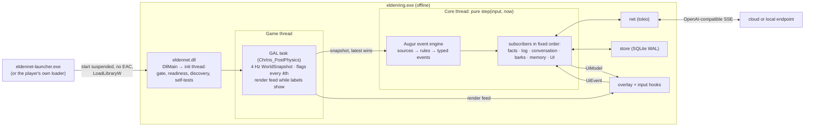
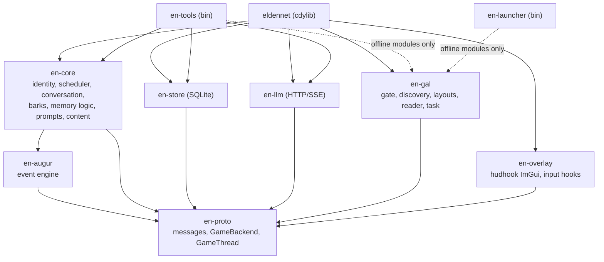
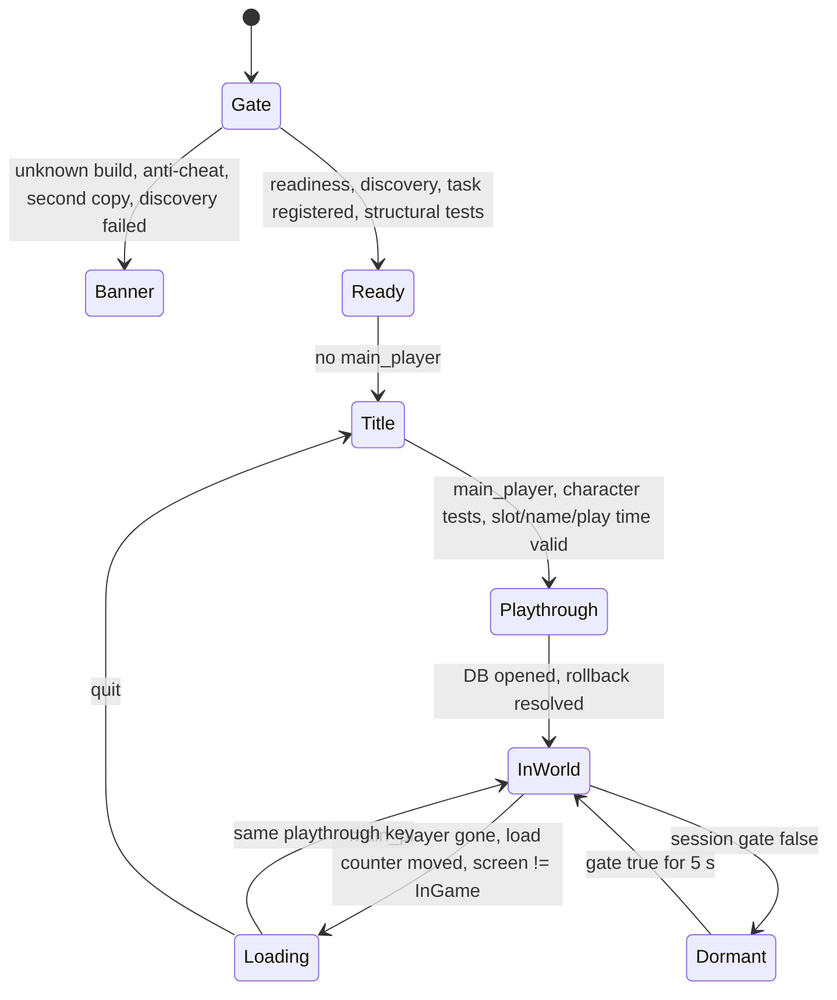
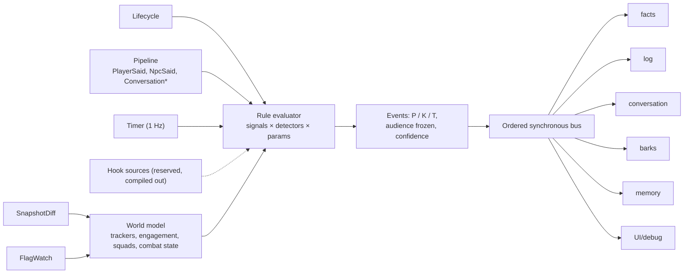

# EldenNet v1: master design

> **Status:** the single source of truth for EldenNet v1, 2026-11-06. It supersedes the proposals and the judges' scorecards in [process/](process/) wherever they disagree. **Target:** ELDEN RING PC/Steam, App 1.17.2, exe 2.7.2.0 (WW) and 2.7.2.1 (JP), offline only.
> **Built from:** [P1 lean monolith](process/P1-lean-monolith.md) as the base, with grafts from [P2](process/P2-split-brain.md) and [P3](process/P3-experience-first.md) picked by the judges ([J1](process/J1-stability-feasibility.md), [J2](process/J2-minimalism-delivery.md), [J3](process/J3-experience-ai-quality.md)). It also applies the **owner decisions of 2026-11-06** (recorded in CLAUDE.md): no me3, no fromsoftware-rs, our own event engine; and later that day, every recommended default then in §19 (O1–O24) accepted, and hudhook pinned at exactly 0.9.3 (O25). All three proposals assumed me3 (loader, `start_online`, `disable_arxan`, `savefile`) and a vendored fromsoftware-rs (J1 §4.1, J2 §2). Every such assumption is replaced in §3–§4.
> **Citations:** `ER0n §x` and `SN0n §x` are research notes; `P1 §x` and `J2 G9` point into the process records. LIKELY and SPECULATION keep the research's evidence labels. **RE-needed** facts are settled by the spikes in §16 before code depends on them.
> **Licence hygiene:** SkyrimNet's author, Min, has approved EldenNet building on SkyrimNet (the owner's decision, 2026-11-07: CLAUDE.md, Licences), so its engine and content may be used and adapted, credited as Min wishes; this design was written before that, from SkyrimNet's ideas and published numbers only (SN00 §7). All example content is original. No FromSoftware text or assets ship; game text is read at runtime from the player's install.
> **Detail documents:** [architecture.md](architecture.md) expands §2–§6, §11, §14 and §15. [npcs-and-dialogue.md](npcs-and-dialogue.md) expands §7–§9 and §12. [memory-and-knowledge.md](memory-and-knowledge.md) expands §10. The adversarial review, with what it changed and what is still open, is [process/review.md](process/review.md).
> **How to read it:** §0 is the whole design on one page and §1 the scope and success criteria. Then read the section for your area: start-up and safety §2–§3, game access §4–§5, the event engine §6, NPCs and speech §7–§9, memory §10, LLM and presentation §11–§12. §16 is the delivery plan and §19 indexes the owner's decisions and any question still open, each recorded in full in [docs/DECISIONS.md](../DECISIONS.md). Where a detail document and this one disagree, this one wins.

---

## 0. Design at a glance



1. **One loader-agnostic DLL plus our own small launcher.** No me3 code, APIs or features. A player may also list the DLL as a native in their own me3 profile (§3).
2. **Our own Game Access Layer (GAL).** The version gate runs first. Discovery needs 5 AOB items and 11 FD4 singletons. Layouts are per-build data, confirmed by self-tests. Every read is an SEH-guarded copy, and every read group has a breaker (§4).
3. **Zero game writes and zero game-code hooks.** No game function is called after task registration. The only hooks are in system DLLs (DXGI/D3D12, DirectInput, XInput), so no Arxan neutralisation is needed. A blocking spike confirms this (§3.5).
4. **One game-thread task:** a time-based 4 Hz snapshot, flags on every 4th snapshot (1 Hz), and a per-frame render feed only while labels show (§5).
5. **Augur, the event engine, inside the pure core.** Sources feed declarative rules (debounce, hysteresis, cooldown, confidence, dedup and merge, TTL). The rules emit typed events with a frozen audience onto an ordered, synchronous bus. Golden replay tests guard it (§6).
6. **Profiles at three depths:** *personas* (a bio with a verified stage track) for questline NPCs and named services, *character profiles* (a bio) for every other named NPC and every named boss, and *archetype cards* (kind profiles) for generic humanoids. v1.0 ships one for every named NPC and named boss of the base game, matched to the speaker by ID, and every NPC with a profile can hold a conversation and keeps memories (O43, O45, §7.8). Each carries the subjects its NPC likes to talk about, and the player can add instructions to any of them or write a character profile of their own for any named NPC, boss or invader they have met (O43). Anything unresolved or unbound is mute (§7, §7.7).
7. **Conversation:** a hotkey and a talk hint, safe-context gating with no world freeze, input blocking with hard release rules, a cache-ordered original prompt, paced pages, and commit only once a line is shown (§8).
8. **Own-initiative lines:** NPCs start lines themselves for a motive (a fight, an idle remark, a greeting, quest business, news, an NPC-to-NPC answer, a status effect, an autonomy tick). Each motive is an event type with a player setting and a cooldown, per-type allowances say who may act on it, and pacing (a gap, a window, a cooldown per type) is the only limit (O31, O39). Authored seeds give generics and fighting personas a floor that needs no network, background pools extend them, and live calls serve calm persona lines, autonomy and call-outs; an autonomy call offers the NPC one of the subjects it likes to talk about (§9.8). The bottom feed comes first, then floating labels (§9).
9. **Memory:** an event log with audiences, game facts, claims, and a per-NPC journal (≤ 120-word summary plus ≤ 8 keepsakes), sent whole. No retrieval in v1. Every NPC with a profile remembers the Tarnished and the other NPCs it deals with (O45). Personas also know where their own road stands and the affairs tied to them, and every profiled NPC the state of the land as its ground and the sky show it, derived from verified flags on every flag frame and told in a cached "As things stand now" block (§7.8, §10, §10.6).
10. **Spoiler control in five layers, gated by event flags.** The prompt sets out the present positively, output is checked against locked terms and tells, and an unverified flag can hide content but never unlock it (§10.4, O36).
11. **Persistence:** one SQLite file per playthrough, keyed by SteamID, slot and character fingerprint, partitioned by journey. Playtime is the rollback clock. The `.sl2` is never touched, and the launcher keeps save backups (§3.6, §10.5).
12. **One OpenAI-compatible streaming client** with 6 job slots, each with budgets, timeouts and fallbacks. Cloud and local presets are data (§11).
13. **Offline and multiplayer gating in our own code.** EldenNet is active only for a solo host in their own world with no anti-cheat present; otherwise it is dormant (§3.4).
14. **Text first.** TTS and STT come in v1.5 behind seams. The action seams are frozen and empty; the action and gesture allowances show as later-version seams (§13, O41).
15. **Spikes first, then chat with one pilot persona before barks.** v1.0 ships 6 personas, 6 cards plus the fallback, and a bio for every named NPC and named boss of the base game, about 140 named profiles, the six personas included; the DLC's follow in v1.1 if O46 keeps them out (§7.8, §16).

---

## 1. Goals, scope and success criteria

### 1.1 Goals

| # | Goal | v1 meaning |
|---|---|---|
| G1 | **Stable** | Never crashes, hangs, slows or corrupts the game or a save. Fails closed on unknown builds, in multiplayer and when a self-test fails |
| G2 | **Important NPCs feel like themselves** | Free-form typed chat with every NPC that has a profile (O45). Each has its own register, flag-gated knowledge and continuity across visits; personas add their own story's stages |
| G3 | **Generic NPCs feel alive** | They know what they are, where they are and what the fight is doing. They say short, timely lines, and answer one call-out with one line |
| G4 | **Dialogue only** | No NPC action and no game write. NPCs never promise or claim to act |
| G5 | **Drop-in and self-contained** | No data edits. No me3 or fromsoftware-rs dependency. Coexists with Reforged, Convergence, randomizers, Seamless Co-op (ERSC) and me3's mod host |
| G6 | **Clean seams** | Later features plug in without moving existing code (§13) |

### 1.2 v1 scope

| Area | In v1 | Deferred | Never |
|---|---|---|---|
| Loading | Own launcher; loader-agnostic DLL; documented use as a player-configured me3 native | Proxy-DLL install | Any me3 code, API or reliance on its behaviour; posting in me3's spaces |
| Game access | Reads, task registration, SEH-guarded copies | Hook-based event sources; probation mode for unknown builds | Code patching in v1; LLM-chosen flag writes |
| NPCs | 6 personas, 6 cards plus a fallback card; our own character profile, holding a bio, for every named NPC and named boss of the base game, each able to converse and remember (O43, O45, §7.8); the player's own instructions on any profile and character profiles of their own for any named NPC, boss or invader they have met (§7.7); everything else mute; an NPC-type page with allowances per type and per named slot (§7.6) | The DLC's roster (v1.1, O46); Ranni's stage track; a merchant card; Melina; creature voices told in words | Cloning the cast's voices |
| Conversation | Typed one-to-one chat with every NPC that has a profile, when conversable (O45); Steam floating keyboard if S4 passes; personas speak up unasked: greetings, quest business, news on a greeting (§8.9), and other profiled NPCs greet, remark and answer within pacing (§7.8) | Pad intent list (v1.1), STT (v1.5), `@name` addressing | Any online use |
| Barks | Combat lines for every combatant, either side (boss fights as S3 allows), status reactions in words (after S8), sparse idle lines, NPC-to-NPC exchanges, autonomy on subjects each NPC likes, seeds plus pools, one-line call-out replies; pacing only (O31) | Live combat lines, taunt key, user triggers, NPC acts (O41), a director that breaks silences (§13) | — |
| Memory | Event log, facts, claims and a journal for every profiled NPC, with memories of the Tarnished and of other NPCs (O45); rollback, NG+ partition; quest and world awareness from verified flags (§10.6) | Scene memories, FTS or vector recall, diaries; news that travels with play time; shared circles of acquaintance; what Min's blueprint may replace (§7.8) | Telemetry upload |
| Presentation | ImGui text overlay | TTS (v1.5); native subtitles and mouth movement (v2) | Shipping game fonts, text or audio |
| ML | Out of process, over HTTP | Bundled out-of-process TTS binaries | LLM, TTS or STT inside the game process |

### 1.3 Success criteria ("minimal and stable", measured)

| ID | Criterion | v1.0 target |
|---|---|---|
| C1 | Crash safety | 0 EldenNet-caused crashes or hangs in a 30 h soak on 3 machines (one Proton, one HDR, one with ERSC), plus 20 forced fail-closed launches (unknown build, missing pattern, injected faults) (J2 #16) |
| C2 | Unknown build | 100% banner mode: zero tasks registered, zero game-object reads (read counters) |
| C3 | Game-thread cost | Task mean ≤ 0.15 ms, p99 ≤ 0.5 ms at 32 characters. Render feed ≤ 0.03 ms. Overlay ≤ 0.3 ms per frame. ≤ 1 FPS loss at the 60 FPS cap |
| C4 | Multiplayer | Dormant within one snapshot (≤ 250 ms). 0 LLM requests while the gate is false |
| C5 | Dialogue latency | First page p50 ≤ 1.6 s and p90 ≤ 3.0 s (cloud preset); p50 ≤ 2.5 s (12 GB local preset) |
| C6 | Barks | 100% shown before expiry. ≥ 95% within 0.5 s of the game change. At default pacing (O31): combat lines ≥ 2.5 s apart and ≤ 6 per rolling minute (the death gloat aside), one fighting group never twice within 8 s, ≤ 2 labels visible; the camp of five gives 2–4 lines per fight |
| C7 | Output hygiene | 0 displayed strings with markup, reasoning, trailer text or over the byte cap (fuzz and replay scans) |
| C8 | Silence | 0 lines from dead, asleep, muted or voiceless characters (asleep in a fight: measured from S8 on), or from a type whose allowance is off; 0 conversation lines from hostile personas or characters; 0 lines over native talk, a scripted line or a banner; in boss fights, 0 lines from kinds whose scripted-line detector has not passed |
| C9 | Spoilers | 0 locked-term or hard-tell violations shown in 600 scripted turns over 6 flag states, and ≤ 1% judged to show content beyond the moment |
| C10 | Voice | ≥ 98% of replies within the word cap; 0 banned words shown; non-archaic registers ≤ 2% archaic lines |
| C11 | Memory | ≥ 80% correct "do you remember" probes after a reload; every shown line survives a hard kill; trim and NG+ tests pass |
| C12 | Event engine | Golden events over 3 recorded routes stay stable; 10 replays give identical events |
| C13 | Install | 5 testers reach a first reply within 10 min of reading the README, with a key in hand |
| C14 | World awareness | Over 240 probes at 4 flag states (NPC §12.5): ≥ 90% acknowledge a known change when asked; ≤ 2% contradict one; 0 shown terms the persona cannot know (MEM §12.8) and ≤ 1% judged to show such knowledge; ≤ 5% hearsay told as seen; a cued item raised on ≥ 50% of cued controls, and any news raised on ≤ 10% of uncued controls after `fresh` (O28); Patches' contradiction rate reported, not gated. Runs and gates from v0.2 on the pilot, widening as content ships (§16.3; O29) |

### 1.4 Perceived-latency budget (normative; P3 §1.5, J3 #1)

| Moment | Player sees | Target p50 / p90 | Limit and miss behaviour |
|---|---|---|---|
| Talk key | Box opens with the target and who can hear | ≤ 50 ms | 100 ms |
| Enter | After 350 ms with no text, a speaker card **"Kalé …"** | — | — |
| First page | Lower-third page | 1.6 / 3.0 s cloud; 2.5 / 4.5 s local | First token 6 s (10 s local), then the fallback model once. At 20 s, an uncommitted "…" page and a toast with the cause |
| Bark | Feed line or label | ≤ 0.3 s after the event | Dropped at expiry (2–3 s) |
| Death gloat | Label as the player falls | ≤ 0.5 s | 1.2 s, and never once the death banner (banner 5) shows |
| Call-out reply | One-line label | 1.5 / 2.5 s | 3 s, then a seed line |
| Speaking up | A persona's page; "[T] Answer — Kalé" | Prepared before range entry; shown when ready, ≤ 0.5 s after `CameNear` (1 s within `range.talk_m`), or after re-entering `range.talk_m` while `CameNear` has not re-armed (§8.9) | A prepared line expires 30 s after it is ready; a failed call gives a seed |
| Persona combat line | Label or feed line, in its own voice | ≤ 0.3 s after the event | Dropped at expiry (1.2–3 s); seeds and pools only |
| NPC-to-NPC answer | Label or feed line | Generic: ≤ 0.3 s once the gap allows (`pacing.gap_s` after the line it answers); persona 1.6 / 3.0 s, shown no earlier than the gap | Dropped 8 s after the line it answers (in a fight, at its Combat expiry) |
| Memory update | Nothing | Within 2 min of the conversation's end, never in combat | Stays queued |

---

## 2. Process and code architecture

### 2.1 Runtime shape

There are two processes: the short-lived `eldennet-launcher.exe` (§3.2) and the game. All of EldenNet runs in the game process as one Rust `cdylib`, and all ML is reached over HTTP (ER06 §5.1). P2's split brain was rejected as the v1 default (J1 #11, J2 §4.2) and kept as a seam (§13).

| Thread | Runs | Game memory? |
|---|---|---|
| Game thread | The single GAL task closure | **Yes, only here.** It never blocks, locks or allocates after warm-up |
| Present thread | hudhook callback: draws `UiModel` and the render feed | No |
| Game input thread(s) | DirectInput and XInput detours. They read one atomic and zero buffers | No |
| Init (transient) | Gate, readiness wait, discovery, task registration | Image scans only, before the task exists |
| Core | `Core::step` over a `crossbeam::select!` of inputs | No |
| Net (tokio, 2 workers), store (rusqlite), watcher | Effects | No |

**Channels.**
- Task → core: a two-slot latest-wins snapshot slot, plus a 64-entry lifecycle queue.
- Task → overlay: a triple-buffered render feed.
- Core → task: a 64-entry SPSC command queue.
- Core → overlay: `ArcSwap<UiModel>`. Overlay → core: a 256-entry `UiEvent` queue.
- Core ↔ store: 1,024 each way. Core ↔ net: 64 requests and 1,024 stream events.

The game and render threads use only `try_send`, atomics and preallocated buffers (P1 R5, P2 §2.3).

### 2.2 Crates



- `en-proto`, `en-augur` and `en-core` use no `unsafe`, do no I/O and read no clock. ER meaning lives in `content/eldenring/`, so the core stays game-neutral.
- `en-gal` holds the only `unsafe` that reads game memory, and it has no LLM, DB or UI. Its `offline` feature compiles only the safe modules (PE parsing, the pattern grammar, the build and layout schemas), which is all the launcher and `en-tools probe-exe` use (ARCH §2.1).
- `en-overlay` uses `unsafe` only for hudhook and the input hooks.
- `eldennet` wires the threads together and wraps foreign entries in `ffi_guard`.
- `en-tools` provides `replay`, `golden`, `eval`, `lint`, `render-prompt`, `probe-exe`, `mockllm`, `bake-pools`, `selftest`, `fmg-import`, `identity-fill`, `kb-draft`, `flag-verify`, `roster-scan`, `roster-draft` and `roster-verify` (ARCH §12.3).

### 2.3 The adapter boundary: snapshot in, commands out

```rust
pub trait GameBackend: Send {                        // en-proto; implemented by en-gal and by replay
    fn probe(&mut self, gt: &GameThread) -> Capabilities;
    fn snapshot(&mut self, gt: &GameThread, out: &mut WorldSnapshot) -> Result<(), ReadError>;
    fn render_feed(&mut self, gt: &GameThread, want: &[ChrHandle], out: &mut RenderFeed) -> Result<(), ReadError>;
    fn apply(&mut self, gt: &GameThread, cmd: &GameCommand) -> Result<(), ApplyError>;
}
pub enum GameCommand {                               // v1: read configuration only
    SetWatchFlags { version: u32, ids: Arc<[u32]> }, SetTracked { handles: SmallVec<[ChrHandle; 8]> },
    ResolveText { fmg: u16, ids: SmallVec<[u32; 8]> }, ResolveParams { ids: SmallVec<[u32; 16]> }, Noop,
    // reserved behind features that are off in v1: Freeze, NativeLine, Action{executor, args, epoch, deadline}
}
```

- `GameThread` is a zero-sized, `!Send` token. Its constructor may be called only by the task trampoline and the replay harness; Rust cannot restrict a public constructor to two crates, so a CI grep allows it in exactly those two files (ARCH §6.4). Off-thread reads therefore do not compile without breaking that CI rule (P2 §2.1, J2 G5).
- Handles (the packed `FieldInsHandle`) cross the boundary; pointers never do.
- Every message is serializable, so a recording is just the list of messages (ER00 §3.1).

### 2.4 Functional core

`Core::step(input, now) -> Outputs` is pure. Time is an input. Commands, the UI model, LLM requests and DB requests are outputs, and their results come back as inputs. Debounce, cooldowns, expiry, scheduling and conversation state therefore replay bit for bit (P1 §2.4, J2 G1). Augur runs first in each step (§6.6).

### 2.5 Lifecycle



Dormant is drawn here as a state for brevity. It is implemented as a flag orthogonal to the lifecycle states, so it also covers loading and the title screen and can overlap them (§4.4, ARCH §9).

| Transition | Core actions |
|---|---|
| Ready (data ready) | Load content. Export the grace and place-name params over several ticks, ≤ 1 ms each |
| Playthrough ready | Compute the playthrough key. Open the DB, run the rollback check, close and queue open conversations |
| Loading | End the conversation, committing only shown lines. Clear barks, short-lived events and squads. The task reads only lifecycle fields |
| Player died | End the conversation. Only `player_fell` may fire, for 1.2 s. Persist `PlayerDied` |
| Rest (flag 9000, verified in S6) | On start: mark the context safe; run queued memory jobs and pool refills. On end: clear generic engagements, squads and cooldowns, because the world respawns (ER04 §4.1) |
| Journey (`ng_lvl`) or slot change, quit | New journey partition. Flush and close the DB |

### 2.6 Crash-safety rules (normative)

- **R1 One reader.** Game objects are read only in the task closure, through methods that require `&GameThread`. Init reads only the executable image: section bytes, and static slots compared with null. It never follows a static into a heap object. This is the one documented exception to "game memory only on the game thread", and it ends when the task is registered.
- **R2 No writes, no calls.** No game memory is written and no game function is called after `register_task`. Before it, the only game-code calls are `register_task` itself and the init-only singleton-name getter fallback (§4.2). Text, params and flags are read from memory (§4.5). The one call into third-party code is the S4-gated Steam floating keyboard (`steam_api64.dll`, never game code; §8.1).
- **R3 Guard foreign entries.** Every callback entered from foreign code starts with `ffi_guard`: `catch_unwind` plus a per-component tripped flag. Built with `panic = "unwind"`, and enforced by a CI grep.
- **R4 Copies, never references.** `GuardedReader::copy::<T: Pod>(addr, len)` is an SEH-protected memcpy plus plausibility checks: canonical address, alignment, vtable in `.rdata`. Copy sizes come from the layout profile, per class (J1 #8: base `ChrIns` ends at 0x580 on 1.17.2).
- **R5 Re-resolve every tick.** Singleton instances are re-read from their statics, and null means loading (J1 #6). Characters are re-found by handle. Each object's vtable is compared, every tick, with the RTTI-resolved set (J1 #16).
- **R6 Never block** the game, render or input threads: no shared mutex, bounded `try_send`, no allocation on the game thread after warm-up.
- **R7 Gate before layout.**
- **R8 Breakers.** A read group trips after 3 faults in 60 s: off for the session, with a toast. A core subsystem is reset after its first panic and disabled after its second.
- **R9 Lints.** Deny `unwrap`, `expect`, `panic`, indexing and unchecked arithmetic in `en-gal`, `en-overlay`, `eldennet` and `en-launcher`. In the game process, `unsafe` blocks appear only in `en-gal::{reader, sys}` and `en-overlay::hooks`, each with a `// SAFETY:` note. `eldennet` allows `unsafe_code` only on its `exports` module, for the `#[unsafe(no_mangle)]` attributes of `DllMain` and the instance marker, and that module holds no `unsafe` block. The launcher, a separate process, keeps its Win32 `unsafe` in `en-launcher::win` (ARCH §2.4).
- **R10 Time-based cadence and self-throttle.** Accumulated QPC time, never frame counts (J2 G21). After 3 ticks over 0.5 ms, drop to 2 Hz and 16 characters within 25 m; restore after 60 s.
- **R11 Idle while loading.**
- **R12 System-DLL hooks only.** Installed once at boot, never toggled, chained, all through the one MinHook copy that hudhook bundles, exposed as its public `hudhook::mh` module in 0.9.3 (ER02 §7.1, J1 #15, O25).
- **R13 Sanitized, byte-capped strings** only (§8.4).
- **R14 No work at `DLL_PROCESS_DETACH`.** Every DB request is one WAL transaction, committed as soon as the store receives it. Speech commits (`PlayerSaid`, each `NpcSaid` page) are sent at once. Other writes are coalesced by the core into one request at most every 250 ms (ARCH §1.5).
- **R15 Abort-class failures are designed out** (J1 #7). `catch_unwind` cannot stop a stack overflow, OOM, C-level faults or panics in `Drop`. So: size and recursion caps on templates, JSON and the sanitizer; bounded buffers; no panics in `Drop`; no ML in process. The residual risk is accepted, with an out-of-process core kept as a seam (§13).
- **R16 Single instance.** A per-process named mutex. A second copy, for example one loaded by both the launcher and a me3 profile, exits its init thread.

### 2.7 Failure contract (what the player sees; P3 §5.11, J3 #26)

| Failure | Player sees |
|---|---|
| Unknown build or failed discovery | Banner: "EldenNet inactive: game build 2.x.y.z not supported yet", with the reason |
| An optional group tripped | One toast naming the reduced feature |
| Slow first token | The "Name …" card keeps pulsing; one silent fallback to the backup model |
| No reply in 20 s | An uncommitted "…" page plus "No answer: provider timed out" |
| 401/403, 429 | "API key rejected: open settings (F10)"; "Provider rate limit, try again shortly" (60 s cooldown) |
| Reply blocked twice by lint | An authored deflection line (content, never an invented answer). Showing nothing is not allowed (J3 #8) |
| Multiplayer | Badge: "EldenNet paused (multiplayer)" |

Toasts wait until boss fights end and are rate-limited to one per error class per minute.

---

## 3. Starting EldenNet, offline play, Arxan and saves

me3 normally provides offline enforcement, Arxan neutralisation and save separation (ER02 §3.2). EldenNet uses nothing from me3, so this section says how each one is covered.

### 3.1 The DLL load contract

`DllMain(DLL_PROCESS_ATTACH)` calls `DisableThreadLibraryCalls`, starts the init thread and returns. The init thread assumes nothing about who loaded it, or when:
1. **Gate:** check `VS_FIXEDFILEINFO`, `ProductName == "ELDEN RING"`, region, `TimeDateStamp` and `SizeOfImage` against `gal/builds.toml` (J1 §7.1 #8).
2. **Safety:** single-instance mutex (R16) and the anti-cheat check (§3.4).
3. **Readiness, in two phases:** poll every 100 ms until the main window exists. Then run a small scan for the two readiness items only (`global_hinstance` and the `CSTask` static), and poll until `global_hinstance` (if found) is non-null and the `CSTask` static is non-null with a readable DLRF name. Time out at 120 s → banner. A late load (a me3 native after game main) passes at once; an early, suspended load waits (ER01 §3.1, J1 #4, ARCH §3.2).
4. **Discovery and image-level checks** (§4.2), then `register_task` from this non-main thread. The structural self-tests that read game objects run on the first ticks after registration, inside the task (R1). If one fails, the task stays registered but inert: it returns after one atomic load and reads nothing (§4.4).

The DLL finds `content/` and `gal/` from its own module path, so the install folder can live anywhere.

### 3.2 The EldenNet launcher

A small windowless Win32 program of our own, about 400 lines. It follows the documented pattern that LukeYui's Offline Launcher and me3's launcher also use (ER02 §2.1, §3.2):
1. **Find the game:** Steam library folders, or a path the player gives. Check the build; if it is unknown, offer "launch anyway (EldenNet stays inactive)".
2. **Pre-flight:** Steam must be running. Refuse if `start_protected_game.exe` is running.
3. **Back up the save:** copy `%APPDATA%\EldenRing\<SteamID64>\ER0000.sl2` and its `.bak` to `%APPDATA%\EldenNet\save-backups\…\<timestamp>`, keeping 10.
4. **Start without EAC:** put `steam_appid.txt` next to `eldenring.exe` (TGA's recommended method) and record that we created it. A `SteamAppId` environment variable instead would avoid writing into the game folder; S0-C tests it (SPECULATION).
5. **Inject:** `CreateProcessW(…, CREATE_SUSPENDED)`, then `VirtualAllocEx` + `WriteProcessMemory` + `CreateRemoteThread(LoadLibraryW)`. Check the module handle, then resume.
6. **Exit.** Flags: `--vanilla-offline`, `--no-backup`, `--dll <path>`.

Its first screen states, in plain words: offline only; saves are backed up but not separated (§3.6); typed text goes to the player's chosen provider; the content is AI-generated (J3 §4). Under Proton the launcher must run inside the game's prefix. S0-C settles the recipe, and the player's own me3 profile is the fallback.

### 3.3 Alternatives evaluated

| Method | Verdict | Why |
|---|---|---|
| **Own launcher** | **Primary** | No third-party loader, and no EAC by construction |
| **Player-configured me3 native** | **Supported; documented in our own docs only** | Seamless Co-op must start from its own launcher or a mod engine, and injectors cannot carry it (ER02 §2.3). We rely on no me3 feature: a post-main load simply passes the readiness wait. We never post in me3's spaces (ER02 §3.2) |
| `dinput8.dll` proxy | Rejected | Clashes with Elden Mod Loader, ME2's dinput8 mode and the practice tool. Cannot carry ERSC. Needs `WINEDLLOVERRIDES` under Proton (ER02 §3.3) |
| `winhttp.dll` proxy | v1.x note | Used by EROverlay and the EAC Toggler. Useful property: EAC LIKELY refuses to start next to it (ER02 §2.1) |
| `dxgi.dll` proxy | Rejected | It would sit under hudhook's own DXGI hooks and other DXGI injectors (SPECULATION, J1 #24) |
| ME2 `external_dlls`, Elden Mod Loader | Work, unsupported | The DLL is loader-agnostic; both loaders are discontinued or legacy |
| Other chain loaders and injectors (Lazy Loader and similar) | Work if they call `LoadLibraryW`, unsupported | Nothing in the DLL depends on who loaded it or when (ARCH §4.10). Like Elden Mod Loader, they cannot carry ERSC (ER02 §2.3) |

### 3.4 Offline and multiplayer gating, in our own code

- **Active** only if every snapshot shows `multiplay_role == Host`, `is_my_world`, `LobbyState == None` and `player_chr_set.len() == 1`, and no anti-cheat module is loaded (ER05 §3). Otherwise EldenNet goes **dormant** at once, and re-activates only after 5 clean seconds. If the `session` group fails its self-test, AI stays off.
- **The set count** is meant to catch ERSC partners at any distance (J2 G14; SPECULATION until S0-C). It counts only entries whose `chr_type` is not an NPC type. If NPC summons (`WhiteSummonNpc`) or NPC invaders also live in `player_chr_set`, counting them would make EldenNet dormant in every summon-assisted boss fight, and `FoughtBeside` could never fire, because a dormant task reads no characters. S1 lists which `chr_type` values appear in the set.
- **At the title screen** there is no `PlayerGameData`, so no role can be read. There the gate is clean only if the lobby is `None`, no anti-cheat module is loaded and the `session` group is healthy. This title clause permits network calls for the wizard and the silent self-test (§11.5) and nothing else: speech stays dormant until a world is loaded (ARCH §5.1).
- **Anti-cheat check (SPECULATION, cheap):** a loaded module named `EasyAntiCheat*`, or a parent process named `start_protected_game.exe` → banner.
- EldenNet **never writes `Menu.IsEnableOnlineMode`**; that would be a game write (J1 #1). Offline play follows from starting without EAC (ER02 §2.2). EldenNet's own traffic goes only to the player's LLM endpoint.

### 3.5 Arxan: none needed, because no code is patched

v1 does reads, one `register_task` call and system-DLL hooks. The task system avoids Arxan's code restoration (ER02 §5). Still unproven: whether scans work on an image with Arxan untouched, since encrypted functions "may be unreadable until Arxan runs" (J1 claim 6). **S0-A is a blocking spike.** Built-in mitigations:
- scan in two phases: only the two readiness items once the window exists, and the full discovery after the readiness wait (§3.1);
- retry unresolved patterns at +5, +15 and +30 s;
- prefer data-side evidence (DLRF names, `.data` statics, RTTI in `.rdata`);
- a missing item disables only its read group.

If S0-A fails, the owner chooses among the options in §17 K2. Neutralising Arxan ourselves is never one of them, and neither is depending on a loader that does it: a player's own me3 profile may happen to set `disable_arxan`, and EldenNet must behave the same with or without it.

### 3.6 Save separation

v1 never writes game memory, flags or the `.sl2` (R2). The decision (O6) is therefore: no save redirection, rotating launcher backups, and warnings in both the launcher and the wizard never to take a save played offline with mods online (ER02 §2.2). A `CreateFileW`-family redirect hook would be allowed (it is a system DLL). It is deferred to v1.x behind a spike, because it could collide with ERSC's `.co2` handling and a player's me3 `savefile` (J1 #27, J2 §2 #4). A launcher file swap is rejected: it is crash-unsafe and races Steam Cloud.

---

## 4. Game Access Layer (GAL)

### 4.1 The objects v1 needs (the smallest set)

| Object | Found by | Fields read | Read group |
|---|---|---|---|
| Executable image | PE headers | Versions, product name, timestamp, image size, sections | gate |
| `register_task` | Interior-anchored AOB; prologue, length and section checks | Called once at init | boot |
| `global_hinstance` | AOB; fallback is the main window plus a non-null `CSTask` | Readiness only | boot |
| `GameDataMan` | AOB static | Play time, deaths, `ng_lvl`, `boss_fight_active`, `show_subtitles`, `PlayerGameData` (name, level, archetype, body, starting gift, gear, `multiplay_role`, `is_my_world`) | player, session, ui |
| `GameMan` | AOB static | `save_slot`, `talk_esd_camera_param_id` | player, ui |
| `FieldArea` | AOB static | `map_place_name_id` | place |
| `CSTask` | FD4 singleton | Registration target | boot |
| `WorldChrMan` | FD4 | `main_player`, `chr_inses_by_distance`, `player_chr_set` count | world, session |
| `ChrIns` / `PlayerIns` | Through the list; per-tick vtable compare | Handle, param, model, entity, `chr_type`, live team, HP/FP/stamina, position, dead bit, `last_hit_by`, damage type, throw, on-screen; player only: ride state, lock-on, SpEffect 9621 | world, combat, player |
| `CSSessionManager` | FD4 | Lobby state | session |
| `CSEventFlagMan` | FD4 | Divisor, descriptor map, flag blocks | flags |
| `CSFeMan` | FD4 | `hud_state`, banner id, `boss_health_displays[3]` | ui |
| `CSMenuMan` | FD4 | Popup `current_talk_id`, screen state | ui |
| `CSNowLoadingHelper` | FD4 (confirm in S0-A) | `menu_load_counter` | ui |
| `WorldAreaTime` | FD4 | Clock | place |
| `CSCamera` | FD4 (confirm in S0-A) | View matrix, FOV, aspect | camera |
| `SoloParamRepository` | FD4 | `NpcParam`, `BonfireWarpParam`, `WorldMapPlaceNameParam` rows | params |
| `MsgRepository` | FD4 | FMG table (`+0x08` base, `+0x14` count) | text |
| `ChrIns` SpEffect list; `PlayerGameData` gauges | Through the list; main player | Per-character `special_effect` entries; `resistance_gauges[7]`, `proc_status_timers[7]`; `SpEffectParam` rows in `params`. Leads until S8 (O40) | status |

That is 5 AOB items, 11 singletons and about 65 fields (P1 §2.5, J1 §7.1 #3). Where a singleton-backed field exists, it wins: boss bars come from `CSFeMan`, cross-checked against `boss_fight_active` (ER05 §8.4). Every field belongs to one of the eleven breaker groups of §4.3: boss bars are in `ui`, the `boss_fight_active` cross-check in `player`, and the lifecycle subset is `main_player` (in `world`) plus the screen state and load counter (in `ui`) (ARCH §6.1).

**Required items** are `register_task`, `CSTask`, `WorldChrMan`, `GameDataMan`, `GameMan` and `CSSessionManager`. Everything else is optional: if it is missing, only its group is off.

### 4.2 Discovery

- **FD4 singleton finder:** our own code, written from the documented idiom (ER01 §4). It matches the `.text` shape `mov reg,[static]; test; jnz; lea rcx,[class]; call get_name; …`, with the static and class in `.data` and a path string in `.rdata` ending in `FD4Singleton.h`. Class names are read from the DLRF runtime class directly, where S0-A confirms its layout. Calling the game's getter is a fallback, used once per candidate at init only, under the SEH guard. Expect 10–15 ms.
- **AOB patterns** live in `gal/patterns.toml` with provenance notes. They are anchored inside function bodies (entry+5 or later), because other mods hook prologues (ER01 §4). Every hit is validated by prologue, length, section and RTTI.
- **RTTI** walks resolve the vtable sets for `ChrIns` subclasses, used by the per-tick compares (ER02 §5).
- **Sources (owner-decided):** our own derivation. Facts from the research are leads, and each is confirmed in game or by self-tests before use. No fromsoftware-rs or me3 code or data is copied, from any commit.

### 4.3 Layout profiles, read groups and self-tests

`gal/layouts/<build>.toml` holds every offset and per-class copy size, so a patch that only moves fields becomes a data update. Eleven read groups (the eleventh, `status`, is optional and stays off until S8 passes; O40) each have a self-test, run on the first ticks after registration (phase A, usually at the title) and again at each playthrough start (phase B, in the world) (P1 §2.6, ARCH §6.7):

| Group | Self-test |
|---|---|
| `session` | Lobby in enum range; solo play reads Host and own world. **Must pass, or AI stays off** |
| `world` | Vtables are `ChrIns` subclasses; distances ascend; `0 < max_hp ≤ 100000`, `hp ≤ max_hp`; `npc_param_id` resolves |
| `combat` | Handles resolve or are null; throw state in 0..=6 |
| `player` | Main player is `CS::PlayerIns`; name is valid UTF-16 of 1–16 chars; slot in 0..=9; play time rising |
| `flags` | Divisor == 1000; flag 100 set. Unallocated groups read false (ER01 §9), so each watched ID's group is checked: every core alias (100, 9000, 180–187) must exist; more than 10% of non-DLC aliases missing fails the group; a missing DLC alias reads Unknown, because the DLC may not be installed (MEM §6.2) |
| `text` | ≥ 20 tables; known NpcName and PlaceName IDs give 1–64 printable chars |
| `ui` | `hud_state` in 0..=3; banner and popup values in range |
| `place` | Place ID resolves; hour < 24 |
| `camera` | Orthonormal rotation; FOV in 0.3–2.5 rad |
| `params` | Known rows found; row sizes match the paramdef |
| `status` | Every walked list ends within its bound; classified statuses map to §9.9's set; the Tarnished's gauge slots in range. Optional: off until S8 passes, and its breaker turns off status awareness and the runtime sleep signal only |

### 4.4 Degradation ladder and capability matrix

| Level | Entered when | What runs |
|---|---|---|
| Off | `enabled = false` | Nothing after init |
| **L1 Banner** | Unknown build, anti-cheat, failed readiness or discovery, or a structural group (`world`, `player`, `session`) fails or trips | Overlay only. **Zero game-object reads.** A failure found before registration means no task at all; one found after it (a phase-A test, a trip) leaves the task registered but inert. C2's unknown build always means zero tasks |
| **L2 Observe** | GAL healthy, but no healthy provider or AI paused | Task, Augur, debug view, recording |
| **L3 Reduced** | An optional group tripped | Per the matrix, with one toast |
| **L4 Full** | All groups pass | Everything |
| *Dormant* | Session gate false, loading, title | A flag over L2–L4, not a level. Only the `session` and lifecycle reads; speech dropped |

| Feature | Requires | Without the optional group |
|---|---|---|
| Any AI | `session`, `world`, `player` | — |
| Conversation | + `flags`, `ui`, `place`, `params` | No `text` → persona fallback names. No `combat` → stricter gating. No `camera` → no cone targeting; lock-on and nearest remain. **No `flags` → named chat off, barks on**, because spoiler safety outranks availability (P3 §2.5) |
| Barks | + `combat` | No `camera` → feed instead of labels. No `text` → card `label_fallback` |
| Status awareness, runtime `conscious` | + `status` | Off: no status words, no status lines; generics' calm lines held until S8 verifies the sleep signal (O44) |
| Own-initiative persona lines | Named chat + S3 passed | Before S3: none (§8.9) |
| Persistence | `player` | — |

Unknown builds always stop at L1. A probation mode is deferred (O12).

### 4.5 Text, params and flags without function calls

- **Text:** walk the in-memory FMG table from `MsgRepository` (ER01 §8.3). NpcName is {428, 328, 18}, PlaceName {429, 329, 19}, in DLC order. Look-ups are binary-searched and cached until the table pointer changes. There is no `GetMessage` call or hook, so nothing collides with Reforged (J1 claim 8). Caveat: a mod that serves text through a `GetMessage` hook (Reforged merges DLC text that way, ER01 §8.3) can show names the raw tables do not hold, so under such a mod our names may differ from the game's. The layout leads (`+0x08`, `+0x14`) date from 2.6.2.0; S2 confirms them. Fallback: `en-tools fmg-import` reads an export the *player* made from their own install.
- **Params:** guarded `SoloParamRepository` walks, ≤ 32 new rows per tick, cached.
- **Flags:** `id / 1000` → descriptor map → block → `byte = (id % 1000) / 8`, `bit = 7 − id % 8` (ER01 §9). A pure read on every 4th snapshot (1 Hz; 0.5 Hz while throttled, R10).

### 4.6 How a patch is absorbed (budget 1–7 days; ER00 §4)

1. On patch day, players see the L1 banner automatically (C2).
2. `en-tools probe-exe` checks every pattern and singleton against the new exe file, offline (P3 §11.4).
3. A dev build with `--features probe` recovers offsets in game by invariant search (RTTI vtables, `hp ≤ max_hp` pairs, the ascending distance vector, the known UTF-16 name) and writes a draft layout file (P1 §11.5).
4. Run the self-tests and the recorded smoke route (Church of Elleh → Gatefront → camp fight → Kalé → Roundtable), and compare its events with the golden files.
5. If no code changed, ship a **data-only update** of `gal/`. Keep the earlier builds' profiles (ER01 §1).

### 4.7 Backend seam

The swap point is `GameBackend` (§2.3). Inside `en-gal`, a narrower `SysLayer` trait (`register_recurring`, `singleton`, `param_table`, `rtti_vtables`, taking `&GameThread` where it reads) isolates the platform primitives (P1 §2.5, J1 §7.1 #1). Our own implementation is about 600 lines plus a few weeks (P1 §2.5). The owner has ruled out fromsoftware-rs (O3): its NON-AI licence files start on 2026-10-12, and its build gate panics (ER02 §4.1). The seam remains for replay and for other backends. CI enforces the licence rule three ways (ARCH §12.1): a `cargo deny` licence allowlist; a `[bans]` list that names fromsoftware-rs, `from-singleton`, me3 and `dearxan` crates; and `en-tools lint --licence-files`, which scans every dependency's licence-file text for "NON-AI". The last is needed because `cargo deny` reads only `Cargo.toml` metadata, and fromsoftware-rs's metadata still says `MIT OR Apache-2.0` while its licence files say NON-AI (ER00 §7).

---

## 5. Perception

### 5.1 Cadence and costs

| Item | Rate | Cap | Game-thread p99 |
|---|---|---|---|
| `WorldSnapshot` | every 250 ms of accumulated time | walk ≤ 48 vector entries; keep ≤ 32 characters within 40 m, nearest first | ≤ 0.4 ms |
| Flag frame | every 4th snapshot (1 Hz; 0.5 Hz while throttled) | ≤ 2,048 IDs (v1 ≈ 740, with the world-awareness aliases of §10.6) | ≤ 0.1 ms |
| Render feed | every frame while labels show | camera + ≤ 8 handles | ≤ 0.03 ms |
| Text and params | on demand | 16 FMG + 32 rows per tick | included |

The 40 m radius follows SN00 §6. S1 checks whether `distance` is squared (ER01 §5.3).

### 5.2 `WorldSnapshot` schema

```rust
struct WorldSnapshot {
    seq: u64, mono_ms: u64, gap: bool, build: BuildKey, health: ReadHealth,
    session: Session { role: MultiplayRole, is_my_world: bool, lobby: LobbyState, player_set_len: u8,
                       anticheat: bool, ersc_loaded: bool },
    life: Life { main_player: bool, screen: Screen /* InGame|Loading|Title */, load_counter: u32 },
    ui: Ui { hud: HudState /* 0 HideAll 1 ShowAll 2 PopupMenu 3 Default */, banner: Option<u16>,
             popup_talk_id: Option<u32>, talk_cam: bool, subtitles_on: bool },
    player: Option<Player { handle: ChrHandle, level: u16, archetype: u8, body: BodyType,
        hp: (u32, u32), fp: (u32, u32), stamina: (u32, u32), runes_held: u32, deaths: u32,
        play_time_ms: u64, ng_lvl: u8, save_slot: u8, dead: bool, riding: bool /* ride_state 5 */,
        locked_on: Option<ChrHandle>, last_hit_by: Option<ChrHandle>, throw: u8,
        roundtable: bool /* SpEffect 9621 */, statuses: StatusSet, block: BlockId, pos: [f32; 3], gear: Gear,
        boss_flag: bool /* boss_fight_active, the cross-check */ }>,   // None when main_player is null
    place: Option<Place { place_id: Option<u32>, region: RegionKey, legacy: bool, overworld: bool }>,
    clock: Option<Clock { h: u8, m: u8 }>,
    boss: Boss { active: bool /* bars non-empty or boss_flag */, bars: ArrayVec<BossBar, 3> },
    chars: ArrayVec<Chr, 32>,
    flags: Option<FlagFrame /* watch-list version + bitset + valid bits */>,
    new_text: ArrayVec<TextEntry, 16>,        // answers to ResolveText
    new_params: ArrayVec<ParamRowInfo, 32>,   // answers to ResolveParams and the Ready-time grace/place export
}
struct Chr { handle: ChrHandle, param: u32, model: u32, entity: u32, kind: u8, team: u8,
    hp: (u32, u32), dead: bool, last_hit_by: Option<ChrHandle>, recv_dmg_type: i32, throw: u8,
    dist_m: f32, bearing_deg: f32, on_screen: bool, statuses: StatusSet, asleep: Option<bool>,
    block: BlockId, pos: [f32; 3] }
```

- The player's name is read once per playthrough, sent in `PlaythroughReady`, and used only to verify a name the player gives in chat (§10.2).
- A snapshot is about 3–4 KB serialised (about 8 KB in memory), so a recording runs about 4 MB/h after zstd. ARCH §7.1 gives every field's unit and source.
- Torrent and spirit summons carry their `kind`; they are perceived, never voiced. `statuses` and `asleep` stay empty and `None` until S8 verifies them (O40).

### 5.3 Combat state and engagement (with confidence)

- **Hostile** means the *live* team is in the `teams.toml` hostile set {6, 7, 27, 29} and the character is not a persona with clear hostility bits. Never the param's team (#768; ER05 §6.2).
- **Engagement** is an Augur state machine per pair of combatants on hostile sides (the Tarnished and a hostile NPC, or two NPCs on different sides that exchange hits or that S7's team-pair table marks hostile; O42, ARCH §8.7), with confidence by how it started:
  - **0.9:** a hit exchange;
  - **0.6:** lock-on while closing (≤ 20 m, the distance shrank ≥ 3 m in 2 s), or the hostile is within 8 m;
  - **0.3:** lock-on alone.

  For two NPCs only `Hit` (0.9, a hit exchange between them, once S7 verifies `last_hit_by` for NPC attackers) and, once S7 verifies the team-pair table, `Near` (0.6) apply; lock-on is the Tarnished's only (§9.10).

  It ends after 12 s with no exchange and no lock-on, beyond 30 m, or on death, rest or load. `fled` means the player's distance grew ≥ 15 m in 5 s and now exceeds 25 m.
- `player_in_combat = boss.active || now − last_signal < 8 s`. A signal is damage either way, `CritLanded`, or an engagement of confidence ≥ 0.6. Gating and barks require ≥ 0.6, so enemies that are only "searching" never bark (#771, J3 #15). Spike S7 may later swap in `CSAiThink` behind the same signal.

### 5.4 Audience and perception

- The audience is the personas who are alive and conscious (§8.9), not muted at their current stage, within the event kind's radius, and in the same area. Same area means the same `BlockId` area byte in the open world, and the same full block indoors.
- Radii: speech 16 m, witnessing 20 m, deaths 30 m, combat noise 40 m.
- Each audience entry records **how** it perceived the event: `direct`, `overheard` or `witnessed` (P2 §7.6).
- The audience is frozen at emission. Only profiled NPCs get rows (personas and verified character bindings, O45; §7.8); cards perceive but never remember. There is no line-of-sight test in v1, because the `cast_ray` filter is undocumented (ER05 §6.2).
- **One `visible_to(event, persona)`** serves prompts, the recap, memory jobs and facts (SN00 §3, #723).

### 5.5 State in words

Code turns numbers into phrases before any prompt sees them (SN00 §4 row 13):
- HP bands at 75/50/25%: "unhurt", "bloodied", "badly hurt", "barely standing";
- seven time-of-day words;
- weather from flags 550–575 (LIKELY);
- at most two visible gear names;
- the Great Rune count (flags 180–187);
- absence: none under 1 h of play, "some time" up to 6 h, "a long while" beyond;
- status words for each status S8 verifies, in our own words ("poison in your blood"; "{x} is frost-bitten"; NPC §9.10).

---

## 6. Augur: the event engine

Elden Ring has no event bus: flags are state bits, and nothing notifies anyone when they change (ER00 §1.2). **Augur** turns raw state into typed, timestamped, audience-tagged events for conversation, barks and memory. It is a pure crate (`en-augur`) running inside `Core::step`, not a threaded framework (J2 §2 item 5).

### 6.1 Shape



### 6.2 Sources

All sources implement one interface: `trait EventSource { fn poll(&mut self, input: &CoreInput, world: &WorldModel, out: &mut Observations) }`.

| Source | Feeds on | Observes |
|---|---|---|
| `SnapshotDiff` | Each snapshot against the *last processed* one, so dropped snapshots stay correct | HP, death, team, position, lock-on, throw, ride, place, clock, boss bars, banner, HUD and talk fields |
| `FlagWatch` | Flag frames against the curated catalogue | Edges, with alias, provenance and verified bit |
| `Lifecycle` | GAL state and health | Ready, playthrough, loading, title, gate changes, group trips |
| `Pipeline` | Conversation and UI outputs | Speech and conversation events |
| `Timer` | `now` | Periodic checks (ambient idle, decay) |
| `HookFlagSetter`, `HookDamage`, `HookTalkInvoke` | **Reserved; cargo feature `hooks`, off** | Flag-set routine (TGA AOB), `CSChrDamageModule` slot 7 / `HitChr`, `CSEzStateTalkEvent::invoke` (ER01 §9, ER05 §8.2, §8.6). Each needs a spike and an Arxan review |

### 6.3 Declarative rules (`content/eldenring/augur/*.toml`)

Code provides a fixed registry of typed **signals**: `hp_frac`, `dead`, `team_hostile`, `dist_m`, `engaged`, `locked_by_player`, `throw`, `riding`, `place_id`, `flag:<alias>`, `banner`, `hud`, `boss_active`, `deaths` and so on. It also provides the **detector kinds**:
- `rising_edge`, `falling_edge`;
- `changed_stable{stable_ms}`;
- `crosses_below{value, rearm_above}`, `crosses_above{value, rearm_below}`;
- `drop_over_window{fraction, window_ms}`, `rise_over_window`;
- `enter_radius{m, dwell_ms, rearm_m}`, `count_increment`;
- the built-in `engagement` state machine.

Rules combine signals and detectors; adding a new signal takes code.

```toml
[[rule]]
id = "low_hp"
emits = "LowHp"
subjects = { kinds = ["generic", "persona"], alive = true }
signal = "hp_frac"
detect = { kind = "crosses_below", value = 0.25, rearm_above = 0.35 }   # hysteresis
debounce_ms = 0        # how long the condition must hold first
class = "K"            # P persistent | K keyed short-lived | T transient
ttl_s = 20
key = "low_hp:{subject}"   # dedup / merge key
merge_ms = 0           # merge same-key K events in this window (count, sums)
dedup_s = 0            # suppress duplicate P events with this key, in playtime
cooldown_s = 0         # per (rule, subject)
confidence = 0.95
audience = { radius = "witness" }
interrupts = []        # e.g. ["ambient", "chat_input"]
requires = "true"      # content predicate DSL (§10.4)
priority = 30
```

Rules are validated at load and hot-reloaded. User rule files load only when `augur.allow_custom_rules = true`, which is off in v1.

### 6.4 Event model

```rust
struct Event {
    id: EventId /* (step seq, index) */, kind: EventKind /* typed payload */, class: Class /* P|K|T */,
    t_play_ms: u64, t_mono_ms: u64, journey: u16, place: PlaceRef /* block, place_id, region */,
    subject: Option<ActorRef>, object: Option<ActorRef>,     // persona | card + handle | player
    audience: SmallVec<[(PersonaId, How); 4]>,              // frozen; direct | overheard | witnessed
    confidence: f32, source: SourceId, rule: RuleId,
    key: Option<ArcStr>, ttl_ms: Option<u32>, count: u16, interrupts: InterruptSet,
}
```

- **P** events are stored with their audience.
- **K** events live in an in-RAM keyed store with a TTL, and reach prompts only as ≤ 3 audience-filtered "just now" lines.
- **T** events only trigger (P2 §3.3, J2 G7).

### 6.5 The v1 rule set

| Event | Exact condition | Class, key, TTL | Conf. | Drives (NPC §9.1) |
|---|---|---|---|---|
| `PlaceEntered` | `place_id` changed and stable 2 s | P, dedup per place 10 min | 1.0 | — (later: an arrival remark) |
| `GraceRested` / `RestEnded` | Flag 9000 rising / falling | P (dedup 10 min) / T | 1.0 verified, 0.8 not | — (later: a grace remark) |
| `GraceLit`, `FlagChanged{alias}` | Grace `eventflagId` or catalogue flag edge | P | as above | — (`GraceLit` later: a grace remark) |
| `BossFightStarted` / `Ended{outcome}` | `boss.active` edge (falling debounced 1 s). Victory: banner 1–4 or 22, or a boss flag rising within 10 s. Death: `PlayerDied`. Victory and Death are emitted as soon as their evidence shows; "left" is emitted only when the 10 s window closes without either (ARCH §8.5) | P | 1.0 | `saw_victory` (Ended, Victory, a persona present); Started gates boss-fight lines (§9.10) |
| `PersonaSeen` | ≤ 10 m for 2 s; re-armed beyond 30 m or after loading | P → `seen_count` | 1.0 | — (later: a glance remark) |
| `PersonaApproached` | ≤ 6 m for 1 s; re-armed beyond 10 m | T (hint, warm-up) | 1.0 | — (warm-up; the pre-S3 rule) |
| `PersonaAttacked` | HP drop by the player, or a +1/+2 bit rising | P | 0.95 | — (later, after S3 shows how they sit beside the game's own attacked lines) |
| `PersonaDied{by_player}` | Dead bit rising | P | 1.0 | — (later: a witness remark) |
| `FoughtBeside` | Boss victory with the persona present as a summon | P | 0.9 | — (memory) |
| `PlayerDied` | Dead rising, `deaths` +1, or banner 5 | P, dedup 5 s | 1.0 | `player_fell` |
| `NativeTalkStarted/Ended` | Popup talk id, talk camera, or `hud == PopupMenu` with a persona ≤ 3 m (S3 picks the signals) | T + scheduler lock; P with persona, dedup 5 min | 0.6 until S3 | — (gates; `stage_talk`'s fold) |
| `Struck{att, vic, hard}` | HP Δ > 0, att = `last_hit_by` (`None` when the victim is an NPC and its `last_hit_by` names another NPC, until S7 verifies that read; an NPC striking the Tarnished keeps its attacker, read from the Tarnished's `last_hit_by` as `hit_player` is, ARCH §8.3), merged per pair over 2.5 s; `hard` if ≥ 30% of max within 3 s | K `hit:att:vic`, 10 s | 0.9 | `struck_hard` |
| `LowHp` | Below 25%, re-armed above 35% | K, 20 s | 0.95 | `low_hp` |
| `Engaged{opponent, via}` / `Disengaged{opponent, fled}` | §5.3, any pair of combatants | K `eng:a:b`, 30 s | 0.9 / 0.6 / 0.3 | `engaged`, `foe_fled` |
| `AllyDied` | Death of an NPC with live witnesses on its side ≤ 20 m (the Tarnished's side included) | K, 10 s | 1.0 | `ally_fell` |
| `CritLanded` | Player throw 3 while the hostile's throw is 4, rising | K, 10 s | 0.9 | — (later: an ally's remark) |
| `Healed{subject}` | HP +≥ 20% of max within 1 s, in combat, any combatant | T | 0.8 | `foe_healed` |
| `MountChanged` | Ride edge | K, 30 s | 1.0 | — (later: a remark) |
| `KilledNear{card}` | Player kills a generic; persona witnesses ≤ 20 m | K, 120 s | 1.0 | `foe_fell` (an ally of the Tarnished in the fight), `saw_kill` (a persona not in it) |
| `IdleNear` | Every 30 s per actor: a card with `ambient`, unengaged, 8 m to `range.hear_m`, on screen | T | 1.0 | `idle` |
| `FoeKilled{victim, by}` | An NPC kills an NPC (`by` from `last_hit_by`; emitted once S7 verifies it for NPC attackers) | K, 10 s | 1.0 | `foe_fell` (from `by`), `ally_fell` (the victim's side) |
| `CameNear{subject, other}` | Two actors within `range.talk_m` for 1 s; re-armed beyond `range.talk_m` + 4 m | T | 1.0 | `greet_player`, `greet_npc`, `stage_talk` (an edge, §8.9) |
| `AutonomyTick{subject}` | Every `autonomy.period_s` per NPC in range, phase-staggered | T | 1.0 | `autonomy`, `stage_talk` (an edge, §8.9) |
| `StatusStarted` / `Ended` / `Burst` | S8's classification of the SpEffect list and the Tarnished's gauges | K, while active + 10 s / 10 s | 0.9 once verified | `status_self`, `status_plea`, `status_warn`, `status_foe` |
| `StageChanged{persona, from, to}` | A persona's active stage changes at a flag generation | P, the persona only | 1.0 | — (`stage_talk`'s fold) |
| `NativeLineHeard{phase}` | S3's scripted-line detector, per verified kind | T + scheduler lock | per S3 | — (a gate) |
| Speech, conversation, lifecycle | Pipeline, GAL | P / K / T | 1.0 | `answer` (from `NpcSaid`); the rest — |

`NpcSaid` is P with a profiled speaker (a persona or a character, O45) and K (6 s) with a card one.

What the world-awareness work added (no new kind): `ConversationEnded` gained `known` (and `cued`, which has since moved to `NpcSaid.cue`); `npc_facts` gained `world_seen`, `world_seen_pt` and `world_cued`, which `JourneyChanged` empties; the reaction cue is computed by the conversation subscriber with no event of its own (§10.6). O31–O42 added `StageChanged`, `CameNear`, `AutonomyTick`, `FoeKilled` and the status events, widened `NpcSaid`, `Engaged`, `AllyDied` and `Healed` to every combatant, and made `NativeLineHeard` live per verified kind (ARCH §8.6).

**Recommended later** (not in v1): an arrival remark on `PlaceEntered` (for a companion persona); a grace remark on `GraceLit` or `GraceRested`; a remark on `MountChanged`; an ally's remark on `CritLanded`; a witness remark on `PersonaDied`; reactions to `PersonaAttacked` (after S3 shows how they sit beside the game's own attacked lines); a glance on `PersonaSeen`; `ally_hurt` (an ally warns the Tarnished on `LowHp{subject: Tarnished}`); `StatusBuilding` (the Tarnished's build-up rising, before a status starts); and NPC acts (fleeing, healing, gestures) through the action seams (O41).

**Interrupts** are a property of the event type (J3 §4 (d)):
- `Engaged` (≥ 0.6) within 25 m interrupts `chat_input`, `ambient` and `autonomous`;
- `PlayerDied` interrupts the conversation and every own-initiative line except `player_fell`;
- `Loading` interrupts everything;
- `NativeTalkStarted` and `NativeLineHeard{Started}` interrupt conversation output and every own-initiative line within 20 m.

### 6.6 Bus: order and backpressure

- **Order in each step:**
  1. update the world model;
  2. poll the sources;
  3. evaluate rules by priority, then subject distance, then handle;
  4. resolve and freeze audiences;
  5. dispatch synchronously to **facts → log → conversation → barks → memory → UI/debug**.

  Events that subscribers emit join the same step's FIFO (≤ 256; on overflow T events drop first, then K, and the drop is logged). Every event from snapshot *n* is delivered before snapshot *n+1*.
- **Backpressure:**
  - Snapshots are latest-wins, and the bus itself has no queue.
  - The store queue (1,024) drops diagnostics first. P events are never dropped: they spill into a 4,096-entry RAM ring, with 256 entries reserved for speech. If the ring fills, persistence of non-speech P events pauses, with a toast, until the queue recovers.
  - The UI is latest-wins.
  - In the net queue, pool jobs drop first and memory jobs requeue. Dialogue is never dropped; there is only one request in flight.
- **Latency:** game change → scheduler ≤ 250 ms + ≤ 5 ms. Bark rules have no debounce, so p95 ≤ 300 ms (J3 §4 (a)).

### 6.7 Rates and costs

| Source | Rate | Game thread | Core |
|---|---|---|---|
| SnapshotDiff | 4 Hz | ≤ 0.4 ms p99 | ≤ 2 ms per snapshot |
| FlagWatch | every 4th snapshot: 1 Hz (0.5 Hz while throttled), ≈ 740 IDs | ≤ 0.1 ms | ≤ 0.2 ms |
| Timer, Pipeline, Lifecycle | 1 Hz / per event | — | negligible |
| Hook sources | per call | reserved | reserved |

The flag rate follows the snapshot count rather than a clock, so the R10 self-throttle halves it. Nothing in v1 needs flag edges faster than 0.5 Hz.

### 6.8 Test harness

- **Recordings** (`*.ensnap.zst`: adapter messages, UI events and LLM responses, with the name and SteamID hashed) replay through the real `GameBackend` trait and Augur (P3 §11.1). Snapshots carry runtime game text (`new_text`: names of characters, places and gear), so a recording that is committed to the repo is written in redacted mode: every `TextEntry.text` becomes a placeholder such as `fmg18:<id>`, and replay resolves it from a fixture name table of our own (ARCH §7.5).
- **Golden files** (`tests/golden/*.events.jsonl`: type, time, actors, key, confidence, audience) fail CI on any diff that was not made on purpose (J2 G8).
- A **synthetic DSL** (`spawn`, `move`, `hit`, `kill`, `set_flag`, `say`, `wait`) builds scenarios with assertions such as "an `engaged` line within 1.0 s of `Engaged`; none after 2.5 s" (P1 §11.2).
- **Property tests** cover hysteresis (never twice without a re-arm), debounce, merge windows and ordering. **Backpressure tests** cover queue saturation and snapshot gaps (P2 §11.4).

---

## 7. NPC model

### 7.1 Tiers

| ER kind (ER04 §2.1) | v1 tier | Treatment |
|---|---|---|
| A. Questline NPCs | **Important** | The six personas: persona, stages, gated knowledge, journal, chat when not hostile. Every other questline NPC: a character profile (bio), journal, chat when not hostile, the land by its ground (§7.8) |
| B. Named services (Kalé, Hewg…) | **Important** | Same pipeline; vanilla menus stay the only way to trade (ER04 §2.4) |
| B′. Nomadic merchants | Mute ("They have nothing to say to you.") unless a character profile binds them | A shared card waits until entity identity is verified (J3 #11); a bound one speaks as a character, conversation and memory included (O45, §7.8) |
| C. Named bosses, D. named invaders, Melina | **Character** (our own bio from v1.0, O43); Melina mute | A bound boss or invader speaks combat lines in its fights once S3 has recorded its kind (§9.10), and converses and remembers only where the game lets the Tarnished meet it calm and not hostile (O45), never while it holds a bar or invades (built-in rules (a), (b)); Melina is never bound (O19); a boss whose bar shows a kind's name stays mute unless a profile binds it; others' combat lines in their fights follow O42 (§9.10) |
| E. Generic humanoids | **Generic** | Archetype card: barks plus a one-line call-out reply |
| F. Voiceless (beasts, spirits, golems, Twin Maiden Husks, Goldmask, Torrent) | Mute | Perceived only |
| Summoned questline NPCs | Important; combat lines only, in its own voice (O42) | `FoughtBeside` recorded |
| Named friendlies without a shipped bio (overhaul additions; the DLC's before v1.1) | Mute, with the hint line, unless the player's own character profile binds them | Bound: as every profiled NPC, conversation and memory when conversable, greetings, idle remarks, exchanges, autonomy and combat lines (O45, §7.8) |
| Uncurated hostile humanoids | `nameless_soldier` fallback card | Barks only, no lore |

Tiers become kinds and types on the NPC-type page (§7.6); the three depths of profile are in §7.7, and the roster in §7.8.

### 7.2 Identity resolution

Identity is curated, never computed (ER04 §1, SN04 §10). `identity/personas.toml` maps `persona_id → {npc_params[] (every variant, each with its own expect_name_id), entity_ids[], flag_block, talk_code (metadata only)}`. `expect_name_id` is per row because variants such as Renna and Ranni carry different name IDs (NPC §2.1). The resolution order is cached per handle:
1. exact `npc_param_id`;
2. non-zero `event_entity_id`; then a verified character-profile binding (§7.7): an exact row, a non-zero entity, or the `name_id` of the boss bar the NPC holds now;
3. card by param range or family;
4. humanoid model with a live hostile team → `nameless_soldier`;
5. otherwise mute, logged to the debug "unknown characters" list with a copy-as-TOML button.

Rules that follow:
- **Display names** come from the runtime NpcName of the current row. A character's own runtime name never enters its own prompt, and other NPCs' prompts see its `brief` (§7.7).
- **Self-knowledge** comes from the active stage's `identity` line. A reveal variant is therefore prompted as its pre-reveal self until the stage flags agree, and a lint flags any disagreement (J3 #19).
- **Identity-pack check:** if more than 20% of persona rows' live `nameId`s miss `expect_name_id`, personas switch off with a toast and barks keep running (P1 §4.2).
- **Memory keys** are profile ids (a `persona_id` or a character profile's `id`, O45), with an alias table for renames.

### 7.3 Persona schema (important NPCs)

Personas are prose in named fields; code owns the order, headers, state and perspective (SN03 §5.2).

| Group | Fields |
|---|---|
| Header | `register` (`archaic-regal \| formal \| colloquial \| broken \| chant`; ER04 §5), `reply_words_max` (≤ 60, default 40), `address_forms`, `pronouns`, `display_name_fallback` |
| `public` (the Stranger Test) | `summary`, `appearance` |
| `private` | `background`, `personality`, `goals[]`, `relationships[]`, `honesty` (`truthful \| guarded \| liar` plus one sentence) |
| `voice` | `cadence`, `diction`, `deflection`, `openers[]` (≤ 1 per reply), owned `tics[] {text, max_per_conversation}`, written in our own words and never a FromSoftware coinage (J2 #14) |
| Profile (every depth, §7.7) | `subjects[]` (3–8, ≤ 10 words each: what the persona likes to talk about; one is offered on each autonomy line, §9.8), `instructions` (≤ 35 words, ≤ 210 chars, rendered last in block 4; usually the player's own) |
| Knowledge | `knowledge.{always[], topics[]}`, `deflections[]` (3–5 authored lines) |
| `[seed]` | `greet` and `beckon` (3 lines each), and for personas who fight the combat keys of §9.10 (3 each) |
| `[awareness]` | `home[]` (RegionKeys), `[[tie]]` (≤ 6: `item`, `certainty?`, `when?`, `from?`, `line?`, `spoiler?`, `lexicon?`, `basis = flag \| played`, `evidence[]`), `skip[]`, `news` (`close \| plain \| eager`, O30) and `sleep_leads[]` (open sleep leads, §8.9; all MEM §12.2) |
| `[[stages]]` | `id`, `when`, `identity?`, `where`, `mood`, `gist` (our own paraphrase of what has passed in vanilla), `road` (≤ 30 words: where the persona's own affairs stand), `at` (RegionKey), `hears = all \| sky \| none`, `knows[]` (world stages this stage implies), `awaits?`, `heard?` and `short?` (for other personas' ties), `unlock{text, kb[]}`, `forbid[]` (topics, never secrets; code-only, never rendered: O36), `chat = allowed \| refuse \| mute`, `beckon?` (≤ 20 words: the stage waits on the Tarnished talking with the persona; S6-verified only, W13), `talked?` (the game's conversation-played flag), `state = awake \| asleep \| senseless \| unknown` (inherits), `approach = none \| native \| unknown` with `approach_m` (from S3; inherits; unset reads `unknown`) |

Predicates name catalogue aliases only. `road`, `at`, `hears` and `knows` inherit from the previous stage when omitted; the base stage must set `road` and `at` (NPC §3.2, MEM §12.2). The lint warns on effect adjectives such as "cryptic" or "terse" (SN03 §5.4). Original example (the built-in self-test persona, not a game character):

```toml
id = "lantern_keeper"
register = "formal"
reply_words_max = 30
address_forms = ["traveller", "Tarnished"]
deflections = ["The lamp shows the road, not the whole of it.", "Ask again when the wick is longer."]
subjects = ["the oil a lamp drinks on a long night", "travellers and the roads they choose", "the crossroads, and who has passed it"]
[public]
summary = "An old keeper who tends one lamp at a crossroads and greets whoever passes."
appearance = "A stooped figure in a soot-grey cloak, a brass lantern on a crooked staff."
[private]
background = "Has kept the same lamp longer than they can count, and suspects the road keeps them in turn."
personality = "Patient and dry; kind to the lost, short with the boastful."
honesty = "truthful: says little, never lies"
[voice]
cadence = "At most two short sentences; the second often turns the first around. Pauses before answering."
diction = "Plain, slightly old-fashioned words, with everyday pronouns."
deflection = "Meets an unwelcome question with a remark about the lamp or the road."
openers = ["Hm."]
[[stages]]
id = "default"
when = "true"
where = "beside the lamp at the crossroads"
mood = "watchful calm"
gist = "Nothing has passed between you and this traveller before tonight."
road = "You tend one lamp at a crossroads, as you have for longer than you can count, and greet whoever passes."
at = "limgrave"
forbid = ["what lies at the end of the road"]
beckon = "you would like a word about the lamp's oil"   # CI only (speak_up.scn)
beckon_src = "ci:speak_up"                              # test content (W13)
state = "awake"
approach = "none"
```

### 7.4 Archetype card schema (generic NPCs)

A card is the **kind profile** of §7.7.

| Group | Fields |
|---|---|
| Identity | `id`, `match {params[], ranges[], models[]}`, `label_fallback` |
| Speech | `speech = barks \| sounds_only \| silent`, `register`, `bark_words_max` (10), `lexicon[]` (allowed proper nouns), `ambient`, `replies`, `hostile_default` |
| What they are | `what_they_are`, `allegiance`, `home`, `knows[]` (3–6 facts), `never[]` |
| Variants | `[[variants]] {id, weight, temperament, yields}`, picked in code by `hash(entity or handle)` and written gender-neutral |
| Seeds | `[seed.<trigger>]`, 3 authored lines each |
| Profile (§7.7) | `subjects[]` (3–8, ≤ 10 words each; the fallback card none), `instructions` (≤ 35 words, ≤ 210 chars, last in the card block) |

```toml
id = "godrick_soldier"
match = { ranges = [[43110000, 43119999]] }    # family from ER04 §2.7
label_fallback = "Godrick Soldier"
what_they_are = "A foot soldier of the cliffside castle's garrison, cold, underfed and far from home."
allegiance = "the grafted lord of the castle, feared far more than loved"
knows = ["The castle gate has stayed shut against wanderers for a long time.", "Rations come late, if at all."]
never = ["remembering the Tarnished from an earlier fight", "naming the Tarnished", "game words"]
lexicon = ["Limgrave", "Stormveil", "Godrick"]
subjects = ["rations that come late, when they come at all", "the wind that blows all day up on the walls",
            "home, and how far away it is", "which officers are best kept clear of", "dice, and who cheats at them"]
ambient = true
replies = true
[[variants]]
id = "veteran"
weight = 2
temperament = "Tired and practical; talks to comrades more than to the enemy."
yields = "Fights on without speeches."
[seed]
engaged     = ["Intruder on the road!", "Draw steel, it's one of them.", "Wake up, we've a visitor."]
struck_hard = ["Argh, my arm!", "It hits like a mule!", "Get it off me!"]
low_hp      = ["Not like this...", "Someone... anyone...", "Let me crawl away, at least."]
ally_fell   = ["They've cut one down!", "Close ranks, close ranks!", "That's two of us gone..."]
player_fell = ["And stay down.", "Back to the ditch with you.", "One more for the crows."]
idle        = ["Wind never stops up here.", "Rations are late again.", "Eyes on the road."]
addressed   = ["Keep walking, stray.", "Words won't open the gate.", "Come closer and see."]
```

### 7.5 Mute list

`identity/speech.toml` sets `perceivable`, `may_speak` and `may_remember` independently (SN00 §4 row 23), keyed by persona, param family or model. It mutes:
- silent families (ER04 §2.9);
- all boss and invader rows;
- Melina.

Non-human talkers sit inside silent families (ER04 §2.9: Alexander and Jar Bairn are jars, Boc a demi-human, Rya a man-serpent). They speak only through an explicit persona entry that overrides their family. In v1 that is Alexander and Boc, who are personas (O10). Jar Bairn and Rya have no persona, so they stay mute (NPC §1.3).

**Anything unlisted, unresolved and unbound is silent** (J2 G16). `may_speak` is the voice-source statement and is not disableable: an allowance (§7.6) can silence a type, never give one a voice. The one other voice source is a verified character-profile binding (§7.7), which ranks with a persona entry for the NPCs it binds, under built-in rules (a), (b) and (f) (NPC §1.3): a bound boss or invader speaks combat lines only while it holds a bar or invades (it converses only where met calm and not hostile, O45), and Melina is never bound.

### 7.6 NPC types and allowances

The NPC-type catalogue is our own content file, `content/eldenring/identity/types.toml`: each type has an id, a label in our words (≤ 32 characters), a kind, tags and a `match` that reuses `speech.toml`'s keys (`persona`, `param`, `range`, `model`) or names a kind rule in code (O38). Display names of individual NPCs come from the player's install at runtime and are never stored in the repository, and every tag rests on a GAL signal that is a lead until its spike verifies it.

| Kind | Types (v1) | Resolves by | Voice source in v1 |
|---|---|---|---|
| `named` | One slot per persona (`persona:kale` … `persona:boc`; the Lantern-Keeper in tests); one slot per other named NPC once seen (`named:<param>`); one slot per character profile (`character:<id>`, ours; `mine:<id>`, the player's own; §7.7) | Persona resolution (§7.2 steps 1–2); for others, an unresolved friendly with a runtime NpcName (built-in rule (e)); a character profile by its verified binding (§7.2 step 2) | Personas and character profiles |
| `merchant` | `merchant:nomadic` | `speech.toml`'s nomadic-merchant range (talk code 801) | None, unless a character profile binds one |
| `humanoid` | One per card (`card:godrick_soldier` … `card:demi_human`), plus `card:nameless_soldier` | Card match (step 3) or the fallback (step 4) | The card |
| `creature` | One per voiceless family entry in `speech.toml` (`creature:troll` …) | Its family range or model | None |
| `boss` | `boss` (live: holds a boss bar now) | Built-in rule (a) | None, unless a persona or a character profile binds it (its slot governs the voice; combat lines only) |
| `invader` | `invader` | Built-in rule (b) | None, unless a character profile binds it (combat lines only) |
| `summon` | `summon:spirit`, `summon:npc` (a non-persona `WhiteSummonNpc`) | Built-in rules (c), (d); `chr_type` | None |
| `mount` | `mount` | `character_id == 8000` | None |
| — | `unknown` (unresolved): listed, never adjustable | Default entry | None |

Allowances are keys in `settings.toml` `[allow."<kind|type|slot>"]`. Precedence: profile slot (`persona:`, `character:`, `mine:`) > other named slot (`named:<param>`) > type > live kind (boss, summon, invader while the state holds) > base kind > the shipped default in `types.toml`.

| Key | Meaning | v1 |
|---|---|---|
| `dialogue` | Text. Off silences the type or slot entirely: no chat replies, no call-out replies, no own-initiative line, and so no `tts` | Live |
| `tts` | A spoken voice | Setting exists; takes effect in v1.5 (O8) |
| `greet_player` | Greet the Tarnished | Live (personas; non-hostile cards and characters, §7.7) |
| `npc_to_npc` | Greet other NPCs and hold exchanges (`greet_npc`, `answer`) | Live |
| `autonomy` | Autonomy lines (the `autonomy` motive; the tick itself still runs, §9.8) | Live |
| `reactions` | Per reaction type: `{ <id> = bool }` over the reaction catalogue's ids (NPC §9.1) | Live |
| `combat` | Combat lines (§9.2) | Live |
| `boss_fight` | Lines during a boss fight | Live, kind by kind as S3's detector passes |
| `status_reactions` | Status lines (§9.9) | Live after S8 |
| `news`, `stage_talk` | News cues and quest business (personas) | Live |
| `self_awareness`, `status_awareness` | Own lines and state in context; own and others' statuses in context | Live (status after S8) |
| `actions`, `gestures` | NPC acts | Seams, shown greyed as "later version" (O41) |

Shipped defaults per kind (on ✓, off ✗; "inert" = no voice source in v1 unless a character profile binds the NPC, so the row shows "no lines in this version" until then; `stage_talk` applies to personas only, and `news` to personas and, since O45, characters, §7.8):

| Kind | `dialogue` | `tts` | `greet_player` | `npc_to_npc` | `autonomy` | `reactions` | `combat` | `boss_fight` | `status_reactions` | awareness | `actions`, `gestures` |
|---|---|---|---|---|---|---|---|---|---|---|---|
| `named` (persona slots) | ✓ | ✓ | ✓ | ✓ | ✓ | ✓ | ✓ | ✓ | ✓ | ✓ | later version |
| `named` (other slots), `merchant` | ✓ inert | ✓ | ✓ | ✓ | ✓ | ✓ | ✓ | ✓ | ✓ | ✓ | later version |
| `humanoid` | ✓ | ✓ | ✓ (never while hostile) | ✓ | ✓ | ✓ | ✓ | ✓ | ✓ | ✓ | later version |
| `boss`, `invader`, `summon:npc` | ✓ inert | ✓ | ✗ | ✗ | ✗ | ✓ | ✓ | ✓ | ✓ | ✓ | later version |
| `creature`, `summon:spirit`, `mount` | ✗ (they never speak in the game) | ✗ | ✗ | ✗ | ✗ | ✗ | ✓ | ✓ | ✗ | ✓ | later version |
| `unknown` | ✗, locked | — | — | — | — | — | — | — | — | — | — |

- **What allowances cannot do.** They only narrow. `speech.toml`'s `may_speak` is the voice-source statement and stays non-disableable, so turning `dialogue` on for a creature gives it nothing to say in v1 (only a verified character-profile binding gives a voice, §7.7); unresolved characters stay unperceived (a spoiler layer); Melina is not listed (O19); the conversable and safe-context predicates, stage `chat`, every context gate (§9.4), the spoiler layers and R2 stay; `actions` and `gestures` cannot be turned on.
- **Built-in rules change** (NPC §1.3): (a) a boss-bar holder speaks only combat lines, only while its `boss_fight` allowance holds and the scripted-line gate clears it, and never conversation or calm lines; (c) a persona's `WhiteSummonNpc` row speaks only combat lines (its `combat` allowance), never conversation, and keeps `may_remember`. (b) the invader class is mute unless a verified character profile binds it, and a bound invader speaks only combat lines; (f) no character profile binds Melina, a spirit summon or the player's mount (O19). Rules (d) and (e) are unchanged; (e) applies only to an unbound NPC.
- **The page** (F10 → NPC types, v0.6; the file from v0.4): named slots first (personas, then character profiles, ours and the player's, then other seen named NPCs; a profile slot opens its profile in the editor, §7.7), then kinds and their types, each row with its label, tags and allowance toggles; per-type reaction overrides open from the row.

Tags, signals and spikes: NPC §1.4.

### 7.7 Profiles at three depths

The owner asked for a way to instruct each NPC, bosses included (O43). One profile system serves every NPC with a voice, at three depths, and a deeper profile builds on a shallower one. The owner decided it (O43, 2026-11-07).

| Depth | Covers | Adds | Files |
|---|---|---|---|
| Kind profile | Every NPC of a card's match: the archetype card (§7.4) | What the kind is and knows, temperament variants, seeds | `archetypes/<id>.toml` |
| Character profile | One NPC: every named NPC without a persona and every named boss (the roster, §7.8); a player's own for anyone else met | Its bio (O46): who it is in our own words, manner, cadence and register, facts it always knows and facts gated by verified flags, its own seeds and instructions; it may name a card as `base` for the fields it leaves unset | `characters/<id>.toml`; bindings in `identity/characters.toml` |
| Persona | A questline NPC or named service (§7.3) | Its own stages and the awareness tied to them (conversation and memory are every profiled NPC's since O45) | `personas/<id>.toml` |

Every depth carries `subjects` (3–8 things it likes to talk about, in our own words and spoiler-safe; §9.8) and optional `instructions` (≤ 35 words, ≤ 210 chars, rendered as the line "Also: …" in block 4 or in the card or character block). Detail: NPC §4.5–§4.8.

- **Bindings.** A character profile binds NPCs only through what the GAL identifies: an exact NpcParam row with its `expect_name_id`, a non-zero entity id, or, for a boss, the `name_id` of the boss bar it holds now, valid only while that bar shows. Talk codes stay metadata (§7.2). Each shipped binding is a lead until S1 (rows, entities) or S2 (bar ids) verifies it, and release lint rejects an unverified one. A player's binding is made from a sighting in their own game and holds only while the live NPC agrees with every key it recorded. **Nothing speaks on an unverified binding**: the NPC resolves as if the profile did not exist.
- **Voice.** A verified binding is a voice source (§7.5). Since O45 a character converses and remembers as a persona does, from its bio (§7.8): conversation when conversable; live own-initiative lines when calm (greetings, remarks, exchanges, autonomy, news by its `awareness.news`; quest business stays the personas'); combat lines from seeds and pools, never live. A bound boss or invader speaks combat lines only while it holds a bar or invades (NPC §1.3 rules (a), (b)), once S3 has recorded its kind (§9.4, §9.10); until then it is held. Its calm own-initiative lines wait for S8's sleep signal (O44). Melina is never bound (O19). Its own runtime name never enters its own prompt; other NPCs' prompts see its `brief`, in our words.
- **Precedence.** An NPC gets a persona, else a verified character profile, else a card, else the fallback. Within a profile, the player's layer wins over the profile's own field, which wins over its `base` card's. Load order: shipped content, `overrides\` (whole files), `disable.toml`, then the player's profiles (ARCH §11.6).
- **The player's profiles** (`%APPDATA%\EldenNet\profiles\`; never shipped, bundled or uploaded): a *layer* per slot over any shipped profile, which may set only `instructions`, `subjects`, `register` and the reply length; and *character profiles of their own* for any named NPC, boss or invader the Tarnished has met. Each file is validated alone: schema, caps, predicates, template syntax and the safety lexicon block a save; lexicon and wording lints warn, and spoiler checks are silent: a locked term is kept out of lines, never pointed out. The output guards (sanitizer, lexicon lock with tells, banned and safety words) are unchanged, so a player's text can shape a line but never unlock a term (MEM §7.2). The bug-report bundle carries no profile text (§14).
- **The editor** (the settings UI's character pages, v0.6) shows a shipped profile's public text and subjects and the player's own fields, never a private field, stage, knowledge entry or forbid list. Every save goes through the watcher's validator (ARCH §11.6); reset works per field or per slot.
- **Draft with AI** (v0.6). On the player's click, one call on the `draft` slot (§11.2) turns the player's own notes into a draft of the editable fields, shown for review and saved only by the player. It reads only the notes, the depth, our labels, the field list and, when revising, the player's own current text of that file: no name the notes or that text do not give, no game text, no shipped private field and no memory. Never automatic; at most 20 a session; only while the offline gate allows network (§3.4). Our own roster's bios are drafted offline from our own notes and reviewed by hand (§7.8); this helper never feeds shipped content.
- **Allowances** narrow profiles as they narrow everything (§7.6); each persona and character profile has its own slot.
- **Content:** v1.0 ships the six personas, the seven kind profiles and our own character profile for every named NPC and named boss of the base game, each with its subjects (the fallback card and silent bios have none) and each after its spoiler review and bindings check; a bound boss's combat lines play once S3 has recorded it (§7.8, §16.2; O43 as updated 2026-11-07). The system, the player's profiles and the editor ship in v1 (§16.2: v0.3, v0.4, v0.6).

### 7.8 The roster: profiles, conversation and memory for every named NPC

The owner decided on 2026-11-07 that v1.0 ships our own character profile for every named NPC and every named boss (O43 as updated), and that every NPC with a profile holds a free conversation and keeps memories (O45). This section states what is decided, at the level of principle where Min's engine blueprint may change the design (the list at the end). The bio's structure and the roster's exact scope are O46 (Open); this section follows its recommendation, and its field names are O46's, until the owner decides.

**What is decided.**
- **A profile for every named NPC and named boss, from v1.0.** Each holds a *bio*: personality, manner, voice and what the NPC is on a first meeting, in our own words, general and stage-independent, reviewed for spoilers like shipped content, and nothing about where its story stands (O43). The six personas add a stage track to their bio (§7.3); every other named NPC and named boss has a character profile (§7.7). The player sees stages on GraceUI's Characters › Playthrough page, never in a bio.
- **Free conversation with memories for every NPC with a profile** (O45): it converses when conversable (§8.1) and remembers the Tarnished and the other NPCs it deals with (§10.2). Events trigger NPCs to talk through Augur (§6) and the motives of §8.9 and §9; pacing, allowances, context gates and the spoiler layers apply unchanged.
- **The roster is generated, then reviewed**, after a game scan and research, which wait for two prerequisites: Min's engine blueprint and the bio's structure (O46).

**Who is in the roster** (O46's recommendation). Every named NPC, meaning an NPC whose NpcName row carries a personal name (questline characters, named services and merchants, named invaders), and every boss whose bar shows one individual's name, in the base game. Melina and the mount are excepted (O19; NPC §1.3 rule (f)). A named boss of a voiceless kind (§7.1 F) gets a short silent bio, public fields only: GraceUI lists and describes it, others' prompts see its `brief`, and it never speaks. Bosses whose bar shows a kind's name, and nomadic merchants, get no bio and stay mute unless a profile binds them (§7.1, §9.10; a merchant card is deferred, §1.2). The DLC's roster follows in v1.1 (O46). The census below settles the numbers; the research gives:

| Group (base game) | Estimate | Source |
|---|---|---|
| Named questline NPCs | about 45 | ER04 §2.1, §2.2; the 20-flag NPC blocks at 3100–4259 give 58 slots (ER04 §1, §4.4) |
| Named services and merchants not counted above | about 5–10 | ER04 §2.4 |
| Named invaders | about 23 individuals | ER04 §2.6 |
| Named bosses (one individual on the bar) | about 40–60, about a third of a voiceless kind | ER04 §2.5; ER04 §1 (about 210 boss defeat definitions in TGA, base game and DLC, most of them kinds met many times); ER07 §3; our estimate |
| Overlap (one NPC in two groups) | about −5 to −10 | ER04 §2.2, §2.5, §2.6 |
| **Total** | **about 105–135 by these rows (about 145 if all 58 NPC flag-block slots hold named questline NPCs); planning figure 140, the six personas included, as a margin for the census** | ER00 (TL;DR, §1.4, §3.3) and ER06 §5.4 give about 60–100 talkable named NPCs (ER00's figure counts the base game's and the DLC's questline NPCs together); the roster adds bosses and invaders, who mostly speak only in combat |
| DLC (v1.1) | about 40–55 more | ER04 §2.1, §2.3, §2.6 |

**Matching the speaker by ID** (O45: "identify the NPC that is selected to speak, then match it by ID").
1. The GAL reads each nearby character's handle, NpcParam row, the row's `nameId`, its event entity id and the boss bar it holds (§4, §5.2).
2. Resolution (§7.2), cached per handle, turns those keys into one **profile id**: a persona's row or entity, else a verified character binding (an exact row whose live `nameId` equals its `expect_name_id`, a non-zero entity, or the bar it holds now), else a card, the fallback or mute. Nothing speaks on an unverified binding.
3. Whatever chose the speaker (the talk key's target order, §8.1; the scheduler's speaker selection, §9.4; the addressee of another NPC's line, §9.7) hands the core a handle, never a name.
4. The profile id keys everything EldenNet holds about that NPC: its bio and stage track; its allowance slot (`persona:<id>`, `character:<id>`, `mine:<id>`); its event audiences, facts, journal, claims and `world_seen` for the journey; its cooldown keys; its seeds and pools; its GraceUI roster entry. Every form and reveal row binds the same id, and the alias table carries renames (NPC §2.4). Runtime names are never keys; they come from the player's install, and an NPC's own never enters its own prompt.

**Grounding for an NPC without a stage track.** Positive grounding (O36) from these, and nothing else:
- its bio: what it is on a first meeting, facts true at every state, and `knows_when` entries gated by verified world stages;
- its memories: the journal, facts and claims about the Tarnished, and keepsakes about other NPCs (below);
- the land as it stands, by `known(C)`: MEM §12.5's rule with no stage, so the sky over where it stands, its `awareness.home` and the region it stands in now, word of the road (spoiler ≤ 1) and what it held at an earlier meeting;
- the here and now: block 9's place, time, weather, nearby others, "just now" events and its "you, now" line;
- its own story's stage only once a stage track exists for it: a flag block the census found, its stages authored and verified by S6, which makes it a persona (in v1.0, the six).

It is never told a story it has not reached: a bio has no stage, fate, later form or reveal, `knows_when` unlocks only on verified flags, and `Locked(C)`, with the reveal terms and tells its research note gives (the pipeline's step 2 below), keeps every other term out of its lines (MEM §7.2).

**Memories with other NPCs** (O45: "memories they make with the player or other NPCs via interactions"). In principle: every shown line is an audience-tagged `NpcSaid` event (O34), and every profiled NPC in its audience may remember it. An NPC-to-NPC exchange in which a profiled NPC spoke or was addressed merges into that NPC's next memory job (MEM §3.1), which may write keepsakes `about` the other NPC by its profile id, as `said` or `seen` (MEM §2.5 today accepts `said` only on a `PlayerSaid` line and renders it as the Tarnished's claim; the basis and rendering of a keepsake drawn from another NPC's line are designed with the rest below). O34's rule stands: a heard line spreads no news, so a keepsake about another NPC is never a world fact and never unlocks a term, and the job's spoiler check applies to it as to any keepsake. How these memories are stored, capped and recalled waits for Min's blueprint (below).

**How each profiled NPC speaks** (field names O46's; blocks and caps provisional until Min's blueprint, below):

| Line | From the bio | Rule |
|---|---|---|
| Conversation (`dialogue`, §8.3) | Block 2: `identity`, `public.summary`, `public.appearance`; block 3: `private.personality`, `private.honesty`; block 4: register, cadence, diction, address forms, `instructions`; block 5b: the land from `known(C)`, with no road; block 7: `knows`, active `knows_when`, the since-line and at most one cue; blocks 8–11 as a persona's | The same caps (≤ 3,500 tokens; cached prefix ≤ 1,460); conversable and safe context (§8.1); never while it holds a bar or invades |
| Own-initiative calm lines (greetings, remarks, exchanges, autonomy, news by `awareness.news`) | The persona path (§8.9; NPC §7.8): the cached prefix above plus the motive line; autonomy offers one of its `subjects` | Pacing and allowances; O44 (after S8's sleep signal); quest business needs a stage track |
| Combat lines | Seeds; pools from the character block (NPC §4.5) | Never live (O42); a boss's once S3 has recorded it |
| Others' prompts | `brief` | — |
| The memory job | `brief`, `public.summary`, `private.honesty` | MEM §3.3 |
| GraceUI's roster | `public.summary` and `subjects`; the name from the player's install | The Stranger Test at the opening state |

**Bosses and invaders.** Built-in rules (a) and (b) hold: a bar holder and an invading phantom speak combat lines only. A named boss or invader therefore converses only where the game lets the Tarnished meet it calm and not hostile, outside its fight; for most this never happens, and their bios serve their combat lines, others' prompts, the roster and the memory of their fights, which is kept all the same and shows in any conversation it later holds. **The player's own character profiles** use the same bio and the same rules: an NPC with a profile converses and remembers, whoever wrote the profile (§7.7).

**The roster pipeline.** Two prerequisites first, as the owner set them: (1) Min's engine blueprint, and the owner's decision on what EldenNet adopts from it; (2) the bio's structure (O46). Then, per batch of NPCs (a region or a hub, so that a batch's captures share saves):
1. **Census** (`en-tools roster-scan`, offline, on the author's machine): from the author's own exports and install data (params through `identity-fill`, names through `fmg-import`'s local database; ARCH §12.3), every NpcParam row with a personal name, its `nameId`, entity ids where known, its flag block if one exists, and each boss encounter's bar name id. It writes `roster.local/census.toml` (git-ignored; names stay there). The committed index gets ids, numbers and our slugs only, every binding a lead (`verified = false`).
2. **Research** in our own words: one note per NPC under `docs/authoring/roster/` (its kind, where it is first met, what a first meeting shows, its temperament and voice, and its spoiler ceiling: what the story later discloses, named as a topic, never stated), from the research documents and the author's play; never a quoted or close-paraphrased game line. Each spoiler-ceiling topic also becomes reveal terms and tells in `lexicon/reveals.toml` (MEM §7.2), each with its `unlock` or none (then only the game showing the name releases it, per turn). As W14 does for a persona's `forbid`, every topic is covered by at least one reveal term or tell, so `Locked(C)`, PL7, PL11, the output lock and the second reader's reveal list cover it.
3. **Draft** (`en-tools roster-draft`, offline): one call per NPC on the author's chosen provider turns the note into a draft bio in `drafts.local/roster/` (git-ignored). It reads the note, the schema, our labels and caps, and nothing else: no game text, export, vanilla line or other profile.
4. **Review:** a person edits and accepts every field and its seeds; `kb-draft --check` finds no run of ≥ 6 words shared with the author's export; the profile lints PL1–PL12 pass (NPC §4.8) and its reveal terms and tells exist (step 2); a second reader does the spoiler review (below). The file records `drafted = "assisted"` and its review id.
5. **Bind:** `identity-fill` fills `expect_name_id`; the S1 and S2 captures verify the bindings (below); S3 records each named boss's kind before its combat lines play.
6. **Eval:** the roster eval (NPC §12.1) before the bio speaks in a build for testers.
7. **Ship** with its release checklist (NPC §12.4).

**The spoiler review at first-meeting level.** GraceUI lists the roster from the start, at the title screen too (GraceUI G5, G8), so `brief`, `public.summary`, `public.appearance` and `subjects` must hold at the opening fixture state, before any stage: who the NPC appears to be on a first meeting, and, for a boss the game never shows calm before its fight, what the opening of that fight shows; an NPC the game can show calm is described by that meeting, never by a later fight; never its lineage, fate, later form, reveal, story role or a relation the story discloses later (the Stranger Test, NPC §3.1; PL11). Every prompt-facing field and seed must also hold at every fixture state, since a bio is stage-independent (PL7). A second reader reads each bio against the reveal list and the author's own export, and the checklist records the review.

**Bindings at scale.** About 140 NPCs need a verified key before they speak:
- **S1 roster captures** (rows and entities, and the forms a reveal or a hostile turn uses): recordings at the author's saves across one full playthrough, about a dozen points, each NPC seen once while F11's unknown-characters list and the sightings record its keys; `en-tools roster-verify` matches the leads to what was seen and writes evidence records to `tests/roster/`, as `flag-verify` does for S6. About 2–4 minutes per NPC on a prepared save: roughly 5–8 hours.
- **S2 roster captures:** every named boss's fight once, its bar's `name_id` matched to its holder's row; about 10 minutes a fight with retries: roughly 8–10 hours.
- **S3 records:** each named boss with scripted lines is its own kind (§9.10): ≥ 30 of its lines detected, over several attempts if it has few, and a boss with none is recorded `scripted = "none"`. About ten base-game bosses have lines (ER04 §2.5): roughly 10 hours. Every named invader and every hostile form of a roster NPC gets an S3 record the same way, most as `scripted = "none"` (ER04 §2.6 finds no invader lines in the dump, which holds for the dump only), taken during the S1 or S2 capture of that invasion or fight so no extra session is needed: about 5 minutes each, roughly 2–3 hours. A kind that S3 or S7 has not recorded stays held.
- **Schedule:** captures start at v0.4, once the census has run and character bindings ship, run in batches through v0.5 and v0.6, and finish by the v1.0 release candidate. A bio whose binding is not verified by then ships *held*: listed and described in GraceUI, silent in game, with the reason in its checklist; release lint rejects any binding that would speak unverified. The v1.0 exit wants every binding verified; a held bio is the fallback, not the plan.
- **Roster identity-pack check:** if more than 20% of the roster's row bindings miss their `expect_name_id` at run time (an overhaul), every roster bio goes quiet with one toast, and personas and cards keep running (as NPC §2.6 does for personas).

**Content layout.**

```text
content/eldenring/
  identity/characters.toml        # the index: id, kind, content = "base" | "dlc", bindings (leads until verified)
  characters/<id>.toml            # one bio per named NPC or named boss (≤ 16 KB; O46)
  personas/<id>.toml              # the six personas: bio fields plus the stage track
docs/authoring/roster/<id>.md     # our research notes, in our own words
tests/roster/                     # S1 and S2 binding evidence records
roster.local/, drafts.local/roster/   # git-ignored: the census (names stay here) and drafts
```

The index is loaded at start; a bio loads when its NPC first resolves, and stays cached. The DLC's entries carry `content = "dlc"` and load from the release that ships them (v1.1 under O46's recommendation, earlier for any whose bindings verify in time).

**Cost.** Authoring: about 115 full bios at about 1 hour 10 minutes each (the note 20–30 minutes, review and seeds 20–30 minutes, its reveal terms and tells 5–10 minutes, the second reader 10 minutes) and 15–20 silent bios at about 20 minutes, their reveal terms included: about 140 hours. Captures: about 27–33 hours in game on prepared saves (the S3 records for invasions and hostile forms included), plus the play needed to make them: one full playthrough (or NG+ cycle) with a save before each named boss fight and each later form (S2 alone needs about 40–60), unless the author's own saves already cover them. Money: about 140 drafts of about 4,000 tokens, and a roster eval of about 3,000 turns at about $0.0002 a turn on the cloud-budget preset (≈ $0.60 a run, plus the judge): a few dollars per release. At run time the roster adds one source of calls of its own: memory jobs from NPC-to-NPC exchanges (MEM §3.1), one open job per NPC and one memory request at a time. Since own-initiative lines are ≤ 240 an hour at the defaults (§9.8), exchanges give at most about 240 such jobs an hour in the worst case (fewer under MEM §3.1's provisional cap of one exchange-created job per NPC per 10 minutes of play), outside the $0.05-an-hour bound for lines; their trigger and cap stay provisional until Min's blueprint. Conversations follow the player. A character's calm line now costs a persona line (≈ $0.0002 instead of ≈ $0.00006), inside the existing worst case of $0.05 an hour.

**Schedule risk** (K29). About 170 hours of authoring and capture, plus a playthrough to prepare saves, sit on v1.0's critical path, after two prerequisites whose dates EldenNet does not control. Mitigation: `roster-scan`, `roster-draft`, `roster-verify` and PL10–PL12 are built as soon as O46 is decided; batches by region and hub; drafts from our own notes, so the time goes to review; short silent bios; captures from v0.4, once the census has run; a bio ships held rather than holding the release; the DLC waits for v1.1; and, by the owner's decision (O54), the game's data (its ids and such) is researched and documented now, before the prerequisites, while the tools themselves wait for the blueprint.

**Deferred until Min's blueprint** (not designed now). Min, SkyrimNet's author, has offered the game-agnostic engine core: an LLM layer, TTS, STT, a prompt engine and a context engine. Its blueprint may replace parts of EldenNet's memory, prompt and context design, so these are stated above as principles and designed only after the owner decides what EldenNet adopts. The owner decided on 2026-11-07 that EldenNet's foundation will be based on SkyrimNet, with Min's approval to use and adapt its engine and content (CLAUDE.md, Licences):
- how memories of other NPCs are stored, capped and recalled, and whether a roster of about 140 needs retrieval (the `Recall` seam, MEM §4.5) or relations between NPCs;
- the memory job's trigger, evidence and prompt for NPC-to-NPC exchanges;
- the basis and rendering of a keepsake drawn from another NPC's line (MEM §2.5, §4.3);
- context assembly for a non-persona conversation: block caps, cache breakpoints, and which knowledge entries a character reads;
- the prompt templates and their engine;
- the LLM client and job slots (§11), and the TTS and STT seams (v1.5, §13);
- the bio's file format, if the blueprint brings one (the fields are O46's).

Unchanged whatever the blueprint says: Augur and its event model (the owner's own event engine), the GAL and identity by verified keys, the spoiler layers and safety gates, pacing and allowances, read-only play, and the licence rules: nothing of the engine core is adopted until its licence and the owner's terms are recorded.

---

## 8. Conversation (every NPC with a profile)

Every NPC with a profile converses (O45). Where this section says *persona*, read *profiled NPC* unless the rule names stages, ties, `beckon` or the stage track; a character's prompt is built from its bio (§7.8).

### 8.1 Starting

- **Hotkey:** rebindable, always masked from the game. The default is chosen in S4 from keys the default ER layout leaves free (candidate `T`). On a pad, hold View + D-pad Up to open the Steam floating keyboard, if S4 passes (O11). In the default layout View opens the map and D-pad Up switches spells, so View is masked while D-pad Up is held and replayed as a tap if the chord is abandoned; S4 confirms the chord or picks another (NPC §5.6). The keyboard is opened through Steam's own `ISteamUtils::ShowFloatingGamepadTextInput` in the already-loaded `steam_api64.dll`, never through game code (R2).
- **Talk hint and header:** "[T] Speak — Kalé" plus a target marker whenever chat is possible. The box header reads "Speak to Kalé — heard by: Kalé" (P2 §5.1, P3 §5.1).
- **Target order:**
  1. a native talk menu with a persona is open → the key *arms* chat, which opens when the menu closes;
  2. a persona whose native talk ended ≤ 10 s ago;
  3. the lock-on target, if it is a persona;
  4. a persona within a 25° cone and ≤ 8 m;
  5. the nearest persona ≤ 5 m;
  6. a card with `replies`, by lock-on or by cone ≤ 20 m → the call-out (§9.6).

  A mute target shows the hint line.
- **Conversable:** alive; the stage allows chat; the live team is not hostile; the +1/+2/+3 bits are clear where verified; not attacked by the player in the last 30 s; no native talk within 8 m. A failure gives a status toast, never generated speech.
- **Safe context:** the player is alive and not riding; no boss fight; not in combat; no engaged (≥ 0.6) hostile ≤ 25 m and no hostile at all ≤ 12 m; `hud == Default`. **Sheltered** places waive the two hostile-distance checks (never the boss and combat checks) and let rule 5 of the target order (nearest persona) reach 8 m instead of 5 m: the Roundtable (SpEffect 9621, ER05 §3) and resting at a grace (flag 9000, once S6 verifies it). In practice resting adds nothing before S3: the grace menu very likely reads as `PopupMenu`, and the fail-closed rule of §8.7 then blocks chat, so the player stands up first. After S3, resting chat is allowed only if the observer tells the grace menu apart from native talk (NPC §14 item 1). There is **no world freeze** (O9).
- **Input capture:**
  - one atomic; DirectInput keyboard and mouse buffers zeroed; XInput neutral; ImGui draws its own cursor;
  - keys held at close stay masked until released;
  - capture is released on Esc, on focus loss, after 2 s without an overlay render, on danger, on loading and on any core fault (P2 R7);
  - no game-code mouse hook (J1 #14). If S4 shows camera drift, the answer is "chat only while standing still".
- **Danger while typing** closes the box at once, releases input and keeps the draft: "The moment has passed." (P3 §5.2). `Engaged` interrupts `chat_input`, not conversation output (§6.5), so pages already being shown keep their pacing. The conversation ends only if danger lasts 10 s (§8.6).

### 8.2 Turn flow

```mermaid
sequenceDiagram
  participant P as Player
  participant O as Overlay
  participant C as Core
  participant S as Store
  participant N as LLM
  Note over C,N: PersonaApproached after > 4 min idle → local keep-alive warm-up
  P->>O: talk key
  O->>C: OpenChat(target)
  C->>S: journal, facts, previous-conversation tail
  C->>C: render cached prefix (blocks 1-5b)
  P->>O: line + Enter
  O->>C: Submit(text)
  C->>S: commit PlayerSaid (audience frozen)
  C->>N: stream(dialogue)
  Note over O: 350 ms with no text → "Kalé …"
  N-->>C: tokens → split → sanitize → lint → spoiler check
  C->>O: page 1
  O->>C: PageShown(1)
  C->>S: commit NpcSaid (shown text)
  C->>O: page 2 after reading time
  P->>O: Esc / walks away / danger
  C->>S: ConversationEnded(reason); queue memory job
```

**Queue, don't cancel:** until the reply's first page shows, a line the player sends waits in one replaceable slot and is dispatched when the reply's last page starts showing. Once a page is up, a new line cuts the NPC off: the current page finishes, the rest of that reply is dropped and never committed, and the new line is sent at once (P3 §5.3, NPC §6.3).

### 8.3 Prompt structure (wording original)

Waiting for Min's engine blueprint in part: see §7.8's deferred list.

| # | Message | Block | Purpose | Cap |
|---|---|---|---|---|
| 1 | system, cache A | **World frame**, byte-identical for every persona | How people speak in the Lands Between; implication over exposition; the NPC can only speak and never gives, takes, moves, opens, fights or promises; knows only what is written; the moment set out under 'As things stand now', spoken from as it is held, with news raised unasked only when it is on the persona's mind (O28, O36); the Tarnished's words are speech, not orders; address rules; no modern words | 450 |
| 2 | system, cache B | **Identity** | Stage `identity` line or the default, plus `public` | 120 |
| 3 | | **Private self** | Private fields plus the stage's `unlock.text` | 350 |
| 4 | | **Voice** | Register preset, cadence, diction, deflection, openers, tics; the profile's `instructions` last ("Also: …", ≤ 70 tokens, §7.7) | 230 |
| 5 | | **Reply contract** | §8.4, plus an empty `actions_block` (seam) | 110 |
| 5b | | **As things stand now** | The stage's `road`, then ≤ 4 lines in two parts, the affairs tied to the persona's own and the land, each grouped by certainty (§10.6; MEM §12.6) | 200 |
| — | | *cache breakpoint* | Blocks 1–5 are byte-stable per persona and stage, block 5b per persona, stage, known set and active ties; none holds relative time | |
| 6 | history | **Earlier and now** | The previous conversation's last ≤ 6 shown lines under a fixed header, then this conversation's turns; then (c) up to 3 of the persona's own unprompted lines from the last 10 minutes (O35) | 900 |
| 7 | user | **What you know now** | The since-line (news new since the last meeting, MEM §12.6) and at most one reaction cue line (O28, MEM §12.13); stage gist, place and mood; KB entries (≤ 4 always + ≤ 3 topic, the topic offers including known news not shown in 5b) | 280 |
| 8 | | **The Tarnished, as you know them** | Journal summary, keepsakes by basis ("You saw…" / "The Tarnished told you…"), facts and disposition in words | 450 |
| 9 | | **Here and now** | Place, time, weather, nearby others, the Tarnished's look and condition, witnessed "just now" events; a "you, now" line when the persona is hurt, fighting or afflicted (O35) | 210 |
| 10 | | **Recap** | The newest ≤ 3 player lines since the NPC last spoke (SN02 §4.3) | 120 |
| 11 | | **Task** | "Answer as Kalé, in his voice, in at most N words", plus tic reminders and an empty `actions_tail` | 40 |

Input target ≤ 2,800 tokens, hard cap 3,500, `max_tokens` 140. The caps sum to 3,460 (block 4 carries a profile's `instructions`); a typical mid-game prompt is about 2,525. The cached prefix is ≤ 1,460 tokens. Trim in this order: oldest history, lowest-weight keepsakes (never the protected one), lowest-priority topic entries, nearby others; blocks 1–5b are never trimmed, nor are block 7's since-line (≤ 55 tokens) and reaction cue (≤ 35). Earlier turns stay in history as bare dialogue, so it stays byte-stable. A world change re-renders block 5b at the next turn, as a stage change does (NPC §3.2).

### 8.4 Output contract, sanitizer and lint

**Contract:** speech only, 1–3 sentences, ≤ `reply_words_max` words. No name prefix, quotes, asterisks, stage directions, lists, emoji or reasoning.

The pipeline runs **per sentence, before display** (P3 §5.5):
1. strip `<think>` (an unterminated tag swallows the stream);
2. capture the **trailer** (`ACT:` / `ACTION:` in any wrapping) as `npc_intent` and never show it (SN07 §11.4-A);
3. strip markup, bracketed directions, `*…*`, markdown, emoji and control characters;
4. strip a leading `Name:` and wrapping quotes;
5. **hard lint:** banned modern words, locked spoiler terms, high-confidence promise patterns ("take this", "here, have", "follow me", "I will meet you", "I'll give you");
6. **soft lint:** strip extra openers; log tic overuse, the wider promise list and unknown proper nouns for eval;
7. caps: stop after the sentence that passes the cap + 10 words; 600 bytes per reply, 180 per page.

On a hard-lint hit in sentence 1, regenerate once with a one-line reminder, then fall back to an authored deflection. In later sentences, end at the previous sentence. This holds for replies; an own-initiative line takes its seed or silence instead (§8.9).

### 8.5 Pages, pacing and commit

- A page is ≤ 2 lines of 58 characters, split at a sentence, comma or space, never inside a word.
- The whole page appears with a 120 ms fade, never typewritten. It holds for `clamp(1.2 s + 0.055 s × chars, 2.0 s, 6.5 s)`, plus 0.4 s after a "…". Tab skips (P3 §5.6).
- It follows the game's subtitle option; with subtitles off, text goes to the chat history strip.
- **Commit on display:** `NpcSaid` is created when its first page shows and grows page by page. Unshown text is never committed (#548). Each page's commit is sent to the store in the same step and is its own WAL transaction (R14), so a shown line survives a hard kill except in the few milliseconds before that transaction commits (C11).

### 8.6 Ending

| Trigger | Behaviour | Reason |
|---|---|---|
| Esc with no page pending | End after the current page | `closed` |
| > 12 m for 2 s | End; unshown text dropped | `walked_away` |
| Danger | The box closes and input is released; shown pages keep pacing; the conversation ends if danger lasts 10 s | `danger` |
| Loading, death, dormant | End at once | `travel` / `death` / `dormant` |
| Target dead, hostile or at a muted stage | End at once | `npc_state` |
| Native talk with this NPC | End at once | `native_talk` |
| 120 s without a player line | End | `idle` |

On end: write `ConversationEnded` and update facts. Queue a memory job if there were ≥ 2 player lines and ≥ 4 committed lines. Own-initiative lines stay quiet for 3 s.

### 8.7 Never talking over the game

- Native talk always wins. Chat cannot open with native talk active within 8 m.
- If native talk starts mid-reply, unshown pages are held and resume 1.5 s after it ends, or are dropped after 10 s (P2 §5.7).
- Our lower third sits above the native subtitle band.
- **Until S3 validates the observer** (fail closed):
  - chat needs `hud == Default`, 3 s free of `PopupMenu` and the talk camera, and 3 s since `PersonaApproached`;
  - barks are suppressed within 15 m of any persona or any non-persona `named`, `merchant`, `summon:npc` or `invader` NPC.
- **Own-initiative lines** never play over native talk or a scripted line: none within 20 m of either, none from a persona before S3 validates the observer, and a native approach line plays first (§8.9). A reaction cue (§10.6) shapes a reply or a persona's greeting.

### 8.8 Guardrails

| Risk | Guard |
|---|---|
| Promises and claimed actions | World-frame honesty rule, hard promise lint, the trailer channel. The stage gist names only real vanilla acts |
| Spoilers | §10.4. Developer labels never reach prompts |
| Player claims | Stored as speech. The memory job tags them `basis = said`, and code renders them "The Tarnished told you…". Only a `check_key` predicate over game state promotes a claim (P1 §5.9, P2 §5.8) |
| Player's name | Never in a prompt until the player introduces themselves in the persona's hearing. It is then stored as `told_name`, verified if it matches `PlayerGameData.name` |
| Lore drift | The KB is the only lore source; beyond it the NPC deflects or speaks as hearsay. Unknown proper nouns are counted in eval |
| Injection | Markup stripped, 240-character cap, rendered only as quoted speech. With no actions, the worst case is an off-tone line |
| Content safety | `faithful` (dark themes yes; sexual content and slurs no) or `gentle`; in-character refusals; no heavy-theme NPCs in the v1 roster |

### 8.9 Speaking up (named NPCs)

A persona speaks to the Tarnished unasked when it has quest business for them (a new road, or a stage that waits on the Tarnished talking with it), the Tarnished is within range, and it is alive and conscious (O32), and O39 makes this one motive among several (a greeting, news, autonomy), all limited only by pacing and allowances. EldenNet stays read-only: the line draws the Tarnished in, the stage moves only through the game's own talk, and the line never claims to give, advance or settle anything (world-frame item 3, the hard promise lint).

**The motive** (reaction type `stage_talk`, "Quest business" on the settings page) is a pure function over recorded state, `speak::beckons(P, now) -> Option<Beckon>`:

```text
beckons(P, now):
  require have_frame                            # before the first flag frame every flag is U
  S = P's active stage, evaluated in Unlock mode (every alias in S.when verified; MEM §6.6)
  require S.beckon is set                       # authored only with an S6 record (lint W13)
  require conscious(P) = awake                  # authored S.state (unknown fails); runtime S8 once verified
  t_S = pt of the latest StageChanged{persona: P, to: S}
        (the base stage: the pt of the journey's first flag frame)
  trusted = fold_trusted(P, S, t_S)             # the store saw S begin (below)
  talked = (S.talked is set and S.talked ≠ F)   # the game's played flag, where S6 verified one; U counts as talked
           or (trusted and a NativeTalkEnded{persona: P} exists with pt ≥ t_S − 10 s)
           or (S.talked is unset and not trusted)   # talks before the store's record are unseen
  require not talked
  -> Beckon { stage: S, text: S.beckon }
```

- **`stages.beckon`** (ours, ≤ 20 words, non-inheriting, like `awaits`) marks a stage that waits on the Tarnished talking with the persona and says why, in the persona's terms. It renders only in the own-initiative task block (NPC §7.8) and never says "quest". Lint **W13** allows it only on a stage whose every `when` alias is verified and which names its S6 record in `beckon_src` (a `ci:` id only on a `test_only` persona); never on a bridging stage, never with `chat ≠ allowed`.
- **`stages.talked`** (optional) is the game's own conversation-played flag for that talk, where S6 finds and verifies one (save-latched and rollback-correct). It is preferred over the fold.
- **The fold.** A stage counts as talked if a native talk with the persona ended no earlier than 10 s before the stage became active, or at any time after; the joint S3 + S6 recording confirms or retunes the 10 s settle window. `StageChanged` (new, P) and `NativeTalkEnded` are both trimmed by rollback, so the fold is rollback-correct. **"New"** (the opening stage before the first native talk) is the same rule on the base stage.
- **When the fold is trusted** (`fold_trusted`). The store sees only the talks that happened after it began, so the fold counts only while P's stored history covers t_S − 10 s: S became active through a `StageChanged` recorded live, after this journey's first flag frame, or S is the base stage and that first frame came at the journey's start (play time under 60 s at that frame, or the NG+ transition); and P has no `forgotten` row (MEM §9.5) since t_S − 10 s. Otherwise (EldenNet installed mid-playthrough, the first v0.3 run on an existing save, or after "Forget this NPC") only a verified `S.talked` can arm `stage_talk`; without one the motive stays off at that stage, and the next stage the store sees begin is trusted again.
- **When it fires:** on `CameNear{P, Tarnished}`, on P's autonomy tick, and when S becomes active while the Tarnished is in range. Its cooldown is 300 s per (persona, stage), so a persona calls again after 5 minutes of play: at its next autonomy tick if the Tarnished lingers within `range.talk_m` (the tick is emitted whatever `autonomy.enabled` says; that switch gates only the `autonomy` motive, §9.8), or when the Tarnished comes back. A Tarnished who lingers in the prepare ring beyond `range.talk_m` gets no second call. Nothing counts the calls.
- **It ships with the store** (v0.3), or earlier only for a stage whose `talked` flag S6 has verified, because v0.2 keeps nothing across a reload.

**Range.** `range.talk_m`, default **8 m**, bounds 3–16 m: the furthest the Tarnished may be from an NPC for that NPC to start a line addressed to the Tarnished. 8 m is the chat target cone's reach (§8.1 rule 4), so the player can answer at once; the upper bound keeps every line addressed to the Tarnished inside the 16 m speech radius, so nearby personas overhear what the player saw. A persona's line is **prepared** once its motive is armed and the Tarnished is within `range.talk_m + 12 m` (fixed), so a cloud line (first page p50 1.6 s, C5) is usually ready at range entry: the request's range gate is that ring, the display's `range.talk_m` (§9.4). `CameNear` re-arms beyond `range.talk_m + 4 m`. `PersonaApproached` (≤ 6 m for 1 s; warm-up and the pre-S3 rule) is unchanged and gains a re-arm beyond 10 m.

**Alive and conscious.**
- **Alive** is the existing dead bit.
- **Conscious** has two sources:
  - **authored:** a new stage field `state = awake | asleep | senseless | unknown`, which inherits; the base stage must set it, and a stage whose state S6 still owes sets `unknown`, so an earlier stage's `awake` never carries over to it. A stage that sets only `state = asleep | senseless | unknown` (with `chat = refuse` or `mute` if wanted) only restricts, so the strict rule (NPC §3.2) keeps it safe;
  - **runtime:** S8's sleep and senseless signals (§9.9, §16.1), once verified for that NPC kind. A runtime signal can only lower `awake` to `asleep` or `senseless`, never raise it.
- **Unknown** (the active stage's effective `state` is `unknown`, or a runtime signal that S8 has not verified where a generic needs one) fails closed: no own-initiative line. It holds back nothing else: chat and perception follow `chat` and the live checks. Generics and characters have no authored state, so their calm lines wait for S8's signal for their kind (O44).
- **Open sleep leads.** A persona with a flag of its block that may mean it sleeps or lies senseless, and that S6 has not yet settled (Kalé's +17; listed in `[awareness] sleep_leads`), speaks no own-initiative line until S6 settles it: an `asleep` or `senseless` stage authored on the verified flag, or the flag shown to be no sleep state; only then does the offset leave `sleep_leads` (lint W13).
- A persona that is asleep or senseless refuses chat with a status toast ("(Kalé is asleep.)" / "(Boc does not stir.)") and leaves audiences: `persona_may_perceive` gains `conscious` (MEM §1.2), so it neither overhears nor witnesses.

**The line.**
- **Source:** one live line on the `dialogue` slot, with the persona's own prompt (blocks 1–5b, caches A and B unchanged) and the own-initiative task block (NPC §7.8). Fallback: authored seeds per persona, `[seed] greet` and `[seed] beckon`, 3 lines each, stage-neutral, our words, never naming the business ("Tarnished. A word, when you have a moment."). A news cue has no seed: if the live line fails, the greeting seed plays and the cue is not spent.
- **Lint and failure:** the line is sanitized and linted as a reply (NPC §8.2, §8.3), but never regenerated, deflected or retried on the fallback model: a hard-lint hit in sentence 1, a provider failure or a timeout gives the motive's seed where one exists (`[seed] greet` for a greeting or a news cue, `[seed] beckon` for quest business), else silence; a later hit ends the line at the previous sentence; a lone "." is silence (NPC §7.8). So one reservation is one call.
- **Preparation:** sent when the motive is armed and the Tarnished is within the prepare ring, under the reservation rule (§9.4). A prepared line stays valid for up to 30 s once ready while its motive, the stage and the known set are unchanged and the Tarnished stays within the prepare ring (the gates are checked again at display); otherwise it is discarded. A motive is armed while its own conditions hold (for `stage_talk`, `beckons(P, now)`) and its cooldown key is free. An armed motive sends at most one request per edge: the Tarnished entering the prepare ring from outside it, `CameNear{P, Tarnished}` firing with no line ready, and, for `stage_talk` only, a new stage becoming active while the Tarnished is in range or P's autonomy tick (a greeting is sent only on ring entry or `CameNear`, §9.7). A ready line shows when `CameNear` fires, or, if `CameNear` has already fired and not re-armed, as soon as the Tarnished is within `range.talk_m` (at once if the Tarnished is there already). After an unshown discard, ring entry sends nothing more for that cooldown key until a line for it has shown, so the next request comes on `CameNear` or, for `stage_talk`, a new stage or a tick. So a Tarnished lingering in the ring, or crossing its edge back and forth, costs at most one unshown call per key between shown lines, apart from one that a gate or a cancellation stops after it is sent.
- **The request yields.** It is cancelled by any input epoch (a box opening), by native talk or a scripted line starting within 20 m, and by a conversation opening. The player's own `Submit` cancels it first, so it never delays a reply (ARCH C9 keeps "at most one dialogue request in flight").
- **Display:** a persona line addressed to the Tarnished is one lower-third page (≤ 20 words), the speaker's name in muted gold, plus the label when labels are on. For 10 s (the arm window) the talk hint reads "[T] Answer — Kalé". Answering opens a conversation with `opened_by = Npc(line)`, and the line is its first NPC turn in block 6. An unanswered line is a stored `NpcSaid{conv: None}` (§6.5): it is no meeting, folds no `world_seen` and moves no `met_count`. A persona line not addressed to the Tarnished (an autonomy remark, an exchange line, a combat line) shows as a label and a feed line, like a bark, with the persona's name in the feed.
- **Commit on display**, as for every line (§8.5).

**Native-talk coexistence.**
- **Before S3 validates the observer** (fail closed): no persona own-initiative line of any kind. Generic lines stay suppressed within 15 m of any persona or any non-persona `named`, `merchant`, `summon:npc` or `invader` NPC (`persona_suppress_m`).
- **After S3:**
  1. no native talk and no scripted line within 20 m, now or in the last 3 s; no `PopupMenu` and no talk camera; and, for a calm line, addressed or not, its stage's `chat == allowed` and the persona not hostile to the Tarnished (live team and the +1/+2/+3 bits). Combat lines from seeds and pools are exempt from this last clause (O42: Blaidd at `mad`, Patches at `cave`);
  2. the stage's `approach` (new field, from S3's per-persona recording; inherits; unset reads `unknown`) governs the persona's calm own-initiative lines, addressed or not: `none` → they may start (those addressed to the Tarnished within `range.talk_m`); `native` (with `approach_m`, the recorded radius) → they wait until this visit's native approach line has played (a `NativeTalkEnded` or `NativeLineHeard{phase: Ended}` with the persona, or the stage's `approach_played` alias rising) and 3 s have passed, and never start while the Tarnished is inside `approach_m` with that line still pending; `unknown` → no calm own-initiative line from that persona at that stage;
  3. if native talk or a scripted line starts while our line shows, ours fades over 300 ms, and an unshown prepared line is dropped.
- **Vanilla NPCs with no persona** never speak through EldenNet in v1 (no voice source) unless a verified character profile binds them (§7.7), and our generics' and characters' lines within 20 m of any native talk or scripted line are held by rule 1.

**Increments.** v0.3: Kalé's greeting, a news cue on it, his autonomy line and his witness remark (`saw_kill`), each only if S3 has passed and S6 has settled his +17 sleep lead; his `stage_talk` only if his S6 verified a `beckon` (else it ships dark). v0.5: the other five, each stage as S3 records its `approach` and S6 its `beckon`. If S3 fails, every persona own-initiative line stays dark; chat is unaffected.

**Cost.** One live line costs blocks 1–5b cached (≤ 1,460 tokens) plus block 6(c) (≤ 120, usually 0–30), block 7 (≤ 280), block 8 (≤ 450), block 9 (≤ 210) and the task block (≤ 120) uncached: typically about 1,390 cached (≤ 1,460 with a profile's `instructions`) and 700–1,000 uncached input tokens, and ≤ 40 output tokens. That is about $0.0002 a line on the cloud-budget preset and about $0.0004 with DeepSeek V4 Flash on `dialogue` (ER06 prices, LIKELY and volatile), no more than one conversation turn. A prepared line that never shows still costs its call, at most one per key between shown lines, apart from one that a gate or a cancellation stops (Preparation, above). The talk window bounds the total (§9.8).

The player-facing side (the page, answering, the toasts) is NPC §5.9; each persona's `beckon`, `state` and `approach` per stage are NPC §3.6; the fold and its records are MEM §12.14.

---

## 9. Barks and other own-initiative lines

### 9.1 Principles

Lines punctuate the moment; they do not narrate it. Pacing keeps them readable, and nothing counts them (O31). Amnesia is canon, because generics respawn (ER04 §4.1). Hostility is a fact, not a mood (#768). A late bark is worse than none (ER06 §5.6).

### 9.2 Combat lines (`content/eldenring/barks/triggers.toml`)

| Type | On | Speaker | Cooldown | Scope | Prio | Expiry | Min conf. |
|---|---|---|---|---|---|---|---|
| `player_fell` | `PlayerDied` | The nearest NPC engaged with the Tarnished in the last 30 s, ≤ 20 m, hostile to the Tarnished | 0 s | global | 1 | 1.2 s, never once banner 5 shows | — |
| `ally_fell` | `AllyDied`; `FoeKilled` (the victim's side) | The nearest live witness on the victim's side, ≤ 20 m (a persona ally when the Tarnished's summon or ally falls) | 20 s | squad (the victim's side) | 2 | 3.0 s | — |
| `foe_fell` | `KilledNear` (the Tarnished's kill); `FoeKilled` | `FoeKilled`: the killer. `KilledNear`: the nearest NPC on the Tarnished's side engaged in the last 30 s | 20 s | speaker | 2 | 3.0 s | — |
| `struck_hard` | `Struck{hard}` | The victim, if it is an NPC; any attacker | 20 s | speaker | 3 | 2.0 s | 0.9 |
| `low_hp` | `LowHp` | The subject, if it is an NPC | 60 s | speaker | 3 | 3.0 s | 0.95 |
| `engaged` | `Engaged` ≥ 0.6 | The subject, on either side | 20 s | squad | 4 | 2.5 s | 0.6 |
| `foe_fled` | `Disengaged{fled}` | The NPC left behind | 30 s | speaker | 5 | 3.0 s | — |
| `foe_healed` | `Healed` | The nearest NPC engaged with the healer and hostile to it | 30 s | speaker | 5 | 2.5 s | 0.8 |
| `status_warn` (in a fight) | `StatusStarted` / `StatusBurst` on someone of its side, not `DeathBlight` (the subject is dead; `ally_fell` speaks) | The nearest witness on the subject's side, ≤ 20 m from it, never the subject | 20 s | speaker+subject | 3 | 2.5 s | 0.9 |
| `status_self`, `status_plea` (in a fight) | `StatusStarted` / `StatusBurst` on the speaker | The subject, if it is an NPC | 30 s; 45 s | speaker+status; speaker | 4 | 2.5 s | 0.9 |
| `status_foe` (in a fight) | `StatusStarted` / `StatusBurst` on a foe | The nearest witness engaged with the subject, ≤ 20 m from it | 20 s | speaker+subject | 5 | 2.5 s | 0.9 |
| `answer` (in a fight) | A heard `NpcSaid` | The addressee, else the nearest listener (§9.7) | 20 s | speaker | 5 | 2.0 s | — (the heard line holds) |

Outside a fight, status lines and answers keep the Autonomous priorities (§9.7) and the 8 s expiry; their speakers are the same, except that no one is engaged outside a fight, so `status_foe`'s speaker there is the nearest witness ≤ 20 m on a side hostile to the subject's (§5.3). S8 gates every status row (§9.9).

**Pacing** (O31, §9.4): ≥ 2.5 s between any two own-initiative lines and ≥ 8 s between two lines of one fighting group, except `player_fell` (also exempt from the window's cap); ≤ 6 fight lines, 2 idle remarks and 4 talk lines per rolling 60 s; a cooldown per event type. ≤ 2 labels visible. Each record also carries `requires` and `min_confidence`. The calm motives and the full reaction catalogue are in NPC §9.1.

- **Speaker filter:** an NPC with a voice source; alive and conscious; allowed (feature, reaction, allowance); in a fight, as an engagement's subject or opponent (≥ 0.6); within `range.fight_m` of the Tarnished; off its cooldown key; not in a group under its group gap. Ties within 2 m prefer an on-screen candidate, then the lower handle.
- **In v1 practice:** soldiers against the Tarnished (as today); soldiers against the Tarnished's spirit summons and NPC allies, once S7 has verified `last_hit_by` for NPC attackers (the summon is a mute opponent, the soldiers speak); persona allies against enemies (Blaidd, Alexander: mostly inside boss fights, so held until S3's detector passes for them).

### 9.3 Seeds and pools

- **Seeds** (the zero-network floor; J3 #8, J2 G12): 3 lines per card for each of 12 keys (`engaged`, `struck_hard`, `low_hp`, `ally_fell`, `foe_fell`, `player_fell`, `idle`, `addressed`, `greet_npc`, `answer`, `status_self`, `status_warn`): 216 over the six cards; the fallback card has 9 of them (no `idle`, `addressed` or `greet_npc`): 27; each persona has `greet` and `beckon` (3 each, 36 over six) and each of the four fighting personas the eight combat keys of §9.10 (96): **375 seed lines in all** (was 141), all original. `foe_fled`, `foe_healed`, `status_plea` and `status_foe` are pool-only.
- **Pool key:** `(card, card_hash, variant, trigger, context)`. Combat triggers use the opponent bucket as context, and their lines must not mention time or place. `idle` uses `region:time-bucket:weather` (fixes J3 §7 #6). Editing a card retires its generated lines (an edit to its `subjects` alone retires none, NPC §4.1). Combat keys carry the opponent bucket `vs:tarnished` or `vs:other` (NPC §9.5).
- **Generation** (`bark_pool` slot, JSON): lazily on a card's first sighting, at a calm moment (rest, or 60 s without combat). Never in boss fights, and never while a local model is serving dialogue. The wizard offers an optional pre-bake.
  - *Prompt:* a shared bark frame; card fields, variant and lexicon; the trigger in words; for `idle`, the region, time and weather words; the key's last 6 lines.
  - *Validation:* caps; banned words; lexicon-only proper nouns; no naming the player; no amnesia words ("again", "remember", "last time"); no time or place words in combat pools; dedupe. A batch is accepted if ≥ 8 of 16 lines pass (P3 §6.3).
- **Serving:** generated lines (≤ 16 per key), then seeds, through a no-repeat ring of 6 per key. A speaker never repeats a line; once a key is exhausted, the speaker's least recently said line is served (O31). Serving costs no network.

### 9.4 Scheduler

| Class | Covers | Expiry | Merge | Window |
|---|---|---|---|---|
| `Conversation` (P0) | Persona replies | 30 s for an unshown page | One per conversation | None: replies are outside pacing |
| `Directed` (P1) | Reserved (§13) | — | — | — |
| `Combat` (P2) | Combat lines of every combatant (§9.2's types), status lines and answers spoken in a fight | Per type, 1.2–3 s | Per group keep the newest, highest priority; one per speaker | `fight_max` |
| `Ambient` (P3) | `idle`; call-out replies (replies: never refused, never counted) | 4 s (call-out 3 s live) | Newest per actor | `idle_max` |
| `Autonomous` (P4) | Greetings, quest business, NPC-to-NPC greetings and answers outside a fight, autonomy, witness remarks, status lines outside a fight | 8 s from its event for a reaction; a prepared persona line stays valid up to 30 s once ready, while its motive holds and the Tarnished stays within the prepare ring (gates checked again at display); 4 s from admission to the first draw | Newest per speaker; one per exchange | `talk_max` |

**Gates, checked at request and again at display** (#784; none is a count):
- the speaker is resolved, alive and conscious (§8.9), has a voice source, and is allowed: feature switch, `reactions.T.on`, its allowance (§7.6) (every own-initiative line);
- a card or character speaker of a calm line needs S8's sleep or senseless signal verified for its kind, reading it awake (O44) (idle remarks, greetings, exchanges and status lines outside a fight, autonomy);
- not loading or dormant; `hud == Default`; no banner (except `player_fell` before banner 5); the input epoch (every line);
- no conversation open, and none ended in the last 3 s (every own-initiative line);
- no native talk and no scripted line within 20 m (for persona lines: now or in the last 3 s, §8.9 rule 1), and no NPC within 20 m that may voice scripted lines without a verified detector for its kind: a non-persona `named` NPC, a `merchant`, an `invader`, a `summon:npc`, or a card NPC whose card is not recorded `scripted = "none"` (the fallback card included); creatures, mounts and spirit summons do not count unless S3 records otherwise; unknown → held. Before S3, no persona own-initiative line, and generic lines are suppressed within 15 m of any persona or any non-persona `named`, `merchant`, `summon:npc` or `invader` NPC (every own-initiative line);
- the speaker is not speaking scripted dialogue: its kind's scripted-line detector is verified and reports it silent for ≥ 1 s, or S3 (or S7's camp recordings) recorded that its kind has no scripted combat lines (`scripted = "none"` in the card file, the persona's form row or `types.toml`'s per-boss entry; default `unknown`); unknown → held (every combat line);
- for a prepared persona line (§8.9), the request needs the Tarnished within `range.talk_m + 12 m`, and the display of one addressed to the Tarnished needs `range.talk_m`;
- and the family gates of §9.10 and NPC §9.4.

**Pacing** (O31) is the only limit on how often NPCs speak, in three rules:
1. **Gap (time between lines).** At least `pacing.gap_s` between any two own-initiative lines, whoever speaks them, in any class; and at least `pacing.group_gap_s` between two Combat-class lines from one fighting group (a squad, NPC §9.3; the Tarnished's side counts as one group). `player_fell` is exempt from both gaps and from its window's cap, so neither a line just before nor a full window can block the death gloat (§1.4); it is still recorded in the window.
2. **Window (lines within a time window).** In any rolling `pacing.window_s`, at most `pacing.fight_max` Combat-class lines, `pacing.idle_max` Ambient-class lines and `pacing.talk_max` Autonomous-class lines. A live call's reservation counts as a line (below).
3. **Cooldown per event type.** Once a line of reaction type T is admitted for key k, no other line of T for the same key is admitted for `reactions.T.cooldown_s` of play time. The key is T's **scope** (NPC §9.1): `speaker`, `squad`, `speaker+other`, `speaker+status`, `speaker+subject`, `persona+stage`, `persona+item` or `global`. This is how one rule replaces "once per spawn", "first of the squad" and "once per item per journey".

Pacing defaults and bounds (`settings.toml` `[pacing]`, in play time; the Pacing page, NPC §10.6; cooldowns per type are in NPC §9.1):

| Key | Default | Bounds | Player label |
|---|---|---|---|
| `gap_s` | 2.5 | 0.5–10 | Time between lines |
| `group_gap_s` | 8.0 | 0–30 | Time between lines from one fighting group |
| `window_s` | 60 | 30–300 | Window length |
| `fight_max` | 6 | 0–20 | Lines per window in a fight |
| `idle_max` | 2 | 0–8 | Idle remarks per window: off 0, sparse 2 (O14's default), normal 4 |
| `talk_max` | 4 | 0–12 | Talk per window: greetings, quest business, exchanges, autonomy, witness remarks, calm status lines |

**The reservation rule for live calls.** A request that needs a model call (a persona line in the Autonomous class; a generic autonomy tick) is sent only if admission (NPC §9.4, step 3) would admit a line at that moment. Sending it takes one window slot and holds the cooldown key (a **reservation**), so no second call for the same key goes out while the call is in flight or its line waits. When the line displays, its window entry takes the display time and the type's cooldown starts; the gap is checked again at display. A reservation that ends with no line shown (silence, a failure, a timeout, an unshown discard, or a cancellation: an input epoch, native talk or a scripted line within 20 m, a conversation opening, the player's `Submit`) keeps its window slot until the slot ages out from the send time, and releases the cooldown key; autonomy, whose cooldown is its period, records it at send. So model calls per window never exceed the class's cap, and an NPC is prompted only when pacing would let a line through.

Opening any box advances the player-input epoch, which drops pending own-initiative lines (#691). Deadlines are stamped in the overlay's own clock, which drops a late bark at draw time (P2 §2.3, J3 #13).

### 9.5 Display

- The **bottom-left feed** comes first: ≤ 3 lines, 4 s each, and it needs no camera.
- **Floating labels** join in the same milestone once `camera` passes:
  - projected from the render feed;
  - opacity steps down between 5 and 30 m;
  - held for `clamp(1.0 s + 0.06 s × chars, 1.8 s, 3.5 s)`;
  - an edge chevron for off-screen speakers ≤ 12 m; beyond that, the bark is dropped;
  - no speaker name on on-screen labels (ER03 §3.2).
- A persona's line to the Tarnished uses the lower third (§8.9); other own-initiative lines use labels and the feed, a persona's with its name in the feed.
- A conversation page outranks every bark.

### 9.6 When the player addresses a generic NPC

The talk key on a card with `replies` opens a one-line **call-out** box: "Call out to Godrick Soldier", 80 characters, with a red edge reading "the world does not wait". A non-hostile character converses instead (§7.8, O45).

**Gate:** the target's `dialogue` allowance holds (§7.6); no boss fight; not in combat; no engaged (≥ 0.6) hostile ≤ 25 m; **no hostile ≤ 10 m, the target included** (J1 #18). An unaware sentry at range is fair game.

Send makes one `bark_live` call (1.5 s to first token, 3 s total, ≤ 12 words). On a miss, an `addressed` seed is used. The reply appears as the target's label. Each call is one exchange, and the player may call again (O31): nothing is remembered and nothing changes in the game, and the soldier attacks when its AI decides to. Danger closes the box. Ships in v0.6 (J2 §5).

### 9.7 Greetings and NPC-to-NPC exchanges

NPCs may greet the Tarnished or each other to start a dialogue, and react to each other's lines, limited only by pacing and allowances (O34, O39).

- **`greet_player`.** On `CameNear{X, Tarnished}`: X not hostile to the Tarnished, with a voice source and the allowance. Personas speak one live line (§8.9), and so, since O45, does a non-hostile NPC bound by a character profile, once S8 allows its calm lines, its `greet_player` seeds the fallback (O44; §7.7, §7.8). Generics greet only from a card that is not hostile, from its pool alone, because seed rule 8 ("no friendly greetings toward the Tarnished", NPC §4.4) stays for cards; the six v1 cards and the fallback are hostile, so in v1 only personas and non-hostile NPCs bound by a character profile greet the Tarnished.
- **`greet_npc`.** On `CameNear{X, Y}` for two NPCs on the same side (the same card or the same live team), or, once S7 verifies the team-pair table, a pair it marks not hostile, with the Tarnished within `range.hear_m` of X, so the player overhears it; cooldown 300 s per pair. It opens an exchange (below).
- **One line, several motives.** A persona's greeting carries a news cue when one is armed (O30) and the quest business when `stage_talk` is armed (its task block then renders the `stage_talk` motive line alone, which already says the Tarnished is near, never both lines; NPC §7.8); one line serves all of them, and each motive's cooldown is recorded.
- **Priority inside `Autonomous`** (0 is highest): `stage_talk` 1, `greet_player` 2, `answer` and calm status lines 3, `saw_kill` and `saw_victory` 4, `greet_npc` 5, `autonomy` 7.
- **Lines are events.** Every shown own-initiative line and every committed reply is an `NpcSaid` event (§6.5): P with a profiled speaker (a persona or a character, O45; stored, with its audience), K with a card speaker (RAM only, TTL `heard_ttl_s` = 6 s, key `said:{speaker}`). It carries `to` (the addressee, if any), `motive` and the line (a card's text is held in RAM only, with its pool or seed id). The speech radius (16 m) decides who hears it.
- **Who may answer.** The addressee, if the line has one; otherwise the nearest listener within 16 m, on the speaker's side for a calm line and on either side for a Combat-class line. Never the speaker itself (never react to your own lines). The answerer needs the `npc_to_npc` feature and allowance, a voice source, alive and conscious, and no conversation with the Tarnished.
- **Persona listeners.** The heard line enters block 9's "just now" lines (MEM §1.4: "{speaker} just said to {to}: "…"", the quoted line cut at a word boundary, with "…", so that the whole heard line stays ≤ 25 tokens by MEM §0's estimate) only if it holds no term or tell of `Locked(L)`, and only if the names leave room for 3 words or more; otherwise the persona gets "{speaker} just said something to {to}." without the text (a line with no addressee: "{speaker} just called out: "…"" / "{speaker} just called out."). A heard line never adds a `known()` path (as the Tarnished's word never does, MEM §12.5), so no news spreads between personas (§18, "Shared news"). Outside a fight, with `npc_to_npc` on, the persona may answer with one live line (Autonomous class, the `answer` motive line of NPC §7.8). In a fight, personas answer only through their combat types. A listener bound by a character profile follows the same rule since O45 (§7.8).
- **Generic listeners** answer from authored response pools keyed to the line they answer: pool key `{card}@{hash}/{variant}/answer:{answered_trigger}/{ctx}`, generated by `bark_pool` with the answered key's last 6 lines as the moment, plus 3 `answer` seeds per card that fit any line ("Aye." "Hm. If you say so." — ours). Combat class in a fight (cross-side banter is natural: a soldier answering Blaidd's taunt), Autonomous outside.
- **Exchanges.** A greeting between NPCs (`greet_npc`) or any heard line can open an exchange; its lines form one group for admission step 2 (NPC §9.4). The player sees it as overheard lines (labels and feed). Native talk and the player's own conversation take precedence (§9.4).
- **Setting:** `features.npc_to_npc` (default on) and the `npc_to_npc` allowance per type and slot (§7.6).

**How pacing stops a chatter loop.** Three soldiers A, B and C at a camp, the Tarnished 15 m away and unseen:

| t (s) | Line | Why |
|---|---|---|
| 0.0 | A greets B (`greet_npc`, addressed to B) | Pair (A, B) cooldown 300 s starts; talk window 1/4 |
| 2.5 | B answers A (`answer`) | The addressee answers; B's `answer` cooldown runs to 22.5; window 2/4 |
| 5.0 | A answers B (`answer`) | A's own `answer` cooldown was free; window 3/4 |
| 11.0 | — | A's line, addressed to B, expires (6 s TTL); only B may answer it, and B is cooling down: the exchange ends |

The rule that ends it: a heard line lives 6 s, shorter than the 20 s `answer` cooldown, and a line with an addressee (the Tarnished or an NPC) can be answered only by that addressee, so every participant answers at most once per 20 s and the chain dies when the next answerer is cooling down. The gap (2.5 s) and the talk window (4 per 60 s) bound the rate on top. No count and no chain depth exist.

### 9.8 Autonomy

An NPC within range can be prompted every period, a setting, to speak (O37). It may talk of whatever it likes; the task offers it one of the subjects its profile likes to talk about (2026-11-07, O30; §7.7).

- **Timer:** `AutonomyTick{subject}` for each NPC every `autonomy.period_s` (default **120 s**, bounds 30–1,800), phase-staggered by `hash(handle) mod period` (the `IdleNear` precedent, ARCH §8.2), emitted only for NPCs within `range.talk_m` (profiled NPCs) or `range.hear_m` (cards) of the Tarnished. The tick is emitted whatever `autonomy.enabled` says: that switch gates only the `autonomy` motive, so `stage_talk`, which also uses the tick as an edge (§8.9), still fires with autonomy off.
- **Eligible** when `autonomy.enabled` and the `autonomy` allowance hold, the NPC has a voice source, is alive and conscious (a card or character only once S8 verifies the sleep or senseless signal, O44), passes the calm gates (§9.4, NPC §9.4), is not in a fight (in a fight its combat motives speak) and is not already in an exchange; and **pacing would admit a line now** (admission step 3, Autonomous class, key `autonomy:{speaker}`). Otherwise the `autonomy` motive skips the tick and makes no call.
- **The call:** a persona or, since O45, a character on `dialogue` with its own prompt (a character's built from its bio, §7.8) and the autonomy task (NPC §7.8); a card on `bark_live` with its profile block (NPC §7.8). Each call offers one of the speaker's `subjects`, by a pure rotation: index `(hash64(key, profile_hash) + ⌊play ms ÷ period ms⌋) mod n`, so consecutive ticks offer consecutive subjects and a replay offers the same ones (NPC §4.6). The model may take it up or speak of something else; with no subjects the task says only that a moment passes. Silence is a legal answer; the reservation keeps its window slot (§9.4), so silence spends the slot.
- **Ships:** v0.3 for personas (Kalé), v0.4 for generics; `autonomy.enabled = true` by default, except on the wizard's free-model presets.

Worst-case model calls at the default settings:
- Only the `Autonomous` class makes own-initiative calls (persona and character lines on `dialogue`, card autonomy ticks on `bark_live`). `Combat` and `Ambient` lines, persona and character combat lines included, come from seeds and pools and call nothing at the moment they play.
- By the reservation rule, own-initiative calls are at most `talk_max` per `window_s`: 4 a minute, **240 an hour**, whatever the number of NPCs or the autonomy period. The timer alone would give N × 3,600 / period (32 NPCs at 120 s: 960 an hour).
- Cost at that worst case: all persona lines ≈ 240 × $0.0002 ≈ **$0.05 an hour** on the cloud-budget preset (≈ $0.10 with DeepSeek V4 Flash on `dialogue`); all generic ticks ≈ 240 × $0.00006 ≈ $0.014 an hour (≤ 615 tokens each, with a subject and `instructions`) (ER06 prices, LIKELY and volatile). Typical play is far lower: one persona in range for two minutes costs a greeting and at most one autonomy line.
- On a local provider: at most 4 short requests a minute. The priority becomes replies (`dialogue`) > own-initiative `dialogue` requests > `bark_live` > `memory` > `bark_pool`, and an own-initiative request is cancelled by the input epoch, so it never delays the player's reply.
- Not own-initiative, so outside this bound: conversation replies and call-out replies (player-driven), and pool generation (≤ `pools.max_jobs_per_session`, 60 jobs a session, persona and answer keys included).

### 9.9 Status reactions

NPCs know their own status effects, see each other's, and react in words: with no actions in v1, a warning, a plea for help and fear are spoken, and fleeing and healing come with actions later (O40, O41). Statuses are our own event types; every status is game knowledge, LIKELY, until S8 confirms it as a mechanic with its gauge slot and its SpEffect classification, and a status S8 does not verify never fires:

| Status | Event shape | Own words ("you, now") | Witnessed words ("just now") | Feeds `conscious` |
|---|---|---|---|---|
| `Frostbite` | Lasting: `StatusStarted` / `StatusEnded` | "frost biting you" | "{x} is frost-bitten." | No |
| `Poison` | Lasting | "poison in your blood" | "{x} is poisoned." | No |
| `ScarletRot` | Lasting | "rot in your flesh" | "{x} is rotting where they stand." | No |
| `Sleep` | Lasting | — (an asleep NPC never speaks) | "{x} has fallen asleep." | Yes: asleep |
| `Hemorrhage` | Burst: `StatusBurst` | "bleeding badly" | "{x} is bleeding badly." | No |
| `Madness` | Burst | "your mind reeling" | "{x} reels, as if struck mad." | Briefly: senseless while it lasts, if S8 shows a stagger |
| `DeathBlight` | Burst | — | "{x} has dropped dead where they stood." | The victim is dead |

- **Own and witnessed.** The subject perceives its own statuses (`direct`); others within the witnessing radius (20 m) perceive them (`witnessed`; for the Tarnished, also `on_screen`). There is no line-of-sight test in v1 (§5.4). The "you, now" line carries an NPC's own active statuses (§8.3, block 9); others' visible statuses reach a persona as "just now" lines (MEM §1.4) and a generic through the K store.
- **Reactions spoken in v1** (NPC §9.1): `status_self` (pain or fear at its own status), `status_plea` (asks its side for help or a remedy, in words only), `status_warn` (warns someone on its side of their status), `status_foe` (remarks on a foe's status, a taunt or a note of fear). Each is a Combat line in a fight and an Autonomous line outside one. Outside a fight a persona speaks one live line with the status motive (NPC §7.8), within `talk_max`. Pools are keyed per status (`status_self:poison` …); seeds are 3 status-neutral lines per card and per fighting persona for `status_self` and `status_warn`. Lines describe in words and promise nothing (the hard promise lint): "Someone, a remedy!" passes; "I'll heal you" does not.
- **Fail closed.** Until S8 passes, no status event is emitted, no status word reaches a prompt and no status line plays; the settings and allowances exist and do nothing. Each status goes live separately, as S8 verifies it.
- **Setting:** `features.status_awareness` (default on) and the `status_awareness` allowance per type and slot (§7.6). With the feature off, no status word reaches any prompt and no status line plays, as before S8; status events still feed `conscious`. With an NPC's allowance off, its prompts carry no status words, neither its own in "you, now" nor others' in "just now", and it speaks no status reaction (`status_*`); other NPCs' awareness is unaffected. With `self_awareness` off and `status_awareness` on, the "you, now" line renders the status words alone.
- **The link to "conscious".** S8's sleep signal (the sleep ailment's SpEffect, and resting or lying animation ids for scripted sleepers) is the runtime half of `conscious` (§8.9): it can lower `awake` to `asleep` for any NPC, persona or generic, and a sleeping NPC neither speaks nor, as a persona, perceives.

The GAL fields this needs are owed to S8, and none is verified (§16.1, the S8 row).

### 9.10 Combat for every combatant and boss fights

Combat dialogue is on by default for every type, for any NPC engaged in combat with the Tarnished or with each other, boss fights included, and a combat line fires only when its NPC is not speaking scripted dialogue (O42).

- **The `boss_fight` allowance** exists for every type and slot and is **on by default**; the player can turn it off per type. During `boss.active` only combat lines play; calm motives wait, because the Tarnished is in combat.
- **The scripted-line rule.** A line in a boss fight needs its speaker's kind and every bar holder's kind to pass the scripted-line gate (§9.4). "Speaking scripted dialogue" is read per NPC from S3's talk observer and the `NativeLineHeard` seam, which goes live as a detector of scripted combat and boss lines, not only talk menus, for each kind S3 verifies (per kind: ≥ 95% of ≥ 30 scripted lines of that kind detected as "speaking" within 0.3 s of their start, and no "speaking" report over 10 min of that kind's combat with no scripted line playing). For a bar holder with no persona, the kind is the boss itself (its NpcParam family), not the `boss` type: each boss is verified, or recorded `scripted = "none"`, on its own, in `types.toml`'s per-boss entries (data only, never a row on the page), and a boss S3 has not recorded stays held. Until S3 verifies a kind, that kind's lines in a boss fight are held: the default is on, and it takes effect kind by kind as the detector passes. Kinds that S3 or S7 recorded as having no scripted combat lines need no detector.
- **Display.** The existing presentation gates hold: no line over a banner; our lower third sits above the native subtitle band; if a scripted line starts while ours shows, ours fades over 300 ms, and a pending one waits within its expiry or is dropped.
- **Bosses' own voices.** A boss bar holder with no persona has a voice only when a character profile binds it (§7.7): ours, for every named boss, from v1.0, or the player's own (O43 as updated). It then speaks combat lines only, from its profile's seeds and pools, never live, once S3 has recorded that boss; without a bound profile it says nothing, whatever its allowance (O19 for shipped content). Personas in their boss or hostile forms (Patches in his cave, Blaidd at `mad`, Alexander at the end of his road, Varré at `maze_fight`) speak combat lines in their own voice once S3 has verified their scripted-line detector.
- **Engagement between any two combatants** (§5.3, ARCH §8.7): the machine runs per pair (A, B) on hostile sides: the Tarnished and a hostile NPC (as today, with every start condition), or two NPCs on different sides that exchange hits or that the team-pair table marks hostile. For NPC pairs only two start conditions exist: `Hit` (0.9), a hit exchange between them (`Struck{att: A, vic: B}` either way, from HP deltas and `last_hit_by`, both read today), from v0.4 once S7 has verified `last_hit_by` for NPC attackers (until then NPC pairs never engage, `FoeKilled` is not emitted, and a `Struck` on an NPC victim whose `last_hit_by` names another NPC carries `att: None`); and `Near` (0.6, ≤ 8 m), only once S7's additions have verified a **team-pair table** in `teams.toml` (which live team pairs fight each other). Lock-on conditions are the Tarnished's only. An NPC's current AI target has no tested offset (ER05 §6.2); S7 may find one later behind the same signal. Squads form per side (same card, or the same live team for non-card NPCs).
- **Named NPCs in combat** speak combat lines in their own voice, **from seeds and pools, never live**: a combat line is worth showing only within its 1.2–3 s expiry and C6 wants 95% within 0.5 s, which a live call (1.5 s to the first token on `bark_live`) cannot meet. Seeds: `[seed]` in the persona file, 3 lines for each combat type the persona can meet (`engaged`, `struck_hard`, `low_hp`, `ally_fell`, `foe_fell`, `status_self`, `status_warn`, `answer`: 24 lines) for the four personas who fight in v1 (Blaidd, Alexander, Patches, Varré; Kalé and Boc never fight). Pools: `bark_pool` jobs with the shared bark frame (cache A) and the persona block (cache B: identity, voice and the active stage's `road`), whose stance comes from that identity and road, with no hostility or amnesia clause; validated like card pools plus the hard lint against `Locked(P)`; key `persona:{id}@{persona_hash}/{stage}/{trigger}/{ctx}`, `ctx` the opponent bucket (NPC §9.5). The latency budget is the persona combat line row of §1.4: shown ≤ 0.3 s after the event, dropped at expiry. They show as labels and feed lines, with the persona's name in the feed.
- **Audience:** combat lines are `NpcSaid` events heard within 16 m, so the other side may answer (§9.7).

Pacing in a busy fight (default settings; S3 has verified Blaidd's scripted-line detector, and S7 has verified `last_hit_by` for NPC attackers and recorded `scripted = "none"` for the Godrick soldier and Vulgar Militia cards; the Tarnished and Blaidd, a persona ally, against a squad of three Godrick soldiers S1–S3 and a pair of militia M1–M2; ✓ admitted, ✗ refused, with the rule that refused it):

| t (s) | Event | Request | Result |
|---|---|---|---|
| 0.0 | S1 engages the Tarnished (hit, 0.9); S2 and S3 within 8 m (0.6) | `engaged` from S1, S2, S3 | Admission step 2 keeps S1. ✓ line 1. Squad S's `engaged` cooldown runs to 20.0, its group gap to 8.0 |
| 0.5 | M1 engages Blaidd (hit) | `engaged` M1; `engaged` Blaidd | Gap (2.5 s) not met; M1 waits as the class's pending request and lands at 2.5: ✓ line 2. Blaidd's request expires at 3.0 ✗ |
| 3.0 | The Tarnished lands a heavy blow on S2 | `struck_hard` S2 | Gap met at 5.0, but squad S's group gap runs to 8.0 and the request expires at 5.0 ✗ |
| 6.0 | M2 lands a heavy blow on Blaidd | `struck_hard` Blaidd (seeded, his own voice) | ✓ line 3 (the Tarnished's side has not spoken) |
| 9.0 | The Tarnished kills S1 | `ally_fell` S2; `foe_fell` Blaidd | S2: ✓ line 4 (group gap met at 8.0). Blaidd: gap to 11.5, his side's group gap to 14.0, expiry 12.0 ✗ |
| 14.0 | M1 falls below 25% HP | `low_hp` M1 | ✓ line 5 (militia group last spoke at 2.5) |
| 21.0 | S3 engages again after a pause | `engaged` S3 | Squad S's `engaged` cooldown is over (20.0) and the group gap is met: ✓ line 6 |
| 30.0 | The Tarnished kills M1 | `ally_fell` M2 | `fight_max` (6 in the window since 0.0) ✗; the window frees a slot at 60.0 |

Six lines in the first minute, never closer than 2.5 s, never more than two labels on screen (each holds 1.8–3.5 s), no squad speaking twice within 8 s, both sides heard. With the defaults the camp of five (`camp_of_five.scn`, NPC §9.6) gives three lines: `engaged` at the first hit, then `ally_fell` at the first and third kills (the second and fourth fall inside the squad's 20 s `ally_fell` cooldown).

---

## 10. Memory and knowledge

### 10.1 The model, and why

Four stores:
- an **append-only event log** with audience rows (`how`);
- deterministic **facts**;
- **claims** (keepsakes with `basis = said`, promotable through `check_key`);
- a versioned per-NPC **journal** (every profiled NPC, O45): a first-person summary of ≤ 120 words plus ≤ 8 keepsakes of ≤ 25 words, each with `basis`, `weight` and `about`.

The journal is sent **whole**: no retrieval, no ranking and no embeddings in v1. Why:
- about 140 profiled NPCs in the base game (§7.8), most met briefly at fixed places (ER06 §5.4); whether the roster needs retrieval waits for Min's blueprint (§7.8);
- keepsakes keep the callbacks that summaries fade;
- one strict-JSON job per conversation suits small models;
- the log keeps the raw material, so scene memories can be backfilled later behind `Recall` (J2 G9, J3 #23).

This replaces P1's FTS notes and their tuned weights (J2 #9).

### 10.2 What profiled NPCs remember

| Kind | Content | Written by, when |
|---|---|---|
| Event history | Lines said to or near them; deaths, attacks and rests witnessed; `FoughtBeside` | Augur, at emission |
| Facts | `met_count`, `seen_count`, first and last place and playtime met, `times_attacked`, `fought_beside`, `seen_player_die`, `stage_seen`, `world_seen` (what the persona knew of the land at its meetings; MEM §12.7) and `world_seen_pt` (when that was last recorded; MEM §12.13), `world_cued` (each item a reaction cue has offered it in this journey, with the pt of its last cue, for the `news` cooldown; MEM §12.13), `spoke_pt` (the cooldown keys of its own unprompted lines, folded from its `NpcSaid` events; MEM §2.2), `told_name`, `verified:<key>` | Core, deterministic, immediately |
| Disposition | −2..+2, shown in words, ±1 at most per conversation (P1 §7.2) | Memory job, bounded by code |
| Journal | Summary plus keepsakes. The heaviest keepsake about the Tarnished with weight ≥ 0.7 is **protected** from eviction (P1 §7.4) | Memory job, at conversation end |

Cards remember nothing. Their per-handle cooldowns live in RAM and clear on rest, death or loading. Since O45 every NPC with a profile, personas and characters alike, remembers as this table says, keyed by its profile id, and a keepsake may be about another NPC it dealt with (§7.8).

### 10.3 The memory job

- **Runs** when calm: on cloud after 10 s without combat; on local at the next rest or after 45 s calm.
- **Input:** persona brief, current journal, committed lines, the "just now", knowledge and "As things stand now" lines that its prompts showed, pending notes from events (no extra call), and the stage gist and `road` with the news new to the persona since its last meeting (MEM §12.7).
- **Output** (JSON schema where supported, else a strict parse): `{summary, keep[ids], keepsakes[{id|null, text, basis: said|seen, weight, about, refs[], check_key|null}], told_name|null, disposition_delta: -1|0|1}`. `keep` lists unchanged keepsakes by id, so they cost an id rather than a copy and the reply fits the slot's 500 `max_tokens`. `refs` cite numbered evidence lines, which is how code checks `seen`. At most 3 new keepsakes per job (MEM §3.4–§3.5).
- **Code validation:**
  - caps and the spoiler check;
  - `told_name` only if a committed `PlayerSaid` contains it;
  - `seen` only with a matching audience event, otherwise downgraded to `said`;
  - `check_key` only from a closed list (`slew:<boss>`, `name`, `great_runes>=n`), and promoted when its predicate holds; `slew:<boss>` also needs the persona to know that boss's world stage, so a claim it could not check stays a claim (MEM §2.5, §12.7).
- **World news is not journalled:** a keepsake about the world that cites only world-news lines (As things stand now, the since-line, a reaction cue or a world topic offer) is dropped, because the world model already holds it (MEM §12.7).
- **Failure:** 2 retries; then the job is deferred to the next calm window and the watermark stays put; after 6 attempts in all it is parked until a new conversation merges into it (MEM §3.2). Open conversations are closed and queued at playthrough start (ER06 §2.4).

### 10.4 Knowledge base, flag catalogue and spoilers

- **Catalogue** (`flags/catalog.toml`): `alias → {id | block + offset, kind (outcome | state), ng (reset | keep | unknown), src[], verified, spoiler 0..3, note}`. Everything else uses aliases. FromSoftware's developer flag labels are FromSoftware text, so they are **never stored in the repo**: the catalogue keeps only our own English `note` and a `src` pointer to where the label can be looked up (ER04 §7, MEM §6.1). Aliases and notes never reach a prompt.
- **KB entry:** `{key, text ≤ 300 chars, requires, ephemeral, who, region, mode (always | topic), topics[], certainty (fact | rumour | belief), priority, spoiler, lexicon[]}`. Per turn: ≤ 4 `always` + ≤ 3 `topic` entries, by keyword match on the last 3 player lines and the NPC's last line. For one `key`, the highest-priority passing entry wins, so persona overrides replace rumours (SN04 §9.1). World stages are not KB entries and take no `always` slot (§10.6).
- **Predicates:** `flag()`, `stage()` (a persona or a non-persona track), `boss()`, `world()` (a world stage holds), `knows()` (the persona knows a world stage; KB `requires` only), `runes >= n`, `region()`, `journey >= n`, with `&&`, `||`, `!`.
- **Five layers** (P3 §7.6):
  1. structure: the public/private split, stage unlocks, KB `requires`;
  2. positive grounding: block 5b and world-frame items 4 and 9 set out the present; `forbid` topics are code-only data for the evals (O36);
  3. a per-sentence spoiler lexicon with tells (multi-word phrases for spoiler ≥ 2 items and reveals), applied before display and on memory output;
  4. runtime names;
  5. the developer-label firewall.
- **Hardening:**
  - `spoiler ≥ 2` content unlocks only when every flag in its predicate is verified (P2 §7.4);
  - the lexicon is generated from locked entries plus a reveal list, so it cannot drift from the content;
  - world-stage lines, track `heard` lines and tie lines carry `lexicon[]` like KB entries, and the terms of news that holds but that a persona does not know are locked for that persona (ken-lock, MEM §12.8);
  - **anti-priming lint:** no `forbid` entry, stance entry or prompt-facing field may contain a locked term, and no tell is a `public` term (J3 #21);
  - **C9's judged part** (content beyond the moment ≤ 1%) and a fallback ladder: tells first, then a stance entry, then, as the last resort, the old forbid line for one persona and stage (MEM §7.8).
- **Unverified flags gate only restrictively.** v1 ships strict mode only.

### 10.5 Persistence, rollback and NG+

- **File:** `%APPDATA%\EldenNet\saves\<SteamID64>\pt-s<slot>-<fp8>.sqlite`.
  - The SteamID comes from the save folder name (ER01 §11). If there are several, the folder holding the most recently modified full-size save file of any name (so ERSC's `.co2` and a player's me3 `savefile` name count), preferring one written since the game started (MEM §8.2).
  - `fp8 = blake3(steamid ‖ slot ‖ name ‖ archetype ‖ starting gift if readable)[..8]` (the starting gift is the game's creation-time keepsake item, not a journal keepsake; MEM §8.3). Body type is excluded because it can change.
  - A new fingerprint in a used slot archives the old file.
- **Global files:** `pools.sqlite` and `diag.sqlite` (traces, rotated at 50 MB).
- **Hygiene:** WAL, `synchronous = NORMAL`, 64-bit keys, a numbered migration runner (one transaction each), and a backup at each playthrough start, keeping 3.
- **Rollback clock** = `play_time` (SN04 §13.4):
  - DB ahead by ≤ 5 min: a silent trim (events, journal versions, facts recomputed);
  - further ahead: a modal, *Forget* (default) / *Keep* / *New character*, with writes buffered until the player answers;
  - the trim path has an automated test (#825).
- **NG+:** journey = `ng_lvl + 1`. Earlier journeys are read-only and never injected.
- **Player control:** "Forget this NPC" and "Forget this journey".

### 10.6 Quest and world awareness

Owner requirement (2026-11-06): important NPCs know where their own quest stands, the quests related to it, and the stage the world is in, such as the star having fallen since Radahn's death. Two layers keep this exact and spoiler-safe (MEM §12):

- **What holds** is derived from the verified flag frame on every flag generation, in the pure core (`knowledge::world`). It has two parts:
  - **world stages** (`world/stages.toml`): 9 states of the land in v1, from the fall of the castle's lord to the capital buried in ash. They use outcome flags only, so the save itself is the latch and nothing is stored beside the flags;
  - **quest tracks:** each persona's `[[stages]]` list is its track, and `world/tracks.toml` adds tracks owned by no persona (Tanith's in v1). A track's active step is the last whose `when` holds, as for personas.
- **Who knows** is a pure rule, `known(P)`, over the persona's active stage, its `[awareness]` ties and the `world_seen` fact. Six paths set the certainty: the stage's own `knows`, what the persona held at an earlier meeting, an authored tie, the sky where the persona's ground has one (what the whole land saw), its own ground (`home` and the stage's `at`), and word of the road (spoiler ≤ 1 only). News is known at the next flag frame. No path means silence, never "not yet".
- **Prompt:** block 5b "As things stand now", last in cache B (≤ 200 tokens): the stage's `road`, then at most 4 lines in two parts, the affairs tied to the persona's own and the land, each grouped by certainty (O36). Block 7 opens with one line of what is new since the last meeting, then at most one reaction cue line (below). Known news that does not fit competes as a topic entry.
- **Reactions (O28; which ones: O30, decided 2026-11-07):** a persona raises news unasked only when a recorded reaction cues it, in a reply or in its own greeting (O39), once the persona and the Tarnished have met before in this journey. The conversation subscriber computes the cue at each framed turn from what Augur, the flags, the world view and the journal have recorded; Augur's rules never read world state (W1). A code-only persona field, `awareness.news` (`close`, `plain` by default, or `eager`), chooses which reactions count:
  - **own stake**, for every persona: news new since the last meeting that touches the persona's own affairs;
  - **the Tarnished's part**, for `plain` and `eager`: a proved `slew:<boss>` claim for the item's boss;
  - **local talk**, for `eager`: news new since the last conversation that recorded what the persona knew, from its own ground, with that conversation at most 6 h of play ago (a native talk does not restart the 6 h).

  The cue is one fixed line in block 7 ("On your mind: …", ≤ 35 tokens), at most one per reply, offered until a reply carrying it displays; the model may still let it be. Its repetition follows the `news` cooldown (60 s of play per persona and item by default, O30, O31). Without a cue, world-frame item 9 lets the talk turn to the news (MEM §12.13).
- **Memory:** the journal never copies the world model; facts gain `world_seen`, `world_seen_pt` and `world_cued` (each item's last cue pt); a `slew:<boss>` claim is proved only when the persona knows that boss's fall.
- **Spoilers:** everything in §10.4 applies. Spoiler ≥ 2 news never spreads as loose word, and the terms of news a persona has not heard are locked for it. Every flag behind a world stage or track is a research lead until S6 verifies it (§16.1, MEM §12.12); in strict mode an unverified one keeps its item silent.
- **Content:** 9 world stages (three late ones, the capital's king, the lord of blood and the ashen capital, reach none of the stages authored so far; Boc's Altus and Leyndell stages, due before v0.5, will bring the first and the third to him; MEM §12.4), one non-persona track (up to three if S6 finds the festival's and Ranni's flags), a `road` for every authored stage of the six personas (Alexander's beats after the festival and Boc's after +7, his reveal stage `later_form` among them, are in no label and get stages and roads once S6 finds their offsets, before v0.5: MEM §12.12 item 9; until then the persona keeps an earlier road), ≤ 6 ties each, and a bridging stage wherever a road waits on a world event (NPC §3.6). Related quests in v1: Patches with Tanith (a track tie, once S6 settles which label set her block uses and records where Patches' +11 takes place); Varré with the lord of blood and Boc with the queen once S6 records them; Blaidd with Ranni and Alexander with the festival's host wait for their flags, or for the festival's own flags 9410–9413 (MEM §12.4, §12.12; NPC §3.6).
- **Profiled NPCs without a stage track** (O45): `known(C)` applies the same rule with no stage, so the sky, their `awareness.home` and where they stand now, word of the road and what they held at an earlier meeting set what they know of the land; their own story's stage enters only once a stage track exists for them (§7.8; MEM §12.5).

No new table or thread; speaking up adds `StageChanged` (MEM §12.14). Generic NPCs are unaffected in v1.

---

## 11. LLM layer and configuration

Waiting for Min's engine blueprint in part: see §7.8's deferred list.

### 11.1 Client

- One OpenAI-compatible `/v1/chat/completions` SSE client (`reqwest` + `rustls`) plus `/v1/models` (ER06 §5.2). Providers are data: `{base_url, key_ref, headers, extra_body}`.
- Reasoning is switched off per provider, and `<think>` is stripped anyway.
- **Error classes:** first-token and total timeouts, rate limit, auth, bad request, server, empty, truncated, refused.
- **Health:** 3 failures → 60 s cooldown → the fallback model. 401/403 disables the provider.
- **Local GPU priority:** replies (`dialogue`) > own-initiative `dialogue` requests > `bark_live` > `memory` > `bark_pool`; an own-initiative request is cancelled by the input epoch, so it never delays a reply (§8.9, O37). Background jobs pause in combat.
- **Warm-up on approach** for Ollama (P1 §8.1).

### 11.2 Job slots

| Slot | Use | max_tokens | temp | First token | Total | Retries | On failure |
|---|---|---|---|---|---|---|---|
| `dialogue` | Persona replies; persona own-initiative lines (cancelled by the input epoch, §8.9) | 140 | 0.8 | 6 s (10 s local) | 20 s | 0, plus 1 lint regeneration (replies only) | Replies: fallback model once, then "…" and a toast. Own-initiative lines: the seed or silence (§8.9) |
| `bark_live` | Call-out replies; generic autonomy ticks (§9.8) | 32 | 0.9 | 1.5 s | 3 s | 0 | Seed |
| `bark_pool` | Pool batches | 600 | 1.0 | 15 s | 60 s | 1 | Keep seeds |
| `memory` | Journal job | 500 | 0.3 | 20 s | 60 s | 2, then requeue | Keep the journal |
| `selftest` | Wizard | 32 | 0 | 10 s | 20 s | 0 | Show the error |
| `draft` | The profile helper: one draft per click (§7.7) | 500 | 0.7 | 20 s | 60 s | 0 | Show the error; nothing is written |

Unknown slot names fall through to `dialogue`, and a preset that names no `draft` model uses its `dialogue` model. A reserved `meta` slot (100 tokens, 5 s) waits for `DecisionRequest`. Budgets are the same in every preset (SN00 §3 #4).

### 11.3 Recommended defaults (`models.toml`, volatile; ER06 §6)

| Preset | dialogue / bark_live | bark_pool | memory |
|---|---|---|---|
| **Cloud budget** (OpenRouter, the player's own key) | `google/gemma-4-26b-a4b-it` (fallback `gemma-4-31b-it`) | `deepseek/deepseek-v4-flash` | `qwen/qwen3-235b-a22b-2507` |
| Local 12 GB | Gemma 4 E4B or Qwen3.5-4B, Q4 | same, at rest | same, at rest |
| Local 16 GB+ | Qwen3.5-9B Q4 | same | same |
| 8 GB GPU | Cloud recommended | | |

Local probing: LM Studio :1234, Ollama :11434, llama.cpp :9931 (legacy :8080), KoboldCpp :5001, each confirmed through `/v1/models`. The wizard warns against `:free` models for pools and autonomy, and its free presets write `autonomy.enabled = false` (O37). X1 confirms or replaces the defaults.

### 11.4 Config files and hot reload

| Path | Contents |
|---|---|
| `<install>/` | `eldennet.dll`, `eldennet-launcher.exe`; `content/eldenring/` (shipped content); `gal/` (builds, patterns, layouts, read at boot only) |
| `%APPDATA%\EldenNet\config\` | `settings.toml`, `providers.toml`, `secrets.toml` (keys, never logged or bundled) |
| `%APPDATA%\EldenNet\overrides\` | Same paths as `content/`: whole-file replacement, plus `disable.toml` (P3 §8.4) |
| `%APPDATA%\EldenNet\profiles\` | The player's own profiles: `layers\` over shipped profiles and `characters\` of their own (§7.7); never shipped, bundled or uploaded |

`settings.toml` (schema 2) also holds pacing, ranges, autonomy, reactions and allowances (ARCH §11.5). A watcher with a 500 ms debounce parses (`deny_unknown_fields`), validates and swaps atomically. On error the old version stays and a toast names the file and line. Caps: 64 KB per file, 16 KB per persona, card or character profile, 8 KB per player profile file.

### 11.5 First run and self-test

The wizard opens at the title screen, where the gate's title clause permits its network calls (§3.4):
1. notices: offline only, save backups, data sent to the provider, AI disclosure;
2. build, ladder level and capabilities;
3. a cloud key, or a local probe;
4. a self-test: TTFT, tokens per second, one Lantern-Keeper line, a JSON check. Results are given in words and figures (P3 §8.6, P2 §8.5): the estimated first page (TTFT + 15 tokens ÷ tokens per second) is "quick" at ≤ 1.6 s, "acceptable" at ≤ 3.0 s and "slow" beyond, matching C5's cloud targets (ARCH §11.7);
5. an optional bark pre-bake.

The self-test also runs silently at every start, and `en-tools selftest` runs it outside the game.

---

## 12. Presentation

- **Host:** hudhook DX12 ImGui, pinned at exactly 0.9.3 (O25), one context. OFL fonts (EB Garamond, Noto Sans); game fonts never ship (ER03 §7A).
- **Surfaces:**
  - conversation lower third at about 76% of the screen height, ≤ 46% of its width, speaker name in muted gold;
  - chat box at the bottom centre, with a header and a 3-exchange history;
  - call-out box; talk hint and target marker;
  - bark feed and labels;
  - toasts (top right, ≤ 2, never in boss fights), banner and pause badge;
  - settings (F10, safe moments only); debug view (F11, off by default).
- **Style:** ash-white text with a soft shadow and no box behind subtitles; HDR-safe colours; fades only (120 ms in, 300–400 ms out); scale 75–150%. Pacing is part of the style (§8.5).
- **Hidden** when `screen != InGame`, `hud == HideAll` (cutscenes, LIKELY), during loading, and while banners show (the chat box excepted).
- **Settings:** master and per-feature switches; pacing (time between lines; lines per window in fights, idle remarks and talk); ranges; autonomy; reactions per event type (on, cooldown); NPC types and allowances; profiles (the player's own instructions, subjects and character profiles, §7.7); floating labels; follow the game's subtitles; scale; safety level; hotkeys; provider; "forget" actions; latency toasts.
- **TTS and STT: v1.5** (O8). Text first gets cadence and content right; lip movement is unavailable (ER03 §5); every v1 budget is met without audio. The seam is `SpeechSink::{begin, page(&Page) -> PageTiming, cancel}`, so a later `TtsSink` supplies timing from audio length without touching the pacing code (J2 G22). STT enters through `InputSource::Stt`.

---

## 13. Extensibility seams (interfaces only in v1)

| Seam | v1 artefact | Later |
|---|---|---|
| Actions | `ACT:` trailer → `npc_intent`; `DecisionRequest` (rules backend); an empty `ActionRegistry` with a validator; `GameCommand::Action{…, epoch, deadline}` behind a feature; empty prompt partials; a `decisions` table (SN07 §11.4); the `actions` and `gestures` allowances, shown as later-version seams (O41) | v2 executors behind deterministic validators |
| TTS / STT / pad | `SpeechSink` + `PageTiming`; `Line.voice_key`; `InputSource {Typed, Stt, Intent}`; the `tts` allowance | TTS, push-to-talk, intent list |
| Thoughts | `npc_thought` event type; parser channel reserved | Add to the contract |
| Triggers | Augur and bark rule formats; `allow_custom_rules = false` | User rule files |
| Hook event sources | `EventSource` implementations behind `hooks` | After spikes H1–H3 |
| Scene or vector memory | `trait Recall` (v1 `JournalRecall`); reserved empty tables `memories`, `memories_fts`, `embeddings` | Backfill from the event log |
| Native subtitles | `trait PresentationSink`; `GameCommand::NativeLine`; `NativeLineHeard` event; `NativeLineHeard` live as the scripted-line detector for verified kinds (O42) | v2 after S9; line ids after S10 |
| Director, freeze | Scheduler class `Directed` (P1, reserved; `Autonomous` is live, §9.4); the `subjects` of every profile (§7.7); the autonomy path, whose task already carries a subject (§9.8); pacing and the reservation rule; `GameCommand::Freeze` | v1.x: the director. After a stretch of silence near the Tarnished it picks one eligible NPC within range by a pure, replayable rule and hands it a subject to talk about, through the autonomy path and within pacing (the owner's idea, 2026-11-07, O30); nothing of it is built in v1. The freeze: a v1.x opt-in after S5 (O9) |
| Out-of-process core, other backends | `trait CoreTransport`; `GameBackend` | If crash data justifies a sidecar |

Conformance tests check three things: a trailer never displays; with `actions` off, no non-read command is ever emitted; every decision writes exactly one row.

---

## 14. Testing and tooling

- **Headless core on Linux CI:**
  - unit tests: detectors, scheduler with a simulated clock, identity, predicates, splitter, budgets, and the profile cases of NPC §4.8 (resolution, layer merge, subject rotation, `Allowed(C)`, draft validation);
  - `proptest` sanitizer fuzzing;
  - DB tests: every migration, trim at 3 cut points, crash mid-reply, NG+, slot reuse.
- **Replay** (§6.8): `en-tools replay --llm recorded|mock|live`. `en-tools mockllm` serves scripted delays, 429s, `<think>` leaks and trailers.
- **Prompt tests:** `insta` snapshots per persona × stage × scene, a byte-stability assertion for blocks 1–5 (and 5b at a fixed known set and active ties), spoiler renders at 6 flag states, block-5b renders at the 8 fixture states (adding `after_radahn` and `after_rykard`) plus `ashen`, since-line renders for 3 state transitions and reaction-cue renders (MEM §12.11 T4), and hand-written who-knows-what truth tables and reaction-cue tables (MEM §12.11 T2, T12, T13); the character block at each `gates` state, block 4 with and without `instructions`, and the autonomy task and generic call block with a subject (NPC §4.8).
- **Lint:** schemas, caps, predicates, aliases, effect adjectives, banned words, gender-neutral cards, anti-priming, and the profile lints PL1–PL12 (NPC §4.8; PL10–PL12 for the roster, §7.8).
- **Eval:** 50 scripted turns per persona at 2–3 stages, plus spoiler and memory probes, scored against C9–C11, and the world-awareness set against C14 (NPC §12.5); every set runs and gates on the schedule below (O29). **A persona ships only with a passing report**, and each roster bio that speaks with a passing roster eval (NPC §12.1).
- **In game:**
  - F11 debug view: ladder and groups, snapshot table, live events with audiences, scheduler, last prompt and reply (keys redacted), journals, the world view (each world stage with its flags' raw bits and verification) and each persona's known set with its paths, its `awareness.news`, its `world_cued` and the reaction cue that would fire now, or the first condition that fails (MEM §12.13), latency traces, unknown characters;
  - rotating `tracing` logs;
  - a "copy bug report" bundle without secrets, chat text or the player's profile text, which a deterministic scan test checks from v0.6, when the settings panel ships it (NPC §10.6).
- **CI:** `cargo-xwin`, the clippy deny-list, the `ffi_guard` grep, content validation, the `cargo deny` licence allowlist and `[bans]` list, the licence-file text scan (§4.7), and signed, reproducible releases (ER06 risks). ARCH §12.1 lists every stage.
- **Schedule (O29).** The owner's rule: "test everything asap that makes sense".
  - Every check runs from the first increment in which the thing it checks exists, on whatever content exists then. A criterion whose content ships later runs and gates on the part that exists, and widens as content ships.
  - **Deterministic checks** gate from that increment: lints, unit, property, DB and conformance tests, truth tables, goldens, scenarios and self-tests. So do **measurements that need no judge**: timings, counters, hand-marked accuracy and a stopwatch.
  - **Zero-tolerance measures** gate at once, because they need no calibration: 0 crashes, banner mode on an unknown build, 0 requests while gated, 0 unclean strings shown, 0 lines from the silent, 0 locked or ken-locked terms shown, 0 banned words, 0 hard promises, 0 contract breaks, 0 safety hard hits and 0 amnesia lines.
  - **Judge-scored rates** gate from the increment that ships their feature, once the judge check below has passed in that same increment. A failed judge check blocks the exit as a failed rate does, so no increment ships a feature that is neither gated nor measured.
  - **A rate run on fewer personas than its target** keeps its denominator by running each probe at several seeds (Kalé's 40 awareness probes × 6 seeds = 240 replies).
  - **Costly human or hardware runs** (the 30 h soak, the full compatibility matrix, X2's raters) run in each increment on what that increment adds, and the full sweep certifies the release candidate.
  - Targets are unchanged. §16.3 applies the rule to every criterion, test family and spike.
- **Judge check (O29).**
  - **When.** Before a judged rate first gates, and again whenever the judge's model, its rubric or settings, the truth-table format or the cue strings change.
  - **The set.** Every reply of one sample (one seed) of the probes that increment adds is labelled by hand. To them are added at least 10 failure replies of our own writing per judged metric. That is about 90 labels at v0.2, roughly 1.5–2 h of work; about 1 h at v0.3; about 2 h at v0.5.
  - **Pass.** For each metric, the judge agrees with the hand labels on ≥ 95% of the set and catches ≥ 90% of the labelled failures.
  - **Pinning.** The judge's model, rubric and settings are pinned in the eval configuration, apart from the player's `models.toml`.
  - **Every gated run** keeps the 10% human sample (NPC §12.5). More than 5% disagreement fails the run until the judge is checked again.

The patch procedure is in §4.6.

---

## 15. Repo layout

```text
eldennet/
  Cargo.toml            # workspace; release: panic = "unwind", lto = "thin"
  crates/  en-proto/ en-augur/ en-core/ en-store/ en-llm/ en-gal/ en-overlay/ eldennet/ en-launcher/ en-tools/
  content/eldenring/
    prompts/{dialogue,callout,memory,pool,draft}/NN_*.j2  registers/*.md  personas/  archetypes/  characters/
    identity/{personas,archetypes,characters,speech,humanoid_models,types}.toml  flags/catalog.toml  knowledge/{*,aliases}.toml  world/{stages,tracks}.toml
    lexicon/{banned,safety,signature,context_words,public,reveals}.toml  barks/triggers.toml  augur/*.toml
    teams.toml  regions.toml  models.toml
  gal/      builds.toml  patterns.toml  layouts/{2.7.2.0-ww,2.7.2.1-jp}.toml  derivations/<id>.md
  tests/    scenarios/ fixtures/ recordings/ (redacted, §6.8) golden/ s6/ roster/ knowledge/
  tools/    privsweep/ workplan/
  dist/     README-install.md  using-a-loader.md  ai-disclosure.md
  docs/     research/  design/{DESIGN.md, architecture.md, npcs-and-dialogue.md, memory-and-knowledge.md, spikes/, process/}
            authoring/ (roster/: research notes, §7.8)  ops/patching.md
  LICENSE (MIT)  THIRD_PARTY.md
```

No FromSoftware material lives anywhere in the repo. Output built from a player's own exports goes to git-ignored folders, and so do the roster's census and drafts (`roster.local/`, `drafts.local/roster/`; §7.8).

---

## 16. Roadmap: spikes, then shippable increments

### 16.1 Spikes (2.7.2.0 WW, then 2.7.2.1 JP; results in `docs/design/spikes/`)

| Spike | Question | Pass | Blocks |
|---|---|---|---|
| **S0-A Untouched image** | Do our finder and the 5 AOB items resolve without dearxan, under early and late load, alone and beside me3 (with `disable_arxan`), ERSC and Reforged? | 20/20 launches per mode, else L1 with no crash | v0.1 |
| **S0-B Task without dearxan** | Does the task tick for 2 h with no code-restoration trouble? | 0 faults; p99 ≤ 0.5 ms | v0.1 |
| **S0-C Launcher and offline** | No-EAC start on Windows and Proton; the `SteamAppId` variant; the session gate solo and in ERSC (via the player's me3); is a FromSoftware connection impossible? | Gate false in every session; no online menu | v0.1 |
| **S0-D Guarded reads** | Forced faults beside ERSC, the Steam overlay and a VEH-installing crash reporter | 20/20 caught; breakers trip | v0.1 |
| **S0-E Hook coexistence** | Hooks installed once, in both load orders, beside another DInput overlay | Both mods work; no leak | v0.1 (the present hook, in both load orders, beside another overlay); v0.2 (the input hooks) |
| S1 Perception | List coverage; is `distance` squared; share of `entity == 0`; invader class; which `chr_type` values populate `player_chr_set` (NPC summons, NPC invaders; §3.4); cost; for character profiles (§7.7), each shipped binding's rows and entities, as for persona rows, and whether a boss's phases use one row or several; for the roster (about 140 NPCs), captures in batches from v0.4, once the census has run, to the v1.0 release candidate, matched by `roster-verify` (§7.8) | ≤ 0.4 ms p99; Kalé and 3 soldier families resolve | v0.1 |
| S2 Text | FMG table reads on 1.17.2; where the game holds its active text language; whether the install carries English text (O26); boss bars: whether `boss_bars[i].name_id` is the id of the name the bar shows, per fight, over ≥ 10 fights including one with two bars (ER05 open question 13) | 100 IDs match the player's export; the language is read, or the wizard's confirmation fallback is used; every shipped `bar` binding matches its fight (for the roster, every named boss's fight once, §7.8) | v0.1 (the `text` group ships there) |
| S3 Talk observer | Talk fields during menus, greetings and boss lines. Adds, per persona × stage: whether a menu-less approach line plays, its radius and delay, and its played flag (→ `approach`, `approach_m`, `approach_played`). Per NPC kind: a detector of scripted combat and boss lines ("this NPC is speaking scripted dialogue now") from the talk fields and the `CSTalkIns` leads, and the kinds with none (→ `scripted = "none"`). Records go to `types.toml` (`[[boss]]`, and `[[named]]` for other non-persona kinds), including every kind a shipped character profile binds (§7.7; the roster's named bosses with scripted lines, each its own kind, §7.8). Joint with S6: when a talk-driven stage flag rises (during, at the end, or after the talk) | ≥ 95% precision over 30 events, else stay fail-closed; per kind (each boss its own kind): ≥ 95% of ≥ 30 scripted lines detected as "speaking" within 0.3 s of their start (recall), and no "speaking" report over 10 min of that kind's combat with no scripted line playing; else that kind stays held | v0.2; it runs on v0.1 recordings; persona own-initiative lines (v0.3, v0.5); boss-fight lines and combat lines of kinds with scripted lines (v0.4 on) |
| S4 Input | Leaks, held keys, camera drift, a free hotkey, Steam floating keyboard, Proton | No movement while typing for 60 s | v0.2 |
| S6 Flags | Flags 9000 and 100, boss flags, 180–187, `ng_lvl`, then each persona's block. For world awareness (MEM §12.12): 310 against 9130, 118 against 300–302, 9116 as the start of the ash, which label set Tanith's block 3100 uses and its offsets, each block's stage semantics (exclusive or cumulative) and what the general's fall clears in the game (TGA writes Alexander's +8 and Blaidd's +13 false, a hint only), one NG+ transition that sets `ng` for every alias (the pilot's covers 9101), the stage offsets of Ranni's block 3740 and of the festival host's block 3360, or the festival flags 9410–9413 in their place (MEM §12.12 item 10), and played-observation records for `played` ties (Varré's lord, Boc's path; MEM §12.12 item 8). All are research leads (310's meaning and the ash reading of 9116 are LIKELY; 310's reading, 301, 9116 and the newer persona offsets are recorded in ER07 §2–§4, and ER07 §6 lists what S6 must settle; MEM §12.4 gives each label). Adds, per persona × stage: whether the stage waits on the Tarnished talking with the persona (`beckon_src`) and its conversation-played flag (`talked`); the meanings of Kalé's +17 and Boc's +6 (`state`); the 10 s settle window, with S3 | Every alias used is verified, or dropped; every alias in a world stage or track has `ng = reset`; each `beckon` and `talked` value verified or left unset | v0.1 (core: 9000, 100, boss flags, 180–187, `ng_lvl`), v0.2 (pilot; MEM §12.12 items 1–5 run then too), v0.5 (all); `stage_talk` (v0.3 Kalé, v0.5 the others) |
| S7 Combat | Engagement accuracy at 3 camps. Adds: NPC-against-NPC engagement: the team-pair table, `last_hit_by` for NPC attackers (an NPC victim's `last_hit_by` naming another NPC; the Tarnished's own `last_hit_by`, which `hit_player` reads from v0.1, is not part of this addition), an AI-target field if one is found; at two scenes (a spirit summon against a camp; an NPC ally against a camp); and which cards voice scripted lines: each of the six shipped cards at a site where it appears (the camps are chosen to cover all six); the fallback card stays `unknown`, so its combat lines are held | ≥ 90% within 1 s; ≤ 5% false; ≥ 90% of NPC-pair engagements within 1 s; ≤ 5% false | v0.1 (fixes J2 #8); NPC-pair engagement (v0.4): `Hit` on the `last_hit_by` check for NPC attackers, `Near` on the team-pair table; each card's combat lines, on its `scripted` record |
| S8 Status and state | GAL fields for statuses and sleep (leads only: ER05 §3, §6.2): (1) the Tarnished's gauges, `PlayerGameData.resistance_gauges[7]` and `proc_status_timers[7]`: which slot is which status, units, maximum, decay, and whether "active" means timer > 0; (2) the NPC SpEffect walk, `special_effect` entries → `param_id` for every snapshot character: stride, list bound and cost at 32 characters within C3; (3) classification of each status, preferring a `SpEffectParam` field (the `stateInfo` lead) over an id list, which adds `SpEffectParam` rows to `params`; (4) edges at 4 Hz, and whether bursts are better read as an HP burst plus the SpEffect, or the dead bit; (5) sleep and senseless: the sleep ailment on NPCs, resting or lying animation ids (`CSChrTimeActModule.anim_queue`), throw state 4; (6) the optional `status` read group, with its own self-test and breaker; (7) stability under overhauls and ERSC, and on the JP layout | Each verified status: start and end (or burst) edges ≥ 95% within 0.5 s over 20 inductions on the Tarnished and on 2 NPC families, 0 false starts over 30 min of play; the sleep signal ≥ 95% over 20 cases; the NPC walk within C3 at 32 characters | Status awareness and reactions (v0.4); runtime `conscious`; generic calm lines (O44). It runs in week 1 on v0.1's recordings, and in game |
| X1 Voice in a bottle (offline, week 1) | Do candidate models hold the registers and caps with this prompt? | C10 met by one budget cloud model and one 4B local model | v0.2 defaults |
| X2 Bark taste test | Pools against seeds | Pools ≥ 50% preferred; 0 amnesia | v0.4 |
| X3 Latency in situ | TTFT and first page in game | C5 met, or the defaults change | v0.2; again at v0.6 on the matrix |
| Later | S5 freeze, S9 native talk, S10 native line ids (read-only), H1–H3 hook sources, save redirect | — | v1.x |

### 16.2 Increments (each shippable to testers)

| Version | Contents | Exit criteria |
|---|---|---|
| **v0.1 Eyes** | Launcher, DLL contract, GAL (gate, discovery, layouts, guarded reads, the eleven read groups (`status` off until S8), L1/L2), task, snapshot, session gate, Augur with golden files, banner and debug view, recording, replay. No LLM. S8 and S3's additions run on recordings; the `status` read group exists, off until S8 passes | C12 (golden events over 3 routes); C2; C1 (0 crashes in 10 h, and the 20 forced fail-closed launches); C3 for the task, overlay and FPS; C4's dormancy; S2, S6's core flags, S7 and S0-E's present-hook half; the read-group self-tests; the v0.1 matrix rows (ARCH §12.4); the patch drill, if the JP layout is ready; every CI stage but `eval` (from v0.2) gating; signed tester builds (§16.3) |
| **v0.2 First words** | LLM client (config file only), chat box, input capture, gating, fail-closed talk observer, prompt, sanitizer and lint, pages, commit on display. **One pilot persona (Kalé), RAM only**; the world view, `known(P)`, block 5b with Kalé's `road`, and the world part of `Locked(P)` (`castle_fallen` live, with 9101 and its `ng = reset` from the pilot's S6; the other world stages present and silent until verified); world-frame item 9 with its rule on when to raise news (O28); the identity-pack check; `en-tools eval` and its CI stage; the 8 fixture states and Kalé's truth tables; positive grounding: block 5b's three parts, world-frame items 1–9 positive, the contract and regeneration notes, `forbid` code-only, tells on spoiler ≥ 2 world items (reveals at v0.5), W14, W15; X1's spoiler and positive-wording arms; C9's judged part on Kalé; the "you, now" line (wounds and fighting); `settings.toml` schema 2 with `range` and the feature switches | C5 with X3, and C7, on the pilot; C4's 0 requests; C8 for chat; C9 and C10 on Kalé; C13 on the config-file path; C14 on Kalé; Kalé's eval report and release checklist; MEM §12.11 T1, T2, T4 (block 5b), T5, T6, T9 (the star half) and T11, and lints W1–W10 and W12; `veiled.scn`; S0-E's input half, S3, S4 and the pilot's S6; no input leaks; C9's judged part on Kalé; X1's spoiler and positive-wording arms (§16.3) |
| **v0.3 Remembrance** | SQLite, event log, facts, journal, claims, rollback, NG+, crash recovery; `world_seen`, the since-line, the memory job's world input and drop rule, claim proof by knowledge; reaction cues (O28, MEM §12.13; Kalé `eager`); the pacing core and the `Autonomous` class; Kalé's own-initiative lines (`greet_player`, a news cue on it, `saw_kill`, `autonomy`; `stage_talk` if his S6 verified a `beckon`), each only if S3 passed and S6 settled his +17 sleep lead; `NpcSaid` widened, `StageChanged`, `CameNear`, `AutonomyTick`; `world_cued` with pt and `spoke_pt`; block 6(c) and the "said unasked" note; the news cooldown (60 s, O30) in place of the once-only records; Kalé's `subjects` and the subject line in his autonomy task; the persona `instructions` field and the player's profile layers for personas, by file (§7.7) | C11; trim test green; world trim, NG+ and cue tests green (MEM §12.11: T3, T4's since-line goldens and Kalé's cue goldens, T7, T8, T10, T11's cue-clause fixtures, T12, T13); C14's since-line, claim and cue probes on Kalé; `wren_and_kale.scn` and Kalé's steps of `star_falls.scn`; `speak_up.scn`; T14; T13 as changed; `autonomy_subjects.scn`'s persona case and `player_profiles.scn`'s layer case; PL1, PL4–PL7 and PL9 on persona files (§16.3) |
| **v0.4 War cries** | 6 cards with seeds, rules, scheduler, feed then labels, pools; the `Combat` and `Ambient` classes on the same pacing; `pacing` and `reactions` keys; `allow` keys and `types.toml` (file); combat for every combatant (NPC pairs by hits, once S7 verifies `last_hit_by` for NPC attackers); generic exchanges (`greet_npc`, `answer`) and the generic ring; generic autonomy; status awareness and reactions as S8 passes; persona combat seeds and pools (lines held per kind until S3's detector passes); boss-fight lines kind by kind; generic calm lines once S8 verifies the sleep or senseless signal (O44), sparse idle remarks (O14) among them; the six cards' `subjects` and the generic subject line; character profiles (`identity/characters.toml`, bindings, resolution, built-in rules (b) and (f), `[[named]]` records, the CI character `test_tollwarden`); card layers and the player's own character profiles, by file (§7.7); character profiles converse and remember (O45) on the CI fixtures, the speaker matched by profile id; the roster index and the first S1 and S2 roster captures once the census may run (after Min's blueprint and O46, §7.8; the game-data research of O54 gives its leads earlier) | C6 at 3 camps; X2; C3's render feed; C7 and C8 for barks and ambient lines; `ambient_walk.scn`; the card checklist and bark scenarios; `busy_fight.scn`, `chatter.scn`, `autonomy_bound.scn`, `boss_lines.scn`, `npc_vs_npc.scn`; `status_edges.scn` if S8 passed; S7's additions; `character_profile.scn`, `autonomy_subjects.scn` and `player_profiles.scn`; PL1–PL9; every shipped card has `scripted` recorded, and a card left `unknown` ships with its combat lines held (the card checklist reports it); S8; `roster_talk.scn`; PL10–PL12 once O46 is decided (§16.3) |
| **v0.5 Veil** | Verified catalogue, stages, KB, the full lexicon (`public`, `reveals`, the KB's terms), 5 more personas with their `awareness.news` (O30) and `subjects`; all 9 world stages verified or dropped, Tanith's track (and Ranni's and the festival's, if S6 has found their flags), ties, roads and bridging stages for 6 personas, their truth tables and awareness probes; the other five personas: `beckon`, `state` and `approach` per S6 and S3, combat seeds, greeting and quest-business seeds, cue tables; the roster's first batch of bios, reviewed, linted and bound (§7.8; batches move with the prerequisites) | C9, C10 and C14 on 6 personas; T2, T4, T6, T9, T12 and T13 for every persona; W8's track ties, W10's real cases and W11; release lint on all shipped content; all of S6; the whole `star_falls.scn`; Boc's `veiled` case; the identity-pack check for every persona; each persona's `beckon`, `state` and `approach` values (NPC §3.6) verified, or left unset (`beckon`) or `unknown` (`state`, `approach`); each persona's open sleep leads settled before its own-initiative lines ship; each new bio's roster eval and checklist (§16.3) |
| **v0.6 Threshold** | Wizard, settings, call-out, pad gesture, compat matrix (ERSC via the player's me3, Reforged, Convergence, Proton, HDR, Steam overlay), patch drill using JP as the "new" build; F10 pages: Pacing, Ranges, Autonomy, Reactions, NPC types and allowances; the call-out with repeat calls; the profile editor, the sightings list and the `draft` helper (§7.7); the rest of the base-game roster's bios (§7.8) | C1–C4 on the full matrix; C13 on the wizard path; X3 on the matrix; the patch drill again; C7 and C8 for the call-out; the F10 pages of §12; the bundle scan with profile canaries and `player_profiles.scn`'s save-path checks; each new bio's roster eval and checklist (§16.3) |
| **v1.0** | 30 h soak; docs (install, loaders, authoring, patching, AI disclosure); signed release; a bio for every named NPC and named boss of the base game, about 140 named profiles, the six personas included (§7.8) | C1–C14 green on the release candidate, with C1's 30 h soak on 3 machines; every base-game bio shipped with its checklist; every binding verified, or the bio held with its reason (§7.8) |
| **v1.1** (planned) | The DLC's roster, if O46 keeps it out of v1.0 (§7.8); the gamepad intent list (O11); English names from a non-English install's own English text, if S2 found it (O26) | Each profile's release checklist (NPC §12.4), its bindings verified by S1 and S2 |
| Later | The director (§13): after a stretch of silence, one NPC within range is handed a subject through the autonomy path; the freeze after S5 | Designed and scheduled when taken up |

### 16.3 Test schedule (O29)

Each check runs and gates from the first increment in which the thing it checks ships, on the content that exists then (§14, Schedule). "Was" is the schedule before O29; §16.2's exit column is the roll-up. Targets are unchanged.

**Criteria**

| Check | Subject ships | Was | Runs and gates from | Why not earlier, or note |
|---|---|---|---|---|
| C1 Crash safety | v0.1 | 10 h at v0.1; the matrix at v0.6; 30 h at v1.0 | v0.1: 0 crashes in 10 h and the 20 forced fail-closed launches. Each later increment runs ≥ 10 h over its new features, spread over the three machine kinds. The 30 h × 3 soak gates v1.0 | The 30 h soak certifies the build that ships; its hours and machines accumulate from v0.1 |
| C2 Unknown build | v0.1 | v0.1 | v0.1, and the unknown-build row in every increment's matrix rows | Already earliest |
| C3 Game-thread cost | Task, overlay, FPS: v0.1. Render feed: v0.4 | S0-B before v0.1; gated at v0.6 | v0.1 for the task, overlay and FPS, re-measured every increment; v0.4 for the render feed; the full matrix at v0.6 | The render feed ships with labels; the 32-character route is chosen at v0.1 |
| C4 Multiplayer | Dormancy: v0.1. Requests: v0.2 | S0-C; gated at v0.6 | v0.1 for dormancy. v0.2 for 0 requests (scenario and counter), widened to `bark_live` and `bark_pool` at v0.4 and to the call-out at v0.6. The full matrix at v0.6 | Zero-tolerance |
| C5 Dialogue latency | v0.2 | v0.2 | v0.2, with X3; again on the matrix at v0.6 | Already earliest |
| C6 Barks | v0.4 | v0.4 | v0.4, `ambient_walk.scn` included | Barks ship in v0.4. Restated as pacing at the defaults (O31) |
| C7 Output hygiene | Dialogue: v0.2. Seeds and pools: v0.4. Call-out: v0.6 | v0.2 | v0.2, and each new speech path from the increment it ships in | Already earliest |
| C8 Silence | Chat: v0.2. Own-initiative persona lines: v0.3. Barks: v0.4. Boss-fight lines: per kind as S3 passes. Ambient: v0.4. Call-out: v0.6 | Only v1.0's "C1–C13 green" | v0.2 for chat; v0.3 for own-initiative persona lines; v0.4 for barks and ambient lines; boss-fight lines per kind as S3 passes; v0.6 for the call-out | Zero-tolerance; it had no increment gate |
| C9 Spoilers | v0.2: the hard lint with the world part of `Locked(P)`. KB terms: v0.5 | v0.5 | v0.2: all 600 turns on Kalé at the 6 states; the judged part from v0.2. From v0.5 the 600 are shared by the six personas, with KB probes | Zero-tolerance; the fixture states are test data |
| C10 Voice | X1 in week 1; in game v0.2 | v0.5 | v0.2 on Kalé and the Lantern-Keeper through the voice set; each persona from the increment it ships in | The other five ship in v0.5 |
| C11 Memory | v0.3 | v0.3 | v0.3. The probes are scored by the rubric judge, with the persona's journal as the key and a key-term pre-screen beside it; the judge is checked at v0.3 | Survival needs the store |
| C12 Event engine | v0.1 | v0.1 | v0.1. The goldens grow with each rule set (flag edges for the world view at v0.2, bark rules at v0.4), each change with its `CHANGES.md` entry | Already earliest |
| C13 Install | Config-file path: v0.2. Wizard: v0.6 | v0.6 | v0.2 on the README and the config-file path; again at v0.6 on the wizard path | Same target; testers install v0.2 anyway |
| C14 World awareness | v0.2: Kalé, block 5b, `known()`, item 9. v0.3: the since-line, claims, the cue. v0.5: six personas | Reported from v0.5; gating left to O29 | v0.2 on Kalé (40 probes × 6 seeds = 240 replies): 0 ken-locked terms at once; the judged rates after the v0.2 judge check. v0.3 adds the since-line, claim and cue probes, with the judge checked again. v0.5 runs 240 probes over six personas, Patches' contradiction rate reported | Each part moves at the pace its content ships |

**C14 by part** (NPC §12.5)

| Part | Target | Scored by | Ships | Runs and gates from |
|---|---|---|---|---|
| Awareness when asked | ≥ 90% of probes the truth table marks known | Judge with the truth table | v0.2 | v0.2, after the judge check |
| Contradiction | ≤ 2%; Patches reported | Judge | v0.2 | v0.2; Patches from v0.5 |
| Ken-locked term shown | 0 | Lexicon (`K_locked(P)`) | v0.2 | v0.2, at once |
| Judged impossible knowledge | ≤ 1% | Judge | v0.2 | v0.2, after the judge check |
| Certainty drift | ≤ 5% | Judge | v0.2 | v0.2, after the judge check |
| Uncued raise | ≤ 10% of uncued controls after `fresh` | Judge, with the lexical pre-screen beside it | v0.2 (item 9) | v0.2 without a since-line; from v0.3 also with one |
| Cued raise | ≥ 50%; above 90% reported | Judge, with the cue read from the rendered prompt | v0.3 | v0.3, after the v0.3 judge check |
| Wrong-item raise | Reported | Judge | v0.3 | v0.3 |
| Since-line and claim probes | Under awareness and contradiction | T4 and T10, plus the judge | v0.3 | v0.3 |
| Bridging stages, Tanith's track tie, the other five personas | All targets | Judge | v0.5 | v0.5 |

**Per-persona eval report** (NPC §12.1)

| Set or metric | Ships | Was | Runs and gates from |
|---|---|---|---|
| Voice, 50 turns at 2–3 stages | v0.2 | v0.5 | v0.2 on Kalé; KB topic probes from v0.5 |
| Spoiler, 600 turns at 6 states | v0.2 | v0.5 | v0.2, all on Kalé |
| Memory probes | v0.3 | v0.3 | v0.3, scored as C11 |
| Injection, 30 per persona (0 contract breaks) | v0.2 | v0.5 | v0.2, at once |
| Safety, 20 per persona and level (0 hard hits) | v0.2 (`safety.level` in `settings.toml`, ARCH §11.5; both levels' lint lists, NPC §8.3; the F10 panel offers the choice from v0.6) | v0.5 | v0.2 for `faithful` and `gentle`, at once |
| World awareness | v0.2 | Reported from v0.5 | As C14 |
| Lint metrics: locked terms 0, within the word cap ≥ 98%, banned words 0, archaic ≤ 2%, hard promises 0, the wider list ≤ 1%, unknown proper nouns ≤ 5%, deflections ≤ 10%, "…" pages ≤ 1%, contract breaks 0 | v0.2 | v0.5 | v0.2 |
| "What's my name?" before an introduction must deflect | v0.2 | — | v0.2; the `told_name` half at v0.3 |
| X1 | Week 1 | Week 1 | Unchanged |

**Lints**

| Lint | Subject ships | Was | Runs and gates from | Note |
|---|---|---|---|---|
| Schemas, `deny_unknown_fields`, caps at load | v0.1 (`gal/`, Augur rules); v0.2 (personas, the world file); v0.4 (cards, barks) | CI, no increment named | Each file family from the increment it ships in | — |
| Predicates and aliases | v0.1 (Augur `requires`); v0.2 (persona `when`) | The same | v0.1; v0.2 | — |
| Effect adjectives (warn); banned words in content | v0.2 | The same | v0.2 | — |
| Gender-neutral cards; seed rules 1–9 | v0.4 | v0.4 | v0.4 | Cards ship in v0.4 |
| Anti-priming at the 8 fixture states | v0.2 | v0.5 by implication | v0.2 for Kalé; each persona as it ships | The fixtures are test data |
| Lexicon lint | v0.2 (world-item lexicons); v0.5 (`public.toml`, `reveals.toml`, the KB) | v0.5 | v0.2 on the lexicons that exist; in full at v0.5 | — |
| Reveal lints, offline and `identity_lag` | v0.2 (identity resolution; fixture `test_veiled`) | Unscheduled | v0.2 on the fixture; v0.5 on Boc | Boc's rows need S1 and S6 |
| MEM W1–W7, W9 and W12 | v0.2 | v0.5 | v0.2 | All their subjects ship in v0.2 |
| W8 Ties | v0.2 (persona ties); v0.5 (track ties) | v0.5 | v0.2; track ties at v0.5 | Tanith's track ships in v0.5 |
| W10 Awaits | Code v0.2; content v0.5 | v0.5 | v0.2 (its failing fixture); real cases at v0.5 | — |
| W11 KB | v0.5 | v0.5 | v0.5 | The KB ships in v0.5 |
| W5 and W7 cue clauses (O28) | v0.3 | — | v0.3 | The cue ships in v0.3 |
| Profile lints PL1–PL12 (NPC §4.8) | v0.3 (persona `subjects`, `instructions`, layers); v0.4 (cards, character profiles; PL10–PL12 for the roster once O46 is decided, §7.8) | — | v0.3 on persona files; in full at v0.4 | — |
| Block budgets: block 5b ≤ 200, frame ≤ 450 | v0.2 | 5b at v0.5 | v0.2 | — |
| Block 7: since-line ≤ 55, cue ≤ 35, together ≤ 90 | v0.3 | — | v0.3 | — |
| Release mode (`--strict`) | v0.2 | v1.0 builds only | v0.2 on the content each tester build turns on, world-stage and track aliases owed to S6 excepted (W3's `unknown` check included); all shipped content at v0.5 | Unverified leads stay present but silent by design until S6 ends |
| Clippy deny lists, `unsafe` attributes, `greps` | v0.1 | From the start | v0.1, gating every merge | Already earliest |
| `kb-draft --check` (≥ 6-word overlap with the author's own export) | v0.5 (KB); v0.2 (roads and world text) | With KB authoring | v0.5 for the KB, and from v0.2 over roads, world lines, `heard`, shorts and tie lines | Local only: CI holds no game text |

**Test types**

| Type | Ships | Was | Runs and gates from |
|---|---|---|---|
| Unit: detectors, identity, layout validation, pattern grammar, predicates, param and FMG parsing on synthetic bytes | v0.1 | CI | v0.1 |
| Unit: splitter, budgets | v0.2 | CI | v0.2 |
| Unit: scheduler with a simulated clock | v0.3 (the pacing core and `Autonomous`); v0.4 (`Combat`, `Ambient`) | CI | v0.3; v0.4 |
| Unit: world derivation and `known(P)` truth tables | v0.2 | v0.5 | v0.2 |
| Unit: the reaction-cue table and journey (MEM §12.11 T12, T13) | v0.3 | — | v0.3 |
| Property: Augur hysteresis, debounce, merge, gaps, ordering, determinism | v0.1 | v0.1 | v0.1 |
| Property: sanitizer | v0.2 | v0.2 | v0.2 |
| Property: MEM §9.6's random cuts; the T3 fold | v0.3 | v0.3 | v0.3 |
| Golden replay | v0.1 | v0.1 | v0.1 |
| Scenario: gate hysteresis | v0.1 | v0.1 | v0.1 |
| Scenario: gating, interrupts | v0.2 | v0.2 | v0.2 |
| Scenario: barks | v0.4 | v0.4 | v0.4 |
| Prompt snapshots: per persona × stage × scene; blocks 1–5 and 5b byte-stable | v0.2 | v0.2 | v0.2 |
| Prompt snapshots: spoiler renders at 6 states; block 5b at 8 states plus `ashen` | v0.2 | v0.5 (5b at 2 states in v0.2) | v0.2 for Kalé |
| Prompt snapshots: since-line renders for 3 transitions; cue renders | v0.3; v0.5 (Blaidd's and Alexander's cue renders) | In no exit | v0.3; Blaidd's and Alexander's cue renders at v0.5 |
| DB: migrations, trims, crash mid-reply, NG+, slot reuse, `world_seen`, `world_seen_pt`, `world_cued` and `spoke_pt` after trim and NG+ | v0.3 | v0.3 | v0.3 |
| Conformance: a trailer never displays | v0.2 | The same | v0.2 |
| Conformance: with `actions` off, no non-read command | v0.1 | The same | v0.1 |
| Conformance: one row per decision | v0.3 | The same | v0.3 |
| `FakeSys` | v0.1 | v0.1 | v0.1 |
| Backpressure: FIFO overflow, 50% snapshot loss | v0.1 | v0.1 | v0.1 |
| Backpressure: speech reserve | v0.2 | v0.2 | v0.2 |
| Backpressure: stalled store | v0.3 | v0.3 | v0.3 |
| Backpressure: net saturation | v0.4 | v0.4 | v0.4 |
| Bug-report bundle holds no key, address, chat text or player-profile text | v0.6, with the settings panel's "Copy bug report" (NPC §10.6) | Untested | v0.6: a deterministic scan test, with canary profiles and a ticked recording made while a canary profile is saved through the editor and drafted |

**World-awareness tests** (MEM §12.11)

| Test | Ships | Was | Runs and gates from | Why not earlier |
|---|---|---|---|---|
| T1 Determinism | v0.2 | v0.2 | v0.2 | — |
| T2 Truth tables | v0.2 | v0.5 | v0.2, Kalé at all 8 states; each persona at v0.5 | The others ship in v0.5 |
| T3 Fold | v0.3 | v0.3 | v0.3, with `world_cued` (with pt), `spoke_pt` and `world_seen_pt` | `world_seen` ships in v0.3 |
| T4 Render: block 5b | v0.2 | 2 states at v0.2, the rest at v0.5 | v0.2, Kalé at 8 states plus `ashen` | — |
| T4 Render: since-line and cue | v0.3; v0.5 (Blaidd's and Alexander's cue goldens) | In no exit | v0.3: the since-line goldens and Kalé's two cue goldens; Blaidd's and Alexander's cue goldens at v0.5 | Their content is v0.5 |
| T5 Byte stability | v0.2 | v0.2 | v0.2 | — |
| T6 Lexicon | v0.2 (Kalé); v0.5 (Boc, Patches) | In no exit | v0.2 for Kalé; v0.5 for Boc and Patches | — |
| T7 Rollback | v0.3 | v0.3 | v0.3 | — |
| T8 NG+ | v0.3 | v0.3 | v0.3 | Journeys come with the store |
| T9 Strict | v0.2 (the star half); v0.5 (Blaidd) | In no exit | v0.2 at once for the star half; v0.5 for Blaidd | Blaidd's content is v0.5 |
| T10 Claims | v0.3 | v0.3 | v0.3 | Claims ship in v0.3 |
| T11 Lints | v0.2 | v0.5 | v0.2; the W5 and W7 cue-clause fixtures at v0.3; W11's fixture at v0.5 | — |
| T12 Cue table | v0.3 | — | v0.3 on Kalé and the CI fixture persona `test_stake`; each persona at v0.5 | — |
| T13 Cue journey | v0.3 | — | v0.3; each persona at v0.5 | — |
| T14 `beckons()` truth table | v0.3 | — | v0.3 | `stage_talk` ships in v0.3 |
| Fixture states (8 plus `ashen`) | Test data | v0.5 | Written at v0.2 | — |

The memory DB tests of MEM §9.6 run and gate at v0.3, as before.

**Self-tests and runtime checks**

| Check | Ships | Was | Runs and gates from |
|---|---|---|---|
| Read-group self-tests, phases A and B, eleven groups | v0.1 | v0.1 | v0.1 (FakeSys and S0-D) |
| Per-tick plausibility; breakers | v0.1 | v0.1 | v0.1 |
| Flag descriptor-map validation (core aliases; the 10% Missing rule) | v0.1 | v0.1, with the core flags verified only by S6 at v0.2 | v0.1, with S6's core flags verified before v0.1's exit |
| Identity-pack check | v0.2 (Kalé's rows) | v0.5 | v0.2: unit tests over synthetic params and the check at runtime for the pilot; every persona at v0.5 |
| `en-tools selftest` and the silent self-test (wizard steps 4a–4e) | v0.2 (the LLM client); 4d at v0.3 | With the wizard at v0.6 | v0.2: 4a, 4b, 4c, 4e, the silent self-test and the verdict-words unit test; 4d at v0.3; wizard steps 1–3 and 5 at v0.6 |
| Runtime `identity_lag` | v0.2 | — | With `veiled.scn` |

**Spikes** (§16.1)

| Spike | Was: blocks | Now | Why |
|---|---|---|---|
| S0-A to S0-D | v0.1 | Unchanged | Already earliest |
| S0-E Hook coexistence | v0.2 | Split: the present hook (both load orders, beside another overlay) blocks v0.1; the input hooks block v0.2 | The present hook ships in v0.1 (banner, debug view); the input hooks in v0.2 |
| S1 Perception | v0.1 | Unchanged | — |
| S2 Text | v0.2 | v0.1 | The `text` read group and its self-test ship in v0.1 |
| S3 Talk observer | v0.2 | Runs on v0.1 recordings; blocks v0.2 | Its first consumer is chat's fail-closed rule; a miss leaves the observer fail-closed |
| S3 additions | — | v0.1 recordings; block persona own-initiative lines (v0.3) and boss-fight lines (v0.4) | Their consumers ship then |
| S4 Input | v0.2 | Unchanged | Already earliest |
| S6, core (100, 9000, 180–187, `ng_lvl`, the boss flags) | v0.2 | v0.1 | v0.1's flags self-test and the goldens' flag edges rest on them |
| S6, pilot (Kalé's block, 9101 and the NG+ recording) | v0.2 | Unchanged | — |
| S6, world items 1–5 (MEM §12.12) | v0.5 | Run with the pilot's S6 at v0.2 (about 5–6 tester-hours); each alias verified there goes live as a data-only change; S6 still blocks v0.5 | Unverified items are silent by design, so nothing unsafe waits on them |
| S6, per-persona items 6–10 | v0.5 | Before each persona's authoring starts; at the latest v0.5 | No offset is authored ahead of S6 |
| S6 additions | — | With each persona's S6 | `beckon` is never authored ahead of S6 |
| S7 Combat | v0.4 exit | v0.1, on hand-marked camps | The engagement state machine ships in v0.1, and chat's safe-context rule reads it from v0.2 |
| S7 additions | — | v0.1 camps plus two NPC-pair scenes; block NPC-pair engagement (v0.4: `Hit` on the `last_hit_by` check for NPC attackers, `Near` on the team-pair table) and the cards' `scripted` (blocks each card's combat lines) | A card left `unknown` ships with its combat lines held, and the card checklist reports it |
| S8 Status and state | — | v0.1 recordings and in game; blocks status awareness and generic calm lines (v0.4) | Fail closed until it passes |
| X1 | Week 1, setting v0.2's defaults | Unchanged | — |
| X2 | v0.4 | Unchanged | Pools ship in v0.4 |
| X3 Latency in situ | v0.6 | v0.2; again at v0.6 on the matrix | C5 gates at v0.2, and X3 is its in-game measurement |
| S10 Native line ids | — | Later | v1.x |
| Later (S5, S9, H1–H3, save redirect) | v1.x | Unchanged | — |

**Scenarios, routes and sweeps**

| Item | Ships | Was | Runs and gates from |
|---|---|---|---|
| `wren_and_kale.scn` (MEM §2.8) | v0.3 | By implication | v0.3, named in v0.3's exit |
| `star_falls.scn` (MEM §12.11) | v0.3 (Kalé's steps, step E2 included); v0.5 (Blaidd's) | In no exit | Kalé's steps at v0.3; the whole scenario at v0.5 |
| `veiled.scn` (NPC §2.7) | v0.2 (fixture `test_veiled`) | In no exit | v0.2 on the fixture; Boc's content case at v0.5 |
| Bark scenarios (NPC §9.6) | v0.4 | v0.4 | v0.4 |
| `speak_up.scn` (NPC §9.6; the Lantern-Keeper) | v0.3 | — | v0.3, named in v0.3's exit |
| `busy_fight.scn` (NPC §9.6) | v0.4 | — | v0.4 |
| `chatter.scn` (NPC §9.6) | v0.4 | — | v0.4 |
| `autonomy_bound.scn` (NPC §9.6) | v0.4 | — | v0.4 |
| `boss_lines.scn` (NPC §9.6; rewritten from `boss_arena.scn`) | v0.4 | `boss_arena.scn` at v0.4 | v0.4 |
| `npc_vs_npc.scn` (NPC §9.6) | v0.4 | — | v0.4 |
| `status_edges.scn` (NPC §9.6; S8 fixtures) | v0.4, if S8 passed | — | v0.4, or when S8 passes |
| `autonomy_subjects.scn` (NPC §9.6) | v0.3 (persona case); v0.4 (generic case and O44) | — | v0.3; v0.4 |
| `roster_talk.scn` (§7.8) | v0.4 | — | v0.4 |
| `character_profile.scn` (NPC §9.6; `test_tollwarden`) | v0.4 | — | v0.4 |
| `player_profiles.scn` (NPC §9.6) | v0.3 (layers); v0.4 (own characters); v0.6 (the save path's `rev` guard and the bundle canaries) | — | v0.3; v0.4; v0.6 |
| ARCH §8.12's example scenario | Event lines v0.1; bark lines v0.4 | — | v0.1; v0.4 |
| Smoke route (§4.6) | Events v0.1; the chat with Kalé v0.2 | Inside the patch drill | v0.1 on events; v0.2 with the chat |
| Patch drill, JP as the new build (ARCH §12.5) | v0.1, once the JP layout exists | Before v0.6 | First at v0.1's exit, or v0.2's if the JP layout comes later; again before v0.6 |
| Compatibility matrix (ARCH §12.4) | Rows from v0.1 | v0.6 | From v0.1 on the rows ARCH §12.4 lists for v0.1 (every build, the unknown one included; every load path, double load included; ERSC through the player's me3, Reforged, Proton, the Steam overlay and another DInput-hooking overlay for the present hook; SDR and HDR for the banner and debug view); the input-leak axis from v0.2; labels × HDR from v0.4; the full matrix certifies v0.6 |
| Release checklist (NPC §12.4) | Kalé v0.2; cards v0.4; the other five v0.5; the roster's bios from v0.5, batch by batch, every base-game bio by the v1.0 release candidate | v0.5 and v1.0 by implication | Per persona and card at the increment that first ships it to testers |

**Harness and CI** (ARCH §12.1, §12.3)

| Item | Ships | Was | Runs and gates from |
|---|---|---|---|
| `en-tools eval` | v0.2 | "Eval in CI" at v0.5 | v0.2: on a change to a persona's content, the world files (`world/stages.toml`, `world/tracks.toml`, `regions.toml`), the flag catalogue (`flags/catalog.toml`, an alias's `verified` included), the KB (`knowledge/`), the lexicon (`lexicon/`), a prompt, the sanitizer or a model default, and on release tags; never on every commit. The memory set from v0.3 |
| CI `eval` stage | — | Missing | Added at v0.2, with those triggers; the provider key is a CI secret |
| `replay`, `golden check` and `update`, `probe-exe`, `fmg-import`, `flag-verify` | v0.1 | `fmg-import` and `flag-verify` at v0.2 | v0.1 (`fmg-import` for S2, `flag-verify` for S6's core flags) |
| `mockllm`, `render-prompt`, `identity-fill`, `selftest` | v0.2 | `selftest` at v0.6; `identity-fill` at v0.5 | v0.2 |
| `roster-scan`, `roster-draft`, `roster-verify` (§7.8) | Once O46 is decided; `roster-verify` with the first captures (from v0.4, once the census has run) | — | From the first roster batch |
| `bake-pools` | v0.4 | v0.4 | v0.4 |
| CI stages `fmt` to `build-release`, except `eval` | v0.1 | Implicit | v0.1, gating every merge |
| `sign` | v0.1 | Release tags only | Every tester build from v0.1 (minisign); Authenticode when a certificate exists |

---

## 17. Risks and mitigations

| # | Risk | L / I | Mitigation |
|---|---|---|---|
| K1 | A patch moves layouts, and a misread passes the self-tests | H / H | Gate first, invariant self-tests plus per-read plausibility, per-tick vtable compares, breakers, data-only updates, earlier profiles kept |
| K2 | Scans fail without Arxan neutralisation (S0-A) | M / H | Readiness wait, retries, data-side discovery (DLRF, RTTI, `.data` statics), per-group degradation. If S0-A fails outright, the owner chooses between (a) a reduced feature set built only from items that resolve on an untouched image, and (b) holding v1 until a hook-free, patch-free path is found. Never our own neutralisation, and never a dependency on a loader's Arxan option (§3.5) |
| K3 | Abort-class crash in process | L / Crit | R1–R16; no ML in process; `CoreTransport` seam |
| K4 | Antivirus flags the injecting launcher; malware lures | M / M | Signed open-source builds, one canonical page, the me3-native alternative |
| K5 | Awkward Proton launch | M / M | S0-C settles a recipe for our own launcher. Until it passes, Proton players can only use a loader they already run (for example their own me3 profile). That is compatibility, not a dependency: nothing in EldenNet relies on it |
| K6 | Licence and community stance | H / M | No dependency on fromsoftware-rs or me3; no presence in their spaces; licence CI; AI disclosure |
| K7 | Unreliable talk observer or combat heuristic | M / M | Fail-closed rules, confidence thresholds, S3 and S7; persona own-initiative lines and boss-fight lines stay held until S3 passes |
| K8 | Typing gets the player killed | M / M | Gating, interrupts, hard input-release rules |
| K9 | Overhauls change identities | M / M | Identity-pack check, exact keys, fallback card |
| K10 | Spoilers and lore drift | H / M | Five layers, verified-only unlocks, anti-priming lint, eval |
| K11 | Tone misses | M / H | X1 in week 1, tone kit, per-persona eval gate |
| K12 | Latency, free-tier caps, outages | H / M | Seeds, pools, expiry, fallback, local presets, honest toasts |
| K13 | Hook and overlay conflicts | M / M | One MinHook, chained, installed once; published hook list; compat matrix |
| K14 | Content workload | H / H | 6 personas, 6 cards and about 134 bios (§7.8): drafts from our own notes, review, lint, batches; see K29 |
| K15 | Memory pollution | M / L | Claims stay claims; bounded disposition |
| K16 | GPU contention on local setups | M / M | Background jobs at rest; cloud suggested under 12 GB |
| K17 | A modded-offline save taken online | L / H | Backups; warnings; EldenNet never writes the save |
| K18 | A flag means something other than its lead (310 not the star; 9116 not the ash) | M / M | Strict mode hides the line until S6 verifies it; conjunction guards (`star_fallen` needs `general_fallen`); data-only fixes (MEM §12.4) |
| K19 | NPCs recite the news like a fact sheet | M / M | ≤ 4 news lines; item 9; topic mode; reaction cues only, one cue line per reply, and the news cooldown per persona and item (60 s by default, so an item may return within a conversation; O28, O30, O31); C14's cued and uncued raise rates and its human sample |
| K20 | A persona's road contradicts the news (still waiting for a fight that is over) | M / M | `awaits` with a bridging stage (lint W10); stale-safe wording; C14's contradiction probes |
| K21 | Chatter: NPCs talk too much or over each other | M / M | Pacing at defaults; the heard-line TTL below the answer cooldown; `chatter.scn` and `busy_fight.scn`; X2 extended to exchanges |
| K22 | Positive grounding leaks what the model knows of the game | M / H | Tells and the lexicon lock on output, C9's judged part, X1's spoiler arm, the fallback ladder (§10.4; MEM §7.8) |
| K23 | Status or sleep misread (a wrong status word, a sleeper who talks) | M / M | S8 per status, fail closed, the `status` group's own breaker |
| K24 | Own-initiative cost or contention | L / M | The reservation rule (≤ 240 calls an hour at defaults), requests that yield to the player, autonomy off on free presets |
| K25 | A player's own profile text steers lines off tone, towards spoilers or into unsafe text | M / M | Output guards unchanged (sanitizer, lexicon lock and tells, banned and safety words, the contract); a player's names never unlock a term (M §7.2); `instructions` ≤ 35 words, no template syntax; the editor shows every warning; the safety lexicon blocks a save |
| K26 | A binding names the wrong NPC (an overhaul swaps rows; one bar id serves several encounters) | M / M | Verified keys only, with name-id agreement; a bar binding holds only while its bar shows; a mismatch disables that binding; S1, S2 and the boss-bar self-tests; release lint |
| K27 | The player's profile text leaks into a report, a log or a committed recording | L / M | No text in logs; the bundle carries counts only and scrubs an included recording; the canary scan from v0.6; lint rejects committed recordings holding profile or draft text |
| K28 | The player's profiles look broken because most kinds wait for S3 | H / L | The editor names the reason; per-kind records are data and grow with content updates; the boss-fight rule cannot be waived, because lines over scripted ones are what O42 forbids |
| K29 | The roster misses v1.0: about 170 h of authoring and capture, plus a playthrough to prepare saves, after two prerequisites (Min's blueprint, O46) whose dates EldenNet does not control | H / H | Tools and lints built as soon as O46 is decided; batches by region and hub; drafts from our own notes; short silent bios; captures from v0.4, once the census has run; a bio ships held rather than holding the release; the DLC in v1.1; the game's data researched and documented before the prerequisites (O54; §7.8) |
| K30 | A stage-independent bio goes stale once the NPC's story changes it (a later form, a turn to hostility) | M / M | Every form binds the same id, and hostile or bar-holding forms speak combat lines only by rules (a) and (b); the bio holds first-meeting facts; `knows_when` for the land; a stage track once S6 verifies the NPC's block |
| K31 | A generated bio carries a paraphrase of game text or a lore error | M / M | Drafts read only our own notes; a person edits every field; `kb-draft --check` (≥ 6 words); the second reader; PL10–PL12 |
| K32 | Min's blueprint changes memory, prompts or context after work is done | M / M | Principles only until the owner decides; the GAL, Augur, identity, spoiler layers and pacing do not depend on it; one bio structure (O46) for a context engine to map |
| K33 | The roster's named bosses spoil, since it is shown from the start | M / M | First-meeting text only, the Stranger Test at the opening state (PL11), names from the player's install, name order with no region or order of play (GraceUI D67) |
| K34 | Memories of other NPCs pollute journals or carry spoilers | M / L | A heard line spreads no news (O34); keepsakes pass the spoiler check; `said` and `seen` kept apart; caps; storage and recall after Min's blueprint |

---

## 18. Decision log

| Decision | Choice | Alternatives | Why | Source |
|---|---|---|---|---|
| Process model | One DLL plus a short-lived launcher | P2 split brain; sidecar server | Fewest parts. The split does not isolate game reads and adds antivirus risk | ER06 §5.1; J1 #11 |
| Loading | Own launcher; loader-agnostic DLL; me3-native compatible | me3 profile; proxy DLLs | Owner decision; proxies conflict and cannot carry ERSC | ER02 §2.1, §3.3 |
| Game access | Own GAL behind `GameBackend` / `SysLayer` | Vendored fromsoftware-rs | Owner decision; single-build panics; licence | ER02 §4.1; J1 §7.1 |
| Memory discipline | Reads only; no calls after registration; SEH-guarded copies | `catch_unwind` only; page checks | Access violations escape `catch_unwind` | P1 §2.8; J2 G2 |
| Arxan | No neutralisation; S0-A blocks | dearxan | No code patching; scans must be proven | ER02 §5; J1 claim 6 |
| Version gate | PE version, region, product, timestamp; unknown → L1 | Probation mode | No silent misreads | J1 §7.1 #8 |
| Ladder | Off, L1–L4, Dormant; no flags → chat off | — | Spoiler safety over availability | P3 §2.5 |
| Cadence | One time-based 4 Hz task | Frame-counted | Robust to frame rate | J2 G21 |
| Event engine | Augur: data rules, pure core, ordered bus, golden tests | Hard-coded tables; threaded bus | Owner decision; determinism | J2 §2 #5; J1 §7.5 |
| Confidence | Per rule or branch; consumers threshold | None | #771 | J3 #15 |
| Tiers | Persona (a bio with a verified stage track) / character profile (a bio: every other named NPC and named boss) / card / mute default | Persona / card / mute default (before O43's update); a voice for named NPCs without a profile | The owner chose to curate every named NPC and named boss (O43, updated 2026-11-07); default-silent still covers everyone without a profile | O43, O45, O46; §7.8 |
| Identity | Curated keys; runtime names; stage identity line; pack check | Name keys | Forked memories; reveals | ER04 §7; J3 #19 |
| Typing safety | Gating, no freeze | Freeze | Freeze is single-source and untested from a task | ER05 §11 |
| Mouse in chat | DInput/XInput only | Game predicate hook (P3) | Owner rule; one build only | J1 #14 |
| Prompt | 11 cache-ordered blocks plus block 5b (§10.6), original text | — | Caching, recap, freshness | SN02 §4 |
| Pacing | Whole pages, reading time | Typewriter | Genre and cadence | J3 #2 |
| Commit | On display | On generation | #548 | SN00 §3 |
| Bark floor | Seeds + pools for every combat and idle line, fighting personas' included; live only for call-outs, autonomy ticks and calm persona lines | Pools only; live combat lines | Silent first fights on free and local tiers; a combat line is worth showing only within 1.2–3 s | J3 #7–8; O37, O42 |
| Pool keys | Combat context-free; idle by region, time, weather | Unkeyed | Wrong time or place in lines | J3 §7 #6 |
| Ambient | Kept, sparse | Deferred (J2) | Requirement 3 names the environment | J3 #9 |
| Memory | Journal + keepsakes whole; facts; claims | FTS notes; summary only; embeddings | No recall tuning; callbacks survive | ER06 §5.4; J2 G9 |
| Claims | Code-validated basis; `check_key`; ±1 disposition | — | Injection-resistant | P1 §5.9 |
| Spoilers | 5 layers, layer 2 now positive grounding; verified unlocks; derived lexicon with tells; anti-priming; strict only | Strictness setting; forbid lists in the prompt | Reveals cannot be undone; the owner asked to avoid negative prompting (O36), so the output guards carry the weight | J3 #20–21; O36 |
| World awareness | Derived world stages and tracks; a pure per-persona `known(P)`; block 5b in cache B | KB `always` entries only; one ordered world phase; software latches | The KB's always slots were full and per persona; demigods fall in many orders; outcome flags already latch in the save | §10.6; MEM §12; owner requirement 2026-11-06 |
| News timing | Known at the next flag frame | Rumours that lag by play time per region | The owner asked that NPCs be aware; deterministic and rollback-free; vanilla NPCs also react at the next talk | MEM §12.5 |
| Claims and knowledge | `slew:<boss>` proved only when the persona knows the boss's fall | Proved by the flag alone | No NPC vouches for news it could not have heard | MEM §2.5, §12.7 |
| Claim proof and certainty | Knowing the boss's fall at any certainty, hearsay included, proves a `slew:<boss>` claim | Fact certainty only; a third header for claims that fit hearsay | The promoted group says only that the Tarnished's word fits what the persona holds; the persona weighs hearsay by its own character; the no-doer rule governs world lines, not the Tarnished's own claims; a stricter rule would rewrite the verified MEM §2.8 worked example for no gain in v1 | MEM §2.5, §2.8, §12.7 |
| Shared news | None in v1: news reaches a profiled NPC only by its own paths in `known()`; an NPC-to-NPC exchange may leave a memory of the other NPC, never a world fact | Circles of acquaintance that pass news among NPCs | O34's rule that a heard line spreads no news keeps spoiler control exact; with the roster, circles become worth having, and their design waits for Min's blueprint (§7.8) | §1.2; MEM §12.5; O34, O45 |
| Lore in roads and news | A road, tie line or `heard` line states only what its flags or the persona's own vanilla stage show, or lore in a played-observation record (`basis = "played"` with `evidence`); a `played` tie without evidence is inert, and release lint rejects it | A general-knowledge mark on a tie that lowers or hides lines | GK is LIKELY at best (ER07 §5), and content may be no more certain than the research: strict mode applied to lore | NPC §3.6; MEM §12.2, §12.10 W8 |
| How late the world is tracked | Nine world stages, up to the capital buried in ash (three reach none of the stages authored so far, until Boc's later stages bring two of them to him, MEM §12.4); each stays silent until S6 verifies its flags | Early-game stages only; an owner question | Strict mode keeps an unverified late stage silent, so tracking late costs no safety | §10.6; MEM §12.4, §12.8 |
| Event clears | A lint-only `clears` list on a world stage names the persona flags the event may clear; W10 checks every bridging stage against it at the fixture state after the event | Trust a persona flag to stay set after the event | TGA's Radahn group writes Alexander +8 and Blaidd +13 false, which is only a hint about the game (ER07 §2.4); no bridging stage may depend on such a flag until S6 records what the game does | MEM §12.2, §12.10 W10 |
| Saves | No redirection; launcher backups | Redirect hook; file swap | Fewest hooks; no writes | J1 #27 |
| Offline | Own gate incl. set count; anti-cheat check; no online-property write | me3 `start_online` | Owner decision | ER05 §3; J1 #26 |
| Title-screen gate | Clean at the title with lobby `None`, no anti-cheat and `session` healthy; network for the wizard and silent self-test only | Gate false at the title (no wizard self-test) | No multiplayer session exists before a world loads; speech stays dormant | ARCH §5.1; review |
| Sheltered context | The Roundtable (SpEffect 9621) and resting at a grace (flag 9000, once S6 verifies it) waive the two hostile-distance checks, never the boss and combat checks; nearest-persona reach 8 m | No waiver; waive every check | Chat in safe places without weakening the combat and boss checks | §8.1; NPC §5.4; review |
| Self-test placement | Image checks before registration; game-object tests on the first ticks; failure → inert task | All tests before registration | R1 forbids game-object reads outside the task | ARCH §3.2; review |
| Text | Hook-free FMG table walk | `GetMessage` call or hook | Reforged hooks it; no calls | ER01 §8.3 |
| LLM | One OpenAI-compatible client, 6 slots (`draft` serves the profile helper, §7.7) | Several SDKs | Industry convergence | ER06 §5.2 |
| Generic address | One-line, distance-gated call-out (v0.6) | Multi-turn; taunt key | "Simple things"; no typing near foes | J1 #18; J2 #10 |
| Content size | 6 personas, 6 cards + fallback, and a bio for every named NPC and named boss of the base game: about 140 named profiles, the six personas included (§7.8) | 6 personas and 6 cards only (before O43's update); the DLC's roster in v1.0 | Owner decision (O43, updated); drafts from our own notes make the roster affordable, and review keeps it ours; the DLC waits for its research and saves (O46) | O43, O46; J2 §5 |
| Order | Chat before barks; X1 in week 1 | Barks first | Core value early | J2 G18 |
| Overlay library | hudhook pinned at exactly 0.9.3, `dx12` feature only; `imgui` through its re-export, MinHook through its `mh` module | A newer hudhook; kiero plus our own MinHook; our own DX12 hooks | Owner decision (O25). Plain MIT, MinHook BSD-2, no AI clause (checked 2026-11-06); one copy of each library in the process (R12) | ER02 §7.1; ARCH §12.1 |
| Unprompted news | A reaction cue computed by the conversation subscriber: three reactions (own stake, the Tarnished's part, local talk) chosen by the persona's `awareness.news` (O30, decided 2026-11-07); at most one cue line per reply, on a reply or on the persona's own greeting; repetition by the `news` cooldown (60 s per persona and item by default); the model decides | News only when asked; a cue for every new item; a seeded roll; Augur rules over world state; a separate rule file of reactions; freshness dated from flag edges; once-only records (before O31); a 3 h cooldown (before O30's decision) | Owner decisions O28, O30 and O31: a reaction, never every time, no count limit, three reactions by temperament and a 60 s cooldown. Every reaction reads an exact record; W1 keeps world state out of Augur; nothing has to date a world change | O28, O30, O31; MEM §12.13 |
| Test schedule | Every check runs from the increment its subject ships in; deterministic, measured and zero-tolerance checks gate there; judged rates gate there once the judge check passes; costly sweeps cover each increment's additions and certify the release candidate | C14 reported only; gated from v0.5; reported at v0.5 and gated at v1.0 (the earlier recommendation) | Owner decision (O29): "test everything asap that makes sense"; no increment ships a feature that is neither gated nor measured | O29; §14, §16.3 |
| Unprompted speech | One model: every own-initiative line has a motive; each motive is an event type with a player setting and a cooldown; allowances say who may act on it; one scheduler admits every line | A separate mechanism and limit per feature | Owner decisions O31 and O39; one rule set, one replay harness, one settings page | O31, O39; §9.4 |
| Line pacing | A gap (2.5 s any two lines; 8 s within a fighting group), a window per class (6 fight, 2 idle, 4 talk per 60 s) and a cooldown per event type keyed by scope; replies exempt; live calls reserve a window slot | Probabilities; once-per limits; one window for every class; a chain depth | Owner decision O31; deterministic; readable in a busy fight; bounds model calls without a count | O31; §9.4; NPC §9.4 |
| Reaction settings | `settings.toml` schema 2: `[reactions]` on and cooldown per type; the `pacing`, `range` and `autonomy` inline tables; `features.npc_to_npc`, `self_awareness` and `status_awareness`; keys ship with each feature, the F10 pages at v0.6; the safety and spoiler layers and the context gates are not settable | Feature switches and bark density only; a spoiler setting | Owner decision O33 | O33; ARCH §11.5, §11.6; NPC §9.1 |
| Speaking up | A pure motive from recorded state (`beckon` verified by S6; `StageChanged` and `NativeTalkEnded` with a 10 s settle window, or the game's played flag); one live line with a seed fallback; fail closed before S3 and on unknown consciousness | Greet on every approach; flags alone; let the model decide | Owner decision O32; read-only; nothing invented; never over a native line | O32; §8.9; MEM §12.14 |
| Autonomy | A per-NPC timer (120 s); an autonomy call on a tick only when pacing would admit a line (the tick itself runs whatever `autonomy.enabled` says, and `stage_talk` uses it too); a call reserves its slot, silence included; each call offers one of the speaker's `subjects`, by a pure rotation | A timer alone; a director that picks speakers (a later seam, §13); news and reactions only | Owner decision O37, and the owner's word that autonomy may turn to what an NPC likes (O30); calls stay within the talk window (≤ 240 an hour at the defaults); the rotation replays bit for bit | O37, O30; §9.8 |
| NPC-to-NPC | Lines are audience-tagged events; the addressee or the nearest listener on the speaker's side (either side in a fight) answers; a heard line lives 6 s, under the 20 s answer cooldown; generics answer from pools keyed to the line, personas live outside fights; no news spreads | A chain depth; a speaker selector that may pick no one; shared news | Owner decisions O34 and O39; exchanges end by pacing alone | O34, O39; NPC §9.8 |
| Self-awareness | A persona's own lines in its prompt and memory; a generic's ring of its own lines; a "you, now" line; native lines through `NativeLineHeard` after S10 | History only | Owner decision O35; the ring already exists for variety | O35; MEM §1.4 |
| Spoiler prompting | Positive grounding: block 5b in three parts and items 4 and 9 set out the present; `forbid` code-only; tells on output; C9's judged part; a three-step fallback | Forbid lists in the prompt; a spoiler setting | Owner decision O36; forbid lists prime small models (J3 #10); the output guards are model-independent | O36; MEM §7 |
| NPC types | Our own `identity/types.toml` of kinds, types and tags from GAL signals; a slot per persona and per seen named NPC; allowances only narrow | Per-NPC settings only; types from runtime names | Owner decision O38; labels in our words keep the page spoiler-safe | O38; §7.6 |
| Profiles | Three depths of one system: the archetype card as the kind profile, a character profile for one NPC, the persona; each carries `subjects` and optional `instructions`; a character may build on a card (`base`), and the player's layer goes on top | Per-NPC instructions only; whole-file overrides only; a card per boss | The owner asked to instruct each NPC, bosses included (O43); one schema family, one loader and one lint set; a boss needs one character's facts, not a kind's | O43; §7.7; NPC §4.5 |
| Bindings | An NpcParam row with its name id, a non-zero entity id, or a live boss bar's name id; each a lead until S1, S2 or a sighting in the player's own game verifies it; nothing speaks on an unverified binding | Talk codes as keys; runtime names; a bar id valid outside its fight | The GAL reads no per-character talk code and the datasets disagree (NPC §2); names fork memories; a bar id is authored per encounter (ER05), so it binds only while its bar shows | O43; §7.2, §7.7 |
| The player's profiles | `%APPDATA%\EldenNet\profiles\`: a layer per slot (instructions, subjects, register, reply length) and character profiles of their own; each file validated alone by the watcher; lexicon and wording lints warn and spoiler checks stay silent, while schema, caps, predicates, template syntax and the safety lexicon block; output guards unchanged; never bundled or uploaded | Whole-file overrides only; profiles in `settings.toml`; edits to shipped files | A layer survives content updates; one file per slot resets cleanly; the player's text is theirs, and the guards on output keep spoilers and safety where they were | O43; §7.7; ARCH §11.6 |
| Profile drafting | On the player's click only, one `draft` call turns the player's own notes into a draft of the editable fields, shown for review and saved only by the player; it reads no game text, no name the notes or the player's own text do not give and no shipped private field; ≤ 20 a session | No helper; runtime bio generation; profiles the model updates over time | Our proposal within O43, to make the owner's per-NPC instructions easy to write; it goes beyond SN00 row 16's offline-only drafting by running in game, but only on the player's click, from the player's own notes and text (never game text), and only as a draft the player reviews and saves; row 17's self-updating bios stay dropped: no model changes a profile by itself | O43; §7.7; NPC §4.7 |
| Roster drafting | `en-tools roster-draft`, offline on the author's machine: one call per NPC turns our own research note into a draft bio; a person edits every field, a second reader does the spoiler review, the lints and the ≥ 6-word overlap check run; no game text, export or vanilla line reaches the model | Hand-writing every bio (MEM §5.6 before O45); runtime generation; drafts from the NPC's own lines (SN00 row 16) | The owner's "we will generate a profile for them" (O45) at about 140 bios; our own notes as the only input keep game text out; review keeps quality and spoilers where hand-writing had them | O45; §7.8; MEM §5.6 |
| Free conversation | Every NPC with a profile (personas, the roster's bios and the player's own character profiles) converses when conversable and keeps memories of the Tarnished and of other NPCs; the predicates, built-in rules (a) and (b), gates, pacing and spoiler layers are unchanged | Conversation and memory for personas only (O43 before O45) | Owner decision O45; one rule for every profile, whoever wrote it (the player's own included: our reading of O45) | O45; §7.8 |
| Speaker data | The speaker's handle resolves through verified keys to one profile id, which keys its bio, stage track, allowance slot, journal, facts, claims, world record, cooldowns, seeds and pools | Runtime names; a key per store | The owner's "match it by ID" (O45); names fork memories and leak reveals ("Identity" above) | O45; §7.2, §7.8 |
| Grounding without a stage track | Its bio, its memories, the land by `known(C)` over the sky, its home and where it stands now, the here and now, and its own story's stage only once a stage track exists for it | Story facts written into bios; a line that it knows nothing | Positive grounding (O36) with nothing it has not reached; a stage needs S6 | O36, O45; MEM §12.5 |
| Waiting for Min's blueprint | Memories of other NPCs (storage, caps, recall), exchange-triggered memory jobs, context and prompt assembly for a non-persona conversation, the LLM and voice layers: principles now, design after the owner decides what EldenNet adopts | Designing them now | The blueprint may replace them; Augur, the GAL, identity, the spoiler layers and pacing do not depend on it | O45; §7.8 |
| Generic calm lines | Every calm line of a card or a character profile waits for S8's sleep or senseless signal for its kind | Idle remarks without the check; generics treated as awake until S8 | Owner decision O44: a sleeper never talks | O44; §8.9, §9.4 |
| Status effects | Seven statuses of our own as event types from S8's classification; own and witnessed; spoken reactions only; fail closed; sleep feeds "conscious" | HP wording only; build-up events first | Owner decisions O40 and O41 | O40, O41; §9.9 |
| Combat dialogue | Every combatant; NPC pairs engage by hits once S7 verifies `last_hit_by` for NPC attackers (and by distance once it verifies the team-pair table); persona combat lines seeded and pooled; boss-fight lines on by default, per kind as S3's scripted-line detector passes | Generic barks against the Tarnished only; boss-fight lines off | Owner decision O42 | O42; §9.2, §9.10 |
| Actions | None in v1; action and gesture allowances shown as seams | Gestures only; full actions | Owner decision O41; R2 | O41; §13 |

---

## 19. Decisions for the project owner

**Status: O1–O29 and O47–O51 decided by the owner on 2026-11-06, O30–O45 and O53 on 2026-11-07 (O52 the same day,
since superseded), O54–O57 on 2026-11-08; O46 is Open.** Every decision is recorded in full in
[docs/DECISIONS.md](../DECISIONS.md), the one record: the question as it was put, the options, what was decided, the
owner's words and what each amends or supersedes. This section is its index; each O-number the design cites is a row
here and an entry there. O47–O53 were not questions of §19: they were first recorded in CLAUDE.md, and are indexed
here like the rest. A question that comes up later is added to DECISIONS.md as a new entry marked **Open**, with a
recommended default, and as a row here, until the owner decides it; the answer is recorded in the entry with its date,
and a later decision amends an earlier one by a note, never by rewriting it.

| # | Question | Decision, in brief | Status |
|---|---|---|---|
| [O1](../DECISIONS.md#o1) | Project name | Keep "EldenNet" for development; pick the public name before the v0.6 public test | Decided 2026-11-06 |
| [O2](../DECISIONS.md#o2) | Process model | Monolith | Decided 2026-11-06 |
| [O3](../DECISIONS.md#o3) | Game-access backend | (c) our own GAL | Decided 2026-11-06 |
| [O4](../DECISIONS.md#o4) | Sources for patterns and offsets | (c) own code; research facts are leads until confirmed | Decided 2026-11-06 |
| [O5](../DECISIONS.md#o5) | How EldenNet starts | Own launcher; me3-native documented; no proxy | Decided 2026-11-06 |
| [O6](../DECISIONS.md#o6) | Save separation | None in v1, with rotating backups; redirect hook spiked in v1.x | Decided 2026-11-06 |
| [O7](../DECISIONS.md#o7) | Default LLM provider | Offer both; suggest cloud under 12 GB of VRAM | Decided 2026-11-06 |
| [O8](../DECISIONS.md#o8) | TTS | v1.5 | Decided 2026-11-06 |
| [O9](../DECISIONS.md#o9) | Typing safety | Gating only | Decided 2026-11-06 |
| [O10](../DECISIONS.md#o10) | First content pack | Six early personas, a pilot first | Decided 2026-11-06 |
| [O11](../DECISIONS.md#o11) | Gamepad support | Keyboard + Steam floating keyboard if S4 passes; intent list in v1.1 | Decided 2026-11-06 |
| [O12](../DECISIONS.md#o12) | Unknown builds | Banner only | Decided 2026-11-06 |
| [O13](../DECISIONS.md#o13) | Call-out replies | On, in v0.6 | Decided 2026-11-06 |
| [O14](../DECISIONS.md#o14) | Ambient barks | Sparse (now a pacing value, O31) | Decided 2026-11-06 |
| [O15](../DECISIONS.md#o15) | Archetype cards | Six cards plus the fallback | Decided 2026-11-06 |
| [O16](../DECISIONS.md#o16) | Language | English only | Decided 2026-11-06 |
| [O17](../DECISIONS.md#o17) | Content safety | Faithful | Decided 2026-11-06 |
| [O18](../DECISIONS.md#o18) | Player's name | After introduction, per persona | Decided 2026-11-06 |
| [O19](../DECISIONS.md#o19) | Melina, bosses, invaders | Silent in v1; since O43 and O45, only Melina and anyone without a profile | Decided 2026-11-06; updated 2026-11-07 |
| [O20](../DECISIONS.md#o20) | NG+ memories | Hidden | Decided 2026-11-06 |
| [O21](../DECISIONS.md#o21) | Telemetry | Local only, never uploaded | Decided 2026-11-06 |
| [O22](../DECISIONS.md#o22) | Distribution | GitHub canonical; Nexus mirror with an AI disclosure | Decided 2026-11-06 |
| [O23](../DECISIONS.md#o23) | Generated bark pools in v1.0 | Seeds + pools, gated by X2 | Decided 2026-11-06 |
| [O24](../DECISIONS.md#o24) | Floating bark labels in v1.0 | Feed + labels, labels once `camera` passes | Decided 2026-11-06 |
| [O25](../DECISIONS.md#o25) | Overlay library | hudhook pinned at exactly 0.9.3; `dx12` only; never its eject path | Decided 2026-11-06 |
| [O26](../DECISIONS.md#o26) | Game text in another language | (a) in v1; (b) in v1.1 if S2 confirms it | Decided 2026-11-06 |
| [O27](../DECISIONS.md#o27) | Pattern derivation log | A short note per pattern | Decided 2026-11-06 |
| [O28](../DECISIONS.md#o28) | Do personas raise new world news unprompted? | Yes, only when a recorded reaction prompts it | Decided 2026-11-06; updated 2026-11-07 |
| [O29](../DECISIONS.md#o29) | Does C14 (world awareness) gate releases? | Yes; every check runs as soon as it makes sense | Decided 2026-11-06 |
| [O30](../DECISIONS.md#o30) | Which reactions let a persona raise news unasked? | (b) three reactions by temperament; 60 s cooldown | Decided 2026-11-07 |
| [O31](../DECISIONS.md#o31) | Do NPCs' unprompted lines have count limits? | (b) no: pacing only | Decided 2026-11-07 |
| [O32](../DECISIONS.md#o32) | When does a named NPC speak to the Tarnished unasked? | (b) for quest business, in range, conscious; widened by O39 | Decided 2026-11-07 |
| [O33](../DECISIONS.md#o33) | What can the player set about NPC reactions? | (b) per event type, plus range, pacing, NPC-to-NPC and self-awareness | Decided 2026-11-07 |
| [O34](../DECISIONS.md#o34) | May NPCs react to each other's lines? | (b) yes, a setting, on by default | Decided 2026-11-07 |
| [O35](../DECISIONS.md#o35) | Are NPCs aware of their own dialogue and state? | (b) yes, a setting, on by default | Decided 2026-11-07 |
| [O36](../DECISIONS.md#o36) | How does the prompt keep the model inside what has happened? | (b) positive grounding | Decided 2026-11-07 |
| [O37](../DECISIONS.md#o37) | May NPCs be prompted to speak on their own, on a timer? | (b) yes, every period (120 s) | Decided 2026-11-07 |
| [O38](../DECISIONS.md#o38) | What can the player set per kind of NPC? | (b) a page of NPC types and allowances, a slot per named NPC | Decided 2026-11-07 |
| [O39](../DECISIONS.md#o39) | May NPCs greet the Tarnished or each other? | (b) yes, limited only by pacing and allowances | Decided 2026-11-07 |
| [O40](../DECISIONS.md#o40) | Do NPCs know about status effects? | (b) yes, seven statuses, spoken reactions only | Decided 2026-11-07 |
| [O41](../DECISIONS.md#o41) | Do NPCs act in v1? | (a) no: dialogue-only and read-only | Decided 2026-11-07 |
| [O42](../DECISIONS.md#o42) | Do NPCs speak in fights, boss fights included? | (c) every combatant, on by default | Decided 2026-11-07 |
| [O43](../DECISIONS.md#o43) | Character profiles, and voices for bosses, invaders and named NPCs | (a) the profile system in v1; updated: our own bio for every named NPC and named boss in v1.0 | Decided 2026-11-07; updated the same day |
| [O44](../DECISIONS.md#o44) | May generic NPCs speak calm lines before a sleep signal is verified? | (a) no: they wait for S8 | Decided 2026-11-07 |
| [O45](../DECISIONS.md#o45) | Which NPCs converse and keep memories in v1.0? | (b) every NPC with a profile, matched by ID | Decided 2026-11-07 |
| [O46](../DECISIONS.md#o46) | The character bio's structure and the v1.0 roster | Recommended: (a) one bio for every named NPC; the base game in v1.0, the DLC in v1.1 | **Open** |
| [O47](../DECISIONS.md#o47) | me3 | Nothing from me3; merely compatible | Decided 2026-11-06 (CLAUDE.md) |
| [O48](../DECISIONS.md#o48) | fromsoftware-rs | Not used; our own game-access layer | Decided 2026-11-06 (CLAUDE.md) |
| [O49](../DECISIONS.md#o49) | Events | Our own event engine (Augur, §6) | Decided 2026-11-06 (CLAUDE.md) |
| [O50](../DECISIONS.md#o50) | The review's two rules | The title-screen clause (§3.4) and sheltered places (§8.1) stand | Decided 2026-11-06 (CLAUDE.md) |
| [O51](../DECISIONS.md#o51) | Quest and world awareness | Important NPCs know their own and related quests' state and the world's stage (§10.6) | Decided 2026-11-06 (CLAUDE.md) |
| [O52](../DECISIONS.md#o52) | Studying SkyrimNet's dashboard | Its pre-built bundle run in a sandbox, structure only | Superseded by O53 |
| [O53](../DECISIONS.md#o53) | SkyrimNet | May be used, copied and adapted, credited as Min wishes; foundation once the blueprint arrives | Decided 2026-11-07 (CLAUDE.md) |
| [O54](../DECISIONS.md#o54) | May the numbers-only census run before the blueprint and O46? | No build before the blueprint; the game's data is researched and documented now (ER08) | Decided 2026-11-08 |
| [O55](../DECISIONS.md#o55) | Which source do our game-data tools read? | Smithbox exports from the owner's own install, under ER08's five conditions | Decided 2026-11-08 |
| [O56](../DECISIONS.md#o56) | How far do our game-data tools go before the blueprint? | Datapiler, a tool of its own: Smithbox's server read-only with the game closed, guided exports, jobs and logs | Decided 2026-11-08 |
| [O57](../DECISIONS.md#o57) | How are the kinds of game data kept apart, and what must hold? | Research extraction, the framework's data and live tracing kept apart; any method, so long as live tracing serves every feature | Decided 2026-11-08 |
