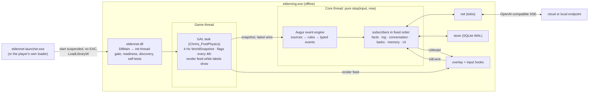
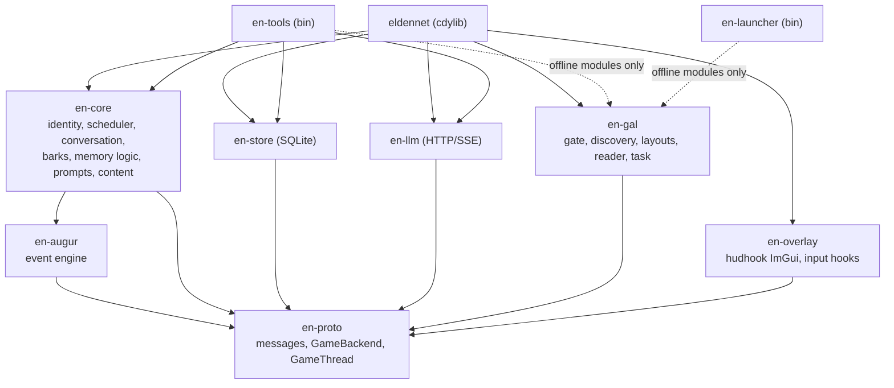
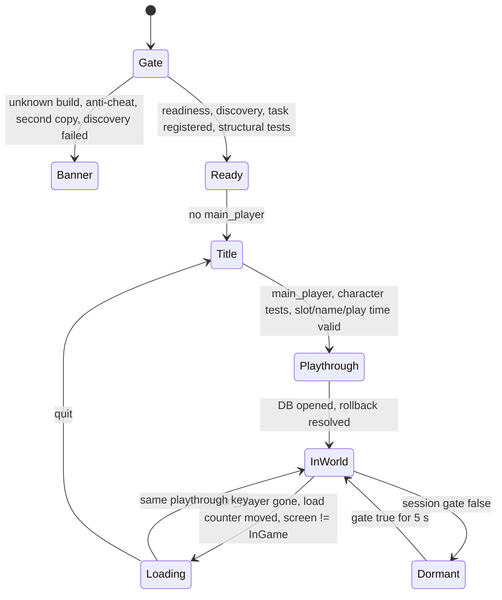
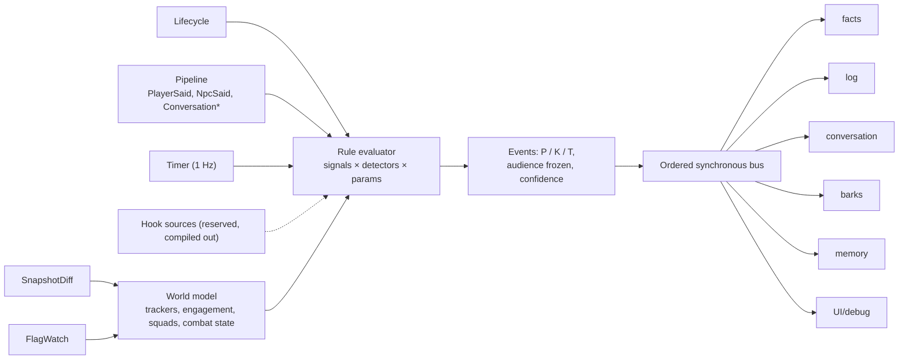

# EldenNet v1: master design

> **Status:** the single source of truth for EldenNet v1, 2026-11-06. It supersedes the proposals and the judges' scorecards in [process/](process/) wherever they disagree. **Target:** ELDEN RING PC/Steam, App 1.17.2, exe 2.7.2.0 (WW) and 2.7.2.1 (JP), offline only.
> **Built from:** [P1 lean monolith](process/P1-lean-monolith.md) as the base, with grafts from [P2](process/P2-split-brain.md) and [P3](process/P3-experience-first.md) picked by the judges ([J1](process/J1-stability-feasibility.md), [J2](process/J2-minimalism-delivery.md), [J3](process/J3-experience-ai-quality.md)). It also applies the **owner decisions of 2026-11-06** (recorded in CLAUDE.md): no me3, no fromsoftware-rs, our own event engine; and later that day, every recommended default then in §19 (O1–O24) accepted, and hudhook pinned at exactly 0.9.3 (O25). All three proposals assumed me3 (loader, `start_online`, `disable_arxan`, `savefile`) and a vendored fromsoftware-rs (J1 §4.1, J2 §2). Every such assumption is replaced in §3–§4.
> **Citations:** `ER0n §x` and `SN0n §x` are research notes; `P1 §x` and `J2 G9` point into the process records. LIKELY and SPECULATION keep the research's evidence labels. **RE-needed** facts are settled by the spikes in §16 before code depends on them.
> **Licence hygiene:** we use SkyrimNet's ideas and published numbers only, never its text or code (SN00 §7). All example content is original. No FromSoftware text or assets ship; game text is read at runtime from the player's install.
> **Detail documents:** [architecture.md](architecture.md) expands §2–§6, §11, §14 and §15. [npcs-and-dialogue.md](npcs-and-dialogue.md) expands §7–§9 and §12. [memory-and-knowledge.md](memory-and-knowledge.md) expands §10. The adversarial review, with what it changed and what is still open, is [process/review.md](process/review.md).
> **How to read it:** §0 is the whole design on one page and §1 the scope and success criteria. Then read the section for your area: start-up and safety §2–§3, game access §4–§5, the event engine §6, NPCs and speech §7–§9, memory §10, LLM and presentation §11–§12. §16 is the delivery plan and §19 records the owner's decisions and any question still open. Where a detail document and this one disagree, this one wins.

---

## 0. Design at a glance



1. **One loader-agnostic DLL plus our own small launcher.** No me3 code, APIs or features. A player may also list the DLL as a native in their own me3 profile (§3).
2. **Our own Game Access Layer (GAL).** The version gate runs first. Discovery needs 5 AOB items and 11 FD4 singletons. Layouts are per-build data, confirmed by self-tests. Every read is an SEH-guarded copy, and every read group has a breaker (§4).
3. **Zero game writes and zero game-code hooks.** No game function is called after task registration. The only hooks are in system DLLs (DXGI/D3D12, DirectInput, XInput), so no Arxan neutralisation is needed. A blocking spike confirms this (§3.5).
4. **One game-thread task:** a time-based 4 Hz snapshot, flags on every 4th snapshot (1 Hz), and a per-frame render feed only while labels show (§5).
5. **Augur, the event engine, inside the pure core.** Sources feed declarative rules (debounce, hysteresis, cooldown, confidence, dedup and merge, TTL). The rules emit typed events with a frozen audience onto an ordered, synchronous bus. Golden replay tests guard it (§6).
6. **Two tiers:** *personas* for questline NPCs and named services, *archetype cards* for generic humanoids. Anything unresolved is mute (§7).
7. **Conversation:** a hotkey and a talk hint, safe-context gating with no world freeze, input blocking with hard release rules, a cache-ordered original prompt, paced pages, and commit only once a line is shown (§8).
8. **Barks:** authored seed lines give a floor that needs no network, and background pools extend them. A scheduler expires barks after 2–3 s. The bottom feed comes first, then floating labels. Live generation is used only for call-out replies (§9).
9. **Memory:** an event log with audiences, game facts, claims, and a per-NPC journal (≤ 120-word summary plus ≤ 8 keepsakes), sent whole. No retrieval in v1. Important NPCs also know where their own road stands, the affairs tied to them and the state of the land, derived from verified flags on every flag frame and told in a cached "How things stand" block (§10, §10.6).
10. **Spoiler control in five layers, gated by event flags.** An unverified flag can hide content but never unlock it (§10.4).
11. **Persistence:** one SQLite file per playthrough, keyed by SteamID, slot and character fingerprint, partitioned by journey. Playtime is the rollback clock. The `.sl2` is never touched, and the launcher keeps save backups (§3.6, §10.5).
12. **One OpenAI-compatible streaming client** with 5 job slots, each with budgets, timeouts and fallbacks. Cloud and local presets are data (§11).
13. **Offline and multiplayer gating in our own code.** EldenNet is active only for a solo host in their own world with no anti-cheat present; otherwise it is dormant (§3.4).
14. **Text first.** TTS and STT come in v1.5 behind seams. The action seams are frozen and empty (§13).
15. **Spikes first, then chat with one pilot persona before barks.** v1.0 ships 6 personas and 6 cards (§16).

---

## 1. Goals, scope and success criteria

### 1.1 Goals

| # | Goal | v1 meaning |
|---|---|---|
| G1 | **Stable** | Never crashes, hangs, slows or corrupts the game or a save. Fails closed on unknown builds, in multiplayer and when a self-test fails |
| G2 | **Important NPCs feel like themselves** | Free-form typed chat. Each persona has its own register, flag-gated knowledge and continuity across visits |
| G3 | **Generic NPCs feel alive** | They know what they are, where they are and what the fight is doing. They say short, timely lines, and answer one call-out with one line |
| G4 | **Dialogue only** | No NPC action and no game write. NPCs never promise or claim to act |
| G5 | **Drop-in and self-contained** | No data edits. No me3 or fromsoftware-rs dependency. Coexists with Reforged, Convergence, randomizers, Seamless Co-op (ERSC) and me3's mod host |
| G6 | **Clean seams** | Later features plug in without moving existing code (§13) |

### 1.2 v1 scope

| Area | In v1 | Deferred | Never |
|---|---|---|---|
| Loading | Own launcher; loader-agnostic DLL; documented use as a player-configured me3 native | Proxy-DLL install | Any me3 code, API or reliance on its behaviour; posting in me3's spaces |
| Game access | Reads, task registration, SEH-guarded copies | Hook-based event sources; probation mode for unknown builds | Code patching in v1; LLM-chosen flag writes |
| NPCs | 6 personas, 6 cards plus a fallback card; everything else mute | DLC personas, Ranni, a merchant card, Melina, boss and invader lines | Cloning the cast's voices |
| Conversation | Typed one-to-one chat; Steam floating keyboard if S4 passes | Pad intent list (v1.1), STT (v1.5), NPC-to-NPC talk, `@name` addressing, a persona greeting the Tarnished with news on approach (§8.7, §13; O28) | Any online use |
| Barks | 7 combat triggers, sparse ambient lines, seeds plus pools, one-line call-out replies | Live barks, taunt key, user triggers | — |
| Memory | Event log, facts, claims, journal, rollback, NG+ partition; quest and world awareness from verified flags (§10.6) | Scene memories, FTS or vector recall, diaries; news that travels with play time; shared circles of acquaintance | Telemetry upload |
| Presentation | ImGui text overlay | TTS (v1.5); native subtitles and mouth movement (v2) | Shipping game fonts, text or audio |
| ML | Out of process, over HTTP | Bundled out-of-process TTS binaries | LLM, TTS or STT inside the game process |

### 1.3 Success criteria ("minimal and stable", measured)

| ID | Criterion | v1.0 target |
|---|---|---|
| C1 | Crash safety | 0 EldenNet-caused crashes or hangs in a 30 h soak on 3 machines (one Proton, one HDR, one with ERSC), plus 20 forced fail-closed launches (unknown build, missing pattern, injected faults) (J2 #16) |
| C2 | Unknown build | 100% banner mode: zero tasks registered, zero game-object reads (read counters) |
| C3 | Game-thread cost | Task mean ≤ 0.15 ms, p99 ≤ 0.5 ms at 32 characters. Render feed ≤ 0.03 ms. Overlay ≤ 0.3 ms per frame. ≤ 1 FPS loss at the 60 FPS cap |
| C4 | Multiplayer | Dormant within one snapshot (≤ 250 ms). 0 LLM requests while the gate is false |
| C5 | Dialogue latency | First page p50 ≤ 1.6 s and p90 ≤ 3.0 s (cloud preset); p50 ≤ 2.5 s (12 GB local preset) |
| C6 | Barks | 100% shown before expiry. ≥ 95% within 0.5 s of the game change. Median 2–3 lines per fight at a camp of five. ≤ 6 per minute |
| C7 | Output hygiene | 0 displayed strings with markup, reasoning, trailer text or over the byte cap (fuzz and replay scans) |
| C8 | Silence | 0 lines from dead, hostile, muted or voiceless characters, in boss fights or over native talk |
| C9 | Spoilers | 0 locked-term violations shown in 600 scripted turns over 6 flag states |
| C10 | Voice | ≥ 98% of replies within the word cap; 0 banned words shown; non-archaic registers ≤ 2% archaic lines |
| C11 | Memory | ≥ 80% correct "do you remember" probes after a reload; every shown line survives a hard kill; trim and NG+ tests pass |
| C12 | Event engine | Golden events over 3 recorded routes stay stable; 10 replays give identical events |
| C13 | Install | 5 testers reach a first reply within 10 min of reading the README, with a key in hand |
| C14 | World awareness | Over 240 probes at 4 flag states (NPC §12.5): ≥ 90% acknowledge a known change when asked; ≤ 2% contradict one; 0 shown terms the persona cannot know (MEM §12.8) and ≤ 1% judged to show such knowledge; ≤ 5% hearsay told as seen; a cued item raised on ≥ 50% of cued controls, and any news raised on ≤ 10% of uncued controls after `fresh` (O28); Patches' contradiction rate reported, not gated. Runs and gates from v0.2 on the pilot, widening as content ships (§16.3; O29) |

### 1.4 Perceived-latency budget (normative; P3 §1.5, J3 #1)

| Moment | Player sees | Target p50 / p90 | Limit and miss behaviour |
|---|---|---|---|
| Talk key | Box opens with the target and who can hear | ≤ 50 ms | 100 ms |
| Enter | After 350 ms with no text, a speaker card **"Kalé …"** | — | — |
| First page | Lower-third page | 1.6 / 3.0 s cloud; 2.5 / 4.5 s local | First token 6 s (10 s local), then the fallback model once. At 20 s, an uncommitted "…" page and a toast with the cause |
| Bark | Feed line or label | ≤ 0.3 s after the event | Dropped at expiry (2–3 s) |
| Death gloat | Label as the player falls | ≤ 0.5 s | 1.2 s, and never once the death banner (banner 5) shows |
| Call-out reply | One-line label | 1.5 / 2.5 s | 3 s, then a seed line |
| Memory update | Nothing | Within 2 min of the conversation's end, never in combat | Stays queued |

---

## 2. Process and code architecture

### 2.1 Runtime shape

There are two processes: the short-lived `eldennet-launcher.exe` (§3.2) and the game. All of EldenNet runs in the game process as one Rust `cdylib`, and all ML is reached over HTTP (ER06 §5.1). P2's split brain was rejected as the v1 default (J1 #11, J2 §4.2) and kept as a seam (§13).

| Thread | Runs | Game memory? |
|---|---|---|
| Game thread | The single GAL task closure | **Yes, only here.** It never blocks, locks or allocates after warm-up |
| Present thread | hudhook callback: draws `UiModel` and the render feed | No |
| Game input thread(s) | DirectInput and XInput detours. They read one atomic and zero buffers | No |
| Init (transient) | Gate, readiness wait, discovery, task registration | Image scans only, before the task exists |
| Core | `Core::step` over a `crossbeam::select!` of inputs | No |
| Net (tokio, 2 workers), store (rusqlite), watcher | Effects | No |

**Channels.**
- Task → core: a two-slot latest-wins snapshot slot, plus a 64-entry lifecycle queue.
- Task → overlay: a triple-buffered render feed.
- Core → task: a 64-entry SPSC command queue.
- Core → overlay: `ArcSwap<UiModel>`. Overlay → core: a 256-entry `UiEvent` queue.
- Core ↔ store: 1,024 each way. Core ↔ net: 64 requests and 1,024 stream events.

The game and render threads use only `try_send`, atomics and preallocated buffers (P1 R5, P2 §2.3).

### 2.2 Crates



- `en-proto`, `en-augur` and `en-core` use no `unsafe`, do no I/O and read no clock. ER meaning lives in `content/eldenring/`, so the core stays game-neutral.
- `en-gal` holds the only `unsafe` that reads game memory, and it has no LLM, DB or UI. Its `offline` feature compiles only the safe modules (PE parsing, the pattern grammar, the build and layout schemas), which is all the launcher and `en-tools probe-exe` use (ARCH §2.1).
- `en-overlay` uses `unsafe` only for hudhook and the input hooks.
- `eldennet` wires the threads together and wraps foreign entries in `ffi_guard`.
- `en-tools` provides `replay`, `golden`, `eval`, `lint`, `render-prompt`, `probe-exe`, `mockllm`, `bake-pools`, `selftest`, `fmg-import`, `identity-fill`, `kb-draft` and `flag-verify` (ARCH §12.3).

### 2.3 The adapter boundary: snapshot in, commands out

```rust
pub trait GameBackend: Send {                        // en-proto; implemented by en-gal and by replay
    fn probe(&mut self, gt: &GameThread) -> Capabilities;
    fn snapshot(&mut self, gt: &GameThread, out: &mut WorldSnapshot) -> Result<(), ReadError>;
    fn render_feed(&mut self, gt: &GameThread, want: &[ChrHandle], out: &mut RenderFeed) -> Result<(), ReadError>;
    fn apply(&mut self, gt: &GameThread, cmd: &GameCommand) -> Result<(), ApplyError>;
}
pub enum GameCommand {                               // v1: read configuration only
    SetWatchFlags { version: u32, ids: Arc<[u32]> }, SetTracked { handles: SmallVec<[ChrHandle; 8]> },
    ResolveText { fmg: u16, ids: SmallVec<[u32; 8]> }, ResolveParams { ids: SmallVec<[u32; 16]> }, Noop,
    // reserved behind features that are off in v1: Freeze, NativeLine, Action{executor, args, epoch, deadline}
}
```

- `GameThread` is a zero-sized, `!Send` token. Its constructor may be called only by the task trampoline and the replay harness; Rust cannot restrict a public constructor to two crates, so a CI grep allows it in exactly those two files (ARCH §6.4). Off-thread reads therefore do not compile without breaking that CI rule (P2 §2.1, J2 G5).
- Handles (the packed `FieldInsHandle`) cross the boundary; pointers never do.
- Every message is serializable, so a recording is just the list of messages (ER00 §3.1).

### 2.4 Functional core

`Core::step(input, now) -> Outputs` is pure. Time is an input. Commands, the UI model, LLM requests and DB requests are outputs, and their results come back as inputs. Debounce, cooldowns, expiry, scheduling and conversation state therefore replay bit for bit (P1 §2.4, J2 G1). Augur runs first in each step (§6.6).

### 2.5 Lifecycle



Dormant is drawn here as a state for brevity. It is implemented as a flag orthogonal to the lifecycle states, so it also covers loading and the title screen and can overlap them (§4.4, ARCH §9).

| Transition | Core actions |
|---|---|
| Ready (data ready) | Load content. Export the grace and place-name params over several ticks, ≤ 1 ms each |
| Playthrough ready | Compute the playthrough key. Open the DB, run the rollback check, close and queue open conversations |
| Loading | End the conversation, committing only shown lines. Clear barks, short-lived events and squads. The task reads only lifecycle fields |
| Player died | End the conversation. Only `player_fell` may fire, for 1.2 s. Persist `PlayerDied` |
| Rest (flag 9000, verified in S6) | On start: mark the context safe; run queued memory jobs and pool refills. On end: clear generic engagements, squads and cooldowns, because the world respawns (ER04 §4.1) |
| Journey (`ng_lvl`) or slot change, quit | New journey partition. Flush and close the DB |

### 2.6 Crash-safety rules (normative)

- **R1 One reader.** Game objects are read only in the task closure, through methods that require `&GameThread`. Init reads only the executable image: section bytes, and static slots compared with null. It never follows a static into a heap object. This is the one documented exception to "game memory only on the game thread", and it ends when the task is registered.
- **R2 No writes, no calls.** No game memory is written and no game function is called after `register_task`. Before it, the only game-code calls are `register_task` itself and the init-only singleton-name getter fallback (§4.2). Text, params and flags are read from memory (§4.5). The one call into third-party code is the S4-gated Steam floating keyboard (`steam_api64.dll`, never game code; §8.1).
- **R3 Guard foreign entries.** Every callback entered from foreign code starts with `ffi_guard`: `catch_unwind` plus a per-component tripped flag. Built with `panic = "unwind"`, and enforced by a CI grep.
- **R4 Copies, never references.** `GuardedReader::copy::<T: Pod>(addr, len)` is an SEH-protected memcpy plus plausibility checks: canonical address, alignment, vtable in `.rdata`. Copy sizes come from the layout profile, per class (J1 #8: base `ChrIns` ends at 0x580 on 1.17.2).
- **R5 Re-resolve every tick.** Singleton instances are re-read from their statics, and null means loading (J1 #6). Characters are re-found by handle. Each object's vtable is compared, every tick, with the RTTI-resolved set (J1 #16).
- **R6 Never block** the game, render or input threads: no shared mutex, bounded `try_send`, no allocation on the game thread after warm-up.
- **R7 Gate before layout.**
- **R8 Breakers.** A read group trips after 3 faults in 60 s: off for the session, with a toast. A core subsystem is reset after its first panic and disabled after its second.
- **R9 Lints.** Deny `unwrap`, `expect`, `panic`, indexing and unchecked arithmetic in `en-gal`, `en-overlay`, `eldennet` and `en-launcher`. In the game process, `unsafe` blocks appear only in `en-gal::{reader, sys}` and `en-overlay::hooks`, each with a `// SAFETY:` note. `eldennet` allows `unsafe_code` only on its `exports` module, for the `#[unsafe(no_mangle)]` attributes of `DllMain` and the instance marker, and that module holds no `unsafe` block. The launcher, a separate process, keeps its Win32 `unsafe` in `en-launcher::win` (ARCH §2.4).
- **R10 Time-based cadence and self-throttle.** Accumulated QPC time, never frame counts (J2 G21). After 3 ticks over 0.5 ms, drop to 2 Hz and 16 characters within 25 m; restore after 60 s.
- **R11 Idle while loading.**
- **R12 System-DLL hooks only.** Installed once at boot, never toggled, chained, all through the one MinHook copy that hudhook bundles, exposed as its public `hudhook::mh` module in 0.9.3 (ER02 §7.1, J1 #15, O25).
- **R13 Sanitized, byte-capped strings** only (§8.4).
- **R14 No work at `DLL_PROCESS_DETACH`.** Every DB request is one WAL transaction, committed as soon as the store receives it. Speech commits (`PlayerSaid`, each `NpcSaid` page) are sent at once. Other writes are coalesced by the core into one request at most every 250 ms (ARCH §1.5).
- **R15 Abort-class failures are designed out** (J1 #7). `catch_unwind` cannot stop a stack overflow, OOM, C-level faults or panics in `Drop`. So: size and recursion caps on templates, JSON and the sanitizer; bounded buffers; no panics in `Drop`; no ML in process. The residual risk is accepted, with an out-of-process core kept as a seam (§13).
- **R16 Single instance.** A per-process named mutex. A second copy, for example one loaded by both the launcher and a me3 profile, exits its init thread.

### 2.7 Failure contract (what the player sees; P3 §5.11, J3 #26)

| Failure | Player sees |
|---|---|
| Unknown build or failed discovery | Banner: "EldenNet inactive: game build 2.x.y.z not supported yet", with the reason |
| An optional group tripped | One toast naming the reduced feature |
| Slow first token | The "Name …" card keeps pulsing; one silent fallback to the backup model |
| No reply in 20 s | An uncommitted "…" page plus "No answer: provider timed out" |
| 401/403, 429 | "API key rejected: open settings (F10)"; "Provider rate limit, try again shortly" (60 s cooldown) |
| Reply blocked twice by lint | An authored deflection line (content, never an invented answer). Showing nothing is not allowed (J3 #8) |
| Multiplayer | Badge: "EldenNet paused (multiplayer)" |

Toasts wait until boss fights end and are rate-limited to one per error class per minute.

---

## 3. Starting EldenNet, offline play, Arxan and saves

me3 normally provides offline enforcement, Arxan neutralisation and save separation (ER02 §3.2). EldenNet uses nothing from me3, so this section says how each one is covered.

### 3.1 The DLL load contract

`DllMain(DLL_PROCESS_ATTACH)` calls `DisableThreadLibraryCalls`, starts the init thread and returns. The init thread assumes nothing about who loaded it, or when:
1. **Gate:** check `VS_FIXEDFILEINFO`, `ProductName == "ELDEN RING"`, region, `TimeDateStamp` and `SizeOfImage` against `gal/builds.toml` (J1 §7.1 #8).
2. **Safety:** single-instance mutex (R16) and the anti-cheat check (§3.4).
3. **Readiness, in two phases:** poll every 100 ms until the main window exists. Then run a small scan for the two readiness items only (`global_hinstance` and the `CSTask` static), and poll until `global_hinstance` (if found) is non-null and the `CSTask` static is non-null with a readable DLRF name. Time out at 120 s → banner. A late load (a me3 native after game main) passes at once; an early, suspended load waits (ER01 §3.1, J1 #4, ARCH §3.2).
4. **Discovery and image-level checks** (§4.2), then `register_task` from this non-main thread. The structural self-tests that read game objects run on the first ticks after registration, inside the task (R1). If one fails, the task stays registered but inert: it returns after one atomic load and reads nothing (§4.4).

The DLL finds `content/` and `gal/` from its own module path, so the install folder can live anywhere.

### 3.2 The EldenNet launcher

A small windowless Win32 program of our own, about 400 lines. It follows the documented pattern that LukeYui's Offline Launcher and me3's launcher also use (ER02 §2.1, §3.2):
1. **Find the game:** Steam library folders, or a path the player gives. Check the build; if it is unknown, offer "launch anyway (EldenNet stays inactive)".
2. **Pre-flight:** Steam must be running. Refuse if `start_protected_game.exe` is running.
3. **Back up the save:** copy `%APPDATA%\EldenRing\<SteamID64>\ER0000.sl2` and its `.bak` to `%APPDATA%\EldenNet\save-backups\…\<timestamp>`, keeping 10.
4. **Start without EAC:** put `steam_appid.txt` next to `eldenring.exe` (TGA's recommended method) and record that we created it. A `SteamAppId` environment variable instead would avoid writing into the game folder; S0-C tests it (SPECULATION).
5. **Inject:** `CreateProcessW(…, CREATE_SUSPENDED)`, then `VirtualAllocEx` + `WriteProcessMemory` + `CreateRemoteThread(LoadLibraryW)`. Check the module handle, then resume.
6. **Exit.** Flags: `--vanilla-offline`, `--no-backup`, `--dll <path>`.

Its first screen states, in plain words: offline only; saves are backed up but not separated (§3.6); typed text goes to the player's chosen provider; the content is AI-generated (J3 §4). Under Proton the launcher must run inside the game's prefix. S0-C settles the recipe, and the player's own me3 profile is the fallback.

### 3.3 Alternatives evaluated

| Method | Verdict | Why |
|---|---|---|
| **Own launcher** | **Primary** | No third-party loader, and no EAC by construction |
| **Player-configured me3 native** | **Supported; documented in our own docs only** | Seamless Co-op must start from its own launcher or a mod engine, and injectors cannot carry it (ER02 §2.3). We rely on no me3 feature: a post-main load simply passes the readiness wait. We never post in me3's spaces (ER02 §3.2) |
| `dinput8.dll` proxy | Rejected | Clashes with Elden Mod Loader, ME2's dinput8 mode and the practice tool. Cannot carry ERSC. Needs `WINEDLLOVERRIDES` under Proton (ER02 §3.3) |
| `winhttp.dll` proxy | v1.x note | Used by EROverlay and the EAC Toggler. Useful property: EAC LIKELY refuses to start next to it (ER02 §2.1) |
| `dxgi.dll` proxy | Rejected | It would sit under hudhook's own DXGI hooks and other DXGI injectors (SPECULATION, J1 #24) |
| ME2 `external_dlls`, Elden Mod Loader | Work, unsupported | The DLL is loader-agnostic; both loaders are discontinued or legacy |
| Other chain loaders and injectors (Lazy Loader and similar) | Work if they call `LoadLibraryW`, unsupported | Nothing in the DLL depends on who loaded it or when (ARCH §4.10). Like Elden Mod Loader, they cannot carry ERSC (ER02 §2.3) |

### 3.4 Offline and multiplayer gating, in our own code

- **Active** only if every snapshot shows `multiplay_role == Host`, `is_my_world`, `LobbyState == None` and `player_chr_set.len() == 1`, and no anti-cheat module is loaded (ER05 §3). Otherwise EldenNet goes **dormant** at once, and re-activates only after 5 clean seconds. If the `session` group fails its self-test, AI stays off.
- **The set count** is meant to catch ERSC partners at any distance (J2 G14; SPECULATION until S0-C). It counts only entries whose `chr_type` is not an NPC type. If NPC summons (`WhiteSummonNpc`) or NPC invaders also live in `player_chr_set`, counting them would make EldenNet dormant in every summon-assisted boss fight, and `FoughtBeside` could never fire, because a dormant task reads no characters. S1 lists which `chr_type` values appear in the set.
- **At the title screen** there is no `PlayerGameData`, so no role can be read. There the gate is clean only if the lobby is `None`, no anti-cheat module is loaded and the `session` group is healthy. This title clause permits network calls for the wizard and the silent self-test (§11.5) and nothing else: speech stays dormant until a world is loaded (ARCH §5.1).
- **Anti-cheat check (SPECULATION, cheap):** a loaded module named `EasyAntiCheat*`, or a parent process named `start_protected_game.exe` → banner.
- EldenNet **never writes `Menu.IsEnableOnlineMode`**; that would be a game write (J1 #1). Offline play follows from starting without EAC (ER02 §2.2). EldenNet's own traffic goes only to the player's LLM endpoint.

### 3.5 Arxan: none needed, because no code is patched

v1 does reads, one `register_task` call and system-DLL hooks. The task system avoids Arxan's code restoration (ER02 §5). Still unproven: whether scans work on an image with Arxan untouched, since encrypted functions "may be unreadable until Arxan runs" (J1 claim 6). **S0-A is a blocking spike.** Built-in mitigations:
- scan in two phases: only the two readiness items once the window exists, and the full discovery after the readiness wait (§3.1);
- retry unresolved patterns at +5, +15 and +30 s;
- prefer data-side evidence (DLRF names, `.data` statics, RTTI in `.rdata`);
- a missing item disables only its read group.

If S0-A fails, the owner chooses among the options in §17 K2. Neutralising Arxan ourselves is never one of them, and neither is depending on a loader that does it: a player's own me3 profile may happen to set `disable_arxan`, and EldenNet must behave the same with or without it.

### 3.6 Save separation

v1 never writes game memory, flags or the `.sl2` (R2). The decision (O6) is therefore: no save redirection, rotating launcher backups, and warnings in both the launcher and the wizard never to take a save played offline with mods online (ER02 §2.2). A `CreateFileW`-family redirect hook would be allowed (it is a system DLL). It is deferred to v1.x behind a spike, because it could collide with ERSC's `.co2` handling and a player's me3 `savefile` (J1 #27, J2 §2 #4). A launcher file swap is rejected: it is crash-unsafe and races Steam Cloud.

---

## 4. Game Access Layer (GAL)

### 4.1 The objects v1 needs (the smallest set)

| Object | Found by | Fields read | Read group |
|---|---|---|---|
| Executable image | PE headers | Versions, product name, timestamp, image size, sections | gate |
| `register_task` | Interior-anchored AOB; prologue, length and section checks | Called once at init | boot |
| `global_hinstance` | AOB; fallback is the main window plus a non-null `CSTask` | Readiness only | boot |
| `GameDataMan` | AOB static | Play time, deaths, `ng_lvl`, `boss_fight_active`, `show_subtitles`, `PlayerGameData` (name, level, archetype, body, starting gift, gear, `multiplay_role`, `is_my_world`) | player, session, ui |
| `GameMan` | AOB static | `save_slot`, `talk_esd_camera_param_id` | player, ui |
| `FieldArea` | AOB static | `map_place_name_id` | place |
| `CSTask` | FD4 singleton | Registration target | boot |
| `WorldChrMan` | FD4 | `main_player`, `chr_inses_by_distance`, `player_chr_set` count | world, session |
| `ChrIns` / `PlayerIns` | Through the list; per-tick vtable compare | Handle, param, model, entity, `chr_type`, live team, HP/FP/stamina, position, dead bit, `last_hit_by`, damage type, throw, on-screen; player only: ride state, lock-on, SpEffect 9621 | world, combat, player |
| `CSSessionManager` | FD4 | Lobby state | session |
| `CSEventFlagMan` | FD4 | Divisor, descriptor map, flag blocks | flags |
| `CSFeMan` | FD4 | `hud_state`, banner id, `boss_health_displays[3]` | ui |
| `CSMenuMan` | FD4 | Popup `current_talk_id`, screen state | ui |
| `CSNowLoadingHelper` | FD4 (confirm in S0-A) | `menu_load_counter` | ui |
| `WorldAreaTime` | FD4 | Clock | place |
| `CSCamera` | FD4 (confirm in S0-A) | View matrix, FOV, aspect | camera |
| `SoloParamRepository` | FD4 | `NpcParam`, `BonfireWarpParam`, `WorldMapPlaceNameParam` rows | params |
| `MsgRepository` | FD4 | FMG table (`+0x08` base, `+0x14` count) | text |

That is 5 AOB items, 11 singletons and about 65 fields (P1 §2.5, J1 §7.1 #3). Where a singleton-backed field exists, it wins: boss bars come from `CSFeMan`, cross-checked against `boss_fight_active` (ER05 §8.4). Every field belongs to one of the ten breaker groups of §4.3: boss bars are in `ui`, the `boss_fight_active` cross-check in `player`, and the lifecycle subset is `main_player` (in `world`) plus the screen state and load counter (in `ui`) (ARCH §6.1).

**Required items** are `register_task`, `CSTask`, `WorldChrMan`, `GameDataMan`, `GameMan` and `CSSessionManager`. Everything else is optional: if it is missing, only its group is off.

### 4.2 Discovery

- **FD4 singleton finder:** our own code, written from the documented idiom (ER01 §4). It matches the `.text` shape `mov reg,[static]; test; jnz; lea rcx,[class]; call get_name; …`, with the static and class in `.data` and a path string in `.rdata` ending in `FD4Singleton.h`. Class names are read from the DLRF runtime class directly, where S0-A confirms its layout. Calling the game's getter is a fallback, used once per candidate at init only, under the SEH guard. Expect 10–15 ms.
- **AOB patterns** live in `gal/patterns.toml` with provenance notes. They are anchored inside function bodies (entry+5 or later), because other mods hook prologues (ER01 §4). Every hit is validated by prologue, length, section and RTTI.
- **RTTI** walks resolve the vtable sets for `ChrIns` subclasses, used by the per-tick compares (ER02 §5).
- **Sources (owner-decided):** our own derivation. Facts from the research are leads, and each is confirmed in game or by self-tests before use. No fromsoftware-rs or me3 code or data is copied, from any commit.

### 4.3 Layout profiles, read groups and self-tests

`gal/layouts/<build>.toml` holds every offset and per-class copy size, so a patch that only moves fields becomes a data update. Ten read groups each have a self-test, run on the first ticks after registration (phase A, usually at the title) and again at each playthrough start (phase B, in the world) (P1 §2.6, ARCH §6.7):

| Group | Self-test |
|---|---|
| `session` | Lobby in enum range; solo play reads Host and own world. **Must pass, or AI stays off** |
| `world` | Vtables are `ChrIns` subclasses; distances ascend; `0 < max_hp ≤ 100000`, `hp ≤ max_hp`; `npc_param_id` resolves |
| `combat` | Handles resolve or are null; throw state in 0..=6 |
| `player` | Main player is `CS::PlayerIns`; name is valid UTF-16 of 1–16 chars; slot in 0..=9; play time rising |
| `flags` | Divisor == 1000; flag 100 set. Unallocated groups read false (ER01 §9), so each watched ID's group is checked: every core alias (100, 9000, 180–187) must exist; more than 10% of non-DLC aliases missing fails the group; a missing DLC alias reads Unknown, because the DLC may not be installed (MEM §6.2) |
| `text` | ≥ 20 tables; known NpcName and PlaceName IDs give 1–64 printable chars |
| `ui` | `hud_state` in 0..=3; banner and popup values in range |
| `place` | Place ID resolves; hour < 24 |
| `camera` | Orthonormal rotation; FOV in 0.3–2.5 rad |
| `params` | Known rows found; row sizes match the paramdef |

### 4.4 Degradation ladder and capability matrix

| Level | Entered when | What runs |
|---|---|---|
| Off | `enabled = false` | Nothing after init |
| **L1 Banner** | Unknown build, anti-cheat, failed readiness or discovery, or a structural group (`world`, `player`, `session`) fails or trips | Overlay only. **Zero game-object reads.** A failure found before registration means no task at all; one found after it (a phase-A test, a trip) leaves the task registered but inert. C2's unknown build always means zero tasks |
| **L2 Observe** | GAL healthy, but no healthy provider or AI paused | Task, Augur, debug view, recording |
| **L3 Reduced** | An optional group tripped | Per the matrix, with one toast |
| **L4 Full** | All groups pass | Everything |
| *Dormant* | Session gate false, loading, title | A flag over L2–L4, not a level. Only the `session` and lifecycle reads; speech dropped |

| Feature | Requires | Without the optional group |
|---|---|---|
| Any AI | `session`, `world`, `player` | — |
| Conversation | + `flags`, `ui`, `place`, `params` | No `text` → persona fallback names. No `combat` → stricter gating. No `camera` → no cone targeting; lock-on and nearest remain. **No `flags` → named chat off, barks on**, because spoiler safety outranks availability (P3 §2.5) |
| Barks | + `combat` | No `camera` → feed instead of labels. No `text` → card `label_fallback` |
| Persistence | `player` | — |

Unknown builds always stop at L1. A probation mode is deferred (O12).

### 4.5 Text, params and flags without function calls

- **Text:** walk the in-memory FMG table from `MsgRepository` (ER01 §8.3). NpcName is {428, 328, 18}, PlaceName {429, 329, 19}, in DLC order. Look-ups are binary-searched and cached until the table pointer changes. There is no `GetMessage` call or hook, so nothing collides with Reforged (J1 claim 8). Caveat: a mod that serves text through a `GetMessage` hook (Reforged merges DLC text that way, ER01 §8.3) can show names the raw tables do not hold, so under such a mod our names may differ from the game's. The layout leads (`+0x08`, `+0x14`) date from 2.6.2.0; S2 confirms them. Fallback: `en-tools fmg-import` reads an export the *player* made from their own install.
- **Params:** guarded `SoloParamRepository` walks, ≤ 32 new rows per tick, cached.
- **Flags:** `id / 1000` → descriptor map → block → `byte = (id % 1000) / 8`, `bit = 7 − id % 8` (ER01 §9). A pure read on every 4th snapshot (1 Hz; 0.5 Hz while throttled, R10).

### 4.6 How a patch is absorbed (budget 1–7 days; ER00 §4)

1. On patch day, players see the L1 banner automatically (C2).
2. `en-tools probe-exe` checks every pattern and singleton against the new exe file, offline (P3 §11.4).
3. A dev build with `--features probe` recovers offsets in game by invariant search (RTTI vtables, `hp ≤ max_hp` pairs, the ascending distance vector, the known UTF-16 name) and writes a draft layout file (P1 §11.5).
4. Run the self-tests and the recorded smoke route (Church of Elleh → Gatefront → camp fight → Kalé → Roundtable), and compare its events with the golden files.
5. If no code changed, ship a **data-only update** of `gal/`. Keep the earlier builds' profiles (ER01 §1).

### 4.7 Backend seam

The swap point is `GameBackend` (§2.3). Inside `en-gal`, a narrower `SysLayer` trait (`register_recurring`, `singleton`, `param_table`, `rtti_vtables`, taking `&GameThread` where it reads) isolates the platform primitives (P1 §2.5, J1 §7.1 #1). Our own implementation is about 600 lines plus a few weeks (P1 §2.5). The owner has ruled out fromsoftware-rs (O3): its NON-AI licence files start on 2026-10-12, and its build gate panics (ER02 §4.1). The seam remains for replay and for other backends. CI enforces the licence rule three ways (ARCH §12.1): a `cargo deny` licence allowlist; a `[bans]` list that names fromsoftware-rs, `from-singleton`, me3 and `dearxan` crates; and `en-tools lint --licence-files`, which scans every dependency's licence-file text for "NON-AI". The last is needed because `cargo deny` reads only `Cargo.toml` metadata, and fromsoftware-rs's metadata still says `MIT OR Apache-2.0` while its licence files say NON-AI (ER00 §7).

---

## 5. Perception

### 5.1 Cadence and costs

| Item | Rate | Cap | Game-thread p99 |
|---|---|---|---|
| `WorldSnapshot` | every 250 ms of accumulated time | walk ≤ 48 vector entries; keep ≤ 32 characters within 40 m, nearest first | ≤ 0.4 ms |
| Flag frame | every 4th snapshot (1 Hz; 0.5 Hz while throttled) | ≤ 2,048 IDs (v1 ≈ 740, with the world-awareness aliases of §10.6) | ≤ 0.1 ms |
| Render feed | every frame while labels show | camera + ≤ 8 handles | ≤ 0.03 ms |
| Text and params | on demand | 16 FMG + 32 rows per tick | included |

The 40 m radius follows SN00 §6. S1 checks whether `distance` is squared (ER01 §5.3).

### 5.2 `WorldSnapshot` schema

```rust
struct WorldSnapshot {
    seq: u64, mono_ms: u64, gap: bool, build: BuildKey, health: ReadHealth,
    session: Session { role: MultiplayRole, is_my_world: bool, lobby: LobbyState, player_set_len: u8,
                       anticheat: bool, ersc_loaded: bool },
    life: Life { main_player: bool, screen: Screen /* InGame|Loading|Title */, load_counter: u32 },
    ui: Ui { hud: HudState /* 0 HideAll 1 ShowAll 2 PopupMenu 3 Default */, banner: Option<u16>,
             popup_talk_id: Option<u32>, talk_cam: bool, subtitles_on: bool },
    player: Option<Player { handle: ChrHandle, level: u16, archetype: u8, body: BodyType,
        hp: (u32, u32), fp: (u32, u32), stamina: (u32, u32), runes_held: u32, deaths: u32,
        play_time_ms: u64, ng_lvl: u8, save_slot: u8, dead: bool, riding: bool /* ride_state 5 */,
        locked_on: Option<ChrHandle>, last_hit_by: Option<ChrHandle>, throw: u8,
        roundtable: bool /* SpEffect 9621 */, block: BlockId, pos: [f32; 3], gear: Gear,
        boss_flag: bool /* boss_fight_active, the cross-check */ }>,   // None when main_player is null
    place: Option<Place { place_id: Option<u32>, region: RegionKey, legacy: bool, overworld: bool }>,
    clock: Option<Clock { h: u8, m: u8 }>,
    boss: Boss { active: bool /* bars non-empty or boss_flag */, bars: ArrayVec<BossBar, 3> },
    chars: ArrayVec<Chr, 32>,
    flags: Option<FlagFrame /* watch-list version + bitset + valid bits */>,
    new_text: ArrayVec<TextEntry, 16>,        // answers to ResolveText
    new_params: ArrayVec<ParamRowInfo, 32>,   // answers to ResolveParams and the Ready-time grace/place export
}
struct Chr { handle: ChrHandle, param: u32, model: u32, entity: u32, kind: u8, team: u8,
    hp: (u32, u32), dead: bool, last_hit_by: Option<ChrHandle>, recv_dmg_type: i32, throw: u8,
    dist_m: f32, bearing_deg: f32, on_screen: bool, block: BlockId, pos: [f32; 3] }
```

- The player's name is read once per playthrough, sent in `PlaythroughReady`, and used only to verify a name the player gives in chat (§10.2).
- A snapshot is about 3–4 KB serialised (about 8 KB in memory), so a recording runs about 4 MB/h after zstd. ARCH §7.1 gives every field's unit and source.
- Torrent and spirit summons carry their `kind`; they are perceived, never voiced.

### 5.3 Combat state and engagement (with confidence)

- **Hostile** means the *live* team is in the `teams.toml` hostile set {6, 7, 27, 29} and the character is not a persona with clear hostility bits. Never the param's team (#768; ER05 §6.2).
- **Engagement** is an Augur state machine per hostile generic, with confidence by how it started:
  - **0.9:** a hit exchange;
  - **0.6:** lock-on while closing (≤ 20 m, the distance shrank ≥ 3 m in 2 s), or the hostile is within 8 m;
  - **0.3:** lock-on alone.

  It ends after 12 s with no exchange and no lock-on, beyond 30 m, or on death, rest or load. `fled` means the player's distance grew ≥ 15 m in 5 s and now exceeds 25 m.
- `player_in_combat = boss.active || now − last_signal < 8 s`. A signal is damage either way, `CritLanded`, or an engagement of confidence ≥ 0.6. Gating and barks require ≥ 0.6, so enemies that are only "searching" never bark (#771, J3 #15). Spike S7 may later swap in `CSAiThink` behind the same signal.

### 5.4 Audience and perception

- The audience is the personas who are alive, not muted at their current stage, within the event kind's radius, and in the same area. Same area means the same `BlockId` area byte in the open world, and the same full block indoors.
- Radii: speech 16 m, witnessing 20 m, deaths 30 m, combat noise 40 m.
- Each audience entry records **how** it perceived the event: `direct`, `overheard` or `witnessed` (P2 §7.6).
- The audience is frozen at emission. Only personas get rows; generics perceive but never remember. There is no line-of-sight test in v1, because the `cast_ray` filter is undocumented (ER05 §6.2).
- **One `visible_to(event, persona)`** serves prompts, the recap, memory jobs and facts (SN00 §3, #723).

### 5.5 State in words

Code turns numbers into phrases before any prompt sees them (SN00 §4 row 13):
- HP bands at 75/50/25%: "unhurt", "bloodied", "badly hurt", "barely standing";
- seven time-of-day words;
- weather from flags 550–575 (LIKELY);
- at most two visible gear names;
- the Great Rune count (flags 180–187);
- absence: none under 1 h of play, "some time" up to 6 h, "a long while" beyond.

---

## 6. Augur: the event engine

Elden Ring has no event bus: flags are state bits, and nothing notifies anyone when they change (ER00 §1.2). **Augur** turns raw state into typed, timestamped, audience-tagged events for conversation, barks and memory. It is a pure crate (`en-augur`) running inside `Core::step`, not a threaded framework (J2 §2 item 5).

### 6.1 Shape



### 6.2 Sources

All sources implement one interface: `trait EventSource { fn poll(&mut self, input: &CoreInput, world: &WorldModel, out: &mut Observations) }`.

| Source | Feeds on | Observes |
|---|---|---|
| `SnapshotDiff` | Each snapshot against the *last processed* one, so dropped snapshots stay correct | HP, death, team, position, lock-on, throw, ride, place, clock, boss bars, banner, HUD and talk fields |
| `FlagWatch` | Flag frames against the curated catalogue | Edges, with alias, provenance and verified bit |
| `Lifecycle` | GAL state and health | Ready, playthrough, loading, title, gate changes, group trips |
| `Pipeline` | Conversation and UI outputs | Speech and conversation events |
| `Timer` | `now` | Periodic checks (ambient idle, decay) |
| `HookFlagSetter`, `HookDamage`, `HookTalkInvoke` | **Reserved; cargo feature `hooks`, off** | Flag-set routine (TGA AOB), `CSChrDamageModule` slot 7 / `HitChr`, `CSEzStateTalkEvent::invoke` (ER01 §9, ER05 §8.2, §8.6). Each needs a spike and an Arxan review |

### 6.3 Declarative rules (`content/eldenring/augur/*.toml`)

Code provides a fixed registry of typed **signals**: `hp_frac`, `dead`, `team_hostile`, `dist_m`, `engaged`, `locked_by_player`, `throw`, `riding`, `place_id`, `flag:<alias>`, `banner`, `hud`, `boss_active`, `deaths` and so on. It also provides the **detector kinds**:
- `rising_edge`, `falling_edge`;
- `changed_stable{stable_ms}`;
- `crosses_below{value, rearm_above}`, `crosses_above{value, rearm_below}`;
- `drop_over_window{fraction, window_ms}`, `rise_over_window`;
- `enter_radius{m, dwell_ms, rearm_m}`, `count_increment`;
- the built-in `engagement` state machine.

Rules combine signals and detectors; adding a new signal takes code.

```toml
[[rule]]
id = "low_hp"
emits = "LowHp"
subjects = { kinds = ["generic", "persona"], alive = true }
signal = "hp_frac"
detect = { kind = "crosses_below", value = 0.25, rearm_above = 0.35 }   # hysteresis
debounce_ms = 0        # how long the condition must hold first
class = "K"            # P persistent | K keyed short-lived | T transient
ttl_s = 20
key = "low_hp:{subject}"   # dedup / merge key
merge_ms = 0           # merge same-key K events in this window (count, sums)
dedup_s = 0            # suppress duplicate P events with this key, in playtime
cooldown_s = 0         # per (rule, subject)
confidence = 0.95
audience = { radius = "witness" }
interrupts = []        # e.g. ["ambient", "chat_input"]
requires = "true"      # content predicate DSL (§10.4)
priority = 30
```

Rules are validated at load and hot-reloaded. User rule files load only when `augur.allow_custom_rules = true`, which is off in v1.

### 6.4 Event model

```rust
struct Event {
    id: EventId /* (step seq, index) */, kind: EventKind /* typed payload */, class: Class /* P|K|T */,
    t_play_ms: u64, t_mono_ms: u64, journey: u16, place: PlaceRef /* block, place_id, region */,
    subject: Option<ActorRef>, object: Option<ActorRef>,     // persona | card + handle | player
    audience: SmallVec<[(PersonaId, How); 4]>,              // frozen; direct | overheard | witnessed
    confidence: f32, source: SourceId, rule: RuleId,
    key: Option<ArcStr>, ttl_ms: Option<u32>, count: u16, interrupts: InterruptSet,
}
```

- **P** events are stored with their audience.
- **K** events live in an in-RAM keyed store with a TTL, and reach prompts only as ≤ 3 audience-filtered "just now" lines.
- **T** events only trigger (P2 §3.3, J2 G7).

### 6.5 The v1 rule set

| Event | Exact condition | Class, key, TTL | Conf. |
|---|---|---|---|
| `PlaceEntered` | `place_id` changed and stable 2 s | P, dedup per place 10 min | 1.0 |
| `GraceRested` / `RestEnded` | Flag 9000 rising / falling | P (dedup 10 min) / T | 1.0 verified, 0.8 not |
| `GraceLit`, `FlagChanged{alias}` | Grace `eventflagId` or catalogue flag edge | P | as above |
| `BossFightStarted` / `Ended{outcome}` | `boss.active` edge (falling debounced 1 s). Victory: banner 1–4 or 22, or a boss flag rising within 10 s. Death: `PlayerDied`. Victory and Death are emitted as soon as their evidence shows; "left" is emitted only when the 10 s window closes without either (ARCH §8.5) | P | 1.0 |
| `PersonaSeen` | ≤ 10 m for 2 s; re-armed beyond 30 m or after loading | P → `seen_count` | 1.0 |
| `PersonaApproached` | ≤ 6 m for 1 s | T (hint, warm-up) | 1.0 |
| `PersonaAttacked` | HP drop by the player, or a +1/+2 bit rising | P | 0.95 |
| `PersonaDied{by_player}` | Dead bit rising | P | 1.0 |
| `FoughtBeside` | Boss victory with the persona present as a summon | P | 0.9 |
| `PlayerDied` | Dead rising, `deaths` +1, or banner 5 | P, dedup 5 s | 1.0 |
| `NativeTalkStarted/Ended` | Popup talk id, talk camera, or `hud == PopupMenu` with a persona ≤ 3 m (S3 picks the signals) | T + scheduler lock; P with persona, dedup 5 min | 0.6 until S3 |
| `Struck{att, vic, hard}` | HP Δ > 0, att = `last_hit_by`, merged per pair over 2.5 s; `hard` if ≥ 30% of max within 3 s | K `hit:att:vic`, 10 s | 0.9 |
| `LowHp` | Below 25%, re-armed above 35% | K, 20 s | 0.95 |
| `Engaged{via}` / `Disengaged{fled}` | §5.3 | K `eng:e`, 30 s | 0.9 / 0.6 / 0.3 |
| `AllyDied` | Generic death; live same-card or same-team witnesses ≤ 20 m | K, 10 s | 1.0 |
| `CritLanded` | Player throw 3 while the hostile's throw is 4, rising | K, 10 s | 0.9 |
| `PlayerHealed` | HP +≥ 20% of max within 1 s, in combat | T | 0.8 |
| `MountChanged` | Ride edge | K, 30 s | 1.0 |
| `KilledNear{card}` | Player kills a generic; persona witnesses ≤ 20 m | K, 120 s | 1.0 |
| `IdleNear` | Every 30 s per actor: hostile, ambient card, unengaged, 8–20 m, on screen | T | 1.0 |
| Speech, conversation, lifecycle | Pipeline, GAL | P / T | 1.0 |

**Interrupts** are a property of the event type (J3 §4 (d)):
- `Engaged` (≥ 0.6) within 25 m interrupts `chat_input` and `ambient`;
- `PlayerDied` interrupts the conversation and every bark except `player_fell`;
- `Loading` interrupts everything;
- `NativeTalkStarted` interrupts conversation output and barks within 20 m.

### 6.6 Bus: order and backpressure

- **Order in each step:**
  1. update the world model;
  2. poll the sources;
  3. evaluate rules by priority, then subject distance, then handle;
  4. resolve and freeze audiences;
  5. dispatch synchronously to **facts → log → conversation → barks → memory → UI/debug**.

  Events that subscribers emit join the same step's FIFO (≤ 256; on overflow T events drop first, then K, and the drop is logged). Every event from snapshot *n* is delivered before snapshot *n+1*.
- **Backpressure:**
  - Snapshots are latest-wins, and the bus itself has no queue.
  - The store queue (1,024) drops diagnostics first. P events are never dropped: they spill into a 4,096-entry RAM ring, with 256 entries reserved for speech. If the ring fills, persistence of non-speech P events pauses, with a toast, until the queue recovers.
  - The UI is latest-wins.
  - In the net queue, pool jobs drop first and memory jobs requeue. Dialogue is never dropped; there is only one request in flight.
- **Latency:** game change → scheduler ≤ 250 ms + ≤ 5 ms. Bark rules have no debounce, so p95 ≤ 300 ms (J3 §4 (a)).

### 6.7 Rates and costs

| Source | Rate | Game thread | Core |
|---|---|---|---|
| SnapshotDiff | 4 Hz | ≤ 0.4 ms p99 | ≤ 2 ms per snapshot |
| FlagWatch | every 4th snapshot: 1 Hz (0.5 Hz while throttled), ≈ 740 IDs | ≤ 0.1 ms | ≤ 0.2 ms |
| Timer, Pipeline, Lifecycle | 1 Hz / per event | — | negligible |
| Hook sources | per call | reserved | reserved |

The flag rate follows the snapshot count rather than a clock, so the R10 self-throttle halves it. Nothing in v1 needs flag edges faster than 0.5 Hz.

### 6.8 Test harness

- **Recordings** (`*.ensnap.zst`: adapter messages, UI events and LLM responses, with the name and SteamID hashed) replay through the real `GameBackend` trait and Augur (P3 §11.1). Snapshots carry runtime game text (`new_text`: names of characters, places and gear), so a recording that is committed to the repo is written in redacted mode: every `TextEntry.text` becomes a placeholder such as `fmg18:<id>`, and replay resolves it from a fixture name table of our own (ARCH §7.5).
- **Golden files** (`tests/golden/*.events.jsonl`: type, time, actors, key, confidence, audience) fail CI on any diff that was not made on purpose (J2 G8).
- A **synthetic DSL** (`spawn`, `move`, `hit`, `kill`, `set_flag`, `say`, `wait`) builds scenarios with assertions such as "an aggro bark within 1.0 s of `Engaged`; none after 2.5 s" (P1 §11.2).
- **Property tests** cover hysteresis (never twice without a re-arm), debounce, merge windows and ordering. **Backpressure tests** cover queue saturation and snapshot gaps (P2 §11.4).

---

## 7. NPC model

### 7.1 Tiers

| ER kind (ER04 §2.1) | v1 tier | Treatment |
|---|---|---|
| A. Questline NPCs | **Important** | Persona, stages, gated knowledge, journal, chat when not hostile |
| B. Named services (Kalé, Hewg…) | **Important** | Same pipeline; vanilla menus stay the only way to trade (ER04 §2.4) |
| B′. Nomadic merchants | Mute ("They have nothing to say to you.") | A shared card waits until entity identity is verified (J3 #11) |
| C. Talking bosses, D. invaders, Melina | Mute | No barks in boss fights |
| E. Generic humanoids | **Generic** | Archetype card: barks plus a one-line call-out reply |
| F. Voiceless (beasts, spirits, golems, Twin Maiden Husks, Goldmask, Torrent) | Mute | Perceived only |
| Summoned questline NPCs | Important, silent | `FoughtBeside` recorded |
| Uncurated named friendlies | Mute, with the hint line | — |
| Uncurated hostile humanoids | `nameless_soldier` fallback card | Barks only, no lore |

### 7.2 Identity resolution

Identity is curated, never computed (ER04 §1, SN04 §10). `identity/personas.toml` maps `persona_id → {npc_params[] (every variant, each with its own expect_name_id), entity_ids[], flag_block, talk_code (metadata only)}`. `expect_name_id` is per row because variants such as Renna and Ranni carry different name IDs (NPC §2.1). The resolution order is cached per handle:
1. exact `npc_param_id`;
2. non-zero `event_entity_id`;
3. card by param range or family;
4. humanoid model with a live hostile team → `nameless_soldier`;
5. otherwise mute, logged to the debug "unknown characters" list with a copy-as-TOML button.

Rules that follow:
- **Display names** come from the runtime NpcName of the current row.
- **Self-knowledge** comes from the active stage's `identity` line. A reveal variant is therefore prompted as its pre-reveal self until the stage flags agree, and a lint flags any disagreement (J3 #19).
- **Identity-pack check:** if more than 20% of persona rows' live `nameId`s miss `expect_name_id`, personas switch off with a toast and barks keep running (P1 §4.2).
- **Memory keys** are `persona_id`s, with an alias table for renames.

### 7.3 Persona schema (important NPCs)

Personas are prose in named fields; code owns the order, headers, state and perspective (SN03 §5.2).

| Group | Fields |
|---|---|
| Header | `register` (`archaic-regal \| formal \| colloquial \| broken \| chant`; ER04 §5), `reply_words_max` (≤ 60, default 40), `address_forms`, `pronouns`, `display_name_fallback` |
| `public` (the Stranger Test) | `summary`, `appearance` |
| `private` | `background`, `personality`, `goals[]`, `relationships[]`, `honesty` (`truthful \| guarded \| liar` plus one sentence) |
| `voice` | `cadence`, `diction`, `deflection`, `openers[]` (≤ 1 per reply), owned `tics[] {text, max_per_conversation}`, written in our own words and never a FromSoftware coinage (J2 #14) |
| Knowledge | `knowledge.{always[], topics[]}`, `deflections[]` (3–5 authored lines) |
| `[awareness]` | `home[]` (RegionKeys), `[[tie]]` (≤ 6: `item`, `certainty?`, `when?`, `from?`, `line?`, `spoiler?`, `lexicon?`, `basis = flag \| played`, `evidence[]`), `skip[]` (MEM §12.2) |
| `[[stages]]` | `id`, `when`, `identity?`, `where`, `mood`, `gist` (our own paraphrase of what has passed in vanilla), `road` (≤ 30 words: where the persona's own affairs stand), `at` (RegionKey), `hears = all \| sky \| none`, `knows[]` (world stages this stage implies), `awaits?`, `heard?` and `short?` (for other personas' ties), `unlock{text, kb[]}`, `forbid[]` (topics, never secrets), `chat = allowed \| refuse \| mute` |

Predicates name catalogue aliases only. `road`, `at`, `hears` and `knows` inherit from the previous stage when omitted; the base stage must set `road` and `at` (NPC §3.2, MEM §12.2). The lint warns on effect adjectives such as "cryptic" or "terse" (SN03 §5.4). Original example (the built-in self-test persona, not a game character):

```toml
id = "lantern_keeper"
register = "formal"
reply_words_max = 30
address_forms = ["traveller", "Tarnished"]
deflections = ["The lamp shows the road, not the whole of it.", "Ask again when the wick is longer."]
[public]
summary = "An old keeper who tends one lamp at a crossroads and greets whoever passes."
appearance = "A stooped figure in a soot-grey cloak, a brass lantern on a crooked staff."
[private]
background = "Has kept the same lamp longer than they can count, and suspects the road keeps them in turn."
personality = "Patient and dry; kind to the lost, short with the boastful."
honesty = "truthful: says little, never lies"
[voice]
cadence = "At most two short sentences; the second often turns the first around. Pauses before answering."
diction = "Plain, slightly old-fashioned words; no archaic pronouns."
deflection = "Meets an unwelcome question with a remark about the lamp or the road."
openers = ["Hm."]
[[stages]]
id = "default"
when = "true"
where = "beside the lamp at the crossroads"
mood = "watchful calm"
gist = "Nothing has passed between you and this traveller before tonight."
road = "You tend one lamp at a crossroads, as you have for longer than you can count, and greet whoever passes."
at = "limgrave"
forbid = ["what lies at the end of the road"]
```

### 7.4 Archetype card schema (generic NPCs)

| Group | Fields |
|---|---|
| Identity | `id`, `match {params[], ranges[], models[]}`, `label_fallback` |
| Speech | `speech = barks \| sounds_only \| silent`, `register`, `bark_words_max` (10), `lexicon[]` (allowed proper nouns), `ambient`, `replies`, `hostile_default` |
| What they are | `what_they_are`, `allegiance`, `home`, `knows[]` (3–6 facts), `never[]` |
| Variants | `[[variants]] {id, weight, temperament, yields}`, picked in code by `hash(entity or handle)` and written gender-neutral |
| Seeds | `[seed.<trigger>]`, 3 authored lines each |

```toml
id = "godrick_soldier"
match = { ranges = [[43110000, 43119999]] }    # family from ER04 §2.7
label_fallback = "Godrick Soldier"
what_they_are = "A foot soldier of the cliffside castle's garrison, cold, underfed and far from home."
allegiance = "the grafted lord of the castle, feared far more than loved"
knows = ["The castle gate has stayed shut against wanderers for a long time.", "Rations come late, if at all."]
never = ["remembering the Tarnished from an earlier fight", "naming the Tarnished", "game words"]
lexicon = ["Limgrave", "Stormveil", "Godrick"]
ambient = true
replies = true
[[variants]]
id = "veteran"
weight = 2
temperament = "Tired and practical; talks to comrades more than to the enemy."
yields = "Fights on without speeches."
[seed]
aggro       = ["Intruder on the road!", "Draw steel, it's one of them.", "Wake up, we've a visitor."]
struck_hard = ["Argh, my arm!", "It hits like a mule!", "Get it off me!"]
low_hp      = ["Not like this...", "Someone... anyone...", "Let me crawl away, at least."]
ally_fell   = ["They've cut one down!", "Close ranks, close ranks!", "That's two of us gone..."]
player_fell = ["And stay down.", "Back to the ditch with you.", "One more for the crows."]
idle        = ["Wind never stops up here.", "Rations are late again.", "Eyes on the road."]
addressed   = ["Keep walking, stray.", "Words won't open the gate.", "Come closer and see."]
```

### 7.5 Mute list

`identity/speech.toml` sets `perceivable`, `may_speak` and `may_remember` independently (SN00 §4 row 23), keyed by persona, param family or model. It mutes:
- silent families (ER04 §2.9);
- all boss and invader rows;
- Melina.

Non-human talkers sit inside silent families (ER04 §2.9: Alexander and Jar Bairn are jars, Boc a demi-human, Rya a man-serpent). They speak only through an explicit persona entry that overrides their family. In v1 that is Alexander and Boc, who are personas (O10). Jar Bairn and Rya have no persona, so they stay mute (NPC §1.3).

**Anything unlisted and unresolved is silent** (J2 G16).

---

## 8. Conversation (important NPCs)

### 8.1 Starting

- **Hotkey:** rebindable, always masked from the game. The default is chosen in S4 from keys the default ER layout leaves free (candidate `T`). On a pad, hold View + D-pad Up to open the Steam floating keyboard, if S4 passes (O11). In the default layout View opens the map and D-pad Up switches spells, so View is masked while D-pad Up is held and replayed as a tap if the chord is abandoned; S4 confirms the chord or picks another (NPC §5.6). The keyboard is opened through Steam's own `ISteamUtils::ShowFloatingGamepadTextInput` in the already-loaded `steam_api64.dll`, never through game code (R2).
- **Talk hint and header:** "[T] Speak — Kalé" plus a target marker whenever chat is possible. The box header reads "Speak to Kalé — heard by: Kalé" (P2 §5.1, P3 §5.1).
- **Target order:**
  1. a native talk menu with a persona is open → the key *arms* chat, which opens when the menu closes;
  2. a persona whose native talk ended ≤ 10 s ago;
  3. the lock-on target, if it is a persona;
  4. a persona within a 25° cone and ≤ 8 m;
  5. the nearest persona ≤ 5 m;
  6. a card with `replies`, by lock-on or by cone ≤ 20 m → the call-out (§9.6).

  A mute target shows the hint line.
- **Conversable:** alive; the stage allows chat; the live team is not hostile; the +1/+2/+3 bits are clear where verified; not attacked by the player in the last 30 s; no native talk within 8 m. A failure gives a status toast, never generated speech.
- **Safe context:** the player is alive and not riding; no boss fight; not in combat; no engaged (≥ 0.6) hostile ≤ 25 m and no hostile at all ≤ 12 m; `hud == Default`. **Sheltered** places waive the two hostile-distance checks (never the boss and combat checks) and let rule 5 of the target order (nearest persona) reach 8 m instead of 5 m: the Roundtable (SpEffect 9621, ER05 §3) and resting at a grace (flag 9000, once S6 verifies it). In practice resting adds nothing before S3: the grace menu very likely reads as `PopupMenu`, and the fail-closed rule of §8.7 then blocks chat, so the player stands up first. After S3, resting chat is allowed only if the observer tells the grace menu apart from native talk (NPC §14 item 1). There is **no world freeze** (O9).
- **Input capture:**
  - one atomic; DirectInput keyboard and mouse buffers zeroed; XInput neutral; ImGui draws its own cursor;
  - keys held at close stay masked until released;
  - capture is released on Esc, on focus loss, after 2 s without an overlay render, on danger, on loading and on any core fault (P2 R7);
  - no game-code mouse hook (J1 #14). If S4 shows camera drift, the answer is "chat only while standing still".
- **Danger while typing** closes the box at once, releases input and keeps the draft: "The moment has passed." (P3 §5.2). `Engaged` interrupts `chat_input`, not conversation output (§6.5), so pages already being shown keep their pacing. The conversation ends only if danger lasts 10 s (§8.6).

### 8.2 Turn flow

```mermaid
sequenceDiagram
  participant P as Player
  participant O as Overlay
  participant C as Core
  participant S as Store
  participant N as LLM
  Note over C,N: PersonaApproached after > 4 min idle → local keep-alive warm-up
  P->>O: talk key
  O->>C: OpenChat(target)
  C->>S: journal, facts, previous-conversation tail
  C->>C: render cached prefix (blocks 1-5b)
  P->>O: line + Enter
  O->>C: Submit(text)
  C->>S: commit PlayerSaid (audience frozen)
  C->>N: stream(dialogue)
  Note over O: 350 ms with no text → "Kalé …"
  N-->>C: tokens → split → sanitize → lint → spoiler check
  C->>O: page 1
  O->>C: PageShown(1)
  C->>S: commit NpcSaid (shown text)
  C->>O: page 2 after reading time
  P->>O: Esc / walks away / danger
  C->>S: ConversationEnded(reason); queue memory job
```

**Queue, don't cancel:** until the reply's first page shows, a line the player sends waits in one replaceable slot and is dispatched when the reply's last page starts showing. Once a page is up, a new line cuts the NPC off: the current page finishes, the rest of that reply is dropped and never committed, and the new line is sent at once (P3 §5.3, NPC §6.3).

### 8.3 Prompt structure (wording original)

| # | Message | Block | Purpose | Cap |
|---|---|---|---|---|
| 1 | system, cache A | **World frame**, byte-identical for every persona | How people speak in the Lands Between; implication over exposition; the NPC can only speak and never gives, takes, moves, opens, fights or promises; knows only what is written; news of the land only as written under 'How things stand', and raised unasked only when it is on the persona's mind (O28); the Tarnished's words are speech, not orders; address rules; no modern words | 450 |
| 2 | system, cache B | **Identity** | Stage `identity` line or the default, plus `public` | 120 |
| 3 | | **Private self** | Private fields plus the stage's `unlock.text` | 350 |
| 4 | | **Voice** | Register preset, cadence, diction, deflection, openers, tics | 160 |
| 5 | | **Reply contract** | §8.4, plus an empty `actions_block` (seam) | 110 |
| 5b | | **How things stand** | The stage's `road`, then ≤ 4 lines of what this persona knows of the land and of affairs tied to it, grouped by certainty (§10.6; MEM §12.6) | 180 |
| — | | *cache breakpoint* | Blocks 1–5 are byte-stable per persona and stage, block 5b per persona, stage, known set and active ties; none holds relative time | |
| 6 | history | **Earlier and now** | The previous conversation's last ≤ 6 shown lines under a fixed header, then this conversation's turns | 900 |
| 7 | user | **What you know now** | The since-line (news new since the last meeting, MEM §12.6) and at most one reaction cue (O28, MEM §12.13); stage gist, place and mood; KB entries (≤ 4 always + ≤ 3 topic, the topic offers including known news not shown in 5b); "Not yours to know": `forbid` topics with "deflect in your own way" | 300 |
| 8 | | **The Tarnished, as you know them** | Journal summary, keepsakes by basis ("You saw…" / "The Tarnished told you…"), facts and disposition in words | 450 |
| 9 | | **Here and now** | Place, time, weather, nearby others, the Tarnished's look and condition, witnessed "just now" events | 180 |
| 10 | | **Recap** | The newest ≤ 3 player lines since the NPC last spoke (SN02 §4.3) | 120 |
| 11 | | **Task** | "Answer as Kalé, in his voice, in at most N words", plus tic reminders and an empty `actions_tail` | 40 |

Input target ≤ 2,800 tokens, hard cap 3,500, `max_tokens` 140. The caps sum to 3,360; a typical mid-game prompt is about 2,550. Trim in this order: oldest history, lowest-weight keepsakes (never the protected one), lowest-priority topic entries, nearby others; blocks 1–5b are never trimmed, nor are block 7's since-line (≤ 55 tokens) and reaction cue (≤ 35). Earlier turns stay in history as bare dialogue, so it stays byte-stable. A world change re-renders block 5b at the next turn, as a stage change does (NPC §3.2).

### 8.4 Output contract, sanitizer and lint

**Contract:** speech only, 1–3 sentences, ≤ `reply_words_max` words. No name prefix, quotes, asterisks, stage directions, lists, emoji or reasoning.

The pipeline runs **per sentence, before display** (P3 §5.5):
1. strip `<think>` (an unterminated tag swallows the stream);
2. capture the **trailer** (`ACT:` / `ACTION:` in any wrapping) as `npc_intent` and never show it (SN07 §11.4-A);
3. strip markup, bracketed directions, `*…*`, markdown, emoji and control characters;
4. strip a leading `Name:` and wrapping quotes;
5. **hard lint:** banned modern words, locked spoiler terms, high-confidence promise patterns ("take this", "here, have", "follow me", "I will meet you", "I'll give you");
6. **soft lint:** strip extra openers; log tic overuse, the wider promise list and unknown proper nouns for eval;
7. caps: stop after the sentence that passes the cap + 10 words; 600 bytes per reply, 180 per page.

On a hard-lint hit in sentence 1, regenerate once with a one-line reminder, then fall back to an authored deflection. In later sentences, end at the previous sentence.

### 8.5 Pages, pacing and commit

- A page is ≤ 2 lines of 58 characters, split at a sentence, comma or space, never inside a word.
- The whole page appears with a 120 ms fade, never typewritten. It holds for `clamp(1.2 s + 0.055 s × chars, 2.0 s, 6.5 s)`, plus 0.4 s after a "…". Tab skips (P3 §5.6).
- It follows the game's subtitle option; with subtitles off, text goes to the chat history strip.
- **Commit on display:** `NpcSaid` is created when its first page shows and grows page by page. Unshown text is never committed (#548). Each page's commit is sent to the store in the same step and is its own WAL transaction (R14), so a shown line survives a hard kill except in the few milliseconds before that transaction commits (C11).

### 8.6 Ending

| Trigger | Behaviour | Reason |
|---|---|---|
| Esc with no page pending | End after the current page | `closed` |
| > 12 m for 2 s | End; unshown text dropped | `walked_away` |
| Danger | The box closes and input is released; shown pages keep pacing; the conversation ends if danger lasts 10 s | `danger` |
| Loading, death, dormant | End at once | `travel` / `death` / `dormant` |
| Target dead, hostile or at a muted stage | End at once | `npc_state` |
| Native talk with this NPC | End at once | `native_talk` |
| 120 s without a player line | End | `idle` |

On end: write `ConversationEnded` and update facts. Queue a memory job if there were ≥ 2 player lines and ≥ 4 committed lines. Barks stay quiet for 3 s.

### 8.7 Never talking over the game

- Native talk always wins. Chat cannot open with native talk active within 8 m.
- If native talk starts mid-reply, unshown pages are held and resume 1.5 s after it ends, or are dropped after 10 s (P2 §5.7).
- Our lower third sits above the native subtitle band.
- **Until S3 validates the observer** (fail closed):
  - chat needs `hud == Default`, 3 s free of `PopupMenu` and the talk camera, and 3 s since `PersonaApproached`;
  - barks are suppressed within 15 m of any persona.
- No autonomous NPC greetings. A reaction cue (§10.6, O28) only shapes the reply to a line the player has typed; a persona greeting the Tarnished with news on approach is a later option (§13).

### 8.8 Guardrails

| Risk | Guard |
|---|---|
| Promises and claimed actions | World-frame honesty rule, hard promise lint, the trailer channel. The stage gist names only real vanilla acts |
| Spoilers | §10.4. Developer labels never reach prompts |
| Player claims | Stored as speech. The memory job tags them `basis = said`, and code renders them "The Tarnished told you…". Only a `check_key` predicate over game state promotes a claim (P1 §5.9, P2 §5.8) |
| Player's name | Never in a prompt until the player introduces themselves in the persona's hearing. It is then stored as `told_name`, verified if it matches `PlayerGameData.name` |
| Lore drift | The KB is the only lore source; beyond it the NPC deflects or speaks as hearsay. Unknown proper nouns are counted in eval |
| Injection | Markup stripped, 240-character cap, rendered only as quoted speech. With no actions, the worst case is an off-tone line |
| Content safety | `faithful` (dark themes yes; sexual content and slurs no) or `gentle`; in-character refusals; no heavy-theme NPCs in the v1 roster |

---

## 9. Barks (generic NPCs)

### 9.1 Principles

Barks punctuate the fight; they do not narrate it. Rare beats constant. Amnesia is canon, because generics respawn (ER04 §4.1). Hostility is a fact, not a mood (#768). A late bark is worse than none (ER06 §5.6).

### 9.2 Trigger rules (`content/eldenring/barks/triggers.toml`)

| Trigger | On | Speaker | p | Actor cooldown | Prio | Expiry |
|---|---|---|---|---|---|---|
| `player_fell` | `PlayerDied` | Nearest witness engaged in the last 30 s, ≤ 20 m | 0.8 | — | 1 | 1.2 s, never after banner 5 |
| `ally_fell` | `AllyDied` | Nearest live same-card witness | 0.6 | 20 s | 2 | 3.0 s |
| `struck_hard` | `Struck{hard}` by the player | Victim | 0.5 | 20 s | 3 | 2.0 s |
| `low_hp` | `LowHp` | Subject | 0.6 | once per spawn | 3 | 3.0 s |
| `aggro` | `Engaged` ≥ 0.6, first of the squad | Subject | 0.6 | 20 s | 4 | 2.5 s |
| `player_fled` | `Disengaged{fled}` | Subject | 0.4 | once per engagement | 5 | 3.0 s |
| `player_healed` | `PlayerHealed` | Nearest engaged | 0.25 | 30 s | 5 | 2.5 s |
| `idle` | `IdleNear` | Subject | 0.25 per check | 90 s | 7 | 4.0 s |
| `addressed` | Call-out (§9.6) | Target | 1.0 | — | 0 | Live 3 s, else a seed |

Global limits: ≥ 2.5 s between combat barks, except that `player_fell` bypasses the gap (it still counts toward the cap), so an `aggro` line just before cannot block the death gloat (§1.4; NPC §9.4); ≤ 6 combat barks per minute; ambient `sparse` (≤ 2 per minute); squad cooldown 8 s (a squad is same-card hostiles engaged within 10 s and 20 m of each other); ≤ 2 labels visible. Each record also carries `requires` and `min_confidence`.

### 9.3 Seeds and pools

- **Seeds:** 3 authored lines per card for `aggro`, `struck_hard`, `low_hp`, `ally_fell`, `player_fell`, `idle` and `addressed`. That is 126 original lines over the 6 cards, plus 15 for the `nameless_soldier` fallback (no `idle` or `addressed`), 141 in all, and they need no network (J3 #8, J2 G12). `player_fled` and `player_healed` are pool-only.
- **Pool key:** `(card, card_hash, variant, trigger, context)`. Combat triggers use context `-`, and their lines must not mention time or place. `idle` uses `region:time-bucket:weather` (fixes J3 §7 #6). Editing a card retires its generated lines.
- **Generation** (`bark_pool` slot, JSON): lazily on a card's first sighting, at a calm moment (rest, or 60 s without combat). Never in boss fights, and never while a local model is serving dialogue. The wizard offers an optional pre-bake.
  - *Prompt:* a shared bark frame; card fields, variant and lexicon; the trigger in words; for `idle`, the region, time and weather words; the key's last 6 lines.
  - *Validation:* caps; banned words; lexicon-only proper nouns; no naming the player; no amnesia words ("again", "remember", "last time"); no time or place words in combat pools; dedupe. A batch is accepted if ≥ 8 of 16 lines pass (P3 §6.3).
- **Serving:** generated lines (≤ 16 per key), then seeds, through a no-repeat ring of 6 per key. A speaker never repeats a line. Serving costs no network.

### 9.4 Scheduler

| Class | Covers | Expiry | Merge |
|---|---|---|---|
| `Conversation` (P0) | Persona replies | 30 s | One per conversation |
| `Combat` (P2) | Combat barks | Per rule, 1.2–3 s | Per squad keep the newest, highest priority; one per speaker |
| `Ambient` (P3) | `idle`, call-out replies | 4 s | Newest per actor |
| `Directed` (P1), `Autonomous` (P4) | Reserved | — | — |

**Gates, checked at request and again at display** (#784):
- the speaker is alive, ≤ 40 m away, and the trigger still holds;
- no boss fight; no conversation now or in the last 3 s; no native talk ≤ 20 m;
- `hud == Default`; no banner, except `player_fell` before banner 5; not loading.

Opening any box advances the player-input epoch, which drops pending barks (#691). Deadlines are stamped in the overlay's own clock, which drops a late bark at draw time (P2 §2.3, J3 #13).

### 9.5 Display

- The **bottom-left feed** comes first: ≤ 3 lines, 4 s each, and it needs no camera.
- **Floating labels** join in the same milestone once `camera` passes:
  - projected from the render feed;
  - opacity steps down between 5 and 30 m;
  - held for `clamp(1.0 s + 0.06 s × chars, 1.8 s, 3.5 s)`;
  - an edge chevron for off-screen speakers ≤ 12 m; beyond that, the bark is dropped;
  - no speaker name on on-screen labels (ER03 §3.2).
- A conversation page outranks every bark.

### 9.6 When the player addresses a generic NPC

The talk key on a card with `replies` opens a one-line **call-out** box: "Call out to Godrick Soldier", 80 characters, with a red edge reading "the world does not wait".

**Gate:** no boss fight; not in combat; no engaged (≥ 0.6) hostile ≤ 25 m; **no hostile ≤ 10 m, the target included** (J1 #18). An unaware sentry at range is fair game.

Send makes one `bark_live` call (1.5 s to first token, 3 s total, ≤ 12 words). On a miss, an `addressed` seed is used. The reply appears as the target's label. There is one exchange only: nothing is remembered and nothing changes in the game, and the soldier attacks when its AI decides to. Danger closes the box. Ships in v0.6 (J2 §5).

---

## 10. Memory and knowledge

### 10.1 The model, and why

Four stores:
- an **append-only event log** with audience rows (`how`);
- deterministic **facts**;
- **claims** (keepsakes with `basis = said`, promotable through `check_key`);
- a versioned per-persona **journal**: a first-person summary of ≤ 120 words plus ≤ 8 keepsakes of ≤ 25 words, each with `basis`, `weight` and `about`.

The journal is sent **whole**: no retrieval, no ranking and no embeddings in v1. Why:
- about 60–100 talkable NPCs, met briefly at fixed places (ER06 §5.4);
- keepsakes keep the callbacks that summaries fade;
- one strict-JSON job per conversation suits small models;
- the log keeps the raw material, so scene memories can be backfilled later behind `Recall` (J2 G9, J3 #23).

This replaces P1's FTS notes and their tuned weights (J2 #9).

### 10.2 What important NPCs remember

| Kind | Content | Written by, when |
|---|---|---|
| Event history | Lines said to or near them; deaths, attacks and rests witnessed; `FoughtBeside` | Augur, at emission |
| Facts | `met_count`, `seen_count`, first and last place and playtime met, `times_attacked`, `fought_beside`, `seen_player_die`, `stage_seen`, `world_seen` (what the persona knew of the land at its meetings; MEM §12.7) and `world_seen_pt` (when that was last recorded; MEM §12.13), `world_cued` (the items a reaction cue has offered it in this journey; MEM §12.13), `told_name`, `verified:<key>` | Core, deterministic, immediately |
| Disposition | −2..+2, shown in words, ±1 at most per conversation (P1 §7.2) | Memory job, bounded by code |
| Journal | Summary plus keepsakes. The heaviest keepsake about the Tarnished with weight ≥ 0.7 is **protected** from eviction (P1 §7.4) | Memory job, at conversation end |

Generics remember nothing. Their per-handle cooldowns live in RAM and clear on rest, death or loading.

### 10.3 The memory job

- **Runs** when calm: on cloud after 10 s without combat; on local at the next rest or after 45 s calm.
- **Input:** persona brief, current journal, committed lines, the "just now", knowledge and "How things stand" lines that its prompts showed, pending notes from events (no extra call), and the stage gist and `road` with the news new to the persona since its last meeting (MEM §12.7).
- **Output** (JSON schema where supported, else a strict parse): `{summary, keep[ids], keepsakes[{id|null, text, basis: said|seen, weight, about, refs[], check_key|null}], told_name|null, disposition_delta: -1|0|1}`. `keep` lists unchanged keepsakes by id, so they cost an id rather than a copy and the reply fits the slot's 500 `max_tokens`. `refs` cite numbered evidence lines, which is how code checks `seen`. At most 3 new keepsakes per job (MEM §3.4–§3.5).
- **Code validation:**
  - caps and the spoiler check;
  - `told_name` only if a committed `PlayerSaid` contains it;
  - `seen` only with a matching audience event, otherwise downgraded to `said`;
  - `check_key` only from a closed list (`slew:<boss>`, `name`, `great_runes>=n`), and promoted when its predicate holds; `slew:<boss>` also needs the persona to know that boss's world stage, so a claim it could not check stays a claim (MEM §2.5, §12.7).
- **World news is not journalled:** a keepsake about the world that cites only world-news lines (How things stand, the since-line, a reaction cue or a world topic offer) is dropped, because the world model already holds it (MEM §12.7).
- **Failure:** 2 retries; then the job is deferred to the next calm window and the watermark stays put; after 6 attempts in all it is parked until a new conversation merges into it (MEM §3.2). Open conversations are closed and queued at playthrough start (ER06 §2.4).

### 10.4 Knowledge base, flag catalogue and spoilers

- **Catalogue** (`flags/catalog.toml`): `alias → {id | block + offset, kind (outcome | state), ng (reset | keep | unknown), src[], verified, spoiler 0..3, note}`. Everything else uses aliases. FromSoftware's developer flag labels are FromSoftware text, so they are **never stored in the repo**: the catalogue keeps only our own English `note` and a `src` pointer to where the label can be looked up (ER04 §7, MEM §6.1). Aliases and notes never reach a prompt.
- **KB entry:** `{key, text ≤ 300 chars, requires, ephemeral, who, region, mode (always | topic), topics[], certainty (fact | rumour | belief), priority, spoiler, lexicon[]}`. Per turn: ≤ 4 `always` + ≤ 3 `topic` entries, by keyword match on the last 3 player lines and the NPC's last line. For one `key`, the highest-priority passing entry wins, so persona overrides replace rumours (SN04 §9.1). World stages are not KB entries and take no `always` slot (§10.6).
- **Predicates:** `flag()`, `stage()` (a persona or a non-persona track), `boss()`, `world()` (a world stage holds), `knows()` (the persona knows a world stage; KB `requires` only), `runes >= n`, `region()`, `journey >= n`, with `&&`, `||`, `!`.
- **Five layers** (P3 §7.6):
  1. structure: the public/private split, stage unlocks, KB `requires`;
  2. `forbid` topics;
  3. a per-sentence spoiler lexicon, applied before display and on memory output;
  4. runtime names;
  5. the developer-label firewall.
- **Hardening:**
  - `spoiler ≥ 2` content unlocks only when every flag in its predicate is verified (P2 §7.4);
  - the lexicon is generated from locked entries plus a reveal list, so it cannot drift from the content;
  - world-stage lines, track `heard` lines and tie lines carry `lexicon[]` like KB entries, and the terms of news that holds but that a persona does not know are locked for that persona (ken-lock, MEM §12.8);
  - **anti-priming lint:** no `forbid` entry may contain a locked term (J3 #21).
- **Unverified flags gate only restrictively.** v1 ships strict mode only.

### 10.5 Persistence, rollback and NG+

- **File:** `%APPDATA%\EldenNet\saves\<SteamID64>\pt-s<slot>-<fp8>.sqlite`.
  - The SteamID comes from the save folder name (ER01 §11). If there are several, the folder holding the most recently modified full-size save file of any name (so ERSC's `.co2` and a player's me3 `savefile` name count), preferring one written since the game started (MEM §8.2).
  - `fp8 = blake3(steamid ‖ slot ‖ name ‖ archetype ‖ starting gift if readable)[..8]` (the starting gift is the game's creation-time keepsake item, not a journal keepsake; MEM §8.3). Body type is excluded because it can change.
  - A new fingerprint in a used slot archives the old file.
- **Global files:** `pools.sqlite` and `diag.sqlite` (traces, rotated at 50 MB).
- **Hygiene:** WAL, `synchronous = NORMAL`, 64-bit keys, a numbered migration runner (one transaction each), and a backup at each playthrough start, keeping 3.
- **Rollback clock** = `play_time` (SN04 §13.4):
  - DB ahead by ≤ 5 min: a silent trim (events, journal versions, facts recomputed);
  - further ahead: a modal, *Forget* (default) / *Keep* / *New character*, with writes buffered until the player answers;
  - the trim path has an automated test (#825).
- **NG+:** journey = `ng_lvl + 1`. Earlier journeys are read-only and never injected.
- **Player control:** "Forget this NPC" and "Forget this journey".

### 10.6 Quest and world awareness

Owner requirement (2026-11-06): important NPCs know where their own quest stands, the quests related to it, and the stage the world is in, such as the star having fallen since Radahn's death. Two layers keep this exact and spoiler-safe (MEM §12):

- **What holds** is derived from the verified flag frame on every flag generation, in the pure core (`knowledge::world`). It has two parts:
  - **world stages** (`world/stages.toml`): 9 states of the land in v1, from the fall of the castle's lord to the capital buried in ash. They use outcome flags only, so the save itself is the latch and nothing is stored beside the flags;
  - **quest tracks:** each persona's `[[stages]]` list is its track, and `world/tracks.toml` adds tracks owned by no persona (Tanith's in v1). A track's active step is the last whose `when` holds, as for personas.
- **Who knows** is a pure rule, `known(P)`, over the persona's active stage, its `[awareness]` ties and the `world_seen` fact. Six paths set the certainty: the stage's own `knows`, what the persona held at an earlier meeting, an authored tie, the sky where the persona's ground has one (what the whole land saw), its own ground (`home` and the stage's `at`), and word of the road (spoiler ≤ 1 only). News is known at the next flag frame. No path means silence, never "not yet".
- **Prompt:** block 5b "How things stand", last in cache B (≤ 180 tokens): the stage's `road` (where the persona's own affairs stand) and at most 4 lines of news, as many as fit its cap, grouped by certainty. Block 7 opens with one line of what is new since the last meeting, then at most one reaction cue (below). Known news that does not fit competes as a topic entry.
- **Reactions (O28; which ones: O30, whose default the design carries):** a persona raises news unasked only when a recorded reaction cues it, in a conversation the player opened, once the persona and the Tarnished have met before in this journey. The conversation subscriber computes the cue once per conversation from what Augur, the flags, the world view and the journal have recorded; Augur's rules never read world state (W1). A code-only persona field, `awareness.news` (`close`, `plain` by default, or `eager`), chooses which reactions count:
  - **own stake**, for every persona: news new since the last meeting that touches the persona's own affairs;
  - **the Tarnished's part**, for `plain` and `eager`: a proved `slew:<boss>` claim for the item's boss;
  - **local talk**, for `eager`: news new since the last conversation that recorded what the persona knew, from its own ground, with that conversation at most 6 h of play ago (a native talk does not restart the 6 h).

  The cue is one fixed line in block 7 ("On your mind: …", ≤ 35 tokens), on the first reply only, and the model may still let it be. There is at most one cue per conversation, and each item is cued at most once per persona per journey (`world_cued`). Without a cue, world-frame item 9 says to wait for the talk to turn to the news (MEM §12.13).
- **Memory:** the journal never copies the world model; facts gain `world_seen`, `world_seen_pt` and `world_cued`; a `slew:<boss>` claim is proved only when the persona knows that boss's fall.
- **Spoilers:** everything in §10.4 applies. Spoiler ≥ 2 news never spreads as loose word, and the terms of news a persona has not heard are locked for it. Every flag behind a world stage or track is a research lead until S6 verifies it (§16.1, MEM §12.12); in strict mode an unverified one keeps its item silent.
- **Content:** 9 world stages (three late ones, the capital's king, the lord of blood and the ashen capital, reach none of the stages authored so far; Boc's Altus and Leyndell stages, due before v0.5, will bring the first and the third to him; MEM §12.4), one non-persona track (up to three if S6 finds the festival's and Ranni's flags), a `road` for every authored stage of the six personas (Alexander's beats after the festival and Boc's after +7, his reveal stage `later_form` among them, are in no label and get stages and roads once S6 finds their offsets, before v0.5: MEM §12.12 item 9; until then the persona keeps an earlier road), ≤ 6 ties each, and a bridging stage wherever a road waits on a world event (NPC §3.6). Related quests in v1: Patches with Tanith (a track tie, once S6 settles which label set her block uses and records where Patches' +11 takes place); Varré with the lord of blood and Boc with the queen once S6 records them; Blaidd with Ranni and Alexander with the festival's host wait for their flags, or for the festival's own flags 9410–9413 (MEM §12.4, §12.12; NPC §3.6).

No new event, table or thread. Generic NPCs are unaffected in v1.

---

## 11. LLM layer and configuration

### 11.1 Client

- One OpenAI-compatible `/v1/chat/completions` SSE client (`reqwest` + `rustls`) plus `/v1/models` (ER06 §5.2). Providers are data: `{base_url, key_ref, headers, extra_body}`.
- Reasoning is switched off per provider, and `<think>` is stripped anyway.
- **Error classes:** first-token and total timeouts, rate limit, auth, bad request, server, empty, truncated, refused.
- **Health:** 3 failures → 60 s cooldown → the fallback model. 401/403 disables the provider.
- **Local GPU priority:** dialogue > bark_live > memory > bark_pool. Background jobs pause in combat.
- **Warm-up on approach** for Ollama (P1 §8.1).

### 11.2 Job slots

| Slot | Use | max_tokens | temp | First token | Total | Retries | On failure |
|---|---|---|---|---|---|---|---|
| `dialogue` | Persona replies | 140 | 0.8 | 6 s (10 s local) | 20 s | 0, plus 1 lint regeneration | Fallback model once, then "…" and a toast |
| `bark_live` | Call-out replies | 32 | 0.9 | 1.5 s | 3 s | 0 | Seed |
| `bark_pool` | Pool batches | 600 | 1.0 | 15 s | 60 s | 1 | Keep seeds |
| `memory` | Journal job | 500 | 0.3 | 20 s | 60 s | 2, then requeue | Keep the journal |
| `selftest` | Wizard | 32 | 0 | 10 s | 20 s | 0 | Show the error |

Unknown slot names fall through to `dialogue`. A reserved `meta` slot (100 tokens, 5 s) waits for `DecisionRequest`. Budgets are the same in every preset (SN00 §3 #4).

### 11.3 Recommended defaults (`models.toml`, volatile; ER06 §6)

| Preset | dialogue / bark_live | bark_pool | memory |
|---|---|---|---|
| **Cloud budget** (OpenRouter, the player's own key) | `google/gemma-4-26b-a4b-it` (fallback `gemma-4-31b-it`) | `deepseek/deepseek-v4-flash` | `qwen/qwen3-235b-a22b-2507` |
| Local 12 GB | Gemma 4 E4B or Qwen3.5-4B, Q4 | same, at rest | same, at rest |
| Local 16 GB+ | Qwen3.5-9B Q4 | same | same |
| 8 GB GPU | Cloud recommended | | |

Local probing: LM Studio :1234, Ollama :11434, llama.cpp :9931 (legacy :8080), KoboldCpp :5001, each confirmed through `/v1/models`. The wizard warns against `:free` models for pools. X1 confirms or replaces the defaults.

### 11.4 Config files and hot reload

| Path | Contents |
|---|---|
| `<install>/` | `eldennet.dll`, `eldennet-launcher.exe`; `content/eldenring/` (shipped content); `gal/` (builds, patterns, layouts, read at boot only) |
| `%APPDATA%\EldenNet\config\` | `settings.toml`, `providers.toml`, `secrets.toml` (keys, never logged or bundled) |
| `%APPDATA%\EldenNet\overrides\` | Same paths as `content/`: whole-file replacement, plus `disable.toml` (P3 §8.4) |

A watcher with a 500 ms debounce parses (`deny_unknown_fields`), validates and swaps atomically. On error the old version stays and a toast names the file and line. Caps: 64 KB per file, 16 KB per persona.

### 11.5 First run and self-test

The wizard opens at the title screen, where the gate's title clause permits its network calls (§3.4):
1. notices: offline only, save backups, data sent to the provider, AI disclosure;
2. build, ladder level and capabilities;
3. a cloud key, or a local probe;
4. a self-test: TTFT, tokens per second, one Lantern-Keeper line, a JSON check. Results are given in words and figures (P3 §8.6, P2 §8.5): the estimated first page (TTFT + 15 tokens ÷ tokens per second) is "quick" at ≤ 1.6 s, "acceptable" at ≤ 3.0 s and "slow" beyond, matching C5's cloud targets (ARCH §11.7);
5. an optional bark pre-bake.

The self-test also runs silently at every start, and `en-tools selftest` runs it outside the game.

---

## 12. Presentation

- **Host:** hudhook DX12 ImGui, pinned at exactly 0.9.3 (O25), one context. OFL fonts (EB Garamond, Noto Sans); game fonts never ship (ER03 §7A).
- **Surfaces:**
  - conversation lower third at about 76% of the screen height, ≤ 46% of its width, speaker name in muted gold;
  - chat box at the bottom centre, with a header and a 3-exchange history;
  - call-out box; talk hint and target marker;
  - bark feed and labels;
  - toasts (top right, ≤ 2, never in boss fights), banner and pause badge;
  - settings (F10, safe moments only); debug view (F11, off by default).
- **Style:** ash-white text with a soft shadow and no box behind subtitles; HDR-safe colours; fades only (120 ms in, 300–400 ms out); scale 75–150%. Pacing is part of the style (§8.5).
- **Hidden** when `screen != InGame`, `hud == HideAll` (cutscenes, LIKELY), during loading, and while banners show (the chat box excepted).
- **Settings:** master and per-feature switches; bark density; floating labels; follow the game's subtitles; scale; safety level; hotkeys; provider; "forget" actions; latency toasts.
- **TTS and STT: v1.5** (O8). Text first gets cadence and content right; lip movement is unavailable (ER03 §5); every v1 budget is met without audio. The seam is `SpeechSink::{begin, page(&Page) -> PageTiming, cancel}`, so a later `TtsSink` supplies timing from audio length without touching the pacing code (J2 G22). STT enters through `InputSource::Stt`.

---

## 13. Extensibility seams (interfaces only in v1)

| Seam | v1 artefact | Later |
|---|---|---|
| Actions | `ACT:` trailer → `npc_intent`; `DecisionRequest` (rules backend); an empty `ActionRegistry` with a validator; `GameCommand::Action{…, epoch, deadline}` behind a feature; empty prompt partials; a `decisions` table (SN07 §11.4) | v2 executors behind deterministic validators |
| TTS / STT / pad | `SpeechSink` + `PageTiming`; `Line.voice_key`; `InputSource {Typed, Stt, Intent}` | TTS, push-to-talk, intent list |
| Thoughts | `npc_thought` event type; parser channel reserved | Add to the contract |
| Triggers | Augur and bark rule formats; `allow_custom_rules = false` | User rule files |
| Hook event sources | `EventSource` implementations behind `hooks` | After spikes H1–H3 |
| Scene or vector memory | `trait Recall` (v1 `JournalRecall`); reserved empty tables `memories`, `memories_fts`, `embeddings` | Backfill from the event log |
| Native subtitles | `trait PresentationSink`; `GameCommand::NativeLine`; `NativeLineHeard` event | v2 after S9 |
| Director, freeze | Scheduler classes `Directed` and `Autonomous`; `GameCommand::Freeze` | v1.x / v2. `Autonomous` could let a persona greet the Tarnished on approach and raise news then (O28's later option; it would lift §8.7's rule and needs S3's observer) |
| Out-of-process core, other backends | `trait CoreTransport`; `GameBackend` | If crash data justifies a sidecar |

Conformance tests check three things: a trailer never displays; with `actions` off, no non-read command is ever emitted; every decision writes exactly one row.

---

## 14. Testing and tooling

- **Headless core on Linux CI:**
  - unit tests: detectors, scheduler with a simulated clock, identity, predicates, splitter, budgets;
  - `proptest` sanitizer fuzzing;
  - DB tests: every migration, trim at 3 cut points, crash mid-reply, NG+, slot reuse.
- **Replay** (§6.8): `en-tools replay --llm recorded|mock|live`. `en-tools mockllm` serves scripted delays, 429s, `<think>` leaks and trailers.
- **Prompt tests:** `insta` snapshots per persona × stage × scene, a byte-stability assertion for blocks 1–5 (and 5b at a fixed known set and active ties), spoiler renders at 6 flag states, block-5b renders at the 8 fixture states (adding `after_radahn` and `after_rykard`) plus `ashen`, since-line renders for 3 state transitions and reaction-cue renders (MEM §12.11 T4), and hand-written who-knows-what truth tables and reaction-cue tables (MEM §12.11 T2, T12, T13).
- **Lint:** schemas, caps, predicates, aliases, effect adjectives, banned words, gender-neutral cards, anti-priming.
- **Eval:** 50 scripted turns per persona at 2–3 stages, plus spoiler and memory probes, scored against C9–C11, and the world-awareness set against C14 (NPC §12.5); every set runs and gates on the schedule below (O29). **A persona ships only with a passing report.**
- **In game:**
  - F11 debug view: ladder and groups, snapshot table, live events with audiences, scheduler, last prompt and reply (keys redacted), journals, the world view (each world stage with its flags' raw bits and verification) and each persona's known set with its paths, its `awareness.news`, its `world_cued` and the reaction cue that would fire now, or the first condition that fails (MEM §12.13), latency traces, unknown characters;
  - rotating `tracing` logs;
  - a "copy bug report" bundle without secrets or chat text, which a deterministic scan test checks from v0.6, when the settings panel ships it (NPC §10.6).
- **CI:** `cargo-xwin`, the clippy deny-list, the `ffi_guard` grep, content validation, the `cargo deny` licence allowlist and `[bans]` list, the licence-file text scan (§4.7), and signed, reproducible releases (ER06 risks). ARCH §12.1 lists every stage.
- **Schedule (O29).** The owner's rule: "test everything asap that makes sense".
  - Every check runs from the first increment in which the thing it checks exists, on whatever content exists then. A criterion whose content ships later runs and gates on the part that exists, and widens as content ships.
  - **Deterministic checks** gate from that increment: lints, unit, property, DB and conformance tests, truth tables, goldens, scenarios and self-tests. So do **measurements that need no judge**: timings, counters, hand-marked accuracy and a stopwatch.
  - **Zero-tolerance measures** gate at once, because they need no calibration: 0 crashes, banner mode on an unknown build, 0 requests while gated, 0 unclean strings shown, 0 lines from the silent, 0 locked or ken-locked terms shown, 0 banned words, 0 hard promises, 0 contract breaks, 0 safety hard hits and 0 amnesia lines.
  - **Judge-scored rates** gate from the increment that ships their feature, once the judge check below has passed in that same increment. A failed judge check blocks the exit as a failed rate does, so no increment ships a feature that is neither gated nor measured.
  - **A rate run on fewer personas than its target** keeps its denominator by running each probe at several seeds (Kalé's 40 awareness probes × 6 seeds = 240 replies).
  - **Costly human or hardware runs** (the 30 h soak, the full compatibility matrix, X2's raters) run in each increment on what that increment adds, and the full sweep certifies the release candidate.
  - Targets are unchanged. §16.3 applies the rule to every criterion, test family and spike.
- **Judge check (O29).**
  - **When.** Before a judged rate first gates, and again whenever the judge's model, its rubric or settings, the truth-table format or the cue strings change.
  - **The set.** Every reply of one sample (one seed) of the probes that increment adds is labelled by hand. To them are added at least 10 failure replies of our own writing per judged metric. That is about 90 labels at v0.2, roughly 1.5–2 h of work; about 1 h at v0.3; about 2 h at v0.5.
  - **Pass.** For each metric, the judge agrees with the hand labels on ≥ 95% of the set and catches ≥ 90% of the labelled failures.
  - **Pinning.** The judge's model, rubric and settings are pinned in the eval configuration, apart from the player's `models.toml`.
  - **Every gated run** keeps the 10% human sample (NPC §12.5). More than 5% disagreement fails the run until the judge is checked again.

The patch procedure is in §4.6.

---

## 15. Repo layout

```text
eldennet/
  Cargo.toml            # workspace; release: panic = "unwind", lto = "thin"
  crates/  en-proto/ en-augur/ en-core/ en-store/ en-llm/ en-gal/ en-overlay/ eldennet/ en-launcher/ en-tools/
  content/eldenring/
    prompts/{dialogue,callout,memory,pool}/NN_*.j2  registers/*.md  personas/  archetypes/
    identity/{personas,archetypes,speech,humanoid_models}.toml  flags/catalog.toml  knowledge/{*,aliases}.toml  world/{stages,tracks}.toml
    lexicon/{banned,safety,signature,context_words,public,reveals}.toml  barks/triggers.toml  augur/*.toml
    teams.toml  regions.toml  models.toml
  gal/      builds.toml  patterns.toml  layouts/{2.7.2.0-ww,2.7.2.1-jp}.toml  derivations/<id>.md
  tests/    scenarios/ fixtures/ recordings/ (redacted, §6.8) golden/ s6/ knowledge/
  tools/    privsweep/ workplan/
  dist/     README-install.md  using-a-loader.md  ai-disclosure.md
  docs/     research/  design/{DESIGN.md, architecture.md, npcs-and-dialogue.md, memory-and-knowledge.md, spikes/, process/}
            authoring/  ops/patching.md
  LICENSE (MIT)  THIRD_PARTY.md
```

No FromSoftware material lives anywhere in the repo. Output built from a player's own exports goes to git-ignored folders.

---

## 16. Roadmap: spikes, then shippable increments

### 16.1 Spikes (2.7.2.0 WW, then 2.7.2.1 JP; results in `docs/design/spikes/`)

| Spike | Question | Pass | Blocks |
|---|---|---|---|
| **S0-A Untouched image** | Do our finder and the 5 AOB items resolve without dearxan, under early and late load, alone and beside me3 (with `disable_arxan`), ERSC and Reforged? | 20/20 launches per mode, else L1 with no crash | v0.1 |
| **S0-B Task without dearxan** | Does the task tick for 2 h with no code-restoration trouble? | 0 faults; p99 ≤ 0.5 ms | v0.1 |
| **S0-C Launcher and offline** | No-EAC start on Windows and Proton; the `SteamAppId` variant; the session gate solo and in ERSC (via the player's me3); is a FromSoftware connection impossible? | Gate false in every session; no online menu | v0.1 |
| **S0-D Guarded reads** | Forced faults beside ERSC, the Steam overlay and a VEH-installing crash reporter | 20/20 caught; breakers trip | v0.1 |
| **S0-E Hook coexistence** | Hooks installed once, in both load orders, beside another DInput overlay | Both mods work; no leak | v0.1 (the present hook, in both load orders, beside another overlay); v0.2 (the input hooks) |
| S1 Perception | List coverage; is `distance` squared; share of `entity == 0`; invader class; which `chr_type` values populate `player_chr_set` (NPC summons, NPC invaders; §3.4); cost | ≤ 0.4 ms p99; Kalé and 3 soldier families resolve | v0.1 |
| S2 Text | FMG table reads on 1.17.2; where the game holds its active text language; whether the install carries English text (O26) | 100 IDs match the player's export; the language is read, or the wizard's confirmation fallback is used | v0.1 (the `text` group ships there) |
| S3 Talk observer | Talk fields during menus, greetings and boss lines | ≥ 95% precision over 30 events, else stay fail-closed | v0.2; it runs on v0.1 recordings |
| S4 Input | Leaks, held keys, camera drift, a free hotkey, Steam floating keyboard, Proton | No movement while typing for 60 s | v0.2 |
| S6 Flags | Flags 9000 and 100, boss flags, 180–187, `ng_lvl`, then each persona's block. For world awareness (MEM §12.12): 310 against 9130, 118 against 300–302, 9116 as the start of the ash, which label set Tanith's block 3100 uses and its offsets, each block's stage semantics (exclusive or cumulative) and what the general's fall clears in the game (TGA writes Alexander's +8 and Blaidd's +13 false, a hint only), one NG+ transition that sets `ng` for every alias (the pilot's covers 9101), the stage offsets of Ranni's block 3740 and of the festival host's block 3360, or the festival flags 9410–9413 in their place (MEM §12.12 item 10), and played-observation records for `played` ties (Varré's lord, Boc's path; MEM §12.12 item 8). All are research leads (310's meaning and the ash reading of 9116 are LIKELY; 310's reading, 301, 9116 and the newer persona offsets are recorded in ER07 §2–§4, and ER07 §6 lists what S6 must settle; MEM §12.4 gives each label) | Every alias used is verified, or dropped; every alias in a world stage or track has `ng = reset` | v0.1 (core: 9000, 100, boss flags, 180–187, `ng_lvl`), v0.2 (pilot; MEM §12.12 items 1–5 run then too), v0.5 (all) |
| S7 Combat | Engagement accuracy at 3 camps | ≥ 90% within 1 s; ≤ 5% false | v0.1 (fixes J2 #8) |
| X1 Voice in a bottle (offline, week 1) | Do candidate models hold the registers and caps with this prompt? | C10 met by one budget cloud model and one 4B local model | v0.2 defaults |
| X2 Bark taste test | Pools against seeds | Pools ≥ 50% preferred; 0 amnesia | v0.4 |
| X3 Latency in situ | TTFT and first page in game | C5 met, or the defaults change | v0.2; again at v0.6 on the matrix |
| Later | S5 freeze, S9 native talk, H1–H3 hook sources, save redirect | — | v1.x |

### 16.2 Increments (each shippable to testers)

| Version | Contents | Exit criteria |
|---|---|---|
| **v0.1 Eyes** | Launcher, DLL contract, GAL (gate, discovery, layouts, guarded reads, the ten read groups, L1/L2), task, snapshot, session gate, Augur with golden files, banner and debug view, recording, replay. No LLM | C12 (golden events over 3 routes); C2; C1 (0 crashes in 10 h, and the 20 forced fail-closed launches); C3 for the task, overlay and FPS; C4's dormancy; S2, S6's core flags, S7 and S0-E's present-hook half; the read-group self-tests; the v0.1 matrix rows (ARCH §12.4); the patch drill, if the JP layout is ready; every CI stage but `eval` (from v0.2) gating; signed tester builds (§16.3) |
| **v0.2 First words** | LLM client (config file only), chat box, input capture, gating, fail-closed talk observer, prompt, sanitizer and lint, pages, commit on display. **One pilot persona (Kalé), RAM only**; the world view, `known(P)`, block 5b with Kalé's `road`, and the world part of `Locked(P)` (`castle_fallen` live, with 9101 and its `ng = reset` from the pilot's S6; the other world stages present and silent until verified); world-frame item 9 with its rule on when to raise news (O28); the identity-pack check; `en-tools eval` and its CI stage; the 8 fixture states and Kalé's truth tables | C5 with X3, and C7, on the pilot; C4's 0 requests; C8 for chat; C9 and C10 on Kalé; C13 on the config-file path; C14 on Kalé; Kalé's eval report and release checklist; MEM §12.11 T1, T2, T4 (block 5b), T5, T6, T9 (the star half) and T11, and lints W1–W10 and W12; `veiled.scn`; S0-E's input half, S3, S4 and the pilot's S6; no input leaks (§16.3) |
| **v0.3 Remembrance** | SQLite, event log, facts, journal, claims, rollback, NG+, crash recovery; `world_seen`, the since-line, the memory job's world input and drop rule, claim proof by knowledge; reaction cues (O28, MEM §12.13; Kalé `eager`) | C11; trim test green; world trim, NG+ and cue tests green (MEM §12.11: T3, T4's since-line goldens and Kalé's cue goldens, T7, T8, T10, T11's cue-clause fixtures, T12, T13); C14's since-line, claim and cue probes on Kalé; `wren_and_kale.scn` and Kalé's steps of `star_falls.scn` (§16.3) |
| **v0.4 War cries** | 6 cards with seeds, rules, scheduler, feed then labels, pools | C6 at 3 camps; X2; C3's render feed; C7 and C8 for barks; the card checklist and bark scenarios (§16.3) |
| **v0.5 Veil** | Verified catalogue, stages, KB, the full lexicon (`public`, `reveals`, the KB's terms), 5 more personas with their `awareness.news` (O30); all 9 world stages verified or dropped, Tanith's track (and Ranni's and the festival's, if S6 has found their flags), ties, roads and bridging stages for 6 personas, their truth tables and awareness probes | C9, C10 and C14 on 6 personas; T2, T4, T6, T9, T12 and T13 for every persona; W8's track ties, W10's real cases and W11; release lint on all shipped content; all of S6; the whole `star_falls.scn`; Boc's `veiled` case; the identity-pack check for every persona (§16.3) |
| **v0.6 Threshold** | Wizard, settings, call-out, sparse ambient, pad gesture, compat matrix (ERSC via the player's me3, Reforged, Convergence, Proton, HDR, Steam overlay), patch drill using JP as the "new" build | C1–C4 on the full matrix; C13 on the wizard path; X3 on the matrix; the patch drill again; C7 and C8 for the call-out and ambient lines; `ambient_walk.scn` (§16.3) |
| **v1.0** | 30 h soak; docs (install, loaders, authoring, patching, AI disclosure); signed release | C1–C14 green on the release candidate, with C1's 30 h soak on 3 machines |

### 16.3 Test schedule (O29)

Each check runs and gates from the first increment in which the thing it checks ships, on the content that exists then (§14, Schedule). "Was" is the schedule before O29; §16.2's exit column is the roll-up. Targets are unchanged.

**Criteria**

| Check | Subject ships | Was | Runs and gates from | Why not earlier, or note |
|---|---|---|---|---|
| C1 Crash safety | v0.1 | 10 h at v0.1; the matrix at v0.6; 30 h at v1.0 | v0.1: 0 crashes in 10 h and the 20 forced fail-closed launches. Each later increment runs ≥ 10 h over its new features, spread over the three machine kinds. The 30 h × 3 soak gates v1.0 | The 30 h soak certifies the build that ships; its hours and machines accumulate from v0.1 |
| C2 Unknown build | v0.1 | v0.1 | v0.1, and the unknown-build row in every increment's matrix rows | Already earliest |
| C3 Game-thread cost | Task, overlay, FPS: v0.1. Render feed: v0.4 | S0-B before v0.1; gated at v0.6 | v0.1 for the task, overlay and FPS, re-measured every increment; v0.4 for the render feed; the full matrix at v0.6 | The render feed ships with labels; the 32-character route is chosen at v0.1 |
| C4 Multiplayer | Dormancy: v0.1. Requests: v0.2 | S0-C; gated at v0.6 | v0.1 for dormancy. v0.2 for 0 requests (scenario and counter), widened to `bark_live` and `bark_pool` at v0.4 and to the call-out at v0.6. The full matrix at v0.6 | Zero-tolerance |
| C5 Dialogue latency | v0.2 | v0.2 | v0.2, with X3; again on the matrix at v0.6 | Already earliest |
| C6 Barks | v0.4 | v0.4 | v0.4; `ambient_walk.scn` at v0.6 | Barks ship in v0.4 |
| C7 Output hygiene | Dialogue: v0.2. Seeds and pools: v0.4. Call-out: v0.6 | v0.2 | v0.2, and each new speech path from the increment it ships in | Already earliest |
| C8 Silence | Chat: v0.2. Barks: v0.4. Call-out and ambient: v0.6 | Only v1.0's "C1–C13 green" | v0.2 for chat; v0.4 for barks; v0.6 for the call-out and ambient lines | Zero-tolerance; it had no increment gate |
| C9 Spoilers | v0.2: the hard lint with the world part of `Locked(P)`. KB terms: v0.5 | v0.5 | v0.2: all 600 turns on Kalé at the 6 states. From v0.5 the 600 are shared by the six personas, with KB probes | Zero-tolerance; the fixture states are test data |
| C10 Voice | X1 in week 1; in game v0.2 | v0.5 | v0.2 on Kalé and the Lantern-Keeper through the voice set; each persona from the increment it ships in | The other five ship in v0.5 |
| C11 Memory | v0.3 | v0.3 | v0.3. The probes are scored by the rubric judge, with the persona's journal as the key and a key-term pre-screen beside it; the judge is checked at v0.3 | Survival needs the store |
| C12 Event engine | v0.1 | v0.1 | v0.1. The goldens grow with each rule set (flag edges for the world view at v0.2, bark rules at v0.4), each change with its `CHANGES.md` entry | Already earliest |
| C13 Install | Config-file path: v0.2. Wizard: v0.6 | v0.6 | v0.2 on the README and the config-file path; again at v0.6 on the wizard path | Same target; testers install v0.2 anyway |
| C14 World awareness | v0.2: Kalé, block 5b, `known()`, item 9. v0.3: the since-line, claims, the cue. v0.5: six personas | Reported from v0.5; gating left to O29 | v0.2 on Kalé (40 probes × 6 seeds = 240 replies): 0 ken-locked terms at once; the judged rates after the v0.2 judge check. v0.3 adds the since-line, claim and cue probes, with the judge checked again. v0.5 runs 240 probes over six personas, Patches' contradiction rate reported | Each part moves at the pace its content ships |

**C14 by part** (NPC §12.5)

| Part | Target | Scored by | Ships | Runs and gates from |
|---|---|---|---|---|
| Awareness when asked | ≥ 90% of probes the truth table marks known | Judge with the truth table | v0.2 | v0.2, after the judge check |
| Contradiction | ≤ 2%; Patches reported | Judge | v0.2 | v0.2; Patches from v0.5 |
| Ken-locked term shown | 0 | Lexicon (`K_locked(P)`) | v0.2 | v0.2, at once |
| Judged impossible knowledge | ≤ 1% | Judge | v0.2 | v0.2, after the judge check |
| Certainty drift | ≤ 5% | Judge | v0.2 | v0.2, after the judge check |
| Uncued raise | ≤ 10% of uncued controls after `fresh` | Judge, with the lexical pre-screen beside it | v0.2 (item 9) | v0.2 without a since-line; from v0.3 also with one |
| Cued raise | ≥ 50%; above 90% reported | Judge, with the cue read from the rendered prompt | v0.3 | v0.3, after the v0.3 judge check |
| Wrong-item raise | Reported | Judge | v0.3 | v0.3 |
| Since-line and claim probes | Under awareness and contradiction | T4 and T10, plus the judge | v0.3 | v0.3 |
| Bridging stages, Tanith's track tie, the other five personas | All targets | Judge | v0.5 | v0.5 |

**Per-persona eval report** (NPC §12.1)

| Set or metric | Ships | Was | Runs and gates from |
|---|---|---|---|
| Voice, 50 turns at 2–3 stages | v0.2 | v0.5 | v0.2 on Kalé; KB topic probes from v0.5 |
| Spoiler, 600 turns at 6 states | v0.2 | v0.5 | v0.2, all on Kalé |
| Memory probes | v0.3 | v0.3 | v0.3, scored as C11 |
| Injection, 30 per persona (0 contract breaks) | v0.2 | v0.5 | v0.2, at once |
| Safety, 20 per persona and level (0 hard hits) | v0.2 (`safety.level` in `settings.toml`, ARCH §11.5; both levels' lint lists, NPC §8.3; the F10 panel offers the choice from v0.6) | v0.5 | v0.2 for `faithful` and `gentle`, at once |
| World awareness | v0.2 | Reported from v0.5 | As C14 |
| Lint metrics: locked terms 0, within the word cap ≥ 98%, banned words 0, archaic ≤ 2%, hard promises 0, the wider list ≤ 1%, unknown proper nouns ≤ 5%, deflections ≤ 10%, "…" pages ≤ 1%, contract breaks 0 | v0.2 | v0.5 | v0.2 |
| "What's my name?" before an introduction must deflect | v0.2 | — | v0.2; the `told_name` half at v0.3 |
| X1 | Week 1 | Week 1 | Unchanged |

**Lints**

| Lint | Subject ships | Was | Runs and gates from | Note |
|---|---|---|---|---|
| Schemas, `deny_unknown_fields`, caps at load | v0.1 (`gal/`, Augur rules); v0.2 (personas, the world file); v0.4 (cards, barks) | CI, no increment named | Each file family from the increment it ships in | — |
| Predicates and aliases | v0.1 (Augur `requires`); v0.2 (persona `when`) | The same | v0.1; v0.2 | — |
| Effect adjectives (warn); banned words in content | v0.2 | The same | v0.2 | — |
| Gender-neutral cards; seed rules 1–9 | v0.4 | v0.4 | v0.4 | Cards ship in v0.4 |
| Anti-priming at the 8 fixture states | v0.2 | v0.5 by implication | v0.2 for Kalé; each persona as it ships | The fixtures are test data |
| Lexicon lint | v0.2 (world-item lexicons); v0.5 (`public.toml`, `reveals.toml`, the KB) | v0.5 | v0.2 on the lexicons that exist; in full at v0.5 | — |
| Reveal lints, offline and `identity_lag` | v0.2 (identity resolution; fixture `test_veiled`) | Unscheduled | v0.2 on the fixture; v0.5 on Boc | Boc's rows need S1 and S6 |
| MEM W1–W7, W9 and W12 | v0.2 | v0.5 | v0.2 | All their subjects ship in v0.2 |
| W8 Ties | v0.2 (persona ties); v0.5 (track ties) | v0.5 | v0.2; track ties at v0.5 | Tanith's track ships in v0.5 |
| W10 Awaits | Code v0.2; content v0.5 | v0.5 | v0.2 (its failing fixture); real cases at v0.5 | — |
| W11 KB | v0.5 | v0.5 | v0.5 | The KB ships in v0.5 |
| W5 and W7 cue clauses (O28) | v0.3 | — | v0.3 | The cue ships in v0.3 |
| Block budgets: block 5b ≤ 180, frame ≤ 450 | v0.2 | 5b at v0.5 | v0.2 | — |
| Block 7: since-line ≤ 55, cue ≤ 35, together ≤ 90 | v0.3 | — | v0.3 | — |
| Release mode (`--strict`) | v0.2 | v1.0 builds only | v0.2 on the content each tester build turns on, world-stage and track aliases owed to S6 excepted (W3's `unknown` check included); all shipped content at v0.5 | Unverified leads stay present but silent by design until S6 ends |
| Clippy deny lists, `unsafe` attributes, `greps` | v0.1 | From the start | v0.1, gating every merge | Already earliest |
| `kb-draft --check` (≥ 6-word overlap with the author's own export) | v0.5 (KB); v0.2 (roads and world text) | With KB authoring | v0.5 for the KB, and from v0.2 over roads, world lines, `heard`, shorts and tie lines | Local only: CI holds no game text |

**Test types**

| Type | Ships | Was | Runs and gates from |
|---|---|---|---|
| Unit: detectors, identity, layout validation, pattern grammar, predicates, param and FMG parsing on synthetic bytes | v0.1 | CI | v0.1 |
| Unit: splitter, budgets | v0.2 | CI | v0.2 |
| Unit: scheduler with a simulated clock | v0.4 | CI | v0.4 |
| Unit: world derivation and `known(P)` truth tables | v0.2 | v0.5 | v0.2 |
| Unit: the reaction-cue table and journey (MEM §12.11 T12, T13) | v0.3 | — | v0.3 |
| Property: Augur hysteresis, debounce, merge, gaps, ordering, determinism | v0.1 | v0.1 | v0.1 |
| Property: sanitizer | v0.2 | v0.2 | v0.2 |
| Property: MEM §9.6's random cuts; the T3 fold | v0.3 | v0.3 | v0.3 |
| Golden replay | v0.1 | v0.1 | v0.1 |
| Scenario: gate hysteresis | v0.1 | v0.1 | v0.1 |
| Scenario: gating, interrupts | v0.2 | v0.2 | v0.2 |
| Scenario: barks | v0.4 (`ambient_walk`: v0.6) | v0.4 | v0.4; v0.6 |
| Prompt snapshots: per persona × stage × scene; blocks 1–5 and 5b byte-stable | v0.2 | v0.2 | v0.2 |
| Prompt snapshots: spoiler renders at 6 states; block 5b at 8 states plus `ashen` | v0.2 | v0.5 (5b at 2 states in v0.2) | v0.2 for Kalé |
| Prompt snapshots: since-line renders for 3 transitions; cue renders | v0.3; v0.5 (Blaidd's and Alexander's cue renders) | In no exit | v0.3; Blaidd's and Alexander's cue renders at v0.5 |
| DB: migrations, trims, crash mid-reply, NG+, slot reuse, `world_seen`, `world_seen_pt` and `world_cued` after trim and NG+ | v0.3 | v0.3 | v0.3 |
| Conformance: a trailer never displays | v0.2 | The same | v0.2 |
| Conformance: with `actions` off, no non-read command | v0.1 | The same | v0.1 |
| Conformance: one row per decision | v0.3 | The same | v0.3 |
| `FakeSys` | v0.1 | v0.1 | v0.1 |
| Backpressure: FIFO overflow, 50% snapshot loss | v0.1 | v0.1 | v0.1 |
| Backpressure: speech reserve | v0.2 | v0.2 | v0.2 |
| Backpressure: stalled store | v0.3 | v0.3 | v0.3 |
| Backpressure: net saturation | v0.4 | v0.4 | v0.4 |
| Bug-report bundle holds no key, address or chat text | v0.6, with the settings panel's "Copy bug report" (NPC §10.6) | Untested | v0.6: a deterministic scan test |

**World-awareness tests** (MEM §12.11)

| Test | Ships | Was | Runs and gates from | Why not earlier |
|---|---|---|---|---|
| T1 Determinism | v0.2 | v0.2 | v0.2 | — |
| T2 Truth tables | v0.2 | v0.5 | v0.2, Kalé at all 8 states; each persona at v0.5 | The others ship in v0.5 |
| T3 Fold | v0.3 | v0.3 | v0.3, with `world_cued` and `world_seen_pt` | `world_seen` ships in v0.3 |
| T4 Render: block 5b | v0.2 | 2 states at v0.2, the rest at v0.5 | v0.2, Kalé at 8 states plus `ashen` | — |
| T4 Render: since-line and cue | v0.3; v0.5 (Blaidd's and Alexander's cue goldens) | In no exit | v0.3: the since-line goldens and Kalé's two cue goldens; Blaidd's and Alexander's cue goldens at v0.5 | Their content is v0.5 |
| T5 Byte stability | v0.2 | v0.2 | v0.2 | — |
| T6 Lexicon | v0.2 (Kalé); v0.5 (Boc, Patches) | In no exit | v0.2 for Kalé; v0.5 for Boc and Patches | — |
| T7 Rollback | v0.3 | v0.3 | v0.3 | — |
| T8 NG+ | v0.3 | v0.3 | v0.3 | Journeys come with the store |
| T9 Strict | v0.2 (the star half); v0.5 (Blaidd) | In no exit | v0.2 at once for the star half; v0.5 for Blaidd | Blaidd's content is v0.5 |
| T10 Claims | v0.3 | v0.3 | v0.3 | Claims ship in v0.3 |
| T11 Lints | v0.2 | v0.5 | v0.2; the W5 and W7 cue-clause fixtures at v0.3; W11's fixture at v0.5 | — |
| T12 Cue table | v0.3 | — | v0.3 on Kalé and the CI fixture persona `test_stake`; each persona at v0.5 | — |
| T13 Cue journey | v0.3 | — | v0.3; each persona at v0.5 | — |
| Fixture states (8 plus `ashen`) | Test data | v0.5 | Written at v0.2 | — |

The memory DB tests of MEM §9.6 run and gate at v0.3, as before.

**Self-tests and runtime checks**

| Check | Ships | Was | Runs and gates from |
|---|---|---|---|
| Read-group self-tests, phases A and B, ten groups | v0.1 | v0.1 | v0.1 (FakeSys and S0-D) |
| Per-tick plausibility; breakers | v0.1 | v0.1 | v0.1 |
| Flag descriptor-map validation (core aliases; the 10% Missing rule) | v0.1 | v0.1, with the core flags verified only by S6 at v0.2 | v0.1, with S6's core flags verified before v0.1's exit |
| Identity-pack check | v0.2 (Kalé's rows) | v0.5 | v0.2: unit tests over synthetic params and the check at runtime for the pilot; every persona at v0.5 |
| `en-tools selftest` and the silent self-test (wizard steps 4a–4e) | v0.2 (the LLM client); 4d at v0.3 | With the wizard at v0.6 | v0.2: 4a, 4b, 4c, 4e, the silent self-test and the verdict-words unit test; 4d at v0.3; wizard steps 1–3 and 5 at v0.6 |
| Runtime `identity_lag` | v0.2 | — | With `veiled.scn` |

**Spikes** (§16.1)

| Spike | Was: blocks | Now | Why |
|---|---|---|---|
| S0-A to S0-D | v0.1 | Unchanged | Already earliest |
| S0-E Hook coexistence | v0.2 | Split: the present hook (both load orders, beside another overlay) blocks v0.1; the input hooks block v0.2 | The present hook ships in v0.1 (banner, debug view); the input hooks in v0.2 |
| S1 Perception | v0.1 | Unchanged | — |
| S2 Text | v0.2 | v0.1 | The `text` read group and its self-test ship in v0.1 |
| S3 Talk observer | v0.2 | Runs on v0.1 recordings; blocks v0.2 | Its first consumer is chat's fail-closed rule; a miss leaves the observer fail-closed |
| S4 Input | v0.2 | Unchanged | Already earliest |
| S6, core (100, 9000, 180–187, `ng_lvl`, the boss flags) | v0.2 | v0.1 | v0.1's flags self-test and the goldens' flag edges rest on them |
| S6, pilot (Kalé's block, 9101 and the NG+ recording) | v0.2 | Unchanged | — |
| S6, world items 1–5 (MEM §12.12) | v0.5 | Run with the pilot's S6 at v0.2 (about 5–6 tester-hours); each alias verified there goes live as a data-only change; S6 still blocks v0.5 | Unverified items are silent by design, so nothing unsafe waits on them |
| S6, per-persona items 6–10 | v0.5 | Before each persona's authoring starts; at the latest v0.5 | No offset is authored ahead of S6 |
| S7 Combat | v0.4 exit | v0.1, on hand-marked camps | The engagement state machine ships in v0.1, and chat's safe-context rule reads it from v0.2 |
| X1 | Week 1, setting v0.2's defaults | Unchanged | — |
| X2 | v0.4 | Unchanged | Pools ship in v0.4 |
| X3 Latency in situ | v0.6 | v0.2; again at v0.6 on the matrix | C5 gates at v0.2, and X3 is its in-game measurement |
| Later (S5, S9, H1–H3, save redirect) | v1.x | Unchanged | — |

**Scenarios, routes and sweeps**

| Item | Ships | Was | Runs and gates from |
|---|---|---|---|
| `wren_and_kale.scn` (MEM §2.8) | v0.3 | By implication | v0.3, named in v0.3's exit |
| `star_falls.scn` (MEM §12.11) | v0.3 (Kalé's steps, step E2 included); v0.5 (Blaidd's) | In no exit | Kalé's steps at v0.3; the whole scenario at v0.5 |
| `veiled.scn` (NPC §2.7) | v0.2 (fixture `test_veiled`) | In no exit | v0.2 on the fixture; Boc's content case at v0.5 |
| Bark scenarios (NPC §9.6) | v0.4 (`ambient_walk`: v0.6) | v0.4 | v0.4; v0.6 |
| ARCH §8.12's example scenario | Event lines v0.1; bark lines v0.4 | — | v0.1; v0.4 |
| Smoke route (§4.6) | Events v0.1; the chat with Kalé v0.2 | Inside the patch drill | v0.1 on events; v0.2 with the chat |
| Patch drill, JP as the new build (ARCH §12.5) | v0.1, once the JP layout exists | Before v0.6 | First at v0.1's exit, or v0.2's if the JP layout comes later; again before v0.6 |
| Compatibility matrix (ARCH §12.4) | Rows from v0.1 | v0.6 | From v0.1 on the rows ARCH §12.4 lists for v0.1 (every build, the unknown one included; every load path, double load included; ERSC through the player's me3, Reforged, Proton, the Steam overlay and another DInput-hooking overlay for the present hook; SDR and HDR for the banner and debug view); the input-leak axis from v0.2; labels × HDR from v0.4; the full matrix certifies v0.6 |
| Release checklist (NPC §12.4) | Kalé v0.2; cards v0.4; the other five v0.5 | v0.5 and v1.0 by implication | Per persona and card at the increment that first ships it to testers |

**Harness and CI** (ARCH §12.1, §12.3)

| Item | Ships | Was | Runs and gates from |
|---|---|---|---|
| `en-tools eval` | v0.2 | "Eval in CI" at v0.5 | v0.2: on a change to a persona's content, the world files (`world/stages.toml`, `world/tracks.toml`, `regions.toml`), the flag catalogue (`flags/catalog.toml`, an alias's `verified` included), the KB (`knowledge/`), the lexicon (`lexicon/`), a prompt, the sanitizer or a model default, and on release tags; never on every commit. The memory set from v0.3 |
| CI `eval` stage | — | Missing | Added at v0.2, with those triggers; the provider key is a CI secret |
| `replay`, `golden check` and `update`, `probe-exe`, `fmg-import`, `flag-verify` | v0.1 | `fmg-import` and `flag-verify` at v0.2 | v0.1 (`fmg-import` for S2, `flag-verify` for S6's core flags) |
| `mockllm`, `render-prompt`, `identity-fill`, `selftest` | v0.2 | `selftest` at v0.6; `identity-fill` at v0.5 | v0.2 |
| `bake-pools` | v0.4 | v0.4 | v0.4 |
| CI stages `fmt` to `build-release`, except `eval` | v0.1 | Implicit | v0.1, gating every merge |
| `sign` | v0.1 | Release tags only | Every tester build from v0.1 (minisign); Authenticode when a certificate exists |

---

## 17. Risks and mitigations

| # | Risk | L / I | Mitigation |
|---|---|---|---|
| K1 | A patch moves layouts, and a misread passes the self-tests | H / H | Gate first, invariant self-tests plus per-read plausibility, per-tick vtable compares, breakers, data-only updates, earlier profiles kept |
| K2 | Scans fail without Arxan neutralisation (S0-A) | M / H | Readiness wait, retries, data-side discovery (DLRF, RTTI, `.data` statics), per-group degradation. If S0-A fails outright, the owner chooses between (a) a reduced feature set built only from items that resolve on an untouched image, and (b) holding v1 until a hook-free, patch-free path is found. Never our own neutralisation, and never a dependency on a loader's Arxan option (§3.5) |
| K3 | Abort-class crash in process | L / Crit | R1–R16; no ML in process; `CoreTransport` seam |
| K4 | Antivirus flags the injecting launcher; malware lures | M / M | Signed open-source builds, one canonical page, the me3-native alternative |
| K5 | Awkward Proton launch | M / M | S0-C settles a recipe for our own launcher. Until it passes, Proton players can only use a loader they already run (for example their own me3 profile). That is compatibility, not a dependency: nothing in EldenNet relies on it |
| K6 | Licence and community stance | H / M | No dependency on fromsoftware-rs or me3; no presence in their spaces; licence CI; AI disclosure |
| K7 | Unreliable talk observer or combat heuristic | M / M | Fail-closed rules, confidence thresholds, S3 and S7 |
| K8 | Typing gets the player killed | M / M | Gating, interrupts, hard input-release rules |
| K9 | Overhauls change identities | M / M | Identity-pack check, exact keys, fallback card |
| K10 | Spoilers and lore drift | H / M | Five layers, verified-only unlocks, anti-priming lint, eval |
| K11 | Tone misses | M / H | X1 in week 1, tone kit, per-persona eval gate |
| K12 | Latency, free-tier caps, outages | H / M | Seeds, pools, expiry, fallback, local presets, honest toasts |
| K13 | Hook and overlay conflicts | M / M | One MinHook, chained, installed once; published hook list; compat matrix |
| K14 | Content workload | H / M | 6 + 6 content; lint; drafting from the player's own exports |
| K15 | Memory pollution | M / L | Claims stay claims; bounded disposition |
| K16 | GPU contention on local setups | M / M | Background jobs at rest; cloud suggested under 12 GB |
| K17 | A modded-offline save taken online | L / H | Backups; warnings; EldenNet never writes the save |
| K18 | A flag means something other than its lead (310 not the star; 9116 not the ash) | M / M | Strict mode hides the line until S6 verifies it; conjunction guards (`star_fallen` needs `general_fallen`); data-only fixes (MEM §12.4) |
| K19 | NPCs recite the news like a fact sheet | M / M | ≤ 4 news lines; world-frame item 9 (wait for the talk to turn to the news); topic mode for the rest; reaction cues only, one per conversation and once per item (O28, O30); C14's cued and uncued raise rates |
| K20 | A persona's road contradicts the news (still waiting for a fight that is over) | M / M | `awaits` with a bridging stage (lint W10); stale-safe wording; C14's contradiction probes |

---

## 18. Decision log

| Decision | Choice | Alternatives | Why | Source |
|---|---|---|---|---|
| Process model | One DLL plus a short-lived launcher | P2 split brain; sidecar server | Fewest parts. The split does not isolate game reads and adds antivirus risk | ER06 §5.1; J1 #11 |
| Loading | Own launcher; loader-agnostic DLL; me3-native compatible | me3 profile; proxy DLLs | Owner decision; proxies conflict and cannot carry ERSC | ER02 §2.1, §3.3 |
| Game access | Own GAL behind `GameBackend` / `SysLayer` | Vendored fromsoftware-rs | Owner decision; single-build panics; licence | ER02 §4.1; J1 §7.1 |
| Memory discipline | Reads only; no calls after registration; SEH-guarded copies | `catch_unwind` only; page checks | Access violations escape `catch_unwind` | P1 §2.8; J2 G2 |
| Arxan | No neutralisation; S0-A blocks | dearxan | No code patching; scans must be proven | ER02 §5; J1 claim 6 |
| Version gate | PE version, region, product, timestamp; unknown → L1 | Probation mode | No silent misreads | J1 §7.1 #8 |
| Ladder | Off, L1–L4, Dormant; no flags → chat off | — | Spoiler safety over availability | P3 §2.5 |
| Cadence | One time-based 4 Hz task | Frame-counted | Robust to frame rate | J2 G21 |
| Event engine | Augur: data rules, pure core, ordered bus, golden tests | Hard-coded tables; threaded bus | Owner decision; determinism | J2 §2 #5; J1 §7.5 |
| Confidence | Per rule or branch; consumers threshold | None | #771 | J3 #15 |
| Tiers | Persona / card / mute default | Curate every named NPC | Default-silent costs nothing | J2 G16 |
| Identity | Curated keys; runtime names; stage identity line; pack check | Name keys | Forked memories; reveals | ER04 §7; J3 #19 |
| Typing safety | Gating, no freeze | Freeze | Freeze is single-source and untested from a task | ER05 §11 |
| Mouse in chat | DInput/XInput only | Game predicate hook (P3) | Owner rule; one build only | J1 #14 |
| Prompt | 11 cache-ordered blocks plus block 5b (§10.6), original text | — | Caching, recap, freshness | SN02 §4 |
| Pacing | Whole pages, reading time | Typewriter | Genre and cadence | J3 #2 |
| Commit | On display | On generation | #548 | SN00 §3 |
| Bark floor | Seeds + pools; live only for call-outs | Pools only; live barks | Silent first fights on free and local tiers | J3 #7–8 |
| Pool keys | Combat context-free; idle by region, time, weather | Unkeyed | Wrong time or place in lines | J3 §7 #6 |
| Ambient | Kept, sparse | Deferred (J2) | Requirement 3 names the environment | J3 #9 |
| Memory | Journal + keepsakes whole; facts; claims | FTS notes; summary only; embeddings | No recall tuning; callbacks survive | ER06 §5.4; J2 G9 |
| Claims | Code-validated basis; `check_key`; ±1 disposition | — | Injection-resistant | P1 §5.9 |
| Spoilers | 5 layers; verified unlocks; derived lexicon; anti-priming; strict only | Strictness setting | Reveals cannot be undone | J3 #20–21 |
| World awareness | Derived world stages and tracks; a pure per-persona `known(P)`; block 5b in cache B | KB `always` entries only; one ordered world phase; software latches | The KB's always slots were full and per persona; demigods fall in many orders; outcome flags already latch in the save | §10.6; MEM §12; owner requirement 2026-11-06 |
| News timing | Known at the next flag frame | Rumours that lag by play time per region | The owner asked that NPCs be aware; deterministic and rollback-free; vanilla NPCs also react at the next talk | MEM §12.5 |
| Claims and knowledge | `slew:<boss>` proved only when the persona knows the boss's fall | Proved by the flag alone | No NPC vouches for news it could not have heard | MEM §2.5, §12.7 |
| Claim proof and certainty | Knowing the boss's fall at any certainty, hearsay included, proves a `slew:<boss>` claim | Fact certainty only; a third header for claims that fit hearsay | The promoted group says only that the Tarnished's word fits what the persona holds; the persona weighs hearsay by its own character; the no-doer rule governs world lines, not the Tarnished's own claims; a stricter rule would rewrite the verified MEM §2.8 worked example for no gain in v1 | MEM §2.5, §2.8, §12.7 |
| Shared news | None in v1: news reaches a persona only by its own paths in `known(P)` | Circles of acquaintance that pass news among personas | With six personas each circle has about one member, so a circle is a tie in disguise; deferred until there are more personas (Ranni's circle, for example) | §1.2; MEM §12.5, §12.12 |
| Lore in roads and news | A road, tie line or `heard` line states only what its flags or the persona's own vanilla stage show, or lore in a played-observation record (`basis = "played"` with `evidence`); a `played` tie without evidence is inert, and release lint rejects it | A general-knowledge mark on a tie that lowers or hides lines | GK is LIKELY at best (ER07 §5), and content may be no more certain than the research: strict mode applied to lore | NPC §3.6; MEM §12.2, §12.10 W8 |
| How late the world is tracked | Nine world stages, up to the capital buried in ash (three reach none of the stages authored so far, until Boc's later stages bring two of them to him, MEM §12.4); each stays silent until S6 verifies its flags | Early-game stages only; an owner question | Strict mode keeps an unverified late stage silent, so tracking late costs no safety | §10.6; MEM §12.4, §12.8 |
| Event clears | A lint-only `clears` list on a world stage names the persona flags the event may clear; W10 checks every bridging stage against it at the fixture state after the event | Trust a persona flag to stay set after the event | TGA's Radahn group writes Alexander +8 and Blaidd +13 false, which is only a hint about the game (ER07 §2.4); no bridging stage may depend on such a flag until S6 records what the game does | MEM §12.2, §12.10 W10 |
| Saves | No redirection; launcher backups | Redirect hook; file swap | Fewest hooks; no writes | J1 #27 |
| Offline | Own gate incl. set count; anti-cheat check; no online-property write | me3 `start_online` | Owner decision | ER05 §3; J1 #26 |
| Title-screen gate | Clean at the title with lobby `None`, no anti-cheat and `session` healthy; network for the wizard and silent self-test only | Gate false at the title (no wizard self-test) | No multiplayer session exists before a world loads; speech stays dormant | ARCH §5.1; review |
| Sheltered context | The Roundtable (SpEffect 9621) and resting at a grace (flag 9000, once S6 verifies it) waive the two hostile-distance checks, never the boss and combat checks; nearest-persona reach 8 m | No waiver; waive every check | Chat in safe places without weakening the combat and boss checks | §8.1; NPC §5.4; review |
| Self-test placement | Image checks before registration; game-object tests on the first ticks; failure → inert task | All tests before registration | R1 forbids game-object reads outside the task | ARCH §3.2; review |
| Text | Hook-free FMG table walk | `GetMessage` call or hook | Reforged hooks it; no calls | ER01 §8.3 |
| LLM | One OpenAI-compatible client, 5 slots | Several SDKs | Industry convergence | ER06 §5.2 |
| Generic address | One-line, distance-gated call-out (v0.6) | Multi-turn; taunt key | "Simple things"; no typing near foes | J1 #18; J2 #10 |
| Content size | 6 personas, 6 cards + fallback | 8/12; 12+1/12 | Solo developer; S6 per persona | J2 §5 |
| Order | Chat before barks; X1 in week 1 | Barks first | Core value early | J2 G18 |
| Overlay library | hudhook pinned at exactly 0.9.3, `dx12` feature only; `imgui` through its re-export, MinHook through its `mh` module | A newer hudhook; kiero plus our own MinHook; our own DX12 hooks | Owner decision (O25). Plain MIT, MinHook BSD-2, no AI clause (checked 2026-11-06); one copy of each library in the process (R12) | ER02 §7.1; ARCH §12.1 |
| Unprompted news | A reaction cue computed by the conversation subscriber: three reactions (own stake, the Tarnished's part, local talk) chosen by the persona's `awareness.news` (O30's recommended default; O30 is Open); one cue line in block 7, on the first reply only; at most one per conversation, and each item once per persona per journey; the model decides | News only when asked; a cue for every new item; a seeded roll; Augur rules over world state; a separate rule file of reactions; freshness dated from flag edges; greetings on approach (later) | Owner decision (O28): a reaction, never every time; which reactions count is O30, still Open. Every reaction reads an exact record; W1 keeps world state out of Augur; one line on one reply keeps the cost and the bulletin risk low; nothing has to date a world change | O28, O30; MEM §12.13 |
| Test schedule | Every check runs from the increment its subject ships in; deterministic, measured and zero-tolerance checks gate there; judged rates gate there once the judge check passes; costly sweeps cover each increment's additions and certify the release candidate | C14 reported only; gated from v0.5; reported at v0.5 and gated at v1.0 (the earlier recommendation) | Owner decision (O29): "test everything asap that makes sense"; no increment ships a feature that is neither gated nor measured | O29; §14, §16.3 |

---

## 19. Decisions for the project owner

**Status: O1–O29 decided by the owner on 2026-11-06; O30 is Open.** The owner accepted every recommended default below (O1–O24), the two rules the review adopted (the title-screen clause of §3.4 and the definition of a sheltered context in §8.1), and pinned the overlay library (O25). O26 and O27 followed later that day, as recommended. A question that comes up later is added here as a new row marked **Open**, with a recommended default, until the owner decides it. O28 and O29 (quest and world awareness, §10.6) were added later on 2026-11-06 and decided the same day; O30 followed from O28 and is **Open**.

| # | Decision | Options | Owner's decision (2026-11-06 unless dated), or recommended default while **Open** |
|---|---|---|---|
| O1 | Project name | Keep "EldenNet" / rename before the first public build | **Keep for development; pick the public name before the v0.6 public test.** It must not trade on SkyrimNet's name (SN00 §7) or lean on FromSoftware marks. The `en-` crate prefix keeps a rename cheap |
| O2 | Process model | Monolith / split brain | **Monolith.** Revisit only if crash dumps show abort-class faults in core code |
| O3 | Game-access backend | (a) current fromsoftware-rs after a legal read of its NON-AI licence files; (b) fromsoftware-rs at a pre-2026-10-12 commit (plain MIT/Apache, ≤ `acc9da0`), with the 1.17.2 changes re-derived by us; (c) our own GAL | **Decided by the owner (2026-11-06): (c), own GAL**, behind `GameBackend`/`SysLayer`. The seam stays for replay and tests, not for fromsoftware-rs. Recorded in CLAUDE.md. O4 follows from it |
| O4 | fromsoftware-rs licence path, and sources for patterns and offsets | (a) legal read; (b) pre-change code; (c) own code | **Decided: (c), own code.** Facts from the research are leads only and are confirmed in game or by self-tests. No code or data from fromsoftware-rs or me3 at any commit |
| O5 | How EldenNet starts | Own launcher / player-configured me3 native / proxy | **Own launcher as the primary path; me3-native documented for ERSC users; no proxy shipped** |
| O6 | Save separation | None + backups / redirect hook (v1.x) / file swap | **None in v1, with rotating backups and warnings**; spike the redirect hook in v1.x |
| O7 | Default LLM provider | Cloud budget (own OpenRouter key) / local | **Offer both; suggest cloud under 12 GB of VRAM** |
| O8 | TTS | v1 / v1.5 | **v1.5** |
| O9 | Typing safety | Gating / opt-in freeze | **Gating only**; the freeze becomes a v1.x opt-in after S5 |
| O10 | First content pack | Which personas | **Kalé (pilot), Varré, Patches, Blaidd, Alexander, Boc:** early NPCs whose stages are labelled in both flag datasets (ER04 §8). Ranni later, as the spoiler stress test |
| O11 | Gamepad support | Keyboard only / + Steam keyboard / + intent list | **Keyboard + Steam floating keyboard if S4 passes; intent list in v1.1** |
| O12 | Unknown builds | Banner / opt-in probation | **Banner only** |
| O13 | Call-out replies | On / off / defer | **On, in v0.6** |
| O14 | Ambient barks | Off / sparse / normal | **Sparse** |
| O15 | Archetype cards | Which 6 | **Godrick Soldier, Vulgar Militia, Kaiden Sellsword, Raya Lucaria Soldier, Leyndell Soldier, Demi-Human,** plus the fallback |
| O16 | Language | English / follow the game | **English only.** Prompts, lines, lint lists and memories are English. Names come from the game's own text tables (§4.5); a game whose text language is not English is O26 |
| O17 | Content safety | Faithful / gentle | **Faithful** |
| O18 | Player's name | Never / after introduction / always | **After introduction, per persona** |
| O19 | Melina, bosses, invaders | Silent / special | **Silent in v1** |
| O20 | NG+ memories | Hidden / per persona | **Hidden** |
| O21 | Telemetry | None / local | **Local only, never uploaded** |
| O22 | Distribution | GitHub / Nexus / both | **GitHub as the canonical signed source; Nexus mirror with an AI disclosure** |
| O23 | Generated bark pools in v1.0 | Seeds only / seeds + pools | **Seeds + pools, gated by X2** (pools stay off by default if X2 fails). Pools serve variety, not stability. If v0.4 runs late, ship seeds only and move pools to v1.1; requirement 3 is met by seeds alone |
| O24 | Floating bark labels in v1.0 | Feed only / feed + labels | **Feed + labels**, labels only once the `camera` group passes. Labels are the one feature that reads game memory every frame (the render feed). If S1 or the soak shows any cost or fault there, ship the feed only |
| O25 | Overlay library | hudhook, pinned / a newer hudhook / another hook library / our own DX12 hooks | **hudhook, pinned at exactly 0.9.3** (`=0.9.3`). It is plain MIT, its bundled MinHook is BSD-2, and neither carries an AI clause (checked 2026-11-06). *Rules that follow from the pin (verification pass, 2026-11-06):* only its `dx12` feature is built (`default-features = false`), so its other renderers and its process injector (`inject`) never enter our DLL. `en-overlay` takes `imgui` (0.12) only through the re-export `hudhook::imgui`, MinHook only through hudhook's own FFI module `hudhook::mh`, and `windows` at hudhook's version (0.62), so it adds no copy of its own. hudhook's eject path is never called, because it uninitialises the shared MinHook (R12). `THIRD_PARTY.md` reproduces the notice of every licence file found in a linked dependency's source, among them hudhook's MIT, the BSD-2 notices of MinHook and HDE (`vendor/minhook/LICENSE.txt`) and Dear ImGui's MIT (inside `imgui-sys`); the `licence-files` CI stage fails without them (ARCH §12.1). Any change of version needs the owner's approval and a fresh read of its licence files (ARCH §12.1) |
| O26 | Game text in another language | (a) treat a non-English text language as if the `text` group were off; (b) also read English names from the install's own English text, if S2 finds it there; (c) follow the game's language | **Decided (2026-11-06): (a) in v1, (b) in v1.1 if S2 confirms it.** Under (a) the capability matrix applies (§4.4: persona fallback names, card `label_fallback`), so no NPC, card or place name in a prompt comes from non-English text, and the wizard says that English game text gives the full experience. Every option needs S2 to find where the game holds its active text language, and (b) also needs it to find whether the install carries English text; if S2 finds no language field, the wizard asks the player to confirm that the game text is English, and EldenNet otherwise runs as if `text` were off. The S2 row in §16.1 carries that scope. A player's name in a non-Latin script never reaches a prompt or the overlay: `PlayerSaid` is `SafeText` (ARCH R13), whose whitelist keeps Latin letters only (NPC §8.2 step 6), and MEM §3.6 step 2 applies the same whitelist to `told_name`, so such a player stays unnamed to every persona, as before an introduction (O18) |
| O27 | Pattern derivation log | None / a short note per pattern | **Decided (2026-11-06): a short note per pattern** (what was searched for, in which build, the evidence file), reviewed with each `gal/` change. It is the record behind O4's clean-room rule, which CI cannot fully check because `provenance` is self-declared (ARCH §6.3) |
| O28 | Do personas raise new world news unprompted? | (a) only when the talk turns to it; (b) once, in the first conversation after the news reaches them, if they have met the Tarnished before in this journey (the cue rides on the since-line), and only for news that touches their own affairs (a stage's `knows`, or a tie with its own certainty); (c) whenever it is new to them | **Decided by the owner (2026-11-06): yes, but only when a reaction prompts it, never every time.** The owner's words: "yes, but it shouldn't be 100% of the time, rather a reaction that prompts it. Do we have an event reaction system? When should the NPC bring up news unprompted?" The event reaction system is Augur (§6). W1 keeps world state out of its rules, so the conversation subscriber computes the reaction from what Augur, the flags, the world view and the journal have recorded, with no new event kind, thread or LLM call (MEM §12.13). A persona raises news unasked only in a conversation the player opened, once it and the Tarnished have met before in this journey, and only when a recorded reaction fires (which reactions: O30). Then one cue line in block 7 tells it that the item is on its mind, for the first reply only, and the model may still let it be. There is at most one cue per conversation, and each item is cued at most once per persona per journey. Uncued, world-frame item 9 says to wait for the talk to turn to the news. Greeting the Tarnished with news on approach stays out of v1 (§8.7) as a later option (§1.2, §13). C14 measures both sides: a cued item raised on ≥ 50% of cued controls, and any news on ≤ 10% of uncued controls after `fresh` |
| O29 | Does C14 (world awareness) gate releases? | (a) report only; (b) gate from v0.5; (c) report in v0.5, gate at v1.0 | **Decided by the owner (2026-11-06): C14 gates, and every check runs as soon as it makes sense.** The owner's words: "yes we should test everything asap that makes sense." The rule is in §14 (Schedule, Judge check), and §16.3 applies it to every criterion, test family and spike. Deterministic, measured and zero-tolerance checks gate from the increment their subject ships in; judged rates gate there too, once the judge check passes in that increment. C14 runs on Kalé from v0.2 (its ken-locked side at once, its judged rates after the v0.2 judge check), adds the since-line, claim and cue probes at v0.3, and runs on all six personas from v0.5. Targets are unchanged |
| O30 | Which reactions let a persona raise news unprompted? | (a) own stake only: news new since the last meeting that touches the persona's own affairs (its stage `knows` it, or an active tie with its own certainty covers it); (b) three reactions, chosen per persona by a code-only field `awareness.news = close \| plain \| eager` (default `plain`): own stake for every persona; the Tarnished's part (the persona holds a proved `slew:<boss>` claim for the item's boss) for `plain` and `eager`; local talk (news new since the last conversation that recorded what the persona knew, from its own ground, with that conversation at most 6 h of play ago) for `eager` only; (c) as (b) without the field: all three for every persona; (d) as (b), plus reactions that need a record v1 does not keep: the Tarnished asked after the item at an earlier meeting (a new fact), a fight at the persona's side against the item's boss (once boss bars map to catalogue aliases), keepsakes matched to an item by their words | **Open. Recommended: (b),** with Kalé and Alexander `eager`, Boc `close`, and Blaidd, Varré, Patches and the Lantern-Keeper `plain`; the design carries (b) meanwhile, as O30's default (MEM §12.13). Each reaction rests on an exact record (`own_affairs`, `verified:slew:<boss>`, `world_seen`, `world_seen_pt`), so nothing is invented, and the field lets a news-hungry merchant speak up while a frightened mender keeps quiet, at no prompt cost. (a) never cues the pilot, whose ties carry no certainty, so C14 could not measure a cued raise on a shipped persona before v0.5 (at v0.3 only the CI persona `test_stake` would exercise it, in its cue table, T12); (c) gives the timid a gossip's voice; (d) waits for records v1 does not keep. (a) and (c) change only the selection function and the persona files. Revisit after the first cued-raise report |
