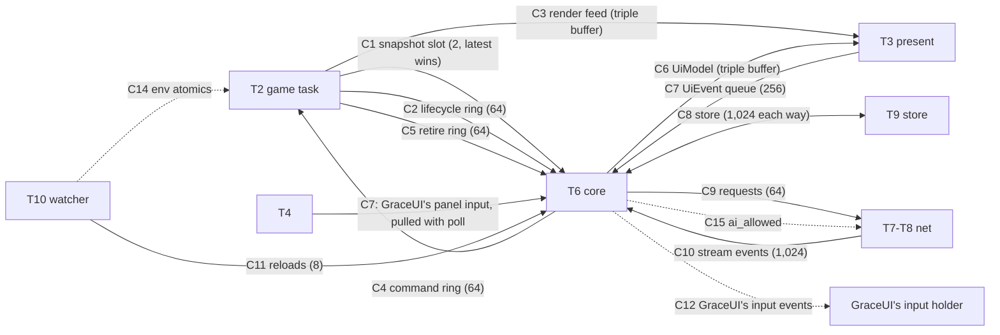
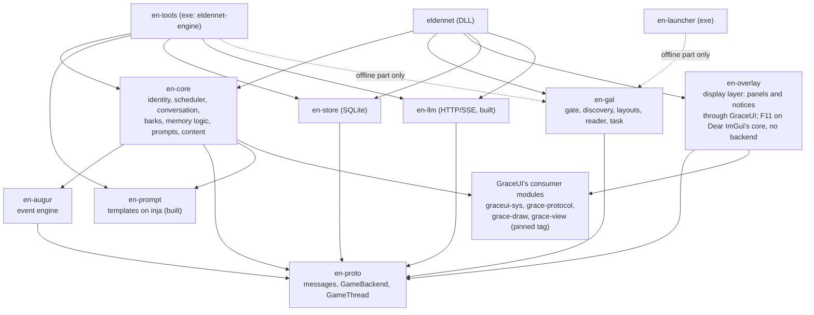
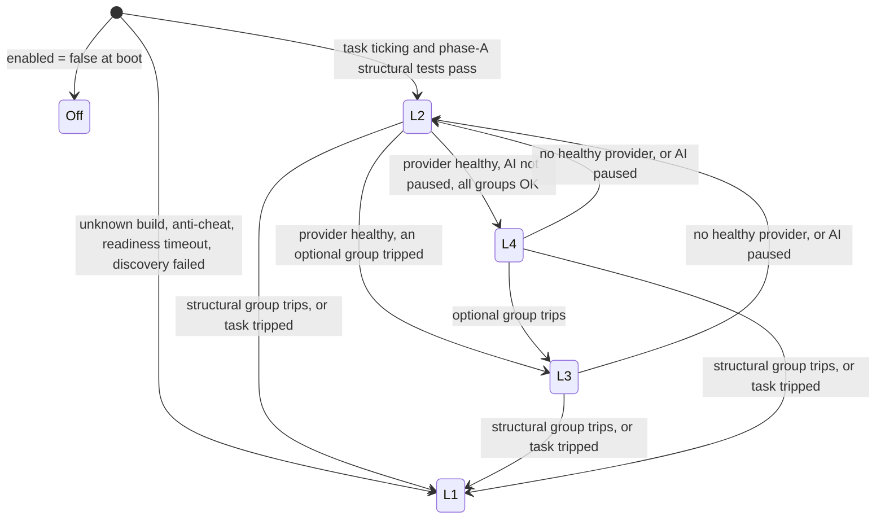
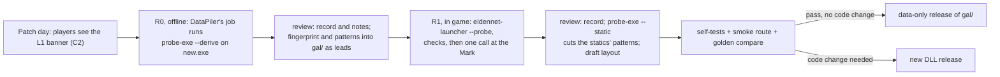
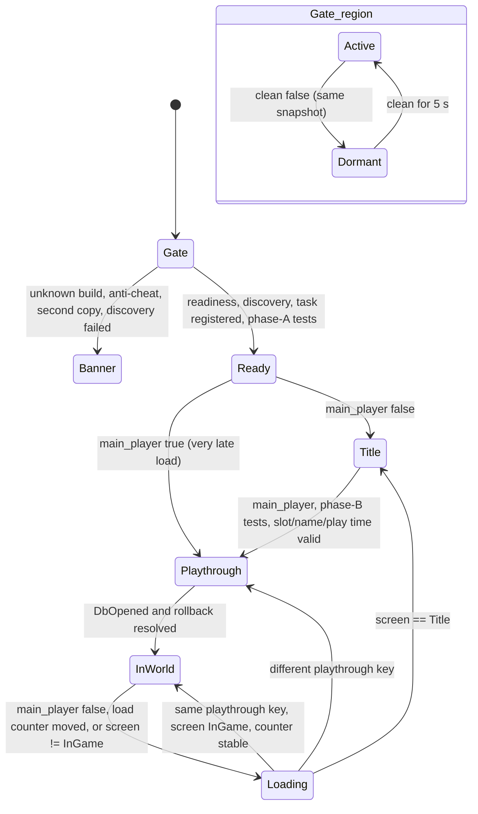

# EldenNet v1: code architecture

> **Status:** detail document under [DESIGN.md](DESIGN.md), 2026-11-06, re-based on C++ on 2026-11-16 (O60, O84;
> roadmap S8.1.e). It expands DESIGN §2–§6, §11, §14 and §15 into implementation detail. **DESIGN.md is
> authoritative.** Where this document seems to disagree with it, DESIGN wins, and the gap is a bug in this document.
> **Target:** ELDEN RING PC/Steam, App 1.17.2, exe 2.7.2.0 (WW) and 2.7.2.1 (JP), offline only.
> **Citations:** `DESIGN §x` points into the master design. `ER0n §x` and `SN0n §x` are research notes, and `P1 §x` and `J1 #n` point into [process/](process/). LIKELY, SPECULATION and RE-needed keep the research's evidence labels. **(impl)** marks a number or choice this document adds. DESIGN does not fix it, and it can change without a design review.
> **How to read it:** §0 maps each section to the DESIGN section it expands. Read §1–§3 for how EldenNet starts and stays safe, §6–§7 for the Game Access Layer and the snapshot, §8 for Augur, and §10 for the crash-safety rules and how CI enforces them. The review's changes are in [process/review.md](process/review.md).
> **Owner rules applied throughout:** no me3 code, crates, APIs or reliance on its behaviour. No fromsoftware-rs code or data, at any commit. Facts about game structures from the research are *leads*, and each one is confirmed in game or by a self-test before code relies on it (DESIGN §4.2, O4). No game writes, no game-code hooks, and no game-function calls after `register_task`, except the init-time singleton-name getter fallback (DESIGN R2, §4.2).

---

## 0. Reading guide

| § | Covers | Expands |
|---|---|---|
| 1 | Processes, threads, channels, startup, shutdown, single instance | DESIGN §2.1, R6, R14, R16 |
| 2 | The 11 modules, their APIs, dependency rules, lints, build options, build profile | DESIGN §2.2–§2.4 |
| 3 | The DLL load contract and the init state machine | DESIGN §3.1, §3.5 |
| 4 | The launcher, the alternatives, and the me3-native page | DESIGN §3.2, §3.3, §3.6 |
| 5 | The offline and multiplayer gate | DESIGN §3.4 |
| 6 | The Game Access Layer | DESIGN §4 |
| 7 | `WorldSnapshot`, cadence, render feed, recordings | DESIGN §5.1–§5.2 |
| 8 | Augur, the event engine | DESIGN §5.3–§5.4, §6 |
| 9 | The lifecycle state machine | DESIGN §2.5 |
| 10 | Crash-safety rules and their enforcement | DESIGN §2.6–§2.7 |
| 11 | The LLM client, configuration and decision calls | DESIGN §11 |
| 12 | Testing, CI and tooling | DESIGN §14, §4.6 |
| 13 | Repo layout | DESIGN §15 |

**Clocks and units.**
- `mono` is milliseconds (or microseconds where marked `_us`) from `QueryPerformanceCounter`. It is the only wall-independent clock.
- `play` is the game's play time in milliseconds (`GameDataMan`), and it is the rollback clock (DESIGN §10.5).
- Distances are metres in Havok space. Angles are degrees unless marked `rad`.
- Offsets are hex. "Copy size" is the number of bytes one guarded copy reads for one object.

---

## 1. Processes and threads

### 1.1 Processes

| Process | Lifetime | Contains |
|---|---|---|
| `eldennet-launcher.exe` | A launch, then, since O71, the whole session in the background as the crash watcher; it exits when the game does (§4) | Discovery, pre-flight, backups, `steam_appid.txt`, injection; plugins (§4.12); the crash watcher and the watch block it shares with EldenNet ([proposal 0001](../proposals/0001-plugins.md) §13.7; §4.14); in development, the dev console, the Mark and R1 (O89, O90) |
| `eldenring.exe` | The game session | `eldennet.dll`: GAL, core, store, net, overlay. All ML is reached over HTTP (DESIGN §2.1) |

No helper process is spawned from inside the game, save one: under another loader, EldenNet starts the crash watcher
itself, `eldennet-launcher --watch <pid>` beside the DLL (O71; §4.14). The out-of-process core stays a seam
(`CoreTransport`, §2.2, DESIGN §13).

### 1.2 Thread inventory

| # | Thread | Created by | Owner | Runs | Game memory | May block | Allocation | On an exception |
|---|---|---|---|---|---|---|---|---|
| T1 | **Init** (transient) | `DllMain` → `CreateThread` | `eldennet`'s `boot`, `en-gal`'s `sys` | Gate, safety, settings, connect to GraceUI, readiness, discovery, the reader's start, worker spawn (§3) | Image only (PE headers, `.text`/`.rdata`/`.data` scans, static slots). No call into game code (O101, since 2026-11-22: the getter fallback and `register_task` are no part of a v1 start; only the probe's R1 round makes them) | Yes (polls with `Sleep(100)`) | Free | `ffi_guard` → L1 banner through GraceUI's `notice` if connected, otherwise a silent exit |
| T2 | **Reader** (since 2026-11-22; O101 (b), proposal 0005 §9.4 and §10: a thread of EldenNet's own, never the game's) | T1, at Reader (§3.2), suspended until the stack table is made again | `en-gal`'s `task` (`ReaderLoop`, stepped about 30 times a second) | The one task closure: command drain, render feed, snapshot (about 10 a second, 5 while throttled), flag frame, text and params (§7.3), with steady reading (§6.6) | **Yes, only here** (R1), by guarded copies; it calls nothing of the game and writes nothing to it | Sleeps between steps; never on a lock | None after warm-up (the first 3 snapshot ticks); retired buffers go back to the core (C5) | `ffi_guard` → task component tripped → the closure returns at once → L1 |
| T3 | **Present** | The game (D3D12 present path) | GraceUI's render callback on its Present hook, drawn with Dear ImGui's DX12 backend (GraceUI G15, O25); EldenNet's part is `en-overlay`'s `on_present` callback | EldenNet's callback draws `UiModel` and the render feed as panels within GraceUI's budget (0.5 ms p99, GraceUI D71); GraceUI stamps the last render | No | Never | EldenNet's code: none after warm-up | GraceUI suspends a callback over budget for 120 frames; EldenNet's own trip → its panels draw nothing |
| T4 | **Window procedure** | The game's window thread | GraceUI (its window-procedure filter) | GraceUI pairs characters, places the IME, releases capture on focus loss and hands characters to the holder, EldenNet's chat box among them | No | Never | None | GraceUI's rules |
| T5 | **Game input** (one or more) | Whichever game thread calls `GetDeviceState` / `XInputGetState` | GraceUI (its DInput and XInput detours) | Zero the keyboard and mouse buffers and neutralise pads while a holder has input; the held-key mask (DESIGN §8.1, applied by GraceUI to every holder) | No | Never | None | GraceUI's rules |
| T6 | **Core** | T1, after the safety step | `eldennet`'s `shell` running `en-core` | Waits on one wake signal that every producer of C1–C11 and C16 raises, then drains each in a fixed order → `Core::step(input, now)` → effects | No | Only on its wake signal | Bounded (§10.2) | Subsystem reset after the first exception, disabled after the second (R8). An exception outside a subsystem stops the core: capture released, banner "EldenNet stopped after an internal error" |
| T7–T8 | **Net**: en-llm's own threads (built), a fixed pool of one more worker than the providers' total concurrency (2 to 8) and one dispatcher; on Windows also each exchange's driver thread (WHY§102) | T6 at Ready | `en-llm` (its `Service`, §2.2) | HTTPS and SSE streams; local probes; the dispatcher keeps the start deadlines and calls the notify callback (C10) | No | Network I/O: each worker waits on its own request | Yes | Caught per request: the request ends as `BadRequest` (built) |
| T9 | **Store** | T6 at Ready | `en-store` | One SQLite connection per open file, through its C API; migrations; backups | No | Disk I/O | Yes | Store tripped → toast "Memory is off for this session"; P events stay in the RAM ring (§8.9) |
| T10 | **Watcher** | T6 | `eldennet`'s `watch` (`ReadDirectoryChangesW`) | Hot reload with parse and validation (§11.6); saves the player's profile files sent on C17, after the same validation; every 60 s re-checks loaded modules for anti-cheat and `ersc.dll` (C14) | No | Yes | Yes | Hot reload off for the session, with a toast |
| T11 | **Log writer** | T6 | `eldennet`'s logger (our own, scrubbed; it never blocks a caller) | Writes rotating logs | No | Disk I/O | Yes | Lines dropped |

No other thread is created by EldenNet. GraceUI, a separate module, starts its own short init thread and its server's
threads (GraceUI D71, D81). The game's own threads enter EldenNet's code only through T2 and through GraceUI's
`on_present` callback on T3, and WinHTTP's own threads only through en-llm's status callback, which queues what
completed for the exchange's driver (WHY§102). Each of those entries is `noexcept` and starts with `ffi_guard` (R3).

**The AI pages, as built** (*2026-11-21*, S11.4.a's second and third slices). T1, on the main path after the safety
step, reads `providers.toml` and `secrets.toml`, `models.toml` beside the DLL, and makes en-llm's transport factory
(no traffic). T6 parses them, fills the AI pages' facts each wake, and takes the space's changes and requests as
values; a key's value is taken out of the request at once into en-llm's `Secret` and every copy EldenNet holds is
overwritten (the request's, the parsed frame's, the poll buffer's after each command), while GraceUI's and toml++'s
stay best effort. Each edit of `providers.toml` or `secrets.toml` is parsed before T6 takes it, then posted to T11,
which makes the same edit on the file as it is then and writes it beside and renames it over, `secrets.toml` with
§11.5's access list. T6 makes T7–T8 when a self-test or a model list first needs them. Log words: `ai_change
what=add|add_own|preset|key|key_place|model|model_reset|remove`, with no URL, model id or typed name.

**GraceUI's calls, as built** (the first in-game build's part 12, 2026-11-20; WHY§216 to §218, §230). T1 alone looks
for GraceUI and connects (§1.4, §3.2), and makes, with `debug.panel`, the F11 view's context, atlas, panel and hotkey,
and the Mark's hotkey when it is asked for then. Once T1 has published the connection, T6 alone calls GraceUI, after
each wake (at most every 100 ms): the banner and the pause badge as notices (`notice`), the world-state claims when
they change (`set_world_state`), `poll` until nothing waits (each hotkey event names its presses since the last: an
odd count of F11's toggles the view, and each of the Mark's is stamped), the view's frame while it is open (built on Dear ImGui's core, then `submit`;
`show_panel` after the first list, `hide_panel` to close), and `register_mark` when the launcher's console asks for
the Mark later. `poll` answering not connected or inactive ends it: nothing more is called. v0.1 registers no
`on_present` callback, so none of EldenNet's code runs on T3; GraceUI draws on T3 the lists T6 submitted. The chat
box's typing (GraceUI 0.2.1's holder events, D176, ABI 1.1) and the display's scale (0.2.2's display event, D180, ABI
1.2; O93) will reach EldenNet through the same `poll` on T6 (WHY§241, §245, §252).

### 1.3 Channels



| # | From → to | Type | Capacity | Overflow policy |
|---|---|---|---|---|
| C1 | Task → core | `SnapSlot`: two preallocated `WorldSnapshot` buffers, each with an atomic state `Empty/Writing/Ready/Reading` | 2 | The writer overwrites a `Ready` slot the reader has not taken and sets `gap = true` in it. The reader always finds the newest snapshot. The core copies it out (≈ 8 KB, one copy into its own preallocated snapshot) and releases the slot at once |
| C2 | Task → core | SPSC ring of the fixed-size `Lifecycle` (a `std::variant` of trivially copyable kinds) | 64 | Not expected to fill. If full, the task sets the sticky `LIFECYCLE_OVERFLOW` atomic, and the core rebuilds the lifecycle state from the next snapshot's `life` and `health` fields (§9) |
| C3 | Task → overlay | Triple buffer of `RenderFeed` (§7.5), with an atomic index swap | 3 | Latest wins |
| C4 | Core → task | SPSC ring of `GameCommand` (DESIGN §2.3). Payloads are inline (a `FixedVector` within its capacity) or a `std::shared_ptr` whose last copy the task never releases (C5) | 64 | The core keeps an outbox. `SetWatchFlags` and `SetTracked` coalesce, last writer wins. `Resolve*` requests are deduplicated and re-sent if no answer arrives within 2 snapshots (impl) |
| C5 | Task → core | SPSC ring of `Retired` (the `std::shared_ptr<const std::vector<std::uint32_t>>` watch lists a newer version replaced) | 64 | If full, the task parks the pointer in a fixed 4-slot holdback and retries next tick. It never frees memory on the game thread |
| C6 | Core → overlay | Triple buffer of `UiModel`, with an atomic index swap, as C3: the core fills the free slot and publishes it; the overlay takes the newest at the start of a frame | 3 | Latest wins. The core owns every slot and reuses one only once the overlay has moved off it, so the present thread never waits and never frees (R6). Not `std::atomic<std::shared_ptr>`: MSVC's library and libstdc++ take a lock in it, and the present thread could drop the last copy |
| C7 | Overlay → core; since GraceUI's G15 also the chat box's input, which GraceUI's window procedure hands over and T6 pulls with `poll` | A lock-free bounded queue of `UiEvent` (our own) | 256 | `try_push`. On full, typing, page and debug events are dropped and counted. `Submit` and `CloseChat` wait in a one-slot retry cell inside the overlay and are pushed on the next frame |
| C8 | Core ↔ store | Bounded queues of our own (`DbRequest` / `DbResult`) | 1,024 each way | Diagnostics (traces, counters) are dropped first. P events are never dropped: they spill into the core's 4,096-entry RAM ring, with 256 slots reserved for speech (§8.9, DESIGN §6.6) |
| C9 | Core → net | The handle's request queue (built): `Service::submit` never blocks, and answers `Accepted`, `Full`, `Duplicate`, `Invalid` or `ShutDown` | 64 | Pool jobs are dropped first (an evicted `bark_pool` job ends `Dropped`) and memory jobs requeue (`Preempted`). Replies are never dropped; at most one dialogue request is in flight, and a persona's own-initiative request yields: the player's `Submit` and any input epoch cancel it first (DESIGN §6.6, §8.9) |
| C10 | Net → core | The handle's event queue of `LlmEvent` (built), read with `poll`, `drain` or `wait`; its notify callback raises the core's wake signal | 1,024 | A worker with a delta for a full queue waits; backpressure then reaches the HTTP stream. Tokens are never dropped. An ending never waits: it may pass the capacity by at most one per live request, so shutdown never blocks (WHY§101) |
| C11 | Watcher → core | A bounded queue of our own of `Reload` | 8 | Coalescing: a newer `ContentPack` or `Settings` replaces a queued one |
| C12 | Overlay ↔ GraceUI's input | GraceUI's state since its G15: EldenNet asks with `request_input` and `release_input`, and reads "input granted, refused, lost and free" and "input held by" through `poll`; the player-input epoch stays EldenNet's own atomic (`EPOCH`, a `std::atomic<std::uint64_t>`), advanced on those events | — | None |
| C13 | Task → debug and core | Per-group fault counters and a fixed 64-bucket timing histogram, all atomics | — | None; they saturate |
| C14 | Init and watcher → task | `ANTICHEAT` and `ERSC_LOADED`, each a `std::atomic<bool>`. *As built (WHY§191):* the core thread joins them to each snapshot's session before the core judges it; the task's own read leaves them false (WHY§169) | — | None |
| C15 | Core → net | `AI_ALLOWED`: the client's gate, a `std::atomic<bool>` set with `Service::set_gate_open` (built). The net checks it before every send, as a second lock behind the core's own gate (C4 criterion, §5); closing it stops running requests and ends queued ones as `GateClosed` | — | None |
| C16 | Clock → core | A 100 ms tick (impl): the core's wait on its wake signal ends at the next tick at the latest, so expiry, page pacing and timers advance with no snapshots (title, loading) | — | Ticks coalesce |
| C17 | Core → watcher | A bounded queue of our own of `ProfileWrite` (`target`, `rev`, the file's text) from the settings UI's profile editor (DESIGN §7.7) | 8 | Never blocks: when full the save is refused with "busy, try again"; the result returns on C11 as `Reload::ProfileResult { target, rev, outcome }` |

The game, present, window and input threads use only non-blocking `try_push` and `try_pop` on lock-free queues,
atomics and preallocated buffers (DESIGN §2.1, R6). The SPSC rings (C2, C4, C5) and C7 are our own lock-free rings over
preallocated arrays. The bounded queues of C8, C11 and C17 are our own too, a mutex and a condition variable around a
ring, with the overflow policies above; only T6, T9 and T10 use them, and the core only with `try_push`. Every producer
of the core's inputs raises its one wake signal, the handle's notify callback among them.

*Since 2026-11-22 (WHY§364 (8), WHY§399, WHY§439; built with the first conversation, S11.3):* since GraceUI's G15, T6
alone calls GraceUI, so C6 and C7 do not cross to a present thread of EldenNet's. The core publishes its `UiModel` whole
after each step, and en-overlay draws it on T6 in the same wake, submitting each panel's list to GraceUI at most every
100 ms. The surfaces' `UiEvent`s (the talk key, Tab and the box's typing from `poll`, then the PageShown and Close that
drawing raises) go to the core in that wake, a few rounds at most. T6 waits on its wake signal and GraceUI's wait handle
together, with C16's 100 ms as the fallback.

### 1.4 Startup order

```mermaid
sequenceDiagram
  participant L as Loader (launcher, me3 or other)
  participant D as DllMain
  participant I as T1 init
  participant O as en-overlay
  participant U as GraceUI (graceui.dll)
  participant G as Game thread
  participant C as T6 core
  L->>D: LoadLibraryW (any time)
  D->>D: DisableThreadLibraryCalls, CreateThread(init)
  D-->>L: TRUE (no other work under loader lock)
  I->>I: pin module, single-instance mutex (R16)
  I->>I: gate (PE version vs gal/builds.toml)
  I->>I: safety (anti-cheat; the launcher's watch block, or the watcher started)
  I->>I: settings.toml: enabled? (no → exit, Off)
  I->>C: spawn core, watcher, log writer
  I->>I: readiness 1: main window exists (poll 100 ms)
  I->>O: connect to GraceUI (GraceUI G15; EldenNet hooks nothing)
  O->>U: find graceui.dll, GraceUI_RequestApi(1), connect
  U-->>O: ok, inactive (anti-cheat), too_old or refused
  O->>U: register faces, panels, hotkeys; world-state provider
  alt gate or safety failed
    I->>I: crash filter installed
    I->>C: Banner(reason) → L1, init exits
  else
    I->>I: discovery: AOBs, FD4 singletons, RTTI (retries +5, +15, +30 s: also the wait for the names)
    I->>I: readiness 2: the task hub's instance non-null (≤ 120 s from T1's start)
    I->>I: crash filter installed (after the game's C runtime has set its own)
    I->>G: register_task(ChrIns_PostPhysics)
    I->>C: spawn store and net
    G->>G: first ticks: group check, phase-A self-tests
    G->>C: Lifecycle::DataReady(caps) → L2, L3 or L4
    I->>I: exit
  end
```

- The core is up before the overlay, so the overlay always has a `UiModel` to draw, the banner included.
- **The connect** (GraceUI §2.9, D70–D73, D88). The launcher has already checked GraceUI's folder (§4.3). `en-overlay`'s helper finds `graceui.dll` on T1 (by module name, an export scan, then `Game\GraceUI\graceui.dll`, polled every 250 ms for at most 30 s) and connects; GraceUI's own init thread installs the hooks. A failed connect leaves EldenNet headless: L2 at most, nothing drawn, logged, with a hint the next time the launcher runs (§10.3). After GraceUI's own anti-cheat hit, `connect` answers `inactive (anti-cheat)` and the banner goes through `notice`, which stays callable. EldenNet registers its space for the browser view only once its gate and safety steps pass (GraceUI D81).
- Store and net threads start only on the path that can reach L2. An L1 session never opens a database or a socket; the dashboard's socket is GraceUI's (GraceUI D81).
- `register_task` is called from T1, a non-main thread, as the game's contract requires (ER01 §3.1).
- **As built** (the first in-game build, 2026-11-16; WHY§191): the mutex is taken at Pin, discovery runs before the
  readiness wait and finds the readiness items with the rest (no separate scan), and the crash filter goes in only
  once the game has started (§3.2). The first build is headless: Connect is logged as skipped (`overlay.connect` stays
  off), and the banner reaches the core and the watch block but is not drawn until GraceUI's part lands (roadmap
  S10.4.d). *2026-11-20:* that last sentence is superseded by part 12 (the next item): `overlay.connect` is on by
  default, and the banner is drawn as a GraceUI notice.
- **The connect, as built** (part 12, 2026-11-20, on GraceUI's ABI 1 preview; WHY§215, §216, §221, §230 to §232).
  - **The look** is graceui-sys's own, `graceui_sys_find(GRACEUI_SYS_LOAD | GRACEUI_SYS_STOP_IF_ABSENT)` (GraceUI
    D164): a module named `graceui.dll`, an export scan, then `GraceUI\graceui.dll` in the game's folder, which
    EldenNet loads, again every 250 ms for at most 30 s; but when nothing answers, no copy is installed there and none
    is loaded, nothing can answer later, and the look ends at once, so a start without GraceUI is not held up 30 s.
    Both load orders work: GraceUI loaded before EldenNet is found by its name, and one installed but not yet loaded
    is loaded by EldenNet. graceui-sys at 3f1352b leaves `installed` at 0 for a GraceUI found by its name, so
    en-overlay reports a find by name as installed until it re-vendors from GraceUI c781a85 (WHY§231). EldenNet loads
    GraceUI only after WaitWindow: under Wine 9 a load before the game's first window could hang in `dxgi.dll`'s load
    (WHY§232; GraceUI c781a85 imports no Direct3D DLL since).
  - **`connect`** as `eldennet` (its id and its space's), with its version, its floor (GraceUI 0.1.0, in en-proto's
    `graceui_pin.hpp` beside the GraceUI commit graceui-sys is vendored from) and the caps it uses: `notices world-state
    hotkeys`, with `panels textures` for the view. `ok` connects; `inactive` for the anti-cheat with a handle is the
    notice-only mode (the banner through `notice` alone, D88); `too_old`, `duplicate_id`, `inactive` otherwise,
    `refused`, `not_yet` and no GraceUI leave EldenNet headless, with one log line (`connect ok=… outcome=… how=…
    looks=… installed=… graceui=… view=… mark=… mark_bound=… world=…`), and the start goes on. Then the F11 view, with
    `debug.panel` only (WHY§218), and the Mark's hotkey when asked for (§4.14). No face is registered yet: the view
    draws with Dear ImGui's own bitmap font, whose atlas is registered as a texture before any submit.
  - `overlay.connect = false` skips it (`connect skipped=1 why=off`). In a run of GraceUI's observer (`--spike s0e` or
    `s4`) the connect runs as usual, and T1 stops at Register (§3.2; WHY§249).
  - **A notice may go unseen.** The player may quiet EldenNet's notices on GraceUI's Installed mods page (GraceUI G32,
    D181); a quiet mod's notice is still answered `ok` and kept on that page, not drawn over the game (WHY§260). So
    EldenNet never relies on a notice being seen: the banner's reason is also in the log and the watch block's status,
    and, once they exist, in EldenNet's own pages.
  - The chat box and O93's scaled text raise the floor when they land: a holder's events need GraceUI 0.2.1 (D176) and
    the display at connect 0.2.2 (D180), and graceui-sys is re-vendored from 0.2.1 or later first (WHY§245, §252).

### 1.5 Shutdown

The game never asks a DLL to shut down. EldenNet therefore never relies on a shutdown step.

| Event | What happens |
|---|---|
| Quit to the title | Lifecycle `Title` (§9): the conversation ends, P events flush, and the playthrough DB closes. Global DBs stay open |
| Runtime disable (`enabled = false` while running) | AI paused: the ladder drops to L2 (Observe), speech is dropped and no LLM request is sent. GraceUI's hooks, EldenNet's connection to them and the task stay installed (R12). Full **Off** takes effect at the next launch |
| Process exit (any path) | No code runs. Every DB request is one WAL transaction (R14). Speech commits (`PlayerSaid`, and each `NpcSaid` page as it shows) are sent as their own request in the same step. Other writes are coalesced by the core into one request at most every 250 ms (DESIGN §8.5). So a hard kill loses at most ≤ 250 ms of non-speech writes, and a shown line only in the few milliseconds before its own transaction commits. Logs may lose their last buffered lines |
| Crash of the game | Same as process exit. On the next `PlaythroughReady`, open conversations are closed and queued for memory (DESIGN §10.3) |
| `FreeLibrary` by a third party | Refused: T1 pins the module with `GetModuleHandleExW(GET_MODULE_HANDLE_EX_FLAG_PIN)` before anything else, because GraceUI's callbacks and the task point into our code (impl) |

### 1.6 Single-instance mutex (R16)

- Name: `Local\EldenNet.Instance.<pid>`, made per process by the PID.
- T1 calls `CreateMutexW(NULL, FALSE, name)` at Pin, right after pinning the module and before the gate, so that a second copy loaded a moment after the first cannot overtake it while it gates (WHY§191). If `GetLastError() == ERROR_ALREADY_EXISTS`, this copy is the second one. It closes the handle, writes one `OutputDebugStringW` line and exits T1. It writes no log, opens no watch block, installs no hooks, spawns no thread and registers no task.
- The first copy holds the handle for the life of the process and never closes it.
- At Ready, the first copy enumerates loaded modules. If another module exports the marker symbol `eldennet_instance_marker`, it shows one toast: "A second copy of EldenNet was loaded and is idle." This happens, for example, when both the launcher and a me3 profile load the DLL.

### 1.7 `DLL_PROCESS_DETACH` (R14)

`DllMain` handles `DLL_PROCESS_ATTACH` only. The detach branch returns `TRUE` and does nothing: no unregistering, no flushing, no thread joins, no frees and no logging. A CI grep checks that the branch is empty (§10).

The C++ runtime also runs code at detach, outside that branch: the destructors of objects of static or thread storage
duration. So the DLL holds none with a non-trivial destructor: its long-lived state is made at boot and never destroyed,
and clang's `-Wexit-time-destructors`, an error in every module the DLL links, keeps such objects out (§10.1).

---

## 2. Modules

### 2.1 Graph



The two dotted edges were added here and adopted into DESIGN §2.2 by the review. `eldennet-engine probe-exe` and the
launcher's build check need the PE parser, the pattern grammar and the `builds.toml` schema. These live in `en-gal`'s
**offline part** (its `pe`, `patterns`, `builds` and `layout` files): code over byte spans, with no Win32, no raw
address and no `reinterpret_cast`. It is a static library target of its own, which the full `en-gal` links; the dotted
edges link only that target, so `sys`, `reader` and `task` never reach the tools or the launcher.

### 2.2 Responsibilities and public API sketches

| Module | Owns | Public surface (sketch) |
|---|---|---|
| `en-proto` | Every message that crosses a thread or the adapter boundary. Each has a JSON form through nlohmann/json (`to_json`, `from_json`) | `WorldSnapshot`, `RenderFeed`, `Lifecycle`, `GameCommand`, `UiModel`, `UiEvent`, `LlmRequest`/`LlmEvent`, `DbRequest`/`DbResult`, `Capabilities`, `ReadHealth`, `ChrHandle`, `BlockId`, `SafeText`, the interface `GameBackend`, the token `GameThread`, `PROTO_VERSION`, `ffi_guard` and its components (R3), `parse_json`. Built (S8.1.j): `ffi_guard.hpp` (a constant-initialised tripped flag per component), `llm.hpp` (`LlmRequest`/`LlmEvent` and the request, decision and result types they carry, each with its JSON form; en-llm keeps their names by using-declarations, and §2.3 keeps `en-core` off `en-llm`) and `json.hpp` (§10.2's JSON caps, checked before nlohmann/json parses) |
| `en-augur` | Sources, world model, signals, detectors, rules, events, audience resolution, the K store, bus ordering | `Augur(RuleSet, Registry)`, `void Augur::step(const CoreInput&, Mono, const AugurCtx&, EventBatch&)`, the interface `EventSource`, `Expected<RuleSet, std::vector<RuleError>> RuleSet::load(std::span<const RuleFile>, const PredicateCompiler&)`, `Event`, `EventKind` |
| `en-prompt` (built, O84) | The template engine on inja 3.4, with SkyrimNet's template rules (its message markers and folders of numbered parts) made strict (NPC §7.1): composition with its guards, the function registry and the reference generated from it, lint; template sources (§2.3) | `Environment(std::shared_ptr<const TemplateSource>, FunctionRegistry, EnvironmentOptions)`, with `MemorySource(std::map<std::string, std::string>)` for `en-core` and `FolderSource(root)` for the tools (`Environment(root, …)` builds one), `std::vector<Message> Environment::render(std::string_view name, const nlohmann::json& context) const`, which throws a `TemplateError` naming the template, line and column, `std::vector<Finding> Environment::lint(std::string_view name, const nlohmann::json* context) const`, `FunctionRegistry::add` |
| `en-core` | Identity and tiers, content loading and validation, predicates, the world view and per-persona knowledge (`knowledge::world`), scheduler, conversation, barks, memory logic, prompts (rendered with en-prompt), decision calls (§11.8), sanitizer, lint, ladder policy, bus subscribers | `Core(std::shared_ptr<const ContentPack>, std::shared_ptr<const Settings>)`, `Outputs Core::step(CoreInput, Mono)`, `Expected<ContentPack, std::vector<ContentError>> ContentPack::load(const ContentFs&)`, the interface `CoreTransport`, `WorldView world::derive(const FlagState&, const WorldFacts&, const WorldContent&)`, `KnownSet world::known(PersonaId, const FlagState&, const WorldFacts&, const WorldView&, const WorldSeen&, const ContentPack&)`, `std::optional<Cue> world::cue(PersonaId, StageId, const KnownSet&, const WorldSeen&, const WorldCued&, const PersonaFacts&, const RenderedJournal&, const ContentPack&, Pt)` (MEM §12.13; `StageId` is the active stage `known()` resolved, whose `at` chooses LocalHere or LocalHome; its candidates are what the known set holds, O86) |
| `en-store` | SQLite files, migrations, the request loop, backups | `StoreHandle Store::spawn(StoreCfg)`, `Expected<void, Full> StoreHandle::send(DbRequest)`, `BoundedQueue<DbResult>& StoreHandle::results()` |
| `en-llm` (built, O84) | The OpenAI-compatible client and its transports (libcurl, WinHTTP), SSE parser, slots, health, budgets, decision calls (§11.8), local probes, warm-up, and the asynchronous handle the core drives (WHY§101) | `Service(Config, std::shared_ptr<TransportFactory>, ServiceOptions)`, `SubmitResult Service::submit(LlmRequest)`, and its `cancel(RequestId)`, `cancel_before_epoch(Epoch)`, `poll`, `drain`, `wait`, `set_notify`, `set_gate_open`, `warm_up(slot)`, `reload(Config)` and `shutdown`; the blocking `Client::chat` and `Client::decide` beneath it; `probe_local` (its `LocalEndpoint`s) and `list_models` |
| `en-gal` | The version gate, discovery, layouts, `GuardedReader`, read groups, the task, the snapshot builder, the FMG, param and flag readers, `SysLayer` | `Expected<BuildProfile, GateError> gate(const ImageView&, const Builds&)`, `Expected<Discovery, DiscoveryReport> discover(const SysLayer&, const BuildProfile&)`, `Expected<TaskToken, GalError> install_task(Discovery, TaskWiring)`, `class ErBackend : public GameBackend`, the interface `SysLayer` (§6.4) |
| `en-overlay` | EldenNet's display layer (GraceUI G15): the connection to GraceUI, every surface as a panel (subtitles, the chat box, the call-out box, the bark feed and labels, the talk hint) drawn in an `on_present` callback with `grace-draw` and `grace-view`, toasts and the banner as notices, its faces registered in GraceUI's atlas, input through `request_input`, its hotkeys registered with GraceUI, the world-state provider, and the F11 debug view on Dear ImGui's core (1.93.0, the version GraceUI pins, on a context of its own with no backend) submitted as a panel. Built (the first in-game build's part 12, 2026-11-20, on GraceUI's ABI 1 preview; WHY§215 to §221, §230, §231): through `graceui-sys` alone, its headers vendored unmodified from GraceUI 3f1352b, each checked by SHA-256 at configure time (`graceui_test.h`, the harness's, from 2131839, WHY§256), and Dear ImGui's core fetched at GraceUI's pin, in the Windows builds only, compiled as GraceUI's `gu_imgui_core` is; the banner (key 1) and the pause badge (key 2) as notices, replaced in place and withdrawn by an empty text; the world-state claims, danger and a game menu as v0.1's stand-ins (the player dead, a boss bar or a lock-on, in a world; the HUD's pop-up menu state) until NPC §5.4's `safe_context` and §5.8's menu read; F11's view (`debug.panel` only, SP8: its ribbon first, then EldenNet's status in our own words and numbers, no game text; it takes no input in GraceUI 0.1, D142), a panel of 680 × 420 at (24, 24), shown only after its first list; and the Mark's hotkey (§4.14). A hotkey another mod took first is registered unbound (`GRACEUI_UNBOUND`, a success with an id): F11's view is made all the same, and an unbound Mark leaves the launcher's Pause the Mark. Two parts: the view's lines and the claims are pure, in every build; the connection is the Windows builds', tested under Wine against a fake GraceUI of our own and end to end with GraceUI's test build. Not yet: faces, panels for the surfaces, `on_present`, input | `Expected<OverlayHandle, ConnectError> Overlay::connect(OverlayCfg, UiModelReader /* C6 */, RenderFeedReader, UiEventSink)`, `input::request()`, `input::release()`, `input::epoch()`. Built: `find()` (T1), `Overlay* Overlay::connect(const graceui::Api&, const Options&, Report&)` (T1), then on T6 `banner(text)`, `badge(text)`, `world(flags)`, `step(status)` (the poll, the view's frame) and `register_mark()` |
| `eldennet` | `DllMain`, the boot sequence, thread spawning, wiring, the effect shell; its foreign entries start with en-proto's `ffi_guard` | `extern "C" BOOL WINAPI DllMain(HINSTANCE, DWORD, LPVOID) noexcept`, `extern "C" __declspec(dllexport) const std::uint32_t eldennet_instance_marker` |
| `en-launcher` | The launcher program (§4) | CLI only |
| `en-tools` | The `eldennet-engine` command (built: `render-prompt`, `chat`, `decide`, `probe`, `models`), with the developer tools as its subcommands (§12.3), the replay `GameBackend` | CLI only |

```cpp
// en-core: the seam that lets a later out-of-process core replace the in-process one (DESIGN §13).
class CoreTransport {
 public:
  virtual ~CoreTransport() = default;
  virtual Expected<void, TransportError> push(CoreInput input, Mono now) = 0;
  virtual void poll_outputs(std::vector<Outputs>& out) = 0;
};
class InProcess final : public CoreTransport { Core core_; /* … */ };   // v1: calls Core::step directly on T6

struct CoreInput {
  struct Tick {};
  std::variant<std::unique_ptr<WorldSnapshot>, Lifecycle, UiEvent, LlmEvent, DbResult, Reload,
               EnvFacts /* SteamID folders, paths */, Tick> payload;
};
struct Outputs {
  std::vector<GameCommand> game; std::shared_ptr<const UiModel> ui /* null: unchanged */;
  std::vector<LlmRequest> llm; std::vector<RequestId> cancel; std::vector<DbRequest> db; bool ai_allowed;
  std::vector<LogRecord> log;
};
```

**The store's rules** (`en-store`; WHY§98 names the traps they avoid):
- a migration file is split into statements by SQLite's own parser (each prepared in turn from the tail the last one
  left), never by searching for `;`, so a trigger or a string that holds one stays whole;
- every id is 64-bit end to end: bound and read as a 64-bit integer, never through a 32-bit value or a double, and
  written as a string wherever a JSON reader may hold numbers as doubles (GraceUI's browser view);
- ids are never reused: a trim (MEM §9.2) never hands a removed row's id to a new row (impl: `AUTOINCREMENT`, or a
  high-water mark kept across trims), so an id that a view or, after v1.0, a code plugin holds (O68) never comes to
  name another row;
- numbers written into SQL, JSON, prompts or logs read the same in every locale: the shortest form that reads back
  exactly, with `.` as the decimal point and no grouping;
- the DB tests use realistic ids, above 2³² and above 2⁵³, never only 1, 2 and 3 (§12.2).

*Since 2026-11-28 (WHY§693; built in v0.3's first slice):* `DbRequest` and `DbResult` have no JSON form. They carry
chat and model text and the player's file keys, cross only between the core and T9, and are never logged, recorded or
reported; their tests use the structs. Every other message keeps its JSON form.

### 2.3 Dependency rules

| Module | May depend on | Must not depend on |
|---|---|---|
| `en-proto` | The standard library; nlohmann/json 3.11.3 (each message's JSON form). Our own fixed-capacity `FixedVector` and `FixedString` and the flag sets (an `enum class` with bitwise operators) live here | Anything with I/O, threads, clocks, Win32 or game knowledge |
| `en-augur` | `en-proto`, nlohmann/json, toml++ 3.4.0 (the rule files), our own `IndexMap` (a vector in insertion order with a hash index beside it) | `en-core`, `en-gal`, `en-store`, `en-llm`, `en-overlay`, any thread or network library, the Windows SDK, `std::filesystem` and file streams, any clock |
| `en-prompt` (built) | inja 3.4.0 (vendored, MIT), nlohmann/json; the standard library (`std::filesystem` and file streams in its folder source only, for the tools) | Every other module of ours, the Windows SDK, any clock |
| `en-core` | `en-augur`, `en-proto`, `en-prompt` (the template engine on inja, O84), toml++, nlohmann/json, RE2 (where a pattern comes from content, §10.2), utf8proc (grapheme boundaries), BLAKE3 (its C implementation, or the launcher's own hash extended to the keyed modes, chosen when the keyed hashes are built; WHY§174), GraceUI's `grace-protocol` (pinned by tag; GraceUI eldennet-changes §2 item 5) | `en-gal`, `en-overlay`, `en-store`, `en-llm`, any network library, libcurl, WinHTTP, SQLite, the Windows SDK, any clock |
| `en-store` | `en-proto`, SQLite (its amalgamation, pinned at adoption, through its C API), the standard library's threads (the request loop and C8's queues) | `en-core`, `en-gal`, `en-overlay`, `en-llm` |
| `en-llm` (built) | `en-proto`, nlohmann/json, toml++ (its configuration files), libcurl (Linux and test builds, the `EN_WITH_CURL` option), the system's WinHTTP (Windows: loaded at run time by its full path from the system directory, never imported), the standard library's threads | `en-core`, `en-gal`, `en-overlay`, `en-store` |
| `en-gal` | `en-proto`, the Windows SDK's headers (`sys` only), toml++ | `en-core`, `en-augur`, `en-store`, `en-llm`, `en-overlay`, Dear ImGui, any network library |
| `en-overlay` | `en-proto`; GraceUI's `graceui-sys` (its header-only C helper and thin C++ wrapper), `grace-draw` and `grace-view`, pinned by tag and commit (GraceUI G15, its §2.7); Dear ImGui's core with no renderer backend, at the version GraceUI pins (1.93.0), for F11's context; the Windows SDK's headers | `en-gal` (it can never reach game memory), `en-core`; since GraceUI's G15, MinHook or any other hook library, an ImGui renderer backend, and GraceUI's `grace-host` and `grace-serve` (GraceUI invariant 16; DESIGN R12) |
| `eldennet` | All of the above and the Windows SDK (`ReadDirectoryChangesW` for T10). Its queues and its logger are our own (§1.3) | — |
| `en-launcher` | `en-gal`'s offline part (the PE reader and `builds.toml`'s gate) and, through it, `en-proto` (the watch block it shares with EldenNet, §4.14, and `ffi_guard`); nlohmann/json and toml++ (its records and its settings); the Windows SDK; our own BLAKE3 hash (`blake3.cpp`, written from the specification and checked against its published test vectors, for the backup manifests, §4.4), in place of BLAKE3's C implementation, which would have added a C compiler to every build and a third-party target for one function (WHY§174); for `--probe`'s lint of R1's reports, the report vocabularies in `eldennet`'s portable part, `en_shell` (WHY§199); once it serves the dashboard off game (O76), GraceUI's `grace-serve`, pinned by tag (GraceUI G29, §4.13) | Every other module of ours |
| `en-tools` | `en-core`, `en-prompt`, `en-augur`, `en-store`, `en-llm`, `en-gal`'s offline part, zstd; doctest for its tests | `en-overlay`, the rest of `en-gal` (`sys`, `reader`, `task`) |

**`en-prompt` inside `en-core`.** `en-prompt` finds every template through a template source of its own
(`TemplateSource`, built in roadmap S8.1.j), which answers only what a name is (a file, a folder of parts or nothing),
which files a folder holds and what a file says. The name rules, a folder's parts and their order, and composition stay
in the environment, so every source gives the same messages and the same errors. The tools use `FolderSource`, which
reads a folder and refuses a name or a link that leads out of it. `en-core` does no I/O, so it hands `en-prompt` the
content pack's templates, already loaded by the content loader, in a `MemorySource`, which opens no file (its tests
render with no file of those names on disk); the folder source is never reached from `en-core`. Errors stay inside
`en-core` as `TemplateError`, caught where a prompt is built.

Every third-party library is vendored with its licence, or fetched at configure time from its own project, pinned by
SHA-256, into the build tree, and listed in `THIRD_PARTY.md` (§12.1).

*Since 2026-11-28 (WHY§692, WHY§696; built in v0.3's first slice):* BLAKE3 is our own, in `en-proto`, with its keyed
and derive-key modes, checked against BLAKE3's published cases; `en-core` (the playthrough's fingerprint) and
`en-launcher` (the backups) share it, and no BLAKE3 library is linked. SQLite is 3.54.1's amalgamation (O146), fetched
from sqlite.org and pinned by its SHA3-256 and SHA-256. Code in the DLL's modules uses no `std::chrono::clock_cast`,
`zoned_time` or `current_zone`: MSVC's library then pulls in its time-zone database, which reads the registry and links
`Advapi32`.

**Never, in any module, at any version:** fromsoftware-rs's crates (`eldenring`, `shared`, `fromsoftware-*`),
`from-singleton`, me3's crates (`me3-*`), `dearxan`, libER, or code copied from any of them. The third-party check
refuses them by name (§12.1), and review refuses code copied from them the same way.

### 2.4 Lints and raw addresses

Every module builds with warnings as errors (`-Wall -Wextra -Wpedantic`, `/W4`) and with the checked-in `clang-tidy`
configuration, which carries the checks below for each module; a CI grep backs the ones `clang-tidy` cannot express.

| Module | Checks (`clang-tidy` and the CI grep) | Raw addresses and casts |
|---|---|---|
| `en-proto`, `en-augur`, `en-core` | Banned calls: every clock (`std::chrono`'s `now`, `QueryPerformanceCounter`), `std::this_thread::sleep_for` and `sleep_until`, `std::filesystem` and file streams, `std::getenv`. Banned types: `std::unordered_map` and `std::unordered_set` outside our own `IndexMap`, whose hash index is never iterated (iteration order differs between standard libraries and must replay bit for bit; use `std::map` or `IndexMap`) | None: no raw address and no `reinterpret_cast` |
| `en-gal` | Nothing that throws or aborts (`throw`, `assert`, `std::abort`, `std::terminate`, `__builtin_unreachable`); no unchecked access to a `std::optional` or an `Expected` (`bugprone-unchecked-optional-access` for the first); no unchecked indexing (`operator[]` only after a bound check, never `.at()`); checked arithmetic on values read from the game, never a silent wrap or a narrowing conversion; every raw-address operation with a `// SAFETY:` note; no lock type (`std::mutex`, `std::shared_mutex`, `std::condition_variable`, `CRITICAL_SECTION`, `SRWLOCK`) | `reader` (the SEH-guarded copy), `sys` (image view, trampoline, `register_task`, getter fallback, mutex, module and thread APIs) |
| `en-overlay` | Same list as `en-gal`. Since GraceUI's G15 it holds no hook: never unhooking or unloading while the game runs is the rule of GraceUI's `grace-host` (R12) | `abi` (calls across GraceUI's C ABI through `graceui-sys`, the `on_present` callback's entry, spans over its own draw lists) |
| `eldennet` | Same list as `en-gal` | None. Its `exports` file holds its two exports (`DllMain` and `eldennet_instance_marker`, §2.2) and no cast; `DllMain` calls `en::gal::sys::boot::on_attach`, which does the Win32 work |
| `en-store`, `en-llm`, `en-prompt`, `en-tools` | No unchecked access to a `std::optional` or an `Expected` (a warning in tests) | No game address. Casts only for a C API's own pointers (SQLite's, libcurl's and WinHTTP's callback contexts, `GetProcAddress`'s answer) |
| `en-launcher` | Same list as `en-gal` | `win` (process creation and injection: the other process's addresses and the Win32 handles). It runs outside the game process, so R9's in-process list does not cover it |

Every raw-address operation and every `reinterpret_cast` carries a `// SAFETY:` note (R9). A CI grep and `clang-tidy`
(`cppcoreguidelines-pro-type-reinterpret-cast`, `cppcoreguidelines-pro-bounds-pointer-arithmetic`) keep them inside
the files of the last column. `bugprone-exception-escape` checks that no exception leaves a destructor or a `noexcept`
function, and so no entry from foreign code (R3, R15).

### 2.5 Build options (all off by default)

Each is a CMake option that defines its macro (`EN_PROBE` and the rest) for the modules it names only; every other
module builds the same with it on or off.

| Option | Modules | Enables | Release CI |
|---|---|---|---|
| `probe` (`EN_PROBE`) | `en-gal`, `eldennet` | *Since 2026-11-22 (O106): R1 is retired; the probe build runs the read-only rounds (`probe = { round = "read" }`, the launcher's `--read`; proposal 0005, L5 and L6), which call nothing in the game. The rest of this row is history.* The derivation round's R1 (§6.2, §6.10): the live derivation, the one call at the Mark, the slot counts, the hub census, the statics' slot searches and the invariant searches for a draft layout; the fault injection used by S0-D and the C1 forced fail-closed launches; the launcher's crash request (`s0d-crash`). Built as its own DLL, `probe/eldennet.dll`, and `settings.toml`'s `probe` table is refused by any other (§11.5) | Refused |
| `hooks` (`EN_HOOKS`) | `en-augur`, `en-gal` | Hook sources H1–H3 (§8.11), and with them EldenNet's own hook library, in `en-gal`'s `hooks` (O65). Compiled out in v1 | Refused |
| `actions` (`EN_ACTIONS`) | `en-proto`, `en-core` | `GameCommand::Action`, executors, prompt partials | Refused |
| `freeze` (`EN_FREEZE`) | `en-proto`, `en-gal` | `GameCommand::Freeze` | Refused |
| `offline` | `en-gal` | Not an option but a target of its own: the offline part (§2.1), which the tools and the launcher link | Allowed (tools and launcher) |

The release job reads the release build's CMake cache and fails if any of `EN_PROBE`, `EN_HOOKS`, `EN_ACTIONS` or
`EN_FREEZE` is on, or if `eldennet.dll` links MinHook or an ImGui renderer backend at all (its link graph and its
symbols, `MH_*` and `ImGui_Impl*`; GraceUI's G15). GraceUI's release job checks its own pinned Dear ImGui and MinHook
(DESIGN O25).

### 2.6 Build profile and target

```cmake
# CMakeLists.txt: the release build of the Windows binaries, with clang-cl and lld-link
cmake_minimum_required(VERSION 3.20)            # CI pins LLVM and the xwin SDK and CRT
set(CMAKE_CXX_STANDARD 20)
set(CMAKE_MSVC_RUNTIME_LIBRARY MultiThreaded)   # /MT: the static CRT
if(MSVC)                                        # clang-cl
  add_compile_options(
    /EHsc                                       # R3: ffi_guard's catch-all depends on it; CI fails if this changes
    /W4 /WX /permissive- /utf-8 /O2 -flto=thin
    /Z7 -gline-tables-only                      # PDBs ship beside each release for crash triage, not in the zip
    /Brepro)
  add_link_options(/DEBUG /Brepro /INCREMENTAL:NO)
endif()
```

- **Target:** x64 Windows with MSVC's ABI, built on Linux CI with clang-cl and lld-link (LLVM, pinned) against the MSVC
  CRT and Windows SDK that xwin downloads (pinned), through a CMake toolchain file beside the MinGW-w64 one in `cmake/`.
  So debug information is PDB, and SEH (`__try`/`__except`) is available to C++ directly. Built (S8.1.i):
  `cmake/clang-cl-xwin.cmake`, LLVM 18, xwin 0.10.0, CRT 14.43.17.13 and SDK 10.0.26100, pinned in `cmake/xwin.lock`
  (the toolchain file refuses a splat that differs); 14.43, not the newest, since 14.44's standard library refuses a
  Clang older than 19 (WHY§111).
- **Static CRT:** `/MT`, so the DLL needs no Visual C++ runtime on the player's machine.
- **Deterministic link:** `/Brepro` at compile and link, path prefixes mapped (`/clang:-ffile-prefix-map`),
  `SOURCE_DATE_EPOCH` and no incremental link (§12.1).
- **Overflow in `en-gal`:** arithmetic on values read from the game goes through checked helpers of our own
  (`__builtin_add_overflow` and its kin), so an overflow is a read fault for its group → breaker, never a silent wrap.
- **The SEH-guarded copy** is C++ in `en-gal`'s `reader` (§6.5), compiled by clang-cl with `__try`/`__except` inline:
  no separate shim.
- **The second Windows build:** MinGW-w64 (GCC, its runtime linked statically) builds every module but `en-gal`'s
  `reader` and `sys`, which need `__try`, and so not the DLL; it runs the Windows tests under Wine in the container
  (WHY§102). Linux builds (GCC or Clang) run every portable test.

---

## 3. The DLL load contract

### 3.1 `DllMain`

```cpp
// src/eldennet/src/exports.cpp: the DLL's two exports, and no cast (§2.4)
extern "C" BOOL WINAPI DllMain(HINSTANCE module, DWORD reason, LPVOID) noexcept {
  return ffi_guard(Component::DllMain, TRUE, [&] {
    if (reason == DLL_PROCESS_ATTACH) en::gal::sys::boot::on_attach(module, &eldennet::boot::init_main);
    return TRUE;                                 // every other reason: nothing (R14)
  });
}
```

`on_attach` calls `DisableThreadLibraryCalls(module)` and `CreateThread(init_main)`, then returns. It allocates nothing, takes no lock and touches no file. The module path is resolved later, on T1, with `GetModuleFileNameW`. From that path T1 finds `content/`, `gal/` and the default log folder, so the install folder can live anywhere (DESIGN §3.1).

The CRT runs the dynamic initialisers of the DLL's static objects under the loader lock, before `DllMain`, so none of
them has one: clang's `-Wglobal-constructors` is an error in every module the DLL links, as `-Wexit-time-destructors`
is for detach (§1.7). Constants are `constexpr`, and the rest of the long-lived state is made at boot, after `DllMain`
has returned.

### 3.2 Init state machine

```mermaid
stateDiagram-v2
  [*] --> Pin
  Pin --> Exit: second copy (the mutex)
  Pin --> Gate: first copy
  Gate --> Safety: build known
  Gate --> SafetyBanner: unknown build
  Safety --> Settings: no anti-cheat
  Safety --> WaitWindow_B: anti-cheat present
  SafetyBanner --> WaitWindow_B
  Settings --> Exit: enabled = false (Off), or the launcher's --probe refused (no probe build)
  Settings --> WaitWindow
  WaitWindow --> Connect: window exists
  WaitWindow --> Banner: 120 s
  WaitWindow_B --> ConnectB: window exists
  ConnectB --> Banner
  Connect --> Discover
  Connect --> R1: probe build, R1 asked (§6.2; retired 2026-11-22, O106)
  Discover --> Discover: retry at +5, +15, +30 s
  Discover --> WaitEngine: required items resolved
  Discover --> Banner: required item missing after +30 s
  WaitEngine --> Reader: a static of the game's start non-null; crash filter installed
  WaitEngine --> Banner: 120 s since T1 start
  Reader --> FirstReading: the reader thread started
  Reader --> Banner: the thread could not be started
  Reader --> Banner: a run of GraceUI's observer (S0-E, S4): no reader
  FirstReading --> Ready: phase-A tests pass and a first snapshot is built
  FirstReading --> Inert: tests fail, or no reading in 30 s
  Inert --> Banner
  Ready --> Exit
  Banner --> Exit
```

| State | Does | Timeout | Failure → |
|---|---|---|---|
| Pin | Pin the module (§1.5); note the QPC start time; take the mutex (§1.6), here rather than in Safety, so that a second copy loaded a moment later cannot overtake the first while it gates (WHY§191) | — | Second copy → Exit: one `OutputDebugStringW` line, nothing else |
| Gate | Read `VS_FIXEDFILEINFO`, `ProductName`, region, `TimeDateStamp` and `SizeOfImage` from the main module's mapped headers; match against `gal/builds.toml` (§6.3), the product names compared without symbols | — | Unknown build → banner path (no task, zero reads, C2) |
| Safety | Anti-cheat check (§5.3). Logging starts here, so a second copy never writes to the shared log; gate results buffered until now are flushed. The launcher's watch block is opened, or, under another loader, the watcher is started (`eldennet-launcher.exe --watch <pid>` beside the DLL) and its block awaited for 3 s (O71; §4.14) | — | Anti-cheat → banner |
| Settings | Parse `settings.toml` (§11.5). If parsing fails, use the defaults and show a toast later. Answer the launcher's R1 request in the watch block, if any (§4.14) | — | `enabled = false` → Exit (Off). An R1 request to a build that is no probe build, or with EldenNet off → refused, Exit: nothing called |
| WaitWindow | Poll every 100 ms for a visible top-level window owned by this PID | 120 s from T1 start | Banner (logged; drawn if the window appears later) |
| Connect | `Overlay::connect` (GraceUI G15; §1.4): find `graceui.dll`, `GraceUI_RequestApi(1)`, `connect`; then register EldenNet's faces, panels, hotkeys and its world-state provider. EldenNet installs no hook (R12): GraceUI's init thread hooks DXGI and D3D12 (its Present hook, which draws with Dear ImGui's DX12 backend), the window procedure, and DInput and XInput, all through its one MinHook, finding `GetDeviceState` through a throwaway `IDirectInputDevice8W`'s vtable and `XInputGetState` in every XInput DLL already loaded, by module name (GraceUI D69). *As built (part 12, 2026-11-20):* graceui-sys's look with its stop-if-absent rule, then `connect`, the F11 view with `debug.panel` and the Mark's hotkey when asked for; no face and no surface's panel yet, and the world-state claims are T6's to send (§1.2, §1.4; WHY§216, §218, §230) | 30 s (the helper's bound); at once when no GraceUI is installed or loaded (GraceUI D164) | A failed connect (`too_old`, `duplicate_id`, `inactive`, `refused`, `not_yet`, no GraceUI) → no banner can show. Log it, continue headless at L2 at most, and leave the launcher its hint (§10.3, GraceUI D88) |
| ConnectB | The banner path's connect: with anti-cheat present GraceUI is notice-only and `connect` answers `inactive (anti-cheat)`, so the banner goes through `notice`, which stays callable; an unknown build connects as usual and shows its banner the same way (GraceUI D88). *As built:* after the crash filter, as Connect does it; the banner is one notice in the warning tone, under EldenNet's key 1, sent by T6 (WHY§221) | 30 s; at once when absent | No GraceUI → no banner can show; logged, with the launcher's hint |
| Discover | Resolve the full inventory (§6.1): 5 AOB items, 11 singletons, RTTI vtable sets, and image checks (§6.2), the readiness items among them: there is no separate readiness scan (WHY§191). Unresolved items are retried at +5, +15 and +30 s (DESIGN §3.5); since the game writes the FD4 class objects' names at run time, the retries are also the wait for the names | ≤ 31 s plus scan time (budget 500 ms per pass, impl) | A required item is missing → banner. An optional item is missing → its group is disabled |
| WaitEngine | Poll every 100 ms until a static the game sets as it starts is non-null: the task hub's instance (`CSTask`) where discovery has it, else the module handle's static; with neither, nothing is waited on. Then install the crash filter (below) | 120 s from T1 start | Banner "EldenNet inactive: the game did not finish starting" |
| Reader | *Since 2026-11-22 (O101 (b); proposal 0005 §9.4, §10).* Build the task object, make T2 (the reader, §1.2) suspended, make the stack table again with T2's stack in it and without T1's (§6.5), then let T2 go (`reader started=1`). Nothing of the game is called and nothing is registered with it: `register_task` is no part of a v1 start. In a run of GraceUI's observer (the launcher's `--spike s0e` or `s4`, read from the watch block), T1 stops at the start of Reader, before the reader is made (`reader skipped=1 why=spike`), raises the `spike_run` banner and ends at L1; T6, T10, T11, the connect, F11's view and the recorder run on, and nothing waits for the task. Discovery's and WaitEngine's guarded reads have run before the stop. A probe build sets R1 aside in such a run. *Before:* Register, the one call of `register_task` from T1 (§6.4), which only the probe's R1 round still makes; the watch block keeps its states `register` and `first_tick` for that round, and `reader` and `first_reading` were appended | — | The thread cannot be made → banner. Nothing else is retried |
| R1 | *Since 2026-11-22 (O106): retired; a probe build asked for the read-only round goes Discover, WaitEngine, Reader, FirstReading, Ready and then reads (proposal 0005 §10). The rest of this row is history.* A probe build asked for R1 (by `settings.toml`'s `probe` table or the launcher's `--probe`): the derivation over the live image, its checks, the one call at the owner's Mark, then the game thread's searches; T1 stays as the probe's reporter for the session (§6.2, §6.10; WHY§193) | 30 s after the call for the game to call a slot | A failed check → no call (`refused`); no slot called → `no_confirmation` |
| FirstReading | Wait for the reader's first snapshot. On T2, the task runs the phase-A self-tests over ≤ 8 steps (§6.7), then builds a snapshot; there is no group check, since the reader is in no group of the game's (the check that the group at the layout's index is named `ChrIns_PostPhysics`, §6.3, belongs to the game's task) | 30 s for the first reading (impl) | No reading or a failed structural test → task **inert** (the closure returns after one atomic load; zero reads) → banner |
| Ready | Send `Lifecycle::DataReady{build, caps}`; spawn store and net; another module exporting `eldennet_instance_marker` is noted as an idle second copy (§1.6); T1 exits | — | — |

On the banner path (an unknown build or anti-cheat) T1 waits for the window, installs the crash filter, connects
(ConnectB), raises the banner (L1) and ends.

**The crash filter** (O71; as built on 2026-11-16, WHY§172, §196). EldenNet's unhandled-exception filter is what lets the
watcher record a crash with its place (§4.14).
- **Installed after the engine wait** (after WaitWindow on the banner path), never in Pin or Safety: the game's C
  runtime installs a filter of its own while it starts, which does not chain, so a filter an early-loaded DLL installed
  on T1 would be replaced and a crash on the game thread would reach none of ours (seen in the fake game under Wine). A
  game that replaces the filter later still leaves the watcher its exit code and its last module list.
- **Chained** to the filter it replaces, and one record per process: a fault inside the filter, or a second at once,
  goes straight on. It writes the code, the thread (game, init or other), whether it chained, and the faulting module's
  file name and offset (no folder) into the watch block, wakes the watcher and waits for it at most 2 s.
- **A few KB of stack.** It allocates nothing, takes no lock and calls nothing of the C runtime, so it works in the
  little stack a thread has left after an overflow; after a stack overflow it skips the module look-up too.
- **A stack overflow ends the process.** For `EXCEPTION_STACK_OVERFLOW` alone the filter, once the watcher has its
  record, ends the process itself with `TerminateProcess` and the overflow's code, instead of passing it on: under Wine,
  an overflow passed on by any DLL's filter hung the process for good, and nothing after it could have run on that stack
  anyway. The cost on Windows is that WER and a crash reporter's filter installed before ours do not see an overflow;
  whether Windows hangs the same way is S0-D's to show on the owner's PC. Every other exception goes on to the filter
  before ours.

**Required vs optional items.**
- **Required:** (`register_task` and `CSTask` only for the game's task, so not in a v1 start, O101) `WorldChrMan`, `GameDataMan`, `GameMan` and `CSSessionManager`. They back `boot`, `world`, `player` and `session`.
- **Optional:** everything else. A missing optional item disables only its read group (DESIGN §3.5).

`CSNowLoadingHelper` is optional too. Without it, loading is detected from `main_player` and the screen state alone (§9).

### 3.3 Early, late and very late load

| Load moment | Who | What the init thread sees | Result |
|---|---|---|---|
| Early: the process is suspended, before game main | Our launcher (§4.6) | No window yet. WaitWindow and WaitEngine take a few seconds | Normal path |
| Late: after game main, before the title | A player's me3 native, ME2, a proxy loader | The window exists, and statics fill at once | Passes the readiness wait immediately (DESIGN §3.3) |
| Very late: at the title or in the world | A delayed injector | As above | The first snapshot already shows `main_player`, so the lifecycle goes straight to Playthrough (§9) |
| During a loading screen | Any | `WorldChrMan.main_player` null; the load counter moving | The lifecycle starts in Loading and resolves on the next stable snapshot |
| Twice (launcher plus a me3 profile) | Both | The second copy sees the mutex | The second copy idles (§1.6) |

The DLL never assumes which loader it has, never calls a loader export, and needs no initializer symbol.

For S0-A's late mode the launcher loads late too (§4.14; WHY§177): `--inject-at window` once the game's window shows,
or `title` a fixed `--title-wait` seconds after it (15 by default, to be set to what the owner's game needs), since the
launcher never reads the game's memory (O73) and cannot see the title from outside; the run's report says where T1
found the game.

---
## 4. The EldenNet launcher

`eldennet-launcher.exe` is our own small Win32 program (en-launcher, §2.3). It has no main window: notices and errors use `TaskDialogIndirect`. It follows the documented community pattern: start `eldenring.exe` directly so EAC never runs, then inject a DLL into the suspended process (ER02 §2.1, §3.2). No code is taken from any launcher.

### 4.1 Command line

| Flag | Effect |
|---|---|
| *(none)* | Discover the game, run the pre-flight checks, back up saves, start offline without EAC, inject `eldennet.dll`, exit |
| `--game <path>` | Use this `Game` folder or `eldenring.exe` instead of Steam discovery. Remembered in `%APPDATA%\EldenNet\config\launcher.toml` |
| `--dll <path>` | Inject this DLL instead of `eldennet.dll` next to the launcher (DESIGN §3.2) |
| `--no-backup` | Skip the save backup (DESIGN §3.2) |
| `--vanilla-offline` | Start the game offline without EAC and **without** injecting anything (DESIGN §3.2) |
| `--backup-only` | Back up saves and exit. Meant for players who start through their own loader (§4.11) |
| `--cleanup` | Remove a `steam_appid.txt` that this launcher created, if the game is not running, and exit |
| `--print-diagnostics` | Write the discovery and pre-flight results to the console and to `launcher.log`, and exit |
| `--no-plugins` | Start with every plugin off, for support (§4.12; the first screen's Start without plugins) |
| `--plugins` | Check and install what is new in `plugins/`, show the list with the code plugins to turn on, and exit without starting the game: the way to manage plugins for players who start through their own loader (§4.12) |

`--game`, `--backup-only`, `--cleanup` and `--print-diagnostics` are additions to DESIGN's three flags (impl); `--no-plugins` and `--plugins` come with plugins in 1.1 (O66, O67).

| Flag (as built, the first in-game build) | Effect |
|---|---|
| `--watch <pid>` | Watch a game another loader started, as the crash watcher (§4.14); EldenNet starts the launcher so itself under another loader (O71). Given alone |

**Development and test options** (built 2026-11-16 and 17; WHY§177, §199). They are in every build of the launcher,
listed apart in `--help`, and none changes anything unless given (§2.5 has no option to compile them out):

| Flag | Effect |
|---|---|
| `--inject-at suspended\|window\|title` | When the DLLs load: into the suspended game (the default), once its window shows, or `--title-wait <s>` seconds after it (§3.3) |
| `--also <path>` | Load a DLL that is not ours before EldenNet's: a stand-in for another mod, such as the tests' stand-in crash reporter with a vectored handler (S0-D, O91) |
| `--appid-method file\|env`, `--remove-after window\|exit\|never` | `launcher.toml`'s choices for one run (§4.5, pending S0-C) |
| `--console` | The dev console: EldenNet's status from the watch block every second while it changes, and the development Mark (§4.14, O90) |
| `--probe` | *Since 2026-11-22 (O106): retired with R1; `--read` runs the read-only round (the same console, the save backup first, no key to press). The rest of this row is history.* The derivation round's R1 (O89; §4.14): brings `--console`; refuses `--no-backup`, `--vanilla-offline` and `--spike`; a failed backup ends the launcher |
| `--spike s0a\|s0b\|s0c\|s0d\|s0d-crash` | Run an S0 spike (DESIGN §16.1) and keep its numbers-only log; with `--runs <n>` and `--run-timeout <s>` for the loops (§4.14). *2026-11-20 (WHY§249 to §251):* also `s0e`, `s0e_alone` and `s4`, the runs of GraceUI's observer (S0-E's present-hook half and S4), each one watched session in its own folder `spikes\<word>-<n>`, named to the game as `ELDENNET_SPIKE_DIR`; with `s0e` and `s4` EldenNet stops at Register and makes no call into the game (§3.2), `s0e_alone` loads no eldennet.dll (no `--dll`), and `--probe` goes with none of them (§4.14) |
| `--no-dialogs [--yes]`, `--no-steam-check`, `--gal <dir>`, `--steam <dir>`, `--appdata <dir>` | For the tests and the harness: no task dialogs (an answer given by `--yes`), no Steam check, and other folders for `gal/`, Steam and `%APPDATA%` |

Arguments that are no option (Proton's forwarded `%command%`, §4.9) are set aside and counted; everything after `--`
goes to the game. Exit codes: 0 done (the game started and ended, whatever its own exit), 1 a spike's runs did not all
pass its rule, 2 a usage error, 3 nothing could be done, and 11 to 21 the errors E01 to E11 (10 plus the error's
number).

### 4.2 Finding the game

1. If `--game` is given, or `launcher.toml` remembers a path, use it.
2. Otherwise read the Steam root from `HKCU\Software\Valve\Steam\SteamPath`, falling back to `HKLM\SOFTWARE\WOW6432Node\Valve\Steam\InstallPath`.
3. Parse `<steam>\steamapps\libraryfolders.vdf` (a small key-value reader of our own) and list every library `path`.
4. In each library, look for `steamapps\appmanifest_1245620.acf` (Steam app 1245620, ER02 header). Read `installdir`, and form `<library>\steamapps\common\<installdir>\Game\eldenring.exe`.
5. If nothing is found, show E01 with an "Open eldenring.exe…" button.
6. Read the exe's PE version resources from the **file** with the `pe` reader of `en-gal`'s offline part, and match them
   against `gal/builds.toml`. An unknown build shows E05, which offers "Launch anyway (EldenNet stays inactive)" (DESIGN
   §3.2).

### 4.3 Pre-flight checks

| Check | How | Failure |
|---|---|---|
| Steam is running | A process named `steam.exe` exists, or `HKCU\Software\Valve\Steam\ActiveProcess\pid` names a live process | E02 |
| No EAC bootstrapper | No process named `start_protected_game.exe` | E04 |
| The game is not already running | No `eldenring.exe` process | E03 |
| The DLL exists and is ours | The file exists, and its version resource reads `ProductName = EldenNet` | E08 |
| GraceUI is installed and fits (GraceUI D83, D88) | `Game\GraceUI\graceui.toml` is readable and every listed file matches its size and SHA-256; its ABI major is one EldenNet speaks and its version at least EldenNet's floor. Otherwise the launcher installs the GraceUI release EldenNet carries, never over a newer one, and over an older major only while the carried release still serves that major (GraceUI D74); outside that window it installs only when the player confirms, after naming the mods GraceUI's last log shows connecting on the older major. *As built (part 12, 2026-11-20; WHY§219, §233):* checked after E08, only when EldenNet is to be loaded; our own reader of the `graceui.toml` GraceUI's `tools/release/manifest.py` writes (GraceUI D165): `graceui`, `abi` and `[files]` read, every listed file's size and SHA-256 (our own) checked in the order of their names, a name outside the folder refusing the file; `protocol`, `caps` and `released` accepted whatever they hold, never a failure; ABI major 1 and the floor 0.1.0 (en-proto's `graceui_pin.hpp`). Logged as `preflight graceui=ok\|no_folder\|no_manifest\|unreadable\|file_missing\|size_differs\|hash_differs\|abi_major\|too_old`. Installing the carried release waits until EldenNet carries one (GraceUI D53) | E12 (§4.7), in E08's manner: what is missing or would stop working, by its name inside GraceUI's folder (never a path), and what to do. *As built:* until there is a release to install, the game starts all the same, headless (§10.3); `--probe` and the spikes, headless by design (O90), only log it |
| The game folder is writable | Only needed for the file method (§4.5) | E06 |
| Other proxy DLLs | `dinput8.dll`, `winhttp.dll` or `dxgi.dll` next to `eldenring.exe` | Information only: "Other mods detected: …". Never blocks |

### 4.4 Save backups (rotation of 10)

- **Source:** each `%APPDATA%\EldenRing\<SteamID64>\` folder whose name is 17 digits. From each, copy `ER0000.sl2` and `ER0000.sl2.bak` if present (ER01 §11).
- **Destination:** `%APPDATA%\EldenNet\save-backups\<SteamID64>\<YYYYMMDD-HHMMSS>\`.
- **Method:** copy to `*.tmp`, check that its size and BLAKE3 hash match the source's, then rename. Each backup folder gets a `manifest.toml` with sizes and BLAKE3 hashes. The hash is our own (`blake3.cpp`, §2.3), checked against 16 of BLAKE3's published test vectors, whole and fed in pieces.
- **With `--probe`** a failed backup ends the launcher: no "Continue without a backup" (§4.14).
- **No duplicates:** if both hashes equal the newest backup's, no new folder is made (impl).
- **Rotation:** keep the newest 10 folders per SteamID and delete older ones. Deletion happens only after a new backup has succeeded.
- **Never:** the launcher never writes, moves or renames anything under `%APPDATA%\EldenRing\`.
- **Failure:** E07 offers "Continue without a backup" or "Cancel".

### 4.5 Starting without EAC: `steam_appid.txt` (the `SteamAppId` variant is pending S0-C)

| Step | File method (default) | Environment method (S0-C candidate, SPECULATION) |
|---|---|---|
| Create | If `<Game>\steam_appid.txt` is absent, write `1245620` to it. If it exists with that content, use it as is | Set `SteamAppId=1245620` and `SteamGameId=1245620` in the child's environment block. Write no file |
| Record | `%APPDATA%\EldenNet\config\launcher-state.toml`: `{ appid_file = "<path>", created_by_us = true/false, created_at }` | Nothing to record |
| Remove | `remove_after = "window"` (default pending S0-C): after the resume, the launcher waits up to 120 s for the game's main window, then deletes the file **only if `created_by_us`**. If S0-C shows Steam reads the file later, switch to `remove_after = "exit"` (wait for the game to exit) or `"never"`. Every launcher start, and `--cleanup`, removes a stale file we created when the game is not running | — |

The launcher never deletes a `steam_appid.txt` it did not create. The method is chosen in `launcher.toml` (`appid_method = "file" | "env"`).

### 4.6 Process creation and injection

```mermaid
sequenceDiagram
  participant LA as Launcher
  participant P as eldenring.exe (suspended)
  LA->>P: CreateProcessW(Game\eldenring.exe, cwd=Game, CREATE_SUSPENDED | CREATE_UNICODE_ENVIRONMENT)
  LA->>LA: make the watch block, Local\EldenNet.Watch.<pid> (§4.14)
  LA->>P: VirtualAllocEx(len of DLL path, MEM_COMMIT|MEM_RESERVE, PAGE_READWRITE)
  LA->>P: WriteProcessMemory(wide DLL path, NUL-terminated)
  LA->>P: CreateRemoteThread(LoadLibraryW from kernel32, path)
  P-->>LA: thread exits (WaitForSingleObject, 30 s)
  LA->>LA: the module is listed (Toolhelp32 snapshot); the exit code only names a failed step
  LA->>P: VirtualFreeEx, then ResumeThread(main thread)
  LA->>LA: wait for the window (§4.5), remove steam_appid.txt if ours
  LA->>LA: stay as the crash watcher until the game ends (O71), then exit
```

- **Absolute path:** the DLL path is absolute, so the game's search order is never used.
- **Failure before resume:** if any step fails, the launcher calls `TerminateProcess` on the suspended game and shows E10. A half-injected game never starts. E10 offers "Start without EldenNet" (the same as `--vanilla-offline`). A failed late load (`--inject-at window` or `title`) ends the game too (WHY§177).
- **Which module loaded** is the game's module list's to say: `LoadLibraryW`'s thread exit code is the module handle's low half, which is 0 for a module at a 4 GiB boundary (WHY§177).
- **Each DLL in turn:** `--also`'s first, then EldenNet's, each by its absolute path on a thread of the game's own.
- **Closing the game** (a spike's runs): `WM_CLOSE` to its windows, then after 10 s `TerminateProcess` with the code "ENLC" (0x454E4C43), which the records call `closed`, never a crash.
- **No elevation:** the launcher requests no elevation (`asInvoker` manifest).

### 4.7 Error texts

| Code | Text (original wording) |
|---|---|
| E01 | "ELDEN RING was not found. Pick eldenring.exe, or start the launcher with --game \"<folder>\"." |
| E02 | "Steam is not running. Start Steam, then run the EldenNet launcher again." |
| E03 | "ELDEN RING is already running. Close it, then start it again from this launcher." |
| E04 | "Easy Anti-Cheat is running (start_protected_game.exe). Close the game, then start it from this launcher." |
| E05 | "This game build (%s) is not supported by this EldenNet version yet. Launch anyway? EldenNet will stay inactive until an update arrives." |
| E06 | "The launcher could not write steam_appid.txt into the game folder (%s). Move the game to a folder you can write to, or see the install guide." |
| E07 | "Your save could not be backed up (%s). Continue without a backup?" |
| E08 | "eldennet.dll was not found next to the launcher (or at the --dll path)." |
| E09 | "The game could not be started: %s (code %u)." |
| E10 | "EldenNet could not be loaded into the game: the %s step failed (code %u). The game was closed again. Antivirus software sometimes blocks this step; see the install guide. Start the game without EldenNet instead?" |
| E11 | "This launcher must run inside the game's Proton prefix. See the Proton notes in the install guide." |
| E12 | "GraceUI, which shows EldenNet in the game, is missing or damaged: %s. The game starts, and EldenNet runs with nothing shown in the game. Copy the GraceUI folder from EldenNet's download into the game's folder again (see the install guide)." The `%s` names the problem in plain words, a file by its name inside GraceUI's folder and never a path: "there is no GraceUI folder beside the game", "graceui.dll does not match graceui.toml" (added with part 12, 2026-11-20; WHY§219) |

*As built:* when one of E01 to E11 ends the launcher, its exit code is 10 plus the error's number; E12 is told and
never ends it (WHY§219).

### 4.8 First-screen notices

The notices show on the first run, and again whenever their version number changes. The player can tick "Don't show again" (stored as `notices_seen = <version>`):

> **EldenNet runs offline only.** The game starts without Easy Anti-Cheat and cannot reach FromSoftware's servers. Never take a save you played with mods into online play.
> **Your saves are backed up, not separated.** EldenNet keeps the last 10 copies in `%APPDATA%\EldenNet\save-backups`. It never edits your save.
> **What you type is sent to the AI provider you choose.** That may be a cloud service or a program on your own PC.
> **NPC lines are generated by AI.** They are not written by FromSoftware, and they can be wrong.
> **Your dashboard.** While the game runs, GraceUI serves EldenNet's pages to a browser on this PC at `http://127.0.0.1:%u` (the port is read from GraceUI's own settings; GraceUI D84).

### 4.9 Proton (placeholder, pending S0-C)

S0-C settles the recipe. The candidate, SPECULATION until then:
1. In the game's Steam properties, set the launch options to `"<path>/eldennet-launcher.exe" %command%`. Proton then starts our launcher inside the game's prefix (`compatdata/1245620`). The launcher ignores the forwarded arguments and starts `eldenring.exe` itself.
2. `%APPDATA%` and the save path resolve inside the prefix.
3. Steam discovery reads the prefix registry; `--game "Z:\…\Game"` is the fallback.

If the recipe fails, the documented fallback is the player's own me3 profile (§4.11, DESIGN K5). E11 fires when the launcher detects it is running outside a prefix while Steam reports Proton.

### 4.10 Loading alternatives

| Method | Verdict | Notes |
|---|---|---|
| **Own launcher** | **Primary** | No third-party loader, and no EAC by construction (DESIGN §3.3) |
| **Player-configured me3 native** | **Supported, documented in our own docs only** | Needed for Seamless Co-op users (ER02 §2.3). It is a late load, so it passes the readiness wait at once. We rely on no me3 feature |
| `dinput8.dll` proxy | Rejected | Clashes with Elden Mod Loader, ME2's dinput8 mode and the practice tool. Cannot carry ERSC. Needs `WINEDLLOVERRIDES` under Proton (ER02 §3.3) |
| `winhttp.dll` proxy | v1.x note | Used by EROverlay and the EAC Toggler. EAC LIKELY refuses to start next to it (ER02 §2.1) |
| `dxgi.dll` proxy | Rejected | It would sit under GraceUI's own DXGI hooks and other DXGI injectors (SPECULATION) |
| ME2 `external_dlls`, Elden Mod Loader | Work, unsupported | The DLL is loader-agnostic; both loaders are discontinued or legacy (ER02 §3.1, §3.3) |
| Other chain loaders (Lazy Loader and similar) | Work if they call `LoadLibraryW`, unsupported | Nothing in the DLL depends on the loader |
| Our own proxy DLL | Deferred (DESIGN §1.2) | The proxy conflicts above would apply to us too |

### 4.11 The me3-native page (`dist/using-a-loader.md`, our docs only)

The page is written by us and lives only in our repository and release zip. It never links to or posts in me3's spaces. Outline:
1. **EldenNet does not need me3.** The launcher is the normal way to start it. me3 is a separate project with its own rules, which do not allow LLM-related work in its spaces. Please do not ask its maintainers or community about EldenNet. EldenNet support lives in EldenNet's issue tracker only.
2. **If you already start the game through your own me3 profile** (for example for Seamless Co-op), add `eldennet.dll` to that profile as a native DLL, by its absolute path. No load order is needed, because EldenNet waits for the game by itself.
3. **Do not also use the EldenNet launcher for the same session.** If both load it, the second copy stays idle.
4. **Co-op:** EldenNet goes dormant in any multiplayer or Seamless Co-op session and wakes 5 s after you are alone again.
5. **Saves and online play:** your profile's own save and online settings are yours to manage. EldenNet never writes your save, and it enforces its own offline check whatever the profile says. Back up first with `eldennet-launcher.exe --backup-only`.
6. **If something fails,** EldenNet shows a banner with the reason. Send the bug-report bundle from the settings panel (F10, Diagnostics).

---

### 4.12 Plugins (from 1.1; O66, O67)

Before the game starts, after the pre-flight checks (§4.3), the launcher looks at `<install>/plugins/`:
- each new folder holding a `plugin.toml`, and each `.zip` holding one such folder, is checked by [proposal
  0001](../proposals/0001-plugins.md) §6.3's archive rules and §5.2's manifest; an archive is unpacked into
  `plugins/<id>/` and then removed; a folder whose files no longer match its manifest is turned off with the reason;
- nothing installs until its validator passes ([proposal 0001](../proposals/0001-plugins.md) §13.1): it is checked in
  `plugins/pending/` and moved into place whole, or not at all, and a library clash with any installed code plugin, on
  or off, is named on both rows with Detached offered as the way out (§13.2);
- a new content plugin is turned on at the end of the player's order; a new or changed code plugin (after v1.0,
  O68) stays off until the player turns it on, with its name, version, author, SHA-256 and what it can reach shown,
  and the answer is kept until the DLL's hash changes; once it is on, a trial run in a throwaway plugin host, outside
  the game, must pass before the game starts with it (O70);
- plugins removed on the dashboard are deleted now; if `plugins/` is not writable, the launcher says so in E06's
  manner and changes nothing;
- **Start without plugins** starts the game with every plugin off, for support.

The dashboard's route (proposal 0001 §6.2) writes into `plugins/pending/` and is checked by T10 in the game, never on
the game, render or input threads; code never arrives that way. When the game is started another way (a player's own
loader, §4.10), T10 makes the same checks at boot for anything new in `plugins/`, and a code plugin stays off until the
player turns it on with `--plugins`.

### 4.13 The dashboard off game (O76; GraceUI G29)

Once EldenNet's engine runs off game in the launcher (O76 (b)), the launcher serves EldenNet's pages (PAGES) to the
player's browser with the game closed. It serves them through `grace-serve`, the one server library GraceUI publishes
for hosts outside the game (GraceUI G29 (a), decided by the owner on 2026-11-16, as recommended; its §7.2 item 26),
never through a server of its own, so every rule of GraceUI's §7.2 and its invariant 4 holds as in the game: loopback
only; the `Host`, `Origin` and Fetch Metadata checks, the session cookie and the ticket; a strict CSP; only the files
`graceui.toml` lists. The home-network switch and pairing (GraceUI G9) stay in the game at first, so the launcher opens
no network listener. `eldennet.dll` links no `grace-serve`: in the game the server is GraceUI's. What the off-game pages
show, the settings off game and the handover of the address between the launcher and the game are O76 to O79's fold
(roadmap S7.12.c).

### 4.14 The crash watcher, the watch block, the Mark and R1 (O71, O89, O90; as built)

**The watch block** (decided 2026-11-16, WHY§173). One page of shared memory, `Local\EldenNet.Watch.<pid>` with two
events beside it, laid out by en-proto's `watch.hpp` at fixed offsets (checked by `static_assert` in every build, since
the launcher builds with MinGW-w64 and clang-cl and the DLL with clang-cl). The launcher makes it before it loads
anything; under another loader, EldenNet's watcher (`--watch <pid>`) makes it. EldenNet writes T1's state, its status
(the core's phase, level and gate flags, discovery's counts, snapshots, faults, trips, the task's p99) and, from its
crash filter, the crash record (§3.2); the launcher writes the spike, a crash request (probe builds), R1's request and
the Marks, which EldenNet writes instead once the launcher has handed them over (below). Numbers and one module file
name only. It lives in en-proto because the DLL may not depend on en-launcher and
the launcher on nothing of ours but en-gal's offline part (§2.3). Rejected: a pipe (a reader thread on both sides and a
protocol), a file (no wake-up, and a crash leaves it half written), and the DLL writing the record itself (it must not
allocate or do I/O in its filter).

**The crash watcher** (O71). While EldenNet's filter waits, the watcher lists the game's modules by file name and
answers. When the game ends it reads the exit code and keeps a record in `%APPDATA%\EldenNet\crashes\` of any end that
was not clean: the kind, the codes, EldenNet's last status and crash record, the modules (each name reduced to its file
name and to letters, digits and `._-+ `), the session's length and the Marks. Numbers, fixed words and module file names
only: no dump, no path, no user or account name, nothing of the game's or the player's text. A crash EldenNet's filter
never saw (a fast fail, or a game that replaced the filter) still leaves its exit code and the last module list, taken
every 5 s. The newest 20 records are kept, and the next start explains the newest one. EldenNet's last log lines join
the record later.

**The dev console and the development Mark** (O90, decided 2026-11-16). `--console` prints EldenNet's status from the
block every second while it changes, on the console the launcher was started from or one of its own, and registers
**Pause** as a system hotkey (`RegisterHotKey`: no hook). Each press is a Mark: numbered from 1, stamped in monotonic
milliseconds (QPC, the snapshots' own clock) into the block's ring of 32, from which EldenNet's recorder takes it into
the recording (§7.5), and kept in the session's record. It is retired when GraceUI's Mark (F11, MEM §6.3) arrives. The
console polls every 200 ms, so a quick step can pass it unseen (WHY§200).

**GraceUI's Mark and the hand-over** (as built with part 12, 2026-11-20; WHY§217, §230). *This changes the sentence
above:* GraceUI's Mark is on Pause, not F11 (F11 opens the debug view), and the launcher's is not retired but handed
over, and kept wherever GraceUI cannot take it. A system hotkey takes its key from the game's window, so a GraceUI
hotkey on Pause could never fire beside the launcher's, and two writers to the ring would race. So the block's
`marks.source` (en-proto's `MarkSource`: none, launcher, asked, eldennet; a reserved field given a meaning, the block's
layout and version unchanged) passes the ring from one writer to the other:
1. the launcher marks `launcher` once its hotkey is registered;
2. EldenNet registers its GraceUI hotkey `mark` on Pause (when the console holds Pause, or at connect with
   `debug.panel`) and, once it is bound, marks `asked`;
3. the launcher unregisters its hotkey, takes the presses already queued as its last, and marks `eldennet`; with no
   console holding Pause (a `debug.panel` session without one), EldenNet marks `eldennet` itself at once;
4. from then on EldenNet alone stamps the Marks, numbered on in the same ring, when T6 takes each press from `poll`
   (at most 100 ms after it), and the launcher reads each back into the session's record.

The owner presses Pause either way. Without GraceUI nothing asks, so the launcher's Pause stays the Mark and R1's flow
is unchanged; without a block, EldenNet keeps a ring of its own. When another mod's GraceUI hotkey took Pause first,
EldenNet's registers unbound (`GRACEUI_UNBOUND`, a success with an id, GraceUI D164): it never asks, and the launcher's
Pause stays the Mark. Until the hand-over, a press of EldenNet's hotkey is logged as not taken.

*Since 2026-11-22 (O106): R1 is retired, and `--probe` with it. The launcher's `--read` asks for the read-only round
through the same field of the block, and EldenNet answers there as before; the field's old value for R1 is kept
reserved and never written. The paragraph below is history.*

**R1 with `--probe`** (O89; decided 2026-11-17, WHY§199). Before it loads anything, the launcher writes R1 into the
block's `control.probe` (a spare field: the block's version is kept, and 0 means no request), and EldenNet answers there
at Settings (§3.2): a probe build accepts and runs R1 with its `settings.toml`'s other `probe` settings, `register =
"auto"` becoming `"mark"`, so the call waits for the owner's Pause at the title with no save loaded; a release build,
or EldenNet turned off, refuses and ends T1 with nothing called. No `settings.toml` is written, so nothing outlives the
session. The console tells each step once in plain words (asked, reading, press the Mark, called, task confirmed, or
refused, not called, call failed, no confirmation), and when the game ends the launcher lints both reports in
`%APPDATA%\EldenNet\probe\` with the vocabularies `eldennet-engine lint --report` uses. Not chosen: a launcher-written
`settings.toml` (it would stay for the next start), or the launcher reading the DLL's version resource to tell a probe
build (the block's answer says it, and covers EldenNet turned off).

**The S0 spikes** (DESIGN §16.1). `--spike` tells EldenNet the spike through the block and keeps a numbers-only log in
`%APPDATA%\EldenNet\spikes\`, a JSON line per run and the tally, which `eldennet-engine spike-report` reads by DESIGN
§16.1's pass rules (§12.3; WHY§201). `s0a --runs <n>` starts and loads per `--inject-at`, waits for T1 to stop (Ready,
a banner or inert) or `--run-timeout`, then closes the game (§4.6); `s0d-crash` asks a probe build for a crash at Ready
and checks that the watcher recorded it; `s0b`, `s0c` and `s0d` watch one session, `s0c` counting the game's TCP
connections to anything but this PC every 2 s (the most at once; no address kept). *2026-11-20 (WHY§249 to §251):*
`s0e`, `s0e_alone` and `s4` are the runs of GraceUI's observer (S0-E's present-hook half and S4; roadmap S10.1.g),
whose measurements are GraceUI's: one watched session each, passing when it did not crash. The launcher makes the
run's folder, `spikes\<word>-<n>` (n one more than the word's highest there, names compared ignoring case), and names
it to the game as `ELDENNET_SPIKE_DIR` in the environment block it always gives `CreateProcessW` (its own, with any
leftover `ELDENNET_SPIKE_DIR`, in any letter case, left out of every other start). With `s0e` and `s4` EldenNet stops at Register and makes no call into the game
(§3.2); `s0e_alone` loads no eldennet.dll at all; `--probe` goes with none of them. The words join schema 1 of the
recording and the reports (§7.5).

## 5. The offline and multiplayer gate

### 5.1 Predicate

The gate is computed by the core on every snapshot from the `session` fields (§7.1):

```text
anticheat_ok = !snapshot.session.anticheat                 (C14 atomic, §5.3)
session_ok   = health.session == Ok                        (group passed its tests and is not tripped)
in_world     = snapshot.life.main_player
solo_world   = role == Host && is_my_world && lobby == None && player_set_len == 1
at_title     = !in_world && screen == Title && lobby == None

clean        = session_ok && anticheat_ok && (solo_world if in_world else at_title)
```

- **`clean` false** → the gate goes **false at once**: on the same snapshot, so within ≤ 250 ms (C4).
- **`clean` true** → the gate goes **true** only after `clean` has held on every processed snapshot for 5,000 ms of mono time, with no snapshot gap longer than 1,000 ms (impl) inside that window.
- **Unknown values:** a field that cannot be read, a value out of the enum range, or a `gap` snapshot all count as not clean.
- **The `at_title` clause** gives the wizard's self-test (DESIGN §11.5) a place to run, because at the title screen there is no `PlayerGameData` to read a role from. At the title the lifecycle is still Dormant for speech (§6.8), so the title clause only permits network calls for the wizard and the silent self-test.
- **If `session` fails its self-test or trips,** `session_ok` is false for the rest of the session. AI stays off; that is L1 for the structural case (DESIGN §4.4).

### 5.2 Effects of a false gate

On the step where the gate turns false, the core:
1. sets `ai_allowed = false` in that step's outputs (C15);
2. cancels every in-flight LLM request (the net aborts the HTTP streams);
3. ends the conversation with reason `dormant`, committing only lines already shown;
4. drops every pending bark and closes the call-out box;
5. sends `SetTracked{[]}`, so the render feed stops.

The net also refuses any request while `AI_ALLOWED` is false. A core bug therefore still cannot cause traffic (C4). While the gate is false, the GAL task reads only the `session` fields and the lifecycle subset (§7.3). The task cannot see the core's gate, so it also does so whenever its own reading says the session is not solo (§6.8; WHY§167): not solo means dormant, in the task as in the core.

### 5.3 Anti-cheat check (SPECULATION, cheap)

| When | Thread | Check |
|---|---|---|
| Init, in the Safety state | T1 | `EnumProcessModules` on our own process: any module whose file name starts with `EasyAntiCheat` (case-insensitive). The parent process (`CreateToolhelp32Snapshot`, `th32ParentProcessID`) has the image name `start_protected_game.exe`. If the parent has already exited, the parent clause is skipped |
| Every 60 s | T10 | The module clause again; also refreshes `ERSC_LOADED` (a module named `ersc.dll`) |

A hit at init → the L1 banner through GraceUI's notice-only mode: GraceUI makes the same check before it hooks, draws notices only, and answers `connect` with `inactive (anti-cheat)` (GraceUI D88). A later hit → `ANTICHEAT = true` → the gate goes false for the rest of the session, with the banner, and EldenNet withdraws its space from the browser view (GraceUI D81).

### 5.4 Player-facing texts

| Situation | Surface | Text |
|---|---|---|
| Gate false in the world for a reason of the session (`not_solo`: role, world, lobby or player set) | Badge, top right | "EldenNet paused (multiplayer)" (DESIGN §2.7). A loading screen alone never raises it, though the gate closes there too (below) |
| Waiting to re-activate | Badge | "EldenNet paused (multiplayer)" stays up until the 5 s window completes. No countdown is shown |

*Decided 2026-11-16 (WHY§175):* §5.1's predicate is not clean during a loading screen (neither in a world nor at the
title), so the gate closes at every loading screen and holds its 5 s again after it; shown as written, the badge would
follow every fast travel for 5 s. So the badge is up only while in a world with the gate closed for a reason of the
session, until the gate has held again. The gate itself stays as §5.1 says: speech returns 5 s after each loading
screen. If that delay is unwanted, a design change would exempt the hold after a loading screen whose session fields
were clean before it. The gate changes only on snapshots: when the task stops sending them (a hang), it stays as it
was, and the stall detector (T6: a running task with no snapshot for 5 s) is the place to act, not the gate.
| Anti-cheat present | Banner | "EldenNet inactive: Easy Anti-Cheat is running. EldenNet only runs offline; start the game with the EldenNet launcher." |
| `session` group failed | Banner | "EldenNet inactive: it could not confirm this is an offline solo session (game build %s)." |

### 5.5 What EldenNet never does

- It never writes `Menu.IsEnableOnlineMode` or any game property; that would be a game write (DESIGN §3.4, J1 #1). CI greps the code for the string, and only the test that asserts its absence may contain it (§10).
- It never connects anywhere except the `base_url`s in `providers.toml` and the localhost probe ports (§11.4). Offline play follows from starting without EAC (ER02 §2.2).

---

## 6. Game Access Layer (GAL)

### 6.1 Object inventory

Types are our own. Offsets and copy sizes live in `gal/layouts/<build>.toml` (§6.3). **Copy size** names where the byte count for one guarded copy comes from. Field leads cite the research; each lead is confirmed by the probe and the self-tests before its `status` becomes `confirmed` (§6.3).

| Object | Discovery | Fields read (type) | Group | Copy-size source |
|---|---|---|---|---|
| Executable image | PE headers of the main module | `FileVersion` (4×u16), `ProductName` (UTF-16), translation (u16 lang, u16 codepage), `TimeDateStamp` (u32), `SizeOfImage` (u32), section table (name, RVA, size, flags) | gate | PE structures (fixed) |
| `register_task` | *Since 2026-11-22 (O106): not derived and not called: R1, its only caller, is retired, and v1 calls nothing in the game (O101). History:* Interior-anchored AOB → containing function from `.pdata` | Code address only; called once | boot | — |
| `global_hinstance` | AOB → RIP-relative static in `.data` | `hinstance: u64` (non-null = ready) | boot | 8 |
| `GameDataMan` | AOB static | `play_time: u32` (ms), `death_count: u32`, `ng_lvl: u32`, `boss_fight_active: u8`, `show_subtitles: u8` (inside the settings block via `settings: ptr`), `player_game_data: ptr` | player, session, ui | `class.GameDataMan.copy_size` |
| `PlayerGameData` | Via `GameDataMan.player_game_data` | `name: u16[17]` (raw name; lead `+0x9C`, ER05 §2), `level: u32`, `archetype: u8`, `body: u8`, `keepsake: u8`, `runes: u32`, `multiplay_role: u8`, `is_my_world: u8`, `gear: u32[6]` (right and left weapon, head, chest, hands, legs) | player, session | `class.PlayerGameData.copy_size` |
| `GameMan` | AOB static | `save_slot: i32`, `talk_esd_camera_param_id: i32` | player, ui | `class.GameMan.copy_size` |
| `FieldArea` | AOB static | `map_place_name_id: i32` | place | `class.FieldArea.copy_size` |
| `CSTask` | FD4 singleton | Instance pointer, passed to `register_task`. Read on the game thread: the task-group table entry at our index (`name: u16[64]`) | boot | `class.CSTaskGroupEntry.stride` |
| `WorldChrMan` | FD4 singleton | `main_player: ptr`, `by_distance: DLVector{begin: ptr, end: ptr}` of `{chr: ptr, distance: f32, pad: u32}`, `player_chr_set: {entries: ptr, capacity: u32}` | world, session | `class.WorldChrMan.copy_size`; vector elements `class.ChrDistEntry.stride` × ≤ 48 |
| `ChrIns` (and subclasses) | Through the vector; the vtable is checked against the RTTI set every tick | `vtable: ptr`, `handle: u64`, `npc_param_id: u32`, `model: u32`, `entity_id: u32`, `chr_type: i32`, `team: u8`, `block_id: u32`, `flags_onscreen: bit`, `flags_dead: bit`, `last_hit_by: u64`, `modules: ptr` | world, combat | `class.<rtti-name>.copy_size` per class (base `ChrIns` lead 0x580, ER05 §6.2) |
| `ChrIns` modules | Via `modules` | data: `hp, max_hp, fp, max_fp, stamina, max_stamina: i32`; physics: `pos: f32[4]`; action flag: `recv_dmg_type: i32`; throw: `throw_state: u8` | world, combat | `class.<Module>.copy_size` |
| `PlayerIns` extras | Main player only | `locked_on: u64`; ride module `ride_state: u8` (5 = riding, ER05 §3); SpEffect list head (walked ≤ 64 entries, `param_id: i32`; looking for 9621) | player, combat | `class.PlayerIns.copy_size`, `class.SpEffectEntry.stride` |
| `ChrIns` SpEffect list (S8) | Through the vector, every snapshot character | `special_effect` entries (`param_id: i32`), bound and stride from S8; `PlayerGameData.resistance_gauges[7]`, `proc_status_timers[7]` (the Tarnished); `SpEffectParam` classification rows (the `stateInfo` lead) in `params` | status | `class.SpEffectEntry.stride` |
| `CSSessionManager` | FD4 singleton | `lobby_state: i32` | session | `class.CSSessionManager.copy_size` |
| `CSEventFlagMan` | FD4 singleton | `divisor: u32`, `descriptor_map: DLMap header`, `holder_base: ptr`; nodes `{left, parent, right: ptr, key: u32, mode: u32, value: u64}`; blocks of 125 bytes | flags | `class.FlagNode.stride`, 125 per block |
| `CSFeMan` | FD4 singleton | `hud_state: i32`, `banner_id: i32`, `boss_bars: {handle: u64, name_id: i32, damage_taken: i32}[3]` | ui | `class.CSFeMan.copy_size` |
| `CSMenuMan` | FD4 singleton | `screen_state: i32` (0 InGame, 1 Loading, 256 Title; ER05 §9), `popup: ptr` → `current_talk_id: i32` | ui | `class.CSMenuMan.copy_size`, `class.CSPopupMenu.copy_size` |
| `CSNowLoadingHelper` | FD4 singleton (confirm in S0-A) | `menu_load_counter: u32` | ui | `class.CSNowLoadingHelper.copy_size` |
| `WorldAreaTime` | FD4 singleton | `clock: u64` (packed hours, minutes, seconds) | place | `class.WorldAreaTime.copy_size` |
| `CSCamera` | FD4 singleton (confirm in S0-A) | `pers_cam: ptr` → `matrix: f32[16]`, `fov: f32` (rad), `aspect: f32` | camera | `class.CSCam.copy_size` |
| `SoloParamRepository` | FD4 singleton | Slot table → param resource → `PARAM` header `{row_count: u16, rows: ptr}`, row descriptors `{id: u32, data: ptr}`; row fields `NpcParam.{name_id: i32, team: u8}`, `BonfireWarpParam.{flag: u32, text_id: i32, area: u8, grid_x: u8, grid_z: u8, pos: f32[3]}`, `WorldMapPlaceNameParam.{text_id: i32, area: u8, grid_x: u8, grid_z: u8}` | params | `param.<Name>.row_size` (must equal the paramdef size in the layout) |
| `MsgRepository` | FD4 singleton | `tables: ptr` (lead `+0x08`), `count: i32` (lead `+0x14`, ER01 §8.3); FMG `{group_count, groups[], string_offsets[]}`; UTF-16 strings | text | `class.Fmg*` strides; strings ≤ 512 bytes |

That is 5 AOB items, 11 FD4 singletons and about 65 fields (DESIGN §4.1).

*As built (2026-11-16; WHY§164, §166):* the code reads these under labels of our own (16 items, 35 classes, 97 fields;
§6.3), and a few fields are placed differently for now, each a choice R1 and S1 confirm: `ride_state` is read from the
player's class, not a ride module; the clock is two fields, `hour` and `minute` (the packing of one `u64` is no fact we
hold); `legacy`, `overworld` and the region are left to the core, from the block id (`regions.toml`); the bearing takes
the view matrix's third row as forward; and `player_set_len` counts the non-null entries until S1 gives the `chr_type`
values to filter by.

**Group labels.** The boss bars belong to `ui`. The lifecycle subset is `WorldChrMan.main_player` (in `world`) plus the screen state and load counter (in `ui`). The `boss_fight_active` cross-check is in `player`. That keeps exactly the eleven breaker groups of DESIGN §4.3 (DESIGN §4.1 now uses the same labels). `status` is optional, off until S8 passes; its trip turns off status awareness and the runtime sleep signal only (DESIGN O40).

*Since 2026-11-22 (Lodestar's fourth read-only round; WHY§354, §355, §359).* Two rows above are not as 2.7.2.0 has
them. No object of the flags' manager's class was found in the game's memory: the event flags are read through another
object, the flags' store, behind one of the accessor's statics from the title on, so the catalogue's 1008
`event_flags` means the object the flags are read through, with the store's class as its lead. The clock is no FD4
singleton but one object inside the object behind another static: 1012 `world_clock` stays reserved and unplaced
until L6 gives that manager an id and the clock a field under it. Nothing in v1's start needs the clock as a static.

### 6.2 Discovery

*Since 2026-11-22 (Lodestar: proposal 0005, O100 to O103; WHY§310 to §316).* Discovery at start is becoming "load the
build's table and check each id", and what follows in this section is how an id is found when the table does not hold
it yet, and how the table is made:
- **The table first.** A layout of schema 2 holds the build's table (`[item.<label>]`, §6.3) under the ids of
  `gal/ids.toml`. At start each entry is checked against the image as loaded and never searched for: placement (the
  value lies where its kind must) and witnesses (each recorded place in the code still refers to it, decoded with our
  own decoder). An id whose check fails is refused alone: nothing looks for it nearby, its place is handed out to no
  one, and a required one stops the start. With every static in the table a start scans for nothing (built and tested
  on the fake game and in `test_discovery_table.cpp`; the real build's table comes with step L5).
- **No call.** A v1 start reads on a thread of its own (O101 (b)), so it never calls the getter and never registers:
  step 3's fallback below and `register_task` are the probe's R1 round's alone. A singleton is named by the name
  layout where a build has one, else by the table (O92: by its instance's class, written into the table at L5).
- **No bytes in `gal/`** (O102 (a)). The accessor is found by its shape (`gal/recipes.toml`, five instruction forms
  decoded by our own decoder, with no byte of the game), which replaced the `fd4_idiom` pattern; `patterns.toml` is
  withdrawn. On 2.7.2.0 the shape gives 7,077 places, each accepted, and 217 statics (the owner's two offline runs,
  `docs/ops/probes/2026-11-22-l3.md`); the withdrawn pattern accepted four places more, each a test of another
  register than the one loaded, which gave two statics that are none.
- **R0 is now `lodestar find`** (`eldennet-engine lodestar find <exe> --gal <folder> --out <file>`): offline, on the
  executable file, numbers and our own labels only (report kind `lodestar`, schema 2). R1's one call leaves the
  round; its successor is a read-only in-game round (L5).
- **The name layout is dead for this game**: its class objects are things of one byte (110 of the 217 lie at odd
  offsets), so nothing can be read from them (WHY§314). `[dlrf]` and `dlrf_name_layout` stay for the fake game.

All discovery runs on T1 over the executable image as the loader mapped it, read through the `SysLayer`'s guarded
image view (§6.4): only ranges that `VirtualQuery` reports committed, readable and without a guard page, so discovery
never lifts a guard in the game's image (WHY§160). Sections are copied in 1 MiB chunks (with an overlap of the longest
pattern); a refused chunk is read again page by page, and unreadable pages are skipped and counted, never touched
directly. Discovery is portable en-gal code over that view, not the seam's, so the tests run the very discovery the
game runs (§6.4). Items, classes and fields go by labels of our own (`roles.hpp`); the game's names reach the code only
as values in `gal/` (§6.3; WHY§164).

**Where the facts come from: the derivation round** (O89, decided by the owner on 2026-11-16). No agent ever sees the
game, so a build's facts are derived on the owner's PC in two reviewed rounds of our own tools, and nothing is relied
on before its review:
1. **R0, offline, with the game closed.** A DataPiler job (DataPiler DP36) runs the devkit's `eldennet-engine probe-exe
   --derive` (§12.3) on the game's executable with `gal/leads.toml` (what to look for: names and shapes under labels
   of our own, never bytes), checks that the report holds only numbers, offsets, labels and patterns of at most 64
   bytes with their addresses wildcarded (no code dump, text, param or path), and packs it for the owner to send.
   DataPiler reads only the file, never the game's memory (O73). The report, `derive.json`, keeps schema 1, whose keys
   and words DataPiler's guard holds a copy of: a new key needs a schema 2 and a DataPiler that reads it (WHY§188).
2. *Since 2026-11-22 (O106): R1 is retired. The in-game step is the read-only round, `eldennet-launcher --read`: it
   names the statics by their instances' classes, checks every entry against the image and calls nothing (proposal
   0005, L5; `docs/ops/probes/2026-11-22-l5.md`). The step below is history.*
   **R1, in game, from the launcher.** `eldennet-launcher --probe` (§4.14) runs the probe build of `eldennet.dll`
   (`EN_PROBE`, §2.5), which derives again over the live image (`ImageLayout::Memory`, where the game has filled what
   the file leaves empty) and checks the result against what R0's review put in `gal/`: the gate, the FD4 idiom byte
   for byte and capture for capture, and the task group's index (WHY§198). Only if every check passes does it make its
   one call into the game, at the owner's first Mark (§4.14), pressed at the title with no save loaded (O89, O90;
   WHY§193). Its reports are `r1-derive.json` (`derive.json`'s schema 1) and `r1-probe.json` (kind `probe`): the slots
   the game calls, how much of our task object it wrote, the task's base class from a census of the hub's objects, and
   the statics' slots.
3. **Review.** An agent reviews each returned file as data and writes its record in our own words (counts only,
   `docs/ops/probes/<date>-<round>.md`) and the derivation notes (§6.3) before any lead enters `gal/`. Nothing is
   `confirmed` until S0-A and the self-tests pass. A static whose slot R1 found has its pattern cut offline afterwards
   (`probe-exe --static <label>=<rva>`). DataPiler then imports R1's numbers and compares the param and text ids and
   counts EldenNet read in game with what Smithbox reads from the files, numbers only: a second, independent source for
   the self-tests and S2 (O89 (4); Smithbox's labels are never facts, O48).

**What the offline round showed** (R0, then R0c on 2026-11-16; their records in `docs/ops/probes/`, WHY§180 to §189):
- **Names filled at run time.** The FD4 class objects hold no name in the file (zeros past the section's raw data, no
  relocation), so `dlrf_name_layout` can only be read in game: the singletons are named by R1, and in a release by the
  class objects once the game has filled them, discovery's retries at +5, +15 and +30 s doubling as the wait for the
  names (WHY§183, §191).
  *2026-11-17 (R1 runs 1 and 2, O92):* in game the class objects hold no name in the image either: their words point to
  the heap (WHY§206, §207). The singletons are named instead by their instances' RTTI: the static's instance, its first
  word read once through the crash-guarded copy under §6.5's plausibility rules (on T1, before any call), and that
  vtable's class from the RTTI walk; a lead matches its name or its name with Imp, once only. A singleton not yet
  created stays unnamed until a retry finds it.
- **A group table by stride.** The task group's name sits in a table of entries wider than a pointer; tables are found
  at strides of 8 to 64 bytes, cut where code addresses an entry's start, and a lone pointer gives no index (WHY§184).
  Where the table and its entries hold no index field, the index is the entry's place.
- **A static with no RTTI.** The save-data static (`GameDataMan`) has no type descriptor in any namespace, so nothing
  singles it out offline: R1 finds its slot by what its instance holds (a counter that rises with the clock and stands
  still at times, the play time), and `probe-exe --static` then cuts its pattern (WHY§185, §193).
- **Product names compared without symbols.** The version resource's product name carries a sign the leads' name does
  not, so the derivation and the gate compare names once symbols are removed (§6.3; WHY§186).
- **What the decoder steps over** is data in the code section and a second executable section the site search does
  not read; neither costs the finder a site (WHY§187, §189).

**AOB items** (`register_task`, and the statics `global_hinstance`, `GameDataMan`, `GameMan` and `FieldArea`, whose
labels in `gal/` are `module_handle`, `save_data`, `game_state` and `field_area`). All patterns are matched in a single
multi-pattern pass over `.text`.
1. Each pattern must match exactly `expect_matches` times (default 1).
2. **Functions:** the hit is mapped to its containing function through the exception directory (`.pdata` `RUNTIME_FUNCTION`). The pattern must sit at `entry + anchor_min` or later, with `anchor_min ≥ 5`, so it is inside the body: other mods hook prologues (ER01 §4). Then the function length (`EndAddress − BeginAddress`) is checked to lie within `fn_len`, and the optional prologue bytes are compared.
3. **Statics:** the RIP-relative displacement at `capture.at` resolves to an address in `.data`, aligned to 8.
4. **RTTI, where declared:** on the first tick, the instance's vtable must resolve to the declared RTTI class.

**FD4 singleton finder** (our own code, written from the documented idiom; ER01 §4).
1. Scan `.text` for the accessor's head, `mov reg, [rip+static]; test reg, reg; jnz; lea rcx, [rip+class]; call
   getter`, which every inlined accessor shares. The byte grammar is the `fd4_idiom` entry in `patterns.toml` (its
   captures `static`, `class` and `getter`, and its `path_suffix`), cut by the derivation round (O89; R0c: one shape
   covers almost every site). An idiom has as many hits as the game has inlined accessors, so it may expect up to
   65,536 (every other pattern 4,096; WHY§182). Each hit is decoded: the static, the class object and the path must be
   RIP-relative operands and the getter a relative call where the captures say, else the hit is refused as
   `unreadable` (a wildcarded register byte also matches other addressing forms; WHY§181).
2. For each hit, check the placement: `static ∈ .data` and 8-aligned, `class ∈ .data`, `getter ∈ .text` (and the start
   of a `.pdata` function), and `path ∈ .rdata`. The path is not where the head ends: it is the load, of every load in
   the block the head's jump skips (before or after the getter's call, in any register; a RIP-relative address, a
   RIP-relative pointer to the string or a 64-bit absolute address), or of the 64 bytes before the head in its function,
   whose string ends with the suffix (R0c: after the getter's call, with the log's format string loaded first;
   WHY§180). Read it as an ASCII string of ≤ 260 bytes; it must end with `FD4Singleton.h`.
3. **Name the singleton:** if `builds.toml` says `dlrf_name_layout = true` (confirmed by R1 and S0-A), read the DLRF
   runtime-class name from the class object at `dlrf.name_ptr_off` (an `.rdata` string of ≤ 128 bytes). The game
   writes those names at run time (R0c), so they are read only in game, and discovery's retries are the wait for them.
   Otherwise, call the getter once for this candidate, from T1 under the SEH guard. This is the only game-function call
   apart from `register_task`, and it never happens after registration (DESIGN §4.2).
4. **Index by name.** A name found twice with different statics is ambiguous; that singleton is unresolved and its group fails closed.
5. **Report** each `{name, static_rva, class_rva}` in the discovery report (log, F11 view, probe tools).

Budget: about 10–15 ms of matching is expected (ER01 §4). A whole discovery pass, including chunk copies, is capped at 500 ms (impl).

**RTTI walk.**
- Find type descriptors by decorated name (`.?AV<Class>@<Space>@@`, from a layout class's `rtti` value) in `.data`.
- Find the complete-object locators in `.rdata` that reference them: x64 signature 1, image-relative offsets, and a self-RVA check.
- The vtable starts one pointer after the locator's address slot.
- Each class's hierarchy descriptor gives its base-class array. Every class that lists the `character` class's `rtti`
  (`CS::ChrIns`) as a base joins the **character vtable set**, which is kept as a sorted fixed array for binary search.
  The `player_character` class (`CS::PlayerIns`) gets its own set. R0 found both sets in the file (6 classes and 2).
- Every other layout class with an `rtti` value gets its own vtable and those of the classes deriving from it.

### 6.3 File schemas (`gal/`, read at boot only)

*Since 2026-11-22 (Lodestar, proposal 0005 §4 to §6).* `gal/` gains two files and the layout a second schema; the
schemas below stand for what they still describe:
- **`ids.toml`**, the catalogue: every place EldenNet needs, under a number and a label of our own (`[[id]]`: `n`,
  `label`, `kind` of static, function, class or table, `means`, `needs`, `required`, and `was` for an older label).
  Numbers are permanent: statics from 1000, functions from 2000, classes from 3000, tables from 4000; a retired id is
  never reused.
- **`recipes.toml`**: how an id is found, as shapes and relations with no byte of the game (`[[recipe]]`: `id`, `kind`,
  `steps` of instruction forms, `gives`, `path_suffix`, `expect_matches`, provenance). It replaces `patterns.toml`
  (O102 (a)); each recipe has its derivation note in `gal/derivations/`.
- **The layout, schema 2**: schema 1's classes and fields, plus the build's table, `[item.<label>]` (`id`, `kind`,
  `rva`, and by kind `length`, `stride` and `count`, or `vtables`; `found_by`, the recipes that gave the value
  independently; `witnesses`; `digest` and `verdict` for a function; `checks`; `status`), and `[provenance]` (the
  tool's label and digest, the round, the date, the leads; never a path or a name of anyone's). A layout with a table
  is refused without the catalogue, an entry must agree with it in label, number and kind, and a `confirmed` static
  needs a witness.

```toml
# gal/builds.toml
schema = 1
[[build]]
key              = "2.7.2.0-ww"
app              = "1.17.2"
file_version     = "2.7.2.0"
product_name     = "ELDEN RING"
region           = "ww"            # from the 4th version field (0 = ww, 1 = jp; ER01 §1), cross-checked with the translation lang
time_date_stamp  = 0x00000000      # from the derivation round's R0 (O89)
size_of_image    = 0x00000000      # above 0: the placeholder is refused
layout           = "layouts/2.7.2.0-ww.toml"
dlrf_name_layout = false           # true once R1 and S0-A confirm the class-name layout (R0c: names written at run time)
status           = "supported"     # supported | retired (kept for players who block updates)
```

The gate requires all of `file_version`, `product_name`, `region`, `time_date_stamp` and `size_of_image` to match. A
same-version rebuild therefore stops at L1 with the reason "build fingerprint differs" and the fields that differ (J1
#8). Product names are compared once their symbols are removed (trademark, registered and copyright signs and their
like, and zero-width characters; spaces made one; ASCII and every other letter kept): R0c found the version
resource's name one symbol longer than the one `builds.toml` holds (WHY§186). Keys and fingerprints are unique, and the region must agree
with the file version's fourth field. A retired build passes too. What passes is a `BuildProfile`, which only the gate
makes, and only a `BuildProfile` opens a layout (R7, by type).

```toml
# gal/patterns.toml
schema = 1
[[pattern]]
id             = "register_task"
kind           = "function"        # function | static | idiom
section        = ".text"
bytes          = "<hex bytes with ?? wildcards; from our own derivation in S0-A>"
expect_matches = 1
anchor_min     = 5                 # interior anchor: hit ≥ entry + 5
fn_len         = [0x40, 0x400]     # bounds on the .pdata length
prologue       = ""                # optional exact bytes at the entry
builds         = ["2.7.2.0-ww", "2.7.2.1-jp"]   # where it was confirmed; empty: a lead, confirmed nowhere yet
provenance     = { method = "own-derivation", leads = ["ER01 §3.2"], evidence = "docs/ops/probes/<date>-<round>.md", date = "YYYY-MM-DD" }

[[pattern]]
id      = "save_data"                # the item's label (WHY§164)
kind    = "static"
section = ".text"
bytes   = "<…>"                      # cut offline at R1's slot (probe-exe --static save_data=<rva>)
capture = { at = 3, kind = "rip_rel32", insn_end = 7 }   # target = hit + insn_end + disp32
target_section = ".data"
# rtti = "<class>"                   # optional, checked on the first tick; none here: the class has no RTTI (R0c)
builds  = []
provenance = { method = "own-derivation", leads = ["ER01 §4"], evidence = "…", date = "…" }

[[pattern]]
id             = "fd4_idiom"
kind           = "idiom"
section        = ".text"
bytes          = "<…>"               # the accessor's head (§6.2)
expect_matches = [0, 0]              # a range, up to 65,536
path_suffix    = "FD4Singleton.h"
captures       = { static = { at = 0, kind = "rip_rel32", insn_end = 0, section = ".data", align = 8 }, class = { at = 0, kind = "rip_rel32", insn_end = 0, section = ".data" }, getter = { at = 0, kind = "rip_rel32", insn_end = 0, section = ".text", function = true } }
builds         = []
provenance     = { method = "own-derivation", leads = ["ARCH §6.2", "ER01 §4"], evidence = "…", date = "…" }
```

- **Derivation note (DESIGN O27):** every pattern has a short note, `gal/derivations/<id>.md`, in our own words: what was searched for, in which build, how the hit was confirmed, and the evidence file. It is reviewed with each `gal/` change, and lint fails on a pattern without one. It is the record behind `provenance.method = "own-derivation"`, which CI cannot check by itself.
- **Evidence:** the round's reviewed record, `docs/ops/probes/<date>-<round>.md` (counts only, in our own words; the
  returned files themselves are not committed), as R0's and R0c's are (§6.2).
- **Grammar:** hex byte pairs, `??` for a wildcard byte, whitespace ignored; 1 to 256 bytes, at least 4 of them fixed.
  A `gal/` file holds ASCII only outside comments (`\uXXXX` in a string), and passes en-proto's TOML pre-check before
  toml++ reads it (WHY§163).
- **Load-time validation:** ids are unique; every required id is present; `capture` lies within the pattern; and `provenance.method` is `own-derivation`. Anything else fails CI and the boot (O4).
- **What a lead may carry:** a lead says *what* to look for (the function's role, its caller, the singleton's name, the
  idiom's shape). It never supplies the bytes. Byte strings that the research quotes from fromsoftware-rs's mapper
  profile, from TGA's table or from other projects are not pasted into `patterns.toml`; every pattern is cut by our own
  derivation kit from the owner's own executable in the derivation round (§6.2, O89) and recorded with its evidence
  (DESIGN §4.2, O4). The leads themselves are `gal/leads.toml`, names and shapes under our own labels.

```toml
# gal/layouts/2.7.2.0-ww.toml
schema       = 1
build        = "2.7.2.0-ww"
derived_from = "probe"                       # or the key of the previous build
probe_record = "docs/ops/probes/<date>-<round>.md"   # the reviewed record of the round that gave it

[task]
group        = { name = "ChrIns_PostPhysics", index = 0 }  # R0 finds the index, R1 checks it before its call; the name again on the first tick
register_abi = { task = "rcx", instance = "rdx", group = "r8" }  # a table of registers: three different ones of rcx, rdx, r8, r9 (R1)
vtable_slots = 0                             # R1: the hub census's base class
run_slot     = 0                             # R1: the slot the game calls every frame
object_size  = 0x0                           # R1: how much of our object the game wrote
status       = "confirmed"                   # a lead [task] may hold its group alone

[class.character]                            # our own label (roles.hpp), never the game's class name
rtti      = "CS::ChrIns"                     # the game's class, as a value: the vtable set's base (§6.2)
copy_size = 0x580                            # lead ER05 §6.2; must cover every field below
status    = "lead"                           # lead | confirmed; an entry with no status is a lead
[class.character.fields]
handle       = { off = 0x0, ty = "handle", group = "world" }
npc_param_id = { off = 0x0, ty = "u32",    group = "world" }
team         = { off = 0x0, ty = "u8",     group = "world", range = [0, 78] }
dead         = { off = 0x0, ty = "bit",    bit = 7, group = "world" }
last_hit_by  = { off = 0x0, ty = "handle", group = "combat" }
parts        = { off = 0x0, ty = "ptr",    to = "character_parts", group = "world" }

[class.characters]                           # an item's class: the FD4 singleton behind it, by its runtime class name
rtti      = "<the game's class>"
singleton = "<the runtime class's name>"
copy_size = 0x0
status    = "lead"
fields    = { by_distance = { off = 0x0, ty = "dlvector", group = "world" }, main_player = { off = 0x0, ty = "ptr", group = "world" } }

[class.near_entry]                           # an element class: a stride instead of a copy size
stride = 0x0
status = "lead"
fields = { chr = { off = 0x0, ty = "ptr", group = "world" }, distance = { off = 0x0, ty = "f32", group = "world" } }

# Since 2026-11-23 (WHY§506, §534; Lodestar, engine 5024ee9): a field may say far = true. Its off may then lie
# anywhere below 0x100000, off + size included; it is a whole number, f32, bool8, bit, bits, ptr, handle, vec3f or
# dlvector, of at most 32 bytes (never utf16[n], mat4f, dlmap or an array). The reader fetches it by a guarded copy
# of its own at the object's address plus off, into the object's buffer past the class's copy, each at a multiple of
# eight; the object view reads it there like any field, and each copy counts against the tick's reads and bytes. A
# class with far fields needs a copy_size, which may be 0 only where every field is far and there is no rtti. The
# characters manager's main_player, by_distance and player_set are such fields, as leads; a param row takes no far.

[enum.hud]                                   # raw value → snapshot enum; a field names it (enum = "hud")
values = { 0 = "HideAll", 1 = "ShowAll", 2 = "PopupMenu", 3 = "Default" }

[param.NpcParam]
slot     = 6                                 # lead ER01 §8.1
row_size = 0x0
status   = "lead"
fields   = { name_id = { off = 0x0, ty = "i32" }, team = { off = 0x0, ty = "u8" } }

[fmg]
indexing     = "flat"
group_stride = 12
npc_names    = [428, 328, 18]                # the tables in search order: §6.9's DLC order, as data
place_names  = [429, 329, 19]
status       = "lead"

[dlrf]
name_ptr_off = 0x0                           # the class objects' name layout (R1), with builds.toml's dlrf_name_layout
status       = "lead"

[selftest]
npc_name_ids   = []                          # known ids that must give 1–64 printable chars (ids only, never text)
place_name_ids = []
npc_param_ids  = []
```

- **Our labels, the game's names as values** (decided 2026-11-16, WHY§164). The code reads classes and fields by labels
  of our own (`roles.hpp`: 16 items, 35 classes, 97 fields); the game's class names appear only as `rtti` values, its
  runtime class names only as `singleton` values, and its text tables only in `[fmg]`, so the code holds no name of the
  game's. `register_abi` is a table of registers, not a variant's name, because the derivation reports registers, and a
  variant in code would need a table of the game's argument orders in code (WHY§123).
- **Field types:** `u8`, `u16`, `u32`, `u64`, `i32`, `f32`, `bool8`, `bit`, `ptr`, `handle`, `vec3f`, `mat4f`, `utf16[n]`,
  `dlvector`, `dlmap`, `array{elem, len, stride}`. A group checks a field by its kind (a whole number of any width, a
  pointer, a bit, a float, ...), not one exact type, so the layout says what the game holds and the reader widens it.
  *Since 2026-11-23 (Lodestar; step L6's seventh round).* One more type, `bits{word, shift, width}`: a run of bits
  in a little-endian word of 1, 2, 4 or 8 bytes at `off`, `width` (1 to 32) bits from bit `shift`, read as a whole
  number; a range's bounds lie within what the run can hold. 2.7.2.0 keeps the time of day so: the hour and the minute
  are two runs of one 64-bit word. A param row's field may not be of it.
- **Validation at boot** (`load_layout`, which needs the gate's `BuildProfile`: a layout for another build is refused):
  - every `off + size` within its class's `copy_size`, or its `stride` for an element class, and `copy_size ≤ 0x4000`;
  - every `to` and `elem` names a class of the file;
  - every field the groups require is present with its kind, and every enum table they need names only values the
    snapshot's enum knows, and the params they read are there;
  - enum tables are total over the `range` of the fields that use them;
  - up to 64 problems are reported, each with where it was and what was wrong, never a value; a `gal/` file over
    256 KiB is refused unread. `eldennet-engine lint --gal` makes the same checks without the gate.
- **Lead and confirmed:** a release build refuses a layout that has any `lead` entry, so every offset is confirmed before players run it. Dev builds accept leads, with a warning banner.
- **A lead `[task]` may hold its group alone** (decided 2026-11-17, WHY§197). The offline round gives the group's
  index, and the rest of `[task]` is the in-game round's to find, so it is left out rather than guessed: such a layout
  is *partial*, discovery is never ready with it, the task's install refuses it and the first tick reads nothing. A
  confirmed `[task]`, or a lead with any other key, needs every key. The group table's shape (entries, stride, the name's
  offset and encoding) has no key: it is in the layout's comments and the round's record, and R1 reports it again as
  loaded.
- **The first real layout** (`gal/layouts/2.7.2.0-ww.toml`, from R0c) is a fresh file holding only the lead `[task]`
  with its group; the fake game's layout shows every class and field the groups read (WHY§166, §197).

### 6.4 `SysLayer`, `GameBackend` and `GameThread`

*Since 2026-11-22 (O101 (b); proposal 0005 §9.4, §10).* The token below is the reading thread's: in v1 that is T2, the
reader, a thread of EldenNet's own, and `run_task` (the one place that issues it) is called by `ReaderLoop::step`, not
by the game. `SysLayer::register_task` and `call_getter` are no part of a v1 start: they remain for the probe's R1
round and for the later task service (proposal 0005 §9.6, step L7), which the owner decides on again when it is
confirmed. Who runs the reading is `FrameProvider` (`GameTask` or `OwnThread`); the rest of EldenNet does not know
which. For a reader that is not in step with the frame the backend reads steadily (`BackendOptions::steady`):
structure words are read again before a snapshot is published and one that changed drops the reading
(`ReadError::Unsteady`), a change of the lifecycle is published at its second sighting, and a group's fault counts
toward its breaker only when it comes twice running.

```cpp
// en-proto
class GameThread {                                 // empty and move-only; only issue() makes one
 public:
  GameThread(GameThread&&) noexcept = default;     // no copy
  // Only the task trampoline (en-gal) and the replay harness (en-tools) may call this; CI enforces it.
  static GameThread issue() noexcept { return GameThread{}; }
 private:
  GameThread() noexcept = default;
};

class GameBackend {                                // DESIGN §2.3, unchanged
 public:
  virtual ~GameBackend() = default;
  virtual Capabilities probe(const GameThread& gt) = 0;
  virtual Expected<void, ReadError> snapshot(const GameThread& gt, WorldSnapshot& out) = 0;
  virtual Expected<void, ReadError> render_feed(const GameThread& gt, std::span<const ChrHandle> want,
                                                RenderFeed& out) = 0;
  virtual Expected<void, ApplyError> apply(const GameThread& gt, const GameCommand& cmd) = 0;
};
```

- The token cannot be copied, and only `GameThread::issue` makes one. C++ has no `Send`, so the type alone does not
  keep it, or a reference to it, on the thread that made it.
- `GameThread::issue` may appear only in `src/en-gal/src/task.cpp` (the trampoline) and `src/en-tools/src/replay.cpp`.
  A CI grep enforces this (§10), because C++ cannot limit a public function to two files.
- Code off the game thread therefore holds no token to read with, short of breaking that CI rule (DESIGN §2.3). Debug
  and test builds also check, at each read, that it runs on the thread that issued the token (impl).

```cpp
// en-gal: the narrow platform seam (DESIGN §4.7), as built (2026-11-16, WHY§159, §165). Our own implementation is
// `NativeSys` (src/en-gal/src/sys/, clang-cl only); the tests use `FakeSys`, a process of byte regions.
struct FrameCtx { std::uint64_t now_us; std::uint32_t dt_us; };
class TaskBody {
 public:
  virtual ~TaskBody() = default;
  virtual void run(const GameThread& gt, const FrameCtx& frame) = 0;
};
struct TaskShape {                 // the layout's [task] (§6.3)
  std::uint32_t vtable_slots, run_slot, object_size, group_index;
  RegisterAbi abi;                 // which register carries the task, the instance and the group
  bool every_slot;                 // R1 only: the run slot not yet known, every slot counts and runs the body
};
class SysLayer {
 public:
  virtual ~SysLayer() = default;
  // T1, at init
  virtual std::uint64_t module_base() const noexcept = 0;
  virtual const ByteSource& image() const noexcept = 0;            // the mapped image; every read a guarded copy
  virtual Expected<std::uint64_t, SysError> call_getter(std::uint64_t getter, std::uint64_t class_object) noexcept = 0;
  virtual Expected<void, SysError> register_task(std::uint64_t function, std::uint64_t instance,
                                                 const TaskShape& shape, TaskBody& body) noexcept = 0;
  // either thread
  virtual Copier& copier() noexcept = 0;                            // the SEH copy, or ReadProcessMemory (§6.5)
  virtual StackRanges& stacks() noexcept = 0;                       // the reader is never pointed into these
  virtual void note_own_stack() noexcept = 0;                       // T1 at init, the game thread at its first tick
  virtual std::uint64_t now_us() const noexcept = 0;                // QPC in game
  virtual std::uint32_t thread_id() const noexcept = 0;
  virtual bool forget_stale_stacks(std::uint64_t address, std::uint64_t len) noexcept;   // WHY§190
  virtual std::uint64_t slot_calls(std::uint32_t slot) const noexcept = 0;                // R1's slot counts
  virtual std::uint64_t task_object() const noexcept = 0;                                 // R1: what the hub wrote
};
```

- **The seam keeps only what needs the platform:** the main module and a guarded view of its image, the copy primitive,
  the stack table, the clock, the init-only getter fallback and the one registration. The first sketch's
  `singleton()`, `rtti_vtables()` and `param_table()` are not the seam's: discovery (§6.2), the RTTI sets and the
  readers are portable en-gal code over the image and the copy primitive, so `FakeSys` tests the very code that runs in
  game, in every build, and only what needs Windows is left to `NativeSys` (decided 2026-11-16, WHY§165).
- `GuardedReader` (§6.5) is en-gal's own, made over the seam's copier and stack table, not handed out by the seam.
- `call_getter` and `register_task` are refused once the task is registered (`NotInit`); nothing retries.

**Task trampoline.**
- Our task object is one zeroed block laid out as a C struct: a pointer to a static fake vtable (`vtable_slots`
  entries, each a distinct guarded no-op that counts its calls, made read-only once filled), then the layout's
  `object_size` bytes, then a pointer to our `TaskBody`.
- The `run_slot` entry is the `extern "C"` function `en_task_run(self, data)`, `noexcept`, which runs the body only
  when `self` is our own object and returns 0. It starts with `ffi_guard(Component::Task, …)`, checks the `TASK_INERT`
  atomic, issues the `GameThread` token (in `task.cpp` alone), reads QPC and calls `body->run`. An exception out of the
  body trips the guard, and every later call returns at once (R3).
- The object and its `TaskBody` are never freed: they live for the life of the process and are never unregistered
  (R14). The registered flag is set before the call, so the getter is refused from then on.
- The `register_task` argument registers are the layout's `register_abi`, found by R1 from the game's own call sites
  (§6.2) and confirmed in S0-A. Before the call, T1 makes the stack table again without its own stack (§6.5).
- **In R1 only**, the run slot is not yet known: every slot counts its calls and runs the body for our own object
  (`every_slot`), slots called on T1 inside the registration do nothing, and the slot counts then show which one the
  game calls every frame (WHY§193).

### 6.5 `GuardedReader`

```cpp
// src/en-gal/src/reader.cpp (built, S8.1.i): our own SEH-guarded copy, in C++, compiled by clang-cl (no separate shim)
namespace {
// The faults a read can meet: a page not mapped, not committed or not readable; a page its file could not bring in;
// a guard page. Any other exception is not the copy's, and goes on to the next handler.
int filter(unsigned long code) noexcept {
  switch (code) {
    case EXCEPTION_ACCESS_VIOLATION: case EXCEPTION_IN_PAGE_ERROR: case EXCEPTION_GUARD_PAGE:
      return EXCEPTION_EXECUTE_HANDLER;
    default:
      return EXCEPTION_CONTINUE_SEARCH;
  }
}
// The copy, in a frame of its own, never inlined: clang's SEH on x64 covers the calls a __try makes, and a memcpy
// written in the __try becomes an intrinsic, which is no call.
__declspec(noinline) void copy_bytes(void* dst, const void* src, std::size_t len) noexcept { std::memcpy(dst, src, len); }
}  // namespace

// SAFETY: the one read of a game address, after the plausibility checks below, into storage the caller owns; the
// pointer made from the address lives for the copy alone. On a fault the destination is zeroed.
CopyOutcome seh_copy(std::uint64_t address, std::span<std::byte> dst) noexcept {
  if (dst.empty()) return {true, 0};
  const void* src = reinterpret_cast<const void*>(static_cast<std::uintptr_t>(address));
  __try {
    copy_bytes(dst.data(), src, dst.size());
  } __except (filter(GetExceptionCode())) {
    const auto code = static_cast<std::uint32_t>(GetExceptionCode());
    std::memset(dst.data(), 0, dst.size());
    return {false, code};
  }
  return {true, 0};
}
```

*Corrected 2026-11-16 (S8.1.i, WHY§111):* the first sketch wrote the `memcpy` inside the `__try`, trusting it to stay a
call; clang makes it an intrinsic that no scope-table entry covers, so under Wine the fault went unhandled at `/Od`, and
at `/O2` clang deleted the `__except` and the copy always answered success. Its filter also let a guard page's fault
(`STATUS_GUARD_PAGE_VIOLATION`) through, which would end the game. Reading a guard page lifts its guard, and Windows
grows a thread's stack through such a page, so `GuardedReader` is never pointed into a thread's stack.

**The stack table, as built** (decided 2026-11-16; WHY§160, §190). `NativeSys` fills a fixed table by walking the
process's regions with `VirtualQuery`: every allocation holding a guard page is added whole (a thread's stack is
reserve, guard and committed top), and in an image only its guard pages; each reading thread adds its own stack
(`GetCurrentThreadStackLimits`), T1 at init and the game thread at its first tick. No TEB is read. A range outlives its
thread (Wine frees an ended thread's stack late, and T1 ends at Ready), and the game reuses that memory, so T1 makes the
table again just before the registration, without its own stack, and a read the table refuses is checked once more on
that rare path alone: a range whose allocation no longer starts there or holds no guard page leaves the table and the
read goes on (counted as `stale_stacks`). Allocation-free, and on the game thread only after registration, so the table
has one writer. Under Wine the walk finds no guard page on thread stacks, so the per-thread step is what covers the
reading threads there; S0-D counts what the walk finds on Windows.


```cpp
// Pod: trivially copyable, standard layout, every bit pattern valid (integers, floats and arrays of them); each
// type's size is checked with static_assert against its layout.
template <class T>
concept Pod = std::is_trivially_copyable_v<T> && std::is_standard_layout_v<T>;

class GuardedReader {
 public:
  // One SEH-protected copy into caller-owned storage. Never forms a pointer or reference into game memory.
  Expected<void, ReadFault> copy_into(Group group, std::uint64_t addr, std::span<std::byte> dst);
  template <Pod T>
  Expected<T, ReadFault> copy(Group group, std::uint64_t addr);
  Expected<ObjView, ReadFault> object(Group group, std::uint64_t addr, const ClassLayout& cls, const VtableSet& set,
                                      ScratchBuf& scratch);   // copy + vtable check
};
```

**Plausibility, before any copy:**
- `addr ≠ 0`;
- `0x10000 ≤ addr` and `addr + len ≤ 0x7FFF_FFFF_0000` (canonical user mode);
- `addr % align == 0` for the type;
- `addr + len` does not overflow;
- `len ≤ 0x4000`.

**Plausibility, after an object copy:** the vtable at `+0` lies in `.rdata` and is a member of the expected `VtableSet` (R4).

**Reading copied values.** `ObjView` reads fields from the copied bytes by layout offset, with bounds-checked `get`. Each typed field is checked against its `range`.

**Budget per tick** (impl): ≤ 512 copies and ≤ 256 KiB. Past either cap, the snapshot is abandoned for this tick and the next snapshot carries `gap = true`; this counts as a soft fault.

**Faults.**
- A caught exception, or a failed plausibility check on a structural field, is a **hard fault** for the field's group (§6.7).
- A vtable mismatch on one list entry is a **soft skip**: the entry is dropped from this snapshot and counted. More than 25% of entries mismatching in one tick is a hard fault for `world` (impl).

**Vectored handlers.** Crash reporters that install vectored exception handlers see the exception before our frame handler (SPECULATION, J1 #9). S0-D tests this. If S0-D fails, the same API switches its copy primitive to `ReadProcessMemory(GetCurrentProcess(), …)`, which raises no exception at all, at a cost of about 1 µs per copy (impl, measured in S0-D). *As built:* the choice is `settings.toml`'s `gal.copy = "seh" | "rpm"` (§11.5), taken on T1 before registration. Under Wine the `rpm` copy answers success with zeros for a no-access, released or guard page and costs about 0.1 ms a copy, so there the task throttles to 2 Hz and the tests inject faults instead (WHY§161). R1's slot search faults on purpose on the game thread, so R1 runs without a crash reporter's vectored handler, or with the `rpm` copy (WHY§170).

**Allocation.** Every scratch buffer is preallocated at registration, sized to the largest `copy_size` per class.

### 6.6 Per-tick re-resolution and vtable compares (R5)

Each snapshot tick:
1. Reads every static slot again (8 bytes each). No instance pointer is kept across ticks, save the render feed's,
   re-validated at every read (§7.4).
2. A null `WorldChrMan` or `main_player` means not in the world, or loading; the snapshot then carries only lifecycle fields.
3. Compares each singleton instance's vtable with its expected RTTI vtable. A mismatch means the object moved or was torn down. The group is skipped for this tick, and it is a hard fault only if it repeats on 3 consecutive ticks while `main_player` is present (impl).
4. Walks `by_distance` from `begin` to `end`. Each entry is checked: an aligned pointer, element count ≤ 48, and an entry vtable in the ChrIns set.
   *2026-11-24 (WHY§572, §573):* the bound is on the list's bounds, not its length: an aligned start (or an empty
   list of two nulls), the end not before it, a whole number of entries and no more than 1 MiB of them, or the
   world's group faults. A list of more than 48 entries is no fault (the game's held 119 in the open world): it
   is nearest first, so its first 48 are walked, the rest being farther, and its whole length is kept
   (`near_all`).
5. Resolves the core's tracked handles by matching `handle` within this walk. There is no separate handle-lookup call, and a handle that is absent is simply not present this tick.

### 6.7 Read groups, self-tests and breakers

**Phase A** runs on the first ticks after registration, wherever the game is (usually the title). **Phase B** runs at each playthrough start, on the first in-world snapshots (DESIGN §4.3). A phase-A test that needs the world is deferred to phase B.

| Group | Phase A | Phase B | Per-tick plausibility | Structural |
|---|---|---|---|---|
| `session` | `CSSessionManager` instance vtable OK; lobby in its enum range | Solo play reads `Host` and `is_my_world`; `player_set_len == 1` | Lobby and role in range | **Yes**; must pass, or AI stays off |
| `world` | `WorldChrMan` static resolves; at the title, `main_player` null is accepted | Entry vtables are ChrIns subclasses; distances ascend (within 0.5 m); `0 < max_hp ≤ 100000`, `hp ≤ max_hp`; every `npc_param_id` resolves | The same, per entry | **Yes** |
| `combat` | — | Handles resolve or are null; throw state in 0–6 | The same | No |
| `player` | `GameDataMan` and `GameMan` instances non-null, with vtables matching wherever the layout declares an RTTI class | The main player's vtable is `CS::PlayerIns`; the name is valid UTF-16 of 1–16 chars; slot in 0–9; play time rising over 2 snapshots | Slot and level in range; play time never decreasing within a playthrough | **Yes** |
| `flags` | Divisor == 1000 | Flag 100 set; every catalogue ID's group exists (unallocated groups read false, ER01 §9) | Block pointers aligned | No |
| `text` | ≥ 20 tables | Known NpcName and PlaceName IDs give 1–64 printable chars | String length ≤ 256 UTF-16 units | No |
| `ui` | `hud_state` in 0–3; screen state in {0, 1, 256} | Banner and popup values in range | The same | No |
| `place` | — | The place ID resolves; hour < 24 | The same | No |
| `camera` | — | Orthonormal rotation (each row's length within 1 ± 0.01, rows orthogonal within 0.01); FOV in 0.3–2.5 rad | The same | No |
| `params` | Known rows found; row sizes match the paramdef | — | Row IDs ascending in the descriptor table | No |
| `status` | — | Every walked list ends within its bound; classified statuses map to DESIGN §9.9's set; the Tarnished's gauge slots in range | The same | No |

**Breaker.** Each group counts hard faults in a sliding 60 s mono window. On the third fault it trips: the group is off
for the session, its fields read as empty (`std::nullopt`), the features that depend on it degrade (§6.8), and one toast
names the reduced feature (R8). There is no half-open state in v1: a reset needs a restart. A structural group tripping
moves the ladder to L1, and the task goes inert.

### 6.8 Capability matrix and ladder

| Feature | Requires | Degrades without |
|---|---|---|
| Any AI | `session`, `world`, `player`, and the gate true (§5) | — |
| Named chat | + `flags`, `ui`, `place`, `params` | No `text` → persona fallback names. No `combat` → stricter gating (no hostile ≤ 25 m at all). No `camera` → no cone targeting; lock-on and nearest remain. **No `flags` → chat off, barks on** (DESIGN §4.4) |
| Barks | + `combat` | No `camera` → bottom feed instead of floating labels. No `text` → card `label_fallback` |
| Status awareness, runtime `conscious` | + `status` | Off: no status words, no status lines; generics' calm lines held until S8 verifies the sleep signal (O44) |
| Own-initiative persona lines | Named chat + S3 passed | Before S3: none (DESIGN §8.9) |
| Call-out | Barks + `ui` | — |
| Persistence | `player` | — |
| Recording, debug view | `world` | — |



- The level is recomputed by the core on every step from `ReadHealth`, provider health and settings.
- **Dormant** is an orthogonal flag over L2–L4. It is set when the gate is false, while loading and at the title. While it is set, speech is dropped and the task reads only `session` and the lifecycle subset (DESIGN §4.4).
- **Not solo means dormant, in the task too** (decided 2026-11-16, WHY§167). The task cannot see the core's gate, so it
  also goes Dormant, reading only the session and the lifecycle, whenever its own reading says the session is not solo:
  a lobby other than None, a role other than Host, or not the player's own world. The core's gate stays the authority;
  the task's reading only narrows what it reads, at once, before the core has seen the snapshot.
- Unknown builds always stop at L1, because probation mode is deferred (O12).

### 6.9 Text, param and flag formats

**FMG table walk** (`text`; S2 confirms the indexing).
- `tables = [MsgRepository + tables_off]` and `count = [MsgRepository + count_off]`, with leads `+0x08` and `+0x14`.
- Group 0 is used, and `fmg = tables[slot]` (layout `fmg.indexing = "flat"`).
- **FMG header** (the public file format): `group_count`, `string_count`, `groups_off`, `offsets_off`.
- **Group:** `{offset_index: i32, first_id: i32, last_id: i32}` at `fmg.group_stride`.
- **Lookup:** binary-search the groups for `first_id ≤ id ≤ last_id`, then `index = offset_index + (id − first_id)` and `str = string_offsets[index]` (an `i64`; 0 means no entry). Copy ≤ 512 bytes and stop at the UTF-16 NUL.
- **DLC order** is {4xx, 3xx, base}: NpcName {428, 328, 18}, PlaceName {429, 329, 19} (DESIGN §4.5).
- **Cache:** results are cached per `(fmg, id)` until the `tables` pointer changes (impl cap 4,096 entries). There are ≤ 16 new look-ups per tick.

**Param walk** (`params`).
- `SoloParamRepository` slot `param.<Name>.slot` → resource → `PARAM` header.
- Row descriptors are sorted by `id` and binary-searched.
- The row is copied with `row_size`. A row size that disagrees with the paramdef size fails the group.
- There are ≤ 32 new rows per tick (DESIGN §4.5). The grace and place-name export at Ready runs over several ticks at ≤ 1 ms each (DESIGN §2.5).

**Flag tree walk** (`flags`; ER01 §9).
1. Sort the watch list by `id / 1000`.
2. For each distinct group, descend the descriptor map: a balanced BST with a sentinel head node, ≤ 64 levels (impl), key `u32`.
3. A descriptor of mode 1 gives `block = holder_base + value`, and mode 2 gives `block = value`. Copy the 125-byte block once.
4. For each ID: `byte = (id % 1000) / 8` and `bit = 7 − id % 8`.
5. A missing group sets the ID's `valid` bit to 0, and the ID reads false (DESIGN §4.5).

The cost is one descent and one 125-byte copy per group, not per flag.

*Since 2026-11-23 (Lodestar's ninth read-only round; WHY§451, §452):* on 2.7.2.0 a mode-1 descriptor's value is a
block's index, not a byte offset: `block = holder_base + value × 125`. Every record seen was mode 1. The record's key is
32 bytes in, its mode 40 and its value 48, and a flag is its group times 1,000 plus its place in the block, the first
flag of a byte in its top bit. These enter `gal/layouts` as leads once a round reads flags by number as the reader will.

### 6.10 Patch-absorption runbook (budget 1–7 days; DESIGN §4.6)

*Since 2026-11-22 (Lodestar, proposal 0005 §8, §13).* The runbook is changing with the address library, step by step:
R0 (step 2) is `eldennet-engine lodestar find` on the new executable, whose report (kind `lodestar`, numbers and our
own labels) is reviewed into a draft table; R1's call (step 3) leaves the round (R1 itself is retired since
2026-11-22, O106), replaced at L5 by a read-only round
in game that names the statics by their instances' classes and adds the witnesses; and the release of `gal/` carries
the new build's table, `ids.toml` and `recipes.toml`, with no pattern cut from the game. The steps below describe the
rounds as they ran on 2.7.2.0 and stay until L5 lands.



The derivation round (O89; §6.2) is steps 2 and 3. Each returned file is reviewed, and its record and derivation notes
written, before anything in it is relied on. A round may take more than one run: on 2.7.2.0 R0 ran three times, its
reader and its FD4 finder fixed between runs (WHY§171, §180).

| Step | Who and what | Output |
|---|---|---|
| 1 | Automatic. The new build's fingerprint is not in `builds.toml`, so the game shows the L1 banner. Pin an issue "Build 2.x.y.z: unsupported, in progress" | — |
| 2 | **R0, offline, with the game closed.** The owner runs DataPiler's job, which runs `eldennet-engine probe-exe <eldenring.exe> --derive --leads gal/leads.toml --out derive.json` (§12.3) and checks that the report holds numbers only. An agent reviews it as data (`lint --report`, then against en-tools' account of each key): the fingerprint, the FD4 idiom and its sites, the vtable sets and the task classes, the group table, the statics' classes, and the confirm list for R1. Its fingerprint, idiom and group index enter `gal/` as leads, each pattern with its note | `derive.json` (schema 1); `docs/ops/probes/<date>-r0.md`; `gal/` leads |
| 3 | **R1, in game.** `eldennet-launcher --probe` with the probe build (`EN_PROBE`) at the title, no save loaded (§4.14). It derives over the live image (the FD4 names the game has written, the registration and its registers from the game's call sites, the group table as loaded), checks the reviewed leads (the gate, the idiom byte for byte, the group's index), and makes the one call at the owner's Mark. On the game thread it counts the slots the game calls, measures how much of our object the hub wrote, takes the hub census (the task's base class) and finds the statics' slots (a vtable search, and the rising counter for a static with no RTTI). The launcher lints both reports when the game ends. After review, `probe-exe --static <label>=<rva>` cuts the statics' patterns offline; the layout's fields are then searched by invariant on the instances R1 gave (RTTI vtables at object starts; `hp ≤ max_hp` pairs; the ascending float vector; UTF-16 text; known flag 100 set; the divisor value 1000), in the next in-game run (WHY§193) | `r1-derive.json`, `r1-probe.json`; `docs/ops/probes/<date>-r1.md`; `layouts/<new>.toml` as leads |
| 4 | Run the self-tests on the draft, then the recorded smoke route (Church of Elleh → Gatefront → camp fight → Kalé → Roundtable). Replay it and compare its events with the golden files (§8.12) | Pass or fail report |
| 5 | Promote the fields from `lead` to `confirmed`, keep the build's entry in `builds.toml` (its fingerprint came with R0) and add it to each confirmed pattern's `builds`, and keep every earlier profile (N−1 at least, all supported builds by default) | `gal/` changes |
| 6 | If no code changed, ship a data-only release: a signed zip of `gal/` that replaces `<install>/gal/`. Otherwise ship a new DLL | Release |

---

## 7. `WorldSnapshot`

### 7.1 Schema (units and sources)

Every field is fixed-capacity and heap-free. The in-memory size is about 8 KB, most of it the text slots; a serialised
snapshot is typically 3–4 KB (DESIGN §5.2). An empty `std::optional` means "not read this tick, or its group is off".

```cpp
// The parts first, then the snapshot. FixedVector<T, N> and FixedString<N> are our own (§2.3): nothing here allocates.
struct Meter { std::uint32_t cur, max; };                                       // (cur, max), from the data module
struct Session { MultiplayRole role; /* PGD.multiplay_role */ bool is_my_world; /* PGD */
  LobbyState lobby; /* CSSessionManager */
  std::uint8_t player_set_len; /* WorldChrMan.player_chr_set: non-null entries whose chr_type is not an NPC type
                                  (DESIGN §3.4; S1 lists the values) */
  bool anticheat, ersc_loaded; /* C14 */ };
struct Life { bool main_player; /* WorldChrMan */ Screen screen; /* CSMenuMan: InGame|Loading|Title */
  std::optional<std::uint32_t> load_counter; /* CSNowLoadingHelper */ };
struct Ui { HudState hud; /* CSFeMan 0–3 */ std::optional<std::uint16_t> banner; /* CSFeMan, empty if 0 or -1 */
  std::optional<std::uint32_t> popup_talk_id; /* CSMenuMan popup, empty if < 0 */
  bool talk_cam; /* GameMan id != -1 */ bool subtitles_on; /* GameDataMan settings */ };
struct Player {
  ChrHandle handle; std::uint16_t level; std::uint8_t archetype; BodyType body;                 // PGD
  Meter hp, fp, stamina;                                                                         // data module
  std::uint32_t runes_held; /* PGD */ std::uint32_t deaths; /* GDM */ std::uint64_t play_time_ms; /* GDM, widened */
  std::uint8_t ng_lvl; /* GDM */ std::uint8_t save_slot; /* GameMan */ bool dead; /* dead bit */
  bool riding; /* ride_state == 5 */ std::optional<ChrHandle> locked_on, last_hit_by;
  std::uint8_t throw_state; /* throw module */ bool roundtable; /* SpEffect 9621 in the list */
  StatusSet statuses; /* bitset of DESIGN §9.9, from the gauges; empty until S8 */
  BlockId block; /* mAA_BB_CC_DD packed */ std::array<float, 3> pos; /* Havok, m */
  Gear gear; /* 6 ItemIds; names come via ResolveText */ bool boss_flag; /* GDM.boss_fight_active */ };
struct Place { std::optional<std::uint32_t> place_id; /* FieldArea, empty if <= 0 */
  RegionKey region; /* from BlockId */ bool legacy; /* area < 30 */ bool overworld; /* area 60 or 61 */ };
struct Clock { std::uint8_t h, m; };                                                            // WorldAreaTime
struct BossBar { ChrHandle handle; std::int32_t name_id, damage_taken; };                      // CSFeMan
struct Boss { bool active; /* bars non-empty OR player.boss_flag */ FixedVector<BossBar, 3> bars; };
struct Chr { ChrHandle handle; std::uint32_t param, model, entity; std::uint8_t kind; /* chr_type */
  std::uint8_t team; /* live team */ Meter hp; bool dead; std::optional<ChrHandle> last_hit_by;
  std::int32_t recv_dmg_type; std::uint8_t throw_state; float dist_m; /* |pos - player.pos|, computed by us */
  float bearing_deg; /* vs camera forward; NaN without camera */ bool on_screen;
  StatusSet statuses; /* bitset of DESIGN §9.9 */ std::optional<bool> asleep; /* empty until S8 */
  BlockId block; std::array<float, 3> pos; };
struct FlagFrame { std::uint32_t watch_version; std::bitset<2048> bits, valid; };
struct TextEntry { std::uint16_t fmg; std::uint32_t id; std::optional<FixedString<256>> text; };  // sanitised UTF-8
struct ParamRowInfo { ParamKind param; std::uint32_t id;
  FixedVector<std::pair<std::uint8_t, std::int64_t>, 8> fields; };

struct WorldSnapshot {                          // DESIGN §5.2 carries the same fields since the review
  std::uint64_t seq;                            // +1 per snapshot built by the task
  std::uint64_t mono_ms;                        // QPC at the start of the build
  bool gap;                                     // an unread snapshot was overwritten, or the budget was hit (§6.5)
  BuildKey build;                               // index into builds.toml
  ReadHealth health;                            // per group: Untested|Ok|Tripped, faults this tick, task_us last/p99
  Session session;
  Life life;
  Ui ui;
  std::optional<Player> player;                 // empty when main_player is null
  std::optional<Place> place;
  std::optional<Clock> clock;
  Boss boss;
  FixedVector<Chr, 32> chars;                   // nearest first
  std::optional<FlagFrame> flags;               // every 4th snapshot
  FixedVector<TextEntry, 16> new_text;          // answers to ResolveText
  FixedVector<ParamRowInfo, 32> new_params;     // answers to ResolveParams and the Ready export
};
```

- **Distances are our own.** `dist_m` is computed from Havok positions, so it does not matter whether the game's vector stores squared distances (S1, ER01 §5.3). The game's vector is used only for the order and the cut-off.
- **The player's name** is read once per playthrough and sent only in `Lifecycle::PlaythroughReady` (DESIGN §5.2). It is not a snapshot field.
- **Torrent and spirit summons** appear with their `kind`, so the core can perceive them and never voice them.

### 7.2 Rates, caps and budgets

| Item | Rate | Cap | Game-thread budget |
|---|---|---|---|
| Snapshot | Every 250 ms of accumulated mono time | Walk ≤ 48 vector entries; keep ≤ 32 within 40 m, nearest first (DESIGN §5.1) | p99 ≤ 0.4 ms |
| Flag frame | Every 4th snapshot (1 Hz; 0.5 Hz while throttled) | ≤ 2,048 IDs (v1 ≈ 740, including the world-awareness aliases of MEM §12.12) | ≤ 0.1 ms |
| Render feed | Every frame while `SetTracked` is non-empty | Camera + ≤ 8 handles | ≤ 0.03 ms |
| Text, params | On demand | 16 FMG + 32 rows per tick | Included |
| Command drain | Every frame | ≤ 16 commands per frame (impl) | ≤ 0.02 ms |
| Whole task | — | — | Mean ≤ 0.15 ms, p99 ≤ 0.5 ms at 32 characters (C3) |
| Dormant | 4 Hz | `session` + lifecycle subset only | ≤ 0.05 ms (impl) |
| Loading | 4 Hz | Lifecycle subset only (R11) | ≤ 0.02 ms (impl) |

### 7.3 Cadence and self-throttle (R10)

```text
per task invocation:
  dt  = min(qpc_now - qpc_last, 1000 ms); acc += dt          # a hitch can never cause a burst
  drain ≤ 16 commands; if tracked non-empty: render_feed()
  if acc >= period:                                           # period = 250 ms, or 500 ms while throttled
      acc = min(acc - period, period)                         # at most one snapshot per invocation
      build snapshot; every 4th: flag frame; text and params within caps
      record the build time in the histogram (C13)
```

**Throttle.** After 3 consecutive snapshot builds over 0.5 ms, the period becomes 500 ms (2 Hz), and the cap becomes 16 characters within 25 m. The normal rate returns after 60 s in which every build is ≤ 0.5 ms. The F11 view shows the state. Frame counts are never used (J2 G21).

### 7.4 Render feed

```cpp
struct Head { ChrHandle handle; std::array<float, 3> pos; bool present; };
struct RenderFeed {
  std::uint64_t seq, qpc_us;                    // stamped on the game thread
  std::array<float, 16> view; float fov_rad, aspect; bool camera_ok;
  FixedVector<Head, 8> heads;                   // label anchor: position + label_height_m (NPC §10.3; default 2.0 m)
};
```

- The overlay projects each head with the swap chain's viewport size, which the overlay knows.
- It drops any label whose deadline has passed in its own clock (`qpc_us` and its own QPC), and any whose handle is no longer `present`. Deadlines are checked at draw time (DESIGN §9.4).
- **Between snapshots** (decided 2026-11-16, WHY§168): the feed does not walk the character list every frame, which
  would not fit its 0.03 ms (§7.2). It keeps the addresses the last snapshot's walk found each tracked character at,
  and re-checks them at every read: the character's vtable still in the set and its handle unchanged, or the head is
  not `present`. That is R5's one exception, for the feed alone, and a fault there is no group's fault.

### 7.5 Recording format (`*.ensnap.zst`)

- **Container:** zstd-compressed JSON Lines, written by a debug-only recorder in the effect shell (`debug.record_sessions`, off by default). Recordings stay on the player's machine and are never uploaded.
- **First line:** a header.

  ```json
  {"ensnap":1,"en_version":"0.1.0","build":"2.7.2.0-ww","content_hash":"b3:…","rules_hash":"b3:…",
   "seed_root":"…","salt":"…","created_play_ms":0}
  ```

- **Then one record per line:** `{"t":<mono_ms>,"k":"snap"|"life"|"ui"|"llm"|"db"|"cmd"|"reload"|"tick","b":{…}}`. Each
  record is the JSON form (nlohmann/json, §2.2) of the message that crossed a boundary. A recording is therefore the
  input list of `Core::step`, plus the commands for checking.
- **Privacy:** the player's name and SteamID are replaced by keyed blake3 hashes using the per-file `salt`. Typed text is kept, because replay needs it. The bug-report bundle excludes recordings unless the player ticks a box.
- **The player's profiles:** a `reload` record carries the text of the player's profile files (replay needs it), like
  typed text; editor keystrokes never reach the core, only the saved file. A `ui` record keeps a `ProfileWrite` (and any
  other UI message carrying a profile document) as `{target, rev, bytes}` only: the core only forwards it, and replay
  takes the text from the `reload` record. A draft's notes (its `ui` record) and reply (its `llm` records) are kept for
  replay like typed text. With `debug.record_redact_text` on, and in any recording the bug-report bundle includes, each
  player-profile text field becomes `profile:<slot>:<field>:<chars>`, and a draft's notes and reply become
  `profile:draft:notes:<chars>` and `profile:draft:reply:<chars>`; replay renders the placeholders.
  `eldennet-engine lint` rejects a committed recording that holds player-profile or draft text (impl).
- **Game text (licence):** `snap` records carry `new_text`, which is runtime FromSoftware text (character, place and
  gear names). A recording meant for the repository is written with `debug.record_redact_text = true` (forced on for
  `tests/recordings/`): each `TextEntry.text` becomes the placeholder `fmg<fmg>:<id>`, and replay resolves placeholders
  from `tests/fixtures/names.toml`, a table of our own invented names. `eldennet-engine lint` rejects a committed
  recording with any non-placeholder `text` (impl).
- **Size:** about 4 MB per hour (DESIGN §5.2). The recorder rotates files at 256 MB (impl).
- **v0.1's form, as built** (decided 2026-11-16; WHY§192). Until the keyed hashes and redacted text exist (S10.2.d),
  the recorder writes `<date>-<time>-<pid>-<n>.ensnap.jsonl`: plain JSON Lines, no zstd (DataPiler reads it with
  Python 3.10's standard library), numbers only by construction. Each line is one report of the kind `recording`
  through en-gal's closed-vocabulary writer, `{"report":"recording","schema":1,"t":<mono ms>,"k":<kind>,...}`, with the
  kinds `header`, `snap`, `life`, `banner`, `change`, `cmd` and `mark`, so `eldennet-engine lint --recording` and
  DataPiler's guard check every line by the same rules as `derive.json`. A text look-up keeps its table, id and whether
  it was found; a param row its param, id and field count; `PlaythroughReady` its slot, class, keepsake, play time and
  the name's length; no SteamID is read. The header's text-valued fields (`build`, `content_hash`, `seed_root`,
  `salt`) wait for the keyed hashes. About 3.3 KB a snapshot line at six characters, so about 47 MB an hour at 4 Hz
  unzipped; a full snapshot stays within a line's 256 KiB. `replay` steps it through the core again (§12.3).
- **The recording's reader, as built** (part 11, 2026-11-20; WHY§225). en_shell's `read_recorded_line` rebuilds what
  Augur reads of a snapshot from the numbers the recorder already writes: the characters, the Tarnished's combat
  fields, the UI, the place, the clock, the boss bars and the flag frame. So `replay` and `golden` drive Augur from a
  recording (`replay --events` writes its events in the golden files' form, §8.12), and the format is unchanged
  (schema 1). What a recording never held stays empty: text look-ups' text, param rows' values, a region key, a
  bearing without the camera. A route's inputs written as the DLL writes them replay to byte-identical events: 7
  significant digits of each float are enough for every derivation on the synthetic routes. A recording of the
  owner's game becomes one of C12's routes once it is redacted so that it may be committed (§8.12). *Also 2026-11-20
  (WHY§251):* the observer's spike words (`s0e`, `s0e_alone`, `s4`) and the banner reason `spike_run` joined schema 1
  of the recording, `rec_stats` and `spike`, not a schema 2: no reader outside the engine holds those words (DataPiler's
  guard holds only `derive`'s), and a schema 2 would make every older reader refuse every recording; the rule that a
  new word means a new schema holds from the first outside copy.

---

## 8. Augur, the event engine

Augur turns snapshot diffs, flag edges, lifecycle changes, pipeline outputs and time into typed events with frozen audiences. It is pure: it does no I/O and reads no clock, and it runs first in every `Core::step` (DESIGN §6).

*2026-11-20, as built (the first in-game build's part 11; WHY§222):* Augur runs straight after en-core's lifecycle
slice in the same step, not before it, and before anything that consumes events. The slice (gate, phases, ladder)
judges the input first; Augur then takes the same input, as `AugurInput{snapshot, life}` with the slice's changes as
its Lifecycle facts (`LifeFact`), since en-augur lies below en-core and never sees `CoreInput`. Run first, it would see
GateChanged, LoadingStarted and the rest a step late, so a loading screen's snapshot would be processed as a world and
LoadingStarted's `ALL` interrupt would lag by up to 100 ms. Not chosen: the previous step's changes (a lag and an
inversion of order), or Augur deriving the lifecycle itself (a second lifecycle machine beside en-core's). v0.1 has no
subscriber: en-core takes the dispatched events into its outputs. en-augur is game-neutral: what the game's values
mean (the hostile teams, the victory banners, a critical hit's throw states, the open world's areas) comes through
`WorldFacts`, beside `AugurCtx`.

### 8.1 Module surface

```cpp
// What en-core supplies, so en-augur stays below en-core in the graph and game-neutral.
class AugurCtx {
 public:
  // Persona{id, stage_muted, chat}, Card{id, variant}, Mute, Player
  virtual Subject classify(const Chr& chr) const = 0;
  virtual bool eval(PredicateId pred, const EvalScope& at) const = 0;  // compiled `requires` (DESIGN §10.4)
  virtual bool persona_may_perceive(PersonaId id) const = 0;           // alive and not muted at the current stage
  // deterministic: blake3(seed_root ‖ ev ‖ salt); as built in v0.1, splitmix64's finaliser (below)
  virtual std::uint64_t rng(EventId ev, std::uint32_t salt) const = 0;
 protected:
  ~AugurCtx() = default;
};

class Augur {
 public:
  void step(const CoreInput& input, Mono now, const AugurCtx& ctx, EventBatch& out);
  void resolve_audience(Event& ev, const AugurCtx& ctx) const;   // for events subscribers emit
  const KStore& kstore() const;                                  // "just now" lines (≤ 3, audience-filtered)
 private:
  SignalRegistry registry_; std::shared_ptr<const RuleSet> rules_; WorldModel world_; KStore kstore_;
  CooldownTable cooldowns_; DedupTable dedup_; std::vector<std::unique_ptr<EventSource>> sources_;
};
```

*2026-11-20, as built (part 11; WHY§223):* `AugurCtx::rng` is en-core's `AugurView::rng` (`src/en-core/src/core.cpp`,
declared in `en/core/core.hpp`), splitmix64's finaliser over the seed root, the event's step and index, and the salt:
deterministic and the same in every build. The seed root is 0 until the store's playthrough key exists, and BLAKE3
replaces the finaliser with it; no v0.1 rule draws from it. en-augur links no BLAKE3, which is en-launcher's (§8.12's
FNV-1a hashes).

### 8.2 Sources

```cpp
class EventSource {                                 // DESIGN §6.2, unchanged
 public:
  virtual ~EventSource() = default;
  virtual void poll(const CoreInput& input, const WorldModel& world, Observations& out) = 0;
};
struct Observations {
  std::vector<Sample> samples;   // (subject, signal, value, t_mono) for this step
  std::vector<Fact> facts;       // discrete: FlagEdge{alias, value, verified}, Lifecycle(..), Speech(..), TimerFire{..}
};
```

| Source | Reads | Produces |
|---|---|---|
| `SnapshotDiff` | The new snapshot against the **last processed** one, which the world model keeps, so a dropped snapshot never fakes an edge | Samples for every registered snapshot signal. The world model also updates trackers (dropped after 2 s absent, impl), engagement and squads. It also yields the samples behind `CameNear` pairs, `FoeKilled` and status edges (after S8) |
| `FlagWatch` | `FlagFrame` against the catalogue's watch list version | `FlagEdge` facts. Frames whose `watch_version` differs from the core's current version are ignored |
| `Lifecycle` | `CoreInput`'s `Lifecycle` and `ReadHealth` | `Lifecycle(..)` facts, `GroupTripped`, `GateChanged` |
| `Pipeline` | `CoreInput`'s `UiEvent` (`Submit`, `CloseChat`) and events subscribers emit during the step | `Speech(..)`, `Conversation(..)` facts |
| `Timer` | `now` crossing each whole second | `TimerFire` facts: the `IdleNear` checks (per actor, phase-staggered by `hash(handle) mod 30 s`), engagement timeouts, the gate's 5 s window, K-store expiry, the deferred `BossFightEnded` outcome; `AutonomyTick` per NPC in range (phase `hash(handle) mod autonomy.period_s`) |
| H1–H3 | Reserved, behind the `hooks` option (§8.11) | — |

### 8.3 Signal registry (code-defined; adding one takes code)

| Signal | Type | Subjects | Derivation |
|---|---|---|---|
| `hp_frac` | f32 0..1 | chr, player | `hp.cur / hp.max`. Not sampled when `hp.max == 0` |
| `hp_delta` | f32 | chr, player | (prev hp − hp) / max, over the last processed snapshot |
| `dead` | bool | chr, player | Dead bit |
| `team_hostile` | bool | chr | Live `team` ∈ the `teams.toml` hostile set {6, 7, 27, 29}, and not a persona with clear hostility bits (DESIGN §5.3) |
| `team_turned` | bool | chr | Live `team` ≠ the `team` of its `NpcParam` row (`Chr.param`, resolved through `ResolveParams`): a charmed foe or a summon fighting on a side not its own (§8.7). To verify in game (S7); never sampled until then |
| `dist_m` | f32 | chr | `Chr.dist_m` |
| `on_screen` | bool | chr | `Chr.on_screen` |
| `locked_by_player` | bool | chr | `player.locked_on == handle` |
| `hit_by_player` | bool | chr | `last_hit_by == player` and `hp_delta > 0` |
| `hit_player` | bool | chr | `player.last_hit_by == handle` and the player's `hp_delta > 0` |
| `engaged` | enum + f32 | chr | Engagement state and confidence (§8.7) |
| `throw` | u8 | chr, player | Throw state |
| `riding` | bool | player | `player.riding` |
| `crouching` | bool | player | A crouch state, from a source verified in game; none is known yet, so it is never sampled (§8.7) |
| `invisible` | bool | player | An invisibility effect in the player's SpEffect list (the list walked for 9621), once its id is verified in game; never sampled until then (§8.7) |
| `roundtable` | bool | player | `player.roundtable` |
| `place_id` | u32? | player | `place.place_id` |
| `block_area` | u8 | player | Area byte of `player.block` |
| `clock_bucket` | enum | world | Seven time-of-day words (DESIGN §5.5) |
| `flag:<alias>` | bool + verified | world, persona | Catalogue flag; `flag:<persona>.<state>` for persona blocks, e.g. `flag:kale.howl_told` (MEM §6.1 naming) |
| `banner` | u16? | world | `ui.banner` |
| `hud` | enum | world | `ui.hud` |
| `talk_popup`, `talk_cam` | bool | world | `ui.popup_talk_id.is_some()`, `ui.talk_cam` |
| `boss_active` | bool | world | `boss.active` |
| `deaths` | u32 | player | `player.deaths` |
| `ng_lvl` | u8 | player | `player.ng_lvl` |
| `in_combat` | bool | player | §8.7 |
| `idle_due` | bool | chr | Set by the Timer at the actor's 30 s phase |

World stages and tracks are not signals in v1: `world()` and `knows()` are refused in Augur and bark `requires` (MEM §12.10, W1). They are derived in bus step 1 (§8.9) and read by the conversation, memory and debug-view subscribers. The reaction cue that lets a persona raise news unasked (O28, MEM §12.13) is not an Augur rule either: the conversation subscriber computes it from what Augur, the flag watcher, the world view and the journal have already recorded.

### 8.4 Detector semantics

For one `(rule, subject)`, let `x₀, x₁, …` be the signal's values at the processed snapshots `t₀, t₁, …` in which the subject is present. A detector is a small state machine over these samples. **No detector fires on a subject's first sample.**

| Detector | State | Fires at `tₖ` when | Re-arm |
|---|---|---|---|
| `rising_edge` / `falling_edge` | — | `xₖ₋₁ = false ∧ xₖ = true` (or the reverse) | Next opposite edge |
| `changed_stable{stable_ms}` | `pending (v, since)`, `last` | `xₖ = v ≠ last` and `v` held for every sample in `[since, tₖ]` with `tₖ − since ≥ stable_ms`; sets `last = v` | Any change restarts `pending` |
| `crosses_below{value, rearm_above}` | `armed`; initially `x₀ ≥ value` | `armed ∧ xₖ < value`; then `armed = false` | `xⱼ > rearm_above` sets `armed` |
| `crosses_above{value, rearm_below}` | Mirror image | `armed ∧ xₖ > value` | `xⱼ < rearm_below` |
| `drop_over_window{fraction, window_ms}` | Samples in the window, base time `b` | `max{xⱼ : tⱼ ∈ [max(tₖ − window, b), tₖ]} − xₖ ≥ fraction`; then `b = tₖ` | Implicit: only samples after the fire count |
| `rise_over_window{fraction, window_ms}` | Mirror image | `xₖ − min{…} ≥ fraction` | As above |
| `enter_radius{m, dwell_ms, rearm_m}` | `armed`, `inside_since` | `armed ∧ dist ≤ m` on every sample of the last `dwell_ms` | `dist > rearm_m`, subject lost, or loading |
| `count_increment` | `last` | `xₖ > xₖ₋₁`; payload `count = xₖ − xₖ₋₁` | — |
| `engagement` | Built-in machine (§8.7) | Its own transitions | Its own |

**Modifiers, applied in this order after a detector fires:**
1. **`debounce_ms`:** the fire becomes a *candidate* at `t_c`. It is emitted at the first `tₖ` with `tₖ − t_c ≥ debounce_ms` if the detector's condition (the post-edge value, below the threshold, inside the radius) held on every sample in between. Otherwise the candidate is cancelled, and the arm state is not consumed. With `debounce_ms = 0` the fire is emitted at `t_c`.
2. **`requires`:** the content predicate is evaluated at emission. If it is false, the fire is suppressed and the edge is consumed.
3. **`cooldown_s`:** per `(rule, subject)`, in mono time. A fire inside the cooldown is suppressed, and its edge is consumed; nothing is deferred.
4. **`class` handling:**
   - **P, `dedup_s` > 0:** suppress the event if the store's last P event with the same `key` has `t_play` within `dedup_s × 1000` ms.
   - **K, `merge_ms` > 0:** if the K store holds the same `key` with `t_first ≥ now − merge_ms`, *coalesce*: `count += 1`, payload aggregates per kind (sums, maxima, last attacker), and `expires = now + ttl`. A new event is emitted only if a *salient* payload field changes; for `Struck` that is `hard` turning false → true. The new event is marked `merged`. Otherwise a new entry is created and emitted. **Merging never delays the first event.**
   - **K, TTL:** an entry is removed silently when `now ≥ expires`.
   - **T:** the event is dispatched and never stored.
5. **Confidence:** the rule's `confidence`, or the branch value for `engagement`, or `1.0` for a verified catalogue flag and `0.8` for an unverified one (DESIGN §6.5).

**As built in Augur v0.1** (part 11, 2026-11-20; WHY§223; `src/en-augur/README.md` holds the list in full):
- **Time.** Detectors sample at each processed snapshot's `mono_ms`, and events carry the step's `now`. The Timer
  source fires once per whole second crossed (at most 60 at once); in a replay, whose steps are the recording's inputs
  (ticks are not recorded), a deferred emission lands on the first input past its second, the same in every replay.
- **First samples.** The rule above holds for every detector; the engagement machine is none, so a hostile first seen
  within 8 m engages on that snapshot (§8.7).
- **Three more forms**, each the smallest reading of a rule the catalogue states: `changed_stable` with `to`, the
  values that may fire (the change is tracked either way; PlayerDied's banner); `engagement` with `on = "engaged" |
  "disengaged"`, the machine's transitions; and `fact` on the signal `lifecycle`, one of the Lifecycle source's facts
  (`data_ready`, `playthrough_ready`, `loading_started`, `loading_ended`, `title_reached`, `gate_changed`,
  `group_tripped`, `ladder_changed`), so that every event, the lifecycle's included, comes from a rule file.
- **Windows.** `drop_over_window`'s base resets on each fire, so a longer window counts nothing twice (Struck's 1 s,
  §8.5).
- **Debounce** lives in the detector, as the first modifier. A candidate waits on through a loading screen, so a boss
  fight's end still matures there after a death.
- **K.** A fire merges only into an entry of the same rule; a fire of another rule with the same key replaces the entry
  (Engaged and Disengaged share `eng:a:b`). An entry's audience is frozen with its event's. The K store expires at the
  start of every step and holds at most 512; the dedup and cooldown tables keep at most 4,096 keys each, the oldest
  going first.
- **Interrupts** are the kind's (§8.8's table, in code, with Engaged's conditions); a rule's `interrupts` add to them.

### 8.5 Rule files

Rule files live in `content/eldenring/augur/*.toml`, with the schema of DESIGN §6.3. Two original examples:

```toml
[[rule]]
id = "struck"
emits = "Struck"
subjects = { kinds = ["generic", "persona", "player"], alive = true }
signal = "hp_frac"
detect = { kind = "drop_over_window", fraction = 0.001, window_ms = 300 }   # fires on each processed HP drop (base resets on fire)
payload = "struck"            # code-registered builder: att = last_hit_by; hard if ≥ 0.30 of max within 3 s; unseen (§8.7)
class = "K"
key = "hit:{att}:{subject}"
ttl_s = 10
merge_ms = 2500
confidence = 0.9
audience = { radius = "witness" }
priority = 20

[[rule]]
id = "boss_ended"
emits = "BossFightEnded"
subjects = { kinds = ["world"] }
signal = "boss_active"
detect = { kind = "falling_edge" }
debounce_ms = 1000
payload = "boss_outcome"      # Victory on banner 1–4 or 22, or a boss flag rising; Death on PlayerDied; else Left after 10 s
class = "P"
key = "boss:{fight_id}"       # fight_id = the EventId of the matching BossFightStarted
confidence = 1.0
audience = { radius = "death" }
priority = 5
```

`payload` names a builder registered in code (impl). The `boss_outcome` builder may defer emission by up to 10 s: Victory and Death emit as soon as their evidence is seen, and Left emits only when the 10 s window ends without either (DESIGN §6.5).

**Load-time validation** (no unknown keys; any error keeps the old rule set and shows a toast naming the file and line, DESIGN §11.4):
- `id` is unique; `emits` is in the `EventKind` catalogue; `signal` is in the registry; the detector is type-compatible (edges on bool signals, `changed_stable` on bool, enum or id signals, crossings and windows on numbers, `count_increment` on integers, `enter_radius` on `dist_m`).
- `class = K` needs `key` and `ttl_s ≥ 1`. `class = T` forbids `ttl_s`, `merge_ms` and `dedup_s`. `dedup_s` is allowed only on P.
- `key` placeholders exist in the payload; `audience.radius` ∈ {`speech`, `witness`, `death`, `combat`, `none`}; `interrupts` are known names (§8.8).
- `requires` compiles and names only catalogue aliases; `priority` is in 0–100 (lower runs first).
- Bounds: `debounce_ms ≤ 60,000`, `merge_ms ≤ 30,000`, `ttl_s ≤ 600`, `cooldown_s ≤ 3,600`, `dedup_s ≤ 86,400`; `confidence` in (0, 1].
- Each file is ≤ 64 KB; the total is ≤ 256 rules (impl).
- User rule files load only when `augur.allow_custom_rules = true`, which is off in v1 (DESIGN §6.3).

**As built in Augur v0.1** (part 11, 2026-11-20; WHY§223):
- **The shipped set**: 25 rules of our own in `content/eldenring/augur/{world,combat,lifecycle}.toml`, built into
  en-core (v0.1 has no content loader). They emit v0.1's 23 kinds: PlaceEntered, BossFightStarted and Ended,
  NativeTalkStarted and Ended (no persona), PlayerDied (three rules, one event), MountChanged, Struck, LowHp, Healed,
  Engaged and Disengaged (the Tarnished's pairs), AllyDied, CritLanded, JourneyChanged and the eight lifecycle events.
  Every subject classifies as Mute or Player until personas exist (v0.2), so every rule that needs a persona or a card
  waits; a rule file naming a kind that waits is refused at load with the version and source it waits for.
- **The schema's additions**: `subjects.in_combat = true` (only while the subject is in combat: the Tarnished by
  §8.7's combat state, a character engaged at 0.6 or more; Healed's "any combatant"), `changed_stable`'s `to`,
  `engagement`'s `on` and the `fact` detector's `value` (§8.4); `payload` may be left out when one builder makes the
  kind (`boss_outcome` must be named: it defers).
- **The signals**: `crit_by_player`, `native_talk` (the talk popup or the talk camera) and `lifecycle` (the facts) join
  §8.3's registry. `clock_bucket` is not registered (the seven words' hours are not set down), nor `flag:<alias>`
  (v0.2); `team_turned`, `crouching`, `invisible` and `idle_due` are registered and never sampled until their spikes
  verify them.
- **Struck's window is 1 s**, not the 300 ms of the example above, so a hit across a dropped snapshot still fires
  once.
- **The boss outcome**: `fight_id` is the session's ordinal of the fight, not the start's EventId (which is not given
  yet when its key is made). Victory's evidence is a victory banner at any snapshot since the fight began (it may show
  before the bars go), Death's a PlayerDied emitted since; the earlier wins; Left when 10 s pass from the falling edge
  without either. A boss flag's evidence waits for the flag catalogue (v0.2).
- **Errors** are `RuleError`s (file, line, problem; a toast's text); any error refuses the whole set, so a reload keeps
  the old one (`Core::load_rules`). The build's own bounds beside the ones above: a window ≤ 10 s, `stable_ms` and
  `dwell_ms` ≤ 60 s, an id ≤ 48 bytes, a key ≤ 96 bytes, `requires` ≤ 1 KB, at most 64 errors reported.
- **`requires`** compiles through en-core's predicates: v0.1 evaluates `true`, `false`, `!`, `&&`, `||`, parentheses
  and comparisons of `runes` and `journey`; `world()` and `knows()` are refused in Augur for good, and `flag()`,
  `boss()`, `stage()` and `region()` until the flag catalogue and `regions.toml` exist.

### 8.6 Event catalogue (every v1 event of DESIGN §6.5)

Since O45, every `PersonaId` in this catalogue reads *profile id* (a persona or a verified character binding, DESIGN §7.8), except in `StageChanged`, which only a stage track emits.

```cpp
// Each kind is a struct of its own, and EventKind is the std::variant of them all, in this order.
// world (P unless noted)
// PlaceEntered: changed_stable 2 s; dedup 10 min per place. GraceRested / RestEnded: flag 9000 rising (P, dedup
// 10 min) / falling (T)
struct PlaceEntered { std::uint32_t place_id; std::optional<std::uint32_t> prev; };
struct GraceRested { std::optional<std::uint32_t> grace; }; struct RestEnded {};
struct GraceLit { std::uint32_t flag, grace; };                                  // BonfireWarpParam flag rising
struct FlagChanged { std::shared_ptr<const std::string> alias; bool value, verified; };
struct BossFightStarted { FixedVector<BossRef, 3> bars; };
struct BossFightEnded { BossOutcome outcome; /* Victory|Death|Left */ FixedVector<BossRef, 3> bars; };
// personas
struct PersonaSeen { PersonaId persona; };                 // ≤ 10 m for 2 s; re-arm > 30 m or after loading
struct PersonaApproached { PersonaId persona; };           // T: ≤ 6 m for 1 s; re-arm beyond 10 m
struct PersonaAttacked { PersonaId persona; AttackVia via; /* HpDrop|HostilityBit */ };   // conf 0.95
struct PersonaDied { PersonaId persona; bool by_player; };
struct FoughtBeside { PersonaId persona; std::int32_t boss; };                            // conf 0.9
// NativeTalkStarted: T + scheduler lock; P with a persona, dedup 5 min; conf 0.6 until S3
struct NativeTalkStarted { std::optional<PersonaId> persona; TalkSignals signals; };
struct NativeTalkEnded { std::optional<PersonaId> persona; std::uint32_t held_ms; };
struct StageChanged { PersonaId persona; StageId from, to; };                             // P, the persona only
// player
struct PlayerDied { std::optional<ActorRef> killer; bool in_boss; };  // dead rising | deaths +1 | banner 5; dedup 5 s
struct MountChanged { bool riding; };                                                     // K 30 s
// combat (K)
struct Struck { std::optional<ActorRef> att; ActorRef vic; bool hard, unseen; std::uint16_t count; float frac_total;
  std::int32_t dmg_type; };                                                               // 10 s; unseen: §8.7
struct LowHp { ActorRef subject; float frac; };                                           // < 0.25, re-arm > 0.35; 20 s
struct Healed { ActorRef subject; float frac; };  // T: any combatant; +≥ 20% of max within 1 s, in combat; conf 0.8
struct Engaged { ActorRef subject, opponent; EngageVia via; SquadId squad; };             // key eng:{a}:{b}; 30 s
struct Disengaged { ActorRef subject, opponent; bool fled; DisengageWhy why; };
struct AllyDied { ActorRef victim; SideId side; std::vector<ChrHandle> witnesses; };      // 10 s
struct CritLanded { ActorRef victim; };            // player throw 3 while the victim's throw is 4; 10 s
struct KilledNear { CardId victim_card; std::vector<PersonaId> witnesses; };              // 120 s
struct IdleNear { ActorRef subject; };                                                    // T
// FoeKilled: K 10 s, an NPC kills an NPC; emitted once S7 verifies last_hit_by for NPC attackers
struct FoeKilled { ActorRef victim, by; };
// Status*: K; after S8
struct StatusStarted { ActorRef subject; Status status; }; struct StatusEnded { ActorRef subject; Status status; };
struct StatusBurst { ActorRef subject; Status status; };
// proximity and timers (T)
// CameNear: within range.talk_m for 1 s; re-arm beyond + 4 m; the Tarnished only while not concealed from subject
// (§8.7)
struct CameNear { ActorRef subject, other; };
struct AutonomyTick { ActorRef subject; };
// pipeline
struct PlayerSaid { std::optional<ActorRef> to; SafeText text; std::optional<ConvId> conv; InputSource input; };
// NpcSaid: P with a profiled speaker (a persona or a character, O45), K (6 s) with a card
struct NpcSaid { ActorRef speaker; std::optional<ActorRef> to; SafeText text; std::optional<ConvId> conv;
  std::uint8_t pages; Motive motive; std::optional<ItemId> cue; };
// Callout*: T, nothing is remembered
struct CalloutSent { ActorRef target; }; struct CalloutReplied { ActorRef target; bool from_seed; };
struct ConversationStarted { PersonaId persona; ConvId conv; Opener opened_by; /* Player | Npc(LineId) */ };  // T
// ConversationEnded's known: ≤ 24 (item, certainty) of the known set at the end; paths are not stored (MEM §12.7);
// empty without a flag frame
struct ConversationEnded { PersonaId persona; ConvId conv; EndReason reason; std::uint16_t player_lines, committed;
  std::optional<std::vector<std::pair<ItemId, Certainty>>> known; };
// lifecycle (P for PlaythroughReady and journey changes, T otherwise)
struct DataReady {}; struct PlaythroughReady { PlaythroughKey key; }; struct LoadingStarted {}; struct LoadingEnded {};
struct TitleReached {}; struct JourneyChanged { std::uint8_t ng_lvl; }; struct GateChanged { bool active; };
struct GroupTripped { Group group; }; struct LadderChanged { Level to; };
// scripted lines (T). NativeLineHeard: T + lock; live per kind S3 verifies; talk_id after S10
struct NativeLineHeard { std::optional<ActorRef> speaker; LinePhase phase; /* Started | Ended */
  std::optional<std::uint32_t> talk_id; };
// reserved seams (never emitted in v1)
struct NpcThought {}; struct DecisionMade {};
```

`ActorRef` is `Player | Persona{id, handle} | Card{id, variant, handle} | Mute{handle}`. `PlaceRef` is `{block, place_id, region}` (DESIGN §6.4). `Motive` is the reaction type a line answers to (NPC §9.1), or `Reply`; `Opener` is `Player | Npc(LineId)`; `LinePhase` is `Started | Ended`; `Status` is one of DESIGN §9.9's seven, and `StatusSet` their bitset; `SideId` is the Tarnished's side, a card or a live team. Which reaction types each event drives is DESIGN §6.5 and NPC §9.1.

### 8.7 Engagement, squads and combat state

```mermaid
stateDiagram-v2
  [*] --> Idle
  Idle --> Engaged: start condition (via, conf)
  Engaged --> Engaged: stronger condition → conf raised (re-emit if it crosses 0.6)
  Engaged --> Idle: 12 s with no exchange and no lock-on → Disengaged(why=Timeout)
  Engaged --> Idle: distance > 30 m → Disengaged(why=Distance)
  Engaged --> Idle: subject dead (no Disengaged; AllyDied, KilledNear or FoeKilled instead)
  Engaged --> Idle: rest or loading (cleared silently)
```



- **Applies to:** each pair of combatants on hostile sides: the Tarnished and a hostile NPC, or two NPCs on different sides that exchange hits (`last_hit_by` for NPC attackers, verified by S7), or that the team-pair table in `teams.toml` (verified by S7) marks hostile (DESIGN O42).
- **Start conditions, strongest first** (DESIGN §5.3):
  - `Hit`, conf 0.9: `hit_player ∨ hit_by_player`;
  - `LockClosing`, conf 0.6: `locked_by_player`, `dist ≤ 20 m`, and the distance shrank ≥ 3 m over 2 s;
  - `Near`, conf 0.6: `dist ≤ 8 m`;
  - `LockOnly`, conf 0.3: `locked_by_player`.
- **NPC pairs:** `Hit` (0.9) from a hit exchange either way, read from HP deltas and `last_hit_by`, once S7 verifies `last_hit_by` for NPC attackers (until then NPC pairs never engage, and a `Struck` on an NPC victim whose `last_hit_by` names another NPC carries `att: None`); `Near` (0.6, ≤ 8 m) once S7 verifies the team-pair table. Lock-on conditions are the Tarnished's only.
- **`fled`** is computed when the engagement ends: the player's distance grew ≥ 15 m within the last 5 s, and it is now > 25 m.
- **Squads:** when `e` becomes engaged, it joins an existing squad of the same side (the same card, or the same live team for non-card NPCs) that has a member engaged within the last 10 s and within 20 m of `e`. Otherwise it starts a new squad. A squad dissolves when its last member disengages or dies, and on rest or loading. The group gap (8 s, `pacing.group_gap_s`) lives in the scheduler (DESIGN §9.4).
- **Combat state:** `in_combat = boss.active ∨ now − last_signal < 8 s`. A signal is damage either way, `CritLanded`, or any engagement with conf ≥ 0.6, refreshed on every step it exists. Gating and barks use only conf ≥ 0.6 (DESIGN §5.3).
- **Stance towards each viewer** (WHY§97, WHY§98; DESIGN §6.5). For a viewer V and each other person X that a prompt or
  a speaker choice names, the world model gives X's stance towards V, the first that holds: `enemy` if X is engaged
  with V (≥ 0.6) or the two are on hostile sides (one `team_hostile` and the other on the Tarnished's side, or, between
  two NPCs, a pair the team-pair table marks hostile once S7 verifies it); `turned` if `team_turned` holds for X;
  `ally` if X is on V's side (the same card, the same live team, or both on the Tarnished's side); `bystander`
  otherwise. "Turned", a live team that differs from the row's team, is to verify in game (S7); until then no one
  reads as turned. The prompt gives the stance as a fact of the moment, so it outranks what earlier lines imply.
- **Unseen attacks.** A hit whose source resolves to no one within 20 m of the victim (its `last_hit_by` was read and
  names no tracked character, or one farther than 20 m) marks its `Struck` `unseen` (§8.6), and no prompt or memory
  then names an attacker for it. An attacker that cannot be read yet (an NPC's, before S7) is unknown, not unseen.
- **A concealed Tarnished.** The Tarnished is concealed from a viewer V while it crouches more than 5 m from V
  (impl), or while an invisibility effect holds (`crouching` and `invisible`, §8.3, each once verified in game; until
  then it is never concealed). A concealed Tarnished is not greeted and not addressed: `CameNear{V, Tarnished}` waits
  until it is no longer concealed from V, so standing up near V greets as arriving does, and the scheduler refuses, at
  request and at display, an own-initiative line from V addressed to the Tarnished (DESIGN §9.4). A conversation the
  Tarnished opens is untouched.

**As built in Augur v0.1** (part 11, 2026-11-20; WHY§223):
- **Engagement** only with a live character on a hostile live team, and a Tarnished present; NPC pairs wait for S7
  (v0.4). A stronger condition raises the confidence and re-emits only when it crosses 0.6. `LockClosing` compares the
  distance with the oldest sample within the last 2 s. After a Timeout, `Near` and lock-on start an engagement again
  only once neither holds, so a hostile standing near does not engage every 12 s; a hit always does. A character lost
  (absent 2 s), no longer hostile, or with no Tarnished ends its engagement silently, as a death does. `fled` reads the
  Tarnished's distance over the last 5 s.
- **Squads**: the same side is the same live team (no cards yet); "a member engaged within the last 10 s" is a member
  engaged now whose last exchange, lock or start is within 10 s. The Tarnished's side holds the Tarnished alone until
  S7 shows which live teams fight beside it.
- **Combat state**: a signal at a snapshot is the Tarnished's HP dropping, a character hit by the Tarnished, a critical
  hit's throw states, or an engagement at 0.6 or more.
- **Struck's attacker**: for a character struck, the attacker is read only when it is the Tarnished (unseen beyond
  20 m); another character's is unknown until S7. For the Tarnished struck, its `last_hit_by` names the attacker if
  that is a present character within 20 m, else the hit is unseen. An unseen hit names no attacker (`att` empty, its
  key `unseen`; an unknown one's `none`).
- **Loading**: on `LoadingStarted`, engagements, squads and the K store are cleared silently, the characters
  forgotten and `enter_radius` re-armed; the Tarnished's and the world's detectors carry on (a fast travel still enters
  its place). Trackers are dropped 2 s after a character is last seen, at most 256 at once.

### 8.8 Audience and interrupts

**Audience** (resolved in step 4 of §8.9 and then frozen):
1. **Origin:** the subject's position; the speaker's position for speech; the player's position for player events.
2. **Radius by kind:** speech 16 m, witnessing 20 m, deaths 30 m, combat noise 40 m (DESIGN §5.4).
3. **Candidates:** profiled NPCs (personas and verified character bindings, O45; DESIGN §7.8) present in the current snapshot with `persona_may_perceive` (`persona_may_perceive` includes `conscious`, MEM §1.2).
4. **Distance:** Euclidean in Havok space, from the candidate to the origin.
5. **Same area:**
   - in the open world (area 60 or 61), the same area byte of `BlockId`;
   - indoors, the same full `BlockId`.
6. **How:**
   - `direct` if the persona is the addressee, subject or object;
   - `overheard` for speech not addressed to it;
   - `witnessed` otherwise.
7. **Cap:** 16 entries (impl), nearest first. Generics never get rows. There is no line-of-sight test in v1 (DESIGN §5.4).

One function, `visible_to(event, persona)`, serves prompts, the recap, memory jobs, facts and decision calls (§11.8), so
an event's audience bounds every reader: a speaker choice offers only candidates who perceived what they would answer
(WHY§99). Events a code plugin reports after v1.0 (O68) are bound the same way.

**Interrupt sets** are flag sets (`InterruptSet`, an `enum class` with bitwise operators) carried on each event
(DESIGN §6.5):

| Event | `interrupts` |
|---|---|
| `Engaged` with conf ≥ 0.6 within 25 m | `CHAT_INPUT \| AMBIENT \| AUTONOMOUS` |
| `PlayerDied` | `CONVERSATION \| OWN_LINES_EXCEPT_PLAYER_FELL` |
| `LoadingStarted` | `ALL` |
| `NativeTalkStarted` | `CONVERSATION_OUTPUT \| OWN_LINES_WITHIN_20M` |
| `NativeLineHeard{Started}` | `CONVERSATION_OUTPUT \| OWN_LINES_WITHIN_20M` |

### 8.9 Bus: order and backpressure

**Order inside one step** (DESIGN §6.6):
1. Update the world model from the input: trackers from the snapshot; `FlagState` from the newest processed flag frame; then the `WorldView` (MEM §12.3), pure and memoised per flag generation and content version, so every later step reads one `world_gen`.
2. Poll the sources in fixed order: Lifecycle, SnapshotDiff, FlagWatch, Pipeline, Timer.
3. Evaluate rules sorted by `(priority, subject distance, handle)`.
4. Resolve and freeze audiences.
5. Dispatch each event to **facts → log → conversation → barks → memory → UI/debug**. Each event goes to all six before the next event starts. The `barks` subscriber schedules every own-initiative line (DESIGN §9.4).

**The step FIFO.**
- Events that subscribers emit (through `BusCtx::emit`, which calls `resolve_audience`) join the tail of the same step's FIFO.
- The FIFO holds ≤ 256 events. On overflow, T events are dropped first, then K events, and the drop is logged. P events are never dropped.
- Every event from snapshot *n* is delivered before snapshot *n+1* is processed.
- **Exceptions:** each subscriber call is wrapped in a catch-all handler. The first exception resets that subsystem;
  the second disables it for the session (R8).

```cpp
class Subscriber {
 public:
  virtual ~Subscriber() = default;
  virtual SubsystemId id() const = 0;
  virtual void on_event(const Event& ev, BusCtx& ctx) = 0;   // may emit events and push Outputs
  virtual void on_step_end(Mono /*now*/, BusCtx& /*ctx*/) {}
};
```

**Backpressure** (DESIGN §6.6):

| Queue | Bound | Policy |
|---|---|---|
| Snapshot input | 2 slots | Latest wins; the bus itself has no queue |
| Step FIFO | 256 | Drop T, then K; never P |
| Store requests | 1,024 | Diagnostics dropped first. P events spill into a RAM ring of 4,096 (256 reserved for speech). When the non-speech part is full, persistence of non-speech P events pauses, with the toast "Memory is behind; recent events are not being saved", until the queue drains below 512 (impl). When the speech reserve is full, the chat stops showing new pages (they wait), so a shown line can never be lost (impl) |
| Net requests | 64 | Pool jobs dropped first; memory jobs requeue; replies never dropped (one dialogue request in flight; an own-initiative one yields to the player's `Submit`) |
| UI | 1 | Latest wins |

**Latency:** game change → scheduler ≤ 250 ms + ≤ 5 ms. Bark rules have no debounce, so p95 ≤ 300 ms (DESIGN §6.6).

### 8.10 Rates and costs

| Source or stage | Rate | Game thread | Core per run |
|---|---|---|---|
| SnapshotDiff + world model | 4 Hz | ≤ 0.4 ms p99 (the snapshot) | ≤ 1 ms |
| Rule evaluation | 4 Hz | — | ≤ 1 ms for ≈ 25 rules × 33 subjects (impl split of DESIGN's 2 ms) |
| FlagWatch | Every 4th snapshot: 1 Hz (0.5 Hz while throttled), ≈ 740 IDs | ≤ 0.1 ms | ≤ 0.2 ms |
| Timer, Pipeline, Lifecycle | 1 Hz / per event | — | Negligible |
| Dispatch | Per event | — | ≤ 0.1 ms per event, excluding prompt rendering, which is deferred to the effect shell's request build |
| Hook sources | Per call | Reserved | Reserved |

The world model keeps ≤ 256 trackers and the K store ≤ 512 entries (impl). Past the cap, the oldest trackers of absent handles and the earliest-expiring K entries go first.

### 8.11 Reserved hook sources H1–H3

These are compiled out in v1 (the `hooks` build option, `EN_HOOKS`). They implement the same `EventSource` interface and
emit into the same kinds, plus the reserved ones. Each **requires a code patch or a game-memory pointer write**, both
forbidden in v1 (R2, R12). Each therefore needs its spike and an owner decision before v1.x. Since GraceUI's G15 they
would use EldenNet's own hook library, never on a function GraceUI hooks (O65, R12; WHY§84, WHY§86).

| Source | Hook point (lead) | Would emit | Spike prerequisites |
|---|---|---|---|
| H1 `HookFlagSetter` | The flag-set routine (TGA AOB lead; ER01 §9) | `FlagChanged` with no polling delay, for any flag | The Arxan behaviour of an inline hook without neutralisation; coexistence with other mods that hook it; which threads call it (the hook may only push to a lock-free ring); ≤ 0.5 µs per call |
| H2 `HookDamage` | `CSChrDamageModule` vtable slot 7 / `HitChr` (ER05 §8.2) | Exact `Struck` with the amount and attack param, multi-hits included | `AttackDamageInfo` mapping; a vtable swap is a game write; ERSC conflicts; a burst rate of about 100 calls per second |
| H3 `HookTalkInvoke` | `CSEzStateTalkEvent::invoke` (ER05 §8.6, §10) | Exact `NativeTalkStarted/Ended`, and `NativeLineHeard` | S3 and S9 results; Reforged and ESD-mod coexistence; the same vtable-write question |

Polling stays as the cross-check when a hook source exists. Golden replays run with and without it.

### 8.12 Test harness

**Golden files** (`tests/golden/<route>.events.jsonl`):

```json
{"golden":1,"recording":"limgrave-camp.ensnap.zst","rules_hash":"b3:…","content_hash":"b3:…"}
{"seq":[412,0],"t_play":731204,"kind":"Engaged","class":"K","subject":"card:godrick_soldier#h3","object":null,
 "key":"eng:h3","conf":0.9,"audience":[],"count":1,"payload":{"via":"Hit","squad":1}}
```

- Handles are normalised to `h1, h2, …` in order of first appearance, and names and SteamID are never present.
- `eldennet-engine golden check` compares exactly, with our own diff. Replays are deterministic, so times match exactly
  too (C12).
- `eldennet-engine golden update` rewrites the files. CI fails if a golden file changes without a matching entry in
  `tests/golden/CHANGES.md`.

**Synthetic DSL** (`tests/scenarios/*.scn`; parsed by `en-tools`; original example):

```text
seed 7
at 0     spawn s1 card=godrick_soldier team=6 pos=12,0,0 hp=400/400
at 0     spawn kale persona=kale pos=-15,0,2
at 1000  move player to=6,0,0 over=1000
at 2200  hit s1 -> player dmg=80
at 2600  set_flag rest=false
at 9000  kill s1 by=player
expect   event Engaged subject=s1 via=Hit conf=0.9 within 2200..2500
expect   bark engaged speaker=s1 within 1000 of Engaged
expect   no bark class=combat after 2500 of Engaged until 9000
expect   event KilledNear witnesses=[kale] within 9000..9300
```

Verbs: `spawn`, `move`, `hit`, `kill`, `set_flag`, `say`, `wait`, plus `drop_snapshots n` for gap tests. Assertions: `event`, `bark`, `no`, `audience`, `count`.

**Property tests** (seeded property tests of our own on doctest, on `en-augur`: the seeds are fixed, and a failure
prints its seed):
- Hysteresis: never two fires without a re-arm crossing between them.
- Debounce: no emission before the condition has held for `debounce_ms`.
- Merge: same-key events within `merge_ms` give exactly one entry, with `count` equal to the number of inputs, and only salient changes re-emit.
- Gaps: dropping any subset of snapshots never creates an edge that the kept snapshots do not show, and an edge that spans a gap fires exactly once.
- Ordering: dispatch order equals the sort by `(priority, distance, handle)` within each source batch, then FIFO.
- Determinism: the same inputs give byte-identical events over 10 runs (C12).

**Backpressure tests:**
- A stalled store: no P event is lost; ring and toast behaviour as specified; the speech reserve holds.
- Snapshot loss of 50% at random: the golden events match the dense run, except for documented timing differences.
- Net saturation: pool jobs are dropped first, and dialogue survives.
- FIFO overflow: T is dropped before K, and P never.

**As built in Augur v0.1** (part 11, 2026-11-20; WHY§223 to §225; `src/en-augur/README.md`, `src/en-tools/README.md`):
- **The golden files' form.** A header (`golden`, `route`, `source`, `rules_hash`, `events`), then one event a line with
  `seq` (step, index), `t`, `t_play`, `kind`, `class`, `rule`, `source`, `subject`, `object`, `key`, `conf`,
  `audience`, `count`, `merged`, `interrupts` and `payload`, numbers to three decimals, handles renamed as above. A
  rule set's hash and a golden file's are FNV-1a 64 (`fnv1a64:<hex>`), not BLAKE3, which is en-launcher's and which
  neither en-augur nor en-tools links. `eldennet-engine golden [check|update] <route.scn | recording>` runs the input
  through en-core and Augur; `check` prints our own diff (`@@ golden line N, run line N @@`) and then needs a line in
  `tests/golden/CHANGES.md` naming the route and the file's hash; `update` writes beside the file and renames, prints
  the line CHANGES.md needs, and writes nothing when an expectation fails. CTest's `en_golden.<route>` checks each
  route.
- **The routes.** The three shipped routes are synthetic scenarios of ours (a camp skirmish, three boss encounters, a
  road with a co-op visit). C12's "3 recorded routes" wait for three recordings of the owner's game, redacted so they
  may be committed, each made a route with `golden update <recording>` (§7.5; WHY§225).
- **The DSL in our own form** for what v0.1 can say: `route <name>`, `seed <n>`, `step <ms>` (the snapshot period, 250
  by default), `end <ms>`, then `at <ms> <verb> …`, applied at the first snapshot at or after its time. Its verbs:
  `spawn`, `despawn`, `move`, `hit`, `heal`, `kill`, `lock`, `unlock`, `throw`, `ride`, `place`, `banner`, `talk`,
  `ng`, `boss`, `session`, `title`, `load`, `wait` and `drop_snapshots`; `set_flag` (v0.2), `say` (the Pipeline source)
  and `expect bark` (v0.4) are refused with the version they wait for, so the example above runs once they exist. Its
  expectations: `expect event <Kind> [field=value …] [within a..b]`, `expect no`, `expect count <n>` and `expect
  audience <Kind> … = [ids]`.
- **The properties** as above, gaps also checking that a count across a gap is counted once, and determinism as
  byte-identical golden text over 10 runs, with and without a seeded loss.
- **50% snapshot loss** (12 seeds a route; WHY§224): no event is invented and none fires earlier; every event of a
  lasting state (the lifecycle's, places, boss fights, deaths, the mount, the journey, native talk, AllyDied) is there
  with its payload, at most two gaps and a second later. The "documented timing differences" are these: per-hit
  events (the hits of a dropped snapshot reach the next kept one as one drop, so Struck's merges and `hard` change),
  states briefer than the gap they fall in (a near pass, a lock-on before the closing, a heal within 1 s, a critical
  hit's two snapshots, a low HP the next hit kills), NativeTalkEnded's `held_ms`, and the gate, whose 5 s hold starts
  again after a gap over 1 s (§5.1), so it may open late or never in a lossy run.
- **Elsewhere**: net saturation is en-llm's test (a full queue gives a pool job's place away, a memory job is requeued,
  a reply never); a stalled store is tested on `PersistQueue`, which keeps the store requests' policy until the store
  exists (v0.3); on FIFO overflow the newest T event goes first, then the newest K.

---

## 9. Lifecycle state machine

DESIGN §2.5 draws Dormant as a state reached from InWorld. It is implemented as an **orthogonal gate region**, so loading and dormancy can overlap without extra states. The diagram below is the composite.



| Transition | Detection (snapshot fields) | Core actions |
|---|---|---|
| → Ready | `Lifecycle::DataReady{caps}` from the task | Load content. Ask for the grace and place-name param export through `ResolveParams` batches (≤ 1 ms per tick). Open `pools.sqlite` and `diag.sqlite`. Run the silent self-test if the gate allows (§11.7) |
| Ready/Title → Playthrough | `life.main_player`; phase-B results in `health`; `player.save_slot` in 0–9; the name is valid (from `PlaythroughReady`); `play_time_ms` > 0 and rising over 2 snapshots | Compute the playthrough key `(SteamID, slot, fp8)` (DESIGN §10.5). Send `DbRequest::Open`. Writes are buffered until the rollback check resolves |
| Playthrough → InWorld | `DbResult::Opened{rollback}`: silent trim, modal, or clean | Close open conversations and queue their memory jobs. Load facts. Lift the write buffer |
| InWorld → Loading | `!life.main_player`, or `life.load_counter` changed, or `life.screen != InGame` | End the conversation (commit shown lines only, reason `travel`). Clear barks, K events, squads and engagements. `SetTracked{[]}`. The task now reads only the lifecycle subset (R11) |
| Loading → InWorld | `main_player`, `screen == InGame`, and the load counter the same on 2 consecutive snapshots | Re-arm `PersonaSeen` (DESIGN §6.5) |
| Loading → Playthrough | The new key ≠ the old key (slot or fingerprint changed) | Flush and close the old DB, then the Playthrough actions |
| → Title | `screen == Title` | Flush and close the playthrough DB. Journey state cleared |
| Player died (in InWorld) | `PlayerDied` (§8.6) | End the conversation (reason `death`). For 1.2 s only `player_fell` may fire. Persist `PlayerDied` (DESIGN §2.5) |
| Rest start / end | `GraceRested` / `RestEnded` (flag 9000; verified in S6) | Start: the context is safe; run queued memory jobs and pool refills. End: clear generic engagements, squads and cooldowns, because the world respawns |
| Journey change | `player.ng_lvl` changed | New journey partition; earlier journeys become read-only (DESIGN §10.5) |
| Active → Dormant | Gate `clean` false (§5.1) | §5.2 effects. The badge shows in the world when the cause is the session, never for a loading screen alone (§5.4) |
| Dormant → Active | `clean` for 5 s | Badge removed. Barks and chat become available on the next step |

The task sends `Lifecycle` messages for `DataReady`, the playthrough identity (`PlaythroughReady{slot, name, archetype, keepsake, play_time_ms}`, read once) and group trips. Everything else is derived by the core from snapshot fields, so a lost lifecycle message can always be rebuilt (C2).

*v0.1's slice, as built (2026-11-16; WHY§176):* a playthrough is told by `PlaythroughReady`'s slot, name, class and
keepsake, compared as they are (the store's fp8 is its file name). Loading → InWorld also needs the same character: a
newer `PlaythroughReady`'s identity, or, without one, the same slot and class; another identity is a new playthrough.
Until the store is built, Playthrough → InWorld happens on the same step (its `Opened` will gate it). From snapshots the
core rebuilds `DataReady` (the structural groups Ok in the Gate phase) and a structural trip (Tripped in a snapshot's
health); a later anti-cheat hit in a snapshot is L1 with its banner, for the session.

---

## 10. Crash safety

### 10.1 Rules and their enforcement

| Rule (DESIGN §2.6) | Enforcement |
|---|---|
| R1 One reader | `GuardedReader` needs a `const GameThread&`; the token cannot be copied, and only `GameThread::issue` makes one (§6.4). CI grep: `GameThread::issue` only in `en-gal/src/task.cpp` and `en-tools/src/replay.cpp`. `en-overlay` cannot link `en-gal` (a CI check of CMake's target graph). A compile-fail test (CTest, `WILL_FAIL`) copies a token and makes one outside `issue`; debug and test builds check the reading thread against the issuing one |
| R2 No writes, no calls | `GuardedReader` has no write method. `SysLayer` exposes no call apart from `register_recurring` and the init-only getter fallback (`sys::fd4::name_via_getter`, which asserts the init phase atomic). CI grep in `en-gal`: no `volatile` store, `std::memcpy` or `std::memmove` into a game address, and no cast of an address to a function-pointer type (`reinterpret_cast`, `std::bit_cast`), outside `sys/register.cpp` and `sys/fd4.cpp`. Conformance test: with `actions` off, no non-read `GameCommand` is ever emitted |
| R3 Guard foreign entries | `ffi_guard(component, fallback, f)` = a `try` with a catch-all handler + a per-component `TRIPPED` atomic, inside an entry marked `noexcept`. CI grep: every `extern "C"`, `WINAPI` or `CALLBACK` function body in the project starts with `ffi_guard(`; `bugprone-exception-escape` checks that no exception leaves a `noexcept` entry (§2.4). CI reads the build's flags and fails unless C++ exceptions are on (`/EHsc`) |
| R4 Copies, never references | `copy<T>` for `Pod` types only; plausibility checks (§6.5). CI grep: no dereference of a game address, and no pointer or reference made from one, in `en-gal` outside `reader.cpp`. Forced-fault tests in S0-D and with the `probe` option |
| R5 Re-resolve every tick | The snapshot builder starts by reading the statics (§6.6). `FakeSys` test: statics move, are nulled and repointed between ticks |
| R6 Never block | No lock type in `en-gal` and `en-overlay` (`std::mutex`, `std::shared_mutex`, `std::condition_variable`, Win32's locks; §2.4). Debug and probe builds replace the global `operator new` and `operator delete` with counting ones that record allocations on the game thread after warm-up, and a test asserts zero |
| R7 Gate before layout | Type state: `BuildProfile` (and so any `Layout`) has a private constructor and exists only as the value of `gate()`'s `Expected`. Unit test |
| R8 Breakers | Unit tests of the 3-in-60-s window; S0-D in game; subsystem reset and disable tests in `en-core` |
| R9 Lints | `clang-tidy` with the checked-in configuration per module (§2.4), and warnings as errors, in CI on the Windows target |
| R10 Time-based cadence, self-throttle | Simulated frame times of 30, 60 and 144 FPS and 1 s hitches → always 4 Hz, never a burst. Throttle entry and exit tests |
| R11 Idle while loading | Replay of a recorded loading screen: read counters show the lifecycle subset only |
| R12 GraceUI's functions are GraceUI's; EldenNet's own hooks are few and approved (GraceUI G15; O65) | In v1 EldenNet links no hook library and installs no hook: the third-party check refuses MinHook, Detours and every other known hook library in EldenNet's project by name (§12.1), the `licence-files` stage fails on any MinHook source, and the release job reads `eldennet.dll`'s import table and symbols for a hook library (`MH_*`, a detours library) and fails on one (GraceUI invariant 16). Once a first hook of EldenNet's own is approved (O65), its one library is allowed in `en-gal`'s `hooks` alone, behind the `hooks` option: the check then names that library as the one exception, and a CI check compares every hook target in the source with GraceUI's published list (GraceUI D102) and fails on a match. The process's overlay and input hooks are GraceUI's, in `graceui.dll`'s `grace-host`, installed once (`std::call_once`) with no uninstall API: it never unhooks or unloads while the game runs (O25), and GraceUI's own checks ban MinHook's disable, remove and uninitialise calls (GraceUI §2.2). EldenNet's own hooks follow the same rules: installed once, after `connect` has answered, chained, never removed. S0-E checks GraceUI's in both load orders, on GraceUI's 0.1 Host |
| R13 Sanitised, capped strings | `UiModel` accepts only `SafeText`, whose constructor runs the sanitizer and the byte cap. Seeded property tests of our own (C7) |
| R14 Nothing at detach | CI grep: the `DLL_PROCESS_DETACH` path is empty, and clang's `-Wexit-time-destructors`, an error, keeps destructors out of detach (§1.7). One DB request = one transaction. Hard-kill tests during a reply |
| R15 Abort-class failures designed out | The caps in §10.2, each with a test. Destructors never throw (a throw out of one ends the process): `bugprone-exception-escape` checks every destructor in the project |
| R16 Single instance | §1.6; a double-load row in the compatibility matrix |

### 10.2 Abort-class caps (R15)

A catch-all handler does not stop a stack overflow, a C-level fault (SEH, which `/EHsc` never turns into a C++
exception), an exception leaving a destructor or another `noexcept` function (`std::terminate`) or, in practice,
running out of memory. The caps keep each of these out of reach.

| Resource | Cap (impl unless cited) |
|---|---|
| Template rendering | The template engine (en-prompt on inja, built, O84; NPC §7.1): nesting depth ≤ 16 (built); output ≤ 64 KB; a bound on render steps |
| JSON parsing (memory jobs, pools, SSE payloads) | Input ≤ 256 KB; nesting depth ≤ 32 (checked before nlohmann/json parses it; built: en-proto's `parse_json`, on every JSON en-llm parses). A model list, read as it parses and keeping only its ids, has its own bound: 1 MB from a local probe, 8 MB from a provider, and the same depth |
| SSE | Line ≤ 64 KB; total response ≤ 1 MB; a stream that passes 16 KB of display text is cancelled and ends as `Truncated` with the text that fitted (built) |
| Sanitizer and splitter | Input per reply ≤ 16 KB; iterative, never recursive; output 600 bytes per reply and 180 per page (DESIGN §8.4) |
| Predicate DSL | Expression ≤ 1 KB; parse depth ≤ 32 |
| Regex | RE2 (linear time), where a pattern comes from content, with `max_mem` at 2 MB for its compiled program and its DFA together; patterns ≤ 1,024 bytes; `std::regex` never on content or player text |
| Content files | 64 KB per file, 16 KB per persona, card or character profile (DESIGN §11.4); the override tree and the player's `profiles\` together ≤ 8 MB and ≤ 2,000 files; `profiles\` ≤ 256 files of ≤ 8 KB |
| Core memory | Event FIFO 256; RAM ring 4,096; trackers 256; K store 512; text cache 4,096; param cache 2,048; target ≤ 64 MB resident for all of EldenNet |
| Threads | Core stack 8 MB; the net's workers 2 MB each (built: en-llm's `StackThread` for the handle's workers and dispatcher and WinHTTP's drivers); no recursion on T2–T5 |
| SQLite | `PRAGMA max_page_count` sized to a 512 MB file cap; `diag.sqlite` rotated at 50 MB (DESIGN §10.5) |
| In-process ML | None (DESIGN §1.2) |

### 10.3 Failure contract (DESIGN §2.7, completed)

| Failure | Ladder | Player sees |
|---|---|---|
| Unknown build | L1 | Banner: "EldenNet inactive: game build 2.x.y.z not supported yet" |
| Discovery or readiness failed | L1 | Banner: "EldenNet inactive: game build 2.x.y.z not supported yet (reason: %s)" |
| Anti-cheat present; `session` failed | L1 | §5.4 texts |
| Task or structural group tripped | L1 | Banner: "EldenNet stopped reading the game after an error. Your game is not affected." |
| Optional group tripped | L3 | One toast naming the feature, for example "Floating labels are off for this session." |
| Core subsystem disabled | L3 | Toast: "Conversations are off for this session after an internal error." |
| Store tripped | L3 | Toast: "Memory is off for this session." |
| No healthy provider | L2 | Badge: "AI paused: provider unavailable (F10)" |
| Slow first token, no reply in 20 s, 401/403, 429, lint twice | — | As in DESIGN §2.7 |
| Multiplayer | Dormant | Badge: "EldenNet paused (multiplayer)" |
| Overlay failed to install: since GraceUI's G15, a failed connect to GraceUI (missing, `too_old`, `refused`) | L2 at most | Nothing can be drawn. Logged, plus a `launcher.log` hint the next time the launcher runs (GraceUI D88); with `too_old`, GraceUI's own notice names EldenNet and both versions |

Toasts wait until boss fights end, are rate-limited to one per error class per minute, and show at most 2 at a time.

---

## 11. LLM client and configuration

### 11.1 Client and provider schema

- **API:** one OpenAI-compatible client over `/v1/chat/completions` with `stream: true`, plus `/v1/models` (ER06 §5.2).
  Built in C++ as en-llm (O84): libcurl on Linux and in tests, the system's WinHTTP on Windows, each with the system
  root store, HTTP/1.1 keep-alive and a connect timeout of 3 s (impl), and our own SSE parser (`data:` lines,
  `[DONE]`). WinHTTP is loaded at run time by its full path in the system directory and never imported by name: a
  proxy `winhttp.dll` beside the game (§4.10) would otherwise stand in for it and see every request, the key's header
  included (WHY§101).
- **Streaming:** `stream_options.include_usage` is requested where supported. Decision calls also ask for `logprobs`
  (the top 5, impl) where the provider offers them (§11.8).
- **Reasoning:** reasoning is switched off per provider through `extra_body`, and `<think>` is stripped anyway
  (DESIGN §11.1). The switch goes with every request, retries included (§11.2).
- **Quantisation floor:** where a provider lets a request filter its upstreams by quantisation (OpenRouter's
  `provider.quantizations`), `quant_floor` keeps every request at that level or above; the client writes it in the
  flavour's own field and keeps it on a retry, as it keeps the reasoning switch (§11.2). Elsewhere it is ignored: a
  local model's quantisation is the file the player loaded (§11.4).
- **A provider for every use** (O88): a provider is an endpoint with its own key, one `[[provider]]` entry with its
  `base_url` and `key_ref`, and every slot names its own provider, model and fallback (`provider`, `model`, `fallback`
  and `fallback_provider`, in `[slots.*]` below or in the preset's entry for the slot, §11.4). That is how each use
  gets a provider of its own: replies on one, prepared lines on another, decisions on a fast one. A slot that names no
  provider takes the one its preset gives it, and a fallback that names none takes its model's provider. The reserved
  slots `actions` and `vision` are written the same way (§11.4).
- **API style** (*2026-11-21, O96*; WHY§280). A provider has an `api_style`, `chat` (the default) or `system_one`,
  which only the `decisions` job reads. A decision call (§11.8) to a `system_one` provider goes as a typed question over
  the System One protocol (`POST /v1/systemone`, which OpenRouter offers, and Ollama from 0.35), through our own client
  in en-llm, written from TypeSafe's and OpenRouter's published references and never from SkyrimNet's (O84). Every
  other job, and a decision's chat retry (§11.8), goes over chat completions on the same provider, whatever its style.
  Built with the decisions slot (roadmap S13.2.h), tried against Ollama locally and against OpenRouter with a real key.

```toml
# %APPDATA%\EldenNet\config\providers.toml
schema = 1
preset = "cloud-budget"                 # or "custom"; presets come from content/eldenring/models.toml

[[provider]]
id = "openrouter"
flavor = "openai"                       # openai | ollama | llamacpp | lmstudio | koboldcpp
kind = "cloud"                          # cloud | local
base_url = "https://openrouter.ai/api/v1"
key_ref = "secrets:openrouter"          # or "env:VARNAME"; never inline
headers = {}
extra_body = { reasoning = { enabled = false }, provider = { sort = "latency" } }
max_concurrency = 2                     # cloud 2, local 1 (impl)
json_mode = "json_schema"               # none | json_object | json_schema
quant_floor = "fp8"                     # where the provider filters its upstreams by quantisation (impl)
cache_marks = "breakpoints"             # none | breakpoints | cache_prompt: how the cache marks travel (NPC §7.1)
logprobs = true                         # whether decision calls may ask for logprobs (§11.8)
api_style = "chat"                      # chat | system_one: the wire format of decision calls only (§11.8, O96)

[slots.dialogue]                        # optional per-slot overrides of the preset's model choice
model = "google/gemma-4-26b-a4b-it"
fallback = "google/gemma-4-31b-it"
# provider = "…" and fallback_provider = "…" name a provider by id (O88): by default the one the preset gives this
# slot, and for the fallback the primary model's
```

- **Base URLs, and keys in clear text** (*2026-11-21, as built: S11.4.a's third slice; O98 (a)*). One check in
  en-proto (`base_url.hpp`) serves AI › Providers' form, `parse_config` on the player's own `providers.toml` and the
  pages' key rows:
  - the scheme is `https://` or `http://`; a base URL holds no name or password before its host (a key is never
    written inline, and the URL is shown on AI › Providers, PV2) and no query or fragment, since the client appends its
    own paths (`url_extras`);
  - `http://` reaches this PC (`localhost`, a dotted 127.0.0.0/8 address or `[::1]`; a name that merely starts with
    "127." is another host's, a fix of 2026-11-21) or, by a literal private address, another PC of the home network
    (RFC 1918's IPv4 ranges, or fc00::/7; never a name, which may resolve anywhere), and nothing else, whatever the
    provider's `kind` (`reach_of`);
  - a key goes only over `https://` or to this PC: a `key_ref`, or a header's `secrets:`/`env:` value, on a provider
    reached by `http://` on another computer is refused, and so is a key set on its row in the pages;
  - a provider on a private address over `http://` is local when its `kind` is not given (one request at once); one
    marked `cloud` there still needs `https://`.
  Each refusal of `providers.toml` is named (en-llm's `ConfigRefusal`: the scheme, a name or password, a query or
  fragment, http:// to a public host, http:// for a cloud provider, a key in clear text, or another) with its line,
  logged as `ai_config result=refused file=… line=… why=…`, never with the message (which can hold an address), and
  shown in words by the line on System › Status and Home's Problems (PAGES §4.6.7, §4.6.1). A server on the home network
  is never probed (§11.4): only the player adds it.
- **A provider of the player's own** (*2026-11-21, as built*). AI › Providers' form adds one by a name and a base URL,
  both checked at EldenNet's one entry point: the name is its id, 1 to 32 of `A-Z a-z 0-9 _ - .`, unique among the
  providers ignoring case, and never a name `secrets.toml` already keeps a key under (that key would otherwise go to
  the new address); the base URL meets the check above, at most 200 bytes, a host of letters, digits, '-' and '.' or a
  bracketed IPv6 address with an optional port, and a path of `A-Z a-z 0-9 - . _ ~ / %XX`, its scheme and host
  lower-cased and a trailing '/' taken off. The entry is `flavor = "openai"`, `json_mode = "json_schema"`; local (no
  `key_ref`) when it is reached by `http://` on this PC or the home network, cloud with `key_ref = "secrets:<id>"`
  otherwise. A key set on the row of a provider of this PC with no `key_ref` gives it `secrets:<id>` first.
- **A key's states** (*2026-11-21, as built, S11.4.a's fourth slice*). A provider with no `key_ref` takes no key while no
  call has asked for one: the pages show Not needed and refuse a key on its row. Once a call is refused for want of a
  key (HTTP 401 or 403), its row takes one, which gives it `secrets:<id>` first; a provider reached by `http://` on
  another computer never takes one. The pages' states come from the DLL: Set, Missing (a `key_ref` naming no kept key),
  Refused (the last call was refused for its key, or for want of one) and Not needed. A refusal is kept across reloads
  of the configuration until the provider answers a list or a self-test, or its key or key's place changes.

### 11.2 Error classes, actions and health

| Class | Detected by | `dialogue` | `bark_live` | `bark_pool` | `memory` | Health effect |
|---|---|---|---|---|---|---|
| `FirstTokenTimeout` | No content delta by the slot's first-token time | Fallback model once (already sent if a backup request started, below), then "…" and a toast | Seed | Retry once | Retry (2 total), then requeue | +1 failure |
| `TotalTimeout` | Total time exceeded | Commit shown pages; "…" and a toast | Seed | Keep seeds | Requeue | +1 |
| `RateLimited` | HTTP 429 | Fallback model once, then a toast | Seed | Drop the batch | Requeue | Provider cooling 60 s (honour `Retry-After` up to 300 s, impl) |
| `Auth` | HTTP 401/403 | Toast "API key rejected: open settings (F10)" (since 2026-11-24, O120: "API key rejected: paste it again on AI › Providers") | Seed | Drop | Requeue | Provider disabled until `providers.toml` or `secrets.toml` changes |
| `BadRequest` | HTTP 400/404/422 | Retry once without the optional fields (`json_schema`, `stream_options`, the rest of `extra_body`), but never without the reasoning switch or the quantisation floor (below), then a toast | Seed | Drop | Retry once stripped the same way, then requeue | Not counted (our request) |
| `Server` | HTTP 5xx, connection reset | Fallback model once | Seed | Retry once | Requeue | +1 |
| `Empty` | `[DONE]` with no content | Fallback model once | Seed | Batch rejected | Retry | +1 |
| `Truncated` | `finish_reason = length` before a full sentence | Show the complete sentences | Seed | Keep valid lines | Retry | +1 |
| `Refused` | A content-filter finish, or a refusal pattern | Authored deflection (DESIGN §2.7) | Seed | Drop | Keep the journal | Not counted |

**The reasoning switch is never stripped** (WHY§98). A reasoning model sent without it may spend the whole budget
thinking, so a retry keeps it, and keeps the quantisation floor (§11.1). When the error says that the model refuses
reasoning off (a 400 or 422 whose body names reasoning, impl), the one retry asks for the lowest effort the flavour
offers instead (`minimal`, else `low`), and the client records that about the (provider, model) pair: its later
requests start at that effort for the rest of the session, and the log and the debug view say so once.

**A backup request** (cloud replies; WHY§98). When a `dialogue` reply on a cloud provider has had no content delta
2.5 s (EST) after it was sent, the client sends the same request to the slot's fallback model, if that pair is healthy,
cancelling a running `bark_pool` or `memory` request on that provider if the backup needs its connection (that job
requeues). Whichever streams first is kept and the other is cancelled at once, which counts as no failure for its
pair; both count towards the requests per hour (§11.4). The core still sees one request (§1.3). Own-initiative
lines get no backup, and neither do local providers, which serve one request at a time (§11.3).

**Decision calls** take their rules at once on every class, with no retry (§11.8); their failures count in health as
any slot's do. *2026-11-21, O96:* a call to a `system_one` provider (§11.1) that fails on any class, is refused or is
late goes once more, as a chat-format decision to the slot's fallback model, before the rules (§11.8); a chat call
still takes its rules at once.

**Health is tracked per (provider, model):**
- 3 consecutive counted failures put the pair in a 60 s cooldown, during which the slot uses its fallback model (DESIGN §11.1).
- A success resets the count.
- When every model of a slot is cooling or disabled, the core sees "no healthy provider" for that slot. That gives L2 if it is `dialogue`, and seeds only if it is the bark slots.

*2026-11-21, as built (S11.4.a's fifth slice).* Each job's card on AI › Models shows one word from this health, the
job's provider's first: Failing while its key is refused (or asked for), No key yet while its `key_ref` names no kept
key, Cooling down while it is rate-limited, Resting after failures while every model of the job is cooling, Ready
otherwise; No model for a job with none (PAGES §4.6.2).

### 11.3 Local GPU priority, pause rules and warm-up

- **Priority on a local provider:** replies (`dialogue`; *2026-11-21, O97:* each with the addressee decision that goes
  before it, §11.8) > own-initiative `dialogue` requests, each with the `decisions` call that chose it (§11.8) >
  `bark_live` > `memory` > `bark_pool`. An own-initiative request is
  cancelled by the input epoch, so it never delays a reply (DESIGN §8.9, O37; DESIGN §11.1). Local providers run one
  request at a time.
- **Preemption:** a higher-priority job cancels a running `bark_pool` or `memory` job, which requeues. It never cancels dialogue.
- **Pause rules for background jobs** (`memory`, `bark_pool`):
  - paused while `in_combat`, during a boss fight, while a conversation is open on a local provider, and while the gate is false;
  - memory resumes on cloud after 10 s calm, and on local at the next rest or after 45 s calm (DESIGN §10.3);
  - pools generate at rest or after 60 s without combat, never in boss fights, and never while a local model serves dialogue (DESIGN §9.3).
- **Warm-up:** on `PersonaApproached`, if a local `ollama` provider has served no request for > 4 min, send its
  native `POST /api/generate {model, keep_alive: "10m"}` with no prompt. Ollama's `/v1` endpoints do not document
  `keep_alive` (ER06 §5.2). Other flavours get no warm-up in v1. Built as en-llm's `Service::warm_up(slot)`, where a
  warm-up that succeeded counts as serving (WHY§101).

### 11.4 Slots, `models.toml`, presets and local probes

| Slot | Use | max_tokens | temp | First token | Total | Retries | On failure |
|---|---|---|---|---|---|---|---|
| `dialogue` | Persona replies; persona own-initiative lines (cancelled by the input epoch, DESIGN §8.9) | 140 | 0.8 | 6 s (10 s local) | 20 s | 0, plus 1 lint regeneration (replies only) | Replies: fallback model once, then "…" and a toast. Own-initiative lines: the seed or silence (DESIGN §8.9) |
| `bark_live` | Call-out replies; generic autonomy ticks (DESIGN §9.8) | 32 | 0.9 | 1.5 s | 3 s | 0 | Seed |
| `bark_pool` | Pool batches | 600 | 1.0 | 15 s | 60 s | 1 | Keep seeds |
| `memory` | Journal job; the lived layer's update (MEM §13.8) | 500 | 0.3 | 20 s | 60 s | 2, then requeue | Keep the journal, or the lived version |
| `selftest` | Wizard | 32 | 0 | 10 s | 20 s | 0 | Show the error |
| `draft` | The profile helper: one draft per click (DESIGN §7.7; NPC §4.7) | 500 | 0.7 | 20 s | 60 s | 0 | Show the error; nothing is written |
| `decisions` | Decision calls (§11.8): in v1 the next speaker and whom it addresses, and whom the player's line addresses when two or more may answer (O97); the recall gate after v1; at most 12 options, the top 5 logprobs where offered (§11.1) | 100 | 0 (impl) | 1.5 s (3 s local, impl) | 5 s | 0 (a `system_one` call: one chat-format retry, O96) | The rules fallback: the task's rule (§11.8), after a `system_one` call's chat retry on the fallback model (O96) |
| `actions` | *Reserved* (O88): NPC actions, after v1 (O31 to O42). An act is to be picked as a decision call picks, from options code builds (DESIGN §13) | 100 | 0 | Set with the feature | Set with the feature | Set with the feature | No act: the rules fallback (§11.8) |
| `vision` | *Reserved* (O88): a later feature that lets an NPC see the screen; none is designed yet | Set with the feature | Set with the feature | Set with the feature | Set with the feature | Set with the feature | Set with the feature |

Unknown slot names fall through to `dialogue`; a preset that names no `draft` model uses its `dialogue` model, and one
that names no `decisions` model uses its `bark_live` model (impl). Budgets are identical in every preset (DESIGN §11.2).
The reserved slots keep the files and Settings in the shape their features will need (O88): `[slots.actions]`,
`[slots.vision]` and a preset's `actions` and `vision` are read and checked as every slot's are, but no request uses
them yet. A request that names one falls through to `dialogue`, as an unknown name does, until its feature exists and
brings the budgets left open above.

**The API style in the files** (*2026-11-21, O96*). `api_style` is written on a provider's entry in `providers.toml`
(§11.1). An entry that gives none takes the style of the preset's provider it matches, and otherwise `chat`; the
player's own entry always wins. A preset's provider table (below) may carry `api_style` beside `flavor`, `kind` and
`base_url`; it is not a matching key. Since only the `decisions` job reads it, one entry serves both styles: on an
OpenRouter entry set to `system_one`, replies, lines and memory still go over chat completions and only decision calls
go as System One. A `system_one` provider sends every decision call as System One whatever model the slot names, so a
preset that gives one to `decisions` names a System One model there (such as TypeSafe's Jev through OpenRouter,
WHY§280) and a chat model as its fallback; a model that does not take the protocol fails, and the chat retry serves
(§11.8). No shipped preset sets `system_one` until its decisions model is measured as below, where the first token
reads as the whole answer for a System One call; OpenRouter's `cloud-budget` may then name Jev for `decisions`.

**Requests per hour** (WHY§99). Beside these budgets for each request, `budget.requests_per_hour` (§11.5) bounds what
the client sends in any rolling hour, retries, backups and decision calls included. At the bound, replies still go out,
since the player asked; own-initiative lines take their seeds or silence, decision calls their rules, and background
jobs wait. One toast says so, and the debug view shows the count. The default, 600 (impl), sits above the 506 an hour
measured for SkyrimNet outside scenes (WHY§99) and is meant to stop a runaway, not ordinary play.

**Presets** (O88). A preset names a model for each slot and the providers its slots use, in one of two forms. A preset
of one provider may write it as `provider = { flavor, kind, base_url }`, as the local presets do. A preset may instead
name its providers, each a table `[preset.<id>.providers.<name>]` with the same three keys, and each slot then names
its own (`provider = "<name>"`) and, where it differs, its fallback's (`fallback_provider = "<name>"`, by default the
slot's own); a slot may leave out `provider` only when its preset names one provider. Each of a preset's providers is
matched to an entry of `providers.toml` as the single one is: by `base_url` where it gives one, otherwise by kind and
flavour. The keys stay with those entries (`key_ref`, §11.5): a preset never holds one. Refused, with the file and
line: a preset with neither form or with both, a slot naming a provider its preset does not define, and one name given
to two providers.

Two cloud presets ship (O88): OpenRouter's, `cloud-budget`, offered first, and NanoGPT's, `cloud-nanogpt`. A preset
that names its models is measured before it ships, and again whenever a model changes: its `decisions` and `bark_live`
models must reach a first token within 1.5 s, those slots' first-token budget, which DeepSeek V3.2 through NanoGPT
missed at 2.9 s (WHY§108). NanoGPT's models are to be measured (run 3's timings, roadmap S8.1.h); OpenRouter's stay
X1's to confirm or replace (DESIGN §11.3).

```toml
# content/eldenring/models.toml (shipped; volatile, ER06 §6)
schema = 1

[preset.cloud-budget.providers.openrouter]   # OpenRouter's (O88), offered first
flavor = "openai"
kind = "cloud"
base_url = "https://openrouter.ai/api/v1"
# api_style = "system_one"                    # only once its decisions model is measured (O96); chat until then

[preset.cloud-budget]
dialogue  = { provider = "openrouter", model = "google/gemma-4-26b-a4b-it", fallback = "google/gemma-4-31b-it" }
bark_live = { provider = "openrouter", model = "google/gemma-4-26b-a4b-it" }
bark_pool = { provider = "openrouter", model = "deepseek/deepseek-v4-flash" }
memory    = { provider = "openrouter", model = "qwen/qwen3-235b-a22b-2507" }
# decisions: none named, so the bark_live model serves; with api_style above, a System One model (O96):
# decisions = { provider = "openrouter", model = "…", fallback = "google/gemma-4-26b-a4b-it" }
warn_free_tier_for = ["bark_pool"]

[preset.cloud-nanogpt.providers.nanogpt]     # NanoGPT's (O88)
flavor = "openai"
kind = "cloud"
base_url = "https://nano-gpt.com/api/v1"

[preset.cloud-nanogpt]                        # every model to be measured before it ships (roadmap S8.1.h)
dialogue  = { provider = "nanogpt", model = "…", fallback = "…" }
bark_live = { provider = "nanogpt", model = "…" }   # a first token within 1.5 s
bark_pool = { provider = "nanogpt", model = "…" }
memory    = { provider = "nanogpt", model = "…" }
decisions = { provider = "nanogpt", model = "…" }   # a first token within 1.5 s

[preset.local-12gb]
provider = { kind = "local" }           # one provider, filled from the probe
all = { model_hint = ["gemma-4-e4b", "qwen3.5-4b"], quant = "Q4", background_at_rest_only = true }

[preset.local-16gb]
provider = { kind = "local" }
all = { model_hint = ["qwen3.5-9b"], quant = "Q4" }
```

**Local probe order** (DESIGN §11.3): LM Studio `:1234`, Ollama `:11434`, llama.cpp `:9931` then the legacy `:8080`, and KoboldCpp `:5001`.
- Each probe is a `GET http://127.0.0.1:<port>/v1/models` with a 500 ms connect timeout and 1.5 s total (impl).
- A port counts only if it answers with a model list. The flavour is confirmed by `GET /api/version` (Ollama) or `/props` (llama.cpp). A port's owner is never assumed (ER06 §5.2).
- Probes run only from the wizard and the F10 "Find local servers" button, and never while the gate is false.
- *2026-11-21 (O98 (a)):* the probes look at this PC alone. A server on another PC of the home network is never probed
  or found: the player adds it on AI › Providers by its private address (§11.1).

*2026-11-21, as built (S11.4.a's third slice).* The pages' model list (AI › Providers' List models) asks every
provider, those no job uses after the others, so that a provider just added is checked at once; the self-test asks the
providers a slot in use names. Each list keeps the ids it was sent, within en-llm's limits (1000 ids of at most 256
printable bytes), for AI › Models' pickers alone, never logged; T6 keeps each provider's newest answered list for the
session. A job's model chosen there writes `[slots.<slot>] provider = "<the job's provider now>", model = "<id>"`,
any `fallback` there kept; its reset removes `[slots.<slot>]`, so the preset's models hold again (PAGES §4.5).
*2026-11-21, as built (S11.4.a's fourth and fifth slices; O99).* AI › Models chooses a job's provider among
`providers.toml`'s (not one whose key was refused) and its model from that provider's newest answered list. A provider
chosen while its list holds the job's model writes `[slots.<slot>] provider`, `model` at once; otherwise nothing is
written until one of its models is chosen. The job's fallback is chosen the same way, never the job's own model on the
job's provider, and only for a job with a model of its own; it is written as `fallback` and `fallback_provider`, the
provider always named, so the fallback stays where it is when the job moves. A table that gives a fallback alone keeps
the preset's model. A reset of the fallback removes both keys (and the table when nothing else is left); a reset of the
job's model removes the whole table. en-llm's `Config::picked` names the slots whose table gives a model,
`picked_fallback` those whose table gives a fallback.

### 11.5 Settings and secrets

```toml
# %APPDATA%\EldenNet\config\settings.toml
schema = 2
enabled = true                                           # false → Off at the next launch, AI paused now (§1.5)
features = { chat = true, barks = true, speak_up = true, callout = true, memory = true, labels = true, npc_to_npc = true, self_awareness = true, status_awareness = true }
autonomy = { enabled = true, period_s = 120 }           # 30–1800; enabled gates the autonomy motive only, the tick still runs (DESIGN §9.8); free-tier presets write enabled = false
range    = { talk_m = 8.0, hear_m = 20.0, fight_m = 40.0 }   # 3–16, 8–30, 10–40
pacing   = { gap_s = 2.5, group_gap_s = 8.0, window_s = 60, fight_max = 6, idle_max = 2, talk_max = 4 }
# NPC §10.7. `scale` and the menu's options are GraceUI's (GraceUI D84, D115), and EldenNet's text follows the scale
# over GraceUI's default (O93: designed sizes at the default, 1.25 since GraceUI D177);
# `show_world` and `home_cards` (Home's cards, their order and Setup's place) are EldenNet's (PAGES §4.5).
ui = { hdr = "auto", paper_white_nits = 203, follow_game_subtitles = true, latency_toasts = false, show_world = true }
pools = { max_jobs_per_session = 60 }                    # 0 turns generated pools off (NPC §9.5, O23)
budget = { requests_per_hour = 600 }                     # 60–3600 (impl); replies are never refused (§11.4)
safety = { level = "faithful" }                          # faithful | gentle (O17)
hotkeys = { talk = "T", skip_page = "Tab", debug = "F11" }   # talk default from S4; the defaults EldenNet registers with GraceUI, whose Hotkeys page keeps the player's bindings (GraceUI D77, D84); the menu key (F5) is GraceUI's, so `settings` goes, by a migration before v0.6 (unknown keys are refused)
augur = { allow_custom_rules = false }
debug = { panel = false, record_sessions = false, record_redact_text = false, log_level = "info" }
# tables last: every key above is top-level

[reactions]                                              # every reaction id but autonomy (NPC §9.1); cooldown_s 0–21600, seconds of play
engaged      = { on = true, cooldown_s = 20 }
struck_hard  = { on = true, cooldown_s = 20 }
low_hp       = { on = true, cooldown_s = 60 }
ally_fell    = { on = true, cooldown_s = 20 }
foe_fell     = { on = true, cooldown_s = 20 }
player_fell  = { on = true, cooldown_s = 0 }
foe_fled     = { on = true, cooldown_s = 30 }
foe_healed   = { on = true, cooldown_s = 30 }
status_self  = { on = true, cooldown_s = 30 }
status_plea  = { on = true, cooldown_s = 45 }
status_warn  = { on = true, cooldown_s = 20 }
status_foe   = { on = true, cooldown_s = 20 }
idle         = { on = true, cooldown_s = 90 }
greet_player = { on = true, cooldown_s = 600 }
greet_npc    = { on = true, cooldown_s = 300 }
answer       = { on = true, cooldown_s = 20 }
stage_talk   = { on = true, cooldown_s = 300 }
news         = { on = true, cooldown_s = 60 }       # O30: 60 s of play per persona and item
saw_kill     = { on = true, cooldown_s = 60 }
saw_victory  = { on = true, cooldown_s = 600 }
# autonomy is switched and timed by `autonomy` above (enabled, period_s), not here

[allow."kind:creature"]                                  # DESIGN §7.6: kind, then type, then named slot
dialogue = false
[allow."card:vulgar_militia"]
reactions = { greet_npc = false }                      # its greetings only; answers stay
[allow."persona:patches"]
autonomy = false
reactions = { saw_kill = false }
```

- `features.barks` is the master switch for generic NPCs' own-initiative lines, `features.speak_up` for named NPCs'. `features.ambient` is gone (`pacing.idle_max`; schema 2 migrates `off` → 0, `sparse` → 2, `normal` → 4).
- Effective permission for a line = the feature switch ∧ `reactions.T.on` ∧ the speaker's allowance for T (DESIGN §7.6) ∧ a voice source ∧ every gate. Every line, replies and call-out replies included, also needs the speaker's `dialogue` allowance. `overrides/disable.toml` `triggers = [...]` still removes a trigger from content; either switch turns a trigger off.
- Before the F10 pages ship (v0.6) the README's config-file section documents these keys; each key ships in the increment of its feature (DESIGN §16.2).
- **v0.1's file, as built** (decided 2026-11-16; WHY§194). The first in-game build reads `schema` (1 or 2), `enabled`,
  `debug.record_sessions` and `debug.log_level`; `overlay = { connect }` (noted, and kept off until GraceUI's part
  lands); `gal = { copy = "seh" | "rpm" }` (§6.5, S0-D); and, in a probe build alone, `probe = { round, register,
  object_size, settle_s, fault_group, fault_every, fault_after_s }` (R1 and S0-D's fault injection). The tables above
  for later increments are accepted as tables and not read yet, so a full file is not refused; any other key, a wrong
  type or a value out of range refuses the whole file, and the defaults are used, with each problem's place (never its
  value) in the log. `probe` in a release build is refused. `ELDENNET_APPDATA` in the environment stands for
  `%APPDATA%` (the launcher's `--appdata` for the DLL): only where EldenNet's files go, never what it reads of the game.
  Every player's file passes en-proto's TOML pre-check before toml++ reads it (WHY§163).
  *2026-11-20, with part 12 (WHY§218, §230):* `overlay.connect` is read and on by default, `false` skipping Connect
  (headless); `debug.panel` is read, off by default, and alone makes F11's view, its panel, atlas and hotkey, so that
  without it F11 reaches the game (PAGES SP8); `debug.record_redact_text` is accepted as a boolean and not read until
  the keyed hashes (S10.2.d). `hotkeys` stays a table not read yet: EldenNet registers F11 (`debug-view`) and Pause
  (`mark`, §4.14) as its defaults, and a binding is the player's on GraceUI's Hotkeys page once it exists.

```toml
# %APPDATA%\EldenNet\config\secrets.toml (keys only)
[keys]
openrouter = "<entered in the wizard or by the player>"
```

- **Secrets are never echoed.** Keys are held as `Secret(String)`, whose `Debug` and `Display` print `"<redacted>"`. They are never logged and never put in recordings, debug dumps or the bug-report bundle.
- **File permissions:** the wizard creates the file with an ACL for the current user only.
- **Strict parsing:** every config file is parsed with toml++, refusing any key its schema does not define, and checked against its `schema` version. A newer schema is refused with a toast. An older one is migrated in memory and written back only on the player's next settings change.

### 11.6 Override layering, `disable.toml` and hot reload

**Content layers** (DESIGN §11.4):
1. `<install>/content/eldenring/…` (shipped);
2. `<install>/plugins/<id>/…` (from 1.1, O66): the content plugins that are on, in the player's order (`config\plugins.toml`), each adding or replacing only what [proposal 0001](../proposals/0001-plugins.md) §5.1 allows, a later plugin winning over an earlier one, every conflict shown on the Content packs page;
3. `%APPDATA%\EldenNet\overrides\…`: the same relative paths, and each file **replaces** the shipped or plugin file whole;
4. `overrides\disable.toml`.
5. `%APPDATA%\EldenNet\profiles\…`: the player's own profiles (DESIGN §7.7; NPC §4.7). `layers\` adds fields to one
   shipped profile after layers 1–4, `characters\` adds character profiles of the player's own, and `tarnished.toml`
   is the Tarnished's own bio (O46: `public.summary` and `public.appearance` only). They are never shipped, bundled or
   uploaded, and they always win over a plugin's.

```toml
# %APPDATA%\EldenNet\overrides\disable.toml
personas = ["patches"]          # that persona becomes mute
cards    = ["kaiden_sellsword"] # its humanoids fall back to `nameless_soldier`
characters = []                 # shipped character profiles; their NPCs become unbound
kb       = ["rumour.some_key"]
triggers = ["idle"]
rules    = []                   # only rules marked disable_ok = true in their file
```

- **Not disableable:** `identity/speech.toml` (perceivability, `may_speak` as the voice source, `may_remember`),
  `identity/types.toml`'s kind rules, the binding rule of `identity/characters.toml` (nothing speaks on an unverified
  binding), the built-in rules (a)–(f) (NPC §1.3), the output guards' word lists (`lexicon/banned.toml` and
  `lexicon/safety.toml`, NPC §8.3), `flags/catalog.toml`, `teams.toml` and the world frame; and, as rules in code,
  every context gate of DESIGN §9.4 (alive, conscious, native talk and scripted lines win, the death window, quiet
  after a conversation, the input epoch, `hud`, banners, loading, dormancy), the
  conversable and safe-context predicates, strict mode, the grounding from the playthrough state (what each NPC knows
  at its stage, the one spoiler mechanism, O86; there is no spoiler setting), and R2 (the action and gesture
  allowances cannot be turned on). These are the safety rules and the grounding, and an attempt is reported as a
  validation error.
- **Not hot-reloaded:** `gal/` is read at boot only and is never overridden.

**Hot reload** (on T10):
1. A `ReadDirectoryChangesW` watcher covers `config/`, `overrides/` and `profiles/`, plus `content/` in dev builds and
   `plugins/` from 1.1, with a 500 ms debounce (DESIGN §11.4).
2. On a change, T10 parses and validates the whole affected layer: schemas, caps, predicates, aliases, template
   compilation against fixture contexts (an unknown name fails it, NPC §7.1), and lint; for a plugin also its
   manifest, the folders and kinds of change §5.1 of proposal 0001 allows, and every id, type, flag and term it names
   (O86 drops proposal 0001 §5.4's locked-term check). A player's profile file is validated alone, with NPC §4.8's
   rules for player files: a refused one keeps its last good version, every other file loads, and the toast and the
   editor name the file, field and line, never its text.
3. Success sends a `Reload` holding a `std::shared_ptr<const ContentPack>` or a `std::shared_ptr<const Settings>` over
   C11. The core swaps it between steps. A save sent on C17 also gets its `Reload::ProfileResult` on C11, saved or
   refused.
4. Failure keeps the old version and shows a toast with the file and line.

When each change takes effect:

| Change | Effect |
|---|---|
| Personas, KB, cards, prompts | Next request. Only the edited persona's cached prefix is invalidated |
| The player's profiles | Next request; only that profile's cached prefix is invalidated, and its hash changes, which retires its generated pool lines; an edit of `subjects` or `stirs` alone invalidates no cached prefix and retires no pool line |
| Providers, keys | Next request; in-flight requests finish on the old config |
| Hotkeys, UI | Immediately |
| `features`, `autonomy`, `range`, `pacing`, `reactions`, `allow` | The next step; pending requests are re-gated; cooldowns, window entries and reservations are kept; a visible line whose speaker is no longer allowed fades |
| Augur rules | The next step. Detector state is kept for rules whose `id` and detector are unchanged, and reset otherwise |
| `enabled` | §1.5 |

**Staleness bound** (WHY§99: SkyrimNet's cached template values may be up to 55 s stale). No value a template
renders is older than the step that builds its request: live state (who is near and their stance, health in words,
the place, the hour, combat) is read from that step's world model; values derived from flags (the world view, known
sets, stages) are memoised per flag generation (§8.9), so they are at most one processed flag frame old (1 s, or 2 s
while throttled); and a cached prefix is keyed by every input it renders and rebuilt when one changes. Nothing is
cached by time alone. A request that waits is bounded by its class's expiry, and its gates are checked again at
display (DESIGN §9.4).

**Caps:** 64 KB per file, 16 KB per persona, card or character profile, 8 KB per player profile file, and the override tree and `profiles\` as in §10.2.

### 11.7 Wizard and self-test

The wizard opens at the title screen on the first run, or when `providers.toml` is missing. Its network steps run only while the gate allows them (§5.1).

| Step | Shows or does | Pass rule |
|---|---|---|
| 1 Notices | The four statements of §4.8 | Acknowledged |
| 2 Status | Build, ladder level, capability list (§6.8) | Informational |
| 3 Provider | *Cloud*, first (O88): a masked key field, written to `secrets.toml`. The preset follows the key's provider where the key's form marks it (OpenRouter's keys begin `sk-or-`); otherwise the player says which provider the key is for, OpenRouter first, then NanoGPT. The key is never tried on a provider to learn whose it is. The provider's entry and the preset go to `providers.toml` (§11.1, §11.4). *Local*, one choice away: the probe results (§11.4) and a model picker | A key is entered and its provider known, or a model is picked |
| 4a Reachability | `GET /v1/models` on each provider the chosen preset uses; its models are listed | HTTP 200 and the models are present |
| 4b Latency | `selftest` slot: a streamed 32-token reply; measures TTFT and tokens per second | Completes |
| 4c Voice check | One Lantern-Keeper line through the real `dialogue` pipeline (prompt, sanitizer, lint) | The output passes the lint |
| 4d JSON check | The `memory` slot returns a 2-field object against a schema | Parses |
| 4e Verdict | Estimated first page = TTFT + 15 tokens ÷ tokens per second. Shown as "quick" (≤ 1.6 s), "acceptable" (≤ 3.0 s) or "slow", plus the figures. The words follow C5's cloud targets | Informational |
| 5 Pre-bake | Optional bark pool pre-bake with a progress bar; play can start at once | Optional |

**Silent self-test** at every Ready while the gate allows: steps 4a and 4b only. A failure gives one toast and one log
line with the cause. `eldennet-engine selftest` runs steps 4a–4e outside the game.

### 11.8 Decision calls

A decision call asks the model to pick one of a few options that code has built. It is EldenNet's own format (O84:
SkyrimNet's logic, not its prompts) over the same chat completions as every other request (§11.1), on the `decisions`
slot (§11.4), which replaces the reserved `meta` slot and `DecisionRequest` (WHY§98, WHY§99). *2026-11-21, O96:* on a
provider whose `api_style` is `system_one` (§11.1), the same call goes as System One's typed question instead, with a
chat-format retry and the rules behind it (below). *2026-11-21, O97:* in v1 decision calls pick the next speaker
together with whom it addresses, and whom the player's line addresses when two or more may answer it (below).

**The principle: code gathers, the model picks.** Every model call, a decision or a line, gets only the records it
needs, gathered by code by id; the model never searches, joins or counts. Bookkeeping (who is present, who heard what,
cooldowns, stages, the known set) stays in code, and the model only picks or writes. Thinking is a last resort. In
bench runs, code that gathered the records a question needed gave 93 to 100% right answers, against 0 to 25% when the
model was handed an index or told the joins (LIKELY, WHY§99).

```text
DecisionCall {                          // built by en-core, rendered from prompts/decisions/
  task:     NextSpeaker | PlayerAddressee | RecallGate   // PlayerAddressee since O97; RecallGate after v1
  kind:     Choice | YesNo
  subject:  optional ProfileId          // the NPC it is for, if one (the recall gate's)
  question: one plain question
  state:    [(name, text)]              // the records it needs, gathered by id, quoted as data
  options:  [(key, text)]               // Choice only: short keys (A, B, … or neutral labels), and none; by code;
                                        // NextSpeaker: one per (speaker, addressee) pair (O97)
  rule:     the key the task's rules pick from the same state (a pure function of it, run by en-core when it
            builds the call): data, one of the options' keys, checked before anything is sent
}
DecisionPick { key, probs: optional [(key, f32)], by: Model | Rules, via: Chat | SystemOne, latency_ms }
```

Both are plain data in en-proto's `llm.hpp` (S8.1.j), read and acted on by en-llm's `decision.hpp` (O84, WHY§100),
the pick with how it was read and the call's one row. *2026-11-21, O96, O97:* `PlayerAddressee`, the pairs and `via`
(the wire format that answered: `SystemOne`, or `Chat` for a chat provider and for a System One call's chat retry)
come with the decisions slot (roadmap S13.2.h); the row's `backend` records `system_one`, `chat` or `rules` (MEM §8.7).

- **Options are built by code.** Only legal options are offered, at most 12 (EST, as MEM §4.5's gate keeps), each a
  short key with one line that code writes from records; the model cannot name an option code did not offer, and
  `none` is an option wherever picking nothing is a legal answer (silence, no memory).
- **The answer.** Where the provider takes a JSON schema (`json_mode = "json_schema"`, §11.1), the reply is held to an
  enum of the keys. Elsewhere the model answers in plain words and the reader goes by meaning: the key, the option's
  own words or a plain paraphrase ("no one" and "silence" for `none`), whatever the case, quotes, markup or words
  around it. An answer that matches no option, or more than one, is a miss. A provider that rejects the schema
  (`BadRequest`) gets plain answers for the rest of the session.
- **Yes or no.** A question that can be put as yes or no is put that way (`YesNo`) and read the same way. In the bench
  runs, typed decisions on a small model never failed to parse but were weak on subtle readings, while plain chat
  matched or beat them once readers went by meaning and questions were plain yes or no (WHY§99).
- **Probabilities, never a cut-off.** Where the provider returns logprobs (§11.1), the call's row records each key's
  probability, for the diagnostics and the evaluation. Nothing cuts on it: the pick stands whatever its probability,
  since SkyrimNet's 0.70 cut-off lost about a quarter of right answers (WHY§99).
- **Thinking off.** Every decision call over chat carries the reasoning switch (§11.1, §11.2), and `<think>` is
  stripped as anywhere; a System One call carries none, since the protocol returns no reasoning (WHY§280). A task may
  turn thinking on only when its evaluation shows the plain pick failing, and then at minimal effort within the slot's
  5 s: thinking cost 2 to 35 s a step in the bench runs, with rare runaways near 50k tokens (WHY§99).
- **A rules fallback, always.** The task's rule decides when no model serves the slot (none set up, or none healthy),
  the gate is false (§5.1),
  the requests per hour are spent (§11.4), the call fails or runs out of time (any class of §11.2, with no retry; a
  System One call after its one chat retry, below) or its answer is a miss. Replays with `--llm mock:<script>` and the
  scenario tests use the rules unless the script answers (§12.3).
- **System One** (*2026-11-21, O96*; WHY§280). On a `system_one` provider (§11.1) en-llm renders the call as System
  One's typed question rather than as chat messages: a `Choice` as a question whose answers are the option keys, each
  with the line code wrote for it, and a `YesNo` as a yes-or-no question, the call's `question` and quoted `state` going
  in as the question and its state. The answer is an option key with probabilities: it is read as the enum is (a key
  code did not offer is a miss), and its probabilities go into the row as logprobs' do, never as a cut-off. No template
  renders it; the prompt's hash is taken over the typed question. The endpoint's fields, and whether its answer
  streams, are taken from TypeSafe's and OpenRouter's published references when S13.2.h builds the client (WHY§280: not
  yet read), never from SkyrimNet's (O84). The provider receives the state sent, as any cloud provider does, under the
  same inputs rule (NPC §9.2).
- **The fallback chain** (*2026-11-21, O96*). A chat call takes the rules at once on a failure, a timeout or a miss.
  A System One call that fails on any class, is refused, misses or answers after the slot's first-token time (1.5 s,
  3 s local; §11.4) goes once more, as the same call in chat format (its `prompts/decisions/` template), to the slot's
  fallback model over chat completions, whatever that provider's style, within what is left of the slot's total time
  (or of the task's own deadline, below); if that fails, misses or runs late too, or the slot has no healthy fallback
  model, the rules pick. Each step counts in health (§11.2).
- **Requests per hour** (§11.4). Every decision request counts towards `budget.requests_per_hour`, a System One call
  and its chat retry each. At the bound every task takes its rules, so a line the player sends still goes to the
  header's target and a reply is never held for a decision. In v1 the next-speaker decision sends at most one call per
  moment that pacing would admit, so within the talk window (≤ 240 an hour at the defaults, DESIGN §9.8), and the
  player's addressee at most one per line the player sends that two or more may answer (O97): a few a minute at most
  while the player types (EST), well inside the default bound of 600.
- **One row per call.** Each call writes exactly one row in the playthrough file's `decisions` table (MEM §8.7;
  DESIGN §13's conformance test): the task, its subject, the option keys, the pick, its probability where offered,
  whether the model or the rules decided, the latency and the prompt's hash; never the prompt's text or a name. A call
  emits no event: `DecisionMade` stays reserved for actions (§8.6).
- **Prompts.** The templates are `prompts/decisions/NN_*.j2`, under NPC §7.1's rules: records enter as quoted data,
  never as instructions, and examples use names no record holds.

**The next speaker and whom it addresses** (v1; NPC §9.2, DESIGN §9.7). Outside a fight, when a moment leaves two or
more profiled NPCs eligible for the same calm motive (a heard line with no addressee, a deed several of them saw, the
Tarnished coming near several at once at a shared place such as the Roundtable Hold), code lists the legal speakers:
each one the motive's own rule accepts and the scheduler would admit now (DESIGN §9.4), in the audience of what it would
answer (§8.8), never the line's own speaker and never a card. Each speaker is a neutral label with its `brief`,
`public.summary` and `stirs` (NPC §9.2), never a name, and `none`, silence, is always offered. The call goes out
when the moment arrives, so its pick is usually ready before the gap (`pacing.gap_s`) allows the next line. Combat
speakers stay with the rules, since a combat line cannot wait for a call.
*2026-11-21, O97, replacing "the model picks the speaker only: the addressee is code's":* each option is a pair, a
legal speaker with one addressee the motive allows that is present and legal for it (another NPC, the Tarnished where a
line addressed to it would pass its gates, or no one; NPC §9.2's table), and the model's pick sets both the speaker
and the line's `to`. Code builds the pairs, at most 11 beside silence (NPC §9.2 says which are kept), and there is no
call with one legal pair, so a moment with one speaker but several legal addressees is a decision too. The rule is the
motive's own pair: its speaker rule (the addressee or the nearest listener on the speaker's side for an answer,
`addressee_or_side_listener`, otherwise the scheduler's order, NPC §9.4) with its talk target (the heard line's speaker
for an answer, the Tarnished for a greeting, no one for a remark on a deed).

**The player's addressee** (v1; *2026-11-21, O97*; NPC §5.1, §9.2; DESIGN §8.1). When a line the player sends is heard
by two or more profiled NPCs that may answer it (each conversable, NPC §5.3, and within the talk key's 8 m reach, the
header's target among them while its conversation holds), a decision picks whom the line addresses. Each of them is an
option under a neutral label with its `brief` and `public.summary`, at most 12 (the header's target and the nearest
others), and no `none`: a line the player sends is always answered. The rule is the header's target, the one the talk
key's target order chose (NPC §5.2). The call goes when the line is dispatched (NPC §6.3), before `PlayerSaid` is
committed and the reply sent; with one who may answer, a call-out to a card, or the requests per hour spent, there is
no call. A pick other than the header's target moves the conversation to the pick (NPC §5.7's `retarget`), and only the
addressee answers. *For the owner's review:* the pick is due within the slot's first-token time (1.5 s, 3 s local)
counted from dispatch, a System One call's chat retry included, after which the header's target answers; so C5's first
page (DESIGN §1.4), counted from the line sent, holds the decision's time.

**The recall gate** (after v1, with MEM §4.5's `SceneRecall`). Code gathers the candidate memories and the gate picks
the one meant, or `none`, by a question that names the setup, the matter and the outcome, the form that did best in
the bench runs (WHY§99). Its rule takes the candidate both searches ranked first, else none (MEM §4.5).

---

## 12. Testing and tooling

### 12.1 CI pipeline

| Stage | Runs on | Fails on |
|---|---|---|
| `fmt` | Linux: `clang-format`, with the checked-in configuration | Any diff |
| `tidy-pure` | Linux: `clang-tidy` and warnings as errors over `en-proto`, `en-augur`, `en-core`, `en-prompt`, `en-store`, `en-llm`, `en-tools` | §2.4 lists |
| `tidy-win` | Linux: the same over the clang-cl build against xwin's SDK | §2.4 lists for `en-gal`, `en-overlay`, `eldennet`, `en-launcher` |
| `greps` | Linux | `ffi_guard` first statement in every `extern "C"`, `WINAPI` and `CALLBACK` body (R3); `GameThread::issue` allowlist (R1); empty detach branch (R14); `IsEnableOnlineMode` anywhere except its absence test; raw addresses, `reinterpret_cast` and pointer arithmetic outside the files §2.4 allows, or without a `// SAFETY:` note; clocks and `std::unordered_map` in the pure modules; the R12 backstop (since GraceUI's G15: any MinHook (`MH_`), ImGui renderer backend (`ImGui_Impl`) or detour symbol in EldenNet's sources); `patterns.toml` provenance not `own-derivation` |
| `test` | Linux, with GCC and with Clang: doctest through CTest, under AddressSanitizer and UndefinedBehaviorSanitizer, and ThreadSanitizer for the threaded modules (built for Clang: `cmake/sanitizers.cmake`, `EN_SANITIZE`) | Unit, property, DB, conformance, prompt snapshots (golden files, our own diff), golden replay, scenarios, backpressure; any sanitizer report |
| `test-win` | Linux: the MinGW-w64 build's Windows tests under Wine (WHY§102) | Any failure |
| `fuzz` | Linux: a libFuzzer target for every parser (the PE parser, the pattern grammar, SSE frames, TOML content), for a fixed time per change (built: `EN_FUZZ`, `fuzz/` with SSE frames, en-proto's JSON caps and en-prompt's template compile; the others come with their parsers; a target's entry has no `ffi_guard`, so an escaping exception reaches libFuzzer as a finding, and R3's grep leaves `fuzz/` out) | A crash, a sanitizer report or a hang |
| `content` | Linux: `eldennet-engine lint` over `content/` and `gal/` | Schemas, caps, predicates, aliases, adjectives, banned words, gender-neutral cards, beckon (W13), positive wording (W15, warn), opponent-neutral combat seeds, and `lead` entries in release layouts; no spoiler lint against term lists (O86: stage texts and bio fields are reviewed when written) |
| `eval` | Linux: `eldennet-engine eval --preset cloud`, on a change to a persona's content, the world files (`world/stages.toml`, `world/tracks.toml`, `regions.toml`), the flag catalogue (`flags/catalog.toml`, an alias's `verified` included), the KB (`knowledge/`), the lexicon (`lexicon/`), a prompt, the sanitizer or a model default, and on release tags; never on every commit. The provider key is a CI secret (from v0.2, DESIGN §16.3) | A set below its gate (NPC §12.1, §12.5); a failed judge check (DESIGN §14) |
| `licences` | Linux: the third-party check over `THIRD_PARTY.md` and the build's sources. Every third-party source is vendored with its licence files, or fetched at configure time from its own project and pinned by SHA-256 (`CMakeLists.txt`), and each is listed in `THIRD_PARTY.md` with its version and licence, against an allowlist (MIT, Apache-2.0, Apache-2.0 WITH LLVM-exception, BSD-2-Clause, BSD-3-Clause, ISC, Zlib, Unicode-3.0, CC0-1.0, BSL-1.0, MPL-2.0, the curl licence, SQLite's public-domain dedication). System libraries are listed apart: WinHTTP, which the Windows binaries load from the system directory, and libcurl, which only the Linux and test builds link. The ban list refuses fromsoftware-rs, `from-singleton`, me3, `dearxan` and libER by name. *Since GraceUI's G15 (2026-11-08):* MinHook and the overlay's renderer backends are GraceUI's, so EldenNet's ban list also refuses, by name, every known hook library (MinHook, Detours, PolyHook, subhook, funchook, Frida, Dobby, kiero) and any ImGui renderer backend (`imgui_impl_*`); Dear ImGui's core stays allowed without a backend, for F11, as one copy at the version GraceUI pins (DESIGN O25). Once a first hook of EldenNet's own is approved (O65), its one hook library is the ban list's single exception, allowed in `en-gal` behind `hooks`, its licence checked when it is chosen. A hook library under another name is caught when it is adopted, by the licence check every new dependency gets (CLAUDE.md) (R12) | A source not listed, unpinned, or fetched from elsewhere than its own project; a hash that differs; any other licence; a listed name |
| `licence-files` | `eldennet-engine lint --licence-files`: walks every third-party source folder, vendored or fetched into the build tree, and fails on any file whose text contains `NON-AI` or `NON AI`. It also compares the SHA-256 of Dear ImGui 1.93.0's `LICENSE.txt` (F11's core) with the value recorded in the repository, and checks that `THIRD_PARTY.md` carries the notice of every licence file it finds in a linked dependency's source (DESIGN O25). *Since GraceUI's G15:* in EldenNet's tree no source may be MinHook (`MinHook.h`, or a C definition of `MH_Initialize`) or have a name that matches `(?i)min[-_]?hook\|detour\|retour\|ilhook\|neohook\|frida\|dobby\|kiero\|polyhook\|subhook\|funchook`, save the one hook library O65 may allow in `en-gal`'s `hooks`; MinHook's licence checks, and its HDE's, are GraceUI's (GraceUI §2.2, GraceUI's proposal 0001 §4.14) | A licence file contradicting a library's declared licence (the case in ER00 §7); a changed Dear ImGui licence text; a MinHook copy, or a source whose name matches the pattern; a missing third-party notice |
| `options` | Linux: the release build's CMake cache, and `eldennet.dll`'s link graph and symbols | `EN_PROBE`, `EN_HOOKS`, `EN_ACTIONS` or `EN_FREEZE` on; MinHook or an ImGui renderer backend linked at all, since GraceUI's G15 (GraceUI's release job checks its own pinned Dear ImGui and MinHook) |
| `build-release` | Two independent runners: clang-cl and lld-link with the pinned LLVM and xwin SDK and CRT, `SOURCE_DATE_EPOCH`, path prefixes mapped, `/Brepro` | Their SHA-256 hashes differ (not reproducible) |
| `sign` | Every tester build from v0.1, and release tags | `SHA256SUMS` signed with the project's minisign key (the public key is in the README); Authenticode signing when a certificate is available (K4) |

**The DLL's checks, as built** (the first in-game build, 2026-11-16, and part 12, 2026-11-20; WHY§195, §220). In the
clang-cl build, CTest's `eldennet_dll_checks` (`src/eldennet/tests/dll_checks.py`) holds the `greps` and the `options`
stage's link checks for `eldennet.dll`:
- the greps on `src/eldennet`, and all but DllMain's on `src/en-overlay`, which the DLL links; every module the DLL
  links keeps `en_dll_module`'s rules (no dynamic initialiser and no exit-time destructor, Clang's warnings as errors);
- the release and probe DLLs read with `llvm-objdump`: `eldennet_instance_marker` their only export, and their imports
  within the reviewed `src/eldennet/tests/imports.allow`, kernel32 and user32 alone: no network (en-llm's WinHTTP is
  loaded by its full path, later than v0.1), no hook API, nothing that reaches into another process. A function a
  build adds is reviewed into the list before the check passes. Part 12 added graceui-sys's `GetTickCount64` (its
  look's bound) and `ReadConsoleW`, which the static C runtime's `sscanf` brings with Dear ImGui's core (its number
  parsing; no console is read). Dear ImGui's core is compiled with `/Zc:threadSafeInit-`, on that library alone (one
  thread at a time uses its context), so the runtime's thread-safe statics bring no SRW lock or condition variable
  import. The probe build adds its own heap and its walk (`HeapCreate`, `HeapLock`, `HeapWalk`, `HeapUnlock`; spike.6).

*Since 2026-11-22 (WHY§364 (10), WHY§425, WHY§426, WHY§433, WHY§439; built with the first conversation, S11.3):* the
`eval` stage's offline part is a CTest label run on demand: each scenario's `eval --llm mock`, and `--llm recorded`
where it has a recording, is a test added with `CONFIGURATIONS eval` and the label `eval`, so a plain `ctest` leaves it
out and `ctest -C eval -L eval` runs it; `en_tools_tests` runs every scenario through the eval's runner in every Linux
test run. The `--preset cloud` run with a CI key, and the judged sets, wait for a key and DESIGN §14's judge check.
The DLL's reviewed imports gained `SetEndOfFile` (the template library's unused file includes) and
`WaitForMultipleObjects` (T6's wait on GraceUI's handle).

### 12.2 Test types

| Type | Modules | Examples |
|---|---|---|
| Unit | All (doctest) | Detectors, scheduler with a simulated clock, identity, predicates, splitter, budgets, layout validation, pattern grammar, FMG and param parsing against synthetic bytes, world derivation, `known(P)` truth tables, the reaction-cue table and journey (MEM §12.11 T2, T12, T13), stance and concealment (§8.7), and the decision reader over keys, option words, plain yes and no, and misses (§11.8); *2026-11-21, O96:* a call rendered as System One and read back, and its chat retry, against a mock server |
| Property (seeded, our own on doctest) | `en-augur`, `en-core` | §8.12; sanitizer (never throws, never shows markup or a trailer, respects caps) |
| Fuzz (libFuzzer) | `en-gal`'s offline part, `en-augur`, `en-core`, `en-llm` | The PE parser, the pattern grammar, SSE frames and TOML content, under AddressSanitizer and UndefinedBehaviorSanitizer |
| Windows, under Wine | Every module the MinGW-w64 build makes | The Windows-only paths that run without the game: WinHTTP's conformance suite and the handle's tests in `en-llm` (built, WHY§102), and the rest as it is built |
| Golden replay | `en-tools` | 3 recorded routes; 10 identical replays (C12) |
| Scenario | `en-tools` | `.scn` files (§8.12) for barks, gating, interrupts, gate hysteresis, memory (`wren_and_kale`, MEM §2.8), knowledge (`star_falls`, MEM §12.11) and identity (`veiled`, NPC §2.7) |
| Prompt snapshot | `en-core` | Golden files, compared by our own diff and rewritten only by `eldennet-engine golden update`, per persona × stage × scene; blocks 1–5 byte-stable, 5b at a fixed known set and active ties; grounding renders at 6 flag states (what the persona is told at each state, O86); block-5b renders at the 8 fixture states plus `ashen`, and since-line and reaction-cue renders (MEM §12.11 T4); each decision task's prompt (§11.8) |
| DB | `en-store` | Every migration, split by SQLite's own parser; trim at 3 cut points, with no id reused after it; realistic ids (above 2³² and 2⁵³) read back exactly; numbers written the same under another locale (§2.2); crash mid-reply; NG+; slot reuse; `world_seen`, `world_seen_pt`, `world_cued` and `spoke_pt` after trim and NG+ |
| Conformance | `en-core` | A trailer never displays; with `actions` off no non-read command; one row per decision (DESIGN §13) |
| `FakeSys` | `en-gal` | Discovery over synthetic images; statics moving, nulls, vtable swaps, faults → breakers |
| Backpressure | `en-core`, `en-augur` | §8.12 |
| Eval | `eldennet-engine eval` | 50 turns per persona at 2–3 stages, plus test questions on what the model already knows of the game, 6 per persona and 4 per roster bio (O86; a persona's topics are its `stages.forbid`, a roster bio's the later truths its research note lists; NPC §12.1) and memory probes (criteria C9–C11), plus the world-awareness set (criterion C14, DESIGN §1.3). Every set runs from the increment its subject ships in and gates on DESIGN §16.3's schedule (O29), the judged rates once DESIGN §14's judge check has passed. A persona ships only with a passing report |
| In game | Dev builds | S0-A–S0-E, smoke route, 30 h soak (C1), 20 forced fail-closed launches with the `probe` option's fault injection (unknown build, missing pattern, forced read faults) |

*Since 2026-11-22 (WHY§409, WHY§424, WHY§428, WHY§431; built with the first conversation, S11.3):* built so far: the
sanitizer's seeded property tests and `fuzz/sanitize`; the prompt goldens per fixture, beside their fixtures in
`tests/fixtures/prompt/`; the eight fixture states and `ashen`, and the truth tables, gated until `known(P)`; every
conversation transition and timer on a simulated clock; and the eval's scenarios on an invented test persona, mock and
recorded, in place of the pilot's 50 turns until the pilot and a key exist.

### 12.3 `eldennet-engine` subcommands (`en-tools`)

`en-tools` builds one command, `eldennet-engine`, with its own small argument parser (built). The subcommands built so
far are marked; the others are added to it as they are built.

| Command | Purpose | Key flags |
|---|---|---|
| `chat` (built) | Send rendered messages to a configured slot and stream the reply (§11.1) | `--config`, `--slot`, `--messages`, `--purpose` |
| `decide` (built) | Ask a decision of a configured slot (§11.8) | `--config`, `--request` |
| `probe` (built) | Find the local model servers on this PC's usual ports (§11.4) | `--json` |
| `models` (built) | List the models each configured provider offers | `--config`, `--provider`, `--models`, `--json` |
| `replay <file.ensnap.zst>` | Drive the real `Core` (and Augur) through the replay `GameBackend`. Built for v0.1's slice on the JSON Lines recording (§7.5): the recorded lifecycle messages, banners and snapshots stepped through `Core` again, answering the recorded changes in order, or saying where it disagrees (WHY§202) | `--llm recorded\|mock:<script>\|live:<providers.toml>`, `--out timeline.jsonl` (built: `--out`) |
| `golden check\|update` | Compare or rewrite `tests/golden` | `--route <name>` |
| `eval` | Scripted persona turns and probes against a provider | `--persona`, `--stages`, `--preset <cloud\|local12>`, `--set awareness` (C14, NPC §12.5), `--report out.md` |
| `lint` | Content and `gal/` validation; `--licence-files` (§12.1); `--profiles <dir>` checks a folder of player profile files with the player's rules (NPC §4.8); built: `--gal <folder>` (each file as its reader reads it, a note per pattern, confirmed builds known), `--report <file>` (a numbers-only report against its kind's closed vocabulary) and `--recording <file>` (each line of a recording) | `--strict` (release rules) |
| `rec-stats`, `spike-report` (built) | A recording's lines by kind and its numbers; DESIGN §16.1's S0 pass rules over the launcher's spike logs and recordings, each rule `pass`, `fail` or `not_measured` (WHY§201) | `--out`; `spike-report s0a\|s0b\|s0c\|s0d --log --recording --need` |
| `render-prompt <template>` (built) | Print the exact prompt: a template file or folder of parts rendered with a JSON context into chat messages, or linted; later for a persona, stage and scene fixture | `--context`, `--root`, `--json`, `--no-merge`, `--lint`, `--list-functions` (built); `--slot`, `--fixture` |
| `probe-exe <eldenring.exe>` (built) | The derivation round's offline part (R0, O89; §6.2, §6.10): from the executable file and the leads, the fingerprint, the FD4 idiom and the singletons, the vtable sets and task classes, `register_task`, the group table, the statics' classes, every pattern cut and checked as `patterns.toml` would hold it, and the confirm list for R1, into `derive.json` (schema 1, numbers only); `--sections` prints a refused file's section table in numbers | `--derive`, `--leads`, `--out`, `--static <label>=<rva>` (a slot R1 found), `--sections` |
| `mockllm` | A local SSE server with scripted delays, 429s, `<think>` leaks, trailers and malformed JSON | `--script mock.toml`, `--port` |
| `bake-pools` | Pre-generate bark pools outside the game | `--cards`, `--providers` |
| `selftest` | Wizard steps 4a–4e outside the game (§11.7) | `--providers` |
| `fmg-import <export dir>` | Turn the **player's own** WitchyBND or Smithbox FMG export into `%APPDATA%\EldenNet\gamedata\fmg-<lang>.db` (git-ignored; never shipped) | `--lang` |
| `identity-fill` | Fill each persona row's `expect_name_id` from the author's own params (numbers only, never text; NPC §2.1) | `--persona` |
| `kb-draft` | Offline KB skeletons from the author's own export, every `text` left empty; `--check` flags ≥ 6-word overlaps with the export (MEM §5.6) | `--persona`, `--export`, `--check` |
| `roster-scan` | The roster's census from the author's own exports and install data: numbers into the index as leads, names only in the git-ignored `roster.local/` (DESIGN §7.8) | `--batch`, `--export` |
| `roster-draft` | Offline: one call per NPC turns our own research note into a draft bio in the git-ignored `drafts.local/roster/`; reads no game text, export or vanilla line (DESIGN §7.8) | `--id`, `--batch`, `--providers` |
| `roster-verify <recording>` | Match the roster's binding leads to a capture's sightings and write evidence records to `tests/roster/` (S1, S2; DESIGN §7.8) | `--batch` |
| `flag-verify <recording>` | Align flag edges with S6 marks and write evidence records (MEM §6.3) | `--script tests/s6/<topic>.toml` |

*Since 2026-11-22 (WHY§364 (10), WHY§412, WHY§425; built with the first conversation, S11.3):* built: `eval
<scenario.toml> --llm mock|recorded [--report FILE]`, whose report is a local-only kind (`eval-local`, schema 1): it
holds model text, so it has no default path, is written only where `--report` says, is ignored by git under
`eval-reports/` and is never uploaded, and what `eval` prints is numbers only. `mockllm --script <mock.toml>
[--requests N]` is a scripted model that prints a script's events in the form `--llm recorded` reads; the local SSE
server above waits for a test of en-llm's live path. Also built: `render-prompt --fixture`, `golden` for the prompt
goldens, and `lexicon fingerprint|check` for the lint's lists (O107).

*2026-11-27 (X1; S11.1.c; O140; WHY§673 to §680):* `eval` takes `--set <file>` (X1's set), `--arm <folder>` (a
prompt arm), a `restart` step (a fresh first meeting) and a `name_prefixes` expectation; `--jobpack <folder>` writes
the set's turns as LLM Jobrunner jobpacks (format 1, data only, `server: "*"`), and `--jobrunner-results <file>`, which
may be given once per zip, reads Jobrunner's `results.jsonl` back as untrusted data. The import writes three
local-only report kinds: `x1-local` (with model text), `x1-summary` (numbers only) and `x1-questions` (the test
questions' replies with their prompts, for the Engine session's scoring, O142). The live path, mockllm's local SSE
server and the cost caps wait for a later need (O140).

### 12.4 Compatibility matrix (rows from v0.1, the full matrix at v0.6; DESIGN §16.3)

| Axis | Values |
|---|---|
| Build | 2.7.2.0 WW, 2.7.2.1 JP, an unknown build (simulated by removing the row) |
| Platform | Windows 10, Windows 11, Proton (Steam Deck or desktop Linux) |
| Load path | Launcher (early); player's me3 native (late); both (double load → mutex); delayed injector (very late) |
| Other mods | Seamless Co-op (via the player's me3), Reforged, Convergence, a randomizer, the Steam overlay, another DInput-hooking overlay (S0-E) |
| GraceUI (GraceUI G15, D83, D88) | Another GraceUI consumer loaded; GraceUI without EldenNet; two copies of GraceUI at two paths; GraceUI listed as a native in a loader; an older GraceUI over a newer one; an installed older major, inside and outside the carried release's support window; another mod's hooking overlay beside GraceUI's; another mod as a second world-state provider |
| Display | SDR, HDR |
| Expected | Known builds: L4 with all groups OK and no input leak. Unknown: L1 with zero task registrations and zero reads (C2). ERSC session: Dormant within one snapshot (C4). Double load: one active copy. GraceUI rows: one hook library in the process (GraceUI's); a second GraceUI idles; the launcher installs or explains; a failed connect is headless and logged |

Each increment runs the rows its own features touch, with that increment's expectations: from v0.1 the builds (the unknown one included), the load paths (double load included), ERSC through the player's me3, Reforged, Proton, the Steam overlay, another DInput-hooking overlay (the present hook, GraceUI's since its G15, S0-E), the GraceUI rows that need no input (one hook library, a second copy idling, a failed connect, the launcher's install), SDR and HDR; from v0.2 the input-leak axis, across every input holder; from v0.4 labels × HDR. The full matrix certifies v0.6.

### 12.5 Patch drill

At v0.1's exit (or v0.2's, if the JP layout is not ready by then), and again before v0.6, the team rehearses §6.10 using **JP as the "new" build**:
1. Remove the `2.7.2.1-jp` rows and layout.
2. Run `probe-exe`, then the in-game probe, the self-tests and the smoke route.
3. Ship a data-only `gal/` to testers.

The drill is timed. It passes if the regenerated layout equals the shipped one in every confirmed field, and the golden events match.

---

## 13. Repo layout

```text
eldennet/
  CMakeLists.txt  .clang-format  .clang-tidy        # the CMake project, C++20 (§2.6); the checked-in configurations
  cmake/          the toolchain files: clang-cl and lld-link with xwin's SDK and CRT; mingw-w64.cmake (built)
  third_party/    inja/  doctest/                   # vendored with their licences (built); the rest is fetched at
                                                    # configure time, pinned by SHA-256, into the build tree
  src/            each module: CMakeLists.txt, include/en/<name>/*.hpp, src/*.cpp, tests/
    en-proto/     include/en/proto/{snapshot, render, lifecycle, command, ui, llm, db, backend, thread, text,
                       fixed, ffi_guard, json}.hpp  src/{json, llm, ffi_guard}.cpp   (llm, json, ffi_guard built)
    en-augur/     src/{sources/, world, signals, detectors, rules, events, audience, kstore, bus}.cpp
    en-prompt/    src/{environment, source, compile, builtins, messages, registry, text, errors, version}.cpp   (built)
    en-core/      src/{step, transport, identity/, content/, predicates, knowledge/, scheduler, conversation/,
                       barks/, memory/, decisions/, prompts/, sanitize, lint, ladder, gate}.cpp
    en-store/     src/{loop, migrations/, events, facts, journal, rollback, backup}.cpp
    en-llm/       src/{client, config, request, message, transport, transport_curl, transport_winhttp, sse, stream,
                       errors, health, decision, probe, service, thread, secret, clock, version}.cpp   (built)
    en-gal/       src/{gate, pe, patterns, builds, layout, fd4, rtti, groups, snapshot, flags,
                       text, params, render, backend, task, probe}.cpp  # the offline part: pe, patterns, builds, layout
                  src/reader.cpp                       # raw addresses: GuardedReader and its SEH-guarded copy
                  src/sys/{image, register, fd4, trampoline, boot, process}.cpp   # raw addresses: the Win32 seam
    en-overlay/   src/{surfaces/, fonts, style, input, debug}.cpp  src/abi.cpp   (no hooks: GraceUI's, G15)
    eldennet/     src/{exports, boot, shell, wiring, watch, recorder, log}.cpp   (ffi_guard: en-proto's)
    en-launcher/  src/{main, discover, vdf, preflight, backup, appid, notices, errors}.cpp  src/win/inject.cpp
    en-tools/     src/{main, render_prompt, chat, decide, probe}.cpp (built)
                  src/{replay, golden, eval, lint, probe_exe, mockllm, bake_pools, selftest, fmg_import,
                       identity_fill, kb_draft, flag_verify, scn}.cpp
  content/eldenring/
    prompts/{dialogue,callout,memory,pool,draft,decisions}/NN_*.j2  registers/*.md  personas/  archetypes/  characters/
    identity/{personas,archetypes,characters,speech,humanoid_models,types}.toml  flags/catalog.toml  knowledge/{*,aliases}.toml
    world/{stages,tracks}.toml
    lexicon/{banned,safety,signature,context_words,public}.toml  barks/triggers.toml
    augur/{world,persona,combat,ambient}.toml  teams.toml  regions.toml  models.toml
  gal/        builds.toml  patterns.toml  layouts/{2.7.2.0-ww,2.7.2.1-jp}.toml  derivations/<id>.md
  tests/      scenarios/*.scn  fixtures/{names.toml, flagstates/ (8 states + ashen), personas/ (test_veiled, test_stake), characters/ (test_tollwarden), profiles/ (player-file fixtures with canary strings), db/}  recordings/*.ensnap.zst (redacted)
              golden/{*.events.jsonl, CHANGES.md}  s6/*.toml  knowledge/{expect,cues}.toml
  tools/      workplan/
  dist/       README-install.md  using-a-loader.md  ai-disclosure.md
  docs/
    research/
    design/   DESIGN.md  architecture.md  npcs-and-dialogue.md  memory-and-knowledge.md  spikes/  process/
    authoring/
    ops/      patching.md  probes/<build>.json
  LICENSE (MIT)  THIRD_PARTY.md
```

**Not in the repository:**
- No FromSoftware material: no FMG text, params, audio or game binaries.
- Recordings committed under `tests/recordings/` contain no game text: they are written in redacted mode (§7.5), so names appear only as `fmg<fmg>:<id>` placeholders. They are made on a test account, with the name and SteamID hashed.
- Anything built from a player's own exports goes to git-ignored folders (`gamedata/`, `*.local.*`).
- The player's own profiles (`%APPDATA%\EldenNet\profiles\`) never enter the repository; the fixtures under `tests/fixtures/profiles/` are ours.
- `docs/ops/probes/` holds only our own probe records: offsets, invariants used, and sample numbers.
