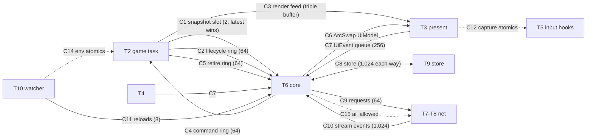
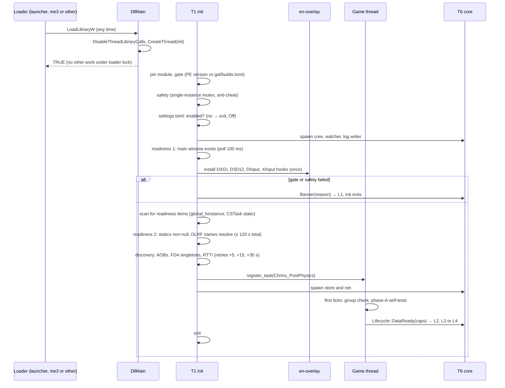
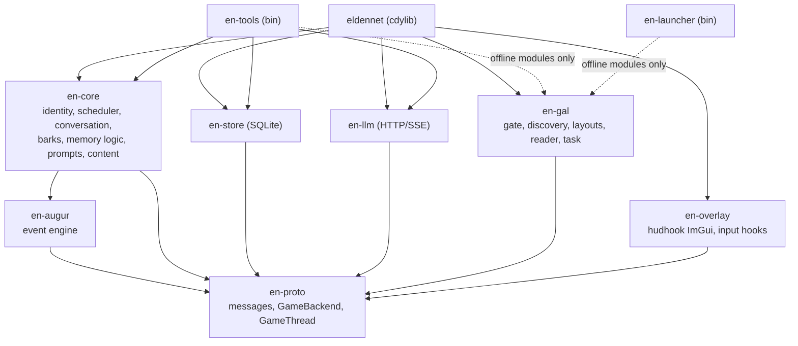
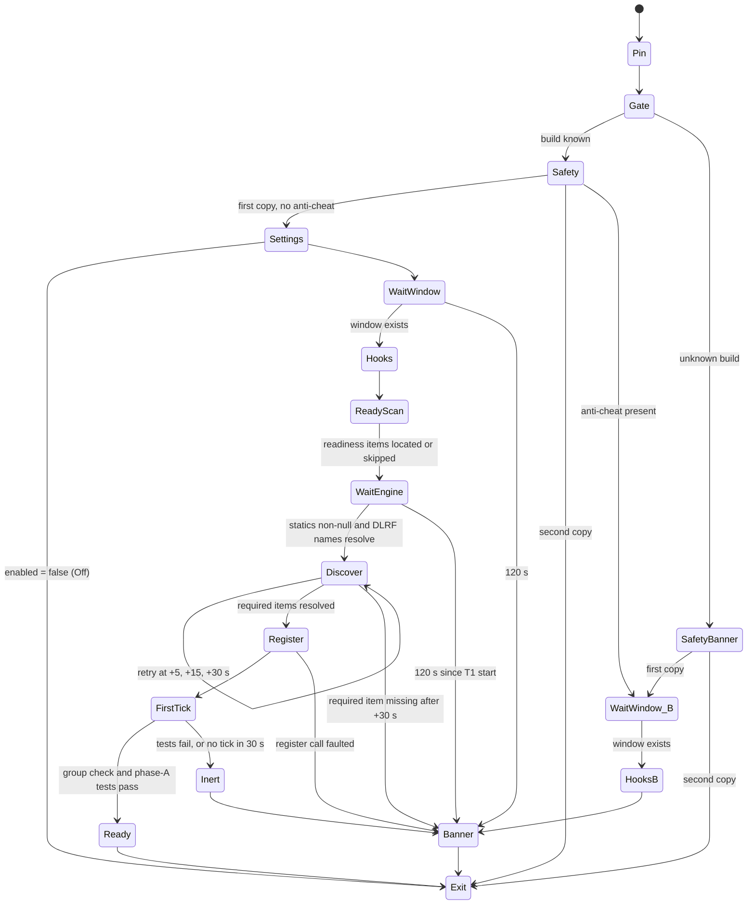
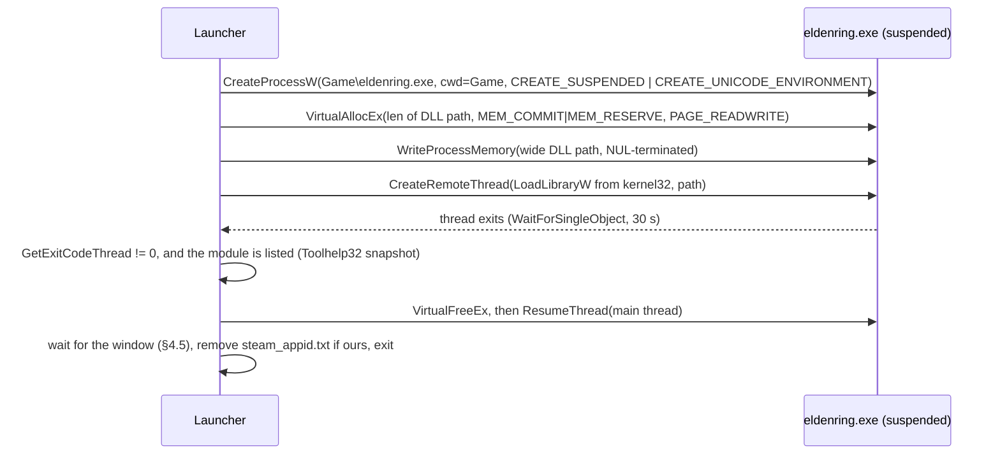
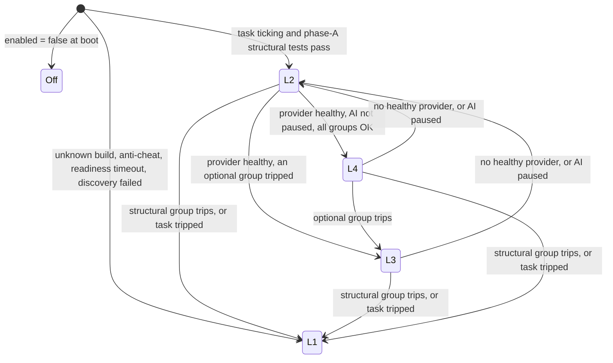
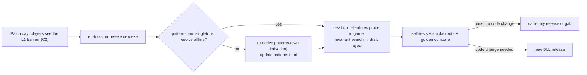
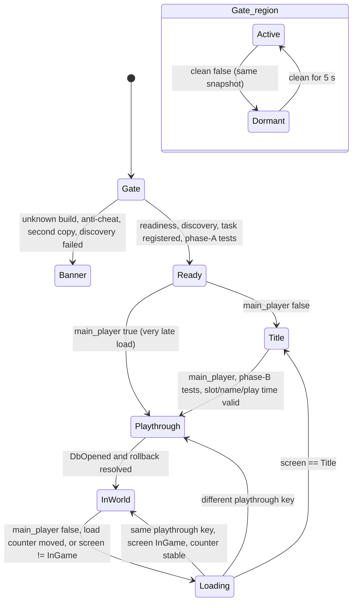

# EldenNet v1: code architecture

> **Status:** detail document under [DESIGN.md](DESIGN.md), 2026-11-06. It expands DESIGN §2–§6, §11, §14 and §15 into implementation detail. **DESIGN.md is authoritative.** Where this document seems to disagree with it, DESIGN wins, and the gap is a bug in this document.
> **Target:** ELDEN RING PC/Steam, App 1.17.2, exe 2.7.2.0 (WW) and 2.7.2.1 (JP), offline only.
> **Citations:** `DESIGN §x` points into the master design. `ER0n §x` and `SN0n §x` are research notes, and `P1 §x` and `J1 #n` point into [process/](process/). LIKELY, SPECULATION and RE-needed keep the research's evidence labels. **(impl)** marks a number or choice this document adds. DESIGN does not fix it, and it can change without a design review.
> **How to read it:** §0 maps each section to the DESIGN section it expands. Read §1–§3 for how EldenNet starts and stays safe, §6–§7 for the Game Access Layer and the snapshot, §8 for Augur, and §10 for the crash-safety rules and how CI enforces them. The review's changes are in [process/review.md](process/review.md).
> **Owner rules applied throughout:** no me3 code, crates, APIs or reliance on its behaviour. No fromsoftware-rs code or data, at any commit. Facts about game structures from the research are *leads*, and each one is confirmed in game or by a self-test before code relies on it (DESIGN §4.2, O4). No game writes, no game-code hooks, and no game-function calls after `register_task`, except the init-time singleton-name getter fallback (DESIGN R2, §4.2).

---

## 0. Reading guide

| § | Covers | Expands |
|---|---|---|
| 1 | Processes, threads, channels, startup, shutdown, single instance | DESIGN §2.1, R6, R14, R16 |
| 2 | The 10 crates, their APIs, dependency rules, lints, features, build profile | DESIGN §2.2–§2.4 |
| 3 | The DLL load contract and the init state machine | DESIGN §3.1, §3.5 |
| 4 | The launcher, the alternatives, and the me3-native page | DESIGN §3.2, §3.3, §3.6 |
| 5 | The offline and multiplayer gate | DESIGN §3.4 |
| 6 | The Game Access Layer | DESIGN §4 |
| 7 | `WorldSnapshot`, cadence, render feed, recordings | DESIGN §5.1–§5.2 |
| 8 | Augur, the event engine | DESIGN §5.3–§5.4, §6 |
| 9 | The lifecycle state machine | DESIGN §2.5 |
| 10 | Crash-safety rules and their enforcement | DESIGN §2.6–§2.7 |
| 11 | The LLM client and configuration | DESIGN §11 |
| 12 | Testing, CI and tooling | DESIGN §14, §4.6 |
| 13 | Repo layout | DESIGN §15 |

**Clocks and units.**
- `mono` is milliseconds (or microseconds where marked `_us`) from `QueryPerformanceCounter`. It is the only wall-independent clock.
- `play` is the game's play time in milliseconds (`GameDataMan`), and it is the rollback clock (DESIGN §10.5).
- Distances are metres in Havok space. Angles are degrees unless marked `rad`.
- Offsets are hex. "Copy size" is the number of bytes one guarded copy reads for one object.

---

## 1. Processes and threads

### 1.1 Processes

| Process | Lifetime | Contains |
|---|---|---|
| `eldennet-launcher.exe` | A few seconds per launch, then it exits (§4) | Discovery, pre-flight, backups, `steam_appid.txt`, injection |
| `eldenring.exe` | The game session | `eldennet.dll`: GAL, core, store, net, overlay. All ML is reached over HTTP (DESIGN §2.1) |

No helper process is spawned from inside the game. The out-of-process core stays a seam (`CoreTransport`, §2.2, DESIGN §13).

### 1.2 Thread inventory

| # | Thread | Created by | Owner | Runs | Game memory | May block | Allocation | On panic |
|---|---|---|---|---|---|---|---|---|
| T1 | **Init** (transient) | `DllMain` → `CreateThread` | `eldennet::boot`, `en-gal::sys` | Gate, safety, settings, readiness, hook install, discovery, `register_task`, worker spawn (§3) | Image only (PE headers, `.text`/`.rdata`/`.data` scans, static slots). The name getter fallback is the only call into game code | Yes (polls with `Sleep(100)`) | Free | `ffi_guard` → L1 banner if the overlay is up, otherwise a silent exit |
| T2 | **Game thread** | The game | `en-gal::task` | The one task closure: command drain, render feed, snapshot, flag frame, text and params (§7.3) | **Yes, only here** (R1) | Never | None after warm-up (the first 3 snapshot ticks); retired buffers go back to the core (C5) | `ffi_guard` → task component tripped → the closure returns at once → L1 |
| T3 | **Present** | The game (D3D12 present path) | `en-overlay` (hudhook render callback) | Draws `UiModel` and the render feed; stamps `LAST_RENDER_QPC` | No | Never | Our code: none after warm-up; ImGui's own buffers reach a steady state | Overlay tripped → draws nothing; capture forced off |
| T4 | **Window procedure** | The game's window thread | `en-overlay` (hudhook `before_wnd_proc`) | Feeds characters to ImGui; on `WM_ACTIVATEAPP`/`WM_KILLFOCUS` releases capture | No | Never | None | Filter tripped → messages pass through |
| T5 | **Game input** (one or more) | Whichever game thread calls `GetDeviceState` / `XInputGetState` | `en-overlay::hooks` | Detours zero the keyboard and mouse buffers and neutralise pads while captured; held-key mask (DESIGN §8.1) | No | Never | None | Hook tripped → pure pass-through |
| T6 | **Core** | T1, after the safety step | `eldennet::shell` running `en-core` | `crossbeam::select!` over C1–C11 and C16 → `Core::step(input, now)` → effects | No | Only on `select!` | Bounded (§10.2) | Subsystem reset after the first panic, disabled after the second (R8). A panic outside a subsystem stops the core: capture released, banner "EldenNet stopped after an internal error" |
| T7–T8 | **Net** (tokio, 2 workers) | T6 at Ready | `en-llm` | HTTPS and SSE streams; local probes | No | Async I/O | Yes | Caught per request → `LlmEvent::Error(Internal)` |
| T9 | **Store** | T6 at Ready | `en-store` | One rusqlite connection per open file; migrations; backups | No | Disk I/O | Yes | Store tripped → toast "Memory is off for this session"; P events stay in the RAM ring (§8.9) |
| T10 | **Watcher** | T6 | `eldennet::watch` (`notify`) | Hot reload with parse and validation (§11.6); every 60 s re-checks loaded modules for anti-cheat and `ersc.dll` (C14) | No | Yes | Yes | Hot reload off for the session, with a toast |
| T11 | **Log writer** | T6 | `tracing-appender` (non-blocking) | Writes rotating logs | No | Disk I/O | Yes | Lines dropped |

No other thread is created. The game's own threads enter our code only through T2–T5. Each of those entries starts with `ffi_guard` (R3).

### 1.3 Channels



| # | From → to | Type | Capacity | Overflow policy |
|---|---|---|---|---|
| C1 | Task → core | `SnapSlot`: two preallocated `WorldSnapshot` buffers, each with an atomic state `Empty/Writing/Ready/Reading` | 2 | The writer overwrites a `Ready` slot the reader has not taken and sets `gap = true` in it. The reader always finds the newest snapshot. The core copies it out (≈ 8 KB `clone_from`) and releases the slot at once |
| C2 | Task → core | SPSC ring of the fixed-size `Lifecycle` enum | 64 | Not expected to fill. If full, the task sets the sticky `LIFECYCLE_OVERFLOW` atomic, and the core rebuilds the lifecycle state from the next snapshot's `life` and `health` fields (§9) |
| C3 | Task → overlay | Triple buffer of `RenderFeed` (§7.5), with an atomic index swap | 3 | Latest wins |
| C4 | Core → task | SPSC ring of `GameCommand` (DESIGN §2.3). Payloads are inline (`SmallVec` within capacity) or an `Arc` the task never drops | 64 | The core keeps an outbox. `SetWatchFlags` and `SetTracked` coalesce, last writer wins. `Resolve*` requests are deduplicated and re-sent if no answer arrives within 2 snapshots (impl) |
| C5 | Task → core | SPSC ring of `Retired` (`Arc<[u32]>` watch lists replaced by a newer version) | 64 | If full, the task parks the `Arc` in a fixed 4-slot holdback and retries next tick. It never frees memory on the game thread |
| C6 | Core → overlay | `ArcSwap<UiModel>` | 1 | Latest wins |
| C7 | Overlay and WndProc → core | `crossbeam::ArrayQueue<UiEvent>` | 256 | `try_push`. On full, typing, page and debug events are dropped and counted. `Submit` and `CloseChat` wait in a one-slot retry cell inside the overlay and are pushed on the next frame |
| C8 | Core ↔ store | `crossbeam::bounded` (`DbRequest` / `DbResult`) | 1,024 each way | Diagnostics (traces, counters) are dropped first. P events are never dropped: they spill into the core's 4,096-entry RAM ring, with 256 slots reserved for speech (§8.9, DESIGN §6.6) |
| C9 | Core → net | `tokio::mpsc` via a blocking-safe `try_send` wrapper | 64 | Pool jobs are dropped first and memory jobs requeue. Dialogue is never dropped; at most one dialogue request is in flight (DESIGN §6.6) |
| C10 | Net → core | `crossbeam::bounded<LlmEvent>` | 1,024 | The net worker awaits a free slot; backpressure then reaches the HTTP stream. Tokens are never dropped |
| C11 | Watcher → core | `crossbeam::bounded<Reload>` | 8 | Coalescing: a newer `ContentPack` or `Settings` replaces a queued one |
| C12 | Overlay ↔ input hooks | Statics: `CAPTURE: AtomicU64` (bit 0 captured, bits 1–63 player-input epoch), `LAST_RENDER_QPC: AtomicU64`, `HELD_MASK: [AtomicU64; 4]` | — | None |
| C13 | Task → debug and core | Per-group fault counters and a fixed 64-bucket timing histogram, all atomics | — | None; they saturate |
| C14 | Init and watcher → task | `ANTICHEAT: AtomicBool`, `ERSC_LOADED: AtomicBool` | — | None |
| C15 | Core → net | `AI_ALLOWED: AtomicBool`. The net checks it before every send, as a second lock behind the core's own gate (C4 criterion, §5) | — | None |
| C16 | Clock → core | `crossbeam::tick(100 ms)` (impl), so expiry, page pacing and timers advance with no snapshots (title, loading) | — | Ticks coalesce |

The game, present, window and input threads use only `try_send`, atomics and preallocated buffers (DESIGN §2.1, R6).

### 1.4 Startup order



- The core is up before the overlay, so the overlay always has a `UiModel` to draw, the banner included.
- Store and net threads start only on the path that can reach L2. An L1 session never opens a database or a socket.
- `register_task` is called from T1, a non-main thread, as the game's contract requires (ER01 §3.1).

### 1.5 Shutdown

The game never asks a DLL to shut down. EldenNet therefore never relies on a shutdown step.

| Event | What happens |
|---|---|
| Quit to the title | Lifecycle `Title` (§9): the conversation ends, P events flush, and the playthrough DB closes. Global DBs stay open |
| Runtime disable (`enabled = false` while running) | AI paused: the ladder drops to L2 (Observe), speech is dropped and no LLM request is sent. Hooks and the task stay installed (R12). Full **Off** takes effect at the next launch |
| Process exit (any path) | No code runs. Every DB request is one WAL transaction (R14). Speech commits (`PlayerSaid`, and each `NpcSaid` page as it shows) are sent as their own request in the same step. Other writes are coalesced by the core into one request at most every 250 ms (DESIGN §8.5). So a hard kill loses at most ≤ 250 ms of non-speech writes, and a shown line only in the few milliseconds before its own transaction commits. Logs may lose their last buffered lines |
| Crash of the game | Same as process exit. On the next `PlaythroughReady`, open conversations are closed and queued for memory (DESIGN §10.3) |
| `FreeLibrary` by a third party | Refused: T1 pins the module with `GetModuleHandleExW(GET_MODULE_HANDLE_EX_FLAG_PIN)` before anything else, because hooks and the task point into our code (impl) |

### 1.6 Single-instance mutex (R16)

- Name: `Local\EldenNet.Instance.<pid>`, made per process by the PID.
- T1 calls `CreateMutexW(NULL, FALSE, name)`. If `GetLastError() == ERROR_ALREADY_EXISTS`, this copy is the second one. It closes the handle, writes one `OutputDebugStringW` line and exits T1. It installs no hooks, spawns no thread and registers no task.
- The first copy holds the handle for the life of the process and never closes it.
- At Ready, the first copy enumerates loaded modules. If another module exports the marker symbol `eldennet_instance_marker`, it shows one toast: "A second copy of EldenNet was loaded and is idle." This happens, for example, when both the launcher and a me3 profile load the DLL.

### 1.7 `DLL_PROCESS_DETACH` (R14)

`DllMain` handles `DLL_PROCESS_ATTACH` only. The detach branch returns `TRUE` and does nothing: no unregistering, no flushing, no thread joins, no frees and no logging. A CI grep checks that the branch is empty (§10).

---

## 2. Crates

### 2.1 Graph



The two dotted edges were added here and adopted into DESIGN §2.2 by the review. `en-tools probe-exe` and the launcher's build check need the PE parser, the pattern grammar and the `builds.toml` schema. These live in `en-gal`'s **offline modules** (`pe`, `patterns`, `builds`, `layout`): safe code over byte slices, with no Win32 and no `unsafe`. The edges enable only the `offline` feature, which compiles out `sys`, `reader` and `task`.

### 2.2 Responsibilities and public API sketches

| Crate | Owns | Public surface (sketch) |
|---|---|---|
| `en-proto` | Every message that crosses a thread or the adapter boundary. All are `serde` types | `WorldSnapshot`, `RenderFeed`, `Lifecycle`, `GameCommand`, `UiModel`, `UiEvent`, `LlmRequest`/`LlmEvent`, `DbRequest`/`DbResult`, `Capabilities`, `ReadHealth`, `ChrHandle`, `BlockId`, `SafeText`, `trait GameBackend`, `struct GameThread`, `PROTO_VERSION` |
| `en-augur` | Sources, world model, signals, detectors, rules, events, audience resolution, the K store, bus ordering | `Augur::new(RuleSet, Registry)`, `Augur::step(&CoreInput, Mono, &dyn AugurCtx, &mut EventBatch)`, `trait EventSource`, `RuleSet::load(&[RuleFile], &dyn PredicateCompiler) -> Result<RuleSet, Vec<RuleError>>`, `Event`, `EventKind` |
| `en-core` | Identity and tiers, content loading and validation, predicates, scheduler, conversation, barks, memory logic, prompts, sanitizer, lint, ladder policy, bus subscribers | `Core::new(Arc<ContentPack>, Arc<Settings>) -> Core`, `Core::step(CoreInput, Mono) -> Outputs`, `ContentPack::load(&dyn ContentFs) -> Result<ContentPack, Vec<ContentError>>`, `trait CoreTransport` |
| `en-store` | SQLite files, migrations, the request loop, backups | `Store::spawn(StoreCfg) -> StoreHandle`, `StoreHandle::{send(DbRequest) -> Result<(), Full>, results() -> Receiver<DbResult>}` |
| `en-llm` | The OpenAI-compatible client, SSE parser, slots, health, local probes, warm-up | `Llm::spawn(ProvidersCfg) -> LlmHandle`, `LlmHandle::{submit(LlmRequest) -> Result<(), Full>, cancel(RequestId), events() -> Receiver<LlmEvent>}`, `probe_local() -> Vec<LocalEndpoint>` |
| `en-gal` | The version gate, discovery, layouts, `GuardedReader`, read groups, the task, the snapshot builder, the FMG, param and flag readers, `SysLayer` | `gate(&ImageView, &Builds) -> Result<BuildProfile, GateError>`, `discover(&dyn SysLayer, &BuildProfile) -> Result<Discovery, DiscoveryReport>`, `install_task(Discovery, TaskWiring) -> Result<TaskToken, GalError>`, `struct ErBackend: GameBackend`, `trait SysLayer` (§6.4) |
| `en-overlay` | hudhook DX12 ImGui, fonts, every surface, input hooks | `Overlay::install(OverlayCfg, Arc<ArcSwap<UiModel>>, RenderFeedReader, UiEventSink) -> Result<OverlayHandle, OverlayError>`, `capture::{set(bool, epoch), state()}` |
| `eldennet` | `DllMain`, the boot sequence, thread spawning, wiring, the effect shell, `ffi_guard` | `#[no_mangle] extern "system" fn DllMain`, `#[no_mangle] static eldennet_instance_marker: u32` |
| `en-launcher` | The launcher binary (§4) | CLI only |
| `en-tools` | Developer tools (§12.3), the replay `GameBackend` | CLI only |

```rust
// en-core: the seam that lets a later out-of-process core replace the in-process one (DESIGN §13).
pub trait CoreTransport: Send {
    fn push(&mut self, input: CoreInput, now: Mono) -> Result<(), TransportError>;
    fn poll_outputs(&mut self, out: &mut Vec<Outputs>);
}
pub struct InProcess { core: Core }                   // v1: calls Core::step directly on T6

pub enum CoreInput {
    Snapshot(Box<WorldSnapshot>), Lifecycle(Lifecycle), Ui(UiEvent), Llm(LlmEvent), Db(DbResult),
    Reload(Reload), Env(EnvFacts /* SteamID folders, paths */), Tick,
}
pub struct Outputs {
    pub game: SmallVec<[GameCommand; 4]>, pub ui: Option<Arc<UiModel>>, pub llm: Vec<LlmRequest>,
    pub cancel: SmallVec<[RequestId; 2]>, pub db: Vec<DbRequest>, pub ai_allowed: bool, pub log: Vec<LogRecord>,
}
```

### 2.3 Dependency rules

| Crate | May depend on | Must not depend on |
|---|---|---|
| `en-proto` | `serde`, `smallvec`, `arrayvec`, `arcstr`, `bitflags` | Anything with I/O, threads, clocks, Win32 or game knowledge |
| `en-augur` | `en-proto`, `serde`, `toml`, `smallvec`, `indexmap` | `en-core`, `en-gal`, `en-store`, `en-llm`, `en-overlay`, `tokio`, `windows`, `std::fs`, any clock |
| `en-core` | `en-augur`, `en-proto`, `minijinja`, `toml`, `serde_json`, `regex`, `unicode-segmentation`, `blake3` | `en-gal`, `en-overlay`, `en-store`, `en-llm`, `tokio`, `reqwest`, `rusqlite`, `windows`, any clock |
| `en-store` | `en-proto`, `rusqlite` (bundled), `crossbeam` | `en-core`, `en-gal`, `en-overlay`, `en-llm` |
| `en-llm` | `en-proto`, `tokio`, `reqwest` (rustls), `serde_json`, `crossbeam` | `en-core`, `en-gal`, `en-overlay`, `en-store` |
| `en-gal` | `en-proto`, `windows` (`sys` only), `bytemuck`, `toml`, `cc` (build) | `en-core`, `en-augur`, `en-store`, `en-llm`, `en-overlay`, `imgui`, `tokio` |
| `en-overlay` | `en-proto`, `hudhook = { version = "=0.9.3", default-features = false, features = ["dx12"] }` (DESIGN O25; `imgui` 0.12 only through the re-export `hudhook::imgui`, MinHook only through hudhook's own FFI module `hudhook::mh`), `windows` 0.62 (hudhook's version, or `hudhook::windows`) | `en-gal` (it can never reach game memory), `en-core` |
| `eldennet` | All of the above, `crossbeam`, `arc-swap`, `notify`, `tracing`, `tracing-appender` | — |
| `en-launcher` | `en-gal` (`offline`), `windows` | Everything else in the workspace |
| `en-tools` | `en-core`, `en-augur`, `en-store`, `en-llm`, `en-gal` (`offline`), `clap`, `zstd`, `insta`, `proptest` | `en-overlay`, `en-gal` with `sys` |

**Never, in any crate, at any version:** fromsoftware-rs crates (`eldenring`, `shared`, `fromsoftware-*`), `from-singleton`, me3 crates (`me3-*`), `dearxan`, or code copied from libER. `cargo deny [bans]` lists them by name (§12.1).

### 2.4 Lints and `unsafe`

| Crate | Crate-level attributes | Clippy (deny) | `unsafe` |
|---|---|---|---|
| `en-proto`, `en-augur`, `en-core` | `#![forbid(unsafe_code)]` | `disallowed_methods`: `Instant::now`, `SystemTime::now`, `thread::sleep`, `std::fs::*`, `std::env::var`. `disallowed_types`: `std::collections::HashMap`/`HashSet` (iteration order must replay bit for bit; use `BTreeMap` or `IndexMap` with a fixed hasher) | None |
| `en-gal` | `#![deny(unsafe_code)]`; `#[allow(unsafe_code)]` only on `mod reader` and `mod sys` | `unwrap_used`, `expect_used`, `panic`, `todo`, `unimplemented`, `unreachable`, `indexing_slicing`, `arithmetic_side_effects`, `undocumented_unsafe_blocks`, `disallowed_types` (`Mutex`, `RwLock`, `parking_lot::*`) | `reader` (SEH copy), `sys` (image view, trampoline, `register_task`, getter fallback, mutex, module and thread APIs) |
| `en-overlay` | `#![deny(unsafe_code)]`; `#[allow]` only on `mod hooks` | Same list as `en-gal`, plus `disallowed_methods` for hudhook's eject path (`hudhook::eject`, `hudhook::Hudhook::unapply`, `hudhook::mh::MH_Uninitialize`, `hudhook::mh::MH_DisableHook`, `hudhook::mh::MH_QueueDisableHook`, `hudhook::mh::MhHook::queue_disable`; R12) | `hooks` (hudhook setup, DInput and XInput detours) |
| `eldennet` | `#![deny(unsafe_code)]`; `#[allow(unsafe_code)]` only on `mod exports`, which holds the two `#[unsafe(no_mangle)]` items (`DllMain`, `eldennet_instance_marker`) and **no `unsafe` block**. `DllMain` calls `en_gal::sys::boot::on_attach`, which does the Win32 work | Same list as `en-gal` | None (attributes only) |
| `en-store`, `en-llm`, `en-tools` | `#![forbid(unsafe_code)]` | `unwrap_used`, `expect_used` (warn in tests) | None |
| `en-launcher` | `#![deny(unsafe_code)]`; `#[allow]` only on `mod win` | Same list as `en-gal` | `win` (process creation and injection). It runs outside the game process, so R9's in-process list does not cover it |

Every `unsafe` block carries a `// SAFETY:` note (R9). `exported_private_dependencies` and `unsafe_op_in_unsafe_fn` are denied workspace-wide.

### 2.5 Cargo features (all off by default)

| Feature | Crates | Enables | Release CI |
|---|---|---|---|
| `probe` | `en-gal`, `eldennet` | In-game invariant search that writes a draft layout (§6.10), plus the fault-injection hooks used by the C1 forced fail-closed launches | Refused |
| `hooks` | `en-augur`, `en-gal` | Hook sources H1–H3 (§8.11). Compiled out in v1 | Refused |
| `actions` | `en-proto`, `en-core` | `GameCommand::Action`, executors, prompt partials | Refused |
| `freeze` | `en-proto`, `en-gal` | `GameCommand::Freeze` | Refused |
| `offline` | `en-gal` | The safe offline modules only (§2.1) | Allowed (tools and launcher) |

The release job runs `cargo tree -e features` and fails if any of `probe`, `hooks`, `actions` or `freeze` is active in `eldennet`, or if hudhook has any feature but `dx12` (DESIGN O25).

### 2.6 Build profile and target

```toml
# Cargo.toml (workspace)
[workspace.package]
edition = "2024"
rust-version = "<pinned in rust-toolchain.toml>"

[profile.release]
panic = "unwind"          # R3: ffi_guard depends on it; CI fails if this changes
lto = "thin"
codegen-units = 1
opt-level = 3
debug = "line-tables-only" # PDBs ship beside each release for crash triage, not in the zip
strip = "none"

[profile.release.package.en-gal]
overflow-checks = true     # an overflow becomes a caught panic → breaker, never a silent wrap
```

- **Target:** `x86_64-pc-windows-msvc`, built on Linux CI with `cargo xwin build --release --locked --target x86_64-pc-windows-msvc`. The xwin SDK and CRT versions are pinned.
- **Static CRT:** `-C target-feature=+crt-static`, so the DLL needs no Visual C++ runtime on the player's machine.
- **Deterministic link:** `-C link-arg=/Brepro`, `--remap-path-prefix`, `SOURCE_DATE_EPOCH` and `CARGO_INCREMENTAL=0` (§12.1).
- **The SEH shim** (`en-gal/src/sys/seh_copy.c`, §6.5) is compiled by the `cc` crate with clang-cl from the xwin toolchain.

---

## 3. The DLL load contract

### 3.1 `DllMain`

```rust
// crates/eldennet/src/exports.rs — the only module where `unsafe_code` is allowed, for the attribute alone
#[unsafe(no_mangle)]
pub extern "system" fn DllMain(module: HMODULE, reason: u32, _: *mut c_void) -> BOOL {
    ffi_guard(Component::DllMain, TRUE, || {
        if reason == DLL_PROCESS_ATTACH { en_gal::sys::boot::on_attach(module, eldennet::boot::init_main) }
        TRUE                                   // every other reason: nothing (R14)
    })
}
```

`on_attach` calls `DisableThreadLibraryCalls(module)` and `CreateThread(init_main)`, then returns. It allocates nothing, takes no lock and touches no file. The module path is resolved later, on T1, with `GetModuleFileNameW`. From that path T1 finds `content/`, `gal/` and the default log folder, so the install folder can live anywhere (DESIGN §3.1).

### 3.2 Init state machine



| State | Does | Timeout | Failure → |
|---|---|---|---|
| Pin | Pin the module (§1.5); note the QPC start time | — | — |
| Gate | Read `VS_FIXEDFILEINFO`, `ProductName`, region, `TimeDateStamp` and `SizeOfImage` from the main module's mapped headers; match against `gal/builds.toml` (§6.3) | — | Unknown build → banner path (no task, zero reads, C2) |
| Safety | Mutex (§1.6). Anti-cheat check (§5.3). Logging starts here, so a second copy never writes to the shared log; gate results buffered until now are flushed | — | Second copy → Exit. Anti-cheat → banner |
| Settings | Parse `settings.toml` (§11.5). If parsing fails, use the defaults and show a toast later | — | `enabled = false` → Exit (Off) |
| WaitWindow | Poll every 100 ms for a visible top-level window owned by this PID | 120 s from T1 start | Banner (logged; drawn if the window appears later) |
| Hooks | `Overlay::install`: DXGI and D3D12 through hudhook, then DInput and XInput through the same MinHook, hudhook's `mh` module (R12). `GetDeviceState` is found through the vtable of a throwaway `IDirectInputDevice8W`, which lives in `dinput8.dll`. `XInputGetState` is hooked in whichever XInput DLL `eldenring.exe` imports (S4) | — | Overlay error → no banner can show. Log it, continue headless at L2 at most |
| ReadyScan | Scan the image for the two readiness items only: `global_hinstance` (AOB) and the `CSTask` static (FD4 finder, §6.2). This is the earliest scan, done after the window exists | Part of the 120 s | Not found → readiness falls back to "window exists and the `CSTask` static is non-null" (DESIGN §3.1) |
| WaitEngine | Poll every 100 ms: `global_hinstance` static non-null (if found), then the `CSTask` static non-null and the DLRF name of its runtime class readable | 120 s from T1 start | Banner "EldenNet inactive: the game did not finish starting" |
| Discover | Resolve the full inventory (§6.1): 5 AOB items, 11 singletons, RTTI vtable sets, and image checks (§6.2). Unresolved items are retried at +5, +15 and +30 s (DESIGN §3.5) | ≤ 31 s plus scan time (budget 500 ms per pass, impl) | A required item is missing → banner. An optional item is missing → its group is disabled |
| Register | Build our task object and call `register_task` once from T1 (§6.4) | — | Fault caught by SEH → banner. Nothing else is retried |
| FirstTick | Wait for the first tick. On the game thread, the task checks that the group at the layout's index is named `ChrIns_PostPhysics` (§6.3), then runs the phase-A self-tests over ≤ 8 ticks (§6.7) | 30 s for the first tick (impl) | No tick or a failed structural test → task **inert** (the closure returns after one atomic load; zero reads) → banner |
| Ready | Send `Lifecycle::DataReady{build, caps}`; spawn store and net; T1 exits | — | — |

**Required vs optional items.**
- **Required:** `register_task`, `CSTask`, `WorldChrMan`, `GameDataMan`, `GameMan` and `CSSessionManager`. They back `boot`, `world`, `player` and `session`.
- **Optional:** everything else. A missing optional item disables only its read group (DESIGN §3.5).

`CSNowLoadingHelper` is optional too. Without it, loading is detected from `main_player` and the screen state alone (§9).

### 3.3 Early, late and very late load

| Load moment | Who | What the init thread sees | Result |
|---|---|---|---|
| Early: the process is suspended, before game main | Our launcher (§4.6) | No window yet. WaitWindow and WaitEngine take a few seconds | Normal path |
| Late: after game main, before the title | A player's me3 native, ME2, a proxy loader | The window exists, and statics fill at once | Passes the readiness wait immediately (DESIGN §3.3) |
| Very late: at the title or in the world | A delayed injector | As above | The first snapshot already shows `main_player`, so the lifecycle goes straight to Playthrough (§9) |
| During a loading screen | Any | `WorldChrMan.main_player` null; the load counter moving | The lifecycle starts in Loading and resolves on the next stable snapshot |
| Twice (launcher plus a me3 profile) | Both | The second copy sees the mutex | The second copy idles (§1.6) |

The DLL never assumes which loader it has, never calls a loader export, and needs no initializer symbol.

---
## 4. The EldenNet launcher

`eldennet-launcher.exe` is our own small Win32 program, about 400 lines. It has no main window: notices and errors use `TaskDialogIndirect`. It follows the documented community pattern: start `eldenring.exe` directly so EAC never runs, then inject a DLL into the suspended process (ER02 §2.1, §3.2). No code is taken from any launcher.

### 4.1 Command line

| Flag | Effect |
|---|---|
| *(none)* | Discover the game, run the pre-flight checks, back up saves, start offline without EAC, inject `eldennet.dll`, exit |
| `--game <path>` | Use this `Game` folder or `eldenring.exe` instead of Steam discovery. Remembered in `%APPDATA%\EldenNet\config\launcher.toml` |
| `--dll <path>` | Inject this DLL instead of `eldennet.dll` next to the launcher (DESIGN §3.2) |
| `--no-backup` | Skip the save backup (DESIGN §3.2) |
| `--vanilla-offline` | Start the game offline without EAC and **without** injecting anything (DESIGN §3.2) |
| `--backup-only` | Back up saves and exit. Meant for players who start through their own loader (§4.11) |
| `--cleanup` | Remove a `steam_appid.txt` that this launcher created, if the game is not running, and exit |
| `--print-diagnostics` | Write the discovery and pre-flight results to the console and to `launcher.log`, and exit |

`--game`, `--backup-only`, `--cleanup` and `--print-diagnostics` are additions to DESIGN's three flags (impl).

### 4.2 Finding the game

1. If `--game` is given, or `launcher.toml` remembers a path, use it.
2. Otherwise read the Steam root from `HKCU\Software\Valve\Steam\SteamPath`, falling back to `HKLM\SOFTWARE\WOW6432Node\Valve\Steam\InstallPath`.
3. Parse `<steam>\steamapps\libraryfolders.vdf` (a small key-value reader of our own) and list every library `path`.
4. In each library, look for `steamapps\appmanifest_1245620.acf` (Steam app 1245620, ER02 header). Read `installdir`, and form `<library>\steamapps\common\<installdir>\Game\eldenring.exe`.
5. If nothing is found, show E01 with an "Open eldenring.exe…" button.
6. Read the exe's PE version resources from the **file** with the `en-gal` offline `pe` module, and match them against `gal/builds.toml`. An unknown build shows E05, which offers "Launch anyway (EldenNet stays inactive)" (DESIGN §3.2).

### 4.3 Pre-flight checks

| Check | How | Failure |
|---|---|---|
| Steam is running | A process named `steam.exe` exists, or `HKCU\Software\Valve\Steam\ActiveProcess\pid` names a live process | E02 |
| No EAC bootstrapper | No process named `start_protected_game.exe` | E04 |
| The game is not already running | No `eldenring.exe` process | E03 |
| The DLL exists and is ours | The file exists, and its version resource reads `ProductName = EldenNet` | E08 |
| The game folder is writable | Only needed for the file method (§4.5) | E06 |
| Other proxy DLLs | `dinput8.dll`, `winhttp.dll` or `dxgi.dll` next to `eldenring.exe` | Information only: "Other mods detected: …". Never blocks |

### 4.4 Save backups (rotation of 10)

- **Source:** each `%APPDATA%\EldenRing\<SteamID64>\` folder whose name is 17 digits. From each, copy `ER0000.sl2` and `ER0000.sl2.bak` if present (ER01 §11).
- **Destination:** `%APPDATA%\EldenNet\save-backups\<SteamID64>\<YYYYMMDD-HHMMSS>\`.
- **Method:** copy to `*.tmp`, check that the sizes match, then rename. Each backup folder gets a `manifest.toml` with sizes and blake3 hashes.
- **No duplicates:** if both hashes equal the newest backup's, no new folder is made (impl).
- **Rotation:** keep the newest 10 folders per SteamID and delete older ones. Deletion happens only after a new backup has succeeded.
- **Never:** the launcher never writes, moves or renames anything under `%APPDATA%\EldenRing\`.
- **Failure:** E07 offers "Continue without a backup" or "Cancel".

### 4.5 Starting without EAC: `steam_appid.txt` (the `SteamAppId` variant is pending S0-C)

| Step | File method (default) | Environment method (S0-C candidate, SPECULATION) |
|---|---|---|
| Create | If `<Game>\steam_appid.txt` is absent, write `1245620` to it. If it exists with that content, use it as is | Set `SteamAppId=1245620` and `SteamGameId=1245620` in the child's environment block. Write no file |
| Record | `%APPDATA%\EldenNet\config\launcher-state.toml`: `{ appid_file = "<path>", created_by_us = true/false, created_at }` | Nothing to record |
| Remove | `remove_after = "window"` (default pending S0-C): after the resume, the launcher waits up to 120 s for the game's main window, then deletes the file **only if `created_by_us`**. If S0-C shows Steam reads the file later, switch to `remove_after = "exit"` (wait for the game to exit) or `"never"`. Every launcher start, and `--cleanup`, removes a stale file we created when the game is not running | — |

The launcher never deletes a `steam_appid.txt` it did not create. The method is chosen in `launcher.toml` (`appid_method = "file" | "env"`).

### 4.6 Process creation and injection



- **Absolute path:** the DLL path is absolute, so the game's search order is never used.
- **Failure before resume:** if any step fails, the launcher calls `TerminateProcess` on the suspended game and shows E10. A half-injected game never starts. E10 offers "Start without EldenNet" (the same as `--vanilla-offline`).
- **No elevation:** the launcher requests no elevation (`asInvoker` manifest).

### 4.7 Error texts

| Code | Text (original wording) |
|---|---|
| E01 | "ELDEN RING was not found. Pick eldenring.exe, or start the launcher with --game \"<folder>\"." |
| E02 | "Steam is not running. Start Steam, then run the EldenNet launcher again." |
| E03 | "ELDEN RING is already running. Close it, then start it again from this launcher." |
| E04 | "Easy Anti-Cheat is running (start_protected_game.exe). Close the game, then start it from this launcher." |
| E05 | "This game build (%s) is not supported by this EldenNet version yet. Launch anyway? EldenNet will stay inactive until an update arrives." |
| E06 | "The launcher could not write steam_appid.txt into the game folder (%s). Move the game to a folder you can write to, or see the install guide." |
| E07 | "Your save could not be backed up (%s). Continue without a backup?" |
| E08 | "eldennet.dll was not found next to the launcher (or at the --dll path)." |
| E09 | "The game could not be started: %s (code %u)." |
| E10 | "EldenNet could not be loaded into the game: the %s step failed (code %u). The game was closed again. Antivirus software sometimes blocks this step; see the install guide. Start the game without EldenNet instead?" |
| E11 | "This launcher must run inside the game's Proton prefix. See the Proton notes in the install guide." |

### 4.8 First-screen notices

The notices show on the first run, and again whenever their version number changes. The player can tick "Don't show again" (stored as `notices_seen = <version>`):

> **EldenNet runs offline only.** The game starts without Easy Anti-Cheat and cannot reach FromSoftware's servers. Never take a save you played with mods into online play.
> **Your saves are backed up, not separated.** EldenNet keeps the last 10 copies in `%APPDATA%\EldenNet\save-backups`. It never edits your save.
> **What you type is sent to the AI provider you choose.** That may be a cloud service or a program on your own PC.
> **NPC lines are generated by AI.** They are not written by FromSoftware, and they can be wrong.

### 4.9 Proton (placeholder, pending S0-C)

S0-C settles the recipe. The candidate, SPECULATION until then:
1. In the game's Steam properties, set the launch options to `"<path>/eldennet-launcher.exe" %command%`. Proton then starts our launcher inside the game's prefix (`compatdata/1245620`). The launcher ignores the forwarded arguments and starts `eldenring.exe` itself.
2. `%APPDATA%` and the save path resolve inside the prefix.
3. Steam discovery reads the prefix registry; `--game "Z:\…\Game"` is the fallback.

If the recipe fails, the documented fallback is the player's own me3 profile (§4.11, DESIGN K5). E11 fires when the launcher detects it is running outside a prefix while Steam reports Proton.

### 4.10 Loading alternatives

| Method | Verdict | Notes |
|---|---|---|
| **Own launcher** | **Primary** | No third-party loader, and no EAC by construction (DESIGN §3.3) |
| **Player-configured me3 native** | **Supported, documented in our own docs only** | Needed for Seamless Co-op users (ER02 §2.3). It is a late load, so it passes the readiness wait at once. We rely on no me3 feature |
| `dinput8.dll` proxy | Rejected | Clashes with Elden Mod Loader, ME2's dinput8 mode and the practice tool. Cannot carry ERSC. Needs `WINEDLLOVERRIDES` under Proton (ER02 §3.3) |
| `winhttp.dll` proxy | v1.x note | Used by EROverlay and the EAC Toggler. EAC LIKELY refuses to start next to it (ER02 §2.1) |
| `dxgi.dll` proxy | Rejected | It would sit under hudhook's own DXGI hooks and other DXGI injectors (SPECULATION) |
| ME2 `external_dlls`, Elden Mod Loader | Work, unsupported | The DLL is loader-agnostic; both loaders are discontinued or legacy (ER02 §3.1, §3.3) |
| Other chain loaders (Lazy Loader and similar) | Work if they call `LoadLibraryW`, unsupported | Nothing in the DLL depends on the loader |
| Our own proxy DLL | Deferred (DESIGN §1.2) | The proxy conflicts above would apply to us too |

### 4.11 The me3-native page (`dist/using-a-loader.md`, our docs only)

The page is written by us and lives only in our repository and release zip. It never links to or posts in me3's spaces. Outline:
1. **EldenNet does not need me3.** The launcher is the normal way to start it. me3 is a separate project with its own rules, which do not allow LLM-related work in its spaces. Please do not ask its maintainers or community about EldenNet. EldenNet support lives in EldenNet's issue tracker only.
2. **If you already start the game through your own me3 profile** (for example for Seamless Co-op), add `eldennet.dll` to that profile as a native DLL, by its absolute path. No load order is needed, because EldenNet waits for the game by itself.
3. **Do not also use the EldenNet launcher for the same session.** If both load it, the second copy stays idle.
4. **Co-op:** EldenNet goes dormant in any multiplayer or Seamless Co-op session and wakes 5 s after you are alone again.
5. **Saves and online play:** your profile's own save and online settings are yours to manage. EldenNet never writes your save, and it enforces its own offline check whatever the profile says. Back up first with `eldennet-launcher.exe --backup-only`.
6. **If something fails,** EldenNet shows a banner with the reason. Send the bug-report bundle from the F11 view.

---

## 5. The offline and multiplayer gate

### 5.1 Predicate

The gate is computed by the core on every snapshot from the `session` fields (§7.1):

```text
anticheat_ok = !snapshot.session.anticheat                 (C14 atomic, §5.3)
session_ok   = health.session == Ok                        (group passed its tests and is not tripped)
in_world     = snapshot.life.main_player
solo_world   = role == Host && is_my_world && lobby == None && player_set_len == 1
at_title     = !in_world && screen == Title && lobby == None

clean        = session_ok && anticheat_ok && (solo_world if in_world else at_title)
```

- **`clean` false** → the gate goes **false at once**: on the same snapshot, so within ≤ 250 ms (C4).
- **`clean` true** → the gate goes **true** only after `clean` has held on every processed snapshot for 5,000 ms of mono time, with no snapshot gap longer than 1,000 ms (impl) inside that window.
- **Unknown values:** a field that cannot be read, a value out of the enum range, or a `gap` snapshot all count as not clean.
- **The `at_title` clause** gives the wizard's self-test (DESIGN §11.5) a place to run, because at the title screen there is no `PlayerGameData` to read a role from. At the title the lifecycle is still Dormant for speech (§6.8), so the title clause only permits network calls for the wizard and the silent self-test.
- **If `session` fails its self-test or trips,** `session_ok` is false for the rest of the session. AI stays off; that is L1 for the structural case (DESIGN §4.4).

### 5.2 Effects of a false gate

On the step where the gate turns false, the core:
1. sets `ai_allowed = false` in that step's outputs (C15);
2. cancels every in-flight LLM request (the net aborts the HTTP streams);
3. ends the conversation with reason `dormant`, committing only lines already shown;
4. drops every pending bark and closes the call-out box;
5. sends `SetTracked{[]}`, so the render feed stops.

The net also refuses any request while `AI_ALLOWED` is false. A core bug therefore still cannot cause traffic (C4). While the gate is false, the GAL task reads only the `session` fields and the lifecycle subset (§7.3).

### 5.3 Anti-cheat check (SPECULATION, cheap)

| When | Thread | Check |
|---|---|---|
| Init, in the Safety state | T1 | `EnumProcessModules` on our own process: any module whose file name starts with `EasyAntiCheat` (case-insensitive). The parent process (`CreateToolhelp32Snapshot`, `th32ParentProcessID`) has the image name `start_protected_game.exe`. If the parent has already exited, the parent clause is skipped |
| Every 60 s | T10 | The module clause again; also refreshes `ERSC_LOADED` (a module named `ersc.dll`) |

A hit at init → L1 banner. A later hit → `ANTICHEAT = true` → the gate goes false for the rest of the session, with the banner.

### 5.4 Player-facing texts

| Situation | Surface | Text |
|---|---|---|
| Gate false in the world | Badge, top right | "EldenNet paused (multiplayer)" (DESIGN §2.7) |
| Waiting to re-activate | Badge | "EldenNet paused (multiplayer)" stays up until the 5 s window completes. No countdown is shown |
| Anti-cheat present | Banner | "EldenNet inactive: Easy Anti-Cheat is running. EldenNet only runs offline; start the game with the EldenNet launcher." |
| `session` group failed | Banner | "EldenNet inactive: it could not confirm this is an offline solo session (game build %s)." |

### 5.5 What EldenNet never does

- It never writes `Menu.IsEnableOnlineMode` or any game property; that would be a game write (DESIGN §3.4, J1 #1). CI greps the code for the string, and only the test that asserts its absence may contain it (§10).
- It never connects anywhere except the `base_url`s in `providers.toml` and the localhost probe ports (§11.4). Offline play follows from starting without EAC (ER02 §2.2).

---

## 6. Game Access Layer (GAL)

### 6.1 Object inventory

Types are our own. Offsets and copy sizes live in `gal/layouts/<build>.toml` (§6.3). **Copy size** names where the byte count for one guarded copy comes from. Field leads cite the research; each lead is confirmed by the probe and the self-tests before its `status` becomes `confirmed` (§6.3).

| Object | Discovery | Fields read (type) | Group | Copy-size source |
|---|---|---|---|---|
| Executable image | PE headers of the main module | `FileVersion` (4×u16), `ProductName` (UTF-16), translation (u16 lang, u16 codepage), `TimeDateStamp` (u32), `SizeOfImage` (u32), section table (name, RVA, size, flags) | gate | PE structures (fixed) |
| `register_task` | Interior-anchored AOB → containing function from `.pdata` | Code address only; called once | boot | — |
| `global_hinstance` | AOB → RIP-relative static in `.data` | `hinstance: u64` (non-null = ready) | boot | 8 |
| `GameDataMan` | AOB static | `play_time: u32` (ms), `death_count: u32`, `ng_lvl: u32`, `boss_fight_active: u8`, `show_subtitles: u8` (inside the settings block via `settings: ptr`), `player_game_data: ptr` | player, session, ui | `class.GameDataMan.copy_size` |
| `PlayerGameData` | Via `GameDataMan.player_game_data` | `name: [u16; 17]` (raw name; lead `+0x9C`, ER05 §2), `level: u32`, `archetype: u8`, `body: u8`, `keepsake: u8`, `runes: u32`, `multiplay_role: u8`, `is_my_world: u8`, `gear: [u32; 6]` (right and left weapon, head, chest, hands, legs) | player, session | `class.PlayerGameData.copy_size` |
| `GameMan` | AOB static | `save_slot: i32`, `talk_esd_camera_param_id: i32` | player, ui | `class.GameMan.copy_size` |
| `FieldArea` | AOB static | `map_place_name_id: i32` | place | `class.FieldArea.copy_size` |
| `CSTask` | FD4 singleton | Instance pointer, passed to `register_task`. Read on the game thread: the task-group table entry at our index (`name: [u16; 64]`) | boot | `class.CSTaskGroupEntry.stride` |
| `WorldChrMan` | FD4 singleton | `main_player: ptr`, `by_distance: DLVector{begin: ptr, end: ptr}` of `{chr: ptr, distance: f32, pad: u32}`, `player_chr_set: {entries: ptr, capacity: u32}` | world, session | `class.WorldChrMan.copy_size`; vector elements `class.ChrDistEntry.stride` × ≤ 48 |
| `ChrIns` (and subclasses) | Through the vector; the vtable is checked against the RTTI set every tick | `vtable: ptr`, `handle: u64`, `npc_param_id: u32`, `model: u32`, `entity_id: u32`, `chr_type: i32`, `team: u8`, `block_id: u32`, `flags_onscreen: bit`, `flags_dead: bit`, `last_hit_by: u64`, `modules: ptr` | world, combat | `class.<rtti-name>.copy_size` per class (base `ChrIns` lead 0x580, ER05 §6.2) |
| `ChrIns` modules | Via `modules` | data: `hp, max_hp, fp, max_fp, stamina, max_stamina: i32`; physics: `pos: [f32; 4]`; action flag: `recv_dmg_type: i32`; throw: `throw_state: u8` | world, combat | `class.<Module>.copy_size` |
| `PlayerIns` extras | Main player only | `locked_on: u64`; ride module `ride_state: u8` (5 = riding, ER05 §3); SpEffect list head (walked ≤ 64 entries, `param_id: i32`; looking for 9621) | player, combat | `class.PlayerIns.copy_size`, `class.SpEffectEntry.stride` |
| `CSSessionManager` | FD4 singleton | `lobby_state: i32` | session | `class.CSSessionManager.copy_size` |
| `CSEventFlagMan` | FD4 singleton | `divisor: u32`, `descriptor_map: DLMap header`, `holder_base: ptr`; nodes `{left, parent, right: ptr, key: u32, mode: u32, value: u64}`; blocks of 125 bytes | flags | `class.FlagNode.stride`, 125 per block |
| `CSFeMan` | FD4 singleton | `hud_state: i32`, `banner_id: i32`, `boss_bars: [ {handle: u64, name_id: i32, damage_taken: i32}; 3 ]` | ui | `class.CSFeMan.copy_size` |
| `CSMenuMan` | FD4 singleton | `screen_state: i32` (0 InGame, 1 Loading, 256 Title; ER05 §9), `popup: ptr` → `current_talk_id: i32` | ui | `class.CSMenuMan.copy_size`, `class.CSPopupMenu.copy_size` |
| `CSNowLoadingHelper` | FD4 singleton (confirm in S0-A) | `menu_load_counter: u32` | ui | `class.CSNowLoadingHelper.copy_size` |
| `WorldAreaTime` | FD4 singleton | `clock: u64` (packed hours, minutes, seconds) | place | `class.WorldAreaTime.copy_size` |
| `CSCamera` | FD4 singleton (confirm in S0-A) | `pers_cam: ptr` → `matrix: [f32; 16]`, `fov: f32` (rad), `aspect: f32` | camera | `class.CSCam.copy_size` |
| `SoloParamRepository` | FD4 singleton | Slot table → param resource → `PARAM` header `{row_count: u16, rows: ptr}`, row descriptors `{id: u32, data: ptr}`; row fields `NpcParam.{name_id: i32, team: u8}`, `BonfireWarpParam.{flag: u32, text_id: i32, area: u8, grid_x: u8, grid_z: u8, pos: [f32; 3]}`, `WorldMapPlaceNameParam.{text_id: i32, area: u8, grid_x: u8, grid_z: u8}` | params | `param.<Name>.row_size` (must equal the paramdef size in the layout) |
| `MsgRepository` | FD4 singleton | `tables: ptr` (lead `+0x08`), `count: i32` (lead `+0x14`, ER01 §8.3); FMG `{group_count, groups[], string_offsets[]}`; UTF-16 strings | text | `class.Fmg*` strides; strings ≤ 512 bytes |

That is 5 AOB items, 11 FD4 singletons and about 65 fields (DESIGN §4.1).

**Group labels.** The boss bars belong to `ui`. The lifecycle subset is `WorldChrMan.main_player` (in `world`) plus the screen state and load counter (in `ui`). The `boss_fight_active` cross-check is in `player`. That keeps exactly the ten breaker groups of DESIGN §4.3 (DESIGN §4.1 now uses the same labels).

### 6.2 Discovery

All discovery runs on T1 over the executable image. Sections are copied in 1 MiB chunks through `GuardedReader` (with an overlap of the longest pattern). Unreadable pages are skipped and logged, never touched directly (impl).

**AOB items** (`register_task`, `global_hinstance`, `GameDataMan`, `GameMan`, `FieldArea`). All patterns are matched in a single multi-pattern pass over `.text`.
1. Each pattern must match exactly `expect_matches` times (default 1).
2. **Functions:** the hit is mapped to its containing function through the exception directory (`.pdata` `RUNTIME_FUNCTION`). The pattern must sit at `entry + anchor_min` or later, with `anchor_min ≥ 5`, so it is inside the body: other mods hook prologues (ER01 §4). Then the function length (`EndAddress − BeginAddress`) is checked to lie within `fn_len`, and the optional prologue bytes are compared.
3. **Statics:** the RIP-relative displacement at `capture.at` resolves to an address in `.data`, aligned to 8.
4. **RTTI, where declared:** on the first tick, the instance's vtable must resolve to the declared RTTI class.

**FD4 singleton finder** (our own code, written from the documented idiom; ER01 §4).
1. Scan `.text` for the instruction shape `mov reg, [rip+static]; test reg, reg; jnz short; lea rcx, [rip+class]; call getter; …; lea rcx, [rip+path]; call log`. The byte grammar is the `fd4_idiom` entry in `patterns.toml`, from our own derivation in S0-A.
2. For each hit, check the placement: `static ∈ .data` and 8-aligned, `class ∈ .data`, `getter ∈ .text` (and the start of a `.pdata` function), and `path ∈ .rdata`. Read the path as an ASCII string of ≤ 260 bytes; it must end with `FD4Singleton.h`.
3. **Name the singleton:** if `builds.toml` says `dlrf_name_layout = true` (S0-A), read the DLRF runtime-class name from the class object at `dlrf.name_ptr_off` (an `.rdata` string of ≤ 128 bytes). Otherwise, call the getter once for this candidate, from T1 under the SEH guard. This is the only game-function call apart from `register_task`, and it never happens after registration (DESIGN §4.2).
4. **Index by name.** A name found twice with different statics is ambiguous; that singleton is unresolved and its group fails closed.
5. **Report** each `{name, static_rva, class_rva}` in the discovery report (log, F11 view, probe tools).

Budget: about 10–15 ms of matching is expected (ER01 §4). A whole discovery pass, including chunk copies, is capped at 500 ms (impl).

**RTTI walk.**
- Find type descriptors by mangled name (`.?AV<Class>@CS@@`) in `.data`.
- Find the complete-object locators in `.rdata` that reference them: x64 signature 1, image-relative offsets, and a self-RVA check.
- The vtable starts one pointer after the locator's address slot.
- Each class's hierarchy descriptor gives its base-class array. Every class that lists `CS::ChrIns` as a base joins the **ChrIns vtable set**, which is kept as a sorted fixed array for binary search. `CS::PlayerIns` gets its own set.
- Singleton classes declared in the layout (`rtti = "…"`) get one expected vtable each.

### 6.3 File schemas (`gal/`, read at boot only)

```toml
# gal/builds.toml
schema = 1
[[build]]
key              = "2.7.2.0-ww"
app              = "1.17.2"
file_version     = "2.7.2.0"
product_name     = "ELDEN RING"
region           = "ww"            # from the 4th version field (0 = ww, 1 = jp; ER01 §1), cross-checked with the translation lang
time_date_stamp  = 0x00000000      # from our own probe of this exe
size_of_image    = 0x00000000
layout           = "layouts/2.7.2.0-ww.toml"
dlrf_name_layout = false           # true once S0-A confirms the class-name layout
status           = "supported"     # supported | retired (kept for players who block updates)
```

The gate requires all of `file_version`, `product_name`, `region`, `time_date_stamp` and `size_of_image` to match. A same-version rebuild therefore stops at L1 with the reason "build fingerprint differs" (J1 #8).

```toml
# gal/patterns.toml
schema = 1
[[pattern]]
id             = "register_task"
kind           = "function"        # function | static | idiom
section        = ".text"
bytes          = "<hex bytes with ?? wildcards; from our own derivation in S0-A>"
expect_matches = 1
anchor_min     = 5                 # interior anchor: hit ≥ entry + 5
fn_len         = [0x40, 0x400]     # bounds on the .pdata length
prologue       = ""                # optional exact bytes at the entry
builds         = ["2.7.2.0-ww", "2.7.2.1-jp"]   # where it was confirmed
provenance     = { method = "own-derivation", leads = ["ER01 §3.2"], evidence = "docs/ops/probes/2.7.2.0-ww.json", date = "YYYY-MM-DD" }

[[pattern]]
id      = "GameDataMan"
kind    = "static"
section = ".text"
bytes   = "<…>"
capture = { at = 3, kind = "rip_rel32", insn_end = 7 }   # target = hit + insn_end + disp32
target_section = ".data"
rtti    = "CS::GameDataMan"         # checked on the first tick, against the instance
builds  = ["2.7.2.0-ww"]
provenance = { method = "own-derivation", leads = ["ER01 §4"], evidence = "…", date = "…" }
```

- **Grammar:** hex byte pairs, `??` for a wildcard byte, whitespace ignored.
- **Load-time validation:** ids are unique; every required id is present; `capture` lies within the pattern; and `provenance.method` is `own-derivation`. Anything else fails CI and the boot (O4).
- **What a lead may carry:** a lead says *what* to look for (the function's role, its caller, the singleton's name, the idiom's shape). It never supplies the bytes. Byte strings that the research quotes from fromsoftware-rs's mapper profile, from TGA's table or from other projects are not pasted into `patterns.toml`; every pattern is cut from our own disassembly of the exe in S0-A and recorded with its evidence file (DESIGN §4.2, O4).

```toml
# gal/layouts/2.7.2.0-ww.toml
schema       = 1
build        = "2.7.2.0-ww"
derived_from = "probe"                       # or the key of the previous build
probe_record = "docs/ops/probes/2.7.2.0-ww.json"

[task]
group          = { name = "ChrIns_PostPhysics", index = 0 }  # the name is checked on the first tick
register_abi   = "v1"                        # argument-order variant, fixed by S0-A
vtable_slots   = 0
run_slot       = 0
object_size    = 0x0

[class.ChrIns]
rtti      = "CS::ChrIns"
copy_size = 0x580                            # lead ER05 §6.2; must cover every field below
status    = "lead"                           # lead | confirmed
[class.ChrIns.fields]
vtable       = { off = 0x0, ty = "ptr" }
handle       = { off = 0x0, ty = "u64",  group = "world" }
npc_param_id = { off = 0x0, ty = "u32",  group = "world" }
team         = { off = 0x0, ty = "u8",   group = "world", range = [0, 78] }
dead         = { off = 0x0, ty = "bit",  bit = 7, group = "world" }
last_hit_by  = { off = 0x0, ty = "u64",  group = "combat" }
modules      = { off = 0x0, ty = "ptr",  to = "ChrModules", group = "world" }

[enum.hud_state]  # raw value → snapshot enum
values = { 0 = "HideAll", 1 = "ShowAll", 2 = "PopupMenu", 3 = "Default" }

[param.NpcParam]
slot     = 6                                 # lead ER01 §8.1
row_size = 0x0
fields   = { name_id = { off = 0x0, ty = "i32" }, team = { off = 0x0, ty = "u8" } }

[selftest]
npc_name_ids   = []                          # known ids that must give 1–64 printable chars (ids only, never text)
place_name_ids = []
npc_param_ids  = []
```

- **Field types:** `u8`, `u16`, `u32`, `u64`, `i32`, `f32`, `bool8`, `bit`, `ptr`, `handle`, `vec3f`, `mat4f`, `utf16[n]`, `dlvector`, `dlmap`, `array{elem, len, stride}`.
- **Validation at boot:**
  - every `off + size ≤ copy_size`, and `copy_size ≤ 0x4000`;
  - every `to` and `elem` names a defined class;
  - every field the groups require is present;
  - enum tables are total over their `range`.
- **Lead and confirmed:** a release build refuses a layout that has any `lead` entry, so every offset is confirmed before players run it. Dev builds accept leads, with a warning banner.

### 6.4 `SysLayer`, `GameBackend` and `GameThread`

```rust
// en-proto
pub struct GameThread { _not_send: PhantomData<*const ()> }   // zero-sized, !Send, !Sync, not Clone
impl GameThread {
    /// Only the task trampoline (en-gal) and the replay harness (en-tools) may call this; CI enforces it.
    #[doc(hidden)]
    pub fn issue() -> GameThread { GameThread { _not_send: PhantomData } }
}

pub trait GameBackend: Send {     // DESIGN §2.3, unchanged
    fn probe(&mut self, gt: &GameThread) -> Capabilities;
    fn snapshot(&mut self, gt: &GameThread, out: &mut WorldSnapshot) -> Result<(), ReadError>;
    fn render_feed(&mut self, gt: &GameThread, want: &[ChrHandle], out: &mut RenderFeed) -> Result<(), ReadError>;
    fn apply(&mut self, gt: &GameThread, cmd: &GameCommand) -> Result<(), ApplyError>;
}
```

- The token is `!Send`, so it cannot be moved off the thread that made it.
- `GameThread::issue` may appear only in `crates/en-gal/src/task.rs` (the trampoline) and `crates/en-tools/src/replay.rs`. A CI grep enforces this (§10), because Rust cannot limit a public constructor to two crates.
- Together these make off-thread reads fail to compile, short of breaking that CI rule (DESIGN §2.3).

```rust
// en-gal: the narrow platform seam (DESIGN §4.7). Our own implementation is `NativeSys`; replay and
// unit tests use `FakeSys` over a byte-buffer "process".
pub trait SysLayer: Send + Sync {
    fn image(&self) -> &ImageInfo;                                               // init: sections, version, .pdata
    fn singleton(&self, name: &str) -> Result<StaticSlot, SysError>;            // init: from the FD4 finder
    fn rtti_vtables(&self, class: &str, subclasses: bool) -> Result<VtableSet, SysError>; // init
    fn register_recurring(&self, phase: TaskPhase, body: Box<dyn TaskBody>) -> Result<TaskToken, SysError>; // init, once
    fn param_table(&self, gt: &GameThread, which: ParamKind) -> Result<ParamTableView, SysError>;          // game thread
    fn reader<'g>(&'g self, gt: &'g GameThread) -> GuardedReader<'g>;            // game thread
}
pub trait TaskBody: Send { fn run(&mut self, gt: &GameThread, frame: &FrameCtx); }
pub struct FrameCtx { pub qpc_now_us: u64, pub dt_us: u32 }
```

**Task trampoline.**
- Our task object is a `#[repr(C)]` struct: a pointer to a static fake vtable (`vtable_slots` entries, each a guarded no-op), then the layout's `object_size` bytes of zeroed space, then our `Box<dyn TaskBody>`.
- The `run_slot` entry is `extern "C" fn en_task_run(this, data)`. It starts with `ffi_guard(Component::Task, …)`, checks the `TASK_INERT` atomic, issues the `GameThread` token, reads QPC and calls `body.run`.
- The object is leaked on purpose: it lives for the life of the process and is never unregistered (R14).
- The `register_task` argument order is the layout's `register_abi`, confirmed in S0-A.

### 6.5 `GuardedReader`

```c
/* crates/en-gal/src/sys/seh_copy.c — our own shim, built by `cc` with clang-cl */
#include <windows.h>
#include <string.h>
static int en_filter(unsigned long code) {
    return (code == EXCEPTION_ACCESS_VIOLATION || code == EXCEPTION_IN_PAGE_ERROR)
        ? EXCEPTION_EXECUTE_HANDLER : EXCEPTION_CONTINUE_SEARCH;
}
int en_seh_copy(void *dst, const void *src, size_t len, unsigned long *code) {
    __try { memcpy(dst, src, len); return 0; }
    __except (en_filter(*code = GetExceptionCode())) { return 1; }
}
```

```rust
impl<'g> GuardedReader<'g> {
    /// One SEH-protected copy into caller-owned storage. Never forms a `&T` into game memory.
    pub fn copy_into(&mut self, group: Group, addr: u64, dst: &mut [u8]) -> Result<(), ReadFault>;
    pub fn copy<T: bytemuck::Pod>(&mut self, group: Group, addr: u64) -> Result<T, ReadFault>;
    pub fn object(&mut self, group: Group, addr: u64, class: &ClassLayout, set: &VtableSet,
                  scratch: &mut ScratchBuf) -> Result<ObjView<'_>, ReadFault>;   // copy + vtable check
}
```

**Plausibility, before any copy:**
- `addr ≠ 0`;
- `0x10000 ≤ addr` and `addr + len ≤ 0x7FFF_FFFF_0000` (canonical user mode);
- `addr % align == 0` for the type;
- `addr + len` does not overflow;
- `len ≤ 0x4000`.

**Plausibility, after an object copy:** the vtable at `+0` lies in `.rdata` and is a member of the expected `VtableSet` (R4).

**Reading copied values.** `ObjView` reads fields from the copied bytes by layout offset, with bounds-checked `get`. Each typed field is checked against its `range`.

**Budget per tick** (impl): ≤ 512 copies and ≤ 256 KiB. Past either cap, the snapshot is abandoned for this tick and the next snapshot carries `gap = true`; this counts as a soft fault.

**Faults.**
- A caught exception, or a failed plausibility check on a structural field, is a **hard fault** for the field's group (§6.7).
- A vtable mismatch on one list entry is a **soft skip**: the entry is dropped from this snapshot and counted. More than 25% of entries mismatching in one tick is a hard fault for `world` (impl).

**Vectored handlers.** Crash reporters that install vectored exception handlers see the exception before our frame handler (SPECULATION, J1 #9). S0-D tests this. If S0-D fails, the same API switches its copy primitive to `ReadProcessMemory(GetCurrentProcess(), …)`, which raises no exception at all, at a cost of about 1 µs per copy (impl, measured in S0-D).

**Allocation.** Every scratch buffer is preallocated at registration, sized to the largest `copy_size` per class.

### 6.6 Per-tick re-resolution and vtable compares (R5)

Each snapshot tick:
1. Reads every static slot again (8 bytes each). No instance pointer is kept across ticks.
2. A null `WorldChrMan` or `main_player` means not in the world, or loading; the snapshot then carries only lifecycle fields.
3. Compares each singleton instance's vtable with its expected RTTI vtable. A mismatch means the object moved or was torn down. The group is skipped for this tick, and it is a hard fault only if it repeats on 3 consecutive ticks while `main_player` is present (impl).
4. Walks `by_distance` from `begin` to `end`. Each entry is checked: an aligned pointer, element count ≤ 48, and an entry vtable in the ChrIns set.
5. Resolves the core's tracked handles by matching `handle` within this walk. There is no separate handle-lookup call, and a handle that is absent is simply not present this tick.

### 6.7 Read groups, self-tests and breakers

**Phase A** runs on the first ticks after registration, wherever the game is (usually the title). **Phase B** runs at each playthrough start, on the first in-world snapshots (DESIGN §4.3). A phase-A test that needs the world is deferred to phase B.

| Group | Phase A | Phase B | Per-tick plausibility | Structural |
|---|---|---|---|---|
| `session` | `CSSessionManager` instance vtable OK; lobby in its enum range | Solo play reads `Host` and `is_my_world`; `player_set_len == 1` | Lobby and role in range | **Yes**; must pass, or AI stays off |
| `world` | `WorldChrMan` static resolves; at the title, `main_player` null is accepted | Entry vtables are ChrIns subclasses; distances ascend (within 0.5 m); `0 < max_hp ≤ 100000`, `hp ≤ max_hp`; every `npc_param_id` resolves | The same, per entry | **Yes** |
| `combat` | — | Handles resolve or are null; throw state in 0..=6 | The same | No |
| `player` | `GameDataMan` and `GameMan` instances non-null, with vtables matching wherever the layout declares an RTTI class | The main player's vtable is `CS::PlayerIns`; the name is valid UTF-16 of 1–16 chars; slot in 0..=9; play time rising over 2 snapshots | Slot and level in range; play time never decreasing within a playthrough | **Yes** |
| `flags` | Divisor == 1000 | Flag 100 set; every catalogue ID's group exists (unallocated groups read false, ER01 §9) | Block pointers aligned | No |
| `text` | ≥ 20 tables | Known NpcName and PlaceName IDs give 1–64 printable chars | String length ≤ 256 UTF-16 units | No |
| `ui` | `hud_state` in 0..=3; screen state in {0, 1, 256} | Banner and popup values in range | The same | No |
| `place` | — | The place ID resolves; hour < 24 | The same | No |
| `camera` | — | Orthonormal rotation (each row's length within 1 ± 0.01, rows orthogonal within 0.01); FOV in 0.3–2.5 rad | The same | No |
| `params` | Known rows found; row sizes match the paramdef | — | Row IDs ascending in the descriptor table | No |

**Breaker.** Each group counts hard faults in a sliding 60 s mono window. On the third fault it trips: the group is off for the session, its fields read as `None`, the features that depend on it degrade (§6.8), and one toast names the reduced feature (R8). There is no half-open state in v1: a reset needs a restart. A structural group tripping moves the ladder to L1, and the task goes inert.

### 6.8 Capability matrix and ladder

| Feature | Requires | Degrades without |
|---|---|---|
| Any AI | `session`, `world`, `player`, and the gate true (§5) | — |
| Named chat | + `flags`, `ui`, `place`, `params` | No `text` → persona fallback names. No `combat` → stricter gating (no hostile ≤ 25 m at all). No `camera` → no cone targeting; lock-on and nearest remain. **No `flags` → chat off, barks on** (DESIGN §4.4) |
| Barks | + `combat` | No `camera` → bottom feed instead of floating labels. No `text` → card `label_fallback` |
| Call-out | Barks + `ui` | — |
| Persistence | `player` | — |
| Recording, debug view | `world` | — |



- The level is recomputed by the core on every step from `ReadHealth`, provider health and settings.
- **Dormant** is an orthogonal flag over L2–L4. It is set when the gate is false, while loading and at the title. While it is set, speech is dropped and the task reads only `session` and the lifecycle subset (DESIGN §4.4).
- Unknown builds always stop at L1, because probation mode is deferred (O12).

### 6.9 Text, param and flag formats

**FMG table walk** (`text`; S2 confirms the indexing).
- `tables = [MsgRepository + tables_off]` and `count = [MsgRepository + count_off]`, with leads `+0x08` and `+0x14`.
- Group 0 is used, and `fmg = tables[slot]` (layout `fmg.indexing = "flat"`).
- **FMG header** (the public file format): `group_count`, `string_count`, `groups_off`, `offsets_off`.
- **Group:** `{offset_index: i32, first_id: i32, last_id: i32}` at `fmg.group_stride`.
- **Lookup:** binary-search the groups for `first_id ≤ id ≤ last_id`, then `index = offset_index + (id − first_id)` and `str = string_offsets[index]` (an `i64`; 0 means no entry). Copy ≤ 512 bytes and stop at the UTF-16 NUL.
- **DLC order** is {4xx, 3xx, base}: NpcName {428, 328, 18}, PlaceName {429, 329, 19} (DESIGN §4.5).
- **Cache:** results are cached per `(fmg, id)` until the `tables` pointer changes (impl cap 4,096 entries). There are ≤ 16 new look-ups per tick.

**Param walk** (`params`).
- `SoloParamRepository` slot `param.<Name>.slot` → resource → `PARAM` header.
- Row descriptors are sorted by `id` and binary-searched.
- The row is copied with `row_size`. A row size that disagrees with the paramdef size fails the group.
- There are ≤ 32 new rows per tick (DESIGN §4.5). The grace and place-name export at Ready runs over several ticks at ≤ 1 ms each (DESIGN §2.5).

**Flag tree walk** (`flags`; ER01 §9).
1. Sort the watch list by `id / 1000`.
2. For each distinct group, descend the descriptor map: a balanced BST with a sentinel head node, ≤ 64 levels (impl), key `u32`.
3. A descriptor of mode 1 gives `block = holder_base + value`, and mode 2 gives `block = value`. Copy the 125-byte block once.
4. For each ID: `byte = (id % 1000) / 8` and `bit = 7 − id % 8`.
5. A missing group sets the ID's `valid` bit to 0, and the ID reads false (DESIGN §4.5).

The cost is one descent and one 125-byte copy per group, not per flag.

### 6.10 Patch-absorption runbook (budget 1–7 days; DESIGN §4.6)



| Step | Who and what | Output |
|---|---|---|
| 1 | Automatic. The new build's fingerprint is not in `builds.toml`, so the game shows the L1 banner. Pin an issue "Build 2.x.y.z: unsupported, in progress" | — |
| 2 | `en-tools probe-exe <eldenring.exe> --against gal/` checks the file offline: PE fingerprint, every pattern (match count, function bounds, capture target section), the FD4 idiom hits by name, and the RTTI classes | `probe-exe.json` with a diff against the previous build |
| 3 | A dev build with `--features probe` runs in game. It resolves discovery, then searches for each layout field by invariant: RTTI vtables at object starts; `hp ≤ max_hp` pairs; the ascending float vector; the player's known UTF-16 name; known flag 100 set; the divisor value 1000. It writes `layouts/<new>.draft.toml` and the probe record | Draft layout plus a JSON record (offset, invariant used, sample values) |
| 4 | Run the self-tests on the draft, then the recorded smoke route (Church of Elleh → Gatefront → camp fight → Kalé → Roundtable). Replay it and compare its events with the golden files (§8.12) | Pass or fail report |
| 5 | Promote the fields from `lead` to `confirmed`, add the build to `builds.toml`, and keep every earlier profile (N−1 at least, all supported builds by default) | `gal/` changes |
| 6 | If no code changed, ship a data-only release: a signed zip of `gal/` that replaces `<install>/gal/`. Otherwise ship a new DLL | Release |

---

## 7. `WorldSnapshot`

### 7.1 Schema (units and sources)

Every field is fixed-capacity and heap-free. The in-memory size is about 8 KB, most of it the text slots; a serialised snapshot is typically 3–4 KB (DESIGN §5.2). `Option` means "not read this tick, or its group is off".

```rust
pub struct WorldSnapshot {      // DESIGN §5.2 carries the same fields since the review
    pub seq: u64,                 // +1 per snapshot built by the task
    pub mono_ms: u64,             // QPC at the start of the build
    pub gap: bool,                // an unread snapshot was overwritten, or the budget was hit (§6.5)
    pub build: BuildKey,          // index into builds.toml
    pub health: ReadHealth,       // per group: Untested|Ok|Tripped, faults this tick, task_us last/p99
    pub session: Session,
    pub life: Life,
    pub ui: Ui,
    pub player: Option<Player>,   // None when main_player is null
    pub place: Option<Place>,
    pub clock: Option<Clock>,
    pub boss: Boss,
    pub chars: ArrayVec<Chr, 32>,                // nearest first
    pub flags: Option<FlagFrame>,                // every 4th snapshot
    pub new_text: ArrayVec<TextEntry, 16>,       // answers to ResolveText
    pub new_params: ArrayVec<ParamRowInfo, 32>,  // answers to ResolveParams and the Ready export
}
pub struct Session { pub role: MultiplayRole /* PGD.multiplay_role */, pub is_my_world: bool /* PGD */,
    pub lobby: LobbyState /* CSSessionManager */, pub player_set_len: u8 /* WorldChrMan.player_chr_set: non-null entries whose chr_type is not an NPC type (DESIGN §3.4; S1 lists the values) */,
    pub anticheat: bool /* C14 */, pub ersc_loaded: bool /* C14 */ }
pub struct Life { pub main_player: bool /* WorldChrMan */, pub screen: Screen /* CSMenuMan: InGame|Loading|Title */,
    pub load_counter: Option<u32> /* CSNowLoadingHelper */ }
pub struct Ui { pub hud: HudState /* CSFeMan 0..=3 */, pub banner: Option<u16> /* CSFeMan, None if 0 or -1 */,
    pub popup_talk_id: Option<u32> /* CSMenuMan popup, None if < 0 */, pub talk_cam: bool /* GameMan id != -1 */,
    pub subtitles_on: bool /* GameDataMan settings */ }
pub struct Player {
    pub handle: ChrHandle, pub level: u16, pub archetype: u8, pub body: BodyType,       // PGD
    pub hp: (u32, u32), pub fp: (u32, u32), pub stamina: (u32, u32),                   // data module (cur, max)
    pub runes_held: u32 /* PGD */, pub deaths: u32 /* GDM */, pub play_time_ms: u64 /* GDM, widened */,
    pub ng_lvl: u8 /* GDM */, pub save_slot: u8 /* GameMan */, pub dead: bool /* dead bit */,
    pub riding: bool /* ride_state == 5 */, pub locked_on: Option<ChrHandle>, pub last_hit_by: Option<ChrHandle>,
    pub throw: u8 /* throw module */, pub roundtable: bool /* SpEffect 9621 in the list */,
    pub block: BlockId /* mAA_BB_CC_DD packed */, pub pos: [f32; 3] /* Havok, m */,
    pub gear: Gear /* 6 ItemIds; names come via ResolveText */, pub boss_flag: bool /* GDM.boss_fight_active */ }
pub struct Place { pub place_id: Option<u32> /* FieldArea, None if <= 0 */, pub region: RegionKey /* from BlockId */,
    pub legacy: bool /* area < 30 */, pub overworld: bool /* area 60 or 61 */ }
pub struct Clock { pub h: u8, pub m: u8 }                                            // WorldAreaTime
pub struct Boss { pub active: bool /* bars non-empty OR player.boss_flag */, pub bars: ArrayVec<BossBar, 3> }
pub struct BossBar { pub handle: ChrHandle, pub name_id: i32, pub damage_taken: i32 } // CSFeMan
pub struct Chr { pub handle: ChrHandle, pub param: u32, pub model: u32, pub entity: u32, pub kind: u8 /* chr_type */,
    pub team: u8 /* live team */, pub hp: (u32, u32), pub dead: bool, pub last_hit_by: Option<ChrHandle>,
    pub recv_dmg_type: i32, pub throw: u8, pub dist_m: f32 /* |pos - player.pos|, computed by us */,
    pub bearing_deg: f32 /* vs camera forward; NaN without camera */, pub on_screen: bool, pub block: BlockId,
    pub pos: [f32; 3] }
pub struct FlagFrame { pub watch_version: u32, pub bits: BitArr<2048>, pub valid: BitArr<2048> }
pub struct TextEntry { pub fmg: u16, pub id: u32, pub text: Option<ArrayString<256>> }   // sanitised UTF-8
pub struct ParamRowInfo { pub param: ParamKind, pub id: u32, pub fields: ArrayVec<(u8, i64), 8> }
```

- **Distances are our own.** `dist_m` is computed from Havok positions, so it does not matter whether the game's vector stores squared distances (S1, ER01 §5.3). The game's vector is used only for the order and the cut-off.
- **The player's name** is read once per playthrough and sent only in `Lifecycle::PlaythroughReady` (DESIGN §5.2). It is not a snapshot field.
- **Torrent and spirit summons** appear with their `kind`, so the core can perceive them and never voice them.

### 7.2 Rates, caps and budgets

| Item | Rate | Cap | Game-thread budget |
|---|---|---|---|
| Snapshot | Every 250 ms of accumulated mono time | Walk ≤ 48 vector entries; keep ≤ 32 within 40 m, nearest first (DESIGN §5.1) | p99 ≤ 0.4 ms |
| Flag frame | Every 4th snapshot (1 Hz; 0.5 Hz while throttled) | ≤ 2,048 IDs (v1 ≈ 700) | ≤ 0.1 ms |
| Render feed | Every frame while `SetTracked` is non-empty | Camera + ≤ 8 handles | ≤ 0.03 ms |
| Text, params | On demand | 16 FMG + 32 rows per tick | Included |
| Command drain | Every frame | ≤ 16 commands per frame (impl) | ≤ 0.02 ms |
| Whole task | — | — | Mean ≤ 0.15 ms, p99 ≤ 0.5 ms at 32 characters (C3) |
| Dormant | 4 Hz | `session` + lifecycle subset only | ≤ 0.05 ms (impl) |
| Loading | 4 Hz | Lifecycle subset only (R11) | ≤ 0.02 ms (impl) |

### 7.3 Cadence and self-throttle (R10)

```text
per task invocation:
  dt  = min(qpc_now - qpc_last, 1000 ms); acc += dt          # a hitch can never cause a burst
  drain ≤ 16 commands; if tracked non-empty: render_feed()
  if acc >= period:                                           # period = 250 ms, or 500 ms while throttled
      acc = min(acc - period, period)                         # at most one snapshot per invocation
      build snapshot; every 4th: flag frame; text and params within caps
      record the build time in the histogram (C13)
```

**Throttle.** After 3 consecutive snapshot builds over 0.5 ms, the period becomes 500 ms (2 Hz), and the cap becomes 16 characters within 25 m. The normal rate returns after 60 s in which every build is ≤ 0.5 ms. The F11 view shows the state. Frame counts are never used (J2 G21).

### 7.4 Render feed

```rust
pub struct RenderFeed {
    pub seq: u64, pub qpc_us: u64,                      // stamped on the game thread
    pub view: [f32; 16], pub fov_rad: f32, pub aspect: f32, pub camera_ok: bool,
    pub heads: ArrayVec<(ChrHandle, [f32; 3], bool /* present */), 8>,   // label anchor: position + label_height_m (NPC §10.3; default 2.0 m)
}
```

- The overlay projects each head with the swap chain's viewport size, which the overlay knows.
- It drops any label whose deadline has passed in its own clock (`qpc_us` and its own QPC), and any whose handle is no longer `present`. Deadlines are checked at draw time (DESIGN §9.4).

### 7.5 Recording format (`*.ensnap.zst`)

- **Container:** zstd-compressed JSON Lines, written by a debug-only recorder in the effect shell (`debug.record_sessions`, off by default). Recordings stay on the player's machine and are never uploaded.
- **First line:** a header.

  ```json
  {"ensnap":1,"en_version":"0.1.0","build":"2.7.2.0-ww","content_hash":"b3:…","rules_hash":"b3:…",
   "seed_root":"…","salt":"…","created_play_ms":0}
  ```

- **Then one record per line:** `{"t":<mono_ms>,"k":"snap"|"life"|"ui"|"llm"|"db"|"cmd"|"reload"|"tick","b":{…}}`. Each record is the `serde` form of the message that crossed a boundary. A recording is therefore the input list of `Core::step`, plus the commands for checking.
- **Privacy:** the player's name and SteamID are replaced by keyed blake3 hashes using the per-file `salt`. Typed text is kept, because replay needs it. The bug-report bundle excludes recordings unless the player ticks a box.
- **Game text (licence):** `snap` records carry `new_text`, which is runtime FromSoftware text (character, place and gear names). A recording meant for the repository is written with `debug.record_redact_text = true` (forced on for `tests/recordings/`): each `TextEntry.text` becomes the placeholder `fmg<fmg>:<id>`, and replay resolves placeholders from `tests/fixtures/names.toml`, a table of our own invented names. `en-tools lint` rejects a committed recording with any non-placeholder `text` (impl).
- **Size:** about 4 MB per hour (DESIGN §5.2). The recorder rotates files at 256 MB (impl).

---

## 8. Augur, the event engine

Augur turns snapshot diffs, flag edges, lifecycle changes, pipeline outputs and time into typed events with frozen audiences. It is pure: it does no I/O and reads no clock, and it runs first in every `Core::step` (DESIGN §6).

### 8.1 Crate surface

```rust
pub struct Augur { registry: SignalRegistry, rules: Arc<RuleSet>, world: WorldModel, kstore: KStore,
                   cooldowns: CooldownTable, dedup: DedupTable, sources: SmallVec<[Box<dyn EventSource>; 6]> }

/// What en-core supplies, so en-augur stays below en-core in the graph and game-neutral.
pub trait AugurCtx {
    fn classify(&self, chr: &Chr) -> Subject;                 // Persona{id, stage_muted, chat}, Card{id, variant}, Mute, Player
    fn eval(&self, pred: PredicateId, at: &EvalScope) -> bool; // compiled `requires` (DESIGN §10.4)
    fn persona_may_perceive(&self, id: PersonaId) -> bool;    // alive and not muted at the current stage
    fn rng(&self, ev: EventId, salt: u32) -> u64;             // deterministic: blake3(seed_root ‖ ev ‖ salt)
}
impl Augur {
    pub fn step(&mut self, input: &CoreInput, now: Mono, ctx: &dyn AugurCtx, out: &mut EventBatch);
    pub fn resolve_audience(&self, ev: &mut Event, ctx: &dyn AugurCtx);  // for events subscribers emit
    pub fn kstore(&self) -> &KStore;                                      // "just now" lines (≤ 3, audience-filtered)
}
```

### 8.2 Sources

```rust
pub trait EventSource {                              // DESIGN §6.2, unchanged
    fn poll(&mut self, input: &CoreInput, world: &WorldModel, out: &mut Observations);
}
pub struct Observations {
    pub samples: Vec<Sample>,        // (subject, signal, value, t_mono) for this step
    pub facts: Vec<Fact>,            // discrete: FlagEdge{alias, value, verified}, Lifecycle(..), Speech(..), TimerFire{..}
}
```

| Source | Reads | Produces |
|---|---|---|
| `SnapshotDiff` | The new snapshot against the **last processed** one, which the world model keeps, so a dropped snapshot never fakes an edge | Samples for every registered snapshot signal. The world model also updates trackers (dropped after 2 s absent, impl), engagement and squads |
| `FlagWatch` | `FlagFrame` against the catalogue's watch list version | `FlagEdge` facts. Frames whose `watch_version` differs from the core's current version are ignored |
| `Lifecycle` | `CoreInput::Lifecycle` and `ReadHealth` | `Lifecycle(..)` facts, `GroupTripped`, `GateChanged` |
| `Pipeline` | `CoreInput::Ui` (`Submit`, `CloseChat`) and events subscribers emit during the step | `Speech(..)`, `Conversation(..)` facts |
| `Timer` | `now` crossing each whole second | `TimerFire` facts: the `IdleNear` checks (per actor, phase-staggered by `hash(handle) mod 30 s`), engagement timeouts, the gate's 5 s window, K-store expiry, the deferred `BossFightEnded` outcome |
| H1–H3 | Reserved, behind the `hooks` feature (§8.11) | — |

### 8.3 Signal registry (code-defined; adding one takes code)

| Signal | Type | Subjects | Derivation |
|---|---|---|---|
| `hp_frac` | f32 0..1 | chr, player | `hp.0 / hp.1`. Not sampled when `hp.1 == 0` |
| `hp_delta` | f32 | chr, player | (prev hp − hp) / max, over the last processed snapshot |
| `dead` | bool | chr, player | Dead bit |
| `team_hostile` | bool | chr | Live `team` ∈ the `teams.toml` hostile set {6, 7, 27, 29}, and not a persona with clear hostility bits (DESIGN §5.3) |
| `dist_m` | f32 | chr | `Chr.dist_m` |
| `on_screen` | bool | chr | `Chr.on_screen` |
| `locked_by_player` | bool | chr | `player.locked_on == handle` |
| `hit_by_player` | bool | chr | `last_hit_by == player` and `hp_delta > 0` |
| `hit_player` | bool | chr | `player.last_hit_by == handle` and the player's `hp_delta > 0` |
| `engaged` | enum + f32 | chr | Engagement state and confidence (§8.7) |
| `throw` | u8 | chr, player | Throw state |
| `riding` | bool | player | `player.riding` |
| `roundtable` | bool | player | `player.roundtable` |
| `place_id` | u32? | player | `place.place_id` |
| `block_area` | u8 | player | Area byte of `player.block` |
| `clock_bucket` | enum | world | Seven time-of-day words (DESIGN §5.5) |
| `flag:<alias>` | bool + verified | world, persona | Catalogue flag; `flag:<persona>.<state>` for persona blocks, e.g. `flag:kale.howl_told` (MEM §6.1 naming) |
| `banner` | u16? | world | `ui.banner` |
| `hud` | enum | world | `ui.hud` |
| `talk_popup`, `talk_cam` | bool | world | `ui.popup_talk_id.is_some()`, `ui.talk_cam` |
| `boss_active` | bool | world | `boss.active` |
| `deaths` | u32 | player | `player.deaths` |
| `ng_lvl` | u8 | player | `player.ng_lvl` |
| `in_combat` | bool | player | §8.7 |
| `idle_due` | bool | chr | Set by the Timer at the actor's 30 s phase |

### 8.4 Detector semantics

For one `(rule, subject)`, let `x₀, x₁, …` be the signal's values at the processed snapshots `t₀, t₁, …` in which the subject is present. A detector is a small state machine over these samples. **No detector fires on a subject's first sample.**

| Detector | State | Fires at `tₖ` when | Re-arm |
|---|---|---|---|
| `rising_edge` / `falling_edge` | — | `xₖ₋₁ = false ∧ xₖ = true` (or the reverse) | Next opposite edge |
| `changed_stable{stable_ms}` | `pending (v, since)`, `last` | `xₖ = v ≠ last` and `v` held for every sample in `[since, tₖ]` with `tₖ − since ≥ stable_ms`; sets `last = v` | Any change restarts `pending` |
| `crosses_below{value, rearm_above}` | `armed`; initially `x₀ ≥ value` | `armed ∧ xₖ < value`; then `armed = false` | `xⱼ > rearm_above` sets `armed` |
| `crosses_above{value, rearm_below}` | Mirror image | `armed ∧ xₖ > value` | `xⱼ < rearm_below` |
| `drop_over_window{fraction, window_ms}` | Samples in the window, base time `b` | `max{xⱼ : tⱼ ∈ [max(tₖ − window, b), tₖ]} − xₖ ≥ fraction`; then `b = tₖ` | Implicit: only samples after the fire count |
| `rise_over_window{fraction, window_ms}` | Mirror image | `xₖ − min{…} ≥ fraction` | As above |
| `enter_radius{m, dwell_ms, rearm_m}` | `armed`, `inside_since` | `armed ∧ dist ≤ m` on every sample of the last `dwell_ms` | `dist > rearm_m`, subject lost, or loading |
| `count_increment` | `last` | `xₖ > xₖ₋₁`; payload `count = xₖ − xₖ₋₁` | — |
| `engagement` | Built-in machine (§8.7) | Its own transitions | Its own |

**Modifiers, applied in this order after a detector fires:**
1. **`debounce_ms`:** the fire becomes a *candidate* at `t_c`. It is emitted at the first `tₖ` with `tₖ − t_c ≥ debounce_ms` if the detector's condition (the post-edge value, below the threshold, inside the radius) held on every sample in between. Otherwise the candidate is cancelled, and the arm state is not consumed. With `debounce_ms = 0` the fire is emitted at `t_c`.
2. **`requires`:** the content predicate is evaluated at emission. If it is false, the fire is suppressed and the edge is consumed.
3. **`cooldown_s`:** per `(rule, subject)`, in mono time. A fire inside the cooldown is suppressed, and its edge is consumed; nothing is deferred.
4. **`class` handling:**
   - **P, `dedup_s` > 0:** suppress the event if the store's last P event with the same `key` has `t_play` within `dedup_s × 1000` ms.
   - **K, `merge_ms` > 0:** if the K store holds the same `key` with `t_first ≥ now − merge_ms`, *coalesce*: `count += 1`, payload aggregates per kind (sums, maxima, last attacker), and `expires = now + ttl`. A new event is emitted only if a *salient* payload field changes; for `Struck` that is `hard` turning false → true. The new event is marked `merged`. Otherwise a new entry is created and emitted. **Merging never delays the first event.**
   - **K, TTL:** an entry is removed silently when `now ≥ expires`.
   - **T:** the event is dispatched and never stored.
5. **Confidence:** the rule's `confidence`, or the branch value for `engagement`, or `1.0` for a verified catalogue flag and `0.8` for an unverified one (DESIGN §6.5).

### 8.5 Rule files

Rule files live in `content/eldenring/augur/*.toml`, with the schema of DESIGN §6.3. Two original examples:

```toml
[[rule]]
id = "struck"
emits = "Struck"
subjects = { kinds = ["generic", "persona", "player"], alive = true }
signal = "hp_frac"
detect = { kind = "drop_over_window", fraction = 0.001, window_ms = 300 }   # fires on each processed HP drop (base resets on fire)
payload = "struck"            # code-registered builder: att = last_hit_by; hard if ≥ 0.30 of max within 3 s
class = "K"
key = "hit:{att}:{subject}"
ttl_s = 10
merge_ms = 2500
confidence = 0.9
audience = { radius = "witness" }
priority = 20

[[rule]]
id = "boss_ended"
emits = "BossFightEnded"
subjects = { kinds = ["world"] }
signal = "boss_active"
detect = { kind = "falling_edge" }
debounce_ms = 1000
payload = "boss_outcome"      # Victory on banner 1–4 or 22, or a boss flag rising; Death on PlayerDied; else Left after 10 s
class = "P"
key = "boss:{fight_id}"       # fight_id = the EventId of the matching BossFightStarted
confidence = 1.0
audience = { radius = "death" }
priority = 5
```

`payload` names a builder registered in code (impl). The `boss_outcome` builder may defer emission by up to 10 s: Victory and Death emit as soon as their evidence is seen, and Left emits only when the 10 s window ends without either (DESIGN §6.5).

**Load-time validation** (`deny_unknown_fields`; any error keeps the old rule set and shows a toast naming the file and line, DESIGN §11.4):
- `id` is unique; `emits` is in the `EventKind` catalogue; `signal` is in the registry; the detector is type-compatible (edges on bool signals, `changed_stable` on bool, enum or id signals, crossings and windows on numbers, `count_increment` on integers, `enter_radius` on `dist_m`).
- `class = K` needs `key` and `ttl_s ≥ 1`. `class = T` forbids `ttl_s`, `merge_ms` and `dedup_s`. `dedup_s` is allowed only on P.
- `key` placeholders exist in the payload; `audience.radius` ∈ {`speech`, `witness`, `death`, `combat`, `none`}; `interrupts` are known names (§8.8).
- `requires` compiles and names only catalogue aliases; `priority` is in 0..=100 (lower runs first).
- Bounds: `debounce_ms ≤ 60,000`, `merge_ms ≤ 30,000`, `ttl_s ≤ 600`, `cooldown_s ≤ 3,600`, `dedup_s ≤ 86,400`; `confidence` in (0, 1].
- Each file is ≤ 64 KB; the total is ≤ 256 rules (impl).
- User rule files load only when `augur.allow_custom_rules = true`, which is off in v1 (DESIGN §6.3).

### 8.6 Event catalogue (every v1 event of DESIGN §6.5)

```rust
pub enum EventKind {
    // world (P unless noted)
    PlaceEntered { place_id: u32, prev: Option<u32> },          // changed_stable 2 s; dedup 10 min per place
    GraceRested { grace: Option<u32> }, RestEnded,               // flag 9000 rising (P, dedup 10 min) / falling (T)
    GraceLit { flag: u32, grace: u32 },                          // BonfireWarpParam flag rising
    FlagChanged { alias: ArcStr, value: bool, verified: bool },
    BossFightStarted { bars: SmallVec<[BossRef; 3]> },
    BossFightEnded { outcome: BossOutcome /* Victory|Death|Left */, bars: SmallVec<[BossRef; 3]> },
    // personas
    PersonaSeen { persona: PersonaId },                          // ≤ 10 m for 2 s; re-arm > 30 m or after loading
    PersonaApproached { persona: PersonaId },                    // T: ≤ 6 m for 1 s
    PersonaAttacked { persona: PersonaId, via: AttackVia /* HpDrop|HostilityBit */ },  // conf 0.95
    PersonaDied { persona: PersonaId, by_player: bool },
    FoughtBeside { persona: PersonaId, boss: i32 },              // conf 0.9
    NativeTalkStarted { persona: Option<PersonaId>, signals: TalkSignals }, // T + scheduler lock; P with a persona, dedup 5 min; conf 0.6 until S3
    NativeTalkEnded { persona: Option<PersonaId>, held_ms: u32 },
    // player
    PlayerDied { killer: Option<ActorRef>, in_boss: bool },      // dead rising | deaths +1 | banner 5; dedup 5 s
    PlayerHealed { frac: f32 },                                  // T: +≥ 20% of max within 1 s, in combat; conf 0.8
    MountChanged { riding: bool },                               // K 30 s
    // combat (K)
    Struck { att: Option<ActorRef>, vic: ActorRef, hard: bool, count: u16, frac_total: f32, dmg_type: i32 }, // 10 s
    LowHp { subject: ActorRef, frac: f32 },                      // < 0.25, re-arm > 0.35; 20 s
    Engaged { subject: ActorRef, via: EngageVia, squad: SquadId },  // key eng:{e}; 30 s
    Disengaged { subject: ActorRef, fled: bool, why: DisengageWhy },
    AllyDied { victim: ActorRef, card: CardId, witnesses: SmallVec<[ChrHandle; 4]> },  // 10 s
    CritLanded { victim: ActorRef },                             // player throw 3 while the victim's throw is 4; 10 s
    KilledNear { victim_card: CardId, witnesses: SmallVec<[PersonaId; 4]> },          // 120 s
    IdleNear { subject: ActorRef },                              // T
    // pipeline
    PlayerSaid { to: Option<ActorRef>, text: SafeText, conv: Option<ConvId>, input: InputSource },
    NpcSaid { speaker: ActorRef, text: SafeText, conv: ConvId, pages: u8 },
    CalloutSent { target: ActorRef }, CalloutReplied { target: ActorRef, from_seed: bool },  // T: nothing is remembered
    ConversationStarted { persona: PersonaId, conv: ConvId },    // T
    ConversationEnded { persona: PersonaId, conv: ConvId, reason: EndReason, player_lines: u16, committed: u16 },
    // lifecycle (P for PlaythroughReady and journey changes, T otherwise)
    DataReady, PlaythroughReady { key: PlaythroughKey }, LoadingStarted, LoadingEnded, TitleReached,
    JourneyChanged { ng_lvl: u8 }, GateChanged { active: bool }, GroupTripped { group: Group }, LadderChanged { to: Level },
    // reserved seams (never emitted in v1)
    NpcThought, NativeLineHeard, DecisionMade,
}
```

`ActorRef` is `Player | Persona{id, handle} | Card{id, variant, handle} | Mute{handle}`. `PlaceRef` is `{block, place_id, region}` (DESIGN §6.4).

### 8.7 Engagement, squads and combat state

```mermaid
stateDiagram-v2
  [*] --> Idle
  Idle --> Engaged: start condition (via, conf)
  Engaged --> Engaged: stronger condition → conf raised (re-emit if it crosses 0.6)
  Engaged --> Idle: 12 s with no exchange and no lock-on → Disengaged(why=Timeout)
  Engaged --> Idle: distance > 30 m → Disengaged(why=Distance)
  Engaged --> Idle: subject dead (no Disengaged; AllyDied or KilledNear instead)
  Engaged --> Idle: rest or loading (cleared silently)
```



- **Applies to:** each hostile generic (`team_hostile`, `Subject::Card`).
- **Start conditions, strongest first** (DESIGN §5.3):
  - `Hit`, conf 0.9: `hit_player ∨ hit_by_player`;
  - `LockClosing`, conf 0.6: `locked_by_player`, `dist ≤ 20 m`, and the distance shrank ≥ 3 m over 2 s;
  - `Near`, conf 0.6: `dist ≤ 8 m`;
  - `LockOnly`, conf 0.3: `locked_by_player`.
- **`fled`** is computed when the engagement ends: the player's distance grew ≥ 15 m within the last 5 s, and it is now > 25 m.
- **Squads:** when `e` becomes engaged, it joins an existing squad of the same card that has a member engaged within the last 10 s and within 20 m of `e`. Otherwise it starts a new squad. A squad dissolves when its last member disengages or dies, and on rest or loading. The squad cooldown (8 s) lives in the bark scheduler (DESIGN §9.2).
- **Combat state:** `in_combat = boss.active ∨ now − last_signal < 8 s`. A signal is damage either way, `CritLanded`, or any engagement with conf ≥ 0.6, refreshed on every step it exists. Gating and barks use only conf ≥ 0.6 (DESIGN §5.3).

### 8.8 Audience and interrupts

**Audience** (resolved in step 4 of §8.9 and then frozen):
1. **Origin:** the subject's position; the speaker's position for speech; the player's position for player events.
2. **Radius by kind:** speech 16 m, witnessing 20 m, deaths 30 m, combat noise 40 m (DESIGN §5.4).
3. **Candidates:** personas present in the current snapshot with `persona_may_perceive`.
4. **Distance:** Euclidean in Havok space, from the candidate to the origin.
5. **Same area:**
   - in the open world (area 60 or 61), the same area byte of `BlockId`;
   - indoors, the same full `BlockId`.
6. **How:**
   - `direct` if the persona is the addressee, subject or object;
   - `overheard` for speech not addressed to it;
   - `witnessed` otherwise.
7. **Cap:** 16 entries (impl), nearest first. Generics never get rows. There is no line-of-sight test in v1 (DESIGN §5.4).

One function, `visible_to(event, persona)`, serves prompts, the recap, memory jobs and facts.

**Interrupt sets** are bitflags carried on each event (DESIGN §6.5):

| Event | `interrupts` |
|---|---|
| `Engaged` with conf ≥ 0.6 within 25 m | `CHAT_INPUT \| AMBIENT` |
| `PlayerDied` | `CONVERSATION \| BARKS_EXCEPT_PLAYER_FELL` |
| `LoadingStarted` | `ALL` |
| `NativeTalkStarted` | `CONVERSATION_OUTPUT \| BARKS_WITHIN_20M` |

### 8.9 Bus: order and backpressure

**Order inside one step** (DESIGN §6.6):
1. Update the world model from the input.
2. Poll the sources in fixed order: Lifecycle, SnapshotDiff, FlagWatch, Pipeline, Timer.
3. Evaluate rules sorted by `(priority, subject distance, handle)`.
4. Resolve and freeze audiences.
5. Dispatch each event to **facts → log → conversation → barks → memory → UI/debug**. Each event goes to all six before the next event starts.

**The step FIFO.**
- Events that subscribers emit (through `BusCtx::emit`, which calls `resolve_audience`) join the tail of the same step's FIFO.
- The FIFO holds ≤ 256 events. On overflow, T events are dropped first, then K events, and the drop is logged. P events are never dropped.
- Every event from snapshot *n* is delivered before snapshot *n+1* is processed.
- **Panics:** each subscriber call is wrapped in `catch_unwind`. The first panic resets that subsystem; the second disables it for the session (R8).

```rust
pub trait Subscriber {
    fn id(&self) -> SubsystemId;
    fn on_event(&mut self, ev: &Event, ctx: &mut BusCtx);     // may emit events and push Outputs
    fn on_step_end(&mut self, now: Mono, ctx: &mut BusCtx) {}
}
```

**Backpressure** (DESIGN §6.6):

| Queue | Bound | Policy |
|---|---|---|
| Snapshot input | 2 slots | Latest wins; the bus itself has no queue |
| Step FIFO | 256 | Drop T, then K; never P |
| Store requests | 1,024 | Diagnostics dropped first. P events spill into a RAM ring of 4,096 (256 reserved for speech). When the non-speech part is full, persistence of non-speech P events pauses, with the toast "Memory is behind; recent events are not being saved", until the queue drains below 512 (impl). When the speech reserve is full, the chat stops showing new pages (they wait), so a shown line can never be lost (impl) |
| Net requests | 64 | Pool jobs dropped first; memory jobs requeue; dialogue never dropped (one in flight) |
| UI | 1 | Latest wins |

**Latency:** game change → scheduler ≤ 250 ms + ≤ 5 ms. Bark rules have no debounce, so p95 ≤ 300 ms (DESIGN §6.6).

### 8.10 Rates and costs

| Source or stage | Rate | Game thread | Core per run |
|---|---|---|---|
| SnapshotDiff + world model | 4 Hz | ≤ 0.4 ms p99 (the snapshot) | ≤ 1 ms |
| Rule evaluation | 4 Hz | — | ≤ 1 ms for ≈ 25 rules × 33 subjects (impl split of DESIGN's 2 ms) |
| FlagWatch | Every 4th snapshot: 1 Hz (0.5 Hz while throttled), ≈ 700 IDs | ≤ 0.1 ms | ≤ 0.2 ms |
| Timer, Pipeline, Lifecycle | 1 Hz / per event | — | Negligible |
| Dispatch | Per event | — | ≤ 0.1 ms per event, excluding prompt rendering, which is deferred to the effect shell's request build |
| Hook sources | Per call | Reserved | Reserved |

The world model keeps ≤ 256 trackers and the K store ≤ 512 entries (impl). Past the cap, the oldest trackers of absent handles and the earliest-expiring K entries go first.

### 8.11 Reserved hook sources H1–H3

These are compiled out in v1 (cargo feature `hooks`). They implement the same `EventSource` trait and emit into the same kinds, plus the reserved ones. Each **requires a code patch or a game-memory pointer write**, both forbidden in v1 (R2, R12). Each therefore needs its spike and an owner decision before v1.x.

| Source | Hook point (lead) | Would emit | Spike prerequisites |
|---|---|---|---|
| H1 `HookFlagSetter` | The flag-set routine (TGA AOB lead; ER01 §9) | `FlagChanged` with no polling delay, for any flag | The Arxan behaviour of an inline hook without neutralisation; coexistence with other mods that hook it; which threads call it (the hook may only push to a lock-free ring); ≤ 0.5 µs per call |
| H2 `HookDamage` | `CSChrDamageModule` vtable slot 7 / `HitChr` (ER05 §8.2) | Exact `Struck` with the amount and attack param, multi-hits included | `AttackDamageInfo` mapping; a vtable swap is a game write; ERSC conflicts; a burst rate of about 100 calls per second |
| H3 `HookTalkInvoke` | `CSEzStateTalkEvent::invoke` (ER05 §8.6, §10) | Exact `NativeTalkStarted/Ended`, and `NativeLineHeard` | S3 and S9 results; Reforged and ESD-mod coexistence; the same vtable-write question |

Polling stays as the cross-check when a hook source exists. Golden replays run with and without it.

### 8.12 Test harness

**Golden files** (`tests/golden/<route>.events.jsonl`):

```json
{"golden":1,"recording":"limgrave-camp.ensnap.zst","rules_hash":"b3:…","content_hash":"b3:…"}
{"seq":[412,0],"t_play":731204,"kind":"Engaged","class":"K","subject":"card:godrick_soldier#h3","object":null,
 "key":"eng:h3","conf":0.9,"audience":[],"count":1,"payload":{"via":"Hit","squad":1}}
```

- Handles are normalised to `h1, h2, …` in order of first appearance, and names and SteamID are never present.
- `en-tools golden check` compares exactly. Replays are deterministic, so times match exactly too (C12).
- `en-tools golden update` rewrites the files. CI fails if a golden file changes without a matching entry in `tests/golden/CHANGES.md`.

**Synthetic DSL** (`tests/scenarios/*.scn`; parsed by `en-tools`; original example):

```text
seed 7
at 0     spawn s1 card=godrick_soldier team=6 pos=12,0,0 hp=400/400
at 0     spawn kale persona=kale pos=-15,0,2
at 1000  move player to=6,0,0 over=1000
at 2200  hit s1 -> player dmg=80
at 2600  set_flag rest=false
at 9000  kill s1 by=player
expect   event Engaged subject=s1 via=Hit conf=0.9 within 2200..2500
expect   bark aggro speaker=s1 within 1000 of Engaged
expect   no bark class=combat after 2500 of Engaged until 9000
expect   event KilledNear witnesses=[kale] within 9000..9300
```

Verbs: `spawn`, `move`, `hit`, `kill`, `set_flag`, `say`, `wait`, plus `drop_snapshots n` for gap tests. Assertions: `event`, `bark`, `no`, `audience`, `count`.

**Property tests** (`proptest`, on `en-augur`):
- Hysteresis: never two fires without a re-arm crossing between them.
- Debounce: no emission before the condition has held for `debounce_ms`.
- Merge: same-key events within `merge_ms` give exactly one entry, with `count` equal to the number of inputs, and only salient changes re-emit.
- Gaps: dropping any subset of snapshots never creates an edge that the kept snapshots do not show, and an edge that spans a gap fires exactly once.
- Ordering: dispatch order equals the sort by `(priority, distance, handle)` within each source batch, then FIFO.
- Determinism: the same inputs give byte-identical events over 10 runs (C12).

**Backpressure tests:**
- A stalled store: no P event is lost; ring and toast behaviour as specified; the speech reserve holds.
- Snapshot loss of 50% at random: the golden events match the dense run, except for documented timing differences.
- Net saturation: pool jobs are dropped first, and dialogue survives.
- FIFO overflow: T is dropped before K, and P never.

---

## 9. Lifecycle state machine

DESIGN §2.5 draws Dormant as a state reached from InWorld. It is implemented as an **orthogonal gate region**, so loading and dormancy can overlap without extra states. The diagram below is the composite.



| Transition | Detection (snapshot fields) | Core actions |
|---|---|---|
| → Ready | `Lifecycle::DataReady{caps}` from the task | Load content. Ask for the grace and place-name param export through `ResolveParams` batches (≤ 1 ms per tick). Open `pools.sqlite` and `diag.sqlite`. Run the silent self-test if the gate allows (§11.7) |
| Ready/Title → Playthrough | `life.main_player`; phase-B results in `health`; `player.save_slot` in 0..=9; the name is valid (from `PlaythroughReady`); `play_time_ms` > 0 and rising over 2 snapshots | Compute the playthrough key `(SteamID, slot, fp8)` (DESIGN §10.5). Send `DbRequest::Open`. Writes are buffered until the rollback check resolves |
| Playthrough → InWorld | `DbResult::Opened{rollback}`: silent trim, modal, or clean | Close open conversations and queue their memory jobs. Load facts. Lift the write buffer |
| InWorld → Loading | `!life.main_player`, or `life.load_counter` changed, or `life.screen != InGame` | End the conversation (commit shown lines only, reason `travel`). Clear barks, K events, squads and engagements. `SetTracked{[]}`. The task now reads only the lifecycle subset (R11) |
| Loading → InWorld | `main_player`, `screen == InGame`, and the load counter the same on 2 consecutive snapshots | Re-arm `PersonaSeen` (DESIGN §6.5) |
| Loading → Playthrough | The new key ≠ the old key (slot or fingerprint changed) | Flush and close the old DB, then the Playthrough actions |
| → Title | `screen == Title` | Flush and close the playthrough DB. Journey state cleared |
| Player died (in InWorld) | `PlayerDied` (§8.6) | End the conversation (reason `death`). For 1.2 s only `player_fell` may fire. Persist `PlayerDied` (DESIGN §2.5) |
| Rest start / end | `GraceRested` / `RestEnded` (flag 9000; verified in S6) | Start: the context is safe; run queued memory jobs and pool refills. End: clear generic engagements, squads and cooldowns, because the world respawns |
| Journey change | `player.ng_lvl` changed | New journey partition; earlier journeys become read-only (DESIGN §10.5) |
| Active → Dormant | Gate `clean` false (§5.1) | §5.2 effects. The badge shows |
| Dormant → Active | `clean` for 5 s | Badge removed. Barks and chat become available on the next step |

The task sends `Lifecycle` messages for `DataReady`, the playthrough identity (`PlaythroughReady{slot, name, archetype, keepsake, play_time_ms}`, read once) and group trips. Everything else is derived by the core from snapshot fields, so a lost lifecycle message can always be rebuilt (C2).

---

## 10. Crash safety

### 10.1 Rules and their enforcement

| Rule (DESIGN §2.6) | Enforcement |
|---|---|
| R1 One reader | `GuardedReader` needs `&GameThread`; the token is `!Send`. CI grep: `GameThread::issue` only in `en-gal/src/task.rs` and `en-tools/src/replay.rs`. `en-overlay` cannot depend on `en-gal` (cargo-deny `[bans]` wrappers check). A `trybuild` compile-fail test sends the token across threads |
| R2 No writes, no calls | `GuardedReader` has no write method. `SysLayer` exposes no call apart from `register_recurring` and the init-only getter fallback (`sys::fd4::name_via_getter`, which asserts the init phase atomic). CI grep in `en-gal`: no `write_volatile`, `ptr::write`, `copy_nonoverlapping` into foreign addresses, or `transmute` to `extern` fn types outside `sys/register.rs` and `sys/fd4.rs`. Conformance test: with `actions` off, no non-read `GameCommand` is ever emitted |
| R3 Guard foreign entries | `ffi_guard(component, fallback, f)` = `catch_unwind` + a per-component `TRIPPED` atomic. CI grep: every `extern "system"` / `extern "C"` fn body in the workspace starts with `ffi_guard(`. CI parses `Cargo.toml` and fails unless `panic = "unwind"` |
| R4 Copies, never references | `copy<T: Pod>` only; plausibility checks (§6.5). CI grep: no `&*` or `.as_ref()` on raw pointers in `en-gal` outside `reader.rs`. Forced-fault tests in S0-D and with `--features probe` |
| R5 Re-resolve every tick | The snapshot builder starts by reading the statics (§6.6). `FakeSys` test: statics move, are nulled and repointed between ticks |
| R6 Never block | `disallowed_types` for `Mutex`, `RwLock` and `parking_lot` in `en-gal` and `en-overlay`. Debug and probe builds install a counting global allocator that records allocations on the game thread after warm-up, and a test asserts zero |
| R7 Gate before layout | Type state: `BuildProfile` (and so any `Layout`) exists only as the `Ok` of `gate()`. Unit test |
| R8 Breakers | Unit tests of the 3-in-60-s window; S0-D in game; subsystem reset and disable tests in `en-core` |
| R9 Lints | Clippy deny-list per crate (§2.4) in CI on the Windows target |
| R10 Time-based cadence, self-throttle | Simulated frame times of 30, 60 and 144 FPS and 1 s hitches → always 4 Hz, never a burst. Throttle entry and exit tests |
| R11 Idle while loading | Replay of a recorded loading screen: read counters show the lifecycle subset only |
| R12 System-DLL hooks only, once | `en-overlay::hooks::install` sits behind a `Once`, and there is no uninstall API. hudhook's eject path uninitialises the shared MinHook and would remove our DInput and XInput detours too, so it never runs. Clippy `disallowed_methods` (§2.4) bans `hudhook::eject`, `hudhook::Hudhook::unapply`, `hudhook::mh::MH_Uninitialize`, `hudhook::mh::MH_DisableHook`, `hudhook::mh::MH_QueueDisableHook` and `hudhook::mh::MhHook::queue_disable`, which match however they are imported. The CI grep backs it up: no `MH_RemoveHook`, no bare `eject(` (`\beject\s*\(`), no `use hudhook::*` and no `hudhook!` macro. A second MinHook fails `licence-files` (any MinHook source outside hudhook 0.9.3), and a known hooking crate also fails `licences` (§12.1). S0-E |
| R13 Sanitised, capped strings | `UiModel` accepts only `SafeText`, whose constructor runs the sanitizer and the byte cap. `proptest` fuzzing (C7) |
| R14 Nothing at detach | CI grep: the `DLL_PROCESS_DETACH` path is empty. One DB request = one transaction. Hard-kill tests during a reply |
| R15 Abort-class failures designed out | The caps in §10.2, each with a test. CI lists every `impl Drop` in the workspace and requires a `// DROP: cannot panic` note |
| R16 Single instance | §1.6; a double-load row in the compatibility matrix |

### 10.2 Abort-class caps (R15)

`catch_unwind` does not stop a stack overflow, an out-of-memory abort, a C-level fault or a panic during unwinding. The caps keep each of these out of reach.

| Resource | Cap (impl unless cited) |
|---|---|
| Template rendering | `minijinja` recursion limit 16; output ≤ 64 KB; fuel limit set |
| JSON parsing (memory jobs, pools, SSE payloads) | Input ≤ 256 KB; nesting depth ≤ 32 (checked before `serde_json`) |
| SSE | Line ≤ 64 KB; total response ≤ 1 MB; a stream that passes 16 KB of display text is cancelled |
| Sanitizer and splitter | Input per reply ≤ 16 KB; iterative, never recursive; output 600 bytes per reply and 180 per page (DESIGN §8.4) |
| Predicate DSL | Expression ≤ 1 KB; parse depth ≤ 32 |
| Regex | `regex` with `size_limit(1 MB)` and `dfa_size_limit(1 MB)`; patterns ≤ 1,024 bytes |
| Content files | 64 KB per file, 16 KB per persona (DESIGN §11.4); override tree ≤ 8 MB and ≤ 2,000 files |
| Core memory | Event FIFO 256; RAM ring 4,096; trackers 256; K store 512; text cache 4,096; param cache 2,048; target ≤ 64 MB resident for all of EldenNet |
| Threads | Core stack 8 MB; tokio worker stacks 2 MB; no recursion on T2–T5 |
| SQLite | `PRAGMA max_page_count` sized to a 512 MB file cap; `diag.sqlite` rotated at 50 MB (DESIGN §10.5) |
| In-process ML | None (DESIGN §1.2) |

### 10.3 Failure contract (DESIGN §2.7, completed)

| Failure | Ladder | Player sees |
|---|---|---|
| Unknown build | L1 | Banner: "EldenNet inactive: game build 2.x.y.z not supported yet" |
| Discovery or readiness failed | L1 | Banner: "EldenNet inactive: game build 2.x.y.z not supported yet (reason: %s)" |
| Anti-cheat present; `session` failed | L1 | §5.4 texts |
| Task or structural group tripped | L1 | Banner: "EldenNet stopped reading the game after an error. Your game is not affected." |
| Optional group tripped | L3 | One toast naming the feature, for example "Floating labels are off for this session." |
| Core subsystem disabled | L3 | Toast: "Conversations are off for this session after an internal error." |
| Store tripped | L3 | Toast: "Memory is off for this session." |
| No healthy provider | L2 | Badge: "AI paused: provider unavailable (F10)" |
| Slow first token, no reply in 20 s, 401/403, 429, lint twice | — | As in DESIGN §2.7 |
| Multiplayer | Dormant | Badge: "EldenNet paused (multiplayer)" |
| Overlay failed to install | L2 at most | Nothing can be drawn. Logged, plus a `launcher.log` hint the next time the launcher runs |

Toasts wait until boss fights end, are rate-limited to one per error class per minute, and show at most 2 at a time.

---

## 11. LLM client and configuration

### 11.1 Client and provider schema

- **API:** one OpenAI-compatible client over `/v1/chat/completions` with `stream: true`, plus `/v1/models` (ER06 §5.2). Built on `reqwest` with `rustls` and the system root store, HTTP/1.1 keep-alive, a connect timeout of 3 s (impl), and our own SSE parser (`data:` lines, `[DONE]`).
- **Streaming:** `stream_options.include_usage` is requested where supported.
- **Reasoning:** reasoning is switched off per provider through `extra_body`, and `<think>` is stripped anyway (DESIGN §11.1).

```toml
# %APPDATA%\EldenNet\config\providers.toml
schema = 1
preset = "cloud-budget"                 # or "custom"; presets come from content/eldenring/models.toml

[[provider]]
id = "openrouter"
flavor = "openai"                       # openai | ollama | llamacpp | lmstudio | koboldcpp
kind = "cloud"                          # cloud | local
base_url = "https://openrouter.ai/api/v1"
key_ref = "secrets:openrouter"          # or "env:VARNAME"; never inline
headers = {}
extra_body = { reasoning = { enabled = false }, provider = { sort = "latency" } }
max_concurrency = 2                     # cloud 2, local 1 (impl)
json_mode = "json_schema"               # none | json_object | json_schema

[slots.dialogue]                        # optional per-slot overrides of the preset's model choice
model = "google/gemma-4-26b-a4b-it"
fallback = "google/gemma-4-31b-it"
```

### 11.2 Error classes, actions and health

| Class | Detected by | `dialogue` | `bark_live` | `bark_pool` | `memory` | Health effect |
|---|---|---|---|---|---|---|
| `FirstTokenTimeout` | No content delta by the slot's first-token time | Fallback model once, then "…" and a toast | Seed | Retry once | Retry (2 total), then requeue | +1 failure |
| `TotalTimeout` | Total time exceeded | Commit shown pages; "…" and a toast | Seed | Keep seeds | Requeue | +1 |
| `RateLimited` | HTTP 429 | Fallback model once, then a toast | Seed | Drop the batch | Requeue | Provider cooling 60 s (honour `Retry-After` up to 300 s, impl) |
| `Auth` | HTTP 401/403 | Toast "API key rejected: open settings (F10)" | Seed | Drop | Requeue | Provider disabled until `providers.toml` or `secrets.toml` changes |
| `BadRequest` | HTTP 400/404/422 | Retry once without the optional fields (`json_schema`, `stream_options`, `extra_body`), then a toast | Seed | Drop | Retry once stripped, then requeue | Not counted (our request) |
| `Server` | HTTP 5xx, connection reset | Fallback model once | Seed | Retry once | Requeue | +1 |
| `Empty` | `[DONE]` with no content | Fallback model once | Seed | Batch rejected | Retry | +1 |
| `Truncated` | `finish_reason = length` before a full sentence | Show the complete sentences | Seed | Keep valid lines | Retry | +1 |
| `Refused` | A content-filter finish, or a refusal pattern | Authored deflection (DESIGN §2.7) | Seed | Drop | Keep the journal | Not counted |

**Health is tracked per (provider, model):**
- 3 consecutive counted failures put the pair in a 60 s cooldown, during which the slot uses its fallback model (DESIGN §11.1).
- A success resets the count.
- When every model of a slot is cooling or disabled, the core sees "no healthy provider" for that slot. That gives L2 if it is `dialogue`, and seeds only if it is the bark slots.

### 11.3 Local GPU priority, pause rules and warm-up

- **Priority on a local provider:** dialogue > bark_live > memory > bark_pool (DESIGN §11.1). Local providers run one request at a time.
- **Preemption:** a higher-priority job cancels a running `bark_pool` or `memory` job, which requeues. It never cancels dialogue.
- **Pause rules for background jobs** (`memory`, `bark_pool`):
  - paused while `in_combat`, during a boss fight, while a conversation is open on a local provider, and while the gate is false;
  - memory resumes on cloud after 10 s calm, and on local at the next rest or after 45 s calm (DESIGN §10.3);
  - pools generate at rest or after 60 s without combat, never in boss fights, and never while a local model serves dialogue (DESIGN §9.3).
- **Warm-up:** on `PersonaApproached`, if a local `ollama` provider has served no request for > 4 min, send its native `POST /api/generate {model, keep_alive: "10m"}` with no prompt. Ollama's `/v1` endpoints do not document `keep_alive` (ER06 §5.2). Other flavours get no warm-up in v1.

### 11.4 Slots, `models.toml`, presets and local probes

| Slot | Use | max_tokens | temp | First token | Total | Retries | On failure |
|---|---|---|---|---|---|---|---|
| `dialogue` | Persona replies | 140 | 0.8 | 6 s (10 s local) | 20 s | 0, plus 1 lint regeneration | Fallback model once, then "…" and a toast |
| `bark_live` | Call-out replies | 32 | 0.9 | 1.5 s | 3 s | 0 | Seed |
| `bark_pool` | Pool batches | 600 | 1.0 | 15 s | 60 s | 1 | Keep seeds |
| `memory` | Journal job | 500 | 0.3 | 20 s | 60 s | 2, then requeue | Keep the journal |
| `selftest` | Wizard | 32 | 0 | 10 s | 20 s | 0 | Show the error |
| `meta` (reserved) | `DecisionRequest` | 100 | — | — | 5 s | 0 | Rules backend |

Unknown slot names fall through to `dialogue`. Budgets are identical in every preset (DESIGN §11.2).

```toml
# content/eldenring/models.toml (shipped; volatile, ER06 §6)
schema = 1
[preset.cloud-budget]
provider = { flavor = "openai", kind = "cloud", base_url = "https://openrouter.ai/api/v1" }
dialogue  = { model = "google/gemma-4-26b-a4b-it", fallback = "google/gemma-4-31b-it" }
bark_live = { model = "google/gemma-4-26b-a4b-it" }
bark_pool = { model = "deepseek/deepseek-v4-flash" }
memory    = { model = "qwen/qwen3-235b-a22b-2507" }
warn_free_tier_for = ["bark_pool"]

[preset.local-12gb]
provider = { kind = "local" }           # filled from the probe
all = { model_hint = ["gemma-4-e4b", "qwen3.5-4b"], quant = "Q4", background_at_rest_only = true }

[preset.local-16gb]
provider = { kind = "local" }
all = { model_hint = ["qwen3.5-9b"], quant = "Q4" }
```

**Local probe order** (DESIGN §11.3): LM Studio `:1234`, Ollama `:11434`, llama.cpp `:9931` then the legacy `:8080`, and KoboldCpp `:5001`.
- Each probe is a `GET http://127.0.0.1:<port>/v1/models` with a 500 ms connect timeout and 1.5 s total (impl).
- A port counts only if it answers with a model list. The flavour is confirmed by `GET /api/version` (Ollama) or `/props` (llama.cpp). A port's owner is never assumed (ER06 §5.2).
- Probes run only from the wizard and the F10 "Find local servers" button, and never while the gate is false.

### 11.5 Settings and secrets

```toml
# %APPDATA%\EldenNet\config\settings.toml
schema = 1
enabled = true                                      # false → Off at the next launch, AI paused now (§1.5)
features = { chat = true, barks = true, ambient = "sparse", callout = true, memory = true, labels = true }
ui = { scale = 1.0, hdr = "auto", paper_white_nits = 203, follow_game_subtitles = true, latency_toasts = false }   # NPC §10.7
pools = { max_jobs_per_session = 60 }               # 0 turns generated pools off (NPC §9.5, O23)
safety = { level = "faithful" }                     # faithful | gentle (O17)
hotkeys = { talk = "T", skip_page = "Tab", settings = "F10", debug = "F11" }   # talk default from S4
augur = { allow_custom_rules = false }
debug = { panel = false, record_sessions = false, record_redact_text = false, log_level = "info" }
```

```toml
# %APPDATA%\EldenNet\config\secrets.toml (keys only)
[keys]
openrouter = "<entered in the wizard or by the player>"
```

- **Secrets are never echoed.** Keys are held as `Secret(String)`, whose `Debug` and `Display` print `"<redacted>"`. They are never logged and never put in recordings, debug dumps or the bug-report bundle.
- **File permissions:** the wizard creates the file with an ACL for the current user only.
- **Strict parsing:** every config file is parsed with `deny_unknown_fields` and checked against its `schema` version. A newer schema is refused with a toast. An older one is migrated in memory and written back only on the player's next settings change.

### 11.6 Override layering, `disable.toml` and hot reload

**Content layers** (DESIGN §11.4):
1. `<install>/content/eldenring/…` (shipped);
2. `%APPDATA%\EldenNet\overrides\…`: the same relative paths, and each file **replaces** the shipped file whole;
3. `overrides\disable.toml`.

```toml
# %APPDATA%\EldenNet\overrides\disable.toml
personas = ["patches"]          # that persona becomes mute
cards    = ["kaiden_sellsword"] # its humanoids fall back to `nameless_soldier`
kb       = ["rumour.some_key"]
triggers = ["idle"]
rules    = []                   # only rules marked disable_ok = true in their file
```

- **Not disableable:** `identity/speech.toml`, `lexicon/*`, `flags/catalog.toml`, `teams.toml` and the world frame. These are the safety and spoiler layers, and an attempt is reported as a validation error.
- **Not hot-reloaded:** `gal/` is read at boot only and is never overridden.

**Hot reload** (on T10):
1. A `notify` watcher covers `config/` and `overrides/`, plus `content/` in dev builds, with a 500 ms debounce (DESIGN §11.4).
2. On a change, T10 parses and validates the whole affected layer: schemas, caps, predicates, aliases, template compilation against fixture contexts, and lint.
3. Success sends `Reload(Arc<ContentPack>)` or `Reload(Arc<Settings>)` over C11. The core swaps it between steps.
4. Failure keeps the old version and shows a toast with the file and line.

When each change takes effect:

| Change | Effect |
|---|---|
| Personas, KB, cards, prompts | Next request. Only the edited persona's cached prefix is invalidated |
| Providers, keys | Next request; in-flight requests finish on the old config |
| Hotkeys, UI | Immediately |
| Augur rules | The next step. Detector state is kept for rules whose `id` and detector are unchanged, and reset otherwise |
| `enabled` | §1.5 |

**Caps:** 64 KB per file, 16 KB per persona, and the override tree as in §10.2.

### 11.7 Wizard and self-test

The wizard opens at the title screen on the first run, or when `providers.toml` is missing. Its network steps run only while the gate allows them (§5.1).

| Step | Shows or does | Pass rule |
|---|---|---|
| 1 Notices | The four statements of §4.8 | Acknowledged |
| 2 Status | Build, ladder level, capability list (§6.8) | Informational |
| 3 Provider | *Cloud:* a masked key field, written to `secrets.toml`. *Local:* the probe results (§11.4) and a model picker | A key is entered, or a model is picked |
| 4a Reachability | `GET /v1/models`; the chosen model is listed | HTTP 200 and the model is present |
| 4b Latency | `selftest` slot: a streamed 32-token reply; measures TTFT and tokens per second | Completes |
| 4c Voice check | One Lantern-Keeper line through the real `dialogue` pipeline (prompt, sanitizer, lint) | The output passes the lint |
| 4d JSON check | The `memory` slot returns a 2-field object against a schema | Parses |
| 4e Verdict | Estimated first page = TTFT + 15 tokens ÷ tokens per second. Shown as "quick" (≤ 1.6 s), "acceptable" (≤ 3.0 s) or "slow", plus the figures. The words follow C5's cloud targets | Informational |
| 5 Pre-bake | Optional bark pool pre-bake with a progress bar; play can start at once | Optional |

**Silent self-test** at every Ready while the gate allows: steps 4a and 4b only. A failure gives one toast and one log line with the cause. `en-tools selftest` runs steps 4a–4e outside the game.

---

## 12. Testing and tooling

### 12.1 CI pipeline

| Stage | Runs on | Fails on |
|---|---|---|
| `fmt` | Linux | Any diff |
| `clippy-pure` | Linux: `en-proto`, `en-augur`, `en-core`, `en-store`, `en-llm`, `en-tools` | §2.4 lists |
| `clippy-win` | Linux via `cargo xwin clippy --target x86_64-pc-windows-msvc` | §2.4 deny lists for `en-gal`, `en-overlay`, `eldennet`, `en-launcher` |
| `greps` | Linux | `ffi_guard` first statement (R3); `GameThread::issue` allowlist (R1); empty detach branch (R14); `IsEnableOnlineMode` anywhere except its absence test; `unsafe` outside the allowed modules; clocks and `HashMap` in pure crates; the R12 backstop (`MH_RemoveHook`, a bare `eject(`, `use hudhook::*`, `hudhook!`); `impl Drop` without its note; `patterns.toml` provenance not `own-derivation` |
| `test` | Linux | Unit, property, DB, conformance, prompt snapshots (`insta`), golden replay, scenarios, backpressure |
| `content` | Linux: `en-tools lint` over `content/` and `gal/` | Schemas, caps, predicates, aliases, adjectives, banned words, gender-neutral cards, anti-priming (DESIGN §14), and `lead` entries in release layouts |
| `licences` | `cargo deny check licenses bans sources` with an allowlist (MIT, Apache-2.0, Apache-2.0 WITH LLVM-exception, BSD-2-Clause, BSD-3-Clause, ISC, Zlib, Unicode-3.0, CC0-1.0, BSL-1.0, MPL-2.0); `[bans]` lists fromsoftware-rs, `from-singleton`, me3 and `dearxan` crates; `sources` allows crates.io only. hudhook declares no `license` field, only a `license-file`, and bundles MinHook as C source, which `cargo deny` cannot see. So `deny.toml` carries a `[[licenses.clarify]]` entry: `crate = "hudhook@0.9.3"`, `expression = "MIT AND BSD-2-Clause"`, and `license-files` for `LICENSE` and `vendor/minhook/LICENSE.txt`, each with the hash `cargo deny` prints for it (an XXH32 value). A hash that no longer matches only voids the clarification, so the hard check of the texts is `licence-files`. The version pin is `=0.9.3` in `en-overlay`'s manifest plus `--locked` builds; as a second net, `[bans]` denies `hudhook:<0.9.3` and `hudhook:>0.9.3`, and by exact name the known hooking crates (`minhook`, `minhook-sys`, `min_hook_rs`, `minhook-detours-rs`, `minhook-detours-sys`, `retour`, `retour-utils`, `detour`, `detour2`, `detour3`, `detours-sys`, `windows-detours`, `ilhook`, `neohook`, `frida-gum`, `dobby-rs`; `cargo deny` matches names exactly and has no wildcards). `licence-files` adds a name pattern for the known hooking families and a MinHook source walk, which catches any C copy of MinHook. A hooking crate under another name is caught when it is adopted, by the licence check every new dependency gets (CLAUDE.md) (R12). Cargo already guarantees one `imgui`, because `imgui-sys` declares `links = "imgui"` (DESIGN O25) | Any other licence or source; any hudhook version but 0.9.3; a listed hooking crate |
| `licence-files` | `en-tools lint --licence-files`: walks every dependency's source folder and fails on any file whose text contains `NON-AI` or `NON AI`. It also compares the SHA-256 of hudhook 0.9.3's `LICENSE` and `vendor/minhook/LICENSE.txt` with values recorded in the repository, fails on MinHook source (`MinHook.h`, or a C definition of `MH_Initialize`) in any package but hudhook 0.9.3, and on any `cargo metadata` package but hudhook whose name matches `(?i)min[-_]?hook\|detour\|retour\|ilhook\|neohook\|frida\|dobby\|kiero`. It also checks that `THIRD_PARTY.md` carries the notice of every licence file it finds in a linked dependency's source, including hudhook's MIT, MinHook's and HDE's BSD-2 and Dear ImGui's MIT inside `imgui-sys` (DESIGN O25) | A licence file contradicting `Cargo.toml` metadata (the case in ER00 §7); a changed hudhook or MinHook licence text; a second MinHook, or a hooking crate whose name matches the pattern; a missing third-party notice |
| `features` | `cargo tree -e features -p eldennet` | `probe`, `hooks`, `actions` or `freeze` enabled; any hudhook feature but `dx12` (DESIGN O25) |
| `build-release` | Two independent runners: `cargo xwin build --release --locked`, pinned toolchain and xwin SDK, `SOURCE_DATE_EPOCH`, `--remap-path-prefix`, `/Brepro` | Their SHA-256 hashes differ (not reproducible) |
| `sign` | Release tags only | `SHA256SUMS` signed with the project's minisign key (the public key is in the README); Authenticode signing when a certificate is available (K4) |

### 12.2 Test types

| Type | Crates | Examples |
|---|---|---|
| Unit | All | Detectors, scheduler with a simulated clock, identity, predicates, splitter, budgets, layout validation, pattern grammar, FMG and param parsing against synthetic bytes |
| Property (`proptest`) | `en-augur`, `en-core` | §8.12; sanitizer (never panics, never shows markup or a trailer, respects caps) |
| Golden replay | `en-tools` | 3 recorded routes; 10 identical replays (C12) |
| Scenario | `en-tools` | `.scn` files (§8.12) for barks, gating, interrupts, gate hysteresis |
| Prompt snapshot | `en-core` | `insta` per persona × stage × scene; blocks 1–5 byte-stable; spoiler renders at 6 flag states |
| DB | `en-store` | Every migration; trim at 3 cut points; crash mid-reply; NG+; slot reuse |
| Conformance | `en-core` | A trailer never displays; with `actions` off no non-read command; one row per decision (DESIGN §13) |
| `FakeSys` | `en-gal` | Discovery over synthetic images; statics moving, nulls, vtable swaps, faults → breakers |
| Backpressure | `en-core`, `en-augur` | §8.12 |
| Eval | `en-tools eval` | 50 turns per persona at 2–3 stages, plus spoiler and memory probes (C9–C11). A persona ships only with a passing report |
| In game | Dev builds | S0-A–S0-E, smoke route, 30 h soak (C1), 20 forced fail-closed launches with `--features probe` fault injection (unknown build, missing pattern, forced read faults) |

### 12.3 `en-tools` subcommands

| Command | Purpose | Key flags |
|---|---|---|
| `replay <file.ensnap.zst>` | Drive the real `Core` (and Augur) through the replay `GameBackend` | `--llm recorded\|mock:<script>\|live:<providers.toml>`, `--out timeline.jsonl` |
| `golden check\|update` | Compare or rewrite `tests/golden` | `--route <name>` |
| `eval` | Scripted persona turns and probes against a provider | `--persona`, `--stages`, `--report out.md` |
| `lint` | Content and `gal/` validation; `--licence-files` (§12.1) | `--strict` (release rules) |
| `render-prompt` | Print the exact prompt for a persona, stage and scene fixture | `--slot`, `--fixture` |
| `probe-exe <eldenring.exe>` | Offline fingerprint, patterns, FD4 idiom and RTTI check against `gal/` | `--against gal/`, `--json` |
| `mockllm` | A local SSE server with scripted delays, 429s, `<think>` leaks, trailers and malformed JSON | `--script mock.toml`, `--port` |
| `bake-pools` | Pre-generate bark pools outside the game | `--cards`, `--providers` |
| `selftest` | Wizard steps 4a–4e outside the game (§11.7) | `--providers` |
| `fmg-import <export dir>` | Turn the **player's own** WitchyBND or Smithbox FMG export into `%APPDATA%\EldenNet\gamedata\fmg-<lang>.db` (git-ignored; never shipped) | `--lang` |
| `identity-fill` | Fill each persona row's `expect_name_id` from the author's own params (numbers only, never text; NPC §2.1) | `--persona` |
| `kb-draft` | Offline KB skeletons from the author's own export, every `text` left empty; `--check` flags ≥ 6-word overlaps with the export (MEM §5.6) | `--persona`, `--export`, `--check` |
| `flag-verify <recording>` | Align flag edges with S6 marks and write evidence records (MEM §6.3) | `--script tests/s6/<topic>.toml` |

### 12.4 Compatibility matrix (v0.6, DESIGN §16.2)

| Axis | Values |
|---|---|
| Build | 2.7.2.0 WW, 2.7.2.1 JP, an unknown build (simulated by removing the row) |
| Platform | Windows 10, Windows 11, Proton (Steam Deck or desktop Linux) |
| Load path | Launcher (early); player's me3 native (late); both (double load → mutex); delayed injector (very late) |
| Other mods | Seamless Co-op (via the player's me3), Reforged, Convergence, a randomizer, the Steam overlay, another DInput-hooking overlay (S0-E) |
| Display | SDR, HDR |
| Expected | Known builds: L4 with all groups OK and no input leak. Unknown: L1 with zero task registrations and zero reads (C2). ERSC session: Dormant within one snapshot (C4). Double load: one active copy |

### 12.5 Patch drill

Before v0.6 the team rehearses §6.10 using **JP as the "new" build**:
1. Remove the `2.7.2.1-jp` rows and layout.
2. Run `probe-exe`, then the in-game probe, the self-tests and the smoke route.
3. Ship a data-only `gal/` to testers.

The drill is timed. It passes if the regenerated layout equals the shipped one in every confirmed field, and the golden events match.

---

## 13. Repo layout

```text
eldennet/
  Cargo.toml  Cargo.lock  rust-toolchain.toml  deny.toml  clippy.toml
  crates/
    en-proto/     src/{lib, snapshot, render, lifecycle, command, ui, llm, db, backend, thread, text}.rs
    en-augur/     src/{lib, sources/, world, signals, detectors, rules, events, audience, kstore, bus}.rs
    en-core/      src/{lib, step, transport, identity/, content/, predicates, scheduler, conversation/,
                       barks/, memory/, prompts/, sanitize, lint, ladder, gate}.rs
    en-store/     src/{lib, loop, migrations/, events, facts, journal, rollback, backup}.rs
    en-llm/       src/{lib, client, sse, slots, health, local, warmup}.rs
    en-gal/       src/{lib, gate, pe, patterns, builds, layout, fd4, rtti, groups, snapshot, flags,
                       text, params, render, backend, task, probe}.rs
                  src/reader.rs                        # unsafe: GuardedReader
                  src/sys/{mod, image, seh_copy.c, register, fd4, trampoline, boot, process}.rs
    en-overlay/   src/{lib, surfaces/, fonts, style, capture}.rs  src/hooks/{mod, dinput, xinput, wndproc}.rs
    eldennet/     src/{lib, boot, shell, wiring, watch, recorder, ffi_guard}.rs
    en-launcher/  src/{main, discover, vdf, preflight, backup, appid, notices, errors}.rs  src/win/inject.rs
    en-tools/     src/{main, replay, golden, eval, lint, render_prompt, probe_exe, mockllm,
                       bake_pools, selftest, fmg_import, identity_fill, kb_draft, flag_verify, scn}.rs
  content/eldenring/
    prompts/{dialogue,callout,memory,pool}/NN_*.j2  registers/*.md  personas/  archetypes/
    identity/{personas,archetypes,speech,humanoid_models}.toml  flags/catalog.toml  knowledge/{*,aliases}.toml
    lexicon/{banned,safety,signature,context_words,public,reveals}.toml  barks/triggers.toml
    augur/{world,persona,combat,ambient}.toml  teams.toml  regions.toml  models.toml
  gal/        builds.toml  patterns.toml  layouts/{2.7.2.0-ww,2.7.2.1-jp}.toml
  tests/      scenarios/*.scn  fixtures/{names.toml, flagstates/, db/}  recordings/*.ensnap.zst (redacted)
              golden/{*.events.jsonl, CHANGES.md}  s6/*.toml
  tools/      privsweep/  workplan/
  dist/       README-install.md  using-a-loader.md  ai-disclosure.md
  docs/
    research/
    design/   DESIGN.md  architecture.md  npcs-and-dialogue.md  memory-and-knowledge.md  spikes/  process/
    authoring/
    ops/      patching.md  probes/<build>.json
  LICENSE (MIT)  THIRD_PARTY.md
```

**Not in the repository:**
- No FromSoftware material: no FMG text, params, audio or game binaries.
- Recordings committed under `tests/recordings/` contain no game text: they are written in redacted mode (§7.5), so names appear only as `fmg<fmg>:<id>` placeholders. They are made on a test account, with the name and SteamID hashed.
- Anything built from a player's own exports goes to git-ignored folders (`gamedata/`, `*.local.*`).
- `docs/ops/probes/` holds only our own probe records: offsets, invariants used, and sample numbers.
