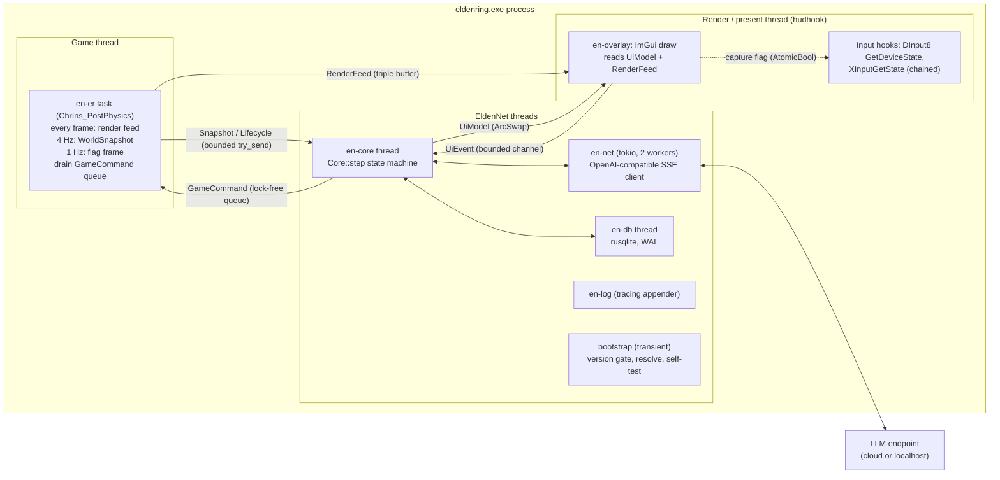
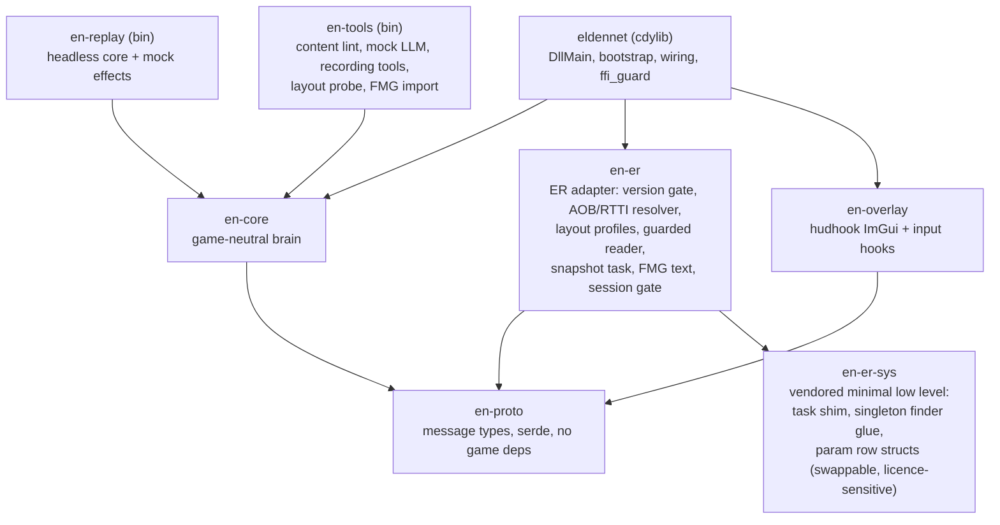
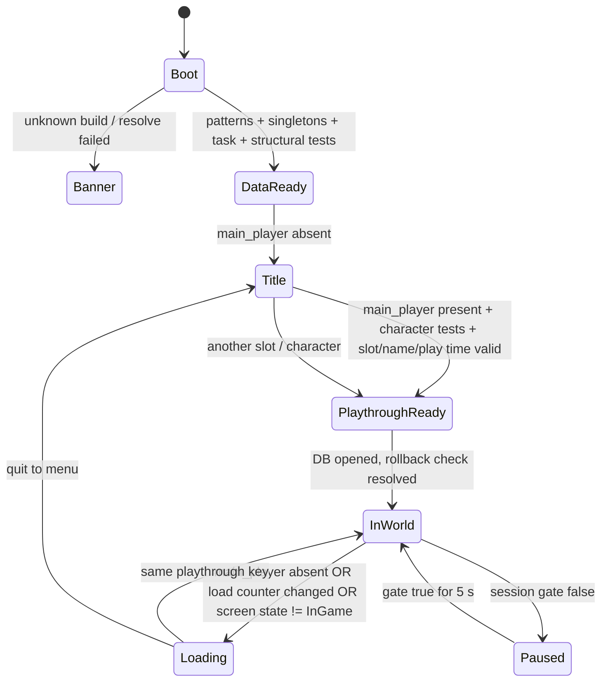
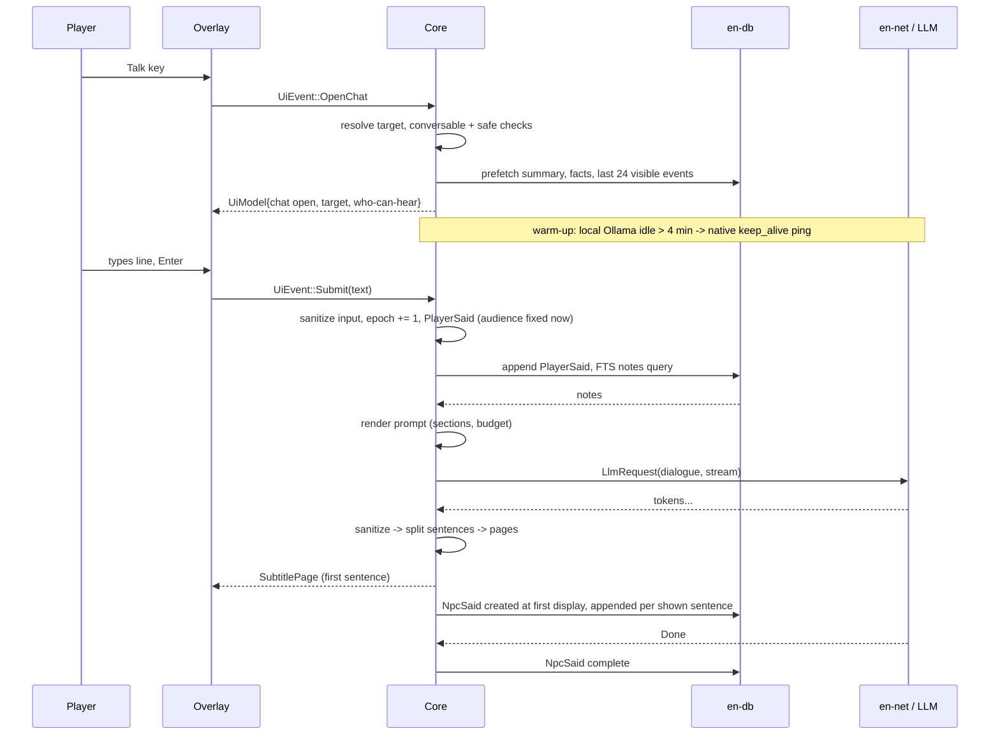

# P1: EldenNet v1 design proposal, "Lean monolith"

> **What this is:** one of several independent v1 design proposals for EldenNet, an LLM-driven NPC framework for ELDEN RING (PC/Steam, App 1.17.2, exe 2.7.2.0 WW / 2.7.2.1 JP). This one takes the **lean monolith** angle: one in-process Rust `cdylib` loaded by me3, holding a game-neutral core crate and a thin Elden Ring adapter crate, with a strict snapshot-in / command-out message boundary so the core runs headless in tests. It aims for the fewest moving parts, the simplest install and the strictest crash-safety discipline that one process allows.
>
> **Date:** 2026-11-06. **Inputs:** `docs/research/skyrimnet/00–08` (cited `SN0n §x`) and `docs/research/eldenring/00–06` (cited `ER0n §x`). Facts tagged LIKELY or RE-needed in the research stay that way here; the spikes in §12.1 must settle them before code depends on them.
>
> **Licence hygiene.** Nothing here reuses SkyrimNet prompts, templates, bios, YAML or code. Only ideas and published numbers are used, and they are cited. All example content (persona, archetype card, prompt section wording) is original. No FromSoftware text or assets ship in the repo. Game text is read at runtime from the user's own install.

---

## 0. Summary and decisions at a glance

EldenNet v1 is **one DLL plus one me3 profile and a content folder**. A single game-thread task copies a plain-data `WorldSnapshot` four times a second. A deterministic core turns snapshot diffs into events, runs a small speech scheduler, builds prompts, talks to one OpenAI-compatible endpoint, and publishes an immutable UI model that an ImGui overlay draws. Named NPCs get personas, flag-gated knowledge, an event log, facts and a rolling summary. Generic humanoids get barks served from pre-generated pools. **v1 writes no game memory, calls no game functions after start-up, edits no game data and hooks no game code.** Every failure degrades to a quieter mode. None of them may take the game down.

| # | Decision | Choice | Main reason |
|---|---|---|---|
| D1 | Process model | One in-process Rust `cdylib`; all ML out of process over HTTP | Simplest install; deepest perception; no native ML in the game (ER06 §5.1, ER00 §3.2) |
| D2 | Core/adapter split | `en-core` is a pure state machine (`step(input) -> outputs`); effects (HTTP, SQLite) run in a thin shell | Deterministic headless tests and replay (ER06 §5.1 item 3) |
| D3 | Game thread | **One** recurring `CSTaskImp` task in `ChrIns_PostPhysics`: render feed every frame, snapshot at 4 Hz, flags at 1 Hz | One place touches game memory (ER01 §3.2, SN00 §3 lesson #819/#830/#831) |
| D4 | Game memory access | Copies only, through an SEH-guarded reader with per-build **layout profiles as data** | Patch churn moves layouts, not names (ER01 §1) |
| D5 | fromsoftware-rs | Vendor a minimal subset from pre-licence-change commit `acc9da0` (MIT/Apache) into a swappable `en-er-sys` crate; replace `rva::get()` with a runtime AOB resolver that returns `Result` | Licence gate and the panic-on-unknown-build behaviour (ER02 §4.1); user decision U1 |
| D6 | Unknown game build | Banner-only mode: overlay works, zero game reads | "Degrade, never crash" (ER02 §5) |
| D7 | Tiers | Personas (questline + named services), archetype cards (generic humanoids), silent (bosses, invaders, creatures) | User requirements 2 and 3; ER04 §2.1 |
| D8 | Identity | Curated `persona_id`, resolved by exact `npc_param_id`, then `event_entity_id`; never by display name | ER04 §1, SN04 §10 lessons |
| D9 | Conversation start | Hotkey, deterministic target order, chat only in a safe context; no world freeze in v1 | The game has no pause (ER05 §11) |
| D10 | Memory | Event log with an audience join table + game-fed facts + per-persona rolling summary + up to 3 FTS-searchable notes per conversation; one LLM call per conversation | Few NPCs, short encounters, small models (ER06 §5.4, SN04 §13.5) |
| D11 | Barks | Data-defined triggers; pools generated in batches and cached; live barks optional with a 1.5 s deadline; 2–3 s expiry | A late bark is worse than none (ER06 §5.6, SN02 §13.1) |
| D12 | Presentation | hudhook DX12 ImGui overlay: chat box, lower-third subtitles, floating bark labels; text only | High feasibility, low patch risk (ER03 §8) |
| D13 | TTS/STT | Deferred to v1.5 behind `SpeechSink`/`InputSource` seams | Minimal v1 (SN06 §7.3) |
| D14 | Actions | None. Freeze the seams: reserved `ACT:` trailer, `DecisionRequest`, empty action registry, epoch-stamped command queue | User requirement 4; SN07 §11.4 |
| D15 | Persistence | One SQLite (WAL) file per playthrough: `SteamID / slot / fingerprint`, journey-tagged rows, playtime as the rollback clock | ER01 §11, SN04 §13.4 |
| D16 | Multiplayer | Fail closed: AI off unless provably solo host in own world | ER05 §3, ER02 §2 |
| D17 | Content format | TOML for all data, minijinja `.j2` for prompts; two layers (shipped, user overlay); hot reload | Fewest parsers; SN00 §4 row 33 |

---

## 1. Goals, non-goals and success criteria

### 1.1 Goals

1. **G-stable.** Loading EldenNet must never crash, hang or corrupt the game or a save, on any build, with any mod mix we test.
2. **G-named.** Important (named, questline) NPCs hold free-form typed conversations in character. They are aware of their situation and of the player, and they remember earlier conversations and witnessed events within a playthrough.
3. **G-generic.** Generic humanoid enemies know only what they are, where they are, and the fight in front of them. They produce short, timely barks, and can answer a player who addresses them with one short line.
4. **G-dialogue-only.** NPCs only talk. They never claim or promise actions.
5. **G-seams.** Clean interfaces for actions, voice, thoughts, triggers, vector memory, native subtitles and a director, so later versions add code without moving existing code.
6. **G-install.** Unzip, add one me3 profile, paste a key or pick a local server, play.

### 1.2 Non-goals for v1

Any NPC action (flags, items, hostility, movement, facing, animation); TTS, STT and lip-sync; native subtitles or talk menus; edits to `regulation.bin`, msgbnd, ESD or EMEVD; inline hooks into `eldenring.exe` code; NPC-to-NPC conversation, GameMaster, thoughts, diaries; vector memory; speech by talking bosses and NPC invaders; persistent memory for generic enemies; Melina (a special channel, ER04 §10 item 8); DLC personas; any multiplayer use; non-English prompts and content; a web dashboard or public API; telemetry upload of any kind.

### 1.3 Success criteria (what "minimal and stable" means, measurably)

Criteria are numbered C1–C12; in-game spikes are numbered S0–S10 (§12.2).

| ID | Criterion | Target for v1.0 | How measured |
|---|---|---|---|
| C1 | Crash safety | 0 crashes with an EldenNet frame on the stack in ≥ 50 h of play across ≥ 5 machines (including 1 Proton, 1 HDR, 1 with Seamless Co-op loaded) | Crash dumps; test log |
| C2 | Unknown build | On a build missing from the table, 100% of starts end in banner-only mode, with zero reads of game objects | Run the WW DLL against the JP exe with the JP profile removed; read counters = 0 |
| C3 | Game-thread cost | Task mean ≤ 0.15 ms, p99 ≤ 0.5 ms with 32 tracked characters; render feed ≤ 0.05 ms per frame | `traces` table, 30 min in Stormveil |
| C4 | Frame rate | ≤ 1 FPS average loss at the 60 FPS cap with a cloud provider | Side-by-side runs, overlay visible |
| C5 | Multiplayer | 0 LLM requests while the session gate is false | Unit test plus log audit in an ERSC session |
| C6 | Bark timeliness | ≥ 95% of shown barks appear ≤ 1.0 s after the triggering snapshot; 0 shown after expiry; ≤ 6 combat barks/min | Scheduler traces over 3 camp fights |
| C7 | Dialogue latency | Median time to first subtitle ≤ 1.5 s (recommended cloud preset), ≤ 2.5 s (local 4B on a 12 GB GPU); p95 ≤ 4 s | `traces`: submit → first displayed sentence |
| C8 | Output hygiene | 0 displayed strings containing markup, reasoning tags, the reserved trailer, or text over the byte cap | Fuzz tests plus a scan of the replay corpus |
| C9 | Silence rules | 0 lines from dead, hostile-state, muted or voiceless characters | Scenario tests; scan of the in-game event log |
| C10 | Spoiler control | ≤ 1% of 200 scripted adversarial questions leak a gated term (recommended preset); 0 with the lexicon filter on | Eval harness, §11 |
| C11 | Memory | After a reload, the NPC refers correctly to the previous conversation in ≥ 80% of scripted "do you remember…" probes; the rollback trim test passes | Eval harness, migration tests |
| C12 | Install | 5 new testers reach a first conversation in ≤ 10 min from the README | Timed sessions |

---

## 2. Process and code architecture

### 2.1 Runtime shape: one process, one game task, five own threads



- **Game thread:** one task closure, the only code that reads game objects (§2.8 R1).
- **Render thread:** hudhook's present callback draws the overlay from plain data. The DirectInput and XInput hooks only consult an atomic flag.
- **en-core:** a single thread running the deterministic core loop over a `crossbeam::select!` of inputs.
- **en-net:** a small tokio runtime for streaming HTTP. It holds no game state.
- **en-db:** owns the one SQLite connection; requests come in by channel.
- **bootstrap:** spawned from `DllMain`, which does nothing else (loader lock). It exits after start-up.

### 2.2 Crates



| Crate | Responsibility | Allowed dependencies | Not allowed |
|---|---|---|---|
| `en-proto` | `WorldSnapshot`, `GameCommand`, `UiModel`, `UiEvent`, `Lifecycle`, `PROTO_VERSION` | `serde`, `smallvec`, `arcstr` | Anything game- or I/O-related |
| `en-core` | Perception diff, event log model, identity resolution, scheduler, conversation, barks, memory logic, prompt rendering, content loading and validation, LLM request shaping, config | `en-proto`, `minijinja`, `toml`, `serde_json`, `regex`, `unicode-segmentation` | `unsafe`, Win32, game addresses, ER constants (these live in `content/eldenring/`) |
| `en-er-sys` | The small low-level layer that differs per licence option (§2.5): task registration shim, FD4 singleton finder, DLRF/RTTI helpers, generated param row structs for the 4 params we read | `windows`, the vendored code | Logic |
| `en-er` | Version gate, pattern resolver, layout profiles, `GuardedReader`, the snapshot task, render feed, FMG reader, static-data export, session gate, self-tests | `en-proto`, `en-er-sys`, `microseh` (or a 20-line `cc` SEH shim) | LLM, DB, UI |
| `en-overlay` | hudhook DX12 ImGui, fonts, input capture hooks (through the MinHook copy hudhook already bundles, so the DLL carries one hooking library; if hudhook does not expose it, link that same vendored MinHook once) | `en-proto`, `hudhook`, `imgui` | Game memory |
| `eldennet` | `DllMain`, bootstrap sequence, thread spawn, effect executors (HTTP via `reqwest`+`rustls`, SQLite via `rusqlite` bundled), `ffi_guard` | all of the above | — |

The core is game-neutral in a concrete sense: it knows actors by `{handle, param, model, entity, kind, team}` integers, world bits by `u32`, places by key and display text. What those numbers mean comes from the `content/eldenring/` data pack: identity, archetypes, teams, the flag catalogue and knowledge. A Nightreign or other FromSoftware port would add an adapter and a content pack and reuse `en-core` unchanged.

### 2.3 The message boundary (`en-proto`)

Three message families cross the boundary. All are owned, plain data and serde-serializable, so a recording is a list of them.

```rust
// Adapter -> core
enum AdapterMsg {
    Lifecycle(Lifecycle),                 // DataReady, PlaythroughReady{..}, LoadingStarted, ...
    StaticData(Arc<StaticData>),          // once per DataReady: graces, place-name rows, teams seen
    Snapshot(Arc<WorldSnapshot>),         // 4 Hz
    Health(ReadHealth),                   // read-group status changes, breaker trips
}
// Core -> adapter (v1 holds only read-configuration commands)
enum GameCommand {
    SetTracked { handles: SmallVec<[ChrHandle; 8]> },   // render-feed positions for labels
    SetFlagWatch { ids: Arc<[u32]> },                    // curated + in-range persona flags
    ResolveText { fmg: u16, ids: SmallVec<[u32; 8]> },   // item/place names on demand
    Noop,                                                 // tests and the action-seam stub
    // Reserved, behind cargo features that are off in v1:
    // Freeze { on: bool }, NativeLine { .. }, Action { executor, args, epoch, deadline }
}
// Core <-> overlay
struct UiModel { version: u64, chat: Option<ChatBox>, subtitle: Option<SubtitlePage>,
                 barks: SmallVec<[BarkLabel; 2]>, feed: SmallVec<[FeedLine; 3]>,
                 toasts: SmallVec<[Toast; 4]>, banner: Option<Banner>, wizard: Option<WizardState>,
                 debug: Option<Arc<DebugView>> }
enum UiEvent { OpenChat, Submit(String), CloseChat, Interrupt, PageNext,
               Setting(SettingChange), Wizard(WizardInput), Debug(DebugCmd) }
```

`ChrHandle` is the game's `FieldInsHandle` packed into a `u64`. Pointers never cross the boundary.

### 2.4 Functional core, imperative shell

```rust
impl Core {
    /// Pure apart from `now`, which comes from the input: no I/O, no threads, no clock reads.
    fn step(&mut self, input: CoreInput, now: Mono) -> Outputs;
}
enum CoreInput { Adapter(AdapterMsg), Ui(UiEvent), Llm(LlmEvent), Db(DbResult), Tick }
struct Outputs { game: Vec<GameCommand>, ui: Option<Arc<UiModel>>,
                 llm: Vec<LlmRequest>, db: Vec<DbRequest>, cancel: Vec<RequestId> }
```

LLM streams arrive back as `LlmEvent::{Token, Done, Error}` with request IDs. DB reads arrive as `DbResult`. Because time is an input and effects are outputs, `en-replay` can drive the same `Core` from a recording, with scripted LLM and DB responses and a simulated clock. Scheduler expiry, cooldowns and the conversation state machine are then fully testable without the game or a network (§11).

### 2.5 The game-access layer and the licence gate

**Facts that constrain this layer.** fromsoftware-rs is the only maintained typed SDK. Its `rva::get()` matches exactly one build per region and `panic!`s otherwise. Since Rust 1.81, a panic that unwinds out of the task trampoline's `extern "C"` function aborts the game. Struct layouts move on bug-fix patches. Since 2026-10-12, its licence files say "MIT NON-AI"/"Apache NON-AI", and the 1.17.2 updates came after that change (ER01 §1, ER02 §4.1, ER00 §3.2).

**What EldenNet needs from the game is small:** register one task; find about 10 singletons; read about 60 fields; walk one vector, one flag tree and one FMG table. So EldenNet owns the field reads, and only the parts that are hard to rewrite come from elsewhere.

| Layer | Owner | Notes |
|---|---|---|
| PE version read | `en-er` (own, Win32 only) | Before anything else (ER02 §5 step 1) |
| Pattern resolution (`register_task`, `GameDataMan`, `GameMan`, `FieldArea`) | `en-er` (own runtime AOB scanner + RTTI check), patterns kept in `content/eldenring/patterns.toml` | The patterns come from the public, pre-change `mapper-profile.toml` (MIT/Apache); results are validated by function length, prologue and RTTI where possible |
| Singleton discovery | `en-er-sys` (FD4Singleton finder via `from-singleton`; confirm its licence when vendoring) | Survives patches; finds *where*, not *what shape* (ER01 §4) |
| Task registration shim (fake FD4 task vtable + `register_task`) | `en-er-sys`, vendored from `acc9da0` | About 150 lines; MIT/Apache at that commit |
| Field layout | `en-er` **layout profiles** (`content/eldenring/layouts/<build>.toml`) | Offsets are data. A patch that only moves fields is a data update |
| Param rows (`NpcParam`, `NpcThinkParam`, `BonfireWarpParam`, `WorldMapPlaceNameParam`) | `en-er-sys` generated row structs (paramdef layouts change rarely) | Read through `SoloParamRepository` with a guarded walk |
| FMG text | `en-er` own in-memory FMG reader (TGA's hook-free method: `[[MsgRepository]+8]` table, binary search of FMG ID ranges) | No function calls, no hooks (ER03 §3.3, ER01 §8.3) |

**Licence options (user decision U1, §13.2):**

- **(a)** Get a legal read, or a statement from the fromsoftware-rs authors that runtime LLM inference is out of scope, then depend on upstream `main` as a pinned git dependency for `en-er-sys`.
- **(b) Recommended default:** vendor only the subset above from `acc9da0` (2026-09-21, plain `MIT OR Apache-2.0`) with attribution in `THIRD_PARTY.md`. Re-derive anything 1.17.2-specific ourselves: RVAs by runtime AOB scan, layouts by our own self-test and in-game probing (`en-tools probe`, §11.5). Never copy post-2026-10-12 commits. Ask the authors (a) in parallel. We should not post LLM-written text in their spaces (ER02 §3.2, §11).
- **(c)** Replace `en-er-sys` with our own minimal code (task shim, singleton finder). That is about 600 lines and a few weeks, with no upstream dependency.

Swappability is structural. `en-er` calls `en-er-sys` only through one trait:

```rust
pub trait SysLayer: Send + Sync {
    fn register_recurring(&self, phase: TaskPhase, f: Box<dyn FnMut(&TaskCtx) + Send>) -> Result<TaskToken, SysError>;
    fn singleton(&self, name: &'static str) -> Result<usize /*address*/, SysError>;
    fn param_table(&self, which: ParamKind) -> Result<ParamTableView, SysError>;
    fn rtti_name(&self, vtable: usize) -> Option<ArcStr>;
}
```

Options (a), (b) and (c) are three implementations of this trait, chosen by a cargo feature. None of them can reach `rva::get()`, because our fork stub-replaces that module with an error-returning resolver.

### 2.6 Version gating and the degradation ladder

**Bootstrap sequence** (bootstrap thread, after me3 loads the native post-main; ER02 §3.2):

1. Read `VS_FIXEDFILEINFO` and `ProductName` from `eldenring.exe`. Build key = `2.7.2.0-ww` or `2.7.2.1-jp`.
2. Look up `layouts/<build>.toml` and `patterns.toml`. If either is missing, go to **L1 banner-only**: start the overlay, show "EldenNet inactive: game build 2.x.y.z is not supported yet", and stop.
3. Resolve patterns and singletons. Any failure → L1 with the reason.
4. Register the single task. The first task ticks run **structural self-tests** on the game thread (below). If they fail → unregister (or trip) the task → L1.
5. Wait for `PlaythroughReady` (§2.7). Run the **character self-tests**. Enable features read group by read group.

**Read groups and self-tests.** Every field read belongs to one group. A group is enabled only after its self-test passes, and is tripped at run time by its breaker (§2.9).

| Group | Contents | Self-test (on 1.17.2, ER02 §5) |
|---|---|---|
| `session` | `CSSessionManager` lobby state, `multiplay_role`, `is_my_world`, player-set count | Lobby value in enum range at DataReady; once in world, `multiplay_role` readable and == Host with `is_my_world` in a solo session. **Must pass, or AI stays off** |
| `world` | `WorldChrMan.chr_inses_by_distance`, `ChrIns` identity/HP/dead/team/type/position | Entries' vtable RTTI names are `ChrIns` subclasses; distances ascending; `0 < max_hp ≤ 100000`, `hp ≤ max_hp`; `npc_param_id` resolves in NpcParam |
| `combat` | `last_hit_by`, `received_damage_type`, throw state, lock-on | Handles resolve or are null; throw state ∈ 0..=6 |
| `player` | `PlayerGameData` (name, level, stats, gear IDs, body type, archetype, keepsake), `GameDataMan` (play time, deaths, `ng_lvl`, boss fields), `GameMan.save_slot` | Main player vtable is `CS::PlayerIns`; `character_id == 0`; name is valid UTF-16, 1–16 chars; slot ∈ 0..=9; play time > 0 and rising |
| `flags` | `CSEventFlagMan` | `event_flag_divisor == 1000`; flag 100 set in a loaded game; every catalogue flag's group exists (unallocated groups read false, ER01 §9) |
| `text` | `MsgRepository` FMG table | Table count ≥ 20; NpcName/PlaceName lookups of known IDs return 1–64 printable chars |
| `ui` | `CSFeManImp.hud_state`, banner id, boss bars, `CSPopupMenu.current_talk_id`, `GameMan.talk_esd_camera_param_id`, load counter / screen state | Values in known ranges at title and in world |
| `place` | `FieldArea.map_place_name_id`, `BlockId`, `WorldAreaTime` clock | Place id resolves in PlaceName; clock hour < 24 |
| `camera` | `CSCamera` matrix, FOV, aspect | Orthonormal rotation; FOV within 0.3–2.5 rad |
| `params` | Param row reads | Known row IDs found; row sizes match the paramdef |

**Capability matrix** (feature → groups it needs; fail closed):

| Feature | Required | Optional (degrades) |
|---|---|---|
| Any AI | `session`, `world`, `player` | — |
| Conversation | + `flags`, `ui`, `place`, `params` | `text` (falls back to persona display names), `combat` (gating is then more conservative) |
| Barks | + `combat` | `text`, `place`, `camera` (falls back to the bottom feed instead of floating labels) |
| Memory/persistence | `player` (slot, play time, name) | — |
| Floating labels | `camera` | — |

**The ladder:**

| Level | Entered when | What runs | What the player sees |
|---|---|---|---|
| L0 Off | `enabled = false` in settings | Nothing after `DllMain` | Nothing |
| L1 Banner-only | Unknown build, missing pattern or singleton, structural self-test failed | Overlay only, no task, no game reads | Banner with the reason and the build string |
| L2 Observe | Self-tests pass, but no provider is healthy, or the user paused AI | Task, perception, debug overlay, recording | Small "AI paused" status, debug view on request |
| L3 Partial | One or more optional groups tripped | Features per the capability matrix | Toast naming the disabled feature |
| L4 Full | Everything passes | Everything | — |
| (Pause) | Session gate false, loading, main menu | Task idles; core drops pending speech | "Paused (multiplayer)" when relevant |

**Unknown builds (user decision U2).** By default an unknown build means L1. An opt-in setting `try_previous_layout = true` lets the bootstrap try the newest known profile if every pattern resolves. All self-tests must then pass, and the session runs in *probation*: L2 (observe only) for the first 10 minutes, then L4 only if no group breaker has tripped. This shortens patch day for tolerant users and never risks a silent misread in the default setting.

### 2.7 Lifecycle



| Transition / event | Detection (snapshot fields) | Core actions |
|---|---|---|
| DataReady | Bootstrap result | Load content pack; send `StaticData` export request (game thread reads grace and place-name params over several ticks, ≤ 1 ms per tick) |
| PlaythroughReady | `main_player` present + character tests | Compute playthrough key (§7.6); open DB on en-db; rollback check; journey check |
| Loading started | as in diagram | End conversation (commit only lines already shown); clear bark queue, short-lived events, squads; hide overlay speech |
| Player died | dead bit rising, `just_died`, `death_count` +1; banner 5 confirms | End conversation; allow only the `player_down` bark rule for 3 s; persist `player_died` with audience |
| Respawn | dead → alive after a load | Clear generic state (enemies respawn) |
| Rest started / ended | Flag 9000 rising / falling (set by the grace talk ESD, ER05 §3) | Mark safe context; on rest end clear generic squads and cooldowns (world reset, ER04 §4.1) |
| Journey changed | `ng_lvl` changes (spike S6 confirms the field) | New journey partition (§7.6) |
| Slot change / quit | `save_slot` change or Title | Flush and close DB |

### 2.8 Crash-safety rules (normative)

- **R1. One reader.** Game objects are read only inside the EldenNet task closure. No hook, overlay callback or worker touches game memory. Exceptions: the bootstrap's pattern and singleton scans read the executable image, not live objects; task registration is thread-safe by contract (ER01 §3.2).
- **R2. No writes, no calls.** After registration, v1 writes no game memory and calls no game function. The FMG text reader is a pure read.
- **R3. Guard every foreign entry.** Every function entered from foreign code (the task closure, DInput/XInput hooks, hudhook callbacks, the WndProc filter, the bootstrap thread body) is wrapped in `ffi_guard(|| …)`: `catch_unwind` plus a per-component *tripped* flag. A tripped component returns immediately on every later call. The cdylib builds with `panic = "unwind"`. A CI check rejects any `extern "C"`/`extern "system"` function whose body does not begin with `ffi_guard`.
- **R4. Copies, never references.** Raw reads go through `GuardedReader::copy::<T: Pod>(addr)`. It is an SEH-protected `memcpy` (`microseh`, or a tiny C shim built with `cc`) plus plausibility checks: non-null, aligned, canonical user-mode address, and vtables inside the module's `.rdata`. No `&T` into game memory is ever formed. A caught access violation becomes `Err(ReadFault)`. Because we only read, a caught fault leaves no state half-written. Reads are batched: one guarded copy of a `ChrIns` prefix (≈0x600 bytes) and one per module, not one per field.
- **R5. Never block the game or render thread.** No mutex is shared with workers. Use bounded `try_send` (drop when full), `ArcSwap` and a triple buffer. Buffers are allocated up front (`SmallVec`, reused `Vec`s).
- **R6. No pointer survives a tick.** Characters are re-found every tick by walking the by-distance list. Handles, not pointers, are stored (ER05 §6.1: the block pool emptied within minutes).
- **R7. Gate before layout.** Nothing RVA- or layout-dependent runs before the version gate.
- **R8. Self-test, then plausibility on every read.** Values out of range count as faults.
- **R9. Breakers.** Read group: 3 faults in 60 s → group disabled for the session, dependent features degrade (§2.6), toast. Core subsystem (conversation, barks, memory, prompt): a panic caught at its boundary → reset that subsystem's state once; a second panic → disable it for the session.
- **R10. Lints.** `#![deny(clippy::unwrap_used, clippy::expect_used, clippy::panic, clippy::indexing_slicing, clippy::arithmetic_side_effects)]` in `en-er`, `en-er-sys`, `en-overlay` and `eldennet`. `unsafe` is allowed only in `en-er::reader`, `en-er-sys` and `en-overlay::hooks`, each block with a `// SAFETY:` note.
- **R11. Idle while loading.** The task does no work while `main_player` is absent or the load counter moves, except to detect the resume.
- **R12. No game-code hooks in v1.** Only system DLL hooks (DXGI via hudhook, DInput8, XInput), chained to any previous hook. This keeps v1 clear of Arxan code restoration (ER02 §5).
- **R13. Sanitized strings only.** Everything that reaches the overlay is sanitized and byte-capped (§5.5).
- **R14. Self-throttle.** If the snapshot step exceeds 0.5 ms three ticks in a row, halve the rate (4 → 2 Hz) and cap tracked characters at 16. Restore after 60 s under budget.
- **R15. No work at exit.** Do not unregister tasks or flush on `DLL_PROCESS_DETACH`. Every DB write is its own transaction (WAL), so nothing is lost.

### 2.9 Error handling in the core

Every effect returns a typed result: `LlmError::{Timeout, FirstTokenTimeout, RateLimited, Server, Auth, Empty, Parse, Cancelled}`, `DbError::{Busy, Corrupt, Migration, Refused}`. Each job has a deterministic fallback. A bark falls back to the pool or to silence. A dialogue turn retries once on the fallback model, then shows an honest grey system line such as "(no reply: model timed out)" plus a toast, never invented NPC speech (ER06 §2.4: masked failures were the worst support cost). A memory job falls back to "no summary update, watermark not advanced", and is retried after the next conversation. Toasts are rate-limited to 1 per error class per 60 s.

---

## 3. Perception

### 3.1 Task schedule

One task, `CSTaskGroupIndex::ChrIns_PostPhysics`. That phase runs after `CameraStep`, so positions and the camera are final for the frame (ER01 §3.2). Spike S1 compares it with `WorldChrMan_PostPhysics` and the `…Safe` twin. Each run:

1. Drain up to 16 `GameCommand`s (≤ 0.02 ms).
2. **Render feed (every frame):** camera view-projection plus the positions of ≤ 8 tracked handles (labels need 60 Hz positions, not 4 Hz). Written to a triple buffer.
3. **Snapshot (every 250 ms of accumulated `delta_time`):** build `WorldSnapshot`, `try_send` to the core.
4. **Flag frame (every 4th snapshot, 1 Hz):** read the current watch list (≈ 700 IDs: catalogue + grace flags + in-range persona blocks). A tree lookup and a bit test each, ≈ 0.1 ms.
5. **Text and params:** up to 16 new FMG lookups and 32 new NpcParam rows per tick, cached for the session (until the FMG table pointer changes).

### 3.2 `WorldSnapshot` schema

```rust
struct WorldSnapshot {
    seq: u64, mono_ms: u64, play_time_ms: u64, build: BuildKey,
    session: Session,      // role, is_my_world, lobby, other_players: u8, ghosts: u8, ersc_loaded: bool
    ui: UiGame,            // hud_state, screen_state, load_counter, banner_id, popup_talk_id,
                           // talk_cam_param_id, show_subtitles
    player: Player,
    place: Place,          // zone: u32 (BlockId), zone_class: Overworld|Legacy|Minor|Hub,
                           // place_text_id, place_name: Option<ArcStr>, subarea_popup_id
    time: TimeOfDay,       // hour, minute
    boss: Boss,            // active, bars: SmallVec<[BossBar; 3]> {name, handle, damage_taken}
    chars: SmallVec<[Chr; 32]>,   // ascending distance, ≤ 32 within 40 m (hard cap 48)
    flags: Option<FlagFrame>,     // every 4th snapshot: (watch-list version, bitset)
    health: ReadHealth,           // per-group fault counters this tick
}
struct Player {
    handle: ChrHandle, name: ArcStr, level: u16, body: BodyType, archetype: u8, keepsake: u8,
    hp: u32, max_hp: u32, fp: u32, max_fp: u32, stamina: u32, max_stamina: u32,
    runes_held: u32, deaths: u32, ng_lvl: u8, dead: bool, just_died: bool,
    riding: bool,                 // ride_state == 5 (ER05 §3)
    locked_on: Option<ChrHandle>, last_hit_by: Option<ChrHandle>, throw_state: u8,
    zone: u32, pos: [f32; 3], yaw: f32,
    gear: Gear,                   // item IDs + resolved names: weapons R/L, head, chest, hands, legs
    roundtable: bool,             // SpEffect 9621 active (ER05 §3)
}
struct Chr {
    handle: ChrHandle, param: u32, model: u32, kind: u8 /*chr_type*/, team: u8,
    entity: u32, zone: u32, dist_m: f32, bearing_deg: f32 /*vs camera forward*/,
    pos: [f32; 3], hp: u32, max_hp: u32, dead: bool,
    last_hit_by: Option<ChrHandle>, recv_dmg_type: i32, throw_state: u8,
    on_screen: bool, locked_by_player: bool,
    name_id: u32, name: Option<ArcStr>,   // NpcParam.nameId -> NpcName {428, 328, 18}
    think_param: i32,                       // EnemyIns.npc_think_param
    eye_dist_m: Option<f32>,                // NpcThinkParam.eye_dist, cached per think row
}
```

Size: about 3–4 KB per snapshot, so a recording at 4 Hz is about 14 KB/s raw, ≈ 4 MB/h after zstd.

**Radius and caps:** 40 m and 32 characters (the bark-awareness radius suggested in SN00 §6). Conversation candidates come from the same list (≤ 12 m). Torrent (`model == 8000`) and the player's spirit summons are included with their `kind` so the core can tag them, never speak through them.

### 3.3 Static data and text

At DataReady the game thread exports `StaticData`: all `BonfireWarpParam` rows (id, `eventflagId`, area/grid, position, `textId1` → PlaceName) and `WorldMapPlaceNameParam` rows. With those the core computes "nearest grace" and coarse region names, with no per-tick reads (ER05 §4).

Text comes from the in-memory FMG tables, with DLC slot order {4xx, 3xx, base} (ER05 Implications item 6). If the `text` group fails, the fallback is an FMG export that the **user** makes from their own install with `en-tools fmg-import <WitchyBND export dir>`. It writes `%APPDATA%\EldenNet\gamedata\fmg-<lang>.db`. Nothing from it ships.

### 3.4 Event derivation (core, from consecutive snapshots)

Per-actor trackers are keyed by handle. A tracker is dropped when its handle has been absent for 2 s. "Hostile" means the runtime `team` maps to `hostile` in `teams.toml` (EMDF team enum, ER05 §6.2: 6 Enemy, 7 Strong Enemy, 27 Hostile NPC, 29 Indiscriminate), never the param's team (SN05 §14.2, lesson #768).

| Event | Exact condition | Store |
|---|---|---|
| `Damaged{v, a?, frac}` | `hp` of v drops by Δ > 0 between snapshots and v was alive; `a = v.last_hit_by` if it resolves. Merged per (a, v) over 2.5 s into key `hit:a:v` with count and total fraction | Short-lived, TTL 10 s |
| `HeavyHit{v}` | Merged `hit:*:v` total ≥ 30% of `max_hp` within 3 s (SN05 §14.2) | Short-lived 10 s |
| `LowHp{x}` | `hp/max_hp` falls below 0.25; re-armed above 0.35 | Short-lived 20 s, key `low_hp:x` |
| `Died{x, killer?}` | dead bit rising (or `hp` → 0 with dead bit next tick); killer = `last_hit_by` | Persistent if x is a persona or a boss; otherwise short-lived 30 s |
| `PlayerDied{killer?}` | player dead bit rising, or `just_died`, or `deaths` +1 | Persistent (audience: personas in 30 m) |
| `AggroStart{e}` | Hostile generic e, first of: e damaged the player (`player.last_hit_by == e` and player Δhp > 0); the player damaged e (`e.last_hit_by == player` and Δhp > 0); the player locked on to e while `dist ≤ eye_dist` (default 20 m) (ER05 §8.1) | Short-lived; state `engaged:e` |
| `AggroEnd{e, fled}` | Engaged e with no hit exchange for 12 s and no lock-on, or `dist > 30 m`; `fled = true` if the player's distance grew by > 15 m in the last 5 s | Short-lived 10 s |
| `CritLanded{v}` | player `throw_state == 3` (InThrowAttacker) while hostile v has `throw_state == 4`, rising edge (ER05 §8.5) | Short-lived 10 s |
| `AllyDied{v, squad}` | `Died` of a generic in a squad (§6.3) with another live member within 20 m | Short-lived 10 s |
| `PlayerHealed` | player `hp` +≥ 20% of max within 1 s while in combat | Short-lived 10 s |
| `CombatStart/End` (player) | §3.6 | State |
| `BossFightStarted{name}` / `Ended{outcome}` | `boss.active` rising / falling. Outcome: `victory` if banner ∈ {1, 2, 3, 4} or a catalogue boss flag rose within 10 s; `death` if `PlayerDied`; else `left` | Persistent |
| `MountChanged{riding}` | `riding` edge | Short-lived |
| `EnteredPlace{place}` | `place_text_id` changed and stable for 2 s, or `subarea_popup_id` changed | Persistent, deduped per place per 10 min of play |
| `RestStarted/Ended` | Flag 9000 edge | Persistent (deduped per grace per 10 min) |
| `GraceLit{grace}` | A grace's `eventflagId` rising | Persistent |
| `FlagChanged{name, value}` | Edge on any catalogue flag | Persistent |
| `PersonaApproached{p}` | Persona within 6 m for ≥ 1 s; re-armed after leaving 20 m | Persistent (first per visit) |
| `NativeTalkStarted/Ended{p?}` | `popup_talk_id` valid, or `talk_cam_param_id != -1`, or `hud_state == PopupMenu` with a persona within 3 m (ER03 §8, ER05 §10). Spike S3 decides which signals count | Persistent with persona if known |
| `PlayerSaid` / `NpcSaid` | From the conversation pipeline, not the diff | Persistent |

### 3.5 Event policy and the audience rule

Every event records its **audience** when it is registered. The audience is every *persona* (generics never remember) that is alive, not muted at its current stage, and within the event's radius of the origin. Radii are 16 m for speech (the player's line, NPC lines), 30 m for deaths, 40 m for combat noise. Zones must also match: the same `BlockId` area and block indoors, or both overworld. **One visibility function, `visible_to(event, persona)`, serves every consumer:** prompt history, the recap, the memory job and facts. This avoids SkyrimNet's split between what conversation sees and what memory sees (SN00 §3, lesson #723; SN05 §14.1 items 2 and 10).

Short-lived events live in an in-RAM keyed store (`key → latest`, TTL). They never enter the DB, never enter persona history, and appear in prompts only as ≤ 3 worded lines in the scene block.

### 3.6 Combat-state heuristic

`player_in_combat = boss.active || (now − last_signal) < 8 s`. A signal is any of: the player took damage from a hostile; the player damaged a hostile; `CritLanded`; at least one engaged enemy. This follows ER05 §8.1: no reliable global exists, and the `CSAiThink` chain stays a v1.x spike. Generic barks require **engagement with the player**, never mere proximity or "searching" (SN05 §14.2, lesson #771). Each generic card also carries an always-on hostility fact from the runtime team, so barks never come out friendly (SN05 §14.1 item 9, lesson #768).

---

## 4. NPC model

### 4.1 Tier mapping

| ER group (ER04 §2.1) | v1 treatment | Pipeline |
|---|---|---|
| A. Questline NPCs | Persona, stages, gated knowledge, memory, free chat | Conversation |
| B. Named service NPCs (Kalé, Hewg, Enia, Roderika as tuner…) | Persona with `role = "service"`, same pipeline. The prompt states that trade and services happen only through the usual dealings (vanilla menus stay authoritative, ER04 §2.4) | Conversation |
| B'. Unnamed service NPCs (nomadic merchants, code 801) | Shared archetype card, `replies = true`, no ambient barks, no memory | Generic reply |
| C. Talking bosses | Silent. Their boss-form rows map to persona or mute entries with `mode = "mute"` | — |
| D. NPC invaders | Silent | — |
| E. Generic humanoids | Archetype card: barks, plus a short reply when addressed | Bark / generic reply |
| F. Voiceless (beasts, dragons, giants, golems, spirits, Twin Maiden Husks, Goldmask) | Perceivable, never speak, never remember | — |
| Unknown | Humanoid model (`c0000`) and hostile team → `fallback.hostile_humanoid` card (on by default). Everything else → silent, and logged to the debug "unknown characters" list for curation | — |

Questline NPCs who are summoned (`kind == WhiteSummonNpc`, 19) resolve to their persona. They produce witnessed events ("fought beside the Tarnished against X") and stay silent in battle in v1.

### 4.2 Identity resolution

The primary key is a curated `persona_id` slug. The resolution order runs once per handle and is cached for the handle's lifetime:

1. `param_index[npc_param_id]` → (persona or archetype, variant). Exact rows, every row variant listed.
2. `entity_index[event_entity_id]` (non-zero only) → persona.
3. Archetype by `npc_param_id` family (`id / 10000 × 10000`, e.g. `4311xxxx` → `43110000`), then by model ID.
4. Fallback rule (§4.1).

There is never a name-based key (SN04 §10.2: name-derived identities forked memories). Display names always come from the runtime NpcName of the *current* row, so reveals happen in sync with vanilla. "Renna" (`20500010`) and "Ranni" (`20500000`) are two rows of one persona (ER04 §7). Talk codes are metadata only, because the datasets disagree (Seluvis 306/307, Boc 223/342; ER04 §1).

```toml
# content/eldenring/identity/personas.toml  (illustrative; IDs from ER04 §1, block bases marked unverified)
[[persona]]
id = "alexander"
talk_code = 220
flag_block = { base = 0, verified = false }       # to fill from a live flag log (spike S6)
rows = [ { param = 44909000, form = "jar" } ]
entities = []                                      # candidate entity IDs, verified bit each
expect_name_id = 0                                 # NpcParam.nameId of row 1 in vanilla data, filled by en-tools (identity-pack check)

[[persona]]
id = "ranni"
rows = [ { param = 20500010, form = "renna", reveal = "masked" },
         { param = 20500000, form = "ranni" } ]
```

**Identity-pack check (overhaul safety).** At DataReady, compare live `NpcParam.nameId` against `expect_name_id` for every persona row. If more than 20% mismatch, an overhaul or randomizer has probably rewritten rows. Personas are then disabled with a toast "identity pack does not match this game data". Barks keep working through the fallback (ER02 §6: randomizers move enemies; ER05 Risks: overhauls change params).

**Aliases.** `persona_aliases(old, new)` lets curators rename personas without orphaning memories.

### 4.3 Persona schema (important NPCs)

A persona is pure prose in named fields. Layout, headers and live state belong to the prompt templates (SN03 §12.1 items 2–4). Fields:

| Field | Purpose | Visible to |
|---|---|---|
| `register` | `archaic-regal \| formal \| colloquial \| broken \| chant \| silent` (ER04 §5) | Prompt rules |
| `public.summary`, `public.appearance` | What any stranger perceives (the "stranger test") | This NPC; other personas in `observed` mode |
| `private.background`, `personality`, `goals`, `fears` | Interior life | This NPC only |
| `secrets[] {id, text, reveal_after}` | Content that appears only once a stage predicate holds | This NPC only, gated |
| `voice.cadence`, `diction`, `address`, `deflection` | Behaviour-level description of speech: sentence shape, how they address the player, how they refuse (SN03 §12.4: describe cadence, not effect words such as "cryptic") | Prompt (end of the cached block) |
| `voice.tics[] {text, max_per_conversation}` | Owned catchphrases with a frequency cap (ER04 §5: tics belong to one NPC) | Prompt + post-filter counter |
| `knowledge[]` | Knowledge-base keys this NPC may know; plus `local[]` short facts | Prompt, gated |
| `stages[]` | Ordered situations: `when` predicate, `situation`, `mood`, `chat = allowed \| refuse \| mute`, `knowledge_add[]`, `forbidden[]` | Prompt; gating |
| `relationships{}` | Short gated notes on other personas | Prompt, gated |
| `remember_past_journeys` | NG+ policy (default false) | Memory filter |

Predicates name symbolic catalogue entries (`stage:alexander.freed`), never raw flag IDs, so personas survive catalogue corrections.

**Original example (illustrative; stage flags unverified):**

```toml
# content/eldenring/personas/alexander.toml
id = "alexander"
role = "questline"
register = "colloquial"

[public]
summary = "A walking warrior jar of great size who travels the land seeking battles that will temper him."
appearance = "A towering clay vessel with a broad lid, thick stubby arms and a cracked, much-patched surface. He moves with a heavy, rocking gait."

[private]
background = "He was fired and filled in the old jar-making tradition, and he believes a jar earns greatness only by being tested in battle. He has wandered far from home on that conviction."
personality = "Big-hearted, boisterous and earnest. Laughs at his own misfortunes, takes debts of honour seriously and is quick to praise courage in others."
goals = "To grow strong enough to stand among the great warriors of the age."
fears = "Breaking before he has proven himself."

[[private.secrets]]
id = "contents"
text = "He knows exactly what a warrior jar is filled with, and is proud rather than ashamed of it."
reveal_after = "stage:alexander.freed"

[voice]
cadence = "Long, rolling sentences that build to an exclamation. Often starts with a hearty interjection. Short bursts of laughter written as words, never as sound effects."
diction = "Plain, warm speech with old-fashioned courtesy. No archaic pronouns."
address = "Calls the player 'friend' once trust is earned, 'Tarnished' before that."
deflection = "When asked something he does not know, he admits it cheerfully and turns the talk to battle or the road ahead."
tics = [ { text = "a hearty laugh written out", max_per_conversation = 1 } ]

knowledge = ["region.limgrave.overview", "lore.tarnished.basic", "festival.radahn.rumour"]

[[stages]]
id = "stuck"
when = "stage:alexander.stuck"
situation = "Wedged fast in the earth beside the road; he cannot move and is embarrassed about it."
mood = "sheepish but jolly"
chat = "allowed"
forbidden = ["festival.radahn.rumour"]

[[stages]]
id = "freed"
when = "stage:alexander.freed"
situation = "Recently freed with the Tarnished's help; owes them a debt and is eager for the road."
mood = "grateful, buoyant"
chat = "allowed"
knowledge_add = ["festival.radahn.rumour"]

[[stages]]
id = "gone"
when = "any(stage:alexander.gone, persona_dead)"
chat = "mute"
```

### 4.4 Archetype card schema (generic humanoids)

| Field | Purpose |
|---|---|
| `id`, `match.params[]`, `match.families[]`, `match.models[]` | Resolution keys (stable IDs, never names) |
| `label` | Fallback display name when NpcName does not resolve |
| `speech` | `bark \| sounds \| silent` |
| `register`, `allegiance`, `outlook` | What they are and believe |
| `variants[] {id, temperament, habit}` | Picked **in code** by `hash(entity or handle) % n`, so one soldier keeps one temperament (SN03 §12.1 item 7). Written gender-neutral; code supplies pronouns |
| `constants {fights_to_death, yields, flees_when_alone, taunts_when_player_low}` | Self-consistent courage and fear (SN03 §12.4) |
| `hostile_default` | Always-on hostility fact unless the runtime team says otherwise |
| `triggers {rule_id → guidance}` | One-line intent per trigger. Guidance only, no sample lines, so the model does not copy them |
| `ambient` | Whether out-of-combat ambient barks are allowed |
| `replies` | Whether the player can address this card |
| `label_height_m` | Floating-label height (default 2.0) |

**Original example:**

```toml
# content/eldenring/archetypes/godrick_soldier.toml  (family IDs from ER04 §2.7)
id = "godrick_soldier"
match = { families = [43110000] }
label = "Godrick Soldier"
speech = "bark"
register = "colloquial"
allegiance = "Foot soldiers of the grafted lord's garrison, posted on the roads and walls of the south."
outlook = "Hold the castle, despise wandering Tarnished as vagrants and thieves, and fear their own lord more than any intruder."
hostile_default = true
ambient = true
replies = true
constants = { fights_to_death = true, yields = false, flees_when_alone = false, taunts_when_player_low = true }

[[variants]]
id = "veteran"
temperament = "Weary and clipped; has seen many Tarnished come and go."
habit = "Speaks in short orders, as if to a recruit."

[[variants]]
id = "zealot"
temperament = "Shrill and proud of the garrison's cruel reputation."
habit = "Boasts about the castle's walls and the lord's power."

[[variants]]
id = "conscript"
temperament = "Nervous bravado; covers fear with insults."
habit = "Talks too fast and repeats the same insult when frightened."

[triggers]
aggro_start = "Spots an intruder and raises the alarm or challenges them."
struck_hard = "Reels from a heavy blow; pain turned into anger or disbelief."
low_hp = "Badly hurt; defiant, desperate, or calling for the garrison."
ally_fell = "A comrade just fell nearby; grief, rage or fear."
player_down = "The Tarnished has fallen; contempt or relief."
player_fled = "The Tarnished retreats; jeering or warning them off."
player_healed = "Notices the Tarnished drinking to recover; impatience or scorn."
idle_ambient = "Grumbles about the post, the weather, the hour or the garrison's lot."
```

### 4.5 Filters and the mute list

`content/eldenring/filters/*.toml` holds one purpose per file (SN00 §4 row 23). Each record sets three independent flags, `perceivable`, `may_speak` and `may_remember`, keyed by persona ID, param family or model ID. Shipped files: `voiceless.toml` (beasts, dragons, giants, trolls, golems, Erdtree Avatars, spirits, mindless undead, Kindred of Rot, scarabs, fingercreepers; ER04 §2.9); `silent_by_design.toml` (Twin Maiden Husks, Goldmask, Melina in v1); `bosses.toml`; `invaders.toml`. Explicit `may_speak = true` allow-entries cover the talking edge cases: Alexander, Jar Bairn, Boc, Rya (ER04 §2.9).

---

## 5. Conversation (important NPCs)

### 5.1 Starting a conversation

- **Hotkey:** `Talk` (default `T`; the hotkey byte is zeroed in the DInput read so the game never sees it; spike S4 checks for clashes). Pad: hold `View` + D-pad Up for 0.4 s, which opens the Steam floating keyboard if spike S4 passes (user decision U6).
- **Target order** (ER03 §7E, SN02 §13.2): (1) an `@name` prefix that matches a persona in range (alias tokens, case-insensitive); (2) the persona whose native talk ended within the last 10 s; (3) the lock-on target if it resolves to a persona (whether friendly NPCs can be locked on to is open, ER03 Open question 5); (4) the best persona in a 25° camera cone within 8 m (score = angle/25 + dist/8, Tier A preferred); (5) the nearest persona within 5 m. A marker with the name is drawn over the chosen target before the first line is sent.
- **Conversable check:** alive; the current stage has `chat = allowed`; not hostile (flag block +1/+2/+3 clear where verified, and the runtime team not hostile, and not damaged by the player in the last 30 s); no native talk active within 8 m. If any check fails, the overlay shows a short status toast, for example "(Boc does not answer)", never generated speech.
- **Safe context (the game does not pause; ER05 §11):** chat opens only if the player is alive and not riding; not in a boss fight; `player_in_combat` false; no engaged hostile within 25 m and no hostile at all within 12 m; `hud_state` is `Default`. Resting at grace (flag 9000) and Roundtable Hold (SpEffect 9621) count as safe even with a menu up. Otherwise: toast "Not now: danger is near." While the chat box is open, any combat signal closes the box at once and releases input. A reply already streaming still finishes in the subtitle area. The world freeze (`SetDisableAllChrUpdate`) waits for spike S5 and v1.x, behind `GameCommand::Freeze` (user decision U5).

### 5.2 Input capture

While the chat box has focus: the keyboard and mouse `IDirectInputDevice8W::GetDeviceState` results are zeroed, and `XInputGetState` returns a neutral state for all pads. Keys held at the moment of closing stay masked until they are released (er-overlay-input's rule, ER03 §7A). ImGui draws its own cursor. The hooks chain to earlier hooks and go through the one MinHook copy the DLL carries (§2.2). v1 does not hook the game's "menu has the mouse" predicate, because that is game code (R12). Spike S4 confirms the camera stays still without it.

### 5.3 Turn flow



Timing guards: after 1.2 s with no token, an ellipsis indicator appears in the subtitle area. First-token timeout is 6 s → one retry on the fallback model → honest failure line. Total timeout is 20 s. A new `Submit` while the NPC is still speaking interrupts it: pages not yet shown are dropped and never committed.

### 5.4 Prompt structure (named-NPC dialogue)

The prompt is minijinja templates in numbered section folders (`prompts/dialogue/10_identity.j2` …). Markers `[system]`, `[system:cache]`, `[history]` and `[user]` map to chat messages and optional cache breakpoints (SN03 §12.1 item 1). The order runs from most to least stable (SN02 §13.1 items 3–4, 14):

| # | Message | Section | Content (derived values computed in code, words not numbers) | Budget (tokens) |
|---|---|---|---|---|
| 1 | system (cache 1) | Identity line | Who you are, that you speak aloud in the Lands Between, to whom | 40 |
| 2 | | World tone primer | Shared, central, original: elevated but plain speech by register, allusion over exposition, courtesy edged with menace, everyone knows only part of the truth (SN03 §12.4) | 200 |
| 3 | | Persona stable | `public` + `private` (`self_stable` render) + gated relationships | 350 |
| 4 | | Rules | Grounding, honesty about abilities, spoiler stance, player name rule, body-type pronouns, banned modern words (ER04 §5) | 180 |
| 5 | | Output contract | §5.5 + empty `actions_block` partial (seam) | 90 |
| 6 | | Voice | `register`, `voice.*`, tics with caps (end of the cached block for recency, SN03 §12.1 item 6) | 120 |
| 7 | system (cache 2) | Situation and knowledge | Current stage situation and mood, gated knowledge entries, forbidden topics. Changes only when flags change | ≤ 400 |
| 8 | history | Last 24 visible events | Player lines as `user` ("Tarnished, to you: …"), own lines as `assistant`, others' lines and persistent events as `user` (`[event] …`). Absolute gap markers ("(much later)") when > 10 min of play passed; no relative-time labels | ≤ 900 |
| 9 | user (uncached) | Memory | Rolling summary (≤ 180 words), disposition phrase, ≤ 4 facts, ≤ 3 recalled notes | ≤ 350 |
| 10 | | Observed player | `observed` render: body-type pronouns, visible gear names, condition phrase ("bloodied", "unhurt"), name only if given | 80 |
| 11 | | Scene | Place, time-of-day bucket, weather phrase, ≤ 4 nearby others (`brief` render with state tags such as dead, summoned spirit, Torrent), ≤ 3 recent short-lived lines visible to the NPC | 150 |
| 12 | | Recap | Up to 5 lines said since this NPC last spoke, tagged *to you* / *overheard* (SN02 §4.3) | 120 |
| 13 | | Task | Reply to the Tarnished's last words in one to three short sentences. Empty `actions_tail` partial (seam) | 40 |

Target is about 2,500 input tokens, hard cap 3,500 (estimated as chars/3.6 with a 15% margin). On overflow, trim in this order: oldest history, recalled notes, scene others, knowledge items with the lowest priority. Section 1–6 bytes are stable per (persona, settings), and 7 per (persona, stage, flag-frame hash), so providers with prefix caching (llama.cpp `cache_prompt`, OpenRouter cache control) reuse them (ER06 §5.5).

### 5.5 Output contract and sanitizer

**Contract (stated in section 5):** plain spoken words only; 1–3 sentences, ≤ 60 words, aim for 8–25 (vanilla lines average 8.1 words, ER04 §5; SkyrimNet's cap is 60, SN00 §6); no name prefix, quotes, asterisks, stage directions, lists, emoji or reasoning; never claim to give, show, move, fight or open anything.

**Sanitizer** (one whitelist pass, applied to the stream before splitting; SN06 §7.1 item 2):

1. Drop `<think>…</think>` and any `<…>`, `<?…?>`, `[…]`, `*…*` spans. Drop a leading `Name:` prefix and wrapping quotes.
2. **Reserved trailer:** a line starting with `ACT:` or `ACTION:` (tolerant of `*`, backticks and code fences) is captured as a `RawIntent`. It is logged as an `npc_intent` event (audience: the speaker only), counted, and never displayed (SN07 §11.4-A).
3. Keep letters (any script), digits, spaces and `. , ; : ! ? ' - — … ( )`. Collapse whitespace.
4. **Sentence filters** (data in `filters/words.toml`, `filters/promises.toml`, `filters/spoilers.toml`): drop a sentence that contains a banned modern word (`NPC`, `HP`, `game`, `player`, `level up`, `quest`…), a high-confidence promise pattern (`take this`, `here, have`, `follow me`, `I will meet you`), or a gated spoiler term whose predicate is false (§7.5). Count each drop. If every sentence is dropped, re-ask once with a constraint line naming the problem. If that also comes back empty, show nothing and log it.
5. Caps: 60 words, 3 sentences, 600 bytes per reply. Once the cap is reached, cancel the stream.

### 5.6 Streaming to subtitles, and commit

- **Splitter:** split on `.`, `!`, `?` or `…` followed by whitespace or end of stream, never mid-word (SN06 §7.1, lesson #318); merge pieces under 12 chars into the next one.
- **Pager:** each sentence becomes pages of ≤ 2 lines × 64 chars. Page duration = clamp(0.35 s + 0.06 s/char, 2.0 s, 7.0 s). `PageNext` (Enter on an empty chat line) advances early.
- **Commit rule:** an `NpcSaid` row is created when its first sentence is **displayed**, and grows sentence by sentence as each is shown. It is marked complete at the end. Interrupted or undisplayed text is never committed (SN06 §7.1 item 4, lesson #548). With TTS later, "displayed" becomes "playback started" through the same `SpeechSink` callback.

### 5.7 Ending a conversation

A conversation ends on: Esc (with the chat box focused, or the `Interrupt` key); the player beyond 12 m for 2 s (the talk template aborts at 10–12 m, ER03 Implications); the target dying, turning hostile or reaching a muted stage; native talk starting with anyone within 8 m; combat start (the box closes; the conversation ends 10 s later if combat persists); loading or death; 120 s with no player line; opening chat with another target. On end: a `ConversationEnded` event is written. Facts update at once. If the player spoke at least 2 lines, the memory job (§7.3) is queued.

### 5.8 Not talking over the game

Native talk always wins. Chat cannot open while native talk is active within 8 m. If native talk starts mid-conversation, our subtitle clears, the conversation suspends, and buffered pages older than 10 s are dropped on resume. Barks are dropped within 15 m of any native talk and whenever a talk popup is open. Our lower-third sits at 76% of screen height, above the native subtitle band. Until spike S3 validates the talk observer, v1 **fails closed** (ER03 Risks): it suppresses all barks within 15 m of any Tier A/B persona, and it requires `hud_state == Default` plus 3 s since `PersonaApproached` before chat can open. That leaves room for menu-less approach greetings.

### 5.9 Guardrails

- **No actions, no promises:** the rules section and contract, the promise filter, and the trailer channel (§5.5).
- **Grounding:** the NPC may mention only people, places and events in its persona, its gated knowledge, its memory and the scene. For anything else it deflects in character, as `voice.deflection` describes (ER06 §5.7: vagueness as a virtue).
- **Spoilers:** stage-locked secrets, `requires`-gated knowledge, runtime display names, the post-generation lexicon, and no developer labels in any content (validator rule; ER04 §7).
- **Player claims stay claims:** `PlayerSaid` is stored raw. The memory job writes claims as "the Tarnished claimed …". A claim becomes a verified fact only when a `claim_check` predicate holds, for example "slew Godrick" ⇐ flag 9101 (ER06 §5.4, the Where Winds Meet lesson).
- **Player name:** never used until the player gives it in chat, stored as the claim `player_name` (reconciled rule, ER00 §5 item 6).
- **Input hygiene:** at most 300 chars; control characters stripped. Player text sits in a `user` turn framed as words spoken in the world, so the system rules say it carries no authority over them.
- **Content safety:** setting `safety = standard | relaxed`. Disallowed requests get an in-character refusal hint; provider filters apply on top (ER06 §5.7).

---

## 6. Barks (generic NPCs)

### 6.1 Trigger rules (data: `content/eldenring/barks/triggers.toml`)

```toml
[[rule]]
id = "aggro_start"
on = "AggroStart"
speaker = "subject"            # subject | victim | nearest_squadmate | nearest_engaged
probability = 0.6
cooldown = { actor_s = 20, squad_s = 8 }
priority = "combat"
expiry_ms = 2500
```

| Rule | On | Speaker | p | Expiry | Notes |
|---|---|---|---|---|---|
| `aggro_start` | `AggroStart` | subject | 0.6 | 2.5 s | |
| `struck_hard` | `HeavyHit` (attacker = player) | victim if alive | 0.5 | 2.0 s | |
| `low_hp` | `LowHp` | subject | 0.5 | 3.0 s | |
| `ally_fell` | `AllyDied` | nearest live squadmate ≤ 20 m | 0.6 | 3.0 s | |
| `player_down` | `PlayerDied` | nearest engaged ≤ 20 m | 0.8 | 3.0 s | Once per death; fires before the load screen |
| `player_fled` | `AggroEnd{fled}` | subject | 0.4 | 3.0 s | |
| `player_healed` | `PlayerHealed` | nearest engaged | 0.25 | 2.5 s | |
| `idle_ambient` | 10 s timer | a card with `ambient`, ≤ 12 m, not engaged, silent ≥ 60 s; player not in combat | 0.15 | 4.0 s | Ambient cap 1 per 20 s |

Every rule also carries the global cooldowns: ≤ 6 combat barks per minute, ≤ 3 ambient per minute (ER06 §5.6; SN05 §14.2: 20 s per actor, 8 s per squad).

### 6.2 What a bark contains, pools and live generation

**Pool generation (`batch` slot, JSON output).** One call per (card, variant) returns `{trigger_id: [12 lines]}` for the seven combat rules. Ambient pools are keyed by (card, region, day | night), 8 lines each, generated lazily in the background when such a card is first seen in a region. The batch prompt contains: the tone primer; the card and variant; one-line trigger intents; the rules (≤ 10 words, no character names besides allegiance terms, never imply having met the player before, since generics respawn (ER04 §9); address the player as an intruder or as "Tarnished" sparingly; gender-neutral toward the player); for ambient, region name, time bucket and weather; JSON schema output.

**Storage:** `%APPDATA%\EldenNet\cache\barks.db`, table `bark_pool(card, variant, trigger, context, content_hash, model_fp, line, uses, last_used)`. `content_hash` covers the card text and the template, so editing a card invalidates its pool. A no-repeat ring blocks any of the last 6 lines per key, and a speaker never repeats a line.

**Refill:** when a key has < 50% unused lines, in the background, one batch job at a time, at most one per 20 s, **never during combat or a boss fight**, and paused while a dialogue request is in flight (ER06 §5.6).

**First run:** the wizard offers "Prepare barks" for the 12 shipped cards × 3 variants = 36 calls, about 2 minutes on a cloud preset.

**Live barks (optional, user decision U7).** Used only when the pool for the key is empty. `bark` slot, 1.5 s total deadline, ≤ 40 tokens, "≤ 10 words or nothing". The prompt: cached system per card variant; user = trigger + 2–3 state phrases (own condition, the player's condition, allies standing) + the squad's last bark. On a miss: silence.

### 6.3 Scheduler

Classes, from the SkyrimNet scheduler idea with ER-sized expiries (SN00 §2, §6; SN02 §13.1 item 8):

| Class | Covers | Default expiry | Merge rule |
|---|---|---|---|
| `Player` (P0) | Player conversation turn | 30 s | One active per conversation; a new submit supersedes |
| `Directed` (P1) | Reserved (director, scripted) | 10 s | — |
| `Combat` (P2) | Combat barks | Per rule, 2–3 s | Per squad keep newest; per speaker 1 |
| `Ambient` (P3) | Ambient barks, generic replies | 4–6 s | Newest only |
| `Autonomous` (P4) | Reserved | — | — |

- **At most:** one conversation line visible; two bark labels visible, one per speaker.
- **Re-validation at display time** (SN05 §14.1 item 5, lesson #784): the speaker is alive and within 40 m; for combat rules, still engaged or within 3 s of the event; no native talk nearby; no loading.
- **Player-input epoch:** opening the chat box or submitting cancels every queued `Ambient` item (SN07 §11.4-E, lesson #691).
- **Squads:** union of hostile generics of the same card family that engaged within 10 s and 20 m of each other. A squad expires 30 s after its last member disengages. Rest, death and loading clear all squads.

### 6.4 Display

Floating label over the speaker's head: projected from the render feed at height `label_height_m`; alpha 1.0 at ≤ 15 m falling to 0.4 at 40 m; position snapped to 2 px steps to avoid jitter. Duration = clamp(1.5 s + 0.07 s/char, 2.5 s, 4.0 s). Off-screen or behind the camera → the bottom-left feed (≤ 3 lines, 4 s), with hysteresis at the screen edge (SN06 §7.1 item 9). Dialogue outranks barks: no bark labels while a conversation page is showing.

### 6.5 When the player addresses a generic NPC

If the target order (§5.1) resolves to a card with `replies = true` and the context is safe, the chat box opens with the card label or the runtime name. Each player line gets **one** live reply: `bark` slot, 4 s deadline, ≤ 16 words, a single sentence. The prompt is the card and variant, place, time, weather, the always-on hostility fact, and the last ≤ 4 lines of this exchange, kept in RAM only. The reply shows in the lower-third. Nothing is written to the DB. The exchange is forgotten when the box closes. Hostile generics stay addressable only from a safe distance (no hostile within 12 m, none engaged within 25 m), which matches "attack on sight": at close range the answer is the fight.

---

## 7. Memory and knowledge

### 7.1 Choice and justification

v1 combines four stores: an **append-only event log** with an audience join table; a **facts** table fed mainly by the game; a **rolling summary** per (persona, journey), versioned; and up to **3 notes per conversation**, searchable with FTS5. One LLM call per conversation writes the summary update, the notes and the extracted claims.

Why this rather than SkyrimNet-style scene memories with embeddings: Elden Ring has about 60–100 talkable named NPCs. They are met at fixed places, briefly, a few times per playthrough (ER06 §5.4). A summary covers continuity, and facts carry the details that must be exact and gateable (met where, attacked by, name given, stage seen). Notes add cheap keyword recall of details a summary loses ("what you told me about the crater"), and cost no extra call, because the conversation is the scene. FTS5 runs inside SQLite: no embedder, no ONNX, no index rebuilds. The `MemoryProvider` trait (§10) and a reserved `embeddings` table let v1.x add vector recall without schema churn (SN04 §13.5, ER00 §3.3).

Passive witnessing costs no LLM call. Events stay in the log and appear in the history window as event lines.

### 7.2 What important NPCs remember

| Kind | Examples | Written by | When |
|---|---|---|---|
| Event history | Lines said to or near them, deaths witnessed, boss victories nearby, the player resting at their grace, a summon fought beside | Core | On registration |
| Facts (`observed`) | `met_count`, `first_met_place`, `last_met_place`, `last_met_playtime`, `attacked_by_player`, `deaths_witnessed`, `fought_alongside`, `stage_seen` | Core, from events and flags | Immediately |
| Facts (`claim` / `verified`) | `player_name`, `player_origin`, deeds claimed | Memory job + `claim_check` predicates | Conversation end |
| Disposition | -2..+2, worded in prompts ("you have come to trust the Tarnished a little") | Memory job (bounded ±1 per conversation) | Conversation end |
| Summary | First person, ≤ 180 words, versioned | Memory job | Conversation end |
| Notes | ≤ 3 per conversation, ≤ 40 words each, importance 0–1, ≤ 6 tags | Memory job | Conversation end |

Generic NPCs remember nothing. Their per-handle state is cooldowns and recent lines, in RAM, cleared on rest, death or load (ER04 §4.1).

### 7.3 The conversation-end memory job (`memory` slot)

- **Input:** persona brief (`public` + register), the previous summary for this journey, the visible events since the summary watermark (≤ 40 lines), current facts, and the list of checkable claims.
- **Output (JSON schema enforced where the provider supports it, otherwise a strict parse):** `{summary, notes[≤3]{text, importance, tags}, claims[≤4]{text, kind: identity|deed|origin|intent|other, check_key?}, player_name?, disposition_delta ∈ {-1, 0, +1}}`.
- **Failure handling:** up to 2 retries with backoff. Then give up without advancing the watermark; the next conversation-end job includes the missed lines (SN00 §4 row 25: never lose source events).
- **Crash recovery:** at PlaythroughReady, conversations with `ended_at IS NULL` are closed and queued for their memory job (ER06 §2.4: Mantella users lost the conversation in progress on a crash).

### 7.4 Retrieval and token budget

For each turn: the latest summary (always); facts with `always = true` (met, name, attacked, disposition), plus facts whose tags overlap the player line; notes by FTS5 BM25 on the player line and the last NPC line. Notes are ranked by `score = 0.5·bm25_norm + 0.3·importance + 0.2·exp(−Δplay_h / τ)` with `τ = 2 h + 10 h·importance` (the shape of SN04 §13.5). Keep the top 3 with score ≥ 0.35, plus the single highest-importance note about the player if importance ≥ 0.7, so "do you remember me?" always has an answer. The whole memory block is capped at 350 tokens (§5.4). Weights are tuned on a labelled probe set (§11.3).

### 7.5 World knowledge, the flag catalogue and spoiler control

**Flag catalogue** (`content/eldenring/flags/*.toml`). Every entry carries provenance and a live-verified bit (ER05 Implications item 9):

```toml
[[flag]]
id = 9101
name = "boss.godrick.defeated"
meaning = "Godrick the Grafted has been defeated"
source = ["eventparam", "tga", "soulsplitter"]
verified = false
[[flag]]
id = 9000
name = "player.resting_at_grace"
source = ["eventparam", "talk-esd"]
verified = false
```

Persona stage names (`stage:alexander.freed`) are defined here as predicates over flag-block offsets. **Unverified flags gate in the restrictive direction only:** content that requires an unverified flag stays hidden. That way a mislabelled flag can hide content but never leak it (ER04 §7; ER05 log: flag 180, Mohg 9112, Iji/Ranni corrections).

**Knowledge base** (`content/eldenring/knowledge/*.toml`):

```toml
[[entry]]
key = "festival.radahn.rumour"
text = "Word has spread of a festival of combat in the east, where warriors gather to face a general who has lost his mind."
requires = "all(flag(102), not(boss.radahn.defeated))"
scope = { tags = ["warrior", "wanderer"] }
always = false
tags = ["radahn", "festival", "caelid", "battle"]
priority = 2
```

- **Predicate DSL:** `flag(id)`, a catalogue name, `stage:…`, `runes >= n` (flags 180–187), `journey >= n`, `region_visited(...)` (grace flags), `persona(...)`, `all`, `any`, `not`. Evaluated in the core over the latest flag frame.
- **Selection:** entries whose `requires` holds and that are in the persona's list or scope. `always = true` entries first, then tag overlap with the player line, within 400 tokens (§5.4 section 7).
- **Spoiler lexicon** (`filters/spoilers.toml`): gated terms, each with a `requires` predicate. Mainly the identity reveals (ER04 §6) and late-game names. Checked on every generated sentence (§5.5).
- **Validator:** rejects developer labels and Japanese dev codenames, content text over 400 chars per entry, *Nightreign* names, and references to unknown catalogue names.

### 7.6 Persistence, playthrough identity, rollback and NG+

- **Location:** `%APPDATA%\EldenNet\saves\<SteamID64>\s<slot>_<fp8>.db`. The SteamID comes from the Steam flat API (`steam_api64.dll` is already loaded), falling back to the single 17-digit directory under `%APPDATA%\EldenRing\`. The slot is `GameMan.save_slot`. The fingerprint is `fp8 = hex(blake3(name ‖ archetype ‖ keepsake))[..8]`. These fields do not change during a playthrough; body type does (the mirror) and is excluded (ER01 §11).
- **Rollback clock:** `play_time_ms` (monotonic per character; SN04 §13.4). On open: if the DB's latest playtime ≤ the current one, it is consistent. If it is ahead by ≤ 5 minutes, this is the routine crash case: silently trim rows newer than the current playtime. If it is ahead by more, the overlay shows a modal: *Restored an older save? Keep memories / Trim to this point / Treat as a new character (archive old file)*. Writes are refused (buffered in RAM, ≤ 500 events) until the player answers (SN04 §11).
- **Trim:** delete events, notes and conversations with `playtime > now`; drop summary versions with `playtime > now`, so the latest older version becomes current; recompute observed facts from the remaining events. **An automated test covers this path** (lesson #825).
- **NG+:** `journey = ng_lvl + 1` tags every row. Prompts and recall filter to the current journey unless the persona sets `remember_past_journeys = true` (default false; user decision U15). NG+ resets questline flags, so stages re-gate automatically (ER04 §4.3).
- **Hygiene:** WAL, `synchronous = NORMAL`, `busy_timeout = 2000`, 64-bit keys (handles stored as `i64` bits), a numbered-migration runner using `PRAGMA user_version` with one transaction per migration, and a `.backup` copy taken at each PlaythroughReady, keeping the last 3.

### 7.7 Schema sketch (original)

```sql
CREATE TABLE meta (k TEXT PRIMARY KEY, v TEXT NOT NULL);  -- schema, steamid, slot, fingerprint, build
CREATE TABLE events (
  id INTEGER PRIMARY KEY, type TEXT NOT NULL, playtime_ms INTEGER NOT NULL, journey INTEGER NOT NULL,
  tod_min INTEGER, zone INTEGER, place TEXT, origin TEXT, target TEXT,
  text TEXT, payload TEXT NOT NULL DEFAULT '{}', complete INTEGER NOT NULL DEFAULT 1);
CREATE TABLE event_audience (event_id INTEGER NOT NULL, persona TEXT NOT NULL,
  PRIMARY KEY (persona, event_id)) WITHOUT ROWID;
CREATE TABLE conversations (id INTEGER PRIMARY KEY, persona TEXT NOT NULL, journey INTEGER NOT NULL,
  started_ms INTEGER NOT NULL, ended_ms INTEGER, first_event INTEGER, last_event INTEGER,
  player_turns INTEGER NOT NULL DEFAULT 0, memory_done INTEGER NOT NULL DEFAULT 0);
CREATE TABLE npc_facts (persona TEXT NOT NULL, journey INTEGER NOT NULL, key TEXT NOT NULL,
  value TEXT NOT NULL, kind TEXT NOT NULL CHECK (kind IN ('observed','claim','verified')),
  source_event INTEGER, playtime_ms INTEGER NOT NULL, PRIMARY KEY (persona, journey, key));
CREATE TABLE npc_summaries (persona TEXT NOT NULL, journey INTEGER NOT NULL, version INTEGER NOT NULL,
  text TEXT NOT NULL, disposition INTEGER NOT NULL DEFAULT 0, watermark_event INTEGER NOT NULL,
  playtime_ms INTEGER NOT NULL, PRIMARY KEY (persona, journey, version));
CREATE TABLE npc_notes (id INTEGER PRIMARY KEY, persona TEXT NOT NULL, journey INTEGER NOT NULL,
  conversation INTEGER, text TEXT NOT NULL, importance REAL NOT NULL, tags TEXT NOT NULL,
  playtime_ms INTEGER NOT NULL);
CREATE VIRTUAL TABLE npc_notes_fts USING fts5(text, tags, content='npc_notes', content_rowid='id');
CREATE TABLE persona_aliases (old TEXT NOT NULL, new TEXT NOT NULL, PRIMARY KEY (old, new));
CREATE TABLE traces (id INTEGER PRIMARY KEY, kind TEXT, label TEXT, parent INTEGER,
  start_us INTEGER, dur_us INTEGER, meta TEXT);
-- Reserved seams (created empty in 0001): decisions, actions, embeddings(+producer fingerprint)
CREATE TABLE decisions (id INTEGER PRIMARY KEY, task TEXT, subject TEXT, options TEXT, chosen TEXT,
  confidence REAL, backend TEXT, latency_ms INTEGER, prompt_hash TEXT, created_ms INTEGER);
CREATE INDEX events_by_time ON events (journey, playtime_ms);
```

---

## 8. LLM layer and configuration

### 8.1 Client and providers

One OpenAI-compatible client: `reqwest` + `rustls` + an SSE parser over `/v1/chat/completions` with `stream: true`, plus `/v1/models` for checks. Provider presets are data: `base_url`, key source (`secrets.toml` or an environment variable; never logged), extra headers, a `reasoning_off` recipe (provider-specific request fields from `models.toml`; `<think>` is stripped regardless; ER06 §5.2), `max_concurrency` (cloud 2, local 1), and `json_mode` support (`none | json_object | json_schema`).

- **Health:** error classes as in §2.9. Cooldown after 429 or 5xx: 30 → 60 → 120 s. `401`/`403` disables the provider and shows a toast.
- **Priorities on a shared local GPU:** dialogue > bark > memory > batch. Batch and memory jobs pause during combat and boss fights (ER06 §6: VRAM contention).
- **Warm-up:** for Ollama, a native `/api/generate` call with `keep_alive` when a persona comes into range after more than 4 idle minutes, because the `/v1` endpoints do not document `keep_alive` (ER06 §5.2).

### 8.2 Job slots

| Slot | Used by | temp | max_tokens | First-token timeout | Total timeout | Retries | Fallback | Output |
|---|---|---|---|---|---|---|---|---|
| `dialogue` | Persona turns | 0.8 | 200 | 6 s | 20 s | 0 | 1 attempt on `fallback` model | Text stream |
| `bark` | Live barks; generic replies | 0.9 | 40 | 1.0 s | 1.5 s (replies 4 s) | 0 | Pool or silence | Text |
| `memory` | Conversation-end job | 0.3 | 600 | 10 s | 60 s | 2 | Defer to next conversation | JSON |
| `batch` | Bark pool generation | 1.0 | 1,200 | 15 s | 90 s | 1 | Skip; retry later | JSON |
| `meta` (reserved) | Future decisions | — | 100 | — | 5 s | 0 | Rules backend | — |

Unknown slot names fall through to `dialogue` (SN00 §4 row 3). These budgets are sized to our caps, not SkyrimNet's (SN00 §6 suggests about 300 / 20 s for dialogue and 40 / 3 s for barks).

### 8.3 Recommended defaults (data in `content/eldenring/models.toml`; volatile, ER06 §6)

| Preset | dialogue | bark | memory / batch | Notes |
|---|---|---|---|---|
| **Cloud (default)**: OpenRouter, BYO key | `google/gemma-4-26b-a4b-it` | same | `deepseek/deepseek-v4-flash` | About $0.0002 per turn (LIKELY). Warn against `:free` for barks (50 requests/day, LIKELY) |
| Local 12 GB GPU | Gemma 4 E4B or Qwen3.5-4B, Q4 (LM Studio / Ollama / llama.cpp) | same | same | Live barks off; batch only at rest |
| Local 16 GB+ | Qwen3.5-9B Q4 | same | same | |
| 8 GB GPU | Recommend cloud or a second machine | | | ER06 §6 |

The local probe order: LM Studio `:1234`, Ollama `:11434`, llama.cpp `:9931` then legacy `:8080`, KoboldCpp `:5001`, each confirmed by `/v1/models`. Never assume a port's owner (ER06 §5.2, Risks).

### 8.4 Config files and content layering

| Path | Contents | Owner |
|---|---|---|
| `<me3 mods>/eldennet/eldennet.dll`, `eldennet.me3` | Binary and profile | Shipped |
| `<me3 mods>/eldennet/content/eldenring/…` | Prompts, personas, archetypes, identity, flags, knowledge, filters, triggers, teams, layouts, patterns, models | Shipped (layer 1) |
| `%APPDATA%\EldenNet\config\settings.toml` | Master toggle, features, hotkeys, UI, safety level, `try_previous_layout` | User |
| `%APPDATA%\EldenNet\config\providers.toml` | Endpoints, slot assignments, overrides of slot budgets | User |
| `%APPDATA%\EldenNet\config\secrets.toml` | API keys (file ACL: current user) | User |
| `%APPDATA%\EldenNet\overrides\…` | Same relative paths as `content/`: replace a file, or merge records by `id` (`remove = ["id"]` deletes) | User (layer 2) |
| `%APPDATA%\EldenNet\{saves,cache,logs,recordings,gamedata}` | Runtime data | EldenNet |

Profile sketch (ER02 §9.3):

```toml
profileVersion = "v1"
savefile = "ER0000.eldennet.sl2"
start_online = false
disable_arxan = true
[[supports]]
game = "eldenring"
[[natives]]
path = "eldennet/eldennet.dll"
load_after = [{ id = "ersc.dll", optional = true }]
```

### 8.5 Hot reload and validation

A `notify` file watcher covers `config/` and `overrides/` always, and shipped `content/` in dev mode. On change: parse (serde with `deny_unknown_fields`), validate, then atomically swap `Arc<ContentPack>` or `Arc<Settings>`. If validation fails, the old version stays and a toast names the file and line.

Validation rules: file ≤ 64 KB, persona ≤ 16 KB, knowledge text ≤ 400 chars; templates compile and render against fixture contexts; references resolve; banned-content rules hold (§7.5). In-flight requests finish on the old provider config. Personas apply from the next turn. Layout and pattern files are read only at boot.

### 8.6 First run and the self-test

On the first `InWorld` with no `providers.toml`, the overlay wizard runs (it takes input capture, and only in a safe context):

1. **Notice:** offline-only play, a separate save, that player text goes to the chosen provider, AI-generated content disclosure.
2. **Provider:** *Cloud* (paste an OpenRouter key into a masked field; written to `secrets.toml`) or *Local* (the probe list in §8.3; pick a model).
3. **Self-test:** reachability, the model exists, a 1-token completion (TTFT), a 1-line in-character test with a built-in test persona, and a JSON-mode test for the `memory` slot. Each step shows pass/fail and the cause.
4. **Optional:** "Prepare barks" (§6.2).

The self-test also runs silently at every start. It covers build, read groups, content validation, endpoint and model, and TTFT. A failure shows one toast and one log line with the cause (ER06 §2.4).

---

## 9. Presentation

- **Host:** hudhook 0.9.x DX12 ImGui; one ImGui context (ER02 §7). Fonts: bundled SIL OFL fonts (a book serif such as EB Garamond for speech, Noto Sans for UI). Game fonts are proprietary and never shipped (ER03 §7A).
- **Chat box:** bottom centre at 70% height, 640 px × 1 line, a 300-char cap, a target header with the runtime display name, a "who can hear you" strip (personas within 16 m), Up for the previous line, Enter to send, Esc to close.
- **Conversation subtitles:** a lower-third at 76% height, speaker name in a muted gold, 2 lines × 64 chars, paged. The player's own last line can optionally show in grey above.
- **Bark labels:** floating, at most 2, and the bottom-left feed fallback (§6.4).
- **Toasts:** top right, 5 s. **Banner:** top centre, for inactive or paused states. **Status pip:** a small, optional corner dot for provider health.
- **Visibility:** hidden while `screen_state != InGame`, `hud_state == HideAll` (cutscenes, LIKELY), during loading and photo mode. The settings window opens on `F10` with the chat closed.
- **Settings:** master on/off; chat, barks, ambient barks, floating labels; overlay scale 75–200%; opacity; follow the game's subtitle option for barks (`show_subtitles`, ER03 §7A); safety level; hotkeys; provider status and "re-run self-test".
- **Style:** dark translucent panels (alpha 0.55), parchment text, no animation beyond 150 ms fades, HDR-safe colours (no pure white; ER02 §7.1).
- **TTS/STT position:** deferred to **v1.5**. The seam already exists (§10). The plan follows ER03 D1 and ER06 §6: our own mixer, sentence-streamed `/v1/audio/speech` or Pocket TTS, voices keyed by persona or card `voice_key`, a pre-rendered bark audio cache, and STT push-to-talk with name hints, as the gamepad path.

---

## 10. Extensibility seams (interfaces only in v1)

| Seam | v1 artifact | How the later feature plugs in |
|---|---|---|
| Actions | `ACT:` trailer → `RawIntent` → `npc_intent` event (never executed); `DecisionRequest`/`DecisionResult` with a rules backend, used in v1 to break target ties; `ActionRegistry` loader and validator that ships empty, plus a test-only `Noop` executor; safety classes `cosmetic | menu | world_state | save_state`; `GameCommand::Action{executor, args, epoch, deadline}` behind cargo feature `actions`; empty `actions_block`/`actions_tail` partials; `decisions` table | v2 fills the registry, enables the feature, adds executors on the same game-thread queue. Prompt layout and parser stay as they are (SN07 §11.4 A–G) |
| TTS | `trait SpeechSink { fn present(&self, line: &Line, on_started: Callback) }`; v1 `SubtitleSink`; `Line{id, speaker, segments, rank, voice_key, audio: Option<..>}` | Add `TtsSink` (own mixer); commit-on-present moves from "shown" to "playback started" |
| STT | `enum InputSource { Typed, Stt { confidence } }` on `PlayerSaid` | Add a push-to-talk capture source |
| Thoughts | `npc_thought` event type (audience: self); parser channel reserved | Add the tag to the contract; the parser routes it |
| Triggers | Bark rules are data with a generic `on`/`conditions` schema | Open the user overlay to new rule files; add response kinds |
| Vector memory | `trait MemoryProvider { fn recall(&self, q: &RecallQuery) -> Vec<Recalled> }` (v1: FTS + facts + summary); `embeddings` table with a producer fingerprint | Add an embedding provider (EmbeddingGemma via `/v1/embeddings`); blend the scores |
| Native subtitles | `trait PresentationBackend` (v1: overlay); `GameCommand::NativeLine` reserved | v2 `TalkScript` path after spike S9 (ER03 §7B) |
| GameMaster | Scheduler classes `Directed` and `Autonomous`; `director.enabled = false`; epoch stamps | A director emits P1/P4 requests through the same scheduler |
| Freeze | `GameCommand::Freeze` reserved | v1.x after spike S5 |
| Sidecar core | `trait CoreTransport` (v1: in-process channels); serde messages | Named-pipe transport, if crash isolation becomes worth an extra process |

---

## 11. Testing and tooling

### 11.1 Headless core

`en-core` has no `unsafe` and no I/O, so it is tested on Linux CI directly:

- **Unit tests:** diff engine (scripted snapshot sequences → expected events, including hysteresis and debounce); scheduler with a simulated clock (expiry, merge, epoch cancel, re-validation); identity resolution; predicate DSL; sanitizer and splitter (`proptest` fuzz: never panics, never emits markup or trailer text, respects caps); recall scoring; token budgeting.
- **Prompt render golden tests:** `insta` snapshots of every prompt kind for fixture personas, stages and scenes. Review the diff on any template change. Rendering is byte-stable for the cached sections, and a test asserts that sections 1–6 do not change when only the scene changes.
- **DB tests:** migrations from every past version; trim and rollback path; crash recovery of open conversations; journey filtering.
- **Conformance tests for seams** (SN07 §11.4-G): a trailer never produces display text; with `actions` off, no non-presentation `GameCommand` is ever emitted; every decision writes exactly one `decisions` row.

### 11.2 Recording and replay

- **In game:** a "Record" toggle in the debug window writes `AdapterMsg` + `UiEvent` + LLM responses, timestamped, as zstd JSON lines to `%APPDATA%\EldenNet\recordings\`. The recording carries no screenshots and no data the player did not type.
- **Replay:** `en-replay run <file> --llm recorded|mock:<script.toml>|live:<providers.toml>`. It produces a transcript and a `UiModel` timeline, and checks scenario assertions in `tests/scenarios/*.toml`. Example: "bark from the engaging Godrick Soldier within 1.0 s of `AggroStart`; no bark after 2.5 s".
- **Synthetic scenarios:** a small Rust DSL (`spawn`, `move`, `hit`, `kill`, `set_flag`, `say`) builds snapshot streams with no game at all.
- **Mock LLM:** `en-tools mockllm` serves OpenAI-style SSE with scripted delays, errors and malformed output, for timeout and fallback tests.

### 11.3 Evaluation harness (needs a real model)

`en-tools eval` runs fixed probe sets against a provider and scores the results:

- spoiler leaks (200 adversarial questions);
- promise or action claims;
- memory probes after a simulated reload;
- register adherence (an archaic-word share per persona, compared with the target band from ER04 §5);
- reply length distribution.

Its output feeds C10 and C11 and the default-model guidance.

### 11.4 In-game debug views and logs

The debug window (`F11`, off by default) has these tabs:

- **Snapshot:** characters with tier, identity and state; read-group health.
- **Events:** the last 200, with audiences.
- **Scheduler:** the queue, with expiries.
- **Prompt:** last prompt per slot by section with token estimates; last raw and sanitized response.
- **LLM:** slot health, TTFT histogram.
- **Breakers.**
- **Unknown characters:** param, entity, model and runtime name, with a "copy as TOML" button for curators.

Logs go to `%APPDATA%\EldenNet\logs\eldennet.log` (5 × 5 MB rotation). Chat text appears only at `debug` level. Every boot logs the build, the resolved patterns, the self-test results and the timings.

### 11.5 Patch-update procedure (budget 1–7 days, ER00 §4.1)

1. **Patch day:** players see banner-only mode automatically, with no crash (C2). Pin an issue: "Build 2.x.y.z: unsupported, working on it".
2. A developer runs `en-tools probe` in game, through a dev build that loads with `probe = true`. It resolves all patterns, dumps candidate offsets for each layout field using invariant searches (the RTTI vtable at the object start, `hp ≤ max_hp` pairs, the ascending-float distance vector, the known UTF-16 player name), and writes a draft `layouts/<new>.toml`.
3. Run every self-test, plus the smoke route: Church of Elleh → Gatefront → one camp fight → Kalé → Roundtable (scripted checklist, about 30 min). Record and replay it against the previous version's assertions.
4. **If no code changed**, ship a **data-only update**: new layout and pattern files. Users drop them into `overrides/layouts/`. Otherwise ship a new DLL.
5. Keep the previous build's profile in the release, so users who block updates or downgrade keep working (ER01 §1).

### 11.6 CI

`cargo-xwin` cross-compiles for `x86_64-pc-windows-msvc`. The pipeline also runs: clippy with the R10 deny-list; the `ffi_guard` grep check; core tests on Linux; content validation of the shipped pack; `cargo deny` with an explicit licence allowlist (it fails on `*NON-AI*` licence files unless U1 = a); and reproducible release builds with signed checksums (ER06 Risks: impersonation).

---

## 12. Repo layout and milestones

### 12.1 Repository layout

```text
eldennet/
  Cargo.toml                    # workspace; [profile.release] panic = "unwind", lto = "thin"
  crates/
    en-proto/  en-core/  en-er/  en-er-sys/  en-overlay/  eldennet/  en-replay/  en-tools/
  content/eldenring/
    prompts/{dialogue,bark,reply,memory,batch}/NN_*.j2
    personas/*.toml   archetypes/*.toml   identity/{personas,archetype_index}.toml
    flags/{catalogue,stages}.toml   knowledge/*.toml
    filters/{voiceless,silent_by_design,bosses,invaders,words,promises,spoilers}.toml
    barks/triggers.toml   teams.toml   models.toml
    layouts/{2.7.2.0-ww,2.7.2.1-jp}.toml   patterns.toml
  dist/eldennet.me3   dist/README-install.md
  tests/{scenarios,fixtures,recordings}/
  docs/{research,design,content-authoring.md,patching.md,ai-disclosure.md}
  LICENSE (MIT)   THIRD_PARTY.md
```

### 12.2 Spikes first (in game, on 2.7.2.0 WW then 2.7.2.1 JP)

Each spike is a throwaway branch with a written pass/fail result in `docs/design/spikes/`. S0–S4 block v0.1; S6–S7 block v0.4/v0.5; S10 feeds the defaults (ER00 §7).

| Spike | Validates | Pass criterion |
|---|---|---|
| S0 Platform | me3 load with `disable_arxan` next to `ersc.dll`; PE gate; runtime AOB for `register_task`, `GameDataMan`, `GameMan`, `FieldArea`; FD4 singleton finder on 1.17.2; vendored task shim registers and ticks; `ffi_guard` catches a deliberate panic; the SEH guard catches a deliberate bad read; an online-mode indicator readable | All resolve on both builds; no crash in 20 forced-fault runs |
| S1 Perception | `chr_inses_by_distance` coverage (open field, summons), whether `distance` is squared, the share of `entity == 0`, snapshot cost | 32-character snapshot p99 ≤ 0.5 ms; coverage matches a manual count in 3 areas |
| S2 Text | In-memory FMG reads for NpcName, PlaceName and gear (slots 18/328/428, 19/329/429, item slots) | 100 sample IDs match the user-exported FMG |
| S3 Talk observer | `current_talk_id`, `talk_esd_camera_param_id`, `hud_state` during menus, approach greetings, boss lines | A rule with ≥ 95% precision for "native talk active within 8 m" over 30 events |
| S4 Input/overlay | DInput/XInput blanking stops all leaks; held-key masking; camera still; Steam floating keyboard via me3; Proton; HDR | No movement or camera drift while typing for 60 s; documented pad result |
| S6 Flags | 9000, 9101–9130, 180–187, the Great Rune flags; 3 persona blocks' +0/+1/+3 bits; NG+ field | Labels confirmed live; `verified = true` set per flag |
| S7 Combat heuristic | `AggroStart`/`End` accuracy at 3 camps | ≥ 90% of real engagements detected within 1 s; ≤ 5% false starts |
| S10 Latency | Pool vs live bark; dialogue TTFT on the presets | Live bark p90 ≤ 1.5 s on cloud (else live stays off); dialogue C7 targets |

### 12.3 Increments (each one shippable to testers)

| Version | Theme | Contents | Exit criteria |
|---|---|---|---|
| **v0.1 "Eyes"** | Perception without AI | Bootstrap, gate, ladder L1/L2, single task, snapshot, render feed, session gate, overlay banner + debug window, recording, `en-replay` with synthetic scenarios | Spike S1–S3 metrics hold on 5 tester machines; zero crashes in 10 h |
| **v0.2 "Camp voices"** | Barks | LLM client and slots, providers, wizard and self-test, card pack (6 cards), triggers, scheduler, pools (batch), floating labels and feed | C6 metric over 3 camps; 0 LLM calls with the gate false |
| **v0.3 "First words"** | Conversation, RAM only | Chat box, input capture, safe gating, target order, talk observer (fail-closed mode), prompt v1, sanitizer, streaming subtitles, 1 pilot persona | C7, C8 on the pilot; no input leaks |
| **v0.4 "Remembrance"** | Persistence | SQLite, event log + audience, facts, memory job, summaries + notes + FTS, playthrough key, rollback modal and trim, NG+ partition, crash recovery | C11; trim test green |
| **v0.5 "What they know"** | Knowledge and spoilers | Flag catalogue (verified bits from S6), stages, KB + predicates, spoiler lexicon, identity-pack check; 4 personas | C10 on 4 personas |
| **v0.6 "Hardening"** | Robustness | Ambient barks, generic replies, breakers end to end, self-throttle, compatibility matrix (ERSC, Reforged, Convergence, Proton, HDR, Steam overlay), a patch drill using the JP build as the "new" build, data-only update path | C1–C5 on the matrix |
| **v1.0** | Release | 8 personas, 12 archetype cards, docs (install, authoring, patching, AI disclosure for Nexus), signed release | All C1–C12 |

---

## 13. Risks and decisions for the user

### 13.1 Risks and mitigations

| # | Risk | Likelihood / impact | Mitigation in this design |
|---|---|---|---|
| K1 | Patch moves RVAs and layouts; a silent misread passes self-tests | High / High | Version gate first; runtime AOB; layouts as data; invariant self-tests + per-read plausibility; breakers; data-only updates; previous profile kept (§2.6, §11.5) |
| K2 | A crash in process despite the rules (an AV outside the guard, UB in `unsafe`) | Low / Critical | R1–R15; `unsafe` confined to three modules with reviews; guarded copies only; forced-fault tests in S0; crash-dump triage as a release blocker |
| K3 | Licence objection over fromsoftware-rs | Medium / High | Option (b) default, swappable `SysLayer`, option (c) ready; `cargo deny` gate; no LLM text in upstream spaces |
| K4 | Talk observer or combat heuristic unreliable | Medium / Medium | Fail-closed defaults (§5.8); conservative safe-context gating; spikes S3/S7; debug views for tuning |
| K5 | Typing in a running world gets the player killed | Medium / Medium | Safe-context gating; auto-close on any combat signal; input capture; freeze deferred until proven |
| K6 | Overhauls and randomizers break identity | Medium / Medium | Identity-pack check; exact-row keys; generic fallback; per-pack identity files from the community later |
| K7 | Spoilers and lore drift from model priors | High / Medium | Stage-gated secrets, `requires`-gated KB, runtime names, lexicon filter, deflection rule, eval harness |
| K8 | Latency and rate limits (free tiers, cloud spikes) | High / Medium | Pools first; strict expiry; fallback model; honest failures; local first-class; budget models in presets |
| K9 | Hook and overlay conflicts (two Present compositors, MinHook clashes) | Medium / Medium | One hooking library; chained input hooks; known-conflict DLL detection with a warning; no game-code hooks |
| K10 | Persona authoring workload and tone quality | High / Medium | 8 personas for v1.0; cadence-based voice fields; an offline drafting aid (`en-tools draft` from the user's own FMG export) with a human rewrite; register eval |
| K11 | Memory pollution by players (fake claims, injection) | Medium / Low | Claims stay claims; bounded disposition change; player text framed as speech; no authority for the LLM |
| K12 | Community reception and AI disclosure rules | High / Low–Medium | Clear Nexus AI disclosure; one canonical release source; signed builds; no upstream asks in LLM-hostile spaces |
| K13 | Local GPU contention causing frame spikes | Medium / Medium | Batch and memory jobs paused in combat; live barks off for local; cloud default; measure in S10 |
| K14 | SQLite corruption or a disk-full condition | Low / Medium | WAL; per-playthrough files; rolling backups; a refused write never blocks gameplay |

### 13.2 Decisions that need the user's input (recommended default in bold)

| ID | Question | Options | Recommended default |
|---|---|---|---|
| U1 | fromsoftware-rs licence path | (a) legal read / authors' statement, then upstream; (b) vendor the pre-change MIT/Apache subset + own resolver and layouts; (c) fully own code | **(b), and ask for (a) in parallel**; switch to (c) if any doubt remains at v0.6 |
| U2 | Unknown game builds | Banner-only; or opt-in probation with the previous profile | **Banner-only; probation opt-in** |
| U3 | v1.0 persona set | Size and who | **8 base-game personas with labelled flag blocks (ER04 §8 item 2): Alexander, Boc, Blaidd, Varre, Patches, Roderika, Kenneth Haight, Kalé (service).** DLC later |
| U4 | Default provider | Cloud OpenRouter BYO key / local first | **Cloud (Gemma 4 26B-A4B) as the wizard's first option, local detection one click away** |
| U5 | Typing safety | Context gating only / opt-in freeze | **Gating only in v1**; freeze as v1.x opt-in after S5 |
| U6 | Gamepad text input | Keyboard only / + Steam floating keyboard / intent wheel | **Keyboard + Steam floating keyboard if S4 passes**; wheel and STT in v1.5 |
| U7 | Live barks | Off / on | **Off for cloud free tiers and local; on for paid cloud** |
| U8 | Ambient (out-of-combat) barks | Off / low / normal | **Low (0.15 per 10 s, cap 1 per 20 s)** |
| U9 | Language | English only / follow game language | **English only in v1** (names from FMG may be localized; recommend an English game language) |
| U10 | Seamless Co-op | Refuse to load / load, AI paused in sessions | **Load safely; AI paused whenever another player is present** |
| U11 | Style anchors from the user's own TalkMsg lines | Off / heard lines only | **Off in v1** (spoiler and IP caution); revisit in v1.x |
| U12 | Content safety level | Standard / relaxed | **Standard** |
| U13 | Talking bosses and invaders | Silent / HP-threshold lines | **Silent in v1** |
| U14 | Melina | Exclude / special channel | **Exclude in v1** |
| U15 | Previous-journey (NG+) memories | Hidden / visible | **Hidden; persona opt-in** |
| U16 | Telemetry | None / local only | **Local only; never uploaded** |

---

## Appendix A. Defaults at a glance

| Parameter | Value | Source / rationale |
|---|---|---|
| Snapshot rate | 4 Hz (self-throttle to 2 Hz) | ER01 §3.2, ER05 Implications |
| Flag poll | 1 Hz, ≈ 700 IDs | ER01 §9 |
| Render feed | every frame, ≤ 8 handles | Floating labels need frame-rate positions |
| Perception radius / cap | 40 m / 32 characters (hard 48) | SN00 §6 |
| Speech hearing radius | 16 m | SN00 §6 (15–20 m) |
| Death / combat audience radius | 30 m / 40 m | SN05 §14.2 |
| Chat start range | cone 8 m @ 25°, nearest 5 m | ER03 §7E |
| Chat end range | > 12 m for 2 s | ER03 Implications |
| Safe context | no engaged hostile ≤ 25 m, no hostile ≤ 12 m, not in combat (8 s decay), not mounted, no boss | ER05 §11 |
| Combat decay / engagement decay | 8 s / 12 s | ER05 §8.1 (heuristic) |
| Heavy hit / low HP | ≥ 30% in 3 s / < 25% (re-arm 35%) | SN05 §14.2, SN00 §6 |
| Dialogue length | 1–3 sentences, ≤ 60 words, 600 bytes | SN00 §6, ER04 §5 |
| Bark length | ≤ 10 words (generic reply ≤ 16) | SN03 §12.2 |
| History window / recap | 24 events / 5 lines | SN00 §6 |
| Gap marker | > 10 min playtime | SN00 §6 |
| Dialogue input budget | ≈ 2,500 tokens, cap 3,500 | ER06 §5.8 |
| Bark expiry | 2.0–3.0 s (ambient 4 s) | SN02 §13.1 |
| Bark cooldowns | 20 s actor, 8 s squad, ≤ 6/min combat, ≤ 3/min ambient | ER06 §5.6 |
| Bark pool size | 12 per (card, variant, trigger); 8 per ambient key; refill below 50% | ER06 §5.6 |
| Live bark deadline | 1.5 s | ER06 §5.6 |
| Summary / notes | ≤ 180 words / ≤ 3 per conversation, ≤ 40 words | Own sizing |
| Recall | top 3 notes ≥ 0.35 + 1 high-importance note about the player | SN04 §13.5 |
| Silent trim window | ≤ 5 min playtime | SN04 §13.4 |
| Breaker | 3 faults / 60 s per read group | Own |
| Toast rate limit | 1 per error class per 60 s | Own |
