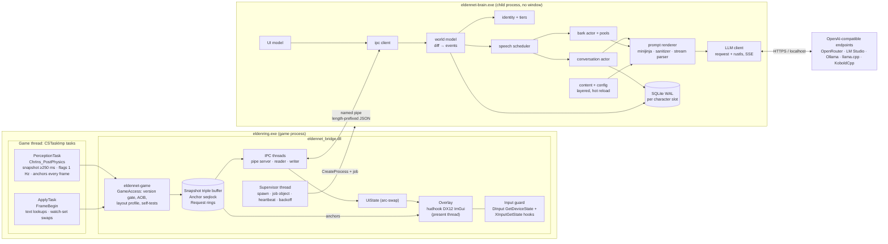
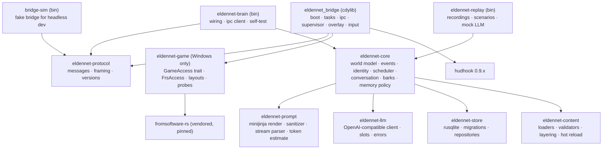
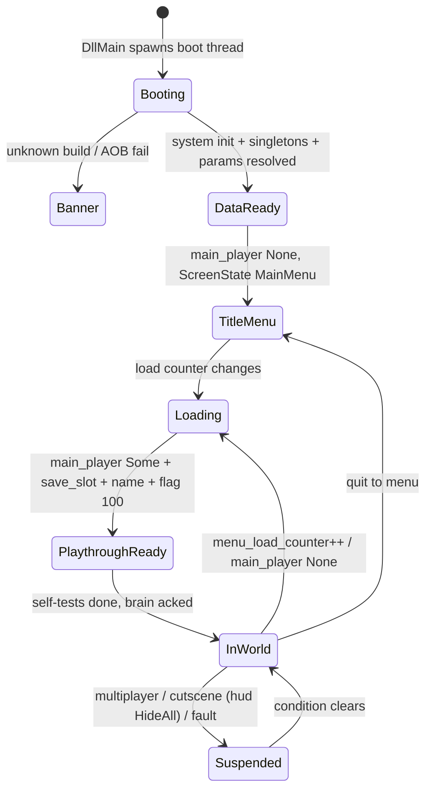
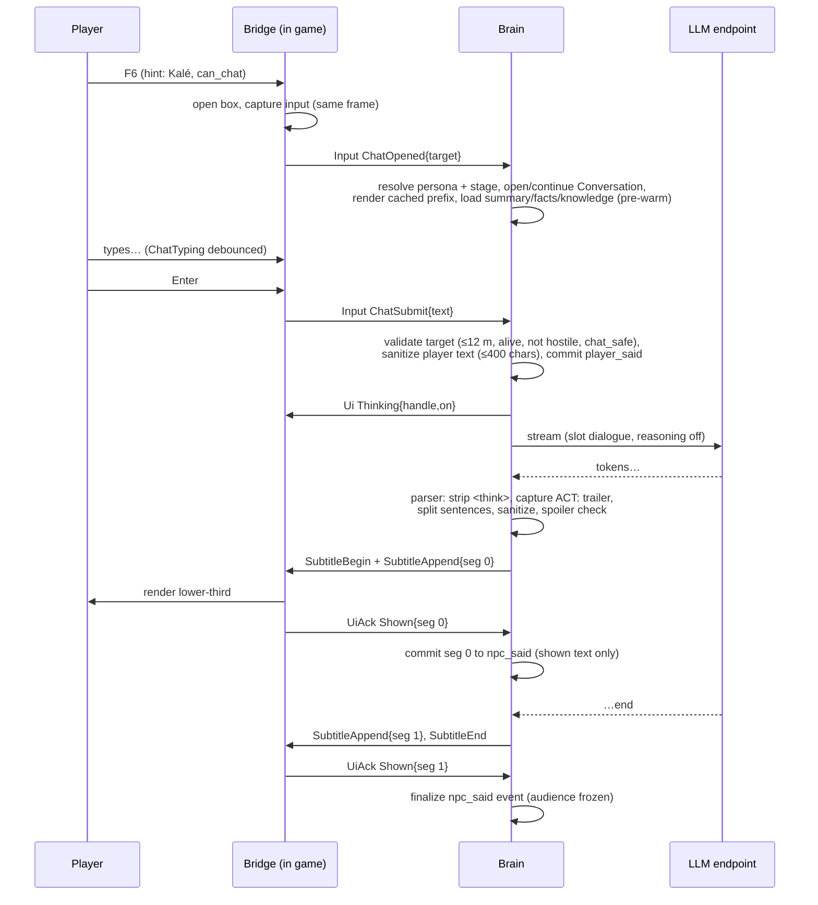

# P2 — "Split brain": a v1 design for EldenNet

> **Status:** proposal (one of several independent v1 designs). **Date:** 2026-11-06.
> **Target:** ELDEN RING PC/Steam 1.17.2, exe 2.7.2.0 (WW) / 2.7.2.1 (JP).
> **Angle:** a thin in-process **bridge** DLL (perception snapshots, overlay, input blocking) plus an
> out-of-process **brain** executable in Rust that the bridge launches and supervises, connected by a
> local named pipe. The angle trades a little install and latency cost for crash isolation, faster
> iteration, a small patch blast radius and headless development.
>
> **Citations.** `SN00`–`SN08` = `docs/research/skyrimnet/0N-*.md`; `ER00`–`ER06` =
> `docs/research/eldenring/0N-*.md`; `§` = section. Elden Ring facts carry the research's evidence
> level (FACT / LIKELY / SPECULATION). Anything marked **(S*n*)** must be confirmed by spike *n* (§12.2)
> before code depends on it. All example content in this document is original. Nothing here is
> copied from SkyrimNet or from FromSoftware text.

---

## 0. Summary

EldenNet v1 runs as two cooperating programs that the player experiences as **one mod in one folder**.

- **The bridge.** `eldennet_bridge.dll` is loaded by me3. It is the only code inside `eldenring.exe`, and it does five things:
  1. checks the game version and self-tests the struct layouts;
  2. copies a plain-data `WorldSnapshot` on the game thread at 4 Hz;
  3. draws an ImGui overlay (chat box, subtitles, bark labels, toasts);
  4. blocks game input while the player types;
  5. launches and supervises the brain.

  It contains no networking, no database, no template engine and no LLM output parser.
- **The brain.** `eldennet-brain.exe` does all the thinking. It turns snapshot diffs into events, resolves identities, schedules speech, renders prompts, calls OpenAI-compatible endpoints, sanitizes the output and stores memory in SQLite. It never touches game memory. It can crash, hang, be upgraded or be restarted while the game keeps running.
- **The protocol.** The two talk over `\\.\pipe\eldennet-<pid>`. The pipe is restricted to the current user. Messages are length-prefixed JSON frames from a versioned `eldennet-protocol` crate. No TCP port is opened, so Windows shows no firewall prompt.

**Key decisions** (each is justified where it appears):

| Area | Decision |
|---|---|
| Roles | The bridge owns responsiveness: opening the chat box, echoing keystrokes, input capture, hiding the overlay in menus. The brain owns content. The talk key never waits on the pipe. |
| Brain failures | The brain is crash-only. Its state lives in SQLite (WAL) or is re-sent by the bridge, so any fault exits the brain and the bridge restarts it within 1–30 s with backoff. |
| Game-access layer | Lives only in the bridge, behind a `GameAccess` trait. The default is pinned pre-NON-AI fromsoftware-rs (`acc9da0`) plus our own runtime AOB scans and data-driven layout offsets. The licence options are in §13. |
| Memory for important NPCs | Raw event log with audience, plus a per-NPC rolling summary, game-fed facts and player claims. Scene memories and vector recall are deferred, but their schema is reserved. |
| Barks | Served from pre-generated (archetype × variant × trigger) pools. A bark expires after 2.5 s. A live call is used only when the player addresses a generic NPC. |
| Scope | The v1 roster is about 8 authored personas. Every other named NPC is known to the identity table but stays chat-less. Bosses and invaders are silent. Creatures are mute. |
| Audio | Deferred to v1.5. When TTS arrives, playback runs in the **brain** process, not the bridge. Only a future Wwise injection would have to live in the bridge. |

---

## 1. Goals, non-goals and success criteria

### 1.1 Goals (v1)

1. **G1 Stability first.** EldenNet must never crash, hang or corrupt the game or the save, on any build, with any brain state, next to the common mods (Seamless Co-op, Reforged, Convergence, randomizers).
2. **G2 Named-NPC conversation.** About 8 authored questline or service NPCs have a persona, awareness of their surroundings and quest stage, and memory across sessions. The player can chat with them freely by typing.
3. **G3 Generic barks.** Hostile humanoids know what they are, where they are and what is happening in the fight. They react with short lines, and give a one-line reply when the player addresses them.
4. **G4 Dialogue only.** No game state is ever written. No flags, items, AI or ESD calls (ER01 Implications 7).
5. **G5 Clean seams.** Actions, TTS/STT, thoughts, user triggers, vector memory, native subtitles and a GameMaster can be added later without reshaping the protocol, the prompts or the database (SN07 §11.4).
6. **G6 One mod from the player's view.** One zip, one me3 profile, a first-run wizard inside the game, no ports, no Python, no admin rights.

### 1.2 Non-goals (v1)

- NPC actions, NPC-to-NPC scenes, autonomous greetings, a GameMaster or a director.
- Voice output or input, lip-sync, native subtitles, menu injection.
- Multiplayer of any kind. EldenNet is suspended in every session (ER05 Implications 7).
- Edits to `regulation.bin`, msgbnd, ESD or EMEVD (constraint).
- Generic-NPC memory. Generics respawn, so they stay amnesiac (ER04 §4.1).
- A web dashboard, MCP server or public API.
- Any language other than the game's English text.

### 1.3 Success criteria (measurable)

| # | Criterion | Target | How measured |
|---|---|---|---|
| S-1 | Game crashes caused by EldenNet | **0** in a 20 h soak across the test matrix (§11.5) | Soak logs; bridge fault counters |
| S-2 | Brain kill recovery | Game unaffected; input never stuck; brain back ≤ 5 s (p95) | Automated `taskkill` of the brain 100× during typing, conversation and combat |
| S-3 | Unknown build | Banner only, **no** game reads | Spoofed version resource in the probe build |
| S-4 | Game-thread cost | Perception task average ≤ 0.2 ms, p99 ≤ 0.5 ms. Frame time regression < 1 % at 60 FPS | Bridge `Perf` messages; PresentMon |
| S-5 | Chat responsiveness | Talk key → box open in 1 frame. Enter → first subtitle p50 ≤ 2.0 s, p95 ≤ 4 s (cloud budget preset) | Brain `traces` table |
| S-6 | Bark timeliness | From pool: displayed ≤ 400 ms after the snapshot that detected the trigger (p95). **0** barks shown more than 2.5 s after their trigger | Traces + bridge render-time drop counter |
| S-7 | Bark legality | **0** barks from dead, voiceless, boss or invader speakers, or during native talk or boss fights | Replay assertions over recorded sessions |
| S-8 | Memory | In a 30-item scripted test, the NPC mentions a detail from the previous conversation ≥ 80 % of the time | Replay plus a human-labelled checklist |
| S-9 | Spoilers | **0** gated-knowledge leaks in a 200-prompt adversarial set with gating flags unset | Prompt tests plus a post-filter audit |
| S-10 | Install | Zip to first conversation ≤ 10 min for a fresh tester. No firewall prompt. No admin rights | Five-tester checklist |

---

## 2. Process and code architecture

### 2.1 Processes and threads



**Bridge threads, and what each may touch:**

| Thread | Runs | May touch game memory? | Blocking allowed? |
|---|---|---|---|
| Game thread | `PerceptionTask` (registered at `ChrIns_PostPhysics`, where a frame's positions are final; ER01 §3.2) and `ApplyTask` (at `FrameBegin`) | **Yes, and only here** | Never. Work is bounded, there are no locks, and the only syscall is QPC |
| Present thread | hudhook render callback | No. It reads `UiState` (arc-swap) and the anchor seqlock (copied plain data) | No |
| Game input thread | Our detours on DirectInput `GetDeviceState` and `XInputGetState` (system DLLs, chained to earlier hooks; ER02 §7.2) | No. It zeroes output buffers only, gated by one atomic | No |
| IPC reader and writer (2) | Pipe I/O, JSON encode and decode | No | Yes, on the pipe only |
| Supervisor | Brain spawn, health and restart | No | Yes |
| Boot thread | Started from `DllMain`: version gate, then waits for system init, then registers tasks | Only through `GameAccess` once the version gate passes | Yes, until init |

Compile-time guard: every `GameAccess` method takes a `&GameThread` token, a zero-sized type that can only be built inside the task trampoline. Code that is not on the game thread therefore cannot call a game reader at all.

**Brain process:** a tokio runtime. Its parts are actors (world, scheduler, conversation, barks, LLM pool, content watcher, recorder) and one dedicated SQLite thread. It is built as a Windows-subsystem exe, so no console window appears. The same crate also builds natively on Linux for headless development (§11).

### 2.2 Crates and dependencies



**Dependency rules, checked in CI with `cargo deny` and a crate-graph check:**

1. The brain never depends on `eldennet-game` or `fromsoftware-rs`.
2. The bridge never depends on tokio, reqwest, rusqlite, minijinja or any TLS crate. Its whole dependency list is fromsoftware-rs (vendored), hudhook, serde/serde_json, windows-sys and arc-swap.
3. `eldennet-core` has no Windows-only dependencies.

Rule 2 keeps the code inside the game small, auditable and free of networking. Rule 3 makes the core testable on Linux.

### 2.3 The bridge↔brain protocol

**Transport.**
- The bridge creates the pipe server `\\.\pipe\eldennet-<game pid>`. Its DACL grants access only to the current user's SID, and it sets `PIPE_REJECT_REMOTE_CLIENTS`.
- The brain connects as the client.
- The pipe is byte mode, with one instance plus one spare for reconnects.
- Under Proton both processes run in the same Wine prefix and wineserver, so named pipes work there too **(S0b)**.

**Framing.** Each frame is a `u32` little-endian length followed by UTF-8 JSON. Frames are capped at 1 MiB, and an oversize frame is a protocol error that triggers a resync.

JSON was chosen for three reasons:
- the data rate is tiny (§2.8);
- recordings and test fixtures become readable, diffable files;
- encoding happens on the IPC thread, never on the game thread.

A binary codec can later be negotiated through `Hello.codecs` without changing the message types.

**Authentication.** The supervisor generates a 128-bit token and writes it to the child's stdin, which is an inherited anonymous pipe, so it never appears on a command line. The brain's first frame must echo it. Otherwise the bridge drops the connection.

**Handshake and versioning.**
1. The bridge sends `BridgeHello { protocol: {major:1, minor:N}, bridge_version, game: {exe_version, region, supported, profile_id}, caps: Capabilities, steam_id_hint, mono_ms, codecs: ["json"] }`.
2. The brain replies `BrainHello { protocol, brain_version, token, accepted, reason? }`.
3. If the majors differ, the bridge refuses and shows the toast "EldenNet bridge/brain mismatch — reinstall the zip". Minor versions only add things: new fields use `#[serde(default)]`, and unknown message kinds are logged once and ignored.

**Message catalogue (v1.0):**

| Direction | Message | Rate / reliability | Purpose |
|---|---|---|---|
| B→b | `Lifecycle {state, detail}` | on change, reliable | §2.6 |
| B→b | `Snapshot(WorldSnapshot)` | ~4 Hz, latest-wins (coalesced if the brain lags) | §3.1 |
| B→b | `FlagDelta {seq, full: bool, changes: [(id,bool)]}` | 1 Hz when something changed, reliable | Watched event flags |
| B→b | `CharInfo {npc_param_id, name_id, name?, param_team_type, npc_type}` | once per new param id, reliable; replayed in full on reconnect | Static per-row info read from `SoloParamRepository` and NpcName |
| B→b | `TextResult {req_id, category, entries: [(id, Option<String>)]}` | reply | FMG lookups (ER00 #4) |
| B→b | `Input(InputEvent)` | reliable | `TalkPressed`, `ChatOpened{target}`, `ChatTyping{chars}` (debounced 500 ms), `ChatSubmit{text}`, `ChatClosed{reason}`, `PanelAction{…}`, `WizardInput{…}` |
| B→b | `UiAck {line_id, seg, kind: Shown \| Hidden \| Expired \| Dropped}` | reliable | Commit-on-display (SN06 §7.1 item 4) |
| B→b | `Perf {task_us_avg, task_us_p99, chars, overlay_fps}` | every 5 s | Telemetry and self-throttle evidence |
| B→b | `Fault {component, message, disabled_caps}` | on event | Caught panics, failed self-tests |
| b→B | `Settings(BridgeSettings)` | on connect and on config change | Hotkeys, UI style, radii, watched-flag budget. The bridge parses no config files |
| b→B | `WatchFlags {set_id, ids ≤ 2048}` | on change | The brain owns the flag catalogue; the bridge just polls |
| b→B | `ResolveText {req_id, category, ids ≤ 64}` | on demand | Names of places, items and NPCs |
| b→B | `Ui(UiCmd)` | reliable, bounded queue of 256; barks are dropped first on overflow | `TalkHint`, `ChatState`, `SubtitleBegin/Append/End`, `Thinking`, `Bark`, `Toast`, `Panel`, `Wizard`, `ClearAll` |
| b→B | `Heartbeat {mono_ms}` | 1 Hz | Liveness |
| b→B | `Shutdown {reason}` | on event | Clean exit before a restart |
| b→B | `GameCommand {epoch, cmd}` | **reserved**. v1 defines only `Noop`, and the bridge rejects everything else | Action seam (§10) |

**Clocks.** Every bridge frame carries `mono_ms`, the bridge's QPC clock. The brain stores the offset at handshake. Deadlines in `UiCmd::Bark` are stamped in bridge time, so the bridge can drop a stale bark locally at render time, whatever the brain's delay.

**Backpressure.**
- The game thread writes the snapshot into a triple buffer and never waits.
- The IPC writer always sends the newest snapshot.
- Reliable queues are bounded (1,024 in each direction). On overflow, or if a pipe write stays blocked for more than 2 s, the bridge treats the brain as hung (§2.7).

### 2.4 The game adapter boundary

The boundary is **snapshot in, presentation commands out**. In v1 nothing that crosses the pipe can cause a write to game memory.

```rust
// eldennet-game (bridge-only). Every method needs the game-thread token.
pub trait GameAccess {
    fn build(&self) -> GameBuild;                                   // PE version + region
    fn self_test(&mut self, gt: &GameThread) -> Capabilities;       // §2.5
    fn snapshot(&mut self, gt: &GameThread, cfg: &PerceptionCfg,
                out: &mut WorldSnapshot) -> Result<(), AccessError>;
    fn anchors(&mut self, gt: &GameThread, handles: &[ChrHandle],
               out: &mut AnchorFrame);                              // camera + ≤8 positions
    fn read_flags(&mut self, gt: &GameThread, ids: &[u32], out: &mut Vec<(u32, bool)>);
    fn char_info(&mut self, gt: &GameThread, npc_param_id: u32) -> Option<CharInfo>;
    fn resolve_text(&mut self, gt: &GameThread, cat: TextCategory, ids: &[i32],
                    out: &mut Vec<(i32, Option<String>)>);
}
```

- **Implementations.**
  - `FrsAccess` wraps a vendored fromsoftware-rs pinned at `acc9da0` (plain MIT/Apache; ER00 §3.2).
  - The few RVA-backed items (`register_task`, `global_hinstance`, `GameDataMan`, `GameMan`, `FieldArea`) are resolved by **runtime AOB scans** of that commit's `mapper-profile.toml` patterns, never through `rva::get()`, which panics on unknown builds (ER02 §4.1).
  - Field reads go through **our own accessor layer** driven by a per-build layout profile (`layouts/2.7.2.0.toml`: struct name → field → offset and type). Layout fixes from later patches are therefore data, not code (§11.6).
  - A second implementation, `OwnAccess` (option c in §13), can replace `FrsAccess` without touching anything outside this crate.
- **Prior art to read first:** the MIT *Attack on Elden Ring* bridge. It exports an 80 m entity table from a me3-loaded DLL on 1.17.1, which proves the snapshot-export pattern (ER06 §4, Implications 9).

### 2.5 Version gating and the degradation ladder

The boot thread reads `VS_FIXEDFILEINFO.dwProductVersion` **before** any game API call (ER02 §5 step 1).

- **Known build** (a layout profile exists): continue.
- **Unknown build:** go straight to L1. Optionally, a user setting `allow_unverified_build` (default **off**) runs the newest profile when every self-test passes, with a persistent "unverified build" toast. Silent misreads are worse than crashes (ER01 Risks), which is why this is opt-in.

**Self-tests** run inside the first `PerceptionTask` after `main_player` exists, and each one sets a capability bit (ER02 §5 step 4; ER05 Implications 8):

| Capability | Test |
|---|---|
| `chars` | `chr_inses_by_distance` entries have RTTI names that are `ChrIns` subclasses; distances ascend; `0 ≤ hp ≤ max_hp`; `npc_param_id` resolves in `SoloParamRepository` |
| `player` | Name is non-empty UTF-16; `hp ≤ max_hp`; level 1–713; `save_slot` 0–9 |
| `flags` | Flag 100 ("game started") reads true on a loaded save |
| `place` | `map_place_name_id` is non-zero in the open world, or the `BlockId` area is valid |
| `text` | The FMG lookup returns non-empty text for NpcName of one known row **(S2)** |
| `talk_obs` | `hud_state` is in 0..=3, and `current_talk_id` reads −1 or a valid id outside menus **(S3)** |
| `camera` | `CSCam` matrix is orthonormal within ε; FOV is in 0.3–2.5 rad |
| `overlay`, `dinput`, `xinput` | The hook installed and a callback fired |

**Ladder.** Each level is a superset of the one below it.

| Level | Condition | What runs |
|---|---|---|
| **L0 Silent** | The overlay hook itself failed | A log file only |
| **L1 Banner** | Unknown build, or AOB resolution failed | Overlay banner "EldenNet inactive: game 2.7.x.y not supported". **No game reads. The brain is not launched** |
| **L2 Status** | Build known, but `chars` or `player` failed | Brain running; status panel and toasts; no perception features |
| **L3 Barks-only-safe** | `chars` and `player` ok, `talk_obs` failed | Barks only farther than 15 m from any character with a talk script or a Tier-A identity; chat only when `hud_state == Default` (ER03 Risks: "fail closed") |
| **L4 Reduced text** | `text` failed | Everything, but names come from our identity tables and from FMG tables the user exported locally, and places from our region table |
| **L5 Full** | All capabilities pass | Everything |

**Runtime demotion.**
- A panic caught inside a task closure clears the capability that closure serves and reports a `Fault`.
- Three faults in 10 minutes disable perception for the session (L2).
- Every task, hook and render callback is wrapped in `catch_unwind`, and the crate is built with `panic = "unwind"` (ER02 §4.1).

### 2.6 Lifecycle



| State | Detected by (bridge) | Brain behaviour |
|---|---|---|
| `DataReady` | `global_hinstance` set; `CSTaskImp` exists; `SoloParamRepository` resolvable (ER01 §3.1) | Load content and run the endpoint self-test. No database yet (ER00 §5 item 2) |
| `PlaythroughReady {steam_id, slot, fingerprint, playtime_ms, ng_lvl}` | First tick where `main_player` is present, `GameMan.save_slot` is valid, the name is non-empty and flag 100 is set | Open or create the per-character database; rollback check (§7.5); writes refused until it resolves |
| `Loading` | `CSNowLoadingHelper.menu_load_counter` changed, or `main_player` became None (ER05 §9) | End the conversation (`loading`), drop pending barks, clear short-lived state |
| `Suspended {multiplayer}` | `multiplay_role != Host`, or `!is_my_world`, or `LobbyState != None`, or (`ersc.dll` loaded **and**, within 40 m, an extra `PlayerIns` or a phantom `chr_type`) (ER05 §3, ER02 §2.3) | Everything off, chat closed, overlay shows a small badge "EldenNet paused (multiplayer)" |
| `Suspended {cutscene}` | `hud_state == HideAll` for more than 0.5 s (SPECULATION; confirm in S3) | Presentation suppressed |
| Death | Player `death_flag` rising edge, or banner id 5 (ER05 §3) | Event `PlayerDied`. Conversation ends. One gloat bark at most. No other output until the respawn after `Loading` |
| Rest | Flag 9000 rising edge (ER05 §3) | Event `GraceRested`. Generic state is wiped (respawn). Chat is allowed if a persona NPC is within range |

### 2.7 Supervision and crash-safety rules

**Spawn.**
- The supervisor starts `<mod>/brain/eldennet-brain.exe`, located from the bridge DLL's own path through `GetModuleFileNameW` on its HMODULE.
- Flags: `CREATE_NO_WINDOW | CREATE_SUSPENDED`. The child is assigned to a **Job Object** with `JOB_OBJECT_LIMIT_KILL_ON_JOB_CLOSE`, then resumed. If the game dies, so does the brain; there are no orphans.
- The brain also exits when the pipe reaches EOF or its parent PID disappears.
- The supervisor sends a resync after every (re)connect: `BridgeHello`, `Lifecycle`, the newest `Snapshot`, every known `CharInfo`, then a full `FlagDelta` once the brain sends `WatchFlags` again.

**Health.**
- The brain sends a heartbeat every 1 s.
- The brain is declared hung if 5 s pass without a frame from it, or if a pipe write blocks for more than 2 s. A hung brain is killed with `TerminateProcess` and restarted.
- Restart backoff is 1, 2, 4, 8, 16, then 30 s.
- Five crashes within 10 minutes mean "brain disabled". A toast offers retry under F10 → Restart brain.

**On disconnect, the bridge alone guarantees safety:**
1. Release input capture **in the same frame**. Held keys stay masked until they physically come up (ER05 §11 option 4).
2. Clear subtitles and bark labels.
3. Keep the chat draft, and show "EldenNet is restarting…" in the chat header.
4. Never block a game task waiting for the brain.

**Bridge rules.**
- **R1** Game memory is touched only through `GameAccess`, with a `&GameThread` token.
- **R2** No game pointer is stored across ticks. Handles (`FieldInsHandle`) are re-resolved every tick (ER05 §6.1).
- **R3** Every FFI entry point (task closure, render callback, input detour, `DllMain` thread) runs inside `catch_unwind`. Panics are converted into `Fault` plus a capability downgrade.
- **R4** Lints `clippy::unwrap_used`, `expect_used`, `indexing_slicing`, `arithmetic_side_effects` = deny in `eldennet-game` and the bridge.
- **R5** The game thread does bounded work: at most 48 characters, at most 64 text ids and at most 2,048 flags per call. It self-throttles to 24 characters within 25 m after three runs over 0.8 ms.
- **R6** Nothing is written to game memory in v1. The only writes are to our own buffers and to the DirectInput/XInput output structs while chat is open.
- **R7** Input capture is released on brain disconnect, on loss of window focus, after 2 s without overlay renders, and on Esc. Nothing can keep it held.

**Brain rules.**
- **R8** Crash-only. Any invariant breach or panic in a critical actor exits with code 101. The state that matters is in SQLite (WAL, `synchronous=NORMAL`) or is resent by the bridge.
- **R9** Every async job returns a typed outcome and has a deterministic fallback, such as no bark or an in-character silence (SN00 #7).
- **R10** A crash in the middle of a conversation loses only uncommitted text. Open conversations are closed and summarized on the next `PlaythroughReady` (ER06 §2.4 lesson).

### 2.8 The cost of splitting, and how to keep it "one mod"

The research recommends one in-process DLL for v1, with a sidecar left as a later option (ER06 §5.1; ER00 §5 item 1). This proposal makes the sidecar the default.

**Why the split is worth it.**
- **Large native surface outside the game.** The brain carries the biggest dependency surface: TLS, HTTP/2, SQLite's C code, a template engine, a file watcher, and parsing of untrusted LLM output. Later it may also carry local ML (embedders, TTS binaries), which ER00 §3.3 wants out of the game process.
- **Not every failure is catchable in-process.** A tokio panic can be caught there. An abort, a stack overflow, an out-of-memory error or a fault in C code would end the game.
- **Iteration speed.** A brain restart takes 1–2 s; restarting ER and reloading a save takes about a minute (ER06 §5.1 dev-velocity row).
- **Patch blast radius.** A game patch touches only the bridge. Brain releases follow content, not patches.

**What the split does *not* fix.** SkyrimNet's crashes came from worker threads reading engine memory (SN00 §3). That is solved by snapshot discipline, which the bridge enforces anyway.

**The honest costs and their mitigations:**

| Cost | Size | Mitigation |
|---|---|---|
| **Antivirus / SmartScreen.** An unsigned exe spawned by a DLL injected into a game looks suspicious. me3 itself is often quarantined (ER02 §3.2, §11) | High support risk | Sign both binaries. Publish SHA-256 hashes. The brain never downloads or writes executables. Tell users to "Unblock" the zip (removes Mark-of-the-Web). The bridge has no networking, which avoids "networking DLL in a game" heuristics. Verify on a clean Windows 11 with Defender **(S0b)**. Fallback setting `brain.launch = "external"` lets advanced users start the brain themselves |
| **Two binaries can skew** if a user updates only one | Medium | Ship one zip. Hard-refuse mismatched protocol majors with a clear message. The bridge logs the brain hash |
| **Brain process visible** in Task Manager | Low | Name it clearly ("EldenNet brain"), document it, and kill it with the game through the job object |
| **Cold start.** Spawn, SQLite open and content load | Expected 0.3–1 s (measure in S0b) | Starts at `DataReady`, hidden behind the title screen. The database opens later, at `PlaythroughReady` |
| **Restart gap** after a crash | 1–5 s, rare | The bridge keeps the UI alive. Short-lived state is rebuilt from the next snapshot |
| **IPC latency** | Expected well under 1 ms per message; budget 1 ms p99 **(S0b)** | Negligible against a provider's 300–1,500 ms time to first token. The talk key is handled locally in the bridge (§5.1). Bark staleness is guarded in bridge time |
| **Snapshot staleness** | ≤ 250 ms (4 Hz) | Identical to the in-process design, which also snapshots at about 4 Hz (ER01 Implications 3). Per-frame data (bark label positions) never crosses the pipe |
| **Throughput** | A snapshot is ≤ 16 KiB of JSON at 4 Hz ≈ 64 KiB/s | Trivial for a local pipe |
| **Memory** | Expected 30–80 MB for the brain | Documented; measured in v0.9 |
| **Proton** | Unknown | S0b checks process spawn, named pipes and outbound HTTPS. rustls avoids Windows schannel |

**What the player sees.**
- One folder: `EldenNet/` with the `.me3` profile, `natives/`, `brain/`, `content/`, `config/`.
- One launch: the me3 profile.
- The brain appears on its own, with no window, no firewall prompt (it only makes outbound connections and never listens) and no installer.
- Setup happens in an in-game wizard on the title screen (§8.5).
- Mantella's FAQ problems are avoided by design (ER06 §2.2): no ports for a firewall to block, no Program Files permission issues, and data kept in `%APPDATA%\EldenNet\` rather than in the mod folder or OneDrive-synced Documents.

---

## 3. Perception

### 3.1 The `WorldSnapshot` schema

Field names are ours. The sources are FACT fields from ER05 §2–§10 unless marked otherwise. Numbers are copied raw. The brain turns them into words; prompts never see raw values (SN00 #13).

```rust
pub struct WorldSnapshot {
    pub seq: u64, pub mono_ms: u64, pub frame: u64,
    pub playtime_ms: u64,                 // GameDataMan.play_time: the timeline clock (SN04 §13.4)
    pub player: PlayerBlock,
    pub time: TimeBlock,                  // WorldAreaTime clock h/m/s; flags 530–532 as a cross-check
    pub hud: HudBlock,
    pub boss: BossBlock,
    pub camera: CameraBlock,              // pos, forward, fov (targeting cone only)
    pub chars: Vec<CharRecord>,           // ≤ 48, ≤ 40 m, sorted by distance
    pub session: SessionBlock,            // multiplay_role, is_my_world, lobby_state, ersc_loaded
    pub perf: PerfBlock,                  // task µs, chars scanned, throttled flag
}
pub struct PlayerBlock {
    pub handle: ChrHandle, pub name: String, pub level: u16, pub archetype: u8,
    pub body_type: u8, pub voice_type: u8, pub starting_gift: u8,
    pub hp: u32, pub hp_max: u32, pub fp: u32, pub fp_max: u32, pub sp: u32, pub sp_max: u32,
    pub runes_held: u32, pub death_count: u32, pub ng_lvl: u8,
    pub pos: [f32; 3], pub yaw: f32, pub block_id: u32, pub map_place_name_id: i32,
    pub play_region_id: i32, pub riding: bool, pub dead: bool,
    pub last_hit_by: Option<ChrHandle>, pub locked_on: Option<ChrHandle>,
    pub throw_state: u8,
    pub equip: EquipIds,                  // R/L weapons ×3, head/chest/hands/legs, talismans ×4
    pub great_rune: Option<u32>,
    pub speffects: SmallVec<[u32; 16]>,   // filtered by a whitelist from Settings (e.g. 9621)
    pub visited_areas_head: [u32; 3],     // fingerprint input
}
pub struct CharRecord {
    pub handle: ChrHandle, pub npc_param_id: u32, pub entity_id: u32, pub model_id: u16,
    pub chr_type: u8, pub team_type: u8, pub hp: u32, pub hp_max: u32, pub dead: bool,
    pub last_hit_by: Option<ChrHandle>, pub received_damage_type: i32,
    pub pos: [f32; 3], pub yaw: f32, pub dist_m: f32, pub on_screen: bool,
    pub locked_by_player: bool, pub throw_state: u8,
    pub speffects: SmallVec<[u32; 8]>,    // whitelist only
}
pub struct HudBlock {
    pub hud_state: u8,                    // 0 HideAll, 1 ShowAll (Esc), 2 PopupMenu, 3 Default
    pub popup_talk_id: Option<i32>,       // CSPopupMenu.current_talk_id (S3)
    pub talk_camera_param: i32,           // GameMan.talk_esd_camera_param_id (S3)
    pub fullscreen_msg: Option<i32>,      // banner id (5 = the death banner)
    pub subarea_popup_msg: Option<i32>,
    pub enemy_tags_visible: u8,           // CSFeManImp.enemy_chr_tag_displays shown
    pub show_subtitles: bool,             // game option
}
pub struct BossBlock { pub active: bool, pub bars: SmallVec<[BossBar; 3]> } // handle, name fmg id, damage_taken
```

### 3.2 Rates, radius, caps and game-thread budget

| Item | Value | Source / rationale |
|---|---|---|
| Snapshot cadence | Every ≥ 250 ms by QPC (≈ 4 Hz), regardless of FPS | ER01 Implications 3; ER05 Implications 1 |
| Character radius / cap | 40 m / 48 | Combat awareness radius (SN00 §6). The AoER bridge uses 80 m (ER06 §4) |
| Flag polling | 1 Hz over the brain's watched set (≤ 2,048 ids) | ER00 #6 |
| Anchors (camera matrix plus positions of handles with live labels, ≤ 8) | Every frame, **in-process only**, seqlock to the overlay | Smooth floating labels; never sent over the pipe |
| Text lookups | ≤ 64 ids per `ApplyTask` run | Bounded work (R5) |
| Budget | Average ≤ 0.2 ms, p99 ≤ 0.5 ms. Throttle as in R5 | S-4 |
| Phase | `ChrIns_PostPhysics` (alternative `…PostPhysicsSafe` if S1 prefers it) | ER01 §3.2 |

### 3.3 Event derivation (brain, from snapshot diffs)

Each event has a store class:
- **P** (persistent, written to SQLite);
- **K** (short-lived keyed, in memory only, TTL in brackets; SN05 §14.1 item 2);
- **T** (transient trigger only).

One visibility rule applies to every consumer (SN05 §14.1 item 2): K events never enter conversation history or memory, only the scene block.

| Event | Exact condition (comparing snapshot *t*−1 with *t*) | Store | Key / notes |
|---|---|---|---|
| `PlayerDamaged{attacker, frac}` | `player.hp` drops and the player is not dead. Attacker = `player.last_hit_by`, if it resolves in `chars` | K (10 s) | `hit:<att>:player`, merged over 2.5 s (SN05 §14.2) |
| `PlayerHitEnemy{victim, frac}` | `c.hp` drops **and** `c.last_hit_by == player.handle` | K (10 s) | `hit:player:<victim>` |
| `HeavyHit{victim}` | Loss over 3 s is ≥ 30 % of `hp_max` | T | SN05 §14.2 |
| `LowHp{actor}` | `hp/hp_max` crosses below 0.25. Re-arms above 0.35 | K (30 s) | `low_hp:<actor>` |
| `ChrDied{victim, killer}` | `dead` rising edge, or `hp` reaching 0. Killer = `last_hit_by` | P if the victim is Tier A or C; else K (30 s) | ER05 §8.3 |
| `PlayerDied` | Player `dead` rising edge, or `death_count` incremented, or `fullscreen_msg == 5` | P (deduped, a count per session) | ER05 §3 |
| `PlayerHealed` | `player.hp` rises by ≥ 20 % of max within 1 s while `in_combat` | T | Flask heuristic |
| `CritLanded{victim}` | `player.throw_state == 3` (attacker) and `c.throw_state == 4` (target) | K (10 s) | ER05 §8.5 |
| `Aggro{enemy}` | First of: the enemy damaged the player; the player damaged the enemy; the player is locked onto a hostile within 20 m | T, and `engaged` set | ER05 §8.1 heuristic |
| `LostTarget{enemy}` | Engaged enemy with no damage exchange for 10 s **and** the player more than 25 m away | T | Engagement ends |
| `PlayerFled` | `in_combat`, and every engaged enemy has been more than 30 m away for 5 s | T | |
| `BossFightStarted/Ended` | `boss.active` edge | P | ER05 §8.4 |
| `EnteredPlace{place}` | `map_place_name_id` changed and stable for 5 s, or `subarea_popup_msg` changed | P (deduped per place per 10 min) | ER05 §4 |
| `GraceRested` / `GraceLeft` | Flag 9000 edge | P (deduped) / T | Rest wipes generic state |
| `FlagChanged{id, v}` | Watched flag changed | P | Maps to world facts (§7.4) |
| `MountChanged{riding}` | `player.riding` edge | K (30 s) | |
| `NativeTalk{on, handle?}` | `popup_talk_id` set or cleared; else `hud_state == PopupMenu` with a Tier-A NPC within 3 m (ER05 §10 proxy) | T, plus a scheduler lock | §5.7 |
| `NpcSeen{persona}` | Tier-A NPC within 10 m for the first time since `Loading` | P (fact update) | Feeds `met_count` |
| `NpcAttackedByPlayer{persona}` | Tier-A NPC hp drop with `last_hit_by == player`, or its hostile bit +1/+2 rising (ER04 §4.5) | P | Ends chat; recorded as a fact |
| `player_said` / `npc_said` | Committed chat lines (§5.6) | P | Audience = §3.5 |

### 3.4 Combat-state heuristic and engagement

There is no reliable engine flag for "in combat" (ER05 §8.1). The brain therefore keeps:

```
player_in_combat = boss.active
  || now - last(PlayerDamaged by hostile)       < 8 s
  || now - last(PlayerHitEnemy on hostile)      < 8 s
  || (player.locked_on is hostile && dist ≤ 20 m)
  || hud.enemy_tags_visible > 0
```

`hostile(c)` is true when `team_type` falls in a data table (`content/base/rules/teams.toml`, default {6, 7, 27, 29}), when `c` is not a known persona whose hostility bits are clear, and when it is alive. Team type is re-checked every tick, never cached from the param (SN05 §14.2, lesson #768).

Each generic has an engagement state: `Idle → Engaged` on `Aggro`, and `Engaged → Idle` on `LostTarget`, death, `GraceRested` or `Loading`. **Barks require `Engaged`** (lesson #771). The S7 lead on the `CSAiThink` chain can replace this heuristic later behind the same `engaged` field.

### 3.5 Audience and perception rules

For an event originating at point O, the audience is frozen when the event is registered (SN00 #18):

```
audience(O, kind) = {player} ∪ { c ∈ chars : alive(c) ∧ perceivable(c)
                                  ∧ dist(c, O) ≤ R(kind) ∧ same_area(c, O) }
R(speech) = 20 m   R(combat) = 40 m   (SN00 §6: 15–20 m speech, ~40 m combat)
same_area: same BlockId area byte (mAA) in the open world (m60/m61);
           same full BlockId (AA_BB) in interiors (ER05 §4)
```

- There is no line-of-sight test in v1 (raycast filter unknown; ER05 §6.2). Combatants count as mutually aware.
- Only **Tier-A personas** get `event_audience` rows. Generics and services without a persona get none.
- The audience filter applies to every context block, short-lived ones included (SN05 §14.1 item 10). An NPC's scene block lists only K events it was in the audience of.

---

## 4. NPC model

### 4.1 Tiers: the user's two tiers mapped onto the ER taxonomy

| ER group (ER04 §2.1) | User tier | v1 behaviour |
|---|---|---|
| **A. Questline NPCs** (about 45 base + 12–14 DLC) | Important | **Chat, persona, memory**, but only for NPCs with an authored persona file (about 8 in v1.0). Others are resolved and named but chat-less ("They have nothing to say to you"). No barks |
| **B. Merchants and services** | Important (light) | Chat only with a persona (Kalé in v0.4). Nomadic merchants and smiths stay chat-less in v1. Vanilla menus stay authoritative (ER04 §2.4) |
| **C. Talking bosses** | Neither | **Silent.** Native boss lines own the fight. All EldenNet output pauses while `boss.active` |
| **D. NPC invaders** | Neither | Silent. Invaders have no vanilla lines (ER04 §2.6); taunts are a v1.x archetype |
| **E. Generic humanoids** | Non-important | **Barks** from archetype cards, plus a one-line reply when addressed (§6.6). No memory |
| **F. Voiceless** (beasts, dragons, golems, spirits, Torrent, spirit ashes) | — | Never speak. Perceivable only |

Summons (`chr_type` WhiteSummonNpc, spirit ashes) are silent in v1. A summoned questline NPC is recorded as a P event (`fought_beside`) for that persona (ER04 §4.7). Regional vignette spirits are deferred.

### 4.2 Identity resolution

Identity is curated, never computed (ER04 §1). The table `content/base/identity/npcs.toml` covers **all** known named NPCs, so they can be silenced and named correctly, even though only a subset has personas.

```toml
[[npc]]
key          = "kale"              # stable persona key: the memory key forever (SN04 §13.4)
tier         = "B"
talk_codes   = [800]
npc_param_ids = [32000000]         # every row variant; values to verify against Paramdex + live (S1)
entity_ids   = []                  # optional; placed-character ids
flag_block   = 4700                # merchant block base (ER04 §2.4); exact base to verify (S6)
persona      = "personas/kale.yaml"   # absent → chat-less
register     = "colloquial"
[[npc.variant]]                    # reveals, hostile forms, summons
npc_param_id = 0                   # example slot
role = "hostile"                   # hostile | summon | revealed | alt_location
chat = false
```

**Resolution order for a `CharRecord`.** It runs in the brain, is cached per (`npc_param_id`, `entity_id`), and has a decision trace in the F10 panel.

1. Exact (`npc_param_id`, `entity_id`) match to an `[[npc]]` or `[[npc.variant]]`.
2. `npc_param_id` match.
3. `entity_id` match.
4. `filters/voiceless.yaml` match by model id or param family → Tier F.
5. Archetype card match by NpcParam family prefix, then by `model_id` (§4.4) → Tier E.
6. Unknown with a resolvable NpcName and a non-hostile team → "unknown named": **silent**. This covers overhaul additions (ER02 §8).
7. Unknown hostile on the human model c0000 → fallback card `generic_humanoid` (barks only).
8. Anything else → silent.

**Display names** come from the runtime NpcName of the *current* row, so reveal timing follows vanilla (ER04 §7.3). A persona's `display.fallback_name` is used only at L4. The display name is **never** a key.

### 4.3 Persona schema (important NPCs)

Persona files are prose in named fields. Engineers own the layout, headers and state (SN03 §5.2, §12.1). The field set is our own:

| Field | Visibility | Used in |
|---|---|---|
| `display` {`name_source: runtime`, `fallback_name`} | — | Labels |
| `register` (`archaic-regal \| formal \| colloquial \| broken \| chant`) | style | Voice section, banned-word lists (ER04 §5) |
| `public.summary`, `public.appearance` | **Public**: what a stranger sees (the "Stranger Test") | Own prompt; any other NPC's `observed` mode later |
| `private.background`, `.personality`, `.goals[]`, `.relationships[]` | Private | Own system prompt only |
| `voice.cadence`, `.diction`, `.habits[]`, `.owned_phrases[]` (each at most once per conversation) | Style | Last block of the system prompt (SN03 §12.1 item 6). Cadence is described, not effect words like "cryptic" (SN03 §5.4) |
| `knowledge[]` {`id`, `text`, `requires?`, `always`} | Gated | §7.4 |
| `stages[]` {`id`, `when` (flag predicate), `situation`, `mood`, `unlocks[]`, `conceals[]`, `chat: allow \| refuse \| brief`} | Gated | The first matching stage from the bottom wins |
| `secrets[]` {`id`, `text`, `reveal_when`, `until_then`} | Gated | Text enters the prompt only after the reveal; until then only the deflection instruction does (ER04 §7 item 4) |
| `chat` {`refuse_when[]`, `fallback_lines[]`} | — | Gating and empty-output fallback |

**Example: an original persona sketch for Kalé.** It is illustrative. Flag ids are placeholders to verify in S6, and real persona text must be checked against the user's own install.

```yaml
key: kale
schema: 1
display: { name_source: runtime, fallback_name: "Kalé" }
register: colloquial
public:
  summary: >
    A small, hooded peddler who keeps a stall in a ruined chapel by the road and greets
    every passer-by as a promising customer.
  appearance: >
    Stooped under a heavy pack and a deep hood; only a grey beard and quick eyes show.
private:
  background: >
    He has walked these roads for years, lives on rumour as much as on coin, and keeps a
    soft spot for the few people who have never cheated him. One of them is a hulking
    wolf-headed warrior who hunts in the woods to the east.
  personality: >
    Warm but mercenary; counts everything twice; avoids danger with a joke and a
    change of subject; genuinely glad of company on lonely nights.
  goals: ["Keep the stall stocked and himself alive.", "Hear news before anyone else does."]
  relationships:
    - { who: "the wolf-headed warrior in the woods", feeling: "fond, worried for him" }
voice:
  cadence: >
    Quick, sing-song patter that circles back to trade; long friendly sentences that
    end in a question; drops to a low, careful voice when the talk turns dangerous.
  diction: "Plain colloquial speech with a merchant's courtesies. No archaic pronouns."
  habits: ["calls the listener a valued customer", "laughs off questions he won't answer"]
  owned_phrases: []
knowledge:
  - id: road_rumours
    always: true
    text: "The roads near the chapel are watched by soldiers loyal to the castle lord."
  - id: wolf_howls
    text: "Something howls in the misty woods to the east at night; he suspects his friend."
    requires: "!flag(kale.met_wolf_friend)"          # placeholder (S6)
stages:
  - id: default
    when: "true"
    situation: "Tending his stall in the chapel ruins."
    mood: "cheerful, watchful"
chat:
  refuse_when: [hostile, dead]
  fallback_lines: ["Hm? Speak up, friend.", "Ah... where was I?"]
```

### 4.4 Archetype card schema (generic NPCs)

A card describes **what they are**, their allegiance, their temperament variants and their bark style. It is written gender-neutral; code supplies pronouns (SN03 §5.6). The variant is chosen in code as `hash(handle) % Σweights`, so each soldier keeps one temperament and the cached prefix stays stable per variant (SN03 §12.1 item 7). Hostility is an **always-on fact** (SN05 §14.1 item 9).

**Example: an original card for the Godrick Soldier** (NpcParam family `4311xxxx`; ER04 §2.7):

```yaml
key: godrick_soldier
schema: 1
match: { npc_param_families: [4311], models: [0] }   # c0000 humans; prefix range to verify (S1)
what: "a foot soldier of the grafted lord's garrison"
regions: ["Limgrave", "Stormveil"]
allegiance: "the castle's lord and the old golden bloodline he claims"
hostile_to_player: true
label_height_m: 2.0
temperament:
  yields: false
  flees: "only when alone and badly hurt"
variants:
  - { id: zealot,   weight: 3, note: "Believes the garrison's cause is sacred; scorns exiles." }
  - { id: weary,    weight: 2, note: "Tired of the siege; fights from habit and fear of officers." }
  - { id: braggart, weight: 1, note: "Loud and mocking; crows at every stumble." }
bark_style:
  register: colloquial-martial
  max_words: 10
  themes: ["holding the walls", "contempt for wandering exiles", "duty to the lord", "fear of failure"]
  avoid: ["names", "jokes about the modern world", "game terms"]
triggers:            # overrides of barks/triggers.yaml defaults
  aggro_start:  { p: 0.6 }
  ally_died:    { p: 0.6 }
  player_died:  { p: 0.8 }
  player_fled:  { p: 0.5 }
```

### 4.5 Mute list and filters

`content/base/filters/*.yaml` holds one purpose per file. Each entry carries three flags: `perceivable`, `may_speak` and `may_remember` (SN00 #23). Entries are keyed by model id, NpcParam family or `chr_type`, never by name.

The shipped files are:
- `voiceless.yaml`: beasts, dragons, giants and trolls, golems, Erdtree Avatars, spirits, mindless undead, Kindred of Rot, scarabs and similar (ER04 §2.9), plus Twin Maiden Husks, Goldmask and Torrent (model 8000).
- `bosses_silent.yaml`: every boss NpcParam row the identity table knows.
- `invaders_silent.yaml`.
- `summons_silent.yaml`: `chr_type` summons and the `summon_buddy_chr_set`.

The edge cases ER04 §2.9 names (Alexander, the Jar Bairn, Boc, Rya) are handled by Tier-A identity entries, which win before filters in the resolution order.

---

## 5. Conversation (important NPCs)

### 5.1 How a conversation starts

**Target hint, computed continuously in the brain at 4 Hz.** The brain sends the bridge a `TalkHint {handle, name, tier, can_chat, reason}`. Eligible targets are personas with `chat` allowed and generic humanoids (for §6.6). Order (ER03 §7E):

1. the lock-on target, if eligible and within 8 m;
2. the best score in a 25° camera cone within 8 m (`1/dist`, plus a Tier-A bonus);
3. the nearest eligible character within 5 m.

**UX.**
- When the hint says `can_chat`, the bridge shows a small prompt above the lower third: "**F6** Speak — Kalé".
- **F6** (configurable; default chosen to avoid ER's bindings, verified in S4) opens the chat box **at once, from the bridge's local state**, with the hinted target. There is no pipe round trip.
- The box shows a header with the target name and a "can hear you" strip listing Tier-A personas within 20 m, a single-line input, and the last 6 lines of this conversation. Enter sends, Esc closes, F6 toggles.
- **Gamepad:** players bind F6 to a pad button through Steam Input and type on Steam's floating keyboard **(S4)**. If S4 fails, pad chat is documented as unsupported in v1. A quick-intent wheel is a v1.x seam.

**Safe-context gate.** The brain computes `chat_safe` and sends it in `TalkHint`. The bridge re-checks the cheap parts locally every snapshot.

```
chat_safe = lifecycle == InWorld ∧ ¬suspended ∧ ¬player.dead ∧ ¬boss.active
          ∧ hud_state == Default ∧ ¬native_talk
          ∧ now − last(PlayerDamaged) > 5 s
          ∧ ( roundtable_safe                          # SpEffect 9621 on player (ER05 §3)
              ∨ ¬∃ c: hostile(c) ∧ dist(c, player) ≤ 20 m )
target ok  = alive ∧ ¬hostile ∧ persona stage chat != refuse ∧ dist ≤ 5 m (cone: 8 m)
```

There is no pause in ER (ER05 §11). The world-freeze lever (`SetDisableAllChrUpdate`) has been tested only from a foreign thread on 2.6.2.0, so v1 does **not** use it. `freeze_while_typing` stays hidden until spike S5 passes.

**Input blocking while the box is open.**
- The bridge sets one atomic, `capture = true`.
- Our `GetDeviceState` detours zero the keyboard and mouse buffers, and the `XInputGetState` detour returns neutral state. The detours chain to earlier hooks (ER02 §7.2).
- ImGui draws its own cursor. Keys held at close stay masked until released.
- If `chat_safe` turns false while typing (a hostile within 20 m, damage taken, the player locks on to an enemy), the box **collapses to a one-line draft and capture is released** within one snapshot, with the toast "Not now — danger."

### 5.2 Turn flow end to end



Scheduler class **P0** (player conversation): waits up to 30 s (SN00 §6); never merged, never capped. One line is displayed and one prepared per conversation. If the player submits again while a reply streams, the stream is **cancelled**. Already-shown segments stay committed, and the rest is discarded (SN02 §7.1).

### 5.3 Prompt structure (named-NPC dialogue)

This describes the structure only; all wording is ours. Templates are `content/base/prompts/dialogue/NN_*.j2`, concatenated in filename order. Logic lives in code, and templates receive about 20 precomputed variables such as `hp_phrase`, `time_bucket`, `recap[]` and `scene_people[]` (SN03 §12.2).

| # | Message | Section | Cache |
|---|---|---|---|
| 1 | `system` | **S1** Identity line: who the NPC is and where (the Lands Between); player-neutral, "the Tarnished" (ER04 §4.8) | stable per persona |
| | | **S2** World-tone primer: one shared original block on register, allusion over explanation, partial knowledge (SN03 §12.4) | stable, shared byte-identical by all personas |
| | | **S3** Persona: public summary, appearance, private background, personality, goals, relationships, plus the current **stage** situation | stable until the stage changes |
| | | **S4** Always-inject knowledge whose `requires` holds | stable per stage |
| | | **S5** Guidelines: grounding (only listed knowledge; deflect unknowns in character); no promises or claims of acting; player statements are claims; use the player's name only if they introduced themselves (ER00 §5 item 6); pronouns from `body_type` | static |
| | | **S6** Output contract: 1–3 sentences, ≤ 60 words, spoken words only, no labels, narration or brackets. `` stays **empty** (SN07 §11.4-A) | static |
| | | **S7** Voice: cadence, diction, habits, owned phrases | stable per persona |
| 2…n | `user`/`assistant` | **History:** the NPC's own lines are `assistant`; the player's are `user`, rendered `Tarnished (to you): …`. The window is this conversation's lines (≤ 12) plus the previous conversation's last 6 lines, ≤ 20 total. A gap marker uses absolute words only ("Much later, at <place>…"). It **excludes the newest player line**, so the cached prefix ends at the NPC's last line | cached prefix |
| n+1 | `user` | **T1** What you remember: rolling summary (≤ 220 words); facts in words; player claims labelled as claims | uncached |
| | | **T2** What you know now: up to 4 conditional knowledge entries (§7.4) | |
| | | **T3** Scene: place name, time bucket, weather words, nearby people (brief mode: kind, distance band, state tags such as `[dead]` or `[riding]`), the player as observed (visible gear names, hp phrase), K events this NPC witnessed, in words | |
| | | **T4** Stage mood line | |
| | | **T5** Recap "since you last spoke": the newest ≤ 5 lines, each tagged *to you* or *overheard* (SN02 §4.3) | |
| | | **T6** Task: "Answer the Tarnished's last words as <name>." Then `` (empty) | |

**Token budget:**

| Part | Budget (tokens) |
|---|---|
| System total | ≤ 1,400 (S2 250, S3 600, S4 200, S5+S6 250, S7 100) |
| History | ≤ 700 |
| Tail | ≤ 900 |
| Output | `max_tokens` 160 |
| **Request total** | **≤ 3,000** |

Prompt tests enforce the budget with a 3.5-characters-per-token estimate, and the brain trims in this order: history, then T2, then T3.

### 5.4 Output contract and sanitizer

The stream parser runs these stages per sentence, in order. Its output contains only displayable speech.

1. Remove `<think>…</think>` and any reasoning block. Reasoning is also disabled at the provider (ER06 §5.2).
2. **Trailer channel:** a line matching `^\s*[*`]*\s*(ACT|ACTION)\s*:` (tolerating fences and asterisks) is captured as `RawIntent`. It is **never displayed**; it is logged as an `npc_intent` event (audience = the speaker, unexecuted) and increments the counter `unexpected_intent` (SN07 §11.4-A).
3. Strip `*…*` narration, `[…]` and `(…)` stage directions, `<…>` and `<?…?>` markup (ER03 TL;DR), markdown, emoji, URLs, surrounding quotes, and a leading `Name:` label.
4. **Meta and modern filter:** if a sentence contains a banned token (data list: "as an AI", "language model", "NPC", "quest", "level up", "HP", "game"…; ER04 §5), drop the sentence.
5. **Spoiler lexicon:** if a sentence names a gated entity whose flag predicate is false (e.g. a revealed identity), drop it and log `spoiler_blocked` (ER06 §5.7).
6. **Caps:** at most 3 sentences, 60 words and 900 bytes per line (ER06 §2.3), cut at a sentence boundary.
7. If nothing survives, show one of the persona's `fallback_lines`, marked `synthetic` in the log.
8. Optional profanity filter by safety level (`standard` default).

### 5.5 Streaming to subtitles

- The sentence splitter cuts on `.`, `!`, `?` and `…` followed by whitespace, never inside a word (SN00 #4, lesson #318). Segments go FIFO.
- The bridge pages at 2 × 60 characters and holds each page for `max(2.5 s, 55 ms × chars)`.
- If `show_subtitles` is off in the game, our subtitles still show unless the user overrides; they are the only output.
- The bridge shows an animated "…" under the speaker label from submit until the first segment (ER06 §5.5 filler idea). The NPC is never credited with words it did not generate.

### 5.6 Ending a conversation and what gets committed

**Commit rules.**
- `player_said` is committed on submit, because the player saw their own line.
- Each `npc_said` segment is committed **only after `UiAck Shown`**. Segments that were flushed, hidden before display or expired are never committed (SN06 §7.1 item 4, lesson #548).
- The final event's text is the concatenation of the shown segments.

**Conversation end reasons:** `closed` (Esc and 60 s idle, or F6 toggled off), `walked_away` (target more than 12 m away; ER03 Implications), `danger` (`chat_safe` false for 10 s), `target_hostile`, `target_dead`, `native_talk`, `loading`, `player_died`, `multiplayer`, `brain_restart`, `turn_cap` (30 player turns).

**On end:**
1. Write `conversation_ended`.
2. Update deterministic facts (`met_count`, `last_met_place`, `last_met_playtime`).
3. If the conversation has ≥ 4 committed lines, enqueue a `summary` job (§7.2). Otherwise add only a fact line ("spoke briefly at <place>").

### 5.7 Not talking over native ER dialogue

- `NativeTalk{on}` takes a **scheduler lock**: no conversation output and no barks.
- Chat cannot open while native talk is active. If native talk begins mid-reply, unshown segments are held (P0, up to 30 s) and resume 1.5 s after it ends (ER03 §8 item 2).
- At **L3** (observer not validated): no barks within 15 m of a Tier-A NPC, and chat only when `hud_state == Default`.
- Autonomous named-NPC greetings are **off in v1**. Vanilla ESDs already have approach lines (ER03 §6), and a generated greeting would talk over them.

### 5.8 Guardrails

| Risk | Guard |
|---|---|
| Promising actions | Guideline S5 ("you can only talk"). The summarizer is told that the NPC's promises are not facts. Promise-like phrasing ("take this", "follow me", "I will meet you") is counted in telemetry to tune prompts. No action exists to fulfil a promise (SN07 §11.4-A honesty rule) |
| Spoilers | Stage-gated persona blocks; `requires`-gated knowledge; a flag catalogue with a `verified` bit where unverified flags cannot unlock spoiler level ≥ 2 (§7.4); the post-generation spoiler lexicon; dev labels never in content (ER04 §7) |
| Player claims | Every player statement about themselves or the world is stored as a **claim** (`player_claims`) and rendered "the Tarnished claims…". A claim becomes `confirmed` only through game state. For example, a claimed name matching `PlayerGameData.name` is confirmed, and "I killed Godrick" is confirmed only by flag 9101 (ER06 §5.4) |
| Lore drift | World primer, persona knowledge, "deflect what you do not know" (ER06 §5.7), and no lore outside the listed entries in the prompt |
| Abuse and content | Safety level setting, in-character refusal fallback lines, and the sanitizer (ER06 §5.7) |
| Memory pollution | Summaries are generated from committed lines only, with claims separated; facts come only from the game |

---

## 6. Barks (generic NPCs)

### 6.1 Trigger rules (data-driven)

`content/base/barks/triggers.yaml` holds one record per trigger. Archetype cards may override `p`. The trigger kinds borrow Skyrim's topic subtypes (ER00 §5 item 3; SN05 §14.2).

| Trigger | Fires on | Speaker | p | Actor CD | Squad CD | Extra requirement |
|---|---|---|---|---|---|---|
| `aggro_start` | `Aggro{enemy}` | that enemy | 0.5 | 20 s | 8 s | Speaker within 25 m |
| `heavy_hit` | `HeavyHit{victim}` on a generic | victim | 0.35 | 20 s | 8 s | Alive after the hit |
| `ally_died` | `ChrDied` of a squad member | nearest living engaged squad member within 20 m of the victim | 0.6 | 20 s | 8 s | — |
| `low_hp` | `LowHp{generic}` | self | 0.4 | 30 s | 8 s | Engaged |
| `player_died` | `PlayerDied` | nearest engaged enemy within 25 m | 0.8 | — | — | One per death |
| `player_healed` | `PlayerHealed` | nearest engaged enemy | 0.25 | 30 s | 15 s | — |
| `player_fled` | `PlayerFled` | the engaged enemy that stays closest | 0.5 | 30 s | 15 s | — |
| `lost_target` | `LostTarget{enemy}` | that enemy | 0.5 | 30 s | 15 s | — |
| `reply` | Player addresses a generic (§6.6) | target | 1.0 | — | — | Live only |

A **squad** is the generics sharing the speaker's archetype key within 15 m of the speaker at event time.

### 6.2 What the bark prompt contains

- **System (cached per archetype variant):**
  - "You are one <what> in <region>";
  - the card's allegiance and temperament, plus the variant note;
  - a short world-tone line;
  - the contract: one line, ≤ `max_words` (default 10; SN00 §6), or an empty reply for silence;
  - no names; no meta words.
- **User:**
  - the trigger in words ("you just saw a comrade fall");
  - 2–3 state phrases, such as the speaker's hp band, the player's hp band and the number of allies standing;
  - the place name and time bucket;
  - whether the player is riding;
  - the visible weapon class;
  - the last 3 lines this squad said, to avoid repeats.
- **Never included:** history, memory, raw numbers, the player's name (ER04 §8 item 4).

### 6.3 Pre-generated pools vs live generation

**Pools are the primary path** (ER06 §5.6). A live round trip cannot meet a 1–2 s window on a free or loaded provider (SN02 §13.4).

- **Pool key:** `(archetype, variant, trigger, language, content_hash)`, where `content_hash` covers the card, the bark templates and the trigger record. Pools live in a **global** `shared/barks.sqlite`, because barks do not depend on the save.
- **Generation.** One `bark_pool` call per key asks for a JSON array of 16 lines.
  - Validation: strict JSON parse, sanitizer, ≤ 10 words, dedupe, banned-word filter.
  - At least 8 valid lines are needed, else one retry.
  - It is scheduled when an archetype first comes within 40 m with an empty pool, and as idle prefill while resting.
  - **Never** during a boss fight. At most one pool call per 20 s.
  - Pools refill in the background when less than 50 % unused remains (ER06 §5.6).
  - Free-tier `:free` models are not used for pools by default (50 requests a day; ER06 §5.2).
- **Serving.** A per-key no-repeat ring of the last 8 lines. If the pool is empty, the result is silence.
- **Live bark** (setting `live_barks`, default **off**): only for `heavy_hit` and `ally_died`, with a 1.5 s deadline (ER00 §4.9). On a miss the pool line is used, or silence.

### 6.4 Scheduler, priorities, expiry and cooldowns

| Class | Use | Max wait / expiry | Merge |
|---|---|---|---|
| P0 Player conversation | Named chat replies, generic replies | 30 s | Never |
| P1 Directed | Reserved (scripted / GameMaster) | 15 s | — |
| P2 Combat bark | §6.1 triggers | **2.5 s** from trigger detection (SN02 §13.1 item 8) | Several waiting for one squad → keep the newest |
| P3 Ambient | Reserved; v1 ships none | 6 s | Newest |

**Rules.**
- Global gap ≥ 3 s between barks, ≤ 5 barks per minute (ER00 §5 item 7: 4–6).
- ≤ 2 labels visible, and one per speaker. A dialogue line outranks a bark (SN06 §7.1 item 3).
- **Re-validate at display time** in the brain against the newest snapshot: speaker alive, within 30 m, still `Engaged`, no boss fight, no native talk, no menu, not suspended (lesson #784). The bridge re-checks the deadline in its own clock.
- **Player-input epoch:** opening the chat box or submitting drops every pending P2/P3 item (lesson #691).
- The brain never reacts to EldenNet's own lines.

### 6.5 Display

- **Floating labels:** the bridge projects `pos + label_height_m` through the per-frame camera anchor. Labels stay 2–4 s, scaled and faded with distance in snapped steps. When the speaker is off-screen or behind the camera, the line falls back to a small feed at bottom left, with hysteresis at the screen edge (SN06 §7.1 item 9).
- Setting `barks.display = labels | feed | off`.
- Labels are hidden in menus, loading screens, cutscenes and banners.

### 6.6 When the player addresses a generic NPC

The player may target a generic humanoid (lock-on or cone) and press F6. The gate is `chat_safe`, with **one relaxation**: the target itself may be hostile if it is not `Engaged`, is at least 8 m away and is the only hostile within 20 m. The world keeps running, and if the target aggroes, the box collapses (§5.1).

- **Reply:** P0, slot `bark_reply`, the §6.2 prompt with trigger `reply`, the player's line (≤ 200 characters), and the last 2 exchanges with this handle if they are under 60 s old. Output is one line of ≤ 14 words (SkyrimNet's combat cap). The deadline is 3 s; on a miss, the target is silent.
- **No memory, no persistent events.** A short-lived `addressed:<handle>` K event (60 s) lets a second message stay coherent.

---

## 7. Memory and knowledge

### 7.1 Event log with audience

- **Persistent events (P)** are written to `events`, with `event_audience` rows for Tier-A personas (SN04 §13.5).
- **Short-lived events (K)** live only in the brain's in-memory keyed store with a TTL, and are never written to disk.
- Every row carries `playtime_ms`, `journey` and the place and time-of-day strings.

### 7.2 What important NPCs remember, and how

**Decision:** the v1 memory is four things together, written to by the game and by one LLM job:

1. **The raw event log**, so the recent window is exact.
2. **One rolling summary per persona per journey**, written by the LLM at conversation end.
3. **A facts table fed only by the game**: met count, first and last place met, attacked by the player, fought beside the player, NPC quest stage seen, and a confirmed player name.
4. **A player-claims table.**

**Why this rather than SkyrimNet-style scene memories with FTS recall:**
- **Scale.** There are about 60–100 talkable NPCs, met at fixed places, for minutes per playthrough. ER06 §5.4 finds that Mantella-style summaries "go a long way" at this scale, and ER00 §5 item 5 recommends exactly this mix.
- **One summary call per conversation**, compared with a recall pipeline per turn plus scene segmentation, watermarks and ranking tuning (SN04 §5–§7).
- **Facts beat summaries** for spoiler gating and for small models (ER06 §5.4).
- **Summaries are plain text** a player or developer can read and edit in the F10 panel.
- **The upgrade path is preserved.** The `memories`, `memories_fts` and `embeddings` tables are created in migration 0001 but stay empty. A v1.x `SceneMemoryRecall` implementation of the `Recall` trait can be added without a schema break (§10).

**Summary job** (slot `summary`, JSON output):
- **Input:** the previous summary, the lines of this conversation the persona was in the audience of, the facts, the stage situation, and the claims so far.
- **Output:** `{ "summary": "<first-person, ≤220 words>", "claims": ["…"] }`.
- **Compaction:** the 220-word cap makes each call a compaction (Mantella re-summarizes at 30 % of context; ER06 §2.2).
- **Retries:** bounded at 2, with backoff to 5 minutes, then give up and keep the old summary plus a fact line. This avoids Mantella's unbounded retry loop.
- **Versioning:** the last 5 versions per persona are kept for rollback.

### 7.3 Retrieval and token budget

There is no ranking in v1: the persona's whole memory is loaded each turn, within these budgets.

| Part | Budget |
|---|---|
| Summary | ≤ 300 tokens |
| Facts in words | ≤ 100 tokens |
| Claims | ≤ 5 newest, ≤ 80 tokens |
| Recent window | the history in §5.3 |

On overflow, the oldest claims drop first, then the summary is cut at a sentence boundary. Everything stays inside the §5.3 tail budget.

### 7.4 World knowledge, gating and spoiler control

**Knowledge files.** `content/base/knowledge/*.yaml` holds original entries:

```yaml
- id: world.castle_lord_fallen
  text: "The lord of the castle on the hill has been struck down by a Tarnished."
  scope: global            # global | region:<name> | persona:<key> | faction:<archetype>
  requires: "flag(boss.godrick.defeated)"
  always: false
  spoiler: 0               # 0 public … 3 identity reveal
```

**Predicate language** (small and parsed at load):
- `flag(key)`, `region(name)`, `journey >= n`, `stage(persona) >= id`;
- `&&`, `||`, `!`.

Flag *keys* resolve through `content/base/flags/catalog.toml`:

```toml
[[flag]]
id = 9101          # global boss kill (ER05 §7)
key = "boss.godrick.defeated"
source = "eventparam+TGA"
verified = false   # set true after the S6 flag-logger session
spoiler = 0
```

**Selection for a prompt:**
- **S4** gets all `always` entries for the persona whose predicate holds.
- **T2** gets up to 4 non-`always` entries. Candidates are global, persona, the current region, and factions of nearby archetypes. They are scored by keyword overlap with the player's line plus a region match.

**Spoiler rules.**
1. An entry with `spoiler ≥ 2` unlocks only when **every** flag in its predicate is `verified`. Until S6 verifies the flag, the secret stays locked; conservative by design (ER04 §7, ER05 Implications 9).
2. Persona `secrets` reveal only at or after their vanilla stage.
3. The post-generation spoiler lexicon is derived from locked entries' `lexicon:` fields.
4. FromSoftware dev labels and *Nightreign* content never appear in content (ER04 §6–§7).

### 7.5 Persistence, rollback and NG+

- **Location:** `%APPDATA%\EldenNet\<SteamID64>\slot<N>-<fingerprint16>.sqlite`, opened in WAL mode at `PlaythroughReady` (ER01 §11, ER00 #13). The SteamID comes from the `CSSessionManager` local entry, with the save directory name as fallback.
- **Fingerprint:** `sha256(steam_id, slot, name, archetype, starting_gift, body_type, voice_type, visited_areas_head)`, truncated to 16 hex characters.
- **Recreated character in the same slot:** the fingerprint matches but current playtime is below the database's `first_seen_playtime`. That cannot be a rollback, so a fresh database is opened (SN04 §13.4).
- **Rollback check:** `Δ = max(events.playtime_ms) − current_playtime`.
  - If `Δ ≤ 0`, proceed.
  - If `0 < Δ ≤ 120 s` (a crash after the last autosave), **silently trim** every row with a playtime above the current one.
  - If `Δ > 120 s` (a restored backup), show the overlay prompt "Keep / Forget what happened after this save". Writes are refused until the player answers (SN04 §11).
  - The trim path has an automated test, because SkyrimNet regressed exactly here (lesson #825).
- **NG+:** `journey = GameDataMan.ng_lvl + 1`. Events, summaries, facts and claims are partitioned by journey. A new journey starts with empty summaries. The setting `memory.carry_previous_journey` (default **off**) can later inject a one-line "you have a feeling you've met before" fact (SN04 §13.4).
- **Death:** memories persist; death does not reload the world. Rest wipes only generic short-lived state.

### 7.6 Schema sketch (original)

```sql
-- per-character DB (slot<N>-<fp>.sqlite); PRAGMA journal_mode=WAL; synchronous=NORMAL; foreign_keys=ON
CREATE TABLE meta (k TEXT PRIMARY KEY, v TEXT NOT NULL);    -- schema_version, steam_id, slot, fp, first_seen_pt
CREATE TABLE journeys (journey INTEGER PRIMARY KEY, first_pt INTEGER NOT NULL, last_pt INTEGER NOT NULL);
CREATE TABLE events (
  id INTEGER PRIMARY KEY, kind TEXT NOT NULL, payload TEXT NOT NULL,   -- JSON
  playtime_ms INTEGER NOT NULL, journey INTEGER NOT NULL,
  place TEXT, tod TEXT, origin TEXT, target TEXT, conv_id INTEGER, wall_ms INTEGER NOT NULL);
CREATE INDEX events_pt ON events (journey, playtime_ms);
CREATE TABLE event_audience (
  event_id INTEGER NOT NULL REFERENCES events(id) ON DELETE CASCADE,
  persona TEXT NOT NULL, how TEXT NOT NULL CHECK (how IN ('direct','overheard','witnessed')),
  PRIMARY KEY (persona, event_id));
CREATE TABLE conversations (
  id INTEGER PRIMARY KEY, persona TEXT NOT NULL, journey INTEGER NOT NULL,
  started_pt INTEGER NOT NULL, ended_pt INTEGER, end_reason TEXT,
  lines INTEGER NOT NULL DEFAULT 0, summarized INTEGER NOT NULL DEFAULT 0);
CREATE TABLE npc_summaries (
  persona TEXT NOT NULL, journey INTEGER NOT NULL, version INTEGER NOT NULL,
  text TEXT NOT NULL, upto_event_id INTEGER NOT NULL, playtime_ms INTEGER NOT NULL, model TEXT,
  PRIMARY KEY (persona, journey, version));
CREATE TABLE npc_facts (
  persona TEXT NOT NULL, journey INTEGER NOT NULL, key TEXT NOT NULL, value TEXT NOT NULL,
  playtime_ms INTEGER NOT NULL, PRIMARY KEY (persona, journey, key));   -- written by code only
CREATE TABLE player_claims (
  id INTEGER PRIMARY KEY, persona TEXT NOT NULL, journey INTEGER NOT NULL, claim TEXT NOT NULL,
  event_id INTEGER, status TEXT NOT NULL DEFAULT 'unverified'
    CHECK (status IN ('unverified','confirmed','contradicted')), check_flag INTEGER, playtime_ms INTEGER);
CREATE TABLE traces (id INTEGER PRIMARY KEY, span TEXT, parent INTEGER, dur_us INTEGER, wall_ms INTEGER, meta TEXT);
-- reserved (created empty, unused in v1):
CREATE TABLE memories (id INTEGER PRIMARY KEY, persona TEXT, journey INTEGER, content TEXT, importance REAL,
  emotion TEXT, mtype TEXT, tags TEXT, playtime_ms INTEGER, first_event_id INTEGER, last_event_id INTEGER);
CREATE VIRTUAL TABLE memories_fts USING fts5(content, tags, content='memories', content_rowid='id');
CREATE TABLE embeddings (memory_id INTEGER PRIMARY KEY, producer TEXT NOT NULL, dim INTEGER, vec BLOB);
CREATE TABLE decisions (id INTEGER PRIMARY KEY, task TEXT, subject TEXT, options_json TEXT, chosen TEXT,
  backend TEXT, latency_ms INTEGER, wall_ms INTEGER);
-- shared/barks.sqlite
CREATE TABLE bark_pool (pool_key TEXT NOT NULL, idx INTEGER NOT NULL, text TEXT NOT NULL, model TEXT,
  created_ms INTEGER, PRIMARY KEY (pool_key, idx));
```

Migrations use a real runner (`rusqlite` `execute_batch` per file plus a version row). All ids are 64-bit (SN00 #32 hygiene).

---

## 8. LLM layer and configuration

### 8.1 Provider abstraction

One OpenAI-compatible streaming client, `/v1/chat/completions` with SSE, built on `reqwest` + rustls (ER06 §5.2).

```toml
[[provider]]
id = "openrouter"
base_url = "https://openrouter.ai/api/v1"
key_ref = "openrouter"           # looked up in secrets (§8.4)
headers = { "X-Title" = "EldenNet" }
reasoning_off = { reasoning = { effort = "none" } }   # merged into the body; per provider
[provider.caps]
stream_usage = true
json_schema = false
```

**Error classes and handling:**

| Error class | Handling |
|---|---|
| `first_token_timeout`, `total_timeout`, `http_5xx`, `empty` | Count toward provider health |
| `http_429` | Honour `Retry-After`; pause pool generation for 10 min |
| `http_401/403` | Toast "Check your API key"; no retries |
| `parse` | Counted per slot |

Three consecutive health failures put a provider on a 60 s cooldown and send traffic to the slot's fallback model or provider (SN01 §14.1 item 6). There is no hedging and no weighted rotation in v1 (SN01 §14.2).

### 8.2 Job slots

Budgets belong to the job, not the model (SN01 §14.1 item 18).

| Slot | Used by | max_tokens | Temp | First-token / total timeout | Retries / fallback |
|---|---|---|---|---|---|
| `dialogue` | Named-NPC replies | 160 | 0.8 | 6 s / 20 s | 1, to the fallback model |
| `bark_reply` | Generic replies | 40 | 0.9 | 2 s / 3 s | 0 → silence |
| `bark_live` | Optional live barks | 30 | 0.9 | 1 s / 1.5 s | 0 → pool |
| `bark_pool` | Pool batches (JSON) | 600 | 1.0 | 10 s / 30 s | 1 |
| `summary` | Memory summaries (JSON) | 500 | 0.4 | 15 s / 60 s | 2 with backoff |
| `meta` | **Reserved** (`DecisionRequest` chat backend) | 100 | 0.2 | 3 s / 5 s | 0 → rules |

Unknown slots fall through to `dialogue`. Reasoning is always off for `dialogue`, `bark_*` and `meta`. `<think>` is stripped regardless.

### 8.3 Recommended defaults

Defaults ship as editable presets in `config/presets/*.toml`. Models and prices change monthly (ER06 §6).

| Preset | dialogue | bark_* | summary | Notes |
|---|---|---|---|---|
| **Cloud budget** (default suggestion) | OpenRouter `google/gemma-4-26b-a4b-it`, fallback `google/gemma-4-31b-it`, `provider.sort=latency` | same primary | `qwen/qwen3-235b-a22b-2507`, fallback `gemma-4-31b-it` | About $0.0002 per named turn (ER06 §5.8). Mirrors Mantella's and SkyrimNet's choices (ER06 §6) |
| **Local 12 GB** | llama.cpp `:9931` (or LM Studio `:1234` / Ollama `:11434`) with Gemma 4 E4B or Qwen3.5-4B Q4 | same | same | One model for every slot. Warm it with a native keep-alive call for Ollama (ER06 §5.2) |
| **Local 16 GB+** | Qwen3.5-9B Q4 | same | same | |
| **8 GB GPU** | The wizard recommends cloud, CPU inference, or a second machine | | | ER uses about 5 GB of VRAM (ER06 §6) |

### 8.4 Config files, content layering and hot reload

**Config** (`EldenNet/config/`, generated on first run, edited by the user, parsed **only by the brain**):
- `eldennet.toml`: master toggles (`enabled`, `chat`, `barks`, `live_barks`), hotkeys, UI, perception radii, safety level, `allow_unverified_build`.
- `llm.toml`: providers, slots, the active preset.

**Secrets.** `%APPDATA%\EldenNet\secrets.toml` sits outside the mod folder, so zipping the mod folder for support never leaks keys. It is encrypted with Windows DPAPI (per user) where available, and redacted in logs.

**Content layering.** `content/base/` ships read-only. `EldenNet/user/` overlays it by relative path, and the user file wins (SN00 #33).
- One purpose per file.
- Validated on load: schema, predicate parse, unknown flag keys, size caps (persona ≤ 32 KB, knowledge file ≤ 256 KB).
- An invalid file is rejected with a toast naming the file and line, and the previous version stays active.

**Hot reload.** The `notify` file watcher, debounced 300 ms, covers config, prompts, personas, archetypes, knowledge, triggers and filters.
- The brain swaps validated content atomically.
- Bridge-relevant settings are pushed as `Settings`.
- Changed archetype or bark templates invalidate their pools through `content_hash`.
- **F10 → Restart brain** reloads code as well.

### 8.5 First-run experience and self-test

**First run** (no `llm.toml` yet): the brain sends `UiCmd::Wizard`, and the bridge shows it **on the title screen**, where typing is safe.
1. Choose **Cloud** (paste an OpenRouter key, or any OpenAI-compatible URL and key) or **Local**. Local auto-probes LM Studio `:1234`, Ollama `:11434`, llama.cpp `:9931` and the legacy `:8080`, and KoboldCpp `:5001`, then confirms with `/v1/models`. It never assumes who owns a port (ER06 §5.2).
2. Pick a preset or model.
3. Run the self-test and show a sample line from a test persona.

**Self-test on every start**, summarized in one toast and a full report in F10:
- **Bridge:** build, profile, capability bits, task timings.
- **Brain:** content validation, database migrate, provider reachable, model listed, a 1-token streamed call measuring time to first token (dialogue slot; others lazily), and pipe round-trip time.
- **Example toast:** `EldenNet ready — L5 · dialogue 430 ms · 4 bark pools · pipe 0.2 ms`. A failure names its cause ("OpenRouter: 401 — check key"). In-character fallbacks never hide the real cause (ER06 §2.4).

---

## 9. Presentation

| Element | Placement and behaviour |
|---|---|
| **Talk hint** | Small text above the lower third when `can_chat`: "F6 Speak — <name>" |
| **Chat box** | Bottom centre, 640 px at 1080p and scaled. Header shows target and "can hear you"; 6-line scrollback; input line; danger collapse (§5.1) |
| **Conversation subtitles** | Lower third: gold speaker name above 1–2 lines, paged, with a "…" thinking indicator. Hidden while native talk or menus are up |
| **Bark labels** | Floating above heads, or in the feed at bottom left (§6.5) |
| **Toasts** | Top right, ≤ 3, 4 s; errors stay until dismissed |
| **F10 panel** | Tabs: Status (level, capabilities, brain state, Restart brain), Nearby (characters with resolved identity, tier, archetype and decision trace), Events (last 100), Prompt (last rendered prompt and response), Memory (persona summary, facts and claims; editable), Latency (traces), Flags (watched values), Settings |

**Style.**
- Bundled OFL-licensed serif font. No FromSoftware fonts or assets (constraint; ER03 §7A).
- Muted parchment text on a 60 %-opaque dark panel with a soft shadow.
- An HDR-safe colour mode, because RGB10A2 changes alpha (ER02 §7.1).
- Settings: font scale 0.75–1.5, subtitle position, label mode, opacity, follow the game's subtitle option.
- One ImGui context, used only for EldenNet. hudhook's bundled MinHook is a known conflict with another hudhook-based DLL; it is listed in our published conflict list (ER02 §7.1).

**TTS and STT: deferred to v1.5.** The seam is fixed in v1:
- A presentation-neutral `Line {id, speaker, text, rank, voice_key?, segments}`.
- A `SpeechSink` trait in the brain. v1 ships `SubtitleSink`. v1.5 adds `TtsSink`: an HTTP TTS engine (OpenAI `/v1/audio/speech` or Pocket TTS `/tts`; ER06 §6), FIFO per reply, played **in the brain process** with pan and attenuation from the snapshot and a 20 Hz anchor stream for the active speaker. That keeps audio-device and driver failures out of the game. Muting follows `Lifecycle` and `hud_state`.
- `UiAck` gains `Played`, and commit-on-display becomes commit-on-play-or-display.
- STT will add `InputSource::Stt` on `player_said` with name hints (SN06 §7.1 item 10). Pin the recognition language.
- Wwise injection (ER03 §7 D2) would need to live in the bridge. It is v2, and gated per build.

---

## 10. Extensibility seams kept in v1 (interfaces only)

| Future feature | Seam frozen in v1 |
|---|---|
| **Actions** | Reserved `ACT:` trailer parsed into `RawIntent` and logged, never executed (§5.4). Empty `actions_block` and `actions_tail` partials in the dialogue prompt (§5.3). `DecisionRequest`/`DecisionResult` with a `Rules` backend, used in v1 for addressee ties between co-present personas (SN07 §11.4-B). An `ActionRegistry` loader and validator over an **empty** registry plus a test-only `Noop` (SN07 §11.4-C). The snapshot already carries the eligibility fields (team, hp, distance, lock-on, talk state; SN07 §11.4-D). A protocol `GameCommand {epoch, cmd}` that the bridge rejects, apart from `Noop`. A bridge `CommandExecutor` table, empty and game-thread-only. Safety classes `cosmetic \| menu \| world_state \| save_state`, with the last two hard-disabled |
| **TTS / STT** | `Line`, `SpeechSink`, `UiAck::Played`, `InputSource` (§9) |
| **Thoughts** | Event kind `npc_thought` (audience = the thinker) defined; the parser's side-channel mechanism already exists |
| **Triggers** | Bark and reaction rules are data records. A user `triggers/*.yaml` layer loads through the same validator later |
| **Vector memory** | `Recall` trait (`SummaryRecall` in v1). Reserved `memories`, `memories_fts` and `embeddings` (with `producer` fingerprint) tables (SN04 §13.1 item 7) |
| **Native subtitles** | `PresentationTarget {Overlay, NativeTalk}` and a bridge capability bit `native_talk` (always false in v1) |
| **GameMaster / NPC↔NPC** | Scheduler classes P1/P3 reserved; the player-input epoch on every queued item; `interject` field reserved in the persona schema |
| **Single-binary mode** | `eldennet-core` stays transport-agnostic, so it could be linked into the bridge later if ever wanted. Not built in v1 |

Conformance tests for these seams already run in v1:
- a trailer never reaches subtitles;
- no non-`Noop` `GameCommand` is ever sent;
- `list_eligible` over recorded snapshots is deterministic;
- every decision writes one `decisions` row (SN07 §11.4-G).

---

## 11. Testing and tooling

### 11.1 Headless core and replay

- **Recorder (brain side, so the bridge stays thin):** the setting `debug.record = true` writes every inbound frame (snapshots, flag deltas, input, acks) with `mono_ms` to `%APPDATA%\EldenNet\recordings\<date>.jsonl`, rotated at 200 MB.
- **`eldennet-replay`:** runs `eldennet-core` over a recording or a scenario with a **mock LLM**. The mock has deterministic canned replies or replays recorded responses keyed by prompt hash. It emits the derived events, scheduler decisions and UI commands, and asserts them against `*.expect.yaml`.
- **Scenario DSL** (`tests/scenarios/*.yaml`) synthesizes snapshots, for example: "two Godrick soldiers at 30 m; player hits A twice; A dies; B within 10 m". It tests event conditions and bark legality (S-6, S-7) without the game.
- **`bridge-sim`:** a fake bridge that speaks the real pipe protocol, plays a recording in real time and shows UI commands in a terminal. On Linux it uses a Unix-socket transport behind the same `Transport` trait. It is used for brain development, protocol tests and the brain-kill drill.

### 11.2 Prompt and parser tests

- **Golden render tests** (`insta`) for each prompt kind against fixtures.
- **Byte-stability test:** the system prefix renders byte-identical across different scene states and turns (SN02 §13.1 item 14).
- **Budget tests** (§5.3).
- **Spoiler tests:** with gating flags unset, locked text never appears in any rendered prompt; the 200-prompt adversarial set checks outputs through the post-filter (S-9).
- **Sanitizer fuzzing:** trailer variants (`*ACTION:*`, fenced, JSON), `<think>`, markup, 2 KB outputs, emoji.
- **Database tests:** migrations from empty and from every past version; rollback trim (silent and prompted); recreated-slot detection; journey partition.

### 11.3 In-game debugging

- The F10 panel (§9).
- `bridge.log` (small and rotated) and `brain.log` (`tracing`, JSON lines, rotated).
- `last_prompt.txt` / `last_response.txt`.
- A per-turn trace with spans `snapshot→event`, `render`, `ttft`, `first_shown`, `committed`.
- **Developer hotkeys:** F10 → Restart brain, Dump snapshot, Toggle recorder.

### 11.4 Protocol tests

- Serde round trips.
- Forward compatibility: an old brain with a new bridge minor and the reverse; unknown kinds ignored.
- Resync after reconnect.
- Oversize frames.
- Token rejection.
- Backpressure: the brain stalls and the bridge's game thread never blocks (asserted with task timings in `bridge-sim`).

### 11.5 Test matrix (v0.9)

| Axis | Values |
|---|---|
| Build | 2.7.2.0 WW, 2.7.2.1 JP, spoofed unknown |
| Platform | Windows 10 and 11 with Defender, Proton (Steam Deck or desktop) |
| Co-loaded mods | Seamless Co-op (session and solo), Reforged, Convergence, item/enemy randomizer |
| Overlays and display | Steam overlay, HDR on and off |
| Providers | Cloud budget, local llama.cpp 4B |

### 11.6 Patch-update procedure (when FromSoftware ships 2.7.x.y)

1. **Day 0:** Steam updates and the bridge sees an unknown build. It shows the L1 banner and launches no brain. Players are told to wait, or to downpatch (ER02 §1).
2. A maintainer runs the **probe build** of the bridge (`--features probe`). It dumps to `probe-<ver>.json`:
   - the PE version;
   - the result and hit count of every runtime AOB;
   - the singleton finder;
   - RTTI vtable checks;
   - every layout self-test against the previous profile;
   - field-candidate scans for failed fields, for example locating `hp/max_hp` pairs by value near the old offset.
3. **If all checks pass with the old offsets:** add `layouts/<ver>.toml` as an alias, run the 15-minute in-game checklist (Nearby panel values, three known flags, talk observer on Kalé's menu, one chat, one bark), and release a **bridge-only** update. The brain is untouched.
4. **If offsets moved:** re-derive them with the probe and the checklist, update the profile and repeat. This never copies code from fromsoftware-rs commits after 2026-10-12 (§13 D1).
5. Keep the previous build's profile (N−1) in the release (ER02 §4.1, er-mods-rs practice).
6. **Budget:** 1–7 days (ER00 §4.1). If param or flag data changed, ship a separate **content** update to the brain.

---

## 12. Repo layout and milestones

### 12.1 Repository layout

```
eldennet/
  Cargo.toml                    # workspace; profile.release panic="unwind"
  crates/
    protocol/                   # eldennet-protocol
    game/                       # eldennet-game (cfg windows) + layouts/*.toml + probe feature
    bridge/                     # eldennet_bridge cdylib: boot, tasks, ipc, supervisor, overlay, input
    core/                       # eldennet-core: world, events, identity, scheduler, conversation, barks
    prompt/                     # eldennet-prompt: render, sanitizer, stream parser
    llm/                        # eldennet-llm
    store/                      # eldennet-store + migrations/*.sql
    content/                    # eldennet-content: schemas, validators, layering, watcher
    brain/                      # eldennet-brain (bin)
    replay/                     # eldennet-replay (bin)
    bridge-sim/                 # bridge-sim (bin)
  vendor/fromsoftware-rs/       # pinned acc9da0 subset (see §13 D1)
  content/base/
    identity/npcs.toml   filters/*.yaml   rules/teams.toml
    personas/*.yaml      archetypes/*.yaml   knowledge/*.yaml
    flags/catalog.toml   barks/triggers.yaml  places/regions.toml
    prompts/{dialogue,bark,bark_pool,summary}/NN_*.j2   tone/world.md
  config/defaults/  eldennet.toml  llm.toml  presets/*.toml
  dist/  EldenNet.me3  README.txt  AI-DISCLOSURE.txt  THIRD_PARTY.txt
  tests/  scenarios/  recordings/  prompt-fixtures/  adversarial/
  docs/  research/  design/  dev/patch-procedure.md  user/{install,privacy,faq}.md
```

**Shipped zip:** `EldenNet/{EldenNet.me3, natives/eldennet_bridge.dll, brain/eldennet-brain.exe, content/, config/ (empty), user/ (empty), README.txt, LICENSE, THIRD_PARTY.txt, AI-DISCLOSURE.txt}`.

The me3 profile:

```toml
profileVersion = "v1"
savefile = "ER0000.eldennet.sl2"         # separate save (ER02 §2.2)
start_online = false
disable_arxan = true                      # as ER00 §3.2 recommends; v1 hooks no game code
[[supports]]
game = "eldenring"
[[natives]]
path = "natives/eldennet_bridge.dll"
load_after = [{ id = "ersc.dll", optional = true }]
```

### 12.2 Spikes first: the riskiest assumptions, checked in game

| Spike | Question | Pass criterion | Blocks |
|---|---|---|---|
| **S0a Platform** | Do runtime AOBs from `acc9da0`'s patterns resolve `register_task`, `global_hinstance`, `GameDataMan`, `GameMan` and `FieldArea` on 2.7.2.0 and 2.7.2.1? Does task registration work through our resolver? Does `catch_unwind` around the closure hold? Does the DLL load next to `ersc.dll`? (ER00 S0) | All resolve; a deliberate panic in a closure is caught | Everything |
| **S0b Split** (new for this angle) | CreateProcess from a me3-loaded DLL (Windows 10/11, Proton); Job Object kill-on-close; pipe server with DACL inside the game; Defender behaviour with an unsigned and a signed brain from a Mark-of-the-Web zip; pipe RTT p50/p99; brain cold start; input released when the brain is killed during typing | Spawn works on all three platforms; no Defender block when signed; RTT p99 < 1 ms; cold start < 1.5 s; no stuck input in 100 kills | The angle itself. If it fails, fall back to the in-process build of `eldennet-core` |
| **S4 Input and overlay** | DirectInput and XInput blanking leak-free? ImGui cursor enough without the game's "menu has mouse" hook? Steam floating keyboard? F6 free? (ER00 S4) | No movement while typing; cursor usable | Chat |
| **S1 Perception** | Coverage of `chr_inses_by_distance`, whether `distance` is squared, cost of a 48-character snapshot, NpcParam families of target archetypes, share of `entity_id == 0` (ER00 S1) | p99 ≤ 0.5 ms; fields sane | Barks, targeting |
| **S3 Talk observer** | `popup_talk_id`, `hud_state` and the talk camera param during menus, greetings and boss lines (ER00 S3) | Reliable on/off edges for 3 NPCs | L5 vs L3 |
| **S2 Text** | FMG lookup on 1.17.2 (NpcName, PlaceName, item names) (ER00 S2) | 20/20 sample ids | L5 vs L4 |
| **S6 Flags** | Flag-logger session for the v1 personas' blocks, 9000, 9101, the hostile bits (ER00 S6) | Each persona's stage flags verified | Persona stages, spoiler unlocks |

### 12.3 Increments. Each one is shippable to testers.

| Version | Theme | Contents | Exit criteria |
|---|---|---|---|
| **v0.1** | Skeleton | Bridge boot, version gate, L1/L2 ladder, overlay banner and status panel, supervisor, pipe and handshake, brain heartbeat, recorder, self-test toast. No LLM | S-2, S-3; runs 2 h with zero faults |
| **v0.2** | Eyes | Full `WorldSnapshot`, flags polling, `CharInfo`, event derivation, identity resolution, F10 Nearby and Events panels, `eldennet-replay` and scenarios, `bridge-sim` | S-4; event assertions pass on 5 recordings |
| **v0.3** | Voices of the crowd | LLM client and slots, first-run wizard, archetype cards (4 families), bark pools, scheduler, floating labels, filters | S-6, S-7 on recordings and in game |
| **v0.4** | First words | Chat box, input guard, `chat_safe`, targeting and hint, dialogue prompt, stream parser, sanitizer, subtitles, commit-on-display; **one persona (Kalé)**; generic replies | S-5; S4 checklist |
| **v0.5** | Remembering | SQLite store, audience, conversations, summaries, facts, claims, rollback and journey handling, crash recovery of open conversations; 3 personas | S-8 (first pass); trim tests green |
| **v0.6** | Knowing | Knowledge base, flag catalogue, stage gating, spoiler lexicon, F10 Memory panel editing; 5 personas | S-9 |
| **v0.9** | Hardening | Test matrix (§11.5), 20 h soak, brain-kill drill, patch drill with the probe build, signing, docs and AI disclosure; 8 personas | S-1, S-10 |
| **v1.0** | Release | Bug fixes only after a feature freeze | All of S-1 to S-10 |

**Suggested v1.0 persona roster.** Early-game NPCs with documented flag blocks (ER04 §8 item 2): Kalé, Blaidd, Boc, Alexander, Patches, Roderika, Rogier and Nepheli.

---

## 13. Risks, mitigations and decisions for the user

### 13.1 Risks

| # | Risk | Likelihood / impact | Mitigation |
|---|---|---|---|
| 1 | **Patch churn** breaks the bridge on patch day (ER00 §4.1) | High / Medium | Version gate first; runtime AOB; data-driven layouts; probe build; bridge-only releases; N−1 profiles; L1 banner never touches the game |
| 2 | **Antivirus / SmartScreen** flags the spawned brain (split-specific) | Medium / High | Signing, hashes, Unblock guidance, no runtime downloads, a networking-free bridge, `external` launch mode, S0b on a clean machine |
| 3 | **Proton** process spawn or pipe quirks (split-specific) | Medium / Medium | S0b. The `Transport` trait allows a fallback transport (anonymous pipes over the child's stdio) without changing protocol messages |
| 4 | **Version skew** between the two binaries | Low / Medium | Single zip; protocol-major refusal with a clear message |
| 5 | **Input stuck or leaking** while typing | Medium / High | Capture owned by the bridge alone; rule R7; S4; brain-kill drill |
| 6 | **Talking over native dialogue** because the observer is unverified (ER00 §4.5) | Medium / Medium | S3; L3 fail-closed rules; no autonomous greetings |
| 7 | **Combat heuristic** misfires (ER05 §8.1) | Medium / Low | `Engaged` gating, re-validation at display time, 2.5 s expiry; S7 later |
| 8 | **Spoilers or lore drift** from model priors (ER00 §4.7) | Medium / Medium | Verified-flag rule, stage gating, spoiler lexicon, deflection guideline, adversarial tests |
| 9 | **Latency or free-tier limits** (ER00 §4.9) | Medium / Medium | Pools, slot timeouts, cooldown health, warm local models, the wizard steering away from `:free` for pools |
| 10 | **Overlay and hook conflicts** (ER02 §7.4) | Medium / Medium | One ImGui context, chained input hooks, a published hook list, coexistence matrix; later the UI_SCENE path |
| 11 | **Identity data errors** (ER04 §1) | Medium / Low | Curated table, unknown → silent, decision trace in the F10 panel, S1 |
| 12 | **Licence or community friction** (ER00 §4.2) | Certain / Project-level | Decision D1; never post AI text in me3 or fromsoftware-rs spaces; Nexus AI disclosure; no play data used to train or improve models |
| 13 | **Memory pollution** by player claims (ER06 §5.4) | Medium / Low | Claims table, game-only facts, editable summaries |
| 14 | **Two moving parts to debug** (split-specific) | Medium / Low | Shared `mono_ms` clock, correlation ids on every line and turn, brain-side recorder, `bridge-sim` |

### 13.2 Decisions that need the user's input

| # | Decision | Options | **Recommended default** |
|---|---|---|---|
| D1 | **fromsoftware-rs licence gate** (ER00 §3.2) | (a) Get a legal read or the authors' statement that runtime inference is out of scope, then use current `main`. (b) Stay on pre-change `acc9da0` (plain MIT/Apache) and re-derive later layout changes ourselves through the probe build and data-driven offsets, never copying post-2026-10-12 code. (c) Write our own minimal structs (`OwnAccess`) | **(b) now**, with (a) asked in parallel and (c) as the fallback. The split confines all three to `eldennet-game` inside the bridge. Under every option EldenNet must never use play data to train or improve models |
| D2 | **Process model** (this angle vs the research's in-process default; ER06 §5.1) | Split brain / single DLL | **Split brain**, provided S0b passes. If it fails, link `eldennet-core` in-process behind the same protocol types |
| D3 | **Supported builds** | Latest WW+JP only / also N−1 | **Latest plus N−1 when the old profile still validates** |
| D4 | **Unverified-build opt-in** (`allow_unverified_build`) | Hidden / available, default off / default on | **Available, default off** |
| D5 | **Default provider path** in the wizard | Cloud BYO key / local / none preselected | **Cloud budget preset preselected**, Local one click away |
| D6 | **v1 persona roster** | §12.3 list or the user's picks | Kalé, Blaidd, Boc, Alexander, Patches, Roderika, Rogier, Nepheli |
| D7 | **Generic address by typing** (§6.6) | On / off | **On**, with the relaxed gate |
| D8 | **Gamepad chat** | Steam floating keyboard best effort / not supported in v1 | **Best effort** (S4); intent wheel in v1.x |
| D9 | **Freeze while typing** | Never in v1 / after S5 as opt-in | **Not in v1** |
| D10 | **TTS playback location (v1.5)** | Brain process / bridge | **Brain process**; bridge only for a v2 Wwise path |
| D11 | **Data location** | `%APPDATA%\EldenNet` / `%LOCALAPPDATA%` / mod folder | **`%APPDATA%\EldenNet`**, beside the game's own saves (ER01 §11) |
| D12 | **Content safety default** | Relaxed / standard / strict | **Standard** |
| D13 | **Live barks** | Off / on | **Off** (pools only) |
| D14 | **Telemetry** | Local only / opt-in upload | **Local only, no uploads** |

---

*End of proposal P2.*
