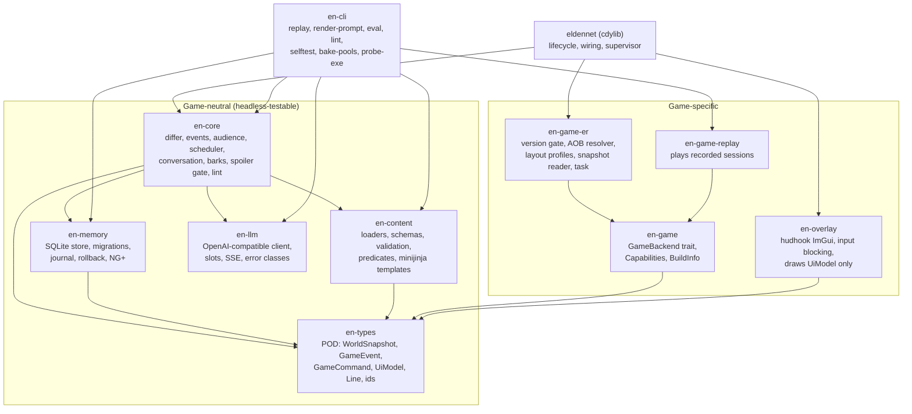
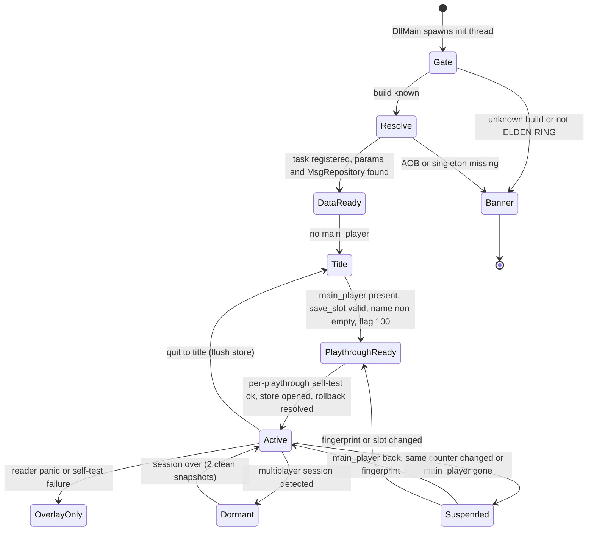

# P3 — EldenNet v1 design proposal: experience first

> **Status:** independent proposal, 2026-11-06. **Target:** ELDEN RING 1.17.2 (exe 2.7.2.0 WW / 2.7.2.1 JP), offline only.
> **Angle:** start from what the player sees, hears and feels when talking to Varré, Patches or Ranni, or when fighting Godrick's soldiers. Then pick the smallest architecture that delivers that, and nothing more.
> **Citations:** `ER00`–`ER06` = `docs/research/eldenring/0n-*.md`; `SN00`–`SN08` = `docs/research/skyrimnet/0n-*.md`. "§" is a section in that note.
> **Licence boundary:** every prompt, persona, card, seed line and schema in this document is original. Nothing is taken from SkyrimNet's prompts, bios or YAML (SN00 §7). No FromSoftware text is quoted or shipped (ER04 §9). Names of characters and places are used only as identifiers.

---

## 0. The proposal on one page

1. **One DLL, one game-thread task, zero game writes.** v1 reads game memory in a single recurring `CSTaskImp` task and never writes game memory, flags, saves or data files. The "commands out" side of the adapter boundary exists, but in v1 its only variant is `Noop` (ER00 §3.1, ER01 Implications §7).
2. **Two tiers, as the user asked.** *Important* = a curated persona file (questline NPCs, named services). *Generic* = a curated archetype card (faction humanoids). Everything else is **mute**: talking bosses, invaders, creatures, unknown NPCs. Muting is a stability decision as much as a scope one (ER04 §2.1).
3. **Conversation is text-first and paced like the game.** Sentences stream into a lower-third subtitle one page at a time, paced for reading, never typewritten. A reply is one to three sentences, usually 8–15 words each (ER04 §5). TTS and STT are v1.5, behind a `SpeechSink` seam.
4. **Tone comes from structure, not adjectives.** Each persona has a `register` and a voice block that describes cadence and diction. Effect words ("cryptic", "terse") are linted out (SN03 §5.4, §12.4). Code enforces the house rules: no game-mechanic words, one opener at most, owned tics with caps, "Tarnished" as the default address, body-type pronouns (ER04 §4.8, §5).
5. **Spoilers are gated by flags in five layers:** stage-gated persona text, `requires` predicates on knowledge, an explicit "not yours to know" list, a per-sentence spoiler-lexicon check before display, and runtime display names (ER04 §7).
6. **Memory is bounded and needs no retrieval.** It has four stores: an audience-tagged event log, game-fed facts, a per-NPC *journal* (a rolling summary of at most 120 words plus at most 8 keepsakes), and short-lived combat facts. The whole journal fits in about 350 tokens, so v1 has no search, no embeddings and no recall tuning (ER06 §5.4, SN04 §13.5).
7. **Barks never wait for the network.** Each archetype card ships authored seed lines for each trigger. LLM-generated pools extend them in the background. Live generation is used only when the player calls out to a generic NPC (3 s deadline). If nothing is ready in time, the NPC stays silent (ER06 §5.6).
8. **Silence is a feature.** No barks during boss fights, native talk, loading, menus or conversations. When the player dies, the gloat must land within 1.2 s or it is dropped, and it is hidden once the death banner (banner 5) appears.
9. **Chat opens only in safe moments** (no engaged hostile within 25 m, no boss fight, the target is not hostile). Input is blocked at DirectInput and XInput while typing. There is no world freeze in v1 (ER05 §11).
10. **Version gate before anything else, then a five-level degradation ladder** that ends at "banner only". Every task body runs under `catch_unwind` (ER02 §5).
11. **Game access sits behind a `GameBackend` trait.** The default backend vendors pre-licence-change fromsoftware-rs plumbing (option b), and EldenNet owns data-driven layout profiles for every field it reads. Options (a) and (c) remain open and swap only that crate (ER00 §3.2).
12. **Persistence:** one SQLite (WAL) file per playthrough, keyed by SteamID + slot + character fingerprint, partitioned by journey. Playtime is the timeline clock. Journals are versioned, so a rollback restores the exact earlier journal (SN04 §11, §13.4).
13. **Measurable from day one:** a `traces` table, an in-game debug panel, recorded snapshot sessions replayed headless, and an offline tone and spoiler eval that gates every persona before it ships.

---

## 1. Goals, non-goals and success criteria

### 1.1 The experience, in four scenes

These scenes are the spec. Every later section exists to make one of them work, or to keep it from breaking. All lines are original.

**A. Varré at the First Step (first meeting, important NPC).** The player walks out of the chapel. A small name tag fades in above a masked figure; the text comes from the game's own NpcName table. The player presses the talk key. A one-line box opens: *Speak to Varré — heard by: Varré*. They type: "Who are you supposed to be?" About a second and a half later, a lower-third line appears with no box, in the place where the game shows subtitles:

> **Varré** — "A guide, of sorts. Though you have the look of someone who prefers to get lost."
>
> *(the page holds for reading, then:)* "Go on. The road won't laugh at you. I might."

He does not explain his master, his rite or anything else his questline reveals later. That material sits in his private persona and unlocks only with his stage flags. He calls the player "Tarnished", never by name. If he uses his signature taunt at all, he uses it once.

**B. Patches, later on (memory that matters).** Patches's stage flags say he once lured the player to a trapped chest. His persona says he lies by reflex and flatters when cornered. EldenNet's own records add two things: in their last chat the player called him a cheat (a keepsake), and the player once struck him (a game fact). The player types: "Give me one reason not to cut you down."

> **Patches** — "Now, now, no need for that! The chest was a — a test of character, and you passed splendidly."

None of this came from vector search. The stage gist, one keepsake and one fact were all in the prompt, because a journal is small enough to send whole.

**C. A Godrick camp at dusk (barks).** The player rides toward a fire. One soldier, not yet engaged, mutters to nobody (ambient pool): "Castle gets the hearths. We get the wind." When the fight starts, a label pops over the nearest soldier: "Fog-stray! On your feet!" The other two stay quiet for now (squad cooldown). The player ripostes one of them, and a neighbour shouts: "He's down — it opened him up!" The last soldier, badly hurt: "Not out here... not in the mud." The player dies, and over the soldier's head, in the second before the banner: "Stay down." Then the death banner (banner 5) shows, and the label is gone. No line waited on the network. Barks are short, chant-like, rooted in their faction and often addressed to no one, which is how FromSoftware's ambient speech works (ER04 §2.8).

**D. Back to Varré after Mohgwyn (knowledge versus memory).** The player has killed Mohg, Lord of Blood. Varré was not there, so he did not *witness* it and holds no memory of it. Whether he *knows* is an authored knowledge decision gated on the kill flags. Anything the player tells him is stored as a **claim**. He remembers what passed between them in earlier chats, and his stage gist covers what he did with the player in vanilla. §7.1 walks through this case.

### 1.2 Goals

| # | Goal | What it means in v1 |
|---|---|---|
| G1 | **Stable** | EldenNet never crashes, hangs or slows the game. It never touches the save or quest state. It switches itself off cleanly on unknown builds and in multiplayer. |
| G2 | **Important NPCs feel like themselves** | Free-form typed chat with about 12 curated personas at v1.0. Each has its own register, knowledge gated by questline flags, and continuity across visits. |
| G3 | **Generic NPCs feel alive in fights** | Short, on-time, faction-flavoured barks for about 12 archetype families. A generic NPC answers in one line when the player calls out to it. |
| G4 | **Memory that matters** | NPCs recall what the player said and did *in their presence*, what the player claimed, and how often they met. They never recall what they could not have perceived. |
| G5 | **No spoilers by default** | No NPC states a fact before the game has revealed it to this playthrough. |
| G6 | **Drop-in** | No edits to `regulation.bin`, msgbnd, ESD or EMEVD. Coexists with Reforged, Convergence, randomizers and the presence of Seamless Co-op (ER03 §8 item 5). |
| G7 | **Ten-minute setup** | One me3 profile and one DLL. An in-game wizard, endpoint probing and a self-test (ER06 §2.4). |
| G8 | **Clean seams** | Actions, TTS/STT, thoughts, user triggers, vector memory, native subtitles and a director can be added later without reshaping the core (SN07 §11.4). |

### 1.3 Non-goals for v1

- NPC actions of any kind: items, shops, hostility, movement, facing, flags. There are no game writes at all.
- TTS, STT, lip movement, native subtitles, Wwise injection (all v1.5–v2; ER03 §7).
- Talking bosses in conversation, NPC invaders speaking, NPC↔NPC scenes, a GameMaster, NPC thoughts.
- DLC personas. The DLC NPC flag blocks are undocumented (ER04 §10 item 1). DLC generic archetype cards are a stretch goal.
- Languages other than English (personas and the lint lists are English-authored).
- Typing on a gamepad, unless spike S4 shows the Steam floating keyboard works.
- Embeddings, retrieval, diaries, dynamic persona rewriting.
- Any online feature, telemetry upload or hosted service.

### 1.4 Success criteria ("minimal and stable", measured)

| # | Criterion | v1.0 target | How it is measured |
|---|---|---|---|
| C1 | No EldenNet-caused crash or hang | 0 in a 30 h soak on 3 machines (one under Proton), plus 20 forced fail-closed launches | Soak log, crash dumps, watchdog |
| C2 | Frame cost | Perception tick p99 ≤ 0.5 ms. Anchor tick ≤ 0.03 ms. Overlay ≤ 0.3 ms per frame. No FPS loss at the 60 cap | `traces`, PresentMon A/B |
| C3 | Fail-closed | Unknown exe: banner, zero tasks registered, zero RVA calls. Multiplayer: dormant within 1 snapshot (≤ 250 ms) | Scripted build-mismatch test, ERSC session test |
| C4 | Time to first text in conversation | p50 ≤ 1.6 s, p90 ≤ 3.0 s on the cloud preset. p50 ≤ 2.5 s on the 12 GB local preset | `traces` (send → first page shown) |
| C5 | Bark timeliness | 100% of shown barks start ≤ 2.5 s after the trigger. ≥ 95% start ≤ 0.3 s | `traces` |
| C6 | Spoiler safety | 0 locked-term violations shown in 600 scripted turns over 6 flag states | `en-cli eval` |
| C7 | Voice | ≥ 98% of replies within the word cap. Archaic-regal personas 25–60% archaic lines; every other register ≤ 2%. 0 banned modern words shown | `en-cli eval` |
| C8 | Memory durability | After a hard kill mid-reply, every *shown* line is present on reload. Rollback-trim and NG+ tests pass | Integration tests |
| C9 | Coexistence | Loads and stays stable with `ersc.dll` (dormant in session), Reforged, Convergence, Steam overlay, HDR | Compat matrix |
| C10 | Setup | First NPC reply ≤ 10 min after install, for a tester with an API key | 5 observed sessions |

### 1.5 Perceived-latency budget

Players judge latency by what they see while waiting. Mantella users complain about 10–15 s waits, and Mantella's own guide targets a first response under 0.5 s (ER06 §2.2, §5.5). Our budget is set per *visible moment*:

| Moment | What the player sees | Target (p50 / p90) | Hard limit | On a miss |
|---|---|---|---|---|
| Press talk key | Box opens with the target's name and who can hear | ≤ 50 ms | 100 ms | — |
| Press Enter | Own line moves into the faint history strip. After 350 ms with no text, a speaker card **"Varré …"** appears | — | — | — |
| First page | Lower-third subtitle | 1.6 / 3.0 s cloud; 2.5 / 4.5 s local | 6 s to first token (10 s local), then the fallback model; 20 s total | At 20 s: a silent "…" page, not committed, plus a toast naming the cause |
| Later pages | Each page held for its reading time | Never early. Late only if the text is not ready | — | — |
| Bark (pool) | Label over the speaker | ≤ 0.3 s | Expires 2.5 s after the trigger | Dropped |
| Player death gloat | Label as the player falls | ≤ 0.5 s | 1.2 s, and never once the banner shows | Dropped |
| Calling out to a generic | One-line label reply | 1.5 / 2.5 s | 3.0 s | Seed line for `addressed` |
| Memory update | Nothing visible | Within 2 min of conversation end, never during combat | Next session | Stays queued |

The ellipsis card is in-genre: about 12% of vanilla lines end in "..." and silent characters reply with "..." (ER04 §5, §2.2). It replaces a spinner.

---

## 2. Process and code architecture

### 2.1 Shape

- **One `cdylib`** (`eldennet.dll`, Rust 2024, `x86_64-pc-windows-msvc`), loaded by a me3 `[[natives]]` profile with `start_online = false`, its own `savefile` and `disable_arxan = true` (ER02 §9.3). `DllMain` only spawns the init thread, so other loaders also work.
- **All ML runs out of process** behind one OpenAI-compatible HTTP client (ER06 §5.1). No whisper, ONNX or TTS DLLs are loaded in v1.
- **One recurring game-thread task** in `ChrIns_PostPhysics`. Every frame it updates *anchors* (camera matrix plus up to 4 head positions, only while floating labels are visible). Every 15th frame (≈ 4 Hz at 60 FPS) it takes the full *perception snapshot*. Curated flags are read on every 4th snapshot (≈ 1 Hz) (ER01 §3.2 rules 1–3, ER05 Implications §1).
- **No apply task in v1.** There is nothing to apply. The UI reads a model the core publishes, and the overlay draws on the present path from that model only.
- **System hooks only:** DXGI Present and ExecuteCommandLists (hudhook), DirectInput `GetDeviceState` and `XInputGetState` (input blocking, chained). **No hooks or patches on `eldenring.exe` code** (ER00 §2, ER02 §7.4).

### 2.2 Threads

| Thread | Owns | Touches game memory? | Must never |
|---|---|---|---|
| Game thread (our task closure) | `GameReader`, snapshot double buffer, text cache | **Yes, only here** | Block, lock a mutex a worker holds, panic out of the closure, allocate more than about 1 KB per tick |
| Render thread (hudhook callback) | ImGui context, input-block state | No (reads `ArcSwap<UiModel>` and the anchor seqlock) | Read game structs |
| Brain thread | Event log cache, perception differ, scheduler, conversation state machine, bark engine, prompt rendering | No | Do network or disk I/O inline |
| Net runtime (tokio, 2 workers) | LLM requests and streams | No | — |
| Store thread | rusqlite connections (playthrough DB, `pools.sqlite`, `diag.sqlite`) | No | — |
| Watcher thread | File watch for hot reload | No | — |
| Init thread | Version gate, resolver, task registration; exits after setup | Only via the probes inside the first task tick | — |

Channels: snapshot → brain through a two-slot overwrite-oldest buffer (the brain always sees the newest snapshot). Brain → UI through `ArcSwap<UiModel>`. Brain ↔ net and brain → store through bounded MPSC queues of 64 and 1,024. When the store queue is full, diagnostics are dropped first and events never.

### 2.3 Crates and dependencies



Rules: `en-core` never depends on `en-game-er` or `en-overlay`. Only `en-game-er` contains `unsafe` that dereferences game memory, and it denies `clippy::unwrap_used`, `expect_used` and `indexing_slicing`. `en-overlay` contains `unsafe` only for hudhook and the input hooks.

### 2.4 The adapter boundary: snapshot in, commands out

```rust
pub trait GameBackend: Send {
    /// Called on the game thread inside the task closure only.
    fn probe(&mut self) -> Capabilities;                    // which readers passed self-test
    fn snapshot(&mut self, out: &mut WorldSnapshot) -> Result<(), ReadError>;
    fn anchors(&mut self, want: &[ChrHandle], out: &mut Anchors) -> Result<(), ReadError>;
    fn apply(&mut self, cmd: &GameCommand) -> Result<(), ApplyError>; // v1: Noop only
}
pub enum GameCommand { Noop }   // reserved later: Freeze(bool), FacePlayer(..), RunTalkMenu(..)
```

Everything that crosses the boundary is plain data with `serde`. This is what lets `en-game-replay` feed recorded sessions to an unmodified core (ER00 §3.1). Handles cross the boundary. Pointers never do: `ChrHandle` wraps `FieldInsHandle` and is re-resolved on every tick (ER05 §6.1).

### 2.5 Version gating and the degradation ladder

**Gate (init thread, before any RVA-backed call).** Read the PE `VS_FIXEDFILEINFO` and check `ProductName == "ELDEN RING"`. Look up `(file_version, region)` in `layouts/builds.toml`. An unknown build gets **no task registration** and no `wait_for_instance`, because that call panics on unknown builds in fromsoftware-rs (ER01 §1, ER02 §10 item 2). Then resolve `register_task`, `global_hinstance`, `GameDataMan`, `GameMan` and `FieldArea` by **runtime AOB** with the known patterns (ER01 §4), and check them against RTTI or DLRF where possible. Load the build's layout profile.

**Capabilities** are probed one at a time on the first ticks and re-probed at each "playthrough ready" (§2.6):

| Cap | Reader | Self-test |
|---|---|---|
| `CHARS` | `WorldChrMan.chr_inses_by_distance` | Vtable RTTI is a `ChrIns` subclass, distances ascend, `0 ≤ hp ≤ max_hp`, `npc_param_id` resolves in `SoloParamRepository` (ER02 §5) |
| `PLAYER` | `PlayerIns`, `PlayerGameData`, `GameDataMan` | `character_id == 0` for the main player, name non-empty, `play_time` monotonic |
| `FLAGS` | `CSEventFlagMan` | Flag 100 (game started) set on a loaded save (ER05 Implications §8) |
| `TEXT` | `MsgRepository` FMG table | NpcName for a known row returns a non-placeholder string (ER03 §3.3) |
| `PLACE` | `FieldArea.map_place_name_id`, params | Id resolves to PlaceName text |
| `TIME` | `WorldAreaTime.clock` | Hours in 0..24 |
| `BOSS` | `GameDataMan.boss_fight_active`, `CSFeManImp.boss_health_displays` | Booleans or handles are sane |
| `TALKOBS` | `CSPopupMenu.current_talk_id`, `GameMan.talk_esd_camera_param_id`, `hud_state` | Validated in spike S3; off until then |
| `CAMERA` | `CSCamera.pers_cam_1` | Matrix orthonormal, fov in range |
| `SESSION` | `multiplay_role`, `is_my_world`, `CSSessionManager` lobby, `player_chr_set` count | Values in the enum range |

**Ladder** (each level is a superset of the one below it):

| Level | When | Player-facing behaviour |
|---|---|---|
| **L4 Full** | All required caps pass | Everything on |
| **L3 Reduced** | An optional cap failed (`TEXT`, `PLACE`, `TIME`, `BOSS`, `TALKOBS`, `CAMERA`) | Fallbacks: names from persona and card files; "somewhere in the Lands Between"; no boss rule, so barks are suppressed whenever any boss bar is visible to the HUD-based rule or, failing that, inside legacy-dungeon boss blocks; without `TALKOBS`, barks are suppressed within 20 m of talk-script NPCs and chat needs 3 s without `hud_state == PopupMenu`; without `CAMERA`, barks go to a feed instead of floating labels. One toast lists what is reduced |
| **L2 Barks-only** | `FLAGS` failed | Named chat is **off**, because spoiler safety outranks availability. Barks run |
| **L1 Overlay-only** | `CHARS` or `PLAYER` failed, or a caught panic in the reader | Banner "EldenNet: inactive on this build (2.7.x.y) — reason", settings and diagnostics. Snapshot task unregistered |
| **L0 Dormant** | Unknown build (static) or multiplayer (dynamic) | Unknown build: banner only, no task ever registered. Multiplayer: task stays registered but reads only `SESSION`; conversation closed, barks off, pending output dropped |

Multiplayer rule: run only if `multiplay_role == Host && is_my_world && lobby == None && player_chr_set.len() == 1`. The last check also catches Seamless Co-op sessions, whose partners appear as extra `PlayerIns` (ER05 §3, ER04 §4.6). If `ersc.dll` is loaded, EldenNet still runs in solo play but re-checks every snapshot.

### 2.6 Lifecycle



Lifecycle hooks the core reacts to:

- **Data ready:** load content, build identity indexes, warm the text cache for persona names.
- **Playthrough ready:** compute the fingerprint, open the playthrough DB, run the rollback check (§7.8). Writes are refused until it resolves.
- **Loading screens** (`CSNowLoadingHelper.menu_load_counter` change or `main_player == None`; ER05 §9): end any conversation (reason `travel`), clear short-lived events, cancel barks, flush the store.
- **Player death** (`death_flag` rising edge): end the conversation (reason `death`), fire `player_fell`, keep the journal untouched. Remarks about a long absence are in-genre; remarks about respawning are not (ER04 §4.2).
- **Rest** (flag 9000 rising edge, ER05 §3): clear all generic engagement state, because the world respawns (ER04 §4.1). Run queued memory jobs and pool refills: **rest is when memory settles.** It is also the safest moment for a local model to use the GPU.
- **Journey change** (`ng_lvl` changed): open a new journey partition (§7.8).

### 2.7 Error handling and crash-safety rules

1. **R1 Game thread only.** Game memory is touched only inside the task closure, through `GameReader`, which checks null, alignment and committed-page reads. It checks RTTI the first time it reads each object kind in a session.
2. **R2 No panic crosses FFI.** The closure body is `catch_unwind(AssertUnwindSafe(..))` with `panic = "unwind"`. A caught panic marks that reader's capability failed for the session and drops down the ladder. The faulting path is never re-entered (ER00 §3.2).
3. **R3 The task never waits.** It uses `try_send`, atomics, preallocated buffers and a time budget (0.5 ms). If p99 is over 0.8 ms for 10 s, the character cap drops from 32 to 16 and a trace is written.
4. **R4 Handles, not pointers,** re-resolved every tick (ER05 Risks).
5. **R5 Suspend on any world transition** (`main_player == None`, load counter, title screen).
6. **R6 Supervised workers.** If the brain thread panics, it restarts once with state rebuilt from the DB. A second panic sends EldenNet to L1 for the session.
7. **R7 Sanitize every string** that reaches the UI, and cap its bytes: 600 per reply, 180 per page, 160 per bark (CHIM's 900-byte crash lesson, ER06 §2.3).
8. **R8 No writes** to game memory, flags, `.sl2` or game files. EldenNet never uses flags as scratch state (Chat with Melina's corruption, ER06 §4).
9. **R9 Fail closed** on unknown builds, multiplayer and failed self-tests.
10. **R10 Visible failure.** Every degradation shows a toast naming the cause and writes a log line. Nothing is masked with fake answers (ER06 §2.4).

### 2.8 The fromsoftware-rs licence gate and a swappable backend

The facts (ER00 §3.2, ER02 §4.1): crates.io 0.14.0 and git up to `acc9da0` (2026-09-21) are plain `MIT OR Apache-2.0`. `main` has carried "MIT/Apache NON-AI" files since 2026-10-12, and the 1.17.2 updates came after that.

| Option | What we do | Cost | Risk |
|---|---|---|---|
| (a) Legal read, or a statement from the authors that runtime inference is out of scope | Track `main` | Low engineering | Waiting time; community friction |
| **(b) Pre-change code + our own deltas (recommended default)** | Vendor the minimal plumbing from `acc9da0` (task registration types, `from-singleton` use, param repository access). Resolve RVAs ourselves at runtime with AOB. Own the **layout profiles** (TOML offsets for the ~60 fields we read, validated in game), derived by our own self-tests, not copied from post-change commits | Medium: we maintain layouts per patch, which the churn makes necessary anyway (ER01 §1) | Our RE effort per patch |
| (c) Own minimal structs | Replace the vendored subset | High | Highest RE burden |

Under (b), a patch that only moves offsets can be supported by shipping a new `layouts/er-2.7.x.toml`, **without rebuilding the DLL**. The previous builds' profiles stay, so players who block updates keep working. Only `en-game-er` changes between options. Pursue (a) in parallel. **This needs the user's decision (§13.2 D1).**

---

## 3. Perception

### 3.1 Cadence and budget

| Item | Rate | Cap | Budget |
|---|---|---|---|
| Full snapshot (player, world, characters) | every 15 frames (≈ 4 Hz) | 32 characters within 40 m, nearest first | ≤ 0.4 ms p99 |
| Curated flag frame | every 4th snapshot (≈ 1 Hz) | ≤ 2,048 flags (catalogue indices, bitset) | ≤ 0.1 ms |
| Anchors (camera plus label heads) | every frame, only while labels are visible | 4 handles | ≤ 0.03 ms |
| Text resolution (FMG) | on first sight of a new `(fmg, id)` | 16 per tick | Included above |

The 40 m radius and the 32-character cap follow the 4 Hz / 40 m perception sketch (ER05 Implications §1). The AoER bridge exports an 80 m table on 1.17.1 (ER06 §4), so 40 m is comfortably inside proven territory.

### 3.2 `WorldSnapshot` schema

```rust
pub struct WorldSnapshot {
    pub gen: u64, pub mono_ms: u64, pub build: BuildId,
    pub session: Session {                    // ER05 §3, §9
        main_player: bool, role: MultiplayRole, is_my_world: bool, lobby: LobbyState,
        other_players: u8, load_counter: u32, screen: Screen /*InGame|Loading|Title*/ },
    pub ui: Ui { hud: HudState, banner: Option<u16> /*FeTextEffect id, 5 = the death banner*/,
        talk: TalkObs { current_talk_id: Option<u32>, talk_camera: bool, valid: bool },
        subtitles_on: bool },                 // ER03 §2.5, §7A; ER05 §9
    pub player: Player {                      // ER05 §2–§4
        handle: ChrHandle, level: u16, runes_held: u32, archetype: u8, body: BodyType,
        hp: Band3, fp: Band3, stamina: Band3,  // raw + max kept for diffs, see below
        hp_raw: (u32, u32), dead: bool, death_count: u32, play_time_ms: u64, ng_lvl: u8,
        save_slot: u8, block: BlockId, pos: Vec3, place_name_id: Option<u32>,
        on_torrent: bool, locked_on: Option<ChrHandle>, in_roundtable: bool /*SpEffect 9621*/,
        resting: bool /*flag 9000*/, throw: ThrowState,
        gear: Gear { right: [ItemId;3], left: [ItemId;3], head: ItemId, chest: ItemId,
                     hands: ItemId, legs: ItemId, talismans: [ItemId;4] },
        name_hash: u64 },                     // name text itself is sent once per playthrough
    pub world: World { clock_h: u8, clock_m: u8, weather: Option<WeatherKind> /*flags 550–575*/,
        boss: Boss { active: bool, bars: [Option<BossBar>; 3] } },   // ER05 §5, §8.4
    pub chars: ArrayVec<Chr, 32>,
    pub flags: Option<FlagFrame>,             // present every 4th snapshot
    pub new_text: ArrayVec<(FmgId, u32, SmolStr), 16>,
}
pub struct Chr {                              // ER05 §6.2
    handle: ChrHandle, npc_param_id: u32, entity_id: u32, model: u16, chr_type: ChrType,
    team: u8, name_id: Option<u32>, hp_raw: (u32, u32), dead: bool,
    last_hit_by: Option<ChrHandle>, recv_dmg_type: Option<u32>, dist_m: f32,
    bearing_deg: f32 /* relative to camera forward */, onscreen: bool, block: BlockId,
    pos: Vec3, throw: ThrowState, is_summon: bool,
}
```

Notes:

- Raw HP is kept so events can be derived. *Bands* (`Band3`: ≥ 75 / ≥ 50 / ≥ 25 / below) are what prompts see. Models parrot numbers, so no number ever reaches a prompt (SN02 §4.1, SN00 §6).
- `team` is read at runtime, not from the param, because hostility changes during play (SN05 §8.4 lesson #768).
- The player's name is read once per playthrough and kept in memory only. Prompts use it only after the player introduces themselves (§5.10).

### 3.3 Curated flag frame

`content/flags/catalog.toml` maps **aliases** to IDs, with provenance and a `verified` bit (ER05 Implications §9):

```toml
[flag."boss.godrick.defeated"]     id = 10000800  src = "TGA,SoulSplitter"  verified = false
[flag."boss.mohg_lord.defeated"]   id = 12050800  src = "TGA"               verified = false
[flag."boss.mohg_lord.global"]     id = 9112      src = "eventparam,TGA"    verified = false
[flag."runes.count_ge_2"]          id = 182       src = "eventparam"        verified = false
[flag."player.resting"]            id = 9000      src = "eventparam,ESD"    verified = true
[block."varre"]                    base = 3180    src = "eventparam"        verified = false  # 20-flag block, ER04 §1
```

Aliases are the only flag vocabulary that personas, cards and knowledge use. Dev labels (Japanese names, spoiler-grade) never leave this file and never reach prompts (ER04 §7). The perception task gets a dense `Vec<u32>` of the IDs, and the frame is a bitset in the same order.

### 3.4 Text resolution

NpcName, PlaceName and item names are read from the live FMG table through `MsgRepository`, on the game thread, with the DLC slot order {4xx, 3xx, base} (ER00 §2 row 4, ER05 §2). Results go into `new_text`, and the brain keeps the cache. Reading the runtime name gives reveal timing for free ("Renna" becomes "Ranni" with the `NpcParam` row variant) and keeps overhaul renames correct (ER04 §7). If `TEXT` fails, names come from persona `display_name_fallback` and card `label_fallback`.

### 3.5 Combat-state heuristic

The game exposes no clean "in combat" global (ER05 §8.1). v1 uses a per-actor **engagement** record, derived on the brain thread:

```
engaged(a) starts when, with a hostile per team relation:
   (a.hp dropped this tick && a.last_hit_by == player)            // player hit it
|| (player.hp dropped && player.last_hit_by == a)                 // it hit the player
|| (player.locked_on == a && a.dist ≤ 15 m)                       // squaring up
engaged(a) ends after 20 s with none of the above, or on a's death, the player's death, rest or load.
player_in_combat = boss.active || any engaged(a) touched in the last 8 s
```

"Hostile" means team type 6, 7, 27 or 29 (Enemy, Strong Enemy, Hostile NPC, Indiscriminate; ER05 §6.2), checked on the live team. "Searching" enemies that never engage never bark aggro lines (SN05 §8.4 #771). Spike S7 may later replace this with `CSAiThink` battle state through TGA's chain. The event contract would stay the same.

### 3.6 Event derivation (snapshot diffs)

Persistent events are written to the playthrough DB with an audience. Short-lived events live in memory under a key and expire after a TTL. **One visibility rule serves every consumer:** dialogue prompts, memory jobs and barks all read the same events through the same audience filter (SN05 §14.1 item 2).

| Event | Exact condition | Store | Audience |
|---|---|---|---|
| `PlaceEntered{place}` | `place_name_id` changed and stable for 2 snapshots; not the same place within 60 s | persistent | player + named within 20 m |
| `GraceRested` | flag 9000 rising edge | persistent | player + named within 20 m |
| `FlagChanged{alias}` | catalogue flag edge (1 Hz frame) | persistent | world (read through the KB, §7.5) |
| `BossFightStarted{bar}` / `BossFightEnded{won}` | `boss.active` edge; `won` if the boss's defeat flag rose within 10 s or banner 1–3 shows (ER05 §3) | persistent | player + named within 40 m |
| `NamedSeen{persona}` | named character enters 20 m; once per 10 min per persona | persistent | that persona |
| `NamedAttacked{persona}` | named `hp` dropped and `last_hit_by == player` | persistent → fact `times_attacked` | that persona + named within 20 m |
| `NamedDied{persona, by_player}` | named `dead` rising edge | persistent | named within 20 m |
| `FoughtBeside{persona}` | `BossFightEnded{won}` while the persona is present as `is_summon` (ER04 §4.7) | persistent → keepsake candidate | that persona |
| `PlayerDied` | player `dead` rising edge or `death_count` +1 | persistent | named within 20 m; generics see `player_fell` |
| `PlayerSaid` / `NpcSaid` | EldenNet input and output (§5.8) | persistent | speech audience (§3.7) |
| `ConversationStarted/Ended{reason}` | conversation state machine | persistent | that persona |
| `Engaged{a}` | engagement start (§3.5) | short-lived, key `eng:<a>`, TTL 30 s | a + same-card within 15 m |
| `Struck{att, vic}` | HP delta > 0, aggregated per pair over 2 s; `hard` if ≥ 30% of max within 3 s (SN05 §14.2) | short-lived, key `hit:<att>:<vic>`, TTL 10 s | att, vic, within 15 m |
| `LowHp{a}` | HP crosses below 25%; re-arms above 40% | short-lived, TTL 15 s | a |
| `AllyFell{fallen, witness}` | generic `dead` rising edge; witnesses are alive, same card or same team, within 15 m | short-lived, TTL 8 s | witnesses |
| `PlayerHealed` | player HP +≥ 25% of max within 1 s while in combat | short-lived, TTL 6 s | engaged actors |
| `PlayerFled{a}` | `a` engaged in the last 15 s, distance now > 25 m and rising, player alive | short-lived, once per engagement | a |
| `CritLanded{vic}` | player `throw == InThrowAttacker` and a hostile `InThrowTarget` within 3 m (ER05 §8.5) | short-lived, TTL 6 s | victim's allies within 12 m |
| `PlayerMounted` | `on_torrent` rising edge | short-lived, TTL 6 s | engaged actors |
| `KilledNear{victim_card}` | generic death with `last_hit_by == player` | short-lived, TTL 120 s | **named** within 20 m (feeds "just now" in conversation) |
| `IdleNear{a}` | a hostile, not engaged, 8–20 m, on screen; checked every 30 s per actor | short-lived, TTL 4 s | a |

### 3.7 Audience and perception rules

- **Speech** (`PlayerSaid`, `NpcSaid`): the speaker, plus everyone alive within **15 m** of the speaker in the same map area (`BlockId.area`, and the same block inside legacy dungeons), plus the player. 15 m sits inside SkyrimNet's ~23 m and suits ER's smaller interiors (SN00 §6). Only *important* personas store anything: generics perceive but never remember (ER04 §4.1).
- **Witnessing** (deaths, attacks, rests, places): named personas within 20 m, same area.
- **Line of sight** is not used in v1. `cast_ray`'s filter is undocumented (ER05 §6.2). The same-area check stands in for walls, as SN05 §14.2 suggests. It is added once spike S7 proves the raycast.
- **Barks:** generics within 40 m see combat events through the table above. They have no history.
- **The audience is frozen** when the event is recorded (SN02 §2). A persona who walks up later did not hear what was said before.

### 3.8 State in words

Code turns state into short phrases, which are the only form prompts see (SN03 §12.2):

| Input | Phrase examples |
|---|---|
| HP band | "unhurt", "bloodied", "badly hurt", "barely standing" |
| Time (clock) | "before dawn", "morning", "midday", "late afternoon", "dusk", "night", "deep night" |
| Weather (flags 550–575) | "clear", "overcast", "rain", "heavy rain", "snow", "fog" |
| Gear (FMG names) | "carrying a greatsword; wearing a knight's helm" (two items at most, the most visible first) |
| Great Runes (flags 180–187) | "bears no Great Rune" / "bears a Great Rune" / "bears several Great Runes" |
| Absence | last met < 1 h playtime: nothing; 1–6 h: "it has been some time"; > 6 h: "it has been a long while" |
| Group | "alone", "two of your comrades are near", "you are the last one standing" |

---
