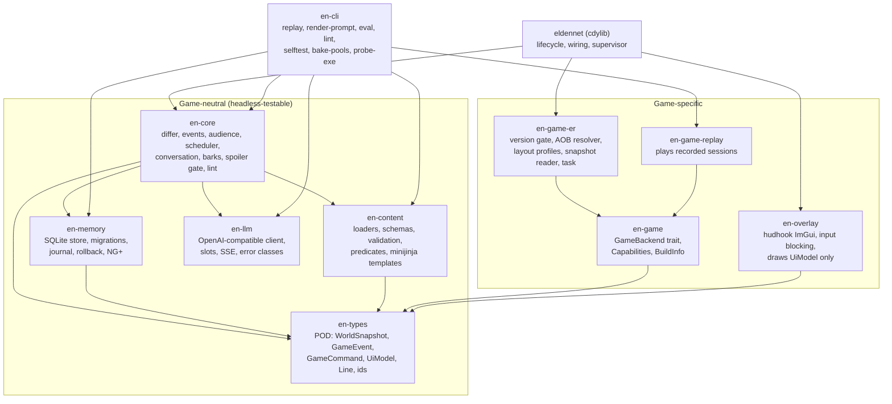
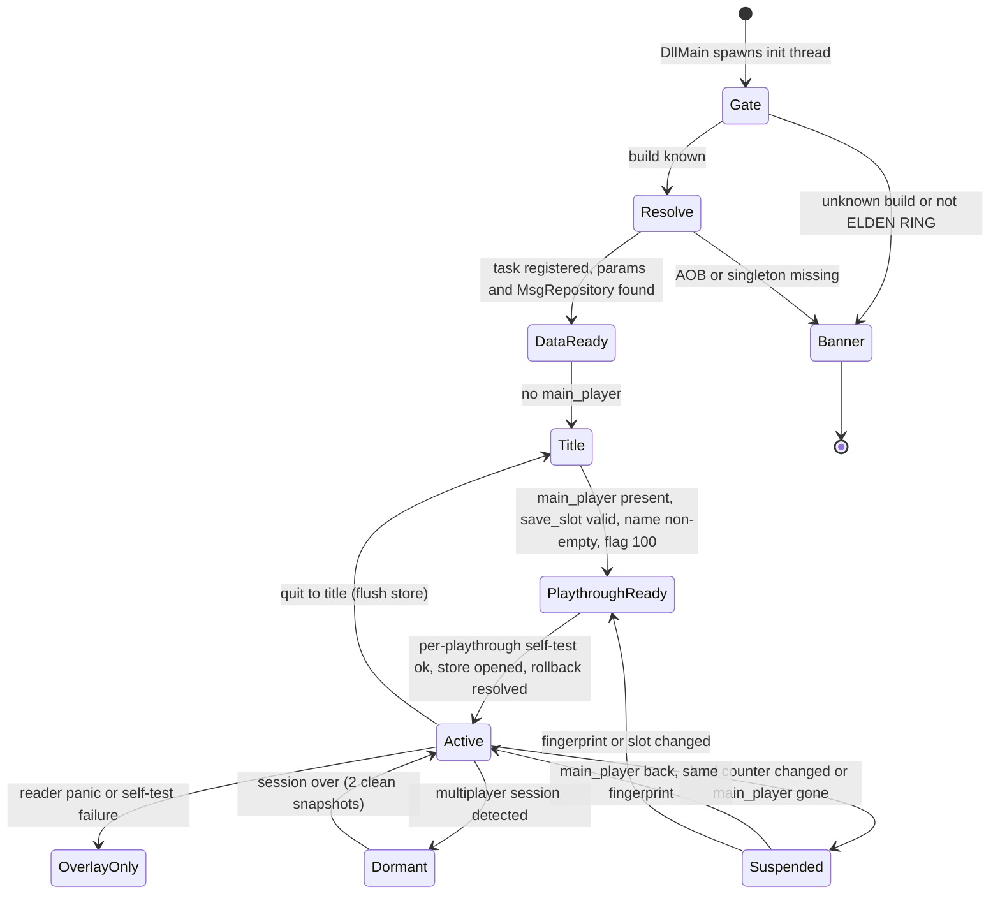
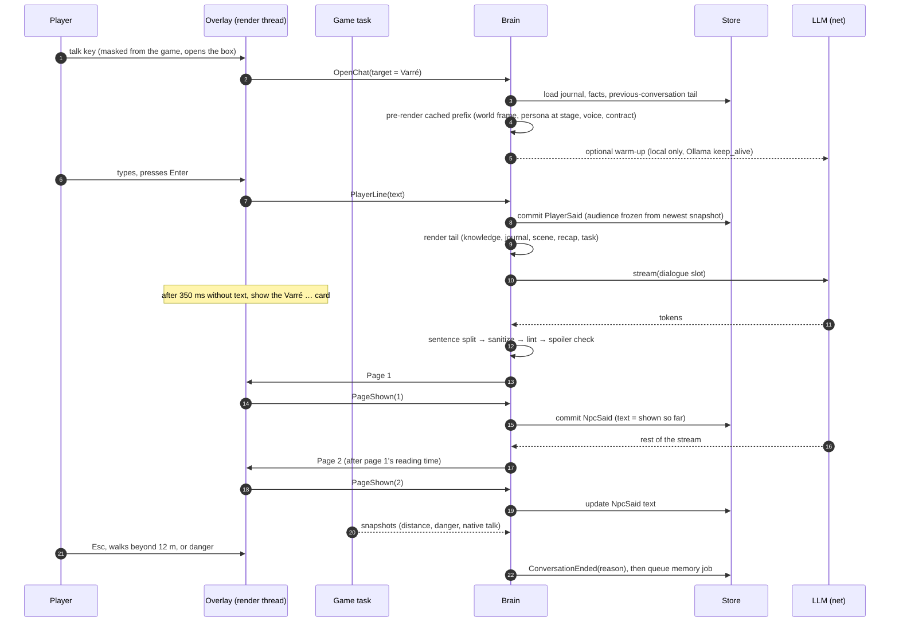

# P3 — EldenNet v1 design proposal: experience first

> **Status:** independent proposal, 2026-11-06. **Target:** ELDEN RING 1.17.2 (exe 2.7.2.0 WW / 2.7.2.1 JP), offline only.
> **Angle:** start from what the player sees, hears and feels when talking to Varré, Patches or Ranni, or when fighting Godrick's soldiers. Then pick the smallest architecture that delivers that, and nothing more.
> **Citations:** `ER00`–`ER06` = `docs/research/eldenring/0n-*.md`; `SN00`–`SN08` = `docs/research/skyrimnet/0n-*.md`. "§" is a section in that note.
> **Licence boundary:** every prompt, persona, card, seed line and schema in this document is original. Nothing is taken from SkyrimNet's prompts, bios or YAML (SN00 §7). No FromSoftware text is quoted or shipped (ER04 §9). Names of characters and places are used only as identifiers.

---

## 0. The proposal on one page

1. **One DLL, one game-thread task, zero game writes.** v1 reads game memory in a single recurring `CSTaskImp` task and never writes game memory, flags, saves or data files. The "commands out" side of the adapter boundary exists, but in v1 its only variant is `Noop` (ER00 §3.1, ER01 Implications §7).
2. **Two tiers, as the user asked.** *Important* = a curated persona file (questline NPCs, named services). *Generic* = a curated archetype card (faction humanoids). Everything else is **mute**: talking bosses, invaders, creatures, unknown NPCs. Muting is a stability decision as much as a scope one (ER04 §2.1).
3. **Conversation is text-first and paced like the game.** Sentences stream into a lower-third subtitle one page at a time, paced for reading, never typewritten. A reply is one to three sentences, usually 8–15 words each (ER04 §5). TTS and STT are v1.5, behind a `SpeechSink` seam.
4. **Tone comes from structure, not adjectives.** Each persona has a `register` and a voice block that describes cadence and diction. Effect words ("cryptic", "terse") are linted out (SN03 §5.4, §12.4). Code enforces the house rules: no game-mechanic words, one opener at most, owned tics with caps, "Tarnished" as the default address, body-type pronouns (ER04 §4.8, §5).
5. **Spoilers are gated by flags in five layers:** stage-gated persona text, `requires` predicates on knowledge, an explicit "not yours to know" list, a per-sentence spoiler-lexicon check before display, and runtime display names (ER04 §7).
6. **Memory is bounded and needs no retrieval.** It has four stores: an audience-tagged event log, game-fed facts, a per-NPC *journal* (a rolling summary of at most 120 words plus at most 8 keepsakes), and short-lived combat facts. The whole journal fits in about 350 tokens, so v1 has no search, no embeddings and no recall tuning (ER06 §5.4, SN04 §13.5).
7. **Barks never wait for the network.** Each archetype card ships authored seed lines for each trigger. LLM-generated pools extend them in the background. Live generation is used only when the player calls out to a generic NPC (3 s deadline). If nothing is ready in time, the NPC stays silent (ER06 §5.6).
8. **Silence is a feature.** No barks during boss fights, native talk, loading, menus or conversations. When the player dies, the gloat must land within 1.2 s or it is dropped, and it is hidden once the death banner (banner 5) appears.
9. **Chat opens only in safe moments** (no engaged hostile within 25 m, no boss fight, the target is not hostile). Input is blocked at DirectInput and XInput while typing. There is no world freeze in v1 (ER05 §11).
10. **Version gate before anything else, then a five-level degradation ladder** that ends at "banner only". Every task body runs under `catch_unwind` (ER02 §5).
11. **Game access sits behind a `GameBackend` trait.** The default backend vendors pre-licence-change fromsoftware-rs plumbing (option b), and EldenNet owns data-driven layout profiles for every field it reads. Options (a) and (c) remain open and swap only that crate (ER00 §3.2).
12. **Persistence:** one SQLite (WAL) file per playthrough, keyed by SteamID + slot + character fingerprint, partitioned by journey. Playtime is the timeline clock. Journals are versioned, so a rollback restores the exact earlier journal (SN04 §11, §13.4).
13. **Measurable from day one:** a `traces` table, an in-game debug panel, recorded snapshot sessions replayed headless, and an offline tone and spoiler eval that gates every persona before it ships.

---

## 1. Goals, non-goals and success criteria

### 1.1 The experience, in four scenes

These scenes are the spec. Every later section exists to make one of them work, or to keep it from breaking. All lines are original.

**A. Varré at the First Step (first meeting, important NPC).** The player walks out of the chapel. A small name tag fades in above a masked figure; the text comes from the game's own NpcName table. The player presses the talk key. A one-line box opens: *Speak to Varré — heard by: Varré*. They type: "Who are you supposed to be?" About a second and a half later, a lower-third line appears with no box, in the place where the game shows subtitles:

> **Varré** — "A guide, of sorts. Though you have the look of someone who prefers to get lost."
>
> *(the page holds for reading, then:)* "Go on. The road won't laugh at you. I might."

He does not explain his master, his rite or anything else his questline reveals later. That material sits in his private persona and unlocks only with his stage flags. He calls the player "Tarnished", never by name. If he uses his signature taunt at all, he uses it once.

**B. Patches, later on (memory that matters).** Patches's stage flags say he once lured the player to a trapped chest. His persona says he lies by reflex and flatters when cornered. EldenNet's own records add two things: in their last chat the player called him a cheat (a keepsake), and the player once struck him (a game fact). The player types: "Give me one reason not to cut you down."

> **Patches** — "Now, now, no need for that! The chest was a — a test of character, and you passed splendidly."

None of this came from vector search. The stage gist, one keepsake and one fact were all in the prompt, because a journal is small enough to send whole.

**C. A Godrick camp at dusk (barks).** The player rides toward a fire. One soldier, not yet engaged, mutters to nobody (ambient pool): "Castle gets the hearths. We get the wind." When the fight starts, a label pops over the nearest soldier: "Fog-stray! On your feet!" The other two stay quiet for now (squad cooldown). The player ripostes one of them, and a neighbour shouts: "He's down — it opened him up!" The last soldier, badly hurt: "Not out here... not in the mud." The player dies, and over the soldier's head, in the second before the banner: "Stay down." Then the death banner (banner 5) shows, and the label is gone. No line waited on the network. Barks are short, chant-like, rooted in their faction and often addressed to no one, which is how FromSoftware's ambient speech works (ER04 §2.8).

**D. Back to Varré after Mohgwyn (knowledge versus memory).** The player has killed Mohg, Lord of Blood. Varré was not there, so he did not *witness* it and holds no memory of it. Whether he *knows* is an authored knowledge decision gated on the kill flags. Anything the player tells him is stored as a **claim**. He remembers what passed between them in earlier chats, and his stage gist covers what he did with the player in vanilla. §7.1 walks through this case.

### 1.2 Goals

| # | Goal | What it means in v1 |
|---|---|---|
| G1 | **Stable** | EldenNet never crashes, hangs or slows the game. It never touches the save or quest state. It switches itself off cleanly on unknown builds and in multiplayer. |
| G2 | **Important NPCs feel like themselves** | Free-form typed chat with about 12 curated personas at v1.0. Each has its own register, knowledge gated by questline flags, and continuity across visits. |
| G3 | **Generic NPCs feel alive in fights** | Short, on-time, faction-flavoured barks for about 12 archetype families. A generic NPC answers in one line when the player calls out to it. |
| G4 | **Memory that matters** | NPCs recall what the player said and did *in their presence*, what the player claimed, and how often they met. They never recall what they could not have perceived. |
| G5 | **No spoilers by default** | No NPC states a fact before the game has revealed it to this playthrough. |
| G6 | **Drop-in** | No edits to `regulation.bin`, msgbnd, ESD or EMEVD. Coexists with Reforged, Convergence, randomizers and the presence of Seamless Co-op (ER03 §8 item 5). |
| G7 | **Ten-minute setup** | One me3 profile and one DLL. An in-game wizard, endpoint probing and a self-test (ER06 §2.4). |
| G8 | **Clean seams** | Actions, TTS/STT, thoughts, user triggers, vector memory, native subtitles and a director can be added later without reshaping the core (SN07 §11.4). |

### 1.3 Non-goals for v1

- NPC actions of any kind: items, shops, hostility, movement, facing, flags. There are no game writes at all.
- TTS, STT, lip movement, native subtitles, Wwise injection (all v1.5–v2; ER03 §7).
- Talking bosses in conversation, NPC invaders speaking, NPC↔NPC scenes, a GameMaster, NPC thoughts.
- DLC personas. The DLC NPC flag blocks are undocumented (ER04 §10 item 1). DLC generic archetype cards are a stretch goal.
- Languages other than English (personas and the lint lists are English-authored).
- Typing on a gamepad, unless spike S4 shows the Steam floating keyboard works.
- Embeddings, retrieval, diaries, dynamic persona rewriting.
- Any online feature, telemetry upload or hosted service.

### 1.4 Success criteria ("minimal and stable", measured)

| # | Criterion | v1.0 target | How it is measured |
|---|---|---|---|
| C1 | No EldenNet-caused crash or hang | 0 in a 30 h soak on 3 machines (one under Proton), plus 20 forced fail-closed launches | Soak log, crash dumps, watchdog |
| C2 | Frame cost | Perception tick p99 ≤ 0.5 ms. Anchor tick ≤ 0.03 ms. Overlay ≤ 0.3 ms per frame. No FPS loss at the 60 cap | `traces`, PresentMon A/B |
| C3 | Fail-closed | Unknown exe: banner, zero tasks registered, zero RVA calls. Multiplayer: dormant within 1 snapshot (≤ 250 ms) | Scripted build-mismatch test, ERSC session test |
| C4 | Time to first text in conversation | p50 ≤ 1.6 s, p90 ≤ 3.0 s on the cloud preset. p50 ≤ 2.5 s on the 12 GB local preset | `traces` (send → first page shown) |
| C5 | Bark timeliness | 100% of shown barks start ≤ 2.5 s after the trigger. ≥ 95% start ≤ 0.3 s | `traces` |
| C6 | Spoiler safety | 0 locked-term violations shown in 600 scripted turns over 6 flag states | `en-cli eval` |
| C7 | Voice | ≥ 98% of replies within the word cap. Archaic-regal personas 25–60% archaic lines; every other register ≤ 2%. 0 banned modern words shown | `en-cli eval` |
| C8 | Memory durability | After a hard kill mid-reply, every *shown* line is present on reload. Rollback-trim and NG+ tests pass | Integration tests |
| C9 | Coexistence | Loads and stays stable with `ersc.dll` (dormant in session), Reforged, Convergence, Steam overlay, HDR | Compat matrix |
| C10 | Setup | First NPC reply ≤ 10 min after install, for a tester with an API key | 5 observed sessions |

### 1.5 Perceived-latency budget

Players judge latency by what they see while waiting. Mantella users complain about 10–15 s waits, and Mantella's own guide targets a first response under 0.5 s (ER06 §2.2, §5.5). Our budget is set per *visible moment*:

| Moment | What the player sees | Target (p50 / p90) | Hard limit | On a miss |
|---|---|---|---|---|
| Press talk key | Box opens with the target's name and who can hear | ≤ 50 ms | 100 ms | — |
| Press Enter | Own line moves into the faint history strip. After 350 ms with no text, a speaker card **"Varré …"** appears | — | — | — |
| First page | Lower-third subtitle | 1.6 / 3.0 s cloud; 2.5 / 4.5 s local | 6 s to first token (10 s local), then the fallback model; 20 s total | At 20 s: a silent "…" page, not committed, plus a toast naming the cause |
| Later pages | Each page held for its reading time | Never early. Late only if the text is not ready | — | — |
| Bark (pool) | Label over the speaker | ≤ 0.3 s | Expires 2.5 s after the trigger | Dropped |
| Player death gloat | Label as the player falls | ≤ 0.5 s | 1.2 s, and never once the banner shows | Dropped |
| Calling out to a generic | One-line label reply | 1.5 / 2.5 s | 3.0 s | Seed line for `addressed` |
| Memory update | Nothing visible | Within 2 min of conversation end, never during combat | Next session | Stays queued |

The ellipsis card is in-genre: about 12% of vanilla lines end in "..." and silent characters reply with "..." (ER04 §5, §2.2). It replaces a spinner.

---

## 2. Process and code architecture

### 2.1 Shape

- **One `cdylib`** (`eldennet.dll`, Rust 2024, `x86_64-pc-windows-msvc`), loaded by a me3 `[[natives]]` profile with `start_online = false`, its own `savefile` and `disable_arxan = true` (ER02 §9.3). `DllMain` only spawns the init thread, so other loaders also work.
- **All ML runs out of process** behind one OpenAI-compatible HTTP client (ER06 §5.1). No whisper, ONNX or TTS DLLs are loaded in v1.
- **One recurring game-thread task** in `ChrIns_PostPhysics`. Every frame it updates *anchors* (camera matrix plus up to 4 head positions, only while floating labels are visible). Every 15th frame (≈ 4 Hz at 60 FPS) it takes the full *perception snapshot*. Curated flags are read on every 4th snapshot (≈ 1 Hz) (ER01 §3.2 rules 1–3, ER05 Implications §1).
- **No apply task in v1.** There is nothing to apply. The UI reads a model the core publishes, and the overlay draws on the present path from that model only.
- **System hooks only:** DXGI Present and ExecuteCommandLists (hudhook), DirectInput `GetDeviceState` and `XInputGetState` (input blocking, chained). **No hooks or patches on `eldenring.exe` code** (ER00 §2, ER02 §7.4).

### 2.2 Threads

| Thread | Owns | Touches game memory? | Must never |
|---|---|---|---|
| Game thread (our task closure) | `GameReader`, snapshot double buffer, text cache | **Yes, only here** | Block, lock a mutex a worker holds, panic out of the closure, allocate more than about 1 KB per tick |
| Render thread (hudhook callback) | ImGui context, input-block state | No (reads `ArcSwap<UiModel>` and the anchor seqlock) | Read game structs |
| Brain thread | Event log cache, perception differ, scheduler, conversation state machine, bark engine, prompt rendering | No | Do network or disk I/O inline |
| Net runtime (tokio, 2 workers) | LLM requests and streams | No | — |
| Store thread | rusqlite connections (playthrough DB, `pools.sqlite`, `diag.sqlite`) | No | — |
| Watcher thread | File watch for hot reload | No | — |
| Init thread | Version gate, resolver, task registration; exits after setup | Only via the probes inside the first task tick | — |

Channels: snapshot → brain through a two-slot overwrite-oldest buffer (the brain always sees the newest snapshot). Brain → UI through `ArcSwap<UiModel>`. Brain ↔ net and brain → store through bounded MPSC queues of 64 and 1,024. When the store queue is full, diagnostics are dropped first and events never.

### 2.3 Crates and dependencies



Rules: `en-core` never depends on `en-game-er` or `en-overlay`. Only `en-game-er` contains `unsafe` that dereferences game memory, and it denies `clippy::unwrap_used`, `expect_used` and `indexing_slicing`. `en-overlay` contains `unsafe` only for hudhook and the input hooks.

### 2.4 The adapter boundary: snapshot in, commands out

```rust
pub trait GameBackend: Send {
    /// Called on the game thread inside the task closure only.
    fn probe(&mut self) -> Capabilities;                    // which readers passed self-test
    fn snapshot(&mut self, out: &mut WorldSnapshot) -> Result<(), ReadError>;
    fn anchors(&mut self, want: &[ChrHandle], out: &mut Anchors) -> Result<(), ReadError>;
    fn apply(&mut self, cmd: &GameCommand) -> Result<(), ApplyError>; // v1: Noop only
}
pub enum GameCommand { Noop }   // reserved later: Freeze(bool), FacePlayer(..), RunTalkMenu(..)
```

Everything that crosses the boundary is plain data with `serde`. This is what lets `en-game-replay` feed recorded sessions to an unmodified core (ER00 §3.1). Handles cross the boundary. Pointers never do: `ChrHandle` wraps `FieldInsHandle` and is re-resolved on every tick (ER05 §6.1).

### 2.5 Version gating and the degradation ladder

**Gate (init thread, before any RVA-backed call).** Read the PE `VS_FIXEDFILEINFO` and check `ProductName == "ELDEN RING"`. Look up `(file_version, region)` in `layouts/builds.toml`. An unknown build gets **no task registration** and no `wait_for_instance`, because that call panics on unknown builds in fromsoftware-rs (ER01 §1, ER02 §10 item 2). Then resolve `register_task`, `global_hinstance`, `GameDataMan`, `GameMan` and `FieldArea` by **runtime AOB** with the known patterns (ER01 §4), and check them against RTTI or DLRF where possible. Load the build's layout profile.

**Capabilities** are probed one at a time on the first ticks and re-probed at each "playthrough ready" (§2.6):

| Cap | Reader | Self-test |
|---|---|---|
| `CHARS` | `WorldChrMan.chr_inses_by_distance` | Vtable RTTI is a `ChrIns` subclass, distances ascend, `0 ≤ hp ≤ max_hp`, `npc_param_id` resolves in `SoloParamRepository` (ER02 §5) |
| `PLAYER` | `PlayerIns`, `PlayerGameData`, `GameDataMan` | `character_id == 0` for the main player, name non-empty, `play_time` monotonic |
| `FLAGS` | `CSEventFlagMan` | Flag 100 (game started) set on a loaded save (ER05 Implications §8) |
| `TEXT` | `MsgRepository` FMG table | NpcName for a known row returns a non-placeholder string (ER03 §3.3) |
| `PLACE` | `FieldArea.map_place_name_id`, params | Id resolves to PlaceName text |
| `TIME` | `WorldAreaTime.clock` | Hours in 0..24 |
| `BOSS` | `GameDataMan.boss_fight_active`, `CSFeManImp.boss_health_displays` | Booleans or handles are sane |
| `TALKOBS` | `CSPopupMenu.current_talk_id`, `GameMan.talk_esd_camera_param_id`, `hud_state` | Validated in spike S3; off until then |
| `CAMERA` | `CSCamera.pers_cam_1` | Matrix orthonormal, fov in range |
| `SESSION` | `multiplay_role`, `is_my_world`, `CSSessionManager` lobby, `player_chr_set` count | Values in the enum range |

**Ladder** (each level is a superset of the one below it):

| Level | When | Player-facing behaviour |
|---|---|---|
| **L4 Full** | All required caps pass | Everything on |
| **L3 Reduced** | An optional cap failed (`TEXT`, `PLACE`, `TIME`, `BOSS`, `TALKOBS`, `CAMERA`) | Fallbacks: names from persona and card files; "somewhere in the Lands Between"; without `BOSS`, barks and chat are suppressed whenever a character on a boss row (`speech.toml`, §4.6) is within 60 m; without `TALKOBS`, barks are suppressed within 20 m of talk-script NPCs and chat needs 3 s without `hud_state == PopupMenu`; without `CAMERA`, barks go to a feed instead of floating labels. One toast lists what is reduced |
| **L2 Barks-only** | `FLAGS` failed | Named chat is **off**, because spoiler safety outranks availability. Barks run |
| **L1 Overlay-only** | `CHARS` or `PLAYER` failed, or a caught panic in the reader | Banner "EldenNet: inactive on this build (2.7.x.y) — reason", settings and diagnostics. Snapshot task unregistered |
| **L0 Dormant** | Unknown build (static) or multiplayer (dynamic) | Unknown build: banner only, no task ever registered. Multiplayer: task stays registered but reads only `SESSION`; conversation closed, barks off, pending output dropped |

Multiplayer rule: run only if `multiplay_role == Host && is_my_world && lobby == None && player_chr_set.len() == 1`. The last check also catches Seamless Co-op sessions, whose partners appear as extra `PlayerIns` (ER05 §3, ER04 §4.6). Spike S1 confirms that the set holds the local player plus phantoms. If `ersc.dll` is loaded, EldenNet still runs in solo play but re-checks every snapshot.

### 2.6 Lifecycle



Lifecycle hooks the core reacts to:

- **Data ready:** load content, build identity indexes, warm the text cache for persona names.
- **Playthrough ready:** compute the fingerprint, open the playthrough DB, run the rollback check (§7.8). Writes are refused until it resolves.
- **Loading screens** (`CSNowLoadingHelper.menu_load_counter` change or `main_player == None`; ER05 §9): end any conversation (reason `travel`), clear short-lived events, cancel barks, flush the store.
- **Player death** (`death_flag` rising edge): end the conversation (reason `death`), fire `player_fell`, keep the journal untouched. Remarks about a long absence are in-genre; remarks about respawning are not (ER04 §4.2).
- **Rest** (flag 9000 rising edge, ER05 §3): clear all generic engagement state, because the world respawns (ER04 §4.1). Run queued memory jobs and pool refills: **rest is when memory settles.** It is also the safest moment for a local model to use the GPU.
- **Journey change** (`ng_lvl` changed): open a new journey partition (§7.8).

### 2.7 Error handling and crash-safety rules

1. **R1 Game thread only.** Game memory is touched only inside the task closure, through `GameReader`, which checks null, alignment and committed-page reads. It checks RTTI the first time it reads each object kind in a session.
2. **R2 No panic crosses FFI.** The closure body is `catch_unwind(AssertUnwindSafe(..))` with `panic = "unwind"`. A caught panic marks that reader's capability failed for the session and drops down the ladder. The faulting path is never re-entered (ER00 §3.2).
3. **R3 The task never waits.** It uses `try_send`, atomics, preallocated buffers and a time budget (0.5 ms). If p99 is over 0.8 ms for 10 s, the character cap drops from 32 to 16 and a trace is written.
4. **R4 Handles, not pointers,** re-resolved every tick (ER05 Risks).
5. **R5 Suspend on any world transition** (`main_player == None`, load counter, title screen).
6. **R6 Supervised workers.** If the brain thread panics, it restarts once with state rebuilt from the DB. A second panic sends EldenNet to L1 for the session.
7. **R7 Sanitize every string** that reaches the UI, and cap its bytes: 600 per reply, 180 per page, 160 per bark (CHIM's 900-byte crash lesson, ER06 §2.3).
8. **R8 No writes** to game memory, flags, `.sl2` or game files. EldenNet never uses flags as scratch state (Chat with Melina's corruption, ER06 §4).
9. **R9 Fail closed** on unknown builds, multiplayer and failed self-tests.
10. **R10 Visible failure.** Every degradation shows a toast naming the cause and writes a log line. Nothing is masked with fake answers (ER06 §2.4).

### 2.8 The fromsoftware-rs licence gate and a swappable backend

The facts (ER00 §3.2, ER02 §4.1): crates.io 0.14.0 and git up to `acc9da0` (2026-09-21) are plain `MIT OR Apache-2.0`. `main` has carried "MIT/Apache NON-AI" files since 2026-10-12, and the 1.17.2 updates came after that.

| Option | What we do | Cost | Risk |
|---|---|---|---|
| (a) Legal read, or a statement from the authors that runtime inference is out of scope | Track `main` | Low engineering | Waiting time; community friction |
| **(b) Pre-change code + our own deltas (recommended default)** | Vendor the minimal plumbing from `acc9da0` (task registration types, `from-singleton` use, param repository access). Resolve RVAs ourselves at runtime with AOB. Own the **layout profiles** (TOML offsets for the ~60 fields we read, validated in game), derived by our own self-tests, not copied from post-change commits | Medium: we maintain layouts per patch, which the churn makes necessary anyway (ER01 §1) | Our RE effort per patch |
| (c) Own minimal structs | Replace the vendored subset | High | Highest RE burden |

Under (b), a patch that only moves offsets can be supported by shipping a new `layouts/er-2.7.x.toml`, **without rebuilding the DLL**. The previous builds' profiles stay, so players who block updates keep working. Only `en-game-er` changes between options. Pursue (a) in parallel. **This needs the user's decision (§13.2 D1).**

---

## 3. Perception

### 3.1 Cadence and budget

| Item | Rate | Cap | Budget |
|---|---|---|---|
| Full snapshot (player, world, characters) | every 15 frames (≈ 4 Hz) | 32 characters within 40 m, nearest first | ≤ 0.4 ms p99 |
| Curated flag frame | every 4th snapshot (≈ 1 Hz) | ≤ 2,048 flags (catalogue indices, bitset) | ≤ 0.1 ms |
| Anchors (camera plus label heads) | every frame, only while labels are visible | 4 handles | ≤ 0.03 ms |
| Text resolution (FMG) | on first sight of a new `(fmg, id)` | 16 per tick | Included above |

The 40 m radius and the 32-character cap follow the 4 Hz / 40 m perception sketch (ER05 Implications §1). The AoER bridge exports an 80 m table on 1.17.1 (ER06 §4), so 40 m is comfortably inside proven territory.

### 3.2 `WorldSnapshot` schema

```rust
pub struct WorldSnapshot {
    pub gen: u64, pub mono_ms: u64, pub build: BuildId,
    pub session: Session {                    // ER05 §3, §9
        main_player: bool, role: MultiplayRole, is_my_world: bool, lobby: LobbyState,
        other_players: u8, load_counter: u32, screen: Screen /*InGame|Loading|Title*/ },
    pub ui: Ui { hud: HudState, banner: Option<u16> /*FeTextEffect id, 5 = the death banner*/,
        talk: TalkObs { current_talk_id: Option<u32>, talk_camera: bool, valid: bool },
        subtitles_on: bool },                 // ER03 §2.5, §7A; ER05 §9
    pub player: Player {                      // ER05 §2–§4
        handle: ChrHandle, level: u16, runes_held: u32, archetype: u8, body: BodyType,
        hp: Band3, fp: Band3, stamina: Band3,  // raw + max kept for diffs, see below
        hp_raw: (u32, u32), dead: bool, death_count: u32, play_time_ms: u64, ng_lvl: u8,
        save_slot: u8, block: BlockId, pos: Vec3, place_name_id: Option<u32>,
        on_torrent: bool, locked_on: Option<ChrHandle>, in_roundtable: bool /*SpEffect 9621*/,
        resting: bool /*flag 9000*/, throw: ThrowState,
        gear: Gear { right: [ItemId;3], left: [ItemId;3], head: ItemId, chest: ItemId,
                     hands: ItemId, legs: ItemId, talismans: [ItemId;4] },
        name_hash: u64 },                     // name text itself is sent once per playthrough
    pub world: World { clock_h: u8, clock_m: u8, weather: Option<WeatherKind> /*flags 550–575*/,
        boss: Boss { active: bool, bars: [Option<BossBar>; 3] } },   // ER05 §5, §8.4
    pub chars: ArrayVec<Chr, 32>,
    pub flags: Option<FlagFrame>,             // present every 4th snapshot
    pub new_text: ArrayVec<(FmgId, u32, SmolStr), 16>,
}
pub struct Chr {                              // ER05 §6.2
    handle: ChrHandle, npc_param_id: u32, entity_id: u32, model: u16, chr_type: ChrType,
    team: u8, name_id: Option<u32>, hp_raw: (u32, u32), dead: bool,
    last_hit_by: Option<ChrHandle>, recv_dmg_type: Option<u32>, dist_m: f32,
    bearing_deg: f32 /* relative to camera forward */, onscreen: bool, block: BlockId,
    pos: Vec3, throw: ThrowState, is_summon: bool,
}
```

Notes:

- Raw HP is kept so events can be derived. *Bands* (`Band3`: ≥ 75 / ≥ 50 / ≥ 25 / below) are what prompts see. Models parrot numbers, so no number ever reaches a prompt (SN02 §4.1, SN00 §6).
- `team` is read at runtime, not from the param, because hostility changes during play (SN05 §8.4 lesson #768).
- The player's name is read once per playthrough and kept in memory only. Prompts use it only after the player introduces themselves (§5.10).

### 3.3 Curated flag frame

`content/flags/catalog.toml` maps **aliases** to IDs, with provenance and a `verified` bit (ER05 Implications §9):

```toml
[flag]
"boss.godrick.defeated"  = { id = 10000800, src = "TGA,SoulSplitter", verified = false }
"boss.mohg_lord.defeated" = { id = 12050800, src = "TGA",             verified = false }
"boss.mohg_lord.global"  = { id = 9112,     src = "eventparam,TGA",   verified = false }
"runes.count_ge_2"       = { id = 182,      src = "eventparam",       verified = false }
"player.resting"         = { id = 9000,     src = "eventparam,ESD",   verified = true }
# questline stages are block-relative; offsets are placeholders until spike S6 logs them
"varre.offer_made"       = { block = "varre", offset = 0, src = "eventparam", verified = false }
"varre.hostile"          = { block = "varre", offset = 1, src = "eventparam", verified = false }  # +1 per ER04 §4.5
"varre.dead"             = { block = "varre", offset = 3, src = "eventparam", verified = false }  # +3

[block]
varre = { base = 3180, src = "eventparam", verified = false }   # 20-flag block, ER04 §1
```

Unverified aliases still load. A spoiler *unlock* that depends on one stays locked (§7.6), and a stage that depends on one is skipped with a lint warning.

Aliases are the only flag vocabulary that personas, cards and knowledge use. Dev labels (Japanese names, spoiler-grade) never leave this file and never reach prompts (ER04 §7). The perception task gets a dense `Vec<u32>` of the IDs, and the frame is a bitset in the same order.

### 3.4 Text resolution

NpcName, PlaceName and item names are read from the live FMG table through `MsgRepository`, on the game thread, with the DLC slot order {4xx, 3xx, base} (ER00 §2 row 4, ER05 §2). Results go into `new_text`, and the brain keeps the cache. Reading the runtime name gives reveal timing for free ("Renna" becomes "Ranni" with the `NpcParam` row variant) and keeps overhaul renames correct (ER04 §7). If `TEXT` fails, names come from persona `display_name_fallback` and card `label_fallback`.

### 3.5 Combat-state heuristic

The game exposes no clean "in combat" global (ER05 §8.1). v1 uses a per-actor **engagement** record, derived on the brain thread:

```
engaged(a) starts when, with a hostile per team relation:
   (a.hp dropped this tick && a.last_hit_by == player)            // player hit it
|| (player.hp dropped && player.last_hit_by == a)                 // it hit the player
|| (player.locked_on == a && a.dist ≤ 15 m)                       // squaring up
engaged(a) ends after 20 s with none of the above, or on a's death, the player's death, rest or load.
player_in_combat = boss.active || any engaged(a) touched in the last 8 s
```

"Hostile" means team type 6, 7, 27 or 29 (Enemy, Strong Enemy, Hostile NPC, Indiscriminate; ER05 §6.2), checked on the live team. "Searching" enemies that never engage never bark aggro lines (SN05 §8.4 #771). Spike S7 may later replace this with `CSAiThink` battle state through TGA's chain. The event contract would stay the same.

### 3.6 Event derivation (snapshot diffs)

Persistent events are written to the playthrough DB with an audience. Short-lived events live in memory under a key and expire after a TTL. **One visibility rule serves every consumer:** dialogue prompts, memory jobs and barks all read the same events through the same audience filter (SN05 §14.1 item 2).

| Event | Exact condition | Store | Audience |
|---|---|---|---|
| `PlaceEntered{place}` | `place_name_id` changed and stable for 2 snapshots; not the same place within 60 s | persistent | player + named within 20 m |
| `GraceRested` | flag 9000 rising edge | persistent | player + named within 20 m |
| `FlagChanged{alias}` | catalogue flag edge (1 Hz frame) | persistent | world (read through the KB, §7.5) |
| `BossFightStarted{bar}` / `BossFightEnded{won}` | `boss.active` edge; `won` if the boss's defeat flag rose within 10 s or banner 1–3 shows (ER05 §3) | persistent | player + named within 40 m |
| `NamedSeen{persona}` | named character enters 20 m; once per 10 min per persona | persistent | that persona |
| `NamedAttacked{persona}` | named `hp` dropped and `last_hit_by == player` | persistent → fact `times_attacked` | that persona + named within 20 m |
| `NamedDied{persona, by_player}` | named `dead` rising edge | persistent | named within 20 m |
| `FoughtBeside{persona}` | `BossFightEnded{won}` while the persona is present as `is_summon` (ER04 §4.7) | persistent → keepsake candidate | that persona |
| `PlayerDied` | player `dead` rising edge or `death_count` +1 | persistent | named within 20 m; generics see `player_fell` |
| `PlayerSaid` / `NpcSaid` | EldenNet input and output (§5.8) | persistent | speech audience (§3.7) |
| `ConversationStarted/Ended{reason}` | conversation state machine | persistent | that persona |
| `Engaged{a}` | engagement start (§3.5) | short-lived, key `eng:<a>`, TTL 30 s | a + same-card within 15 m |
| `Struck{att, vic}` | HP delta > 0, aggregated per pair over 2 s; `hard` if ≥ 30% of max within 3 s (SN05 §14.2) | short-lived, key `hit:<att>:<vic>`, TTL 10 s | att, vic, within 15 m |
| `LowHp{a}` | HP crosses below 25%; re-arms above 40% | short-lived, TTL 15 s | a |
| `AllyFell{fallen, witness}` | generic `dead` rising edge; witnesses are alive, same card or same team, within 15 m | short-lived, TTL 8 s | witnesses |
| `PlayerHealed` | player HP +≥ 25% of max within 1 s while in combat | short-lived, TTL 6 s | engaged actors |
| `PlayerFled{a}` | `a` engaged in the last 15 s, distance now > 25 m and rising, player alive | short-lived, once per engagement | a |
| `CritLanded{vic}` | player `throw == InThrowAttacker` and a hostile `InThrowTarget` within 3 m (ER05 §8.5) | short-lived, TTL 6 s | victim's allies within 12 m |
| `PlayerMounted` | `on_torrent` rising edge | short-lived, TTL 6 s | engaged actors |
| `KilledNear{victim_card}` | generic death with `last_hit_by == player` | short-lived, TTL 120 s | **named** within 20 m (feeds "just now" in conversation) |
| `IdleNear{a}` | a hostile, not engaged, 8–20 m, on screen; checked every 30 s per actor | short-lived, TTL 4 s | a |

### 3.7 Audience and perception rules

- **Speech** (`PlayerSaid`, `NpcSaid`): the speaker, plus everyone alive within **15 m** of the speaker in the same map area (`BlockId.area`, and the same block inside legacy dungeons), plus the player. 15 m sits inside SkyrimNet's ~23 m and suits ER's smaller interiors (SN00 §6). Only *important* personas store anything: generics perceive but never remember (ER04 §4.1).
- **Witnessing** (deaths, attacks, rests, places): named personas within 20 m, same area.
- **Line of sight** is not used in v1. `cast_ray`'s filter is undocumented (ER05 §6.2). The same-area check stands in for walls, as SN05 §14.2 suggests. It is added once spike S7 proves the raycast.
- **Barks:** generics within 40 m see combat events through the table above. They have no history.
- **The audience is frozen** when the event is recorded (SN02 §2). A persona who walks up later did not hear what was said before.

### 3.8 State in words

Code turns state into short phrases, which are the only form prompts see (SN03 §12.2):

| Input | Phrase examples |
|---|---|
| HP band | "unhurt", "bloodied", "badly hurt", "barely standing" |
| Time (clock) | "before dawn", "morning", "midday", "late afternoon", "dusk", "night", "deep night" |
| Weather (flags 550–575) | "clear", "overcast", "rain", "heavy rain", "snow", "fog" |
| Gear (FMG names) | "carrying a greatsword; wearing a knight's helm" (two items at most, the most visible first) |
| Great Runes (flags 180–187) | "bears no Great Rune" / "bears a Great Rune" / "bears several Great Runes" |
| Absence | last met < 1 h playtime: nothing; 1–6 h: "it has been some time"; > 6 h: "it has been a long while" |
| Group | "alone", "two of your comrades are near", "you are the last one standing" |

---

## 4. NPC model

### 4.1 Tiers: mapping the user's two tiers onto Elden Ring's cast

The user asked for two tiers. Elden Ring's cast has six kinds (ER04 §2.1). v1 maps them like this:

| ER kind (ER04 §2) | Examples | v1 tier | What v1 does | Why |
|---|---|---|---|---|
| A. Questline NPCs | Varré, Patches, Blaidd, Boc, Roderika, Rogier, Nepheli, Sellen, Kenneth, Alexander, Ranni | **Important** | Persona, awareness, journal, free chat when not hostile | The user's requirement 2 |
| B. Named services | Kalé, Hewg, Iji, Enia, Corhyn, Miriel | **Important** | Same as A. Vanilla menus stay the only way to trade, level or smith (ER04 §2.4) | Players visit them most. Chat sits beside the menu, never inside it |
| B'. Shared-template services | Nomadic Merchants (801) | **Important (shared persona)** | One `nomad_merchant` persona. Journal and facts are keyed per entity ID, so each merchant remembers its own customer | High encounter rate, little authoring (ER04 §2.4) |
| C. Talking bosses | Margit, Godrick, Rennala, Rykard, Malenia | **Mute** | Nothing. No barks inside boss fights at all | Their vanilla lines own the arena (ER03 §6). Talking over them is the worst failure |
| D. NPC invaders | Vyke, Nerijus, Eleonora | **Mute** | Nothing | They have no vanilla lines; their taunts are gestures (ER04 §2.6) |
| E. Generic humanoids | Godrick, Leyndell and Raya Lucaria soldiers, Kaiden Sellswords, nobles, demi-humans | **Generic** | Archetype card, barks, one-line replies when addressed | The user's requirement 3 |
| F. Voiceless | Beasts, dragons, golems, trolls, spirits, Twin Maiden Husks, Goldmask, Torrent | **Mute** | Never speak; perceived only | ER04 §2.9 |
| Special | Melina | **Mute in v1** | — | She is reached through the grace menu and cutscenes, not as a world NPC (ER04 §10 item 8). Needs her own entry point (v1.x) |
| Summoned questline NPCs | Nepheli or Alexander as boss-fight summons | **Important, silent while summoned** | `FoughtBeside` is recorded in their journal | High-value memory (ER04 §4.7). Silent because summons appear only during boss fights |
| Uncurated named friendlies | Overhaul or Tarnished Pack additions | **Mute** | A hint, "They have nothing to say to you.", if targeted | A persona-less named NPC would invent its own lore |
| Uncurated humanoid hostiles | Overhaul enemies on a humanoid model | **Generic fallback** | The `nameless_soldier` card: neutral, says little | Barks stay safe without lore claims |

**v1.0 roster (proposed, §13 D3).** Twelve Important personas, chosen from NPCs whose stage labels appear in both flag datasets and who are met early (ER04 §8 item 2): Varré, Kalé, Patches, Blaidd, Alexander, Boc, Roderika, Rogier, Nepheli, Sellen, Kenneth Haight, Gostoc, plus the shared Nomadic Merchant persona. **Ranni** ships only if she passes the spoiler eval. She is the hardest case: the reveal-heavy, archaic-regal register at 37–43% (ER04 §5, §7). About 12 archetype families ship, starting with Godrick Soldier and Knight, Kaiden Sellsword, Vulgar Militia and Highwayman, Wandering Noble, Raya Lucaria Soldier, Leyndell Soldier and Knight, Demi-Human (pidgin), Man-Serpent, Sanguine Noble and Haligtree Soldier (ER04 §2.7).

### 4.2 Identity resolution

Identity is curated, never computed. The talk code, flag block and `NpcParam` rows disagree for Seluvis, Boc, Gostoc, Hewg and code 335 (ER04 §1). `character_id` is shared by every human (`c0000`). Display names change at reveals.

`content/identity/npc_identity.toml` (one entry per persona):

```toml
[varre]
persona     = "personas/varre.toml"
talk_code   = 301                      # informational only
flag_block  = "varre"                  # alias into flags/catalog.toml (base 3180)
npc_params  = [523010000]              # every NpcParam variant, incl. summon/boss/hostile forms
entity_ids  = [1042360700]             # optional disambiguator (LIKELY, ERR-mined; verify in S1)
summon_params = []                     # rows that mean "this persona, summoned"
```

**Resolution order** (per character, cached per `(npc_param_id, entity_id)` for the session):

1. `npc_param_id` exactly in `npc_params` or `summon_params` → that persona (with `is_summon` taken from the row list).
2. `entity_id` in `entity_ids` → that persona. This catches overhauls that swap rows but keep placements.
3. `npc_param_id` in an archetype card's `match` ranges → that card. Ranges cover families such as `4311xxxx` = Godrick Soldier (ER04 §2.7).
4. Humanoid model (allowlist in `content/identity/humanoid_models.toml`) and live team hostile → the `nameless_soldier` fallback card.
5. Otherwise → mute.

Heuristics (a talk script, a `52CCC####` row shape, an entity suffix `07xx`) are **never** used to promote anyone. They only log a candidate in `diag.sqlite` for curators to review (ER05 §6.3).

**Variants and reveals.** One persona owns every row variant ("Witch Renna" `20500010` and "Ranni" `20500000`, for example). What the NPC is called on screen comes from the runtime NpcName of the current row (§3.4), so the overlay reveals names exactly when vanilla does. What the NPC *knows about itself* (its identity line and private blocks) comes from the persona's active **stage** (§4.3), which is decided by flags. The two cannot disagree: if the current row is the reveal variant but the stage flags have not caught up, the persona keeps its pre-reveal identity line and a lint warning is logged.

**Key used for memory:** `persona_id` for personas with one instance. For shared personas, `persona_id#entity_id` (for example `nomad_merchant#1043370705`). Display names and handles are never used as keys (SN04 §10.2).

### 4.3 Persona schema (important NPCs)

Authors write prose in named fields. Code owns headers, order, state and perspective (SN03 §5.2). There is no template logic inside persona files.

| Field | Audience | Guidance | Cap |
|---|---|---|---|
| `register` | voice | `archaic-regal` \| `formal` \| `colloquial` \| `broken` \| `chant` (ER04 §5) | enum |
| `reply_words_max` | contract | Default 40; Gideon-like orators up to 60; Gurranq-like 20 | ≤ 60 |
| `address_forms` | voice | How they address the player ("Tarnished", "cully", "friend") | 3 |
| `public.summary` | anyone (Stranger Test) | What a stranger perceives. No reveals | 60 words |
| `public.appearance` | anyone | Visible traits only | 40 words |
| `private.background` | self | History, allegiance, secrets *at base stage* | 120 words |
| `private.personality` | self | Values, temperament, how they treat the weak and the strong | 80 words |
| `private.goals` | self | 2–4 bullets | 4 |
| `private.relationships` | self | `Name: feeling, one clause` | 6 |
| `private.honesty` | self | `truthful` \| `guarded` \| `liar` + one sentence (Patches, Gideon, Gowry, Gostoc; ER04 §7) | — |
| `voice.cadence` | voice | Sentence shape and rhythm, described as behaviour | 60 words |
| `voice.diction` | voice | Word choice, register markers, what they never say | 40 words |
| `voice.deflection` | voice | How they dodge what they won't or can't answer | 30 words |
| `voice.openers` | lint | Allowed opening interjections; at most one per reply | 4 |
| `voice.tics` | lint + prompt | Owned catchphrases with `max_per_conversation` (ER04 §5: tics belong to individuals) | 3 |
| `knowledge.always` / `.topics` | KB | Knowledge keys (§7.5) | 8 / 16 |
| `[[stages]]` | self | Ordered. Each has `when` (predicate), `where`, `mood`, `gist`, `unlock` (extra private text, KB keys), `forbid` (topics to deflect), `chat` (true/false), optional `identity` | ≤ 12 stages |
| `deflections` | fallback | 3–5 authored lines used when a reply is blocked by lint (§5.5) | 5 |

**Predicate language** (used by stages, knowledge and spoiler terms): `flag("alias")`, `stage("persona","stage_id")` (at or after), `boss("alias")`, `runes >= n`, `region("liurnia")`, `journey >= n`, `dlc_entered()`, combined with `&&`, `||`, `!` and parentheses. String arguments take single or double quotes. It has a tiny hand-written parser in `en-content`, with no Jinja in content (SN03 §12.2).

**Stage `gist`** is the author's own short paraphrase of what has passed between this NPC and the Tarnished *in vanilla* up to that stage. Example: "you offered them your lord's rite; they took the medal". It lets free chat stay consistent with the game's scripted talks, which v1 cannot capture (vanilla-line capture is v2; ER03 §8 item 2). It is a plot summary in our own words, never a quotation.

**Example: Varré (original sketch; stage flag offsets are placeholders until S6 verifies the block).**

```toml
id = "varre"
schema = 1
display_name_fallback = "Varré"
register = "formal"
reply_words_max = 40
address_forms = ["Tarnished"]
pronouns = "he"
deflections = ["Hm. Some questions answer themselves, given time.",
               "You ask a great deal for someone who has given so little.",
               "Not today, Tarnished."]

[public]
summary = """A masked man in white who lingers where newcomers first stumble into the Lands \
Between, watching them with open amusement. He offers directions the way a cat offers \
affection: briefly, and on his own terms."""
appearance = "A pale mask over the upper face, white hood and robes, a surgeon's steady hands."

[private]
background = """A surgeon in the service of a lord of blood, whose dynasty he believes will \
outlast the Erdtree's order. He seeks out the graceless and the drifting, because the unguided \
are easiest to claim. A Tarnished with no maiden at their side is, to him, proof of that."""
personality = """Courtesy used as a blade: every polite phrase carries a little contempt. He \
enjoys watching others squirm but respects nerve, and he is patient, sure the Tarnished will \
come round in the end."""
goals = ["Bring this Tarnished into his lord's fold", "Give away nothing that does not buy him something"]
relationships = ["His lord: devotion close to worship", "The Two Fingers and their maidens: scorn"]
honesty = "guarded: he rarely lies, but he chooses which truths to tell, and when"

[voice]
cadence = """Short, finished sentences. Often asks a question and answers it himself. His \
mockery comes as faint praise, and he lets a remark hang before the barb. He never raises his \
voice, and he speaks a little slower when he is enjoying himself."""
diction = "Plain modern words with a courtier's polish; no archaic pronouns, no oaths, no slang."
deflection = "Turns an unwelcome question back into a remark about the asker's ignorance."
openers = ["Hm.", "Oh?", "Ah."]
tics = [{ text = "maidenless", max_per_conversation = 1 }]

[knowledge]
always = ["kb.varre.self", "kb.world.tarnished", "kb.world.graces"]
topics = ["kb.blood.dynasty.rumour", "kb.limgrave.roads"]

[[stages]]
id = "first_step"
when = "!flag('varre.left_first_step')"
where = "by the path below the chapel, where the newly arrived first walk out"
mood = "idle curiosity"
gist = "You have only just noticed this Tarnished; nothing has passed between you yet."
forbid = ["his lord's name and nature", "any rite or offer", "where his lord dwells"]

[[stages]]
id = "offer_made"
when = "flag('varre.offer_made')"
where = "a ruined church in Liurnia"
mood = "the patient recruiter"
gist = "You have told the Tarnished of a rite that would bring them into your lord's service."
unlock = { text = "He will now speak of devotion and the rite, never of what lies at its end.", kb = ["kb.varre.rite"] }
forbid = ["what the rite leads to"]

[[stages]]
id = "medal_given"
when = "flag('varre.medal_given')"
mood = "satisfied, a host awaiting a guest"
gist = "You gave the Tarnished the token that opens the way to your lord's palace."
unlock = { kb = ["kb.varre.palace"] }

[[stages]]
id = "hostile_or_gone"
when = "flag('varre.hostile') || flag('varre.dead')"
chat = false
```

Stage IDs, places and gists here are illustrative. The real list follows the curated labels of Varré's block once spike S6 has logged them. Stage `when` predicates name flag *aliases* only.

### 4.4 Register and voice: carrying FromSoftware's tone

The research gives measurable targets (ER04 §5): lines average 8.1 words, about 12% end in "...", the common openers are "Oh", "Well" and "Ah", and register marks status. Rennala, Margit and Ranni use archaic forms in 37–58% of their lines, while commoners use them in 0–2%. Tics belong to individuals. NPCs talk *around* secrets, introduce themselves by name and title, and never use game-mechanic words. How v1 encodes this:

| Lever | Where | Rule |
|---|---|---|
| **World frame** (shared system block) | `content/prompts/world_frame.md` | Original text covering: the setting as lived experience, not lore exposition; implication over explanation; courtesy laced with menace or grief; everyone knows only part of the truth; the Tarnished are distrusted exiles; no modern idiom. Written as instructions about *how people speak here*, never as sample lines |
| **Register presets** | `content/prompts/registers/*.md` | Each of the five registers is a short block on sentence shape and pronoun use. `archaic-regal`: thee/thou forms in roughly one sentence in two, inverted clauses allowed, never on every word. `colloquial`: modern English with regional idiom, contractions, fragments |
| **Persona voice block** | persona `voice.*` | Cadence and diction as behaviour. The persona linter **warns** on effect adjectives: cryptic, terse, clipped, riddling, mysterious, enigmatic, gruff, sardonic (SN03 §5.4 PR #384, §12.4) |
| **Length** | contract plus code | 1–3 sentences, `reply_words_max` (default 40); the stream stops after the sentence that passes the cap + 10 |
| **Openers** | code lint | At most one leading interjection; extras are stripped |
| **Tics** | prompt plus counter | Each tic is tracked per conversation. Once a tic hits its cap, the task line adds "you have already said X; do not repeat it" |
| **Banned modern words** | code lint (hard) | `content/lexicon/banned.toml`: quest, level, HP, FP, stats, NPC, boss (as a noun for an enemy), game, player, OK, okay, respawn, checkpoint, loot, buff, DPS… |
| **Address** | world frame plus persona | "Tarnished" or `address_forms`. The player's real name is never used unless they introduced themselves in the persona's hearing (§5.10; ER00 §5 item 6) |
| **Pronouns** | code | From `PlayerGameData` body type, rendered into the scene block ("the Tarnished — she") (ER04 §4.8) |
| **Proper nouns** | KB plus lexicon | Places and items only by the names the game shows: runtime FMG strings fed into the scene block and the lexicon |

The archaic share and the banned-word rate are **measured** for each persona in the offline eval (§11) against C7. An archaic-regal persona outside 25–60% fails release.

### 4.5 Archetype card schema (generic NPCs)

A card describes a *kind of person*, written gender-neutral. Code picks a variant deterministically from the spawn's handle, so each soldier keeps one temperament for its whole life and the cached prompt prefix stays stable per variant (SN03 §12.1 item 7). Hostility is an always-on fact taken from the card plus the live team, never from combat state (SN05 §8.4 #768).

| Field | Purpose |
|---|---|
| `id`, `match.npc_param_ranges`, `match.models` | Resolution (§4.2) |
| `speech` | `barks` \| `sounds_only` \| `silent` |
| `label_fallback` | Name shown if NpcName is missing ("Godrick Soldier") |
| `what_they_are` | One sentence |
| `allegiance`, `home` | Who they serve and where they belong |
| `knows` | 3–6 short facts they may allude to (faction, place, hardship) |
| `never` | Forbidden content: remembering the Tarnished from before ("you again", ER04 §9), naming the player, proper nouns outside `lexicon`, game words |
| `register`, `bark_words_max` | Default `colloquial`, 10 |
| `lexicon` | Allowed proper nouns |
| `[[variants]]` | `id`, `weight`, `temperament`, `yields` (whether and when they beg, flee or fight to the end) |
| `[triggers]` | Per-trigger `enabled` and `probability` overrides (§6.2) |
| `[seed.<trigger>]` | **3–6 authored lines per enabled trigger**: the zero-LLM floor |

**Example: Godrick Soldier (original).**

```toml
id = "godrick_soldier"
schema = 1
speech = "barks"
match = { npc_param_ranges = [[43110000, 43119999]] }
label_fallback = "Godrick Soldier"
what_they_are = "A foot soldier of the castle on the cliffs, poorly fed and worse paid."
allegiance = "the self-styled lord of the castle, of the golden line, whom they fear more than love"
home = "the roads, forts and walls of Limgrave"
knows = ["Their lord grafts the limbs of the fallen onto himself; the soldiers dread being chosen.",
         "The castle's gate has stood shut against the Tarnished for a long time.",
         "Supplies come late; the wind off the sea never stops."]
never = ["claiming to remember the Tarnished from an earlier fight", "speaking the Tarnished's name",
         "proper nouns not in the lexicon", "game words"]
register = "colloquial"
bark_words_max = 10
lexicon = ["Limgrave", "Stormveil", "Godrick"]

[[variants]]
id = "conscript"
weight = 3
temperament = "Frightened, loud to hide it, glances at the others before acting."
yields = "Begs or bolts once badly hurt."

[[variants]]
id = "veteran"
weight = 2
temperament = "Tired and practical; talks to comrades more than to the enemy."
yields = "Fights on, but grimly, without speeches."

[[variants]]
id = "zealot"
weight = 1
temperament = "Believes in the golden line with a convert's heat; sneers at the Tarnished."
yields = "Never; dies cursing."

[triggers]
idle = { probability = 0.3 }

[seed]
aggro       = ["Fog-stray! On your feet!", "Tarnished on the road. Cut it down.", "Another one. Shields up."]
ally_fell   = ["He's down — it opened him up!", "No — not him too!", "Close in! Don't let it breathe!"]
low_hp      = ["Not out here... not in the mud.", "Someone — anyone —", "Mercy... I've nothing worth taking."]
player_fell = ["Stay down.", "One less stray.", "Drag it off the road."]
struck_hard = ["Gah — it cuts deep!", "Keep it off me!", "Hold, hold!"]
player_fled = ["That's right, run!", "Let it go. It'll be back for worse.", "Coward's legs, that one."]
idle        = ["Castle gets the hearths. We get the wind.", "Pray he picks someone else this time.",
               "Gate's shut. Gate's always shut."]
addressed   = ["Turn back, Tarnished.", "Not one step closer.", "No orders for parley. Only for you."]
taunted     = ["Laugh while you've breath.", "Big words from a corpse-to-be."]
```

### 4.6 Mute list and speech capability

`content/identity/speech.toml`:

- `silent` by model family: beasts, dragons, giants, trolls, golems, Erdtree Avatars, spirits, Kindred of Rot, scarabs, fingercreepers, unnamed living jars, Twin Maiden Husks, Goldmask, Torrent (`character_id == 8000`) (ER04 §2.9, ER05 §3).
- `silent` by role: every NPC invader row, every boss row (`boss_health_bar` holders), Melina.
- Explicit exceptions that *do* talk: Alexander and Jar Bairn (jars), Boc (demi-human), Rya (man-serpent) (ER04 §2.9).
- **Default for anything not listed and not resolved: silent.**
- Three separate flags per entry (SN05 §14.1 item 7): `perceivable` (counts in "who is near"), `may_speak`, `may_remember`. For example, a spirit ash is perceivable but neither speaks nor remembers.

---

## 5. Conversation (important NPCs)

### 5.1 How a conversation starts

**Hotkey.** Default `Enter`, rebindable. Spike S4 confirms no clash with the player's ER keyboard bindings. The input hooks always mask EldenNet's own hotkeys from the game's `GetDeviceState` reads, so the game never sees the press. The box opens on key-up, and full blocking starts in the same frame (ER02 §7.2). Pads: if spike S4 shows the Steam floating keyboard works, holding the Interact button plus D-pad Up opens it. Otherwise pad users have no v1 typing path (§13 D4).

**Target order** (deterministic, after ER03 §7E):

1. **A native talk menu is open with an Important NPC** (needs `TALKOBS`). The key *arms* chat: the box opens on that NPC as soon as the menu closes. Vanilla owns the moment, and the player still gets to speak to that NPC.
2. **The lock-on target**, if it resolves to an Important persona. Whether friendly NPCs can be locked on is unverified (ER03 open question 5). If they cannot, this rule simply never fires.
3. **Forward cone:** an Important persona within 8 m and ≤ 25° of the camera's forward vector. The nearest wins; the one facing the player breaks ties.
4. **The nearest** Important persona within 5 m.
5. A generic target by the same rules opens the *call-out* box instead (§6.7). A mute target shows "They have nothing to say to you." for 2 s.

A target marker (a small diamond above the head plus the runtime name) shows *before* typing, like SkyrimNet's "who can hear you" strip (SN06 §7.1 item 8). The box header lists the audience as it stands: "Speak to Varré — heard by: Varré". v1 talks one-to-one. Other personas in earshot are recorded as audience (they *overhear*) but never answer.

### 5.2 Safe-context gating and input blocking

The game does not pause, and typing near enemies gets players killed (ER05 §11). Chat **opens** only if all of these hold:

| Check | Source |
|---|---|
| Level ≥ L3; not dormant; not loading; the player alive | §2.5, §3.2 |
| `!player_in_combat` and no `engaged` hostile within 25 m | §3.5 |
| `!boss.active` | ER05 §8.4 |
| Target persona: alive, live team not hostile, stage `chat == true`, NpcParam state bits +1/+2/+3 clear (ER04 §4.5) | §4.3 |
| Distance ≤ 5 m to start (the vanilla template engages at ≤ 5 m; ER03 §2.1) | snapshot |
| No native talk menu open (`hud_state != PopupMenu`, `TALKOBS` clear); else arm per §5.1 rule 1 | ER05 §9 |

The **resting** state (flag 9000) and the **Roundtable** (SpEffect 9621) are treated as fully safe: chat may open at up to 8 m there.

**While the box is open:**

- DirectInput keyboard and mouse `GetDeviceState`, plus `XInputGetState`, are blanked for the game. Keys held when the box closes stay masked until released. Hooks are chained, never assumed exclusive (ER02 §7.2, ER03 §7A).
- ImGui draws its own cursor, so v1 needs no game-predicate hook. If S4 shows the camera still drifts, the 2.7.2.0-only "menu has the mouse" hook is an optional per-build feature (ER03 §7A).
- If danger appears (an engagement within 25 m, boss bar, damage taken), the box **closes at once**, the draft is kept for the next open, and a small toast says "The moment has passed." The player is never trapped typing while being hit.
- The world-freeze option (`SetDisableAllChrUpdate`) stays off in v1 until spike S5 shows it is safe from a game task. It is in the config schema (`chat.freeze_while_typing = false`) so it can be switched on later.

### 5.3 Turn flow, end to end



One request is in flight per conversation. If the player presses Enter while the NPC is generating, the new line is queued (one slot, replaced by later lines). When the reply finishes, the queued line goes out as the next turn. If the player sends a line while pages are still displaying, the current page finishes and the rest of that reply is dropped and never committed: the NPC was cut off.

### 5.4 Prompt structure

The prompt is cache-ordered: stable material first, volatile material last, and a recap at the very end (SN02 §4.1–4.3, ER06 §5.5). Wording is original. This is the layout:

| # | Message | Block | Source | Token cap | Cache |
|---|---|---|---|---|---|
| 1 | system | **World frame**: the setting as lived; how people speak here; "you can only speak — you cannot give, take, move, open, fight or promise to"; "you know only what is written below; beyond it you have hearsay at best"; how to address the Tarnished | `prompts/world_frame.md` (shared by all personas) | 350 | cached, byte-identical across personas |
| 2 | system | **Identity line** ("You are Varré, …" from the stage's `identity` or the default) + `public.summary` + `public.appearance` | persona | 120 | cached |
| 3 | system | **Private self**: background, personality, goals, relationships, honesty, plus the active stage's `unlock.text` | persona + stage | 350 | cached; changes only when the stage changes |
| 4 | system | **Voice**: register preset, cadence, diction, deflection, openers, tics | register + persona | 160 | cached |
| 5 | system | **Reply contract**: 1–3 sentences, ≤ N words, spoken words only, no narration or asterisks, no lists, "..." allowed, no game words | `prompts/contract_dialogue.md` | 110 | cached |
| — | | *cache breakpoint* | | | |
| 6 | user / assistant | **History**: (a) the previous conversation's last ≤ 6 shown lines under a fixed header "Earlier, when you last spoke with the Tarnished:"; (b) this conversation's turns, the player as `user` ("Tarnished: …") and the persona's shown lines as `assistant` | event log | ≤ 900 | cached up to the previous turn |
| 7 | user | **What you know now**: stage `gist`, `where` and `mood`; world facts from flags in words; knowledge entries (always + topic matches, §7.5); **"Not yours to know"**: the stage's `forbid` list, with "if asked, deflect in your own way" | KB + stage | ≤ 350 | volatile |
| 8 | user | **The Tarnished, as you know them**: journal summary; keepsakes, each prefixed by basis ("You saw…", "The Tarnished told you…"); facts in words (times met, last place, absence, times they struck you, name if introduced, attitude) | memory | ≤ 350 | volatile |
| 9 | user | **Here and now**: place, time word, weather word, who else is near (brief), the Tarnished's look (two gear names, body type) and state ("bloodied"), "just now" lines from `KilledNear`, `PlayerDied` and similar events the persona witnessed | snapshot | ≤ 180 | volatile |
| 10 | user | **Recap**: "Just said to you:" the newest ≤ 3 player lines since the persona last spoke (SN02 §4.3; one-to-one in v1, so no overheard tags) | event log | ≤ 120 | volatile |
| 11 | user | **Task**: "Answer as Varré, in his voice, in at most N words." plus tic notes. Reserved empty partial `actions_tail` (§10) | template | 40 | volatile |

The input is ≤ 2,800 tokens with `max_tokens` = 140. The cached prefix (1–5) is about 1,100 tokens and stays byte-stable for a persona at a given stage. It contains no relative time, so providers with prefix caching (llama.cpp `cache_prompt`, OpenAI-style automatic caching) reuse it on every turn and every visit (ER06 §5.5).

Earlier turns enter the history as *bare dialogue*. Blocks 7–11 from earlier turns are not kept, so the history stays byte-stable and the context is always fresh.

### 5.5 Output contract, sanitizer and lint

The contract is **speech only**: plain spoken text, 1–3 sentences. There is no narration, no voice tags and no thoughts. One reserved trailer channel exists and is always stripped (§10).

The pipeline runs **per sentence**, before anything is shown:

1. **Reasoning strip.** Drop `<think>…</think>`. An unterminated `<think>` swallows the stream until it closes or ends. Reasoning is also disabled at the provider (ER06 §5.2).
2. **Trailer strip.** A line starting with `ACT:` or `ACTION:` (with or without `*`, backticks or a fence) is removed and logged as `unexpected_intent` (SN07 §11.4-A).
3. **Markup strip.** Remove `<…>`, `<?…?>`, `[…]` bracket-only directions, `*…*` spans, markdown markers, emoji and control characters (ER03 §3.2).
4. **Frame strip.** Remove a leading speaker label ("Varré:") and quotes that wrap the whole reply. Normalise whitespace and ellipses.
5. **Hard lint (blocking):** banned modern words (§4.4) and **locked spoiler terms** for the current flag state (§7.6).
6. **Soft lint (fix or log):** strip extra opener interjections. Log tic overuse, promise patterns ("I will meet you", "take this", "I'll give you") and unknown proper nouns (capitalised terms not in the lexicon, the runtime FMG names or the KB). These are measured in eval.
7. **Caps.** Stop the stream after the sentence that passes `reply_words_max + 10`. Apply byte caps (600 per reply, 180 per page).

**On a hard-lint failure:** in sentence 1, regenerate once with a one-line reminder appended to the task ("do not speak of X" or "speak only in-world words"). If that also fails, show one of the persona's authored `deflections` and log it. In sentence 2 or later, end the reply at the previous sentence. The player never sees a blocked word. Losing half a reply looks like an NPC choosing not to say more, which is in character.

### 5.6 Streaming to subtitles: pages, pacing and cadence

- **Unit:** a *page* is at most 2 lines of 58 characters, matching ER's own convention of multi-page lines (ER03 §2.3, Implications "line model"). A sentence longer than a page is split at commas or spaces, never inside a word (SN06 §7.1 item 2).
- **Reveal:** a whole page at once with a 120 ms fade, as vanilla subtitles do. No token-by-token typewriter: it reads like a chatbot, and it undermines cadence.
- **Hold time:** `clamp(1.2 s + 0.055 s × chars, 2.0 s, 6.5 s)`, about 15 characters per second. A 40-character line holds 3.4 s. Pages advance automatically. `Tab` skips to the next page.
- **Gaps between sentences** are part of the voice. A sentence ending in "..." gets an extra 0.4 s before the next page. This is the "lets a remark hang" in Varré's cadence, made mechanical.
- **Subtitle toggle:** follows `GameDataMan.game_settings.show_subtitles`, with our own override (ER03 §8 item 1). When off, conversation text still shows in the chat box's history strip, because text is the only channel in v1.

### 5.7 Ending a conversation

| Trigger | Behaviour | Reason code |
|---|---|---|
| `Esc` or closing the box while no page is pending | End after the current page | `closed` |
| Distance > 12 m (the vanilla template's abort radius; ER03 §2.1, Implications "Timing") | End at once; unshown text discarded | `walked_away` |
| Danger (§5.2) | Close the box at once; the current page fades in 0.3 s | `danger` |
| Loading, death, multiplayer, quit | End at once | `travel` / `death` / `dormant` |
| Target dead, hostile, disabled, or stage `chat = false` | End at once | `npc_state` |
| A native talk starts with this NPC | End at once (vanilla owns it) | `native_talk` |
| Idle 120 s with the box closed, or 300 s with it open | End | `idle` |

On end: commit `ConversationEnded{reason}` and queue a memory job (§7.3). Barks stay suppressed for 3 s after a conversation ends, so the soundscape does not jump straight back.

### 5.8 What gets committed, and when

- **`PlayerSaid`** is committed when sent. It *was* said, and the audience is frozen from the newest snapshot (§3.7).
- **`NpcSaid`** is created when its **first page is shown**, with the shown text, and updated as each further page shows. Text that was generated but never shown is never committed. The player never heard it, so no NPC may remember or answer it (SN06 §7.1 item 4, SN02 §7.2 #548).
- **History and memory jobs read only committed text.** The memory job also receives the exact "just now" and knowledge lines that the dialogue prompts showed during this conversation, so conversation and memory see the same world (SN05 §8.4 lesson 5).
- The DB is WAL and the store thread flushes every 250 ms, so a crash loses at most the last quarter-second of shown text. A conversation cut off by a crash is still summarised on the next load: the memory watermark has not moved (ER06 §2.4).

### 5.9 Never talking over the game

1. **Native talk has priority over everything** (ER03 Implications "talk lock"). When `TALKOBS` is valid, a native talk with *this* NPC ends our conversation, and a native talk with anyone within 20 m holds our pages: they resume afterwards, or are dropped after 10 s.
2. **Without a validated `TALKOBS`:** chat may not open within 3 s of `hud_state == PopupMenu` or `talk_esd_camera_param_id != -1`, and barks are suppressed within 20 m of any NPC whose placement has a talk script (ER03 Risks "fail closed").
3. **Approach greetings** (menu-less `TalkToPlayer`) cannot be detected before S3. As mitigation, our first page waits until the talk camera is clear, and conversations start at ≤ 5 m, where vanilla greetings have usually already fired.
4. **Cutscenes, menus, banners:** `hud_state` other than `Default`, or `banner.is_some()`, hides all overlay text except the chat box itself.
5. **Boss fights:** no barks, no chat.

### 5.10 Guardrails

| Risk | Guardrail |
|---|---|
| **Promises of actions** ("take this", "meet me at…") | The world frame's honesty rule (block 1). Promise patterns are logged as soft lint and measured in eval. If eval shows more than 1% of replies with them, they become hard lint. No actions exist, so nothing can be exploited (ER06 §5.7). Persona stage `gist` notes what vanilla *will* do ("you gave them the medal"), so the NPC refers to real vanilla acts, never invented ones |
| **Spoilers beyond flags** | §7.6, five layers. Dev labels never reach prompts (§3.3) |
| **Player claims** | Player lines are only ever stored as speech. The memory job labels anything the player asserted with `basis = "said"`, and code renders it as "The Tarnished told you…". A claim never becomes a fact, a flag or a KB entry (ER06 §5.4, Where Winds Meet lesson) |
| **The player's name** | Read from the game but never put in a prompt, unless a persona heard the player introduce themselves. The memory job extracts it into the `told_name` fact, and only for personas in the audience (ER00 §5 item 6, reconciled) |
| **Lore hallucination** | KB entries are the only lore source. "Beyond what is written you know rumours at best": deflect, guess aloud as hearsay, or turn the question. Unknown proper nouns are counted in eval (§11). Grounding matters more in ER than in Skyrim, because cryptic speech hides invented lore (SN03 §12.4) |
| **Abuse and unsafe content** | `safety.level` = `faithful` (default: dark themes allowed, no sexual content, no slurs) or `gentle`. Provider moderation, plus our own slur list. Off-limits requests get an in-character refusal through `voice.deflection`. Personas with heavy themes (Dung Eater, Fia) are not in the v1 roster (ER04 §9) |
| **Player text as instructions** | Player text is sanitised (markup stripped, 240-character cap) and rendered only as quoted speech inside "Tarnished: …". The world frame says the Tarnished's words are speech in the world, not orders to the narrator. With no actions, the worst case is an off-tone line, which lint and caps contain |

### 5.11 What the player sees when something fails

| Failure | Player sees | Logged |
|---|---|---|
| No first token in 6 s (10 s local) | "Varré …" card keeps pulsing; a silent switch to the fallback model | `slot_fallback` |
| No reply in 20 s | One "…" page (not committed) + toast "No answer — provider timed out" | trace + error class |
| 401/403 | Toast "API key rejected — open EldenNet settings (F10)"; chat disabled until the config changes | — |
| 429 / quota | Toast "Provider rate limit — try again shortly"; 60 s cooldown on the slot | retry-after |
| 3 failures in a row | Chat disabled 60 s; toast with the cause | provider health |
| Reply blocked by lint twice | An authored deflection line (this is content, not a fake answer) | lint record |

There is never a canned "fake" answer to hide an outage (ER06 §2.4).

---

## 6. Barks (generic NPCs)

### 6.1 What barks are for

- **They punctuate; they do not narrate.** FromSoftware's ambient speech is short, faction-ideological, rooted in place and often addressed to nobody (ER04 §2.8). A good bark lands *on* the moment: the swing, the fall, the flight. A bark 3 s late is worse than silence (ER06 §5.6).
- **Rare beats constant.** A camp of five should produce two or three lines in a whole fight, not fifteen.
- **Amnesia is canon.** Generics respawn on rest, so they never claim to know the Tarnished from before (ER04 §4.1, §9).
- **Hostility is a fact, not a mood.** A Godrick soldier never sounds friendly to the Tarnished (SN05 §8.4 #768).

### 6.2 Trigger rules (data: `content/barks/triggers.toml`)

| Trigger | Fires on (§3.6) | Speaker | Default p | Per-actor cooldown | Priority (1 = highest) | Pool or live |
|---|---|---|---|---|---|---|
| `player_fell` | `PlayerDied` | nearest witness engaged in the last 30 s | 0.8 | — | 1 | pool; must show ≤ 1.2 s after death, hidden when banner 5 shows |
| `ally_fell` | `AllyFell` | nearest alive witness of the same card | 0.7 | 20 s | 2 | pool |
| `taunted` | player taunt key on a locked hostile (§6.7) | target | 1.0 | 10 s | 2 | pool |
| `struck_hard` | `Struck{hard}` with the victim generic and the attacker the player | victim | 0.5 | 20 s | 3 | pool |
| `low_hp` | `LowHp` | the actor | 0.7 | once per spawn | 3 | pool |
| `aggro` | `Engaged` (first member of a squad) | the actor | 0.6 | 20 s | 4 | pool |
| `crit_landed` | `CritLanded` | an ally of the victim within 12 m | 0.4 | 20 s | 4 | pool |
| `player_healed` | `PlayerHealed` | nearest engaged actor | 0.3 | 30 s | 5 | pool |
| `player_fled` | `PlayerFled` | the actor | 0.5 | once per engagement | 5 | pool |
| `player_mounted` | `PlayerMounted` | nearest engaged actor | 0.3 | 60 s | 6 | pool |
| `idle` | `IdleNear` (unengaged, 8–20 m, on screen) | the actor | 0.25 per check | 90 s | 7 | pool |
| `addressed` | the player's typed call-out (§6.7) | target | 1.0 | — | 0 (player-initiated) | **live**, 3 s deadline, else seed |

Rules are records: `trigger`, `event`, `speaker_rule`, `probability`, `cooldown_actor_s`, `cooldown_squad_s`, `priority`, `expiry_s`, `requires` (predicate, e.g. `!region('roundtable')`). Cards can override `enabled` and `probability` per trigger. Users override the whole file through `user/` (§8.4). User-authored *new* triggers wait for v1.x; the loader already accepts them, behind `barks.allow_custom_triggers = false`.

### 6.3 Pools: seeds plus generated lines

**Key:** `(card_id, card_version_hash, variant_id, trigger)`. A card edit changes the hash and retires that card's generated lines.

**Sources, in serving order:**

1. Generated lines that pass validation (`source = gen`), at most 16 per key.
2. Authored seed lines from the card (`source = seed`), at least 3 per key, always present.

**Serving:** pick uniformly from the key's lines, excluding a no-repeat ring of the last 6 lines served from that key (across all spawns) and the squad's last line. Serving is a local DB read plus an in-memory ring, so it costs 0 ms of network.

**Generation** (slot `bark_pool`; background only):

- **When:** (a) optionally during the first-run wizard, for every shipped card; (b) on first encounter with a card that has no generated lines, queued and run at the next calm moment, with seeds covering until then; (c) refill when fewer than half a key's generated lines are unused, but only while resting or after 60 s with no combat. Never during a boss fight, and never while a local model is serving a conversation.
- **Prompt contents** (original wording, cached per card variant):
  - *system:* a short shared bark frame ("you write battle cries and mutters for soldiers of the Lands Between; one breath each; never addressed by name; no memory of earlier fights; no game words"), then the card's `what_they_are`, `allegiance`, `home`, `knows`, the variant's `temperament` and `yields`, the register preset, and the `lexicon`.
  - *user:* the trigger in words ("a comrade at your side has just been cut down by the Tarnished"), the variant, a time-of-day word and a region word, the 6 most recent lines for this key (to avoid repeats), and "write 16 distinct lines of at most 10 words, as a JSON array of strings".
- **Validation, line by line:** sanitize (§5.5 steps 1–4); ≤ `bark_words_max` (12 for `idle`); no banned words; no proper noun outside `lexicon` and place names; no second person plus name; no "again", "remember" or "last time" (the amnesia rule); dedupe after normalisation. The key accepts the batch if at least 8 lines pass, else it retries once, else it keeps the seeds.

**Volume:** about 12 cards × 3 variants × 11 pooled triggers ≈ 400 keys, each one batched call, so about 400 calls for a full pre-bake. On a budget cloud model that costs a few cents (ER06 §5.6 puts a bark call at ≈ $0.00006) and runs in minutes at concurrency 4. Pools live in a global `pools.sqlite` shared by all playthroughs, and are tagged with the generating model's fingerprint.

### 6.4 Live barks

v1 generates live only for `addressed`, because a player who chose to speak tolerates a short wait. The `bark_live` slot gets a ≤ 500-token prompt: the cached card system block plus the player's words, the target's state words (HP band, whether comrades are near, time and weather words) and "one line, at most 10 words, or nothing". It has a 1.5 s first-token timeout and a 3.0 s total deadline. On a miss, it uses a seed line from `addressed`. No other trigger generates live in v1. ER06 §5.6 allows live generation for rare events with a 1.5 s deadline; v1 skips even that until pool quality is measured.

### 6.5 Scheduler

The single scheduler on the brain thread owns all speech requests (SN02 §7.1, SN00 §4 row 22):

| Class | Contains | Expiry | Merge | Pre-empts |
|---|---|---|---|---|
| `Conversation` | Important NPC replies | 30 s (from the player's send) | never | barks (suppressed during conversation) |
| `Bark` | combat triggers | **2.5 s** from the trigger to the display start | per squad, keep the newest highest-priority one | `Ambient` |
| `Ambient` | `idle` | 4 s | per actor | — |
| *(reserved)* `Directed`, `Autonomous` | v2 director and thoughts | — | — | — |

**Gates, checked at request time and again at display time** (the second check is SN05 §8.4 lesson #784):

- speaker alive and within 40 m; the trigger still valid (`low_hp`: the speaker is still alive; `player_fell`: banner 5 not yet shown);
- not `boss.active`; no conversation active or ended in the last 3 s; no native talk within 20 m; `hud_state == Default`; not loading;
- per-actor cooldown (table above); **squad cooldown 8 s** (squad = same card within 15 m at trigger time);
- **global caps:** at least 2.5 s between barks, at most 6 per rolling minute, at most 3 labels visible (ER00 §5 item 7);
- a player-input epoch: when the player opens the chat or call-out box, all pending barks are dropped (SN02 §7.1 #691).

When several triggers fire in one tick, the scheduler takes the highest priority and drops the rest. When a squad fires several within its 8 s window, it keeps the newest.

### 6.6 Display

- **Floating label** over the speaker's head, projected from the per-frame anchor (camera matrix plus head position; §2.1). It fades in over 120 ms, holds for `clamp(1.0 s + 0.06 s × chars, 1.8 s, 3.5 s)`, then fades out over 400 ms. Scale and opacity step down between 5 m and 30 m, in steps, to avoid re-layout jitter (SN06 §7.1 item 9).
- **Off-screen, within 12 m:** an edge label with a chevron toward the speaker ("‹ Godrick Soldier: Hold, hold!"). Beyond 12 m off-screen, the bark is dropped.
- One label per speaker. A conversation subtitle outranks every label (SN06 §7.1 item 3).
- Without `CAMERA`: a lower-left **bark feed** of at most 3 lines in the same style.
- Labels show no speaker name unless the bark is off-screen. The face already says who spoke, and vanilla subtitles show no speaker tags either (ER03 §3.2).

### 6.7 When the player addresses a generic NPC

The user wants generics to "respond with simple things". v1 gives two paths:

- **Calling out (out of combat).** The talk key on a generic target opens a one-line box: *Call out to Godrick Soldier* (80-character cap, a red edge reading "hostiles near — the world does not wait"). Gating is lighter than for chat: no boss fight, and no hostile *engaged* within 25 m. An unaware sentry is fair game, which is the point. Send makes an `addressed` live bark (§6.4). The reply shows as a label. Nothing is remembered and nothing changes in the game: the soldier will still attack when its AI decides to.
- **Taunting (in combat).** No typing. A tap of the talk key while locked on to an engaged generic plays a `taunted` pool line from it, with a 10 s cooldown. The player's own taunt is not shown (the Tarnished is silent).
- Voiceless targets: "It does not speak." Mute humanoids (invaders): nothing.

---

## 7. Memory and knowledge

### 7.1 Worked example: what should Varré remember after you go to Mohgwyn?

| # | What happens | Was Varré in the audience? | What EldenNet stores | What Varré's prompt shows later |
|---|---|---|---|---|
| 1 | First Step: the player chats, mocks his mask, says "I kneel to no one" | yes | `PlayerSaid` and `NpcSaid` events; journal update: summary ("The newcomer laughed at my mask and swore to kneel to no one…"), keepsake `{basis: said, text: "swore never to kneel to anyone"}` | "The Tarnished told you they would never kneel to anyone." |
| 2 | In vanilla menus, the player accepts his offer, and later receives the medal | n/a (not our chat) | Nothing stored by EldenNet; stage flags flip | Stage `medal_given` → gist "You gave the Tarnished the token that opens the way to your lord's palace." |
| 3 | The player strikes Varré by accident, then is forgiven (absolution) | yes (he is the victim) | `NamedAttacked` → fact `times_attacked = 1` | "The Tarnished struck you once." Chat is blocked while +1 is set |
| 4 | The player travels to Mohgwyn Palace and kills Mohg, Lord of Blood | **no** | `BossFightEnded{won}` with audience = the player and named personas within 40 m; flags 12050800 and 9112 set | Nothing as *memory*. Knowledge: only if an entry says Varré would know (below) |
| 5 | The player returns: "Your lord is dead. I killed him." | yes | `PlayerSaid`; after the chat, keepsake `{basis: said, text: "claimed to have slain my lord"}` | "The Tarnished told you they slew your lord." |
| 6 | The player starts NG+ | — | New journey partition | Varré of journey 2 does not know the Tarnished |

**The authored decision in row 4.** Does news of a demigod's fall reach Varré? That is a **knowledge** question, not a memory question, and it is answered in content. One entry, `kb.mohg.fallen` (`requires = "flag('boss.mohg_lord.global')"`), carries a persona-specific override for Varré under the same `key`, which says how *he* holds the news. Without that entry, Varré hears it only as the player's claim and may disbelieve it in character. Either way he never remembers *seeing* it.

**What the example demands of the design:** (1) audience-correct witness memory, (2) game facts that do not depend on an LLM, (3) a clear line between *known* (KB, flag-gated), *witnessed* (audience) and *told* (claims), (4) stage gists for what happened in vanilla, and (5) journey partitioning. The four stores below cover exactly these.

### 7.2 The v1 memory model and why

| Store | What it holds | Written by | Read by |
|---|---|---|---|
| **Event log** (`events`, `event_audience`) | Every persistent event in §3.6, append-only, with its frozen audience, playtime and journey | Brain, deterministically | History (block 6), memory jobs, debug, later backfills |
| **Facts** (`npc_facts`) | Per persona: `met_count`, `first_met_place`, `last_met_place`, `last_met_playtime`, `times_attacked`, `fought_beside`, `told_name`, `attitude`, `seen_player_die`, `last_conversation_id` | Brain, deterministically (`attitude` comes from the memory job) | Block 8, rendered in words |
| **Journal** (`npc_journal`, versioned) | A first-person `summary` of ≤ 120 words plus ≤ 8 **keepsakes** (≤ 25 words each, with `basis`, `weight`, `about`) | The memory job (LLM), once per conversation | Block 8, injected **whole** |
| **Short-lived** (in memory) | Keyed combat facts with TTL | Brain | Barks, and "just now" lines in block 9 |

**Why journal plus keepsakes, rather than rolling summaries alone or scene memories with search:**

- **Scale.** About 60–100 talkable NPCs, met at fixed places, talked to for minutes per playthrough (ER06 §5.4). A journal of ≤ 350 tokens is sent whole, so v1 has **no retrieval at all**: no FTS ranking, no embeddings, no recall thresholds to tune per model and language (SN00 §6 recall rows, SN04 §7).
- **Specific callbacks survive.** Mantella-style rolling summaries fade details on each compaction (ER06 §5.4). Keepsakes keep the moments that matter ("struck me once", "called me a cheat", "fought beside me against the knight") as separate, weighted items, as SkyrimNet's importance scores do (SN04 §5.2), but within a hard budget.
- **Small models cope.** One strict-JSON job per conversation, rewriting a short document it was given. That is the narrow job small models handle best (ER06 §5.3).
- **Inspectable and editable.** The debug panel shows the journal as text, and the player can clear one NPC's memory.
- **Nothing is lost.** The event log keeps the raw material, so scene memories with FTS or embeddings can be backfilled later (v1.x) if journals prove too lossy (SN04 §13.5).

**Generics have no memory rows of any kind** (ER06 §5.4, ER04 §4.1).

### 7.3 The memory job

- **Created when** a conversation ends with ≥ 2 player lines and ≥ 4 committed lines in total (Mantella's minimum is 5 messages, ER06 §2.2). Memory-worthy events such as `FoughtBeside` and `NamedAttacked` update facts directly, and also create a *pending note* that is folded into the next journal job, so no LLM call is spent on them alone.
- **Runs when** there is no combat and no boss fight. Cloud: after 10 s of calm. Local: at the next rest (flag 9000) or after 45 s of calm, whichever comes first. It retries twice per session. A job that still fails stays queued: the watermark in `memory_progress` does not advance, and the job reruns next session (SN04 §5.1 #755 lesson: never lose the source events).
- **Input:** the persona's public summary and voice line (enough to write in the first person); the current journal; the conversation's committed lines; the context lines the dialogue prompts showed (block 7 gist, block 9 "just now"); pending notes; the stage gist.
- **Output** (JSON schema enforced where the provider supports it; otherwise take the last `{…}` block, strictly parsed, once):

```json
{ "summary": "≤120 words, first person, past tense, concrete names and places",
  "keepsakes": [ { "text": "≤25 words, first person", "basis": "said|seen",
                   "weight": 0.0, "about": "tarnished|self|world" } ],
  "told_name": null,
  "attitude": "warm|wary|scornful|fearful|indebted|neutral" }
```

- **Code-side validation:** caps; at most 8 keepsakes, keeping the heaviest on overflow; every text sanitised and spoiler-checked; `told_name` accepted only if a committed `PlayerSaid` line in this conversation contains it; `basis = seen` accepted only for things that appear as events with this persona in their audience, or as lines the prompts showed. Otherwise it is downgraded to `said`.
- **Rendering enforces the claim rule regardless of LLM wording:** `said` keepsakes always render as "The Tarnished told you…" and `seen` keepsakes as "You saw…". The journal is stored as a **new version** row, with `as_of_playtime` and its source event range, so a rollback can restore the exact earlier version (§7.8).

### 7.4 Budget and placement

| Part of block 8 | Cap |
|---|---|
| Journal summary | 120 words (~160 tokens) |
| Keepsakes | 8 × 25 words (~260 tokens worst case; typically 4–5) |
| Facts in words | ~60 tokens |
| Previous-conversation tail (block 6a) | 6 lines (~150 tokens) |

That totals ≤ ~600 tokens of memory per turn, fixed and predictable, and it sits in the uncached tail so a journal update never breaks the prefix cache (SN04 §4.4).

### 7.5 World knowledge base

`content/knowledge/*.toml`, all original text, short, in a neutral in-world voice:

```toml
[[entry]]
key        = "kb.godrick.fallen"
text       = "The lord of the castle on the cliffs has fallen; the grafted one rules nothing now."
requires   = "flag('boss.godrick.defeated')"
who        = "all"                 # all | tier:important | personas = ["kale", ...] | region("limgrave")
mode       = "topic"               # always | topic
topics     = ["godrick", "stormveil", "castle", "graft"]
certainty  = "fact"                # fact | rumour | belief (theories are never 'fact'; ER04 §6)
priority   = 1

[[entry]]
key        = "kb.mohg.fallen"      # same key: the highest-priority passing entry wins
text       = "Word has come, or a feeling has: the lord you serve no longer answers from his palace."
requires   = "flag('boss.mohg_lord.global')"
who        = { personas = ["varre"] }
mode       = "always"
certainty  = "belief"
priority   = 10
```

- **Selection per turn:** every `always` entry whose `requires` and `who` pass (cap 4), plus `topic` entries whose topic words appear in the last 3 player lines or in the persona's last line (cap 3, ranked by `priority`, then the most recent flag). Plain keyword matching after lowercasing and alias expansion: no embeddings in v1.
- **`key` semantics:** among passing entries with the same key, only the highest priority renders. Personal versions replace general rumours (SN04 §9.1 `knowledge_key`).
- **Ephemeral versus persistent** is made explicit (SN04 §9.1): a `requires` on a stage-in-progress flag means "true while it lasts"; an outcome flag means "true forever".
- **Regional knowledge** comes from `who = region(…)`. A Liurnia persona knows Liurnian rumours. Generics never read the KB; their card's `knows` is their whole world.
- **Authoring scale for v1.0:** about 80 world entries (bosses, Great Runes, regions, Erdtree beats) plus 3–8 per persona. An offline helper drafts entries from the flag catalogue for human rewrite; no runtime generation (SN04 §9.1).

### 7.6 Spoiler control

| Layer | Mechanism | Catches |
|---|---|---|
| 1. Content structure | Persona `public`/`private` split (Stranger Test); stage-gated `unlock`; KB `requires` | What the NPC is told |
| 2. Explicit forbids | The stage's `forbid` list as "Not yours to know" with a deflection instruction | The model volunteering from its own training (Elden Ring is heavily wiki-covered; ER06 §5.7) |
| 3. Spoiler lexicon | `content/spoilers/lexicon.toml`: `term → unlock predicate`. For example "Morgott" → Morgott revealed or killed; "Radagon", "Hoarah Loux", "Shabriri" → their reveal flags (ER04 §6–§7). Checked **per sentence before display** and on every memory output | Leaks that layers 1–2 miss |
| 4. Runtime names | Display names come from the live NpcName row (§3.4) | Overlay text that names an NPC ahead of the game |
| 5. Dev-label firewall | Flag aliases only; Japanese dev labels never leave `catalog.toml` | Label leaks (e.g. Melina's or Millicent's spoiler-grade codenames; ER04 §7) |

**Strictness setting:** `spoilers = "strict"` (default) or `"relaxed"` (lexicon off, layers 1–2 kept) for players who have finished the game. Lexicon entries whose flags are unverified are treated as **always locked** until S6 verifies them: the safe direction.

### 7.7 Persistence

- **Location:** `%APPDATA%\EldenNet\<SteamID64>\`. The SteamID comes from the save directory (`%APPDATA%\EldenRing\<SteamID64>\`) or `CSSessionManager` (ER01 §4, §11).
- **One DB per playthrough:** `pt-<slot>-<fp8>.sqlite`, where `fp8` is the first 8 hex digits of `sha256(steamid, slot, character_name, archetype, starting_gift, body_type)`. These attributes are fixed at character creation (ER05 §2). Every row carries `journey`.
- **Global:** `pools.sqlite` (bark lines) and `diag.sqlite` (traces, decisions, lint records; rotated at 50 MB).
- SQLite WAL, `synchronous = NORMAL`, 64-bit integer keys, and a migration runner with numbered SQL files, each file run in one transaction. Statements are never split naively (SN00 §4 row 32).
- **Slot reuse:** a new fingerprint in the same slot archives the old DB (it is renamed, never deleted) and starts fresh.
- Nothing is ever written to `.sl2` (ER01 §11).

### 7.8 Rollback and NG+

- **Clock:** `GameDataMan.play_time` is monotonic per character. Elden Ring has no calendar (SN04 §13.4).
- **On playthrough ready:** compute `Δ = max(events.playtime) − play_time`.
  - `Δ ≤ 10 min` (a crash or autosave lag): **silent trim**. Delete events newer than `play_time`, with their audience rows; restore each journal to its latest version with `as_of_playtime ≤ play_time`; recompute facts from the remaining events.
  - `Δ > 10 min` (a restored backup): an overlay prompt, "This save is older than EldenNet's memories by 2 h 14 min. Forget what happened after this point?", with **Forget** (default, highlighted) or **Keep**. Writes are refused while the prompt is open (SN04 §11).
- **The trim path has an automated test** that replays a session, cuts it at three points and checks that events, journals and facts all match the cut (SN04 §11 #825).
- **NG+:** a change of `ng_lvl` starts journey `ng_lvl + 1`. Personas start with empty journals and facts in the new journey. Earlier journeys stay in the DB, read-only, and are never injected. A per-persona "echoes" option (a faint sense of déjà vu for some characters) is a v1.x idea, not v1.

### 7.9 Schema sketch (original)

```sql
CREATE TABLE meta (k TEXT PRIMARY KEY, v TEXT NOT NULL);           -- schema_version, fingerprint, steamid, slot
CREATE TABLE events (
  id INTEGER PRIMARY KEY, journey INTEGER NOT NULL, playtime_ms INTEGER NOT NULL,
  kind TEXT NOT NULL, origin TEXT, target TEXT, place_id INTEGER, tod TEXT,
  payload TEXT NOT NULL, created_wall INTEGER NOT NULL);
CREATE INDEX events_jt ON events(journey, playtime_ms);
CREATE TABLE event_audience (event_id INTEGER NOT NULL REFERENCES events(id) ON DELETE CASCADE,
  persona TEXT NOT NULL, PRIMARY KEY (persona, event_id)) WITHOUT ROWID;
CREATE TABLE npc_facts (journey INTEGER NOT NULL, persona TEXT NOT NULL, k TEXT NOT NULL,
  v TEXT NOT NULL, updated_playtime_ms INTEGER NOT NULL, PRIMARY KEY (journey, persona, k));
CREATE TABLE npc_journal (id INTEGER PRIMARY KEY, journey INTEGER NOT NULL, persona TEXT NOT NULL,
  version INTEGER NOT NULL, as_of_playtime_ms INTEGER NOT NULL,
  first_event_id INTEGER, last_event_id INTEGER,
  summary TEXT NOT NULL, keepsakes TEXT NOT NULL,                  -- JSON array, validated
  model_fp TEXT NOT NULL, UNIQUE (journey, persona, version));
CREATE TABLE memory_progress (journey INTEGER NOT NULL, persona TEXT NOT NULL,
  last_event_id INTEGER NOT NULL, PRIMARY KEY (journey, persona));
CREATE TABLE memory_jobs (id INTEGER PRIMARY KEY, journey INTEGER NOT NULL, persona TEXT NOT NULL,
  conversation_id INTEGER NOT NULL, state TEXT NOT NULL, attempts INTEGER NOT NULL DEFAULT 0,
  last_error TEXT);
CREATE TABLE conversations (id INTEGER PRIMARY KEY, journey INTEGER NOT NULL, persona TEXT NOT NULL,
  started_playtime_ms INTEGER NOT NULL, ended_playtime_ms INTEGER, end_reason TEXT);
-- reserved for later (created empty in v1): memories, memories_fts, embeddings, npc_intents
```

```sql
-- pools.sqlite
CREATE TABLE bark_lines (id INTEGER PRIMARY KEY, card TEXT NOT NULL, card_hash TEXT NOT NULL,
  variant TEXT NOT NULL, trigger TEXT NOT NULL, text TEXT NOT NULL,
  source TEXT NOT NULL CHECK (source IN ('seed','gen')), model_fp TEXT, created_wall INTEGER,
  uses INTEGER NOT NULL DEFAULT 0, last_used_wall INTEGER,
  UNIQUE (card, card_hash, variant, trigger, text));
```

---

## 8. LLM layer and configuration

### 8.1 Provider abstraction

There is one client, `en-llm`, for any OpenAI-compatible `/v1/chat/completions` endpoint, using SSE streaming (`reqwest` + `tokio`), because every surveyed project converged on that (ER06 §5.2).

- `Provider { id, base_url, key_ref, headers, extra_body }`. `extra_body` carries per-provider switches, above all **reasoning off** (OpenRouter `reasoning`, Ollama `think: false`, llama.cpp `--reasoning-budget 0` on the server side) (ER06 §5.2).
- `ChatRequest { messages, max_tokens, temperature, stop, json_schema? }`, returning `Stream<Delta>` plus `Outcome { ttft_ms, total_ms, finish_reason, usage }`.
- **Error classes:** `TimeoutFirstToken`, `TimeoutTotal`, `RateLimited{retry_after}`, `Auth`, `BadRequest`, `Server`, `Empty`, `Truncated`, `Refused`. Each slot maps each class to an action (fall back, retry, cool down, surface).
- **Provider health:** 3 consecutive failures → 60 s cooldown → the slot's fallback model. A plain fallback, without hedging or rotation in v1 (SN00 §4 row 3).
- **Local warm-up:** for Ollama, a native `/api/generate` call with `keep_alive` when chat opens, because its `/v1` endpoints do not document `keep_alive` (ER06 §5.2).

### 8.2 Job slots

| Slot | Job | `max_tokens` | temp | First token | Total | Retries | On failure |
|---|---|---|---|---|---|---|---|
| `dialogue` | Important replies | 140 | 0.8 | 6 s (10 s local) | 20 s | 0, plus 1 lint regeneration | fallback model once, then a "…" page and a toast |
| `bark_live` | `addressed` replies | 32 | 0.9 | 1.5 s | 3.0 s | 0 | seed line |
| `bark_pool` | batch pool fill | 450 | 1.0 | 15 s | 60 s | 2 | keep seeds |
| `memory` | journal update | 450 | 0.3 | 20 s | 60 s | 2, then requeue | keep the old journal |
| `selftest` | wizard check | 32 | 0 | 10 s | 20 s | 0 | show the error |

Unknown slot names fall through to `dialogue` (SN00 §4 row 3). Budgets are the same across presets, so a model swap never changes the latency bounds (SN00 §3 principle 4).

### 8.3 Recommended defaults (Nov 2026; a data file, expected to change)

| Preset | `dialogue` | `bark_live` | `bark_pool` | `memory` | Notes |
|---|---|---|---|---|---|
| **Cloud budget** (OpenRouter, BYO key; default suggestion) | `google/gemma-4-26b-a4b-it` (fallback `google/gemma-4-31b-it`) | `gemma-4-26b-a4b-it` | `deepseek/deepseek-v4-flash` | `qwen/qwen3-235b-a22b-2507` | Provider sort `latency`. These are Mantella's and SkyrimNet's late-2026 picks (ER06 §6). ≈ $0.0002 per turn (ER06 §5.8) |
| **Cloud quality** | a premium dialogue model from SkyrimNet's list (e.g. `z-ai/glm-4.7`, `qwen/qwen3-235b-a22b-2507`) | as budget | as budget | as budget | For players who prefer richer voice to lower cost |
| **Local 12 GB** | Gemma 4 E4B or Qwen3.5-4B, Q4 | same | same, **at rest only** | same, **at rest only** | ER uses ~5 GB VRAM at 1440p (ER06 §6) |
| **Local 16 GB+** | Qwen3.5-9B Q4 | same | same | same | — |
| **8 GB GPU** | cloud recommended | | | | A local LLM beside ER is impractical (ER06 §6) |

The wizard **warns against `:free` models for `bark_pool`**, because of the reported 50-requests-a-day cap (ER06 §5.2). Spike X1 (§12) confirms or replaces the dialogue defaults on our own eval before v0.6.

### 8.4 Config files and content layering

```
<me3 mod folder>/eldennet/
  eldennet.dll
  config/eldennet.toml     # master switch, features, hotkeys, overlay, safety, spoilers, debug
  config/providers.toml    # providers and slot → model map, or `preset = "cloud-budget"`
  config/secrets.toml      # API keys only; never logged, never in debug dumps, excluded from bug reports
  content/                 # shipped; replaced on update
    prompts/ registers/ personas/ archetypes/ identity/ knowledge/ flags/ spoilers/ lexicon/ barks/
  user/                    # player overrides; same relative paths; never touched by updates
  layouts/builds.toml, layouts/er-2.7.2-ww.toml, layouts/er-2.7.2-jp.toml
```

- **Two layers:** `user/<path>` replaces `content/<path>` as a whole file, and `user/disable.toml` lists content IDs to switch off (SN00 §4 row 33). There is no hub and no merge semantics.
- **Validation at load:** schema version; required fields; word caps; predicates parse; flag aliases exist; references resolve; a persona's total length ≤ 700 words; effect-adjective warnings. An invalid file is skipped (keeping the previous version if one was loaded) and a toast names the file.
- Key `eldennet.toml` settings: `enabled`, `features.{chat,barks,memory}`, `hotkeys.{talk,skip_page,settings}`, `chat.{max_chars=240, freeze_while_typing=false}`, `barks.{density = "normal"|"sparse"|"off", allow_custom_triggers=false}`, `overlay.{scale, font, follow_game_subtitles=true}`, `safety.level = "faithful"`, `spoilers = "strict"`, `debug.{panel, record_sessions}`.

### 8.5 Hot reload

A file watcher with a 500 ms debounce rebuilds the `ContentSet` on a worker, validates it, then swaps it in atomically through `ArcSwap`. Content and prompts apply from the next request (a stage-prefix change invalidates only that persona's cached prefix). Providers apply from the next request. Hotkeys apply immediately. `layouts/` and `builds.toml` need a game restart, because they are only read before task registration.

### 8.6 First run and self-test

1. **At the title screen** (always safe), the overlay shows "EldenNet — first run". Step 1 shows the build, the ladder level and the capability list, so the player sees what works before configuring anything.
2. **Provider:** *Cloud* (paste a key into the overlay; it is stored in `secrets.toml`) or *Local*. Local probes LM Studio :1234, Ollama :11434, llama.cpp :9931 and legacy :8080, and KoboldCpp :5001, then confirms through `/v1/models`. A port's owner is never assumed (ER06 §5.2).
3. **Self-test:** list models, measure TTFT and tokens per second on `dialogue` and `bark_live`, and run one line from a built-in, original test persona (*the Lantern-Keeper*, not a FromSoftware character). It shows the measured latency against the §1.5 budget, in words: "conversation will feel quick / acceptable / slow".
4. **Prepare barks** (optional): a background pool pre-bake with a progress bar. The game is playable at once, because seeds cover everything.
5. A summary page with links to F10 settings. The same self-test runs outside the game: `en-cli selftest`.

---

## 9. Presentation

### 9.1 Surfaces

| Surface | Where | Content | Rules |
|---|---|---|---|
| **Conversation subtitle** | Lower third, centred, max 46% of screen width | Speaker name (small caps, letter-spaced, smaller) above 1–2 lines of text | One page at a time (§5.6). Outranks everything. Hidden in menus, cutscenes and banners |
| **Chat box** | Bottom centre, above the HUD | Header "Speak to Varré — heard by: Varré"; one input line; a faint history strip of the last 3 exchanges, with the Tarnished's lines in grey italics | Opens only when safe (§5.2). Danger closes it and keeps the draft |
| **Call-out box** | Same position, red-edged | "Call out to Godrick Soldier" | §6.7 |
| **Target marker** | Above the target's head | A small diamond plus the runtime name | Shows when a talk target is resolvable and the key would act |
| **Bark labels** | World space over the speaker | Text only; edge chevron when off-screen ≤ 12 m | §6.6 |
| **Toasts** | Top right, at most 2 | "EldenNet: …" status, errors and degradation notices | Fade after 6 s. Never during boss fights (queued) |
| **Settings (F10)** | Centred panel | Every config key above, plus "forget this NPC" and "forget everything in this journey" | Only opens out of combat |
| **Debug (F11, dev builds)** | Side panel | §11.3 | — |

### 9.2 Style

- **Typography:** one OFL serif (EB Garamond or Cormorant Garamond) bundled with its licence. The game's fonts are proprietary and must not ship (ER03 §7A).
- **Colour:** ash-white text (`#E8E2D0`) with a soft dark shadow, and no box behind subtitles, close to vanilla. Speaker names in muted gold (`#C8B27A`). The chat box sits on a 70% black field with a hairline gold edge.
- **Motion:** fades only (120 ms in, 300–400 ms out). No sliding, bouncing or typewriter effects.
- **Pacing** is part of the style: hold times, the "…" pause and page gaps (§5.6), and bark lifetimes (§6.6).
- **Scale:** follows resolution, with `overlay.scale` from 0.75 to 1.5. Readable at 1080p from a couch.
- **HDR:** tested in the compat matrix. If colours wash out, a "HDR compensation" toggle applies a gamma table. Rendering in-engine is v2 (ER02 §6, EROverlay).

### 9.3 Settings that matter to the experience

Bark density (normal / sparse / off), subtitle follow-game toggle, text scale, spoiler strictness, safety level, per-feature master switches, the hotkeys, provider and model presets, "forget" actions, and a "show latency in toasts" option for tuning.

### 9.4 TTS and STT: deferred to v1.5, with the seam in place

**Why defer.** Without lip movement (the game has only a per-line mouth window; ER03 §5) and without cloned voices (legal and community risk; ER03 Risks), synthetic voices coming from masked, unmoving faces can feel uncanny. Text-first lets us get *cadence and content* right first, which is where FromSoftware's character comes from. Every v1 latency budget is also met without TTS in the chain.

**The seam:**

- `Line { id, speaker, rank: Dialogue|Bark, pages: Vec<Page>, voice_key: Option<VoiceKey> }` drives presentation and commit, the presentation-neutral line object of SN06 §7.1 item 3.
- `trait SpeechSink { fn begin(&mut self, line: &Line); fn page(&mut self, p: &Page) -> PageTiming; fn cancel(&mut self, mode: CancelMode); }`. v1 ships `TextSink`. In v1.5 `TtsSink` calls an OpenAI-compatible `/v1/audio/speech` (or Pocket TTS `POST /tts`) and plays through our own mixer with distance attenuation from the anchors, ducking under native talk and muting in menus and loading (ER03 §7 D1). `PageTiming` then comes from the audio length instead of the reading formula, so the pacing code stays the same.
- `voice_key` resolves per persona, then per card variant, then by body type and age. Voice filters (mask, helmet, spirit) are data.
- **STT** enters through `PlayerInput { text, source: Typed|Stt }`, with push-to-talk, name hints (nearby persona names and place names) and the language pinned (SN02 §13.1 item 10). It would also be the pad path.

---

## 10. Extensibility seams kept in v1 (interfaces only)

| Future feature | v1 seam | Where | v1 behaviour |
|---|---|---|---|
| **Actions** | (A) reply trailer `ACT:` parsed and stripped; (B) `DecisionRequest` and `DecisionResult` with a `Rules` backend; (C) action registry loader and validator with an **empty** registry; (D) the snapshot already carries eligibility facts (team, hp band, talk script, distance, lock-on); (E) `GameCommand` enum + `apply()` + a player-input epoch; empty prompt partials `actions_block` (cached) and `actions_tail` (SN07 §11.4) | `en-core::reply`, `en-core::decide`, `en-content::actions`, `en-types::GameCommand` | Trailers are logged as `unexpected_intent`; only `Noop` exists; a conformance test proves no non-UI command is ever produced |
| **TTS / STT** | `SpeechSink`, `Line.voice_key`, `PlayerInput.source` (§9.4) | `en-core::present` | `TextSink` only |
| **Thoughts** | `npc_thought` event type (audience = the thinker); parser channel name reserved | `en-types`, `en-core::reply` | Never prompted |
| **User triggers** | The trigger table *is* the rule format; `allow_custom_triggers` flag | `en-content::barks` | Shipped rules only |
| **Vector or scene memory** | `trait Recall { fn recall(&self, persona, query, budget) -> Vec<MemoryItem> }`, implemented by `JournalRecall` (whole journal); reserved tables `memories`, `memories_fts`, `embeddings(model_fp)` | `en-memory` | Journal only |
| **Native subtitles and talk menus** | `trait PresentationSink` (overlay today; `TalkScript` + text hook in v2, ER03 §7B/C3) | `en-core::present` | Overlay |
| **GameMaster / NPC↔NPC** | Scheduler classes `Directed` and `Autonomous`; the input epoch cancels autonomous work (SN02 §7.1 #691); `DecisionRequest{task: speaker}` | `en-core::sched` | Classes unused |
| **Vanilla-line capture** | `NativeLineHeard{persona, talk_param_id, text}` event type, fed by a future talk hook (ER05 §10) | `en-types` | Not emitted |
| **Second game backend** | `GameBackend` trait (§2.4) | `en-game` | ER backend + replay |

---

## 11. Testing and tooling

### 11.1 Headless core and recorded sessions

- `en-game-replay` implements `GameBackend` from **recorded sessions**. In-game, `debug.record_sessions = true` writes `*.ensnap.zst`: zstd-compressed JSON lines of every `WorldSnapshot` (player name and SteamID hashed out). The core runs unchanged against them (ER00 §3.1).
- **Scripted sessions:** a small DSL builds snapshots without the game ("player at First Step; Varré at 3 m; flags {varre.offer_made}; at t = 10 s three Godrick soldiers engage…"). These are used for unit and integration tests.
- **Golden event tests:** each recorded or scripted session has an expected event list (§3.6). A differ change that alters events fails CI unless the golden file is updated deliberately.
- An LLM mock backend (scripted streams, timeouts, 429s, `<think>` leaks, trailer lines) drives the conversation and bark state machines through every failure path in §5.11.

### 11.2 Prompt, content and quality tests

| Test | What it checks |
|---|---|
| **Prompt render snapshots** (`insta`) | For each persona × stage × scripted scene: the exact rendered messages. Prefix (blocks 1–5) byte-stability across turns and across memory changes |
| **Spoiler gate** | For each of 6 flag states (fresh start, after Godrick, 2 Great Runes, after Morgott, after Mohg, Erdtree burned): no locked lexicon term appears in any rendered prompt, and KB selection matches expectations |
| **Sanitizer fuzz** | Trailer variants, nested markup, unterminated `<think>`, emoji, very long lines, invalid UTF-8 → output passes caps and whitelist |
| **Persona lint** (`en-cli lint`) | Schema, caps, predicates, flag aliases, effect adjectives, banned words *inside* personas, gender-neutral cards |
| **Memory and rollback** | Trim at three cut points; NG+ partition; crash mid-reply (shown-only commit); slot reuse |
| **Conformance** | No `GameCommand` other than `Noop`; every `DecisionRequest` logs one row (SN07 §11.4-G) |
| **Offline quality eval** (`en-cli eval`) | 50 scripted turns per persona at 2–3 stages, run against the configured models. It scores C6 and C7: word caps, banned words, archaic share by register, locked terms, promise patterns, unknown proper nouns and tic counts. An optional rubric judge model (1–5: in character, grounded, tone) runs as a report only. **A persona ships only with a passing report** |

### 11.3 In-game diagnostics

- **F11 debug panel** (dev builds; a reduced panel in release): ladder level and capabilities; the snapshot table (characters with persona or card, team, band, engaged); a live event stream with audiences; scheduler queues and cooldowns; the last prompt and reply for the targeted persona (keys redacted); journal and facts for the target; latency traces (send → first token → first page); flag watch for the target's block.
- **Logs:** `tracing` to `%APPDATA%\EldenNet\logs\eldennet.log`, rotated. A "copy bug report" button bundles the log, build, capabilities and config **without** `secrets.toml` or chat text unless the player ticks a box.
- **`traces` table:** spans `snapshot`, `diff`, `render`, `ttft`, `first_page`, `bark_serve`, `pool_gen`, `memory_job` (SN02 §13.1 item 16).

### 11.4 Patch-update procedure (target: 1–7 days; ER00 §4 item 1)

1. **Patch day:** users on the new build see the L0 banner "EldenNet is waiting for an update for 2.7.x.y". Nothing breaks.
2. `en-cli probe-exe <path>`: run every AOB pattern and RTTI or DLRF lookup against the new exe offline, and report which resolve.
3. In game, with a dev build and `layouts/candidate.toml`: run the self-test suite (§2.5). Fix shifted fields by checking invariants (HP ranges, ascending distances, RTTI names), using our own derivation (§2.8).
4. Record a 10-minute session (First Step, a fight, a grace rest, a conversation) and compare its events with the golden expectations for the same route.
5. Add the build to `builds.toml` with its layout file. If only offsets moved, **ship data only**. Keep every previous build's entry.
6. Release with a changelog line. Re-run the compat matrix within the week.

---

## 12. Repo layout and milestone plan

### 12.1 Layout

```
eldennet/
  Cargo.toml                 # workspace
  crates/
    en-types/ en-game/ en-game-er/ en-game-replay/ en-core/ en-content/
    en-memory/ en-llm/ en-overlay/ eldennet/ en-cli/
  third_party/               # only if option (b): vendored fromsoftware-rs subset @acc9da0 + LICENSE files
  content/                   # all original: prompts, registers, personas, archetypes, identity,
                             # knowledge, flags (aliases + IDs + provenance), spoilers, lexicon, barks
  layouts/                   # builds.toml + per-build layout profiles (our own data)
  tests/fixtures/            # scripted sessions; recorded sessions with hashed identity; golden files
  tools/                     # authoring helpers that read the *user's own* local exports; outputs not committed
  dist/                      # eldennet.me3 template, install readme, AI-disclosure text
  docs/research/ docs/design/ docs/authoring/ (persona and card style guide) docs/ops/ (patch procedure)
```

No FromSoftware text, params or assets anywhere. `tools/` outputs (for example a local TalkMsg export used to draft personas) go to a git-ignored folder (ER04 §9, SN03 §12.1 item 9).

### 12.2 Spikes first (each settles a risky assumption before building on it)

| Spike | Question | Pass criterion | Blocks |
|---|---|---|---|
| **S0 Platform** (ER00 §7) | Do runtime AOBs resolve `register_task`, `global_hinstance`, `GameDataMan`, `GameMan`, `FieldArea` on 2.7.2.0 and 2.7.2.1? Does `from_singleton` work on 1.17.2? Does the me3 profile load beside `ersc.dll`? Does the version gate keep an unknown build untouched? | All resolve; a forced mismatch registers no task | v0.1 |
| **S1 Perception** | `chr_inses_by_distance` coverage in the open field and dungeons; is `distance` squared; summons and ghosts; `event_entity_id` share; per-tick cost | 32 characters ≤ 0.4 ms p99; Varré, Kalé and three soldier families resolve | v0.2 |
| **S2 Text** | Read NpcName, PlaceName and item names through `MsgRepository` on 1.17.2 | Correct names, DLC slot order | v0.2 |
| **S3 Talk observation** | What `current_talk_id`, `hud_state` and `talk_esd_camera_param_id` read during menus, greetings and boss lines | A reliable "native talk with X" signal, or documented fallback rules (§5.9) | v0.3 |
| **S4 Input** | Do DirectInput and XInput blanking stop every leak? Cursor and camera? A free default hotkey? Steam floating keyboard? Proton? | No movement or action while typing on keyboard; pad result recorded | v0.3 |
| **S6 Flags (subset)** | A flag-logger session over Varré's, Patches's and Kalé's blocks, boss flags (Godrick, Margit, Mohg), 9000, 180–187, `ng_lvl` | Each alias used in v1.0 has `verified = true` or is dropped | v0.6 |
| **X1 Voice in a bottle** (offline, week 1) | Can the candidate models hold the registers and caps with our prompt layout? | C7 met by at least one budget cloud model and one 4B local model on 3 personas | v0.3 defaults |
| **X2 Bark taste test** (offline) | Are generated pools better than seeds? Repetition? Amnesia rule? | Blind preference ≥ 50% for pools; 0 amnesia violations after validation | v0.5 |
| **X3 Latency in situ** | TTFT and first page in game with the overlay, on cloud and local presets | C4 met, or the defaults changed | v0.7 |
| S5 Freeze (optional), S7 Combat AI (optional) | `SetDisableAllChrUpdate` from a task; the TGA `CSAiThink` chain | — | v1.x only |

### 12.3 Increments (each one shippable to testers)

| Version | Name | Contents | Exit criteria |
|---|---|---|---|
| **v0.1** | *Lantern* | Version gate, AOB resolver, layout profile, single task, snapshot, overlay banner + debug panel, ladder L0–L1, session recording | C1 (short soak), C3 |
| **v0.2** | *Eyes* | Differ and events, audience, identity resolution, text cache, replay harness, golden tests | Golden tests over 3 recorded routes |
| **v0.3** | *First words* | Chat box, safe gating, input blocking, prompt layout, sanitizer and lint, pages and pacing, `dialogue` slot. **One persona (Varré), no memory** | C4 for one persona; X1 defaults chosen |
| **v0.4** | *Remembrance* | Event log persistence, facts, journal job, previous-conversation tail, rollback trim, NG+, crash test | C8 |
| **v0.5** | *War cries* | Cards, triggers, scheduler, seeds, pools and pre-bake, labels and anchors, call-out and taunt | C5 over a 1 h soak; X2 |
| **v0.6** | *Veil* | Knowledge base, stages, spoiler lexicon, strictness, 6 personas, offline eval in CI | C6 and C7 for those 6 |
| **v0.7** | *Threshold* | First-run wizard, self-test, settings panel, hot reload, toasts, bug-report bundle | C10 with 3 testers; X3 |
| **v0.8** | *Company* | 12 personas + nomad merchant, 12 cards, compat matrix (ERSC, Reforged, Convergence, HDR, Proton) | C9 |
| **v1.0** | — | Hardening, 30 h soak, patch procedure rehearsed on a real update, docs, AI disclosure | C1–C10 all green |

---

## 13. Risks and decisions

### 13.1 Risks and mitigations

| # | Risk | Likelihood / impact | Mitigation |
|---|---|---|---|
| 1 | **Patch churn** moves RVAs and layouts (ER01 §1) | High / High | Gate first, runtime AOB, data-driven layout profiles, old builds kept, the L0 banner, the §11.4 procedure |
| 2 | **Licence and community stance** (NON-AI files, me3 policy, Nexus disclosure; ER02 §4.1) | Medium / High | Option (b) default with (a) pursued in parallel; the backend swap is limited to one crate; no AI text in those projects' spaces; disclosure ready in `dist/` |
| 3 | **Tone misses**: NPCs sound like chatbots or riddle-machines | Medium / High (the whole point) | Cadence-based voice blocks, lint, register presets, X1 before building, eval gating per persona, cap on effect words |
| 4 | **Spoilers** from model priors or wrong flag labels (ER04 §7) | Medium / High | Five layers (§7.6); unverified flags lock; strict default; eval at 6 flag states |
| 5 | **Talking over vanilla** before S3 validates the observer (ER03 Risks) | Medium / Medium | Fail-closed fallbacks (§5.9); one-to-one only; conversations start at ≤ 5 m |
| 6 | **Latency** on cloud spikes or weak local hardware (ER06 §5.5) | Medium / Medium | Streaming pages, ellipsis card, cache-ordered prompt, warm-up, fallback model, barks without the network, honest toasts |
| 7 | **Crash in process** from a bad read | Low / High | One reader thread, RTTI checks, handles only, `catch_unwind`, ladder, supervised workers |
| 8 | **Typing danger** (no pause; ER05 §11) | Medium / Medium | Strict gating, auto-close with draft kept, no freeze until S5 |
| 9 | **Memory pollution** through social engineering | Medium / Low | Claims stay claims; `basis` is validated by code; no actions to exploit |
| 10 | **Content effort**: personas, stages, KB and lexicon are curated work (SN00 §5 item 2) | High / Medium | 12 personas for v1.0; schema and lint; offline drafting helpers from the user's own exports; eval catches drift |
| 11 | **Overhauls and randomizers** change rows and text (ER05 Risks) | Medium / Low | Runtime names; unknown named NPCs mute; the unknown-humanoid card; entity-ID fallback |
| 12 | **Overlay conflicts** (two compositors, HDR; ER02 §7.1) | Low / Medium | One hudhook instance, hook chaining, published hook list, compat matrix |
| 13 | **Impersonation and malware** lures (ER06 Risks) | Medium / Medium | One canonical release page, signed builds |

### 13.2 Decisions that need the user (with the recommended default)

| # | Decision | Options | **Recommended default** and why |
|---|---|---|---|
| D1 | fromsoftware-rs licence path (§2.8) | (a) legal read or the authors' statement · (b) pre-change `acc9da0` + own runtime AOB and layouts · (c) own structs | **(b) now, (a) in parallel.** It unblocks work on plain-MIT/Apache code, and our own layouts are needed for patch churn anyway. (c) stays possible behind `GameBackend` |
| D2 | Default provider path in the wizard | Cloud budget (BYO OpenRouter key) · Local | **Offer both; suggest cloud on GPUs under 12 GB.** Latency (C4) and VRAM (ER06 §6) favour cloud; local is first-class for 12 GB+ |
| D3 | v1.0 roster | §4.1 list ± Ranni | **The §4.1 twelve + nomad merchants; Ranni only if her eval passes.** These are early-game NPCs whose flags are labelled in both datasets, and Ranni is the spoiler stress test |
| D4 | Pad typing in v1 | Keyboard only · Steam floating keyboard · quick-intent wheel | **Keyboard only, plus the Steam keyboard if S4 passes.** The intent wheel is v1.x; STT (v1.5) is the real pad path |
| D5 | World freeze while typing | Off · opt-in | **Off.** It is single-source RE, tested only from a foreign thread on 2.6.2.0 (ER05 §11) |
| D6 | Spoiler strictness default | Strict · relaxed | **Strict.** A spoiled reveal cannot be undone |
| D7 | Safety level default | Faithful · gentle | **Faithful** (dark themes yes; sexual content and slurs no). The game's tone is dark |
| D8 | When NPCs may use the player's name | Never · after introduction · always | **After the player introduces themselves, per persona.** Vanilla never uses the name (ER04 §4.8), so it is earned |
| D9 | Language scope | English only · all game languages | **English only for v1.** Personas and lint lists are English; mixing runtime names in other languages needs its own pass |
| D10 | Bark density default | Normal · sparse | **Normal** (2.5 s gap, ≤ 6/min), with sparse one click away |
| D11 | Previous-journey "echoes" after NG+ | None · per-persona opt-in | **None in v1.** It is a lore decision per character; revisit with players |
| D12 | Diagnostics | Local only · opt-in upload | **Local only, ever.** No telemetry leaves the machine, and logs are never used for training (which also respects the NON-AI terms; ER05 Risks) |
| D13 | Distribution | Nexus · GitHub · both | **GitHub releases as the canonical source, mirrored on Nexus with AI disclosure.** One canonical, signed source against impersonation (ER06 Risks) |
