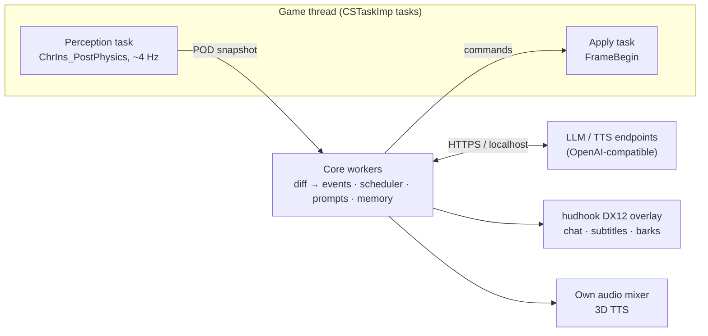

# Elden Ring: feasibility of an LLM NPC framework

> **What this is:** a synthesis of six verified research reports (R01–R06). It gives a feasibility verdict, a capability matrix, a v1 stack and a prototyping plan for **EldenNet**: a SkyrimNet-style, in-process LLM NPC framework for ELDEN RING (PC/Steam, including Shadow of the Erdtree).
> **Date:** 2026-11-06. **Game state:** App ver. 1.17.2, exe 2.7.2.0 (WW) / 2.7.2.1 (JP), released 2026-10-20. It is LIKELY still current: no 1.17.3 or 1.18 was found (R01 §1, R02 §1).
> **v1 scope:** named NPCs get a persona, awareness, persistent memory and free-form chat. Generic humanoids get short barks about combat and their surroundings. Dialogue only, no NPC actions.
> **Evidence tags** come from the source reports: **FACT** (primary source: code, paramdef or data dump), **LIKELY** (several weak signals, or a search snippet only), **SPECULATION** (design inference). This document adds no new primary research. Where the reports disagree, the resolution is stated. **RE-needed** marks claims that must be confirmed in game before code depends on them.

| Ref | Report | Focus |
|---|---|---|
| R01 | [01-engine-internals.md](01-engine-internals.md) | Engine layers, threading, singletons, characters, flags, ESD, saves |
| R02 | [02-modding-ecosystem.md](02-modding-ecosystem.md) | Patch level, EAC, me3, fromsoftware-rs, overlay and input, licences |
| R03 | [03-dialogue-and-presentation.md](03-dialogue-and-presentation.md) | Talk ESD, TalkParam, subtitles, Wwise voice, presentation options |
| R04 | [04-game-design-and-world.md](04-game-design-and-world.md) | NPC roster and talk codes, flags as quest state, style corpus, spoiler gating |
| R05 | [05-game-state-and-events.md](05-game-state-and-events.md) | Readable state, combat heuristics, menus, pausing |
| R06 | [06-prior-art.md](06-prior-art.md) | LLM NPC mods, latency, memory, barks, model defaults |
| S08 | [../skyrimnet/08-skyrim-engine.md](../skyrimnet/08-skyrim-engine.md) | Skyrim engine baseline used for the comparison |

---

## TL;DR

- **The v1 scope is feasible** with an overlay UI, no game-data edits and no inline hooks in `eldenring.exe`. Nearly every input v1 needs can be read from a game-thread task without hooks: nearby characters, player state, location, time, event flags, the boss and HUD state, and talk menus (R01, R05). Elden Ring is harder ground than Skyrim: it has no script VM, no event bus and no stable record IDs. So perception works by diffing snapshots, and NPC identity needs a hand-curated table.
- **The main risk is maintenance, not capability.** Four PC builds shipped in 2026. 104 of 107 tracked RVAs moved in 1.17.0, and 99 moved in 1.17.2. Struct layouts moved too (`ChrIns` +8 at 0x3b8, `WorldChrMan` +0x10). `fromsoftware-rs` supports exactly one exe build per region and **panics** on any other. Its newest crates.io release (0.14.0) only supports 1.16.2 (FACT, R01 §1, R02 §1, §4). A version gate, runtime pattern scanning, a layout self-test and a degraded "do nothing" mode are mandatory.
- **The second risk is licences and the community.** Since 2026-10-12, fromsoftware-rs ships "MIT NON-AI" and "Apache NON-AI" licence files, and its 1.17.2 updates came after that change. me3 bans LLM use in its own project spaces. Nexus reportedly made AI disclosure mandatory around 2026-11-03 (FACT/LIKELY, R02 §4.1, R06 §4). Get a licence read before building on post-change code.
- **Recommended stack:**
  - a Rust `cdylib` loaded through a **me3** `[[natives]]` profile, offline-only with a separate save;
  - **fromsoftware-rs**, pinned and vendored behind our own version and layout layer;
  - `CSTaskImp` recurring tasks for all game access;
  - a **hudhook** DX12 ImGui overlay, with DirectInput and XInput blocking while the player types;
  - our own 3D audio mixer and a SQLite (WAL) sidecar store;
  - one OpenAI-compatible streaming client. **All ML runs out of process.**
- **Identity is a data problem.** The keys are the three-digit talk code, every `NpcParam` row variant and the MSB entity ID. The three public datasets disagree in places, for example Seluvis 306/307 and Boc 223/342. `character_id` is a model ID that every human shares (`c0000`) (R04 §1, R01 §5.4). There are about 60–100 talkable named NPCs. Generics respawn, so they get archetype keys and no memory.
- **Text and our own 3D TTS are high-confidence.** Native subtitles, mouth movement and pushing audio into Wwise are either unproven or tied to one build, so they are deferred. **v1 has no lip-sync.** The game only has a per-line mouth-movement window and no viseme data, and many key NPCs are masked or not human (R03 §5).
- **The game has no pause.** Typing needs input capture plus context gating: resting at a grace (flag 9000), no hostiles nearby, no boss fight. The engine's cutscene freeze `SetDisableAllChrUpdate` is a lead from a single source, tested only on 1.16.2 (exe 2.6.2.0) and only from a foreign thread (R05 §11).
- **Event flags carry the game's knowledge.** They cover bosses, Great Runes, story beats and per-NPC 20-flag quest blocks at 3100–4259. Flag IDs are data and survive patches. Their meanings come from a pre-DLC dump and community labels, so validate them in game before spoiler gating depends on them (R04 §4, §7; R05 §7).
- **Prior art.** No LLM framework that voices FromSoftware's own NPCs from inside the game exists (LIKELY; GitHub-only search). What does exist: an MIT in-process perception bridge (*Attack on Elden Ring*, 1.17.1), external companion overlays, and the Skyrim lineage. The Skyrim lessons: single-DLL packaging, time to first token under 0.5 s, rolling summaries and pre-generated bark pools (R06).

---

## 1. Elden Ring in one page, for a Skyrim modder

### 1.1 Engine and runtime

- **Engine.** FromSoftware's in-house engine, which the community calls the "Dantelion2" lineage. It has `DL*` base libraries (kernel, `DLRF` reflection, strings), the `FD4` framework (tasks, resources, params, singletons) and the `CS` game layer (`WorldChrMan`, `CSEventFlagMan`, `CSMenuManImp`…). It is built against the VS2015-ABI MSVC STL, and MSVC RTTI is present.
- **Middleware.** D3D12, Havok (physics, behaviour, AI navmesh, HavokScript), **Wwise** (bank v135, about Wwise 2019.2), **Scaleform** GFx UI and Steamworks. Protection is **Arxan/GuardIT** anti-tamper, plus **EasyAntiCheat** online (FACT, R01 §2, R03 §4.1). PC caps at 60 FPS (LIKELY, R06).
- **Frame pipeline.** A frame runs 169 ordered `CSTaskGroupIndex` phases (`FrameBegin` … `ChrIns_PostPhysics` … `FrameEnd`). A DLL gets onto the game thread by registering a recurring `CSTaskImp` task. This is the analogue of SKSE's task interface, and the only safe place to read or change game objects (FACT, R01 §3.2).
- **Finding things.** Manager singletons are found by a pattern scan for the engine's own "uninitialized FD4Singleton" check, plus DLRF names. The scan takes about 10–15 ms. Its README tests only 1.16, but fromsoftware-rs uses it unchanged on 1.17.2. A few statics and **every function** are per-build RVAs. **There is no Address Library**: nothing translates an address from one build to the next (FACT, R01 §4, R02 §1, §5).

### 1.2 Data, state and "scripting"

- **No plugin system.** Each kind of data has its own format:
  - Gameplay data: `regulation.bin`, an AES-256-CBC → DCX → BND4 archive of `.param` tables. It is one file, so the last mod to write it wins.
  - Placements: MSB maps. Each enemy part has `npcParamID`, `thinkParamID`, `talkID` and `entityID`.
  - Text: FMG files in `msgbnd` (TalkMsg, NpcName, PlaceName…).
  - Quest logic: EMEVD bytecode.
  - Conversations: talk-ESD state machines (`t<talkId>.esd`).
  - AI: Lua (5.0, LIKELY). Animation control: HavokScript (FACT, R01 §6–§10).
- **No script VM for mods and no event bus.** State lives in event flags (1000-bit groups) and in live structs (`ChrIns`, `PlayerGameData`). A DLL **polls and diffs**; it cannot subscribe. It can run ESD talk commands through a synthetic `TalkScript` (FACT, R01 §9–§10; S08).
- **Saves.** One `ER0000.sl2` file: a BND4 with 10 slots of 0x280000 bytes, each with an MD5, bound to the SteamID. There is no co-save (FACT, R01 §11).

### 1.3 Modding stack (November 2026)

- **Loader: me3** v0.13.0 (2026-08-11; `main` still active on 2026-10-13). TOML profiles hold `[[natives]]` DLLs and VFS `[[packages]]`, plus `savefile`, `start_online = false` (the default, which forces `Menu.IsEnableOnlineMode=false`) and `disable_arxan` (dearxan). ModEngine2 was discontinued on 2024-07-19 (FACT, R02 §3).
- **In-process SDK.** The `eldenring` crate of fromsoftware-rs (Rust) is the only maintained typed SDK. libER (C++) stopped at 1.16 and has no character headers (FACT, R02 §4).
- **Overlay.** hudhook 0.9.3 (DX12 ImGui). The veeenu practice tool shows that such an overlay runs stably on ER for years (FACT, R02 §7).
- **Data and RE tools.** Smithbox, WitchyBND, DarkScript3 (EMEVD), ESDLang (talk ESD), Paramdex, and the TGA Cheat Engine table for App 1.17.2 (FACT, R02 §8).
- **Online.** Any DLL means EAC is off, so the game is offline only. Seamless Co-op (its own P2P) and the Reforged 2.0 servers are separate ecosystems (FACT/LIKELY, R02 §2).

### 1.4 Skyrim vs Elden Ring

| Dimension | Skyrim SE/AE (SkyrimNet's base) | Elden Ring 1.17.2 | Consequence for EldenNet |
|---|---|---|---|
| **Scripting VM** | Papyrus attached to records; about 1.2 ms per frame (WEB); 53 script-visible engine event sources (S08) | None for mods. EMEVD, talk ESD, Lua AI and HKS are authored data. A DLL can run ESD commands but cannot add scripts (R01 §6, §10) | All native; perception by snapshot diff |
| **Plugin / data model** | ESM/ESP/ESL records merged by load order | One encrypted `regulation.bin` (last wins), plus MSB/FMG/EMEVD/ESD per map; no merging (R01 §8) | Ship **no data files** in v1; read params at runtime |
| **NPC identity** | FormID (plugin + local id), EditorIDs, base vs reference (S08 §2) | `NpcParam` row (several per character), MSB `event_entity_id` (often 0 for generics), shared human model `c0000`, runtime-only `FieldInsHandle`. The talk code links text, flags and params, with exceptions (R01 §5.4, R04 §1) | Curated identity table; archetype keys for generics |
| **Dialogue system** | Quest→Branch→Topic→Info conditioned database; topic subtypes form a bark taxonomy; subtitle manager (S08 §5) | Talk-ESD state machine per placement. One line = a `TalkParam` row → TalkMsg FMG + Wwise voice. Most generic enemies have no talk script; their grunts are sound only (R03 §1–§6) | Own presentation; barks are new content |
| **Quest progression** | Quest stages, journal, globals, all queryable (S08 §10) | No journal. Event flags: story 100–120, Great Runes 180–197, bosses `…0800` and 9100–9295, NPC 20-flag blocks 3100–4259 (R04 §4, R05 §7) | Curated flag catalogue → facts and spoiler predicates |
| **Audio** | Native sound engine, voice types; `.fuz` = `.xwm` + `.lip` lip data (S08 §5.3) | Wwise 2019.2 banks in `sd*.bdt`; `Play_v<id>` voice events; only a per-line mouth-movement window (`lipSyncStart/Time`), no visemes (R03 §4–§5) | Own audio engine; no lip-sync in v1 |
| **UI** | Scaleform SWF, SkyUI MCM; SkyrimNet uses Prisma UI (Ultralight) (S08 §8) | Scaleform GFx; no MCM; native menus impractical to build (R01 §2.2) | ImGui overlay for chat, subtitles, settings |
| **Mod loader** | SKSE64 + MO2/Vortex VFS | me3 profiles; ME2 discontinued; proxy-DLL loaders legacy (R02 §3) | Ship a `.me3` profile; loader-agnostic DLL |
| **Native framework library** | SKSE64 + CommonLibSSE-NG: typed, broad, multi-runtime, event sinks, task queue, co-save | fromsoftware-rs: typed structs, params, tasks. 1.17.x only on git `main`; one build per region, panics otherwise; NON-AI licence files since 2026-10-12 (R02 §4) | Pin or vendor; own version gate; licence review |
| **Anti-cheat / online** | None (single-player) (BACKGROUND) | Arxan always; EAC online. Modded = offline; a modded save taken online risks a ban (R02 §2) | Offline only, separate save, hard-disable in multiplayer |
| **Patch stability** | Rare updates now; Address Library maps stable IDs per runtime (SE 1.5.97, AE 1.6.x, 1.7.x) (S08 §7.6) | Four builds in 2026; nearly all RVAs moved in 1.17.0 and 1.17.2; layouts moved; no address-translation layer (R01 §1) | Expect patch-day breakage; degrade, never crash |
| **NPC count / variety** | 1,000+ named characters (UESP snippet, S08 §10) with schedules, homes, factions | About 45 base-game and 12–14 DLC questline NPCs (about 60–100 talkable). 7,039 `NpcParam` rows, about 715 named (single source). Mostly stationary, laconic, often masked or non-human (R04 §2, R05 §6.3) | Small hand-curated persona set; generics by archetype |
| **Game loop / respawns** | Pauses in menus; cells respawn after in-game days (BACKGROUND); Radiant AI schedules | No pause in normal play. Resting or dying respawns ordinary enemies; bosses and story NPCs persist via flags (R04 §4.1, R05 §11) | Generics have no memory; chat needs safety gating |
| **Saves** | `.ess` + SKSE co-save (S08 §9) | `.sl2`, 10 slots, SteamID-bound, no co-save (R01 §11) | Sidecar SQLite keyed by SteamID + slot + fingerprint |

**Net:** Elden Ring lacks Skyrim's four big gifts: stable records, a script VM, an event bus and a data-driven AI and quest layer (S08). Everything v1 needs is still reachable. The price is a curated data layer and a hardened version layer.

---

## 2. Feasibility matrix

**Confidence** is the chance that the v1 approach works as described:
- **High:** primary evidence plus a working precedent.
- **Med:** evidence exists, but the approach is heuristic or untested on 1.17.2.
- **Low:** unproven.

**Stability risk** is the chance that a patch or another mod breaks it.

| # | Capability | v1 approach | Confidence | Stability risk | Source |
|---|---|---|---|---|---|
| 1 | **Enumerate named NPCs nearby** | A game-thread task walks `WorldChrMan.chr_inses_by_distance` (sorted) out to radius R. It re-resolves each character by `FieldInsHandle` every tick and matches `npc_param_id`/`event_entity_id` against the curated table | **High** (struct is FACT; the AoER bridge exports an 80 m entity table on 1.17.1) | **Med** (offset moved +0x10 in 1.17.2; open-field coverage and whether `distance` is squared are RE-needed) | R01 §5, R05 §6.1, R06 §4 |
| 2 | **Identify NPC kind** | `npc_param_id` → `NpcParam` (`nameId`, `teamType`) via `SoloParamRepository`; runtime `team_type`; model ID → name table; curated `named_npcs` and voiceless lists. Unknown → generic | **High** for the coarse tier. **Med** for the exact persona, because talk codes have exceptions | **Low** for IDs (they are data). **Med** under overhauls and randomizers | R01 §5.4, R04 §1–§2, R05 §6.3 |
| 3 | **Read player / location / time state** | `PlayerGameData` (name, level, class, gear IDs, runes, HP); `GameDataMan` (deaths, `ng_lvl`); `BlockId` + `FieldArea.map_place_name_id` / `WorldMapPlaceNameParam` / `BonfireWarpParam` → PlaceName; `WorldAreaTime`; weather flags 550–575 | **High** (fields FACT). **Med** for weather (flag upkeep unverified) | **Med** (`GameDataMan`, `GameMan` and `FieldArea` are RVA statics; `PlayerGameData` was reworked in 1.17) | R01 §7, R05 §2–§5 |
| 4 | **Resolve display text** (names, places, gear) | Read the in-memory FMG tables through the `MsgRepository` singleton, TGA's hook-free method, or call `GetMessage` found by AOB. DLC slot order {4xx, 3xx, base}. Fallback: FMGs exported offline from the user's install | **Med** (TGA's method is current on 1.17.2; the `GetMessage` AOB dates from 2.6.2.0; no fromsoftware-rs API) | **Med** | R01 §8.3, R03 §3.3, R05 §12 |
| 5 | **Observe combat events** | Diff snapshots: HP deltas, `last_hit_by`, `death_flag`, `boss_fight_active`, `CSFeManImp` boss bars and enemy damage tags, throw state, lock-on. "In combat" is derived and decays | **Med** (no reachable aggro or battle-state flag; a heuristic) | **Med** | R05 §8, R01 §6 |
| 6 | **Read progression flags** | `CSEventFlagMan::get_flag` on the game thread, polled at about 1 Hz. A curated catalogue (bosses, Great Runes, story, graces, NPC blocks) records provenance and a live-verified bit per flag | **High** for reading. **Med** for meaning (pre-DLC labels; NPC bits +1/+2/+3 never observed at runtime) | **Low** (flag IDs are data; the manager is a singleton) | R01 §9, R04 §4, R05 §7 |
| 7 | *Detect vanilla talk in progress (supporting)* | Read `CSPopupMenu.current_talk_id`, the `CSNpcTalkIns` menu state, `hud_state` and `talk_esd_camera_param_id`. Later, hook `CSEzStateTalkEvent::invoke` | **Med–Low** (reverse-engineers' field names; runtime meaning unverified) | **Med** (per-build layouts) | R03 §2.5, R05 §9–§10 |
| 8 | **Open a chat input** | A hotkey and a fixed target order: active talk → lock-on → forward cone (8–12 m) → nearest within 5 m. A hudhook ImGui text box. DirectInput keyboard/mouse `GetDeviceState` and XInput are blanked while it is open. Pads: Steam floating keyboard, or later a `TalkScript` quick-reply menu | **High** for keyboard and mouse. **Low–Med** for pads | **Low** (hooks in system DLLs, no game RVAs). **Med** for clashes with other overlays | R02 §7, R03 §7A/E, R05 §11 |
| 9 | **Show subtitles** | An ImGui lower-third (speaker plus 1–2 paged lines) and world-space bark labels projected via `CSCamera`. Follows `game_settings.show_subtitles`. Native `TalkToPlayer` is deferred | **High** (overlay). **Low** (native) | **Low** (overlay). **High** (native) | R03 §7–§8 |
| 10 | **Play TTS as 3D audio** | Our own mixer (WASAPI via cpal/kira). Pan and attenuation from the NPC's head relative to the camera, copying ER's roll-off of about 50 m. Ducks under native lines and mutes on pause, loading and cutscenes. TTS comes from an external HTTP service | **High** (no game hooks) | **Low** | R03 §4, §7D; R06 §6 |
| 11 | **Lip-sync** | **None in v1.** ER only moves the mouth during a time window of a natively played `TalkParam` line. There is no viseme data, and many key NPCs are masked. v2 trick: a silent native line with mouth movement under our audio | **Low** | n/a in v1. **High** in v2 (needs the native talk path) | R03 §5 |
| 12 | **Pause / safety while typing** | Context gating: resting (flag 9000), Roundtable Hold (SpEffect 9621), no hostile within R, no boss fight. Otherwise quick replies only. Optional freeze via `CS::CSEventUtility::SetDisableAllChrUpdate` (AOB) or the per-character `disabled_updates` bit | **Med** (gating). **Low** (freeze: single source, 2.6.2.0, called only from a foreign thread) | **Low** (gating). **High** (freeze AOB) | R05 §3, §11; R02 §7.2 |
| 13 | **Persistence per save** | Sidecar SQLite (WAL) in `%APPDATA%\EldenNet\<SteamID>\`, keyed by `GameMan.save_slot` + character fingerprint + journey (`ng_lvl`). The me3 `savefile` option keeps modded saves separate. Never write the `.sl2` or any flag | **High** (design). **Med** (spotting slot reuse by fingerprint) | **Low** | R01 §11, R04 §4.3, R06 §5.4 |
| 14 | *Online / multiplayer / version gate (supporting)* | me3 `start_online = false`. Our own PE version check runs before any RVA use. Disable unless `multiplay_role == Host`, `is_my_world`, `LobbyState == None` and no Seamless Co-op session | **High** | **Low** | R02 §2, §5; R05 §3 |

Every capability v1 needs is rated High or Med, except two: lip-sync (cut) and the freeze (optional). Everything rated High rests on reads, tasks or hooks in system DLLs, never on patches to the game's own code.

---

## 3. Recommended v1 technical stack

### 3.1 Shape

**Rule:** game memory is touched only inside the two task closures. The overlay renders on the present path and reads snapshots only. Snapshots in and commands out are serializable messages, so a headless core can replay recorded sessions without the game (R01 §3.2, R06 §5.1).

### 3.2 Choices and rationale

| Layer | Choice | Rationale |
|---|---|---|
| **Language** | Rust (stable, edition 2024), `cdylib` for `x86_64-pc-windows-msvc`, cross-compiled with `cargo-xwin`. `panic = "unwind"`, and `catch_unwind` around every task closure | The only maintained typed SDK and the surrounding ecosystem (me3, dearxan, hudhook, er-mods-rs) are Rust. Since Rust 1.81, a panic that unwinds through the `extern "C"` task trampoline aborts the game (FACT, R02 §4.1, §9) |
| **Loader** | A me3 ≥ v0.13.0 profile: `[[natives]]`, `start_online = false`, own `savefile`, `disable_arxan = true`, and an optional `load_after` on `ersc.dll`. The DLL itself uses a plain `DllMain` that starts a thread, so ME2 `external_dlls` and proxy loading also work | Maintained, runs on Proton, enforces offline play, keeps saves separate. Natives load after game main, so v1 needs no early hooks (FACT, R02 §3) |
| **Game framework** | fromsoftware-rs `eldenring`, vendored as a thin fork pinned to one commit. We wrap it in (a) a PE-version gate; (b) runtime AOB resolution of the RVA-backed items (`register_task`, `global_hinstance`, `GameDataMan`, `GameMan`, `FieldArea`) from its own `mapper-profile.toml` patterns; (c) a per-build layout profile with a startup self-test | It has the most current `WorldChrMan`, `ChrIns`, `PlayerGameData`, `CSEventFlagMan`, param and task code. But upstream panics on unknown builds, drops old ones and lags on crates.io (FACT, R01 §1, R02 §4–§5). See the licence gate below |
| **Game-thread access** | `CSTaskImp::run_recurring`: one perception task and one apply task | The supported pattern. It avoids Arxan code restoration and clashes with other mods' hooks (FACT, R01 §3.2) |
| **Text** | Read FMG tables through `MsgRepository`. No detour in v1 | Runtime text keeps overhaul names and renamed NPC variants correct (R02 §8, R04 §7) |
| **Overlay and input** | hudhook 0.9.3 DX12 ImGui. DirectInput `GetDeviceState` and `XInputGetState` are blanked, modelled on fromsoftware-rs `debug::InputBlocker` and er-mods-rs `er-dinput-suppress-core`, chaining to earlier hooks. ImGui draws the cursor | A proven DX12 overlay on ER. Blocking the window procedure is not enough, because the game reads keys through DirectInput (FACT, R02 §7.2) |
| **Audio** | An in-process mixer (cpal/kira or rodio) with our own spatialization. TTS runs out of process | No Wwise or bank edits, so nothing for a patch to break (R03 §7 D1) |
| **Storage** | `rusqlite` (bundled), WAL mode. Tables `events`, `npc_facts`, `npc_summaries`, `bark_pool` | Incremental and crash-safe. Mantella users lose the conversation in progress when the game crashes (R06 §2.4) |
| **LLM client** | One OpenAI-compatible streaming client (`reqwest` + `tokio`). Model slots `dialogue`, `bark` and `summary`, each with a timeout and a fallback, and reasoning off. Presets in YAML. It probes LM Studio :1234, Ollama :11434, llama.cpp :9931 (and the legacy :8080) and KoboldCpp :5001, then checks `/v1/models` | The abstraction Mantella, CHIM and SkyrimNet all converged on. Keeping ML out of the game process keeps CUDA, ONNX and GPL native code out of it (R06 §5.1–§5.2) |
| **Prompts and content** | `minijinja` templates, hot-reloaded. TOML/YAML data: identity table, flag catalogue, voiceless list, bark triggers. Corpora are generated locally from the user's install (Smithbox/WitchyBND export) | No FromSoftware text is redistributed. Content is data-driven, as in SkyrimNet (R04 §9, R06 §5.7) |
| **Diagnostics** | `tracing` logs. A startup self-test (build, layout, endpoint, model, time to first token) shown as an in-game toast | Hidden failures were the biggest support cost in earlier mods (R06 §2.4) |

**Licence gate.** The history is FACT; this is not legal advice (R01 Implications §2, R02 §4.1).
- crates.io 0.14.0 and all commits up to `acc9da0` (2026-09-21) are plain `MIT OR Apache-2.0`. These already include the 1.17.1 RVAs and the 1.17.0 `ChrIns` fix (`b080915`).
- `main` has carried the NON-AI files since 2026-10-12. The 1.17.2 updates came after that: `b726336` (RVAs) and `5baf0dd` (`WorldChrMan`).

The options are:
- **(a)** a legal read or a statement from the authors that runtime inference is out of scope;
- **(b)** stay on pre-change code and re-derive the later changes ourselves, using runtime AOB scans for the RVAs and the self-test for layouts;
- **(c)** write our own minimal structs.

Decide this before writing code.

### 3.3 Alternatives rejected

| Alternative | Why rejected for v1 | Revisit? |
|---|---|---|
| C++ with libER or a home-grown "CommonLib" | libER stopped at 1.16 (2025-04) and has no `WorldChrMan`/`ChrIns`. We would maintain every struct alone (R02 §4.2) | If the licence rules out fromsoftware-rs |
| External process (`ReadProcessMemory`, like EldenEncouragement) | Shallow perception, fragile pointer chains, no game-thread calls, and an overlay that needs fullscreen (R06 §4) | No |
| Python/WSL sidecar server (Mantella, CHIM) | Setup friction is the top adoption killer. Player2 reports about 1 in 20 downloads reaching gameplay (LIKELY), and players complain about CHIM's install (R06 §2) | Later, as an optional sidecar behind the same message boundary |
| ML inside the game process (whisper.cpp, ONNX, local TTS DLLs) | Native crashes and GPU-driver failures inside the game process; Piper and espeak-ng are GPL (R06 §5.1) | Optional bundled binaries later |
| ModEngine2 / Elden Mod Loader | ME2 is discontinued. EML is legacy and cannot load Seamless Co-op (R02 §3) | Fallback only |
| Native subtitles via `TalkToPlayer` and a message-lookup hook | Unproven from a synthetic `TalkScript` on a real NPC. Needs TalkParam rows, which cannot be inserted. Per-build RVAs. Can interfere with the NPC's own ESD (R03 §7B) | v2 |
| Pushing TTS into Wwise (`DLMOW::MOAudioInputObject`, er-positional-voice) | 18 call sites at hard-coded 2.7.2.0 addresses, re-ported every patch (R03 §7 D2) | v2 |
| `regulation.bin`, msgbnd or ESD edits (e.g. a "Speak freely" entry) | Breaks drop-in coexistence with Reforged, Convergence and randomizers; regulation is a single file (R01 §8.1, R03 §7C) | v2, as an optional add-on |
| Hooks on damage, AI or the flag setter | Arxan risk, unmapped structs (`AttackDamageInfo`), single-source RE (R05 §8) | v1.x, after the spikes |
| Vector-recall memory | About 60–100 named NPCs, met briefly. Summaries plus facts are enough (R06 §5.4) | v1.x |
| A fine-tuned model | Mantella's fine-tune went stale within about two years (R06 §2.2) | No |

---

## 4. The hard problems, ranked by risk

1. **Patch churn with a single-build upstream (Critical).**
   - *Problem:* four builds in 2026, and RVAs and layouts move even on bug-fix patches. fromsoftware-rs panics on unknown exes. Steam auto-updates, and WW and JP builds need separate tables. Silent misreads are worse than crashes (R01 §1, R02 §1).
   - *Mitigation:* keep our own build table and check the version before any RVA use. Resolve addresses at runtime by AOB, validated by RTTI; EROverlay's signature-checked hooks span 1.05–1.17.1. Keep layout profiles per build, with self-tests: vtable RTTI names, `hp ≤ max_hp`, ascending distances, resolvable param rows. Disable features one at a time, down to an overlay-only banner. Wrap closures in `catch_unwind`. Budget 1–7 days per patch, and keep the previous build's tables, as er-mods-rs's fork does.
2. **Dependency licences and community stance (High; affects the whole project).**
   - *Problem:* NON-AI licence files on fromsoftware-rs (and rewwise), me3's LLM policy, and Nexus's disclosure rule (R02 §4.1, R06 §4).
   - *Mitigation:* apply the licence gate in §3.2. Keep the dependency surface small enough to swap. Never post AI-written text in those projects' spaces. Disclose AI use on Nexus. Ask the MIT-licensed *Attack on Elden Ring* author about a shared perception bridge.
3. **Crash safety in the game process: threading and pointer lifetime (High).**
   - *Problem:* SkyrimNet's crashes #819, #830 and #831 came from worker threads reading game data. Characters stream in and out (MapForGoblins saw a block pool fall from 33 entries to zero), and `WorldChrMan` moves on world transitions (R05 §6.1, R06 §2.1).
   - *Mitigation:* touch game memory only in task closures, and copy plain data out. Store handles, not pointers, and re-resolve them every tick. Suspend while loading (`main_player == None`, or a load-counter change). The overlay reads snapshots only.
4. **Identity: who is this character? (High).**
   - *Problem:* there are no stable IDs, and the datasets disagree on talk codes. One character can have several `NpcParam` rows, and names change at reveals (Renna → Ranni, Margit → Morgott). Many generics have `event_entity_id == 0`. Overhauls and randomizers change rows (R04 §1, §7; R05 §6.3).
   - *Mitigation:* a curated `npc_identity.toml` maps `persona_id` → talk codes, all `NpcParam` variants, entity IDs, flag-block base, register and a voiceless flag. Unknown characters fall to the generic tier. Display names come from runtime NpcName text. Generics are keyed by archetype and have no memory.
5. **Not talking over, or contradicting, the game (Med–High).**
   - *Problem:* detecting native talk relies on unverified field names. Free chat may contradict a later scripted beat or promise actions the mod cannot take (R03 §2.5, R04 §9).
   - *Mitigation:* log the talk fields in the first spike. Until the observer is validated, suppress barks near NPCs that have talk scripts. Queue or drop barks during native talk. The system prompt forbids promises and claims of having acted. Stage overlays record what each NPC conceals.
6. **Typing in a game with no pause (Med–High).**
   - *Problem:* keystrokes leak through DirectInput and XInput, enemies keep attacking, and pad players have no keyboard (R02 §7.2, R05 §11).
   - *Mitigation:* block input, and keep held keys masked until they are released. Open chat only in safe contexts, with quick-reply menus. Add the freeze only after its spike. Push-to-talk speech input comes later.
7. **Knowledge correctness and spoilers (Med).**
   - *Problem:* flag labels come from a pre-DLC dump (2024-04), and several meanings were wrong until cross-checked (flag 180 means zero Great Runes; Mohg's kill flag is 9112). LLMs know the endings, confabulate, and may miss content after their training cutoff (R04 §7, R05 log, R06 §5.7).
   - *Mitigation:* a catalogue that records provenance and a live-verified bit for each flag. `requires` predicates gate knowledge. NPCs deflect unknowns in character. A post-generation spoiler-lexicon check. Player statements are stored as claims. Dev labels never reach prompts.
8. **Combat awareness without an aggro signal (Med).**
   - *Problem:* no public link from a character to its `CSAiThink`, and the damage struct is unmapped (R05 §8.1–§8.2).
   - *Mitigation:* a heuristic from HP deltas, `last_hit_by`, the boss bar, HUD tags, lock-on and `eye_dist`. Spike TGA's chain `[[[chr+0x58]+0x18]+0xC0]`.
9. **Latency and bark density (Med).**
   - *Problem:* 10–15 s waits are the top complaint, and a bark 3 s late is worse than none. Free tiers reportedly allow 50 requests a day (LIKELY). Hostile camps multiply triggers (R06 §2.2, §5.6).
   - *Mitigation:* pre-generated archetype × trigger bark pools. Cooldowns per actor, per squad and global. Live barks only with a 1.5 s deadline. For dialogue: stream tokens and split sentences, reasoning off, stable prompt prefix first (for caching), warm local models.
10. **Coexistence with other native mods (Med).**
    - *Problem:* Seamless Co-op, Reforged and other overlays share the process. Two DXGI compositors, or two MinHook instances on one function prologue, corrupt each other, and HDR changes how the overlay renders (R02 §7.1, §7.4).
    - *Mitigation:* no hooks in the game's code in v1. Chain the input hooks and publish our hook list. Test with Seamless Co-op, Reforged, Convergence, the Steam overlay, HDR and Proton. Render in-engine (the UI_SCENE approach) later.
11. **Setup friction (Med).**
    - *Mitigation:* one DLL plus an me3 profile, a first-run wizard, endpoint probing and a self-test toast (R06 §2.4).
12. **Presentation gap: no native look and no mouth movement (Low–Med).**
    - *Mitigation:* accept it in v1. Use archetype voices, with filters that suggest masks and helmets. Native talk path in v2 (R03 §5, §7).

---

## 5. Implications for the AI framework

### v1 (minimal and stable)

1. **Process model.** One in-process DLL holds the game adapter and the core: event log, memory, scheduler, prompts and the HTTP client. All ML is reached over HTTP. Snapshots in and commands out cross a message boundary, which allows a headless replay harness.
2. **Two lifecycles.** "Data ready" means singletons and params are found. "Playthrough ready" means `main_player`, `save_slot` and `PlayerGameData` exist. The memory store opens only at the second (S08 §12.1).
3. **Perception schema.** A `WorldSnapshot` at about 4 Hz holds the player block, up to N characters within about 40 m, curated flags, `hud_state`, boss bars, time and place. Diffing snapshots produces these events: `PlayerDamaged`, `PlayerHitEnemy`, `ChrDied(killer)`, `PlayerDied`, `BossFightStarted/Ended`, `EnteredArea`, `GraceLit`, `FlagChanged`, `MountChanged`, `CritLanded`, `ConversationProxyStart` (R05). Bark triggers borrow Skyrim's topic subtypes: NormalToCombat, Hit, AllyKilled, Flee and LostIdle (S08 §12.1).
4. **Tiers** (R04 §2.1):

   | Tier | Who | v1 treatment |
   |---|---|---|
   | A | Questline NPCs | Persona, memory, chat |
   | B | Services | Light persona; vanilla menus stay in charge |
   | C | Talking bosses | No chat |
   | D | Invaders | Silent |
   | E | Generic humanoids | Barks |
   | F | Voiceless | Never speak |

   Chat is offered only on vanilla's preconditions: the NPC is alive and not hostile (state bits +1, +2 and +3 clear), the player is not dead and not a client in someone else's world, and the player is within about 5 m. Chat ends beyond 10–12 m (R03).
5. **Memory.** An append-only event log, a facts table fed by the game, and a per-NPC rolling summary written at the end of each conversation. Everything is partitioned by save slot and journey. Player statements are stored as claims. Generics have no memory (R06 §5.4, R04 §8).
6. **Style.**
   - Each NPC has a register: archaic-regal, formal, colloquial, broken, chant or silent.
   - Replies are 1–3 lines of about 8–12 words, at most about 60 words; vanilla lines average 8.1 words.
   - Modern game words are banned. Catchphrases are owned by one NPC and capped in frequency.
   - Pronouns follow the player's body type.
   - *Reconciled:* R05 rates the player's name as valuable input, but R04 shows vanilla NPCs never use it; they say "Tarnished". So NPCs keep the name in memory and use it only after the player introduces themselves in chat, which is stored as a claim.
7. **Barks.** Archetype × trigger pools are batch-generated and cached on disk, with a no-repeat ring. Cooldowns: about 20 s per actor, about 8 s per squad, and 4–6 barks a minute globally. Vanilla chants serve as style seeds, extracted locally and never redistributed (R06 §5.6, R04 §2.8).
8. **Safety rules.**
   - Never write flags, and never use them as scratch storage (the Chat with Melina corruption lesson).
   - Sanitize every string: strip `<…>` and `<?…?>` markup, cap its length in bytes (CHIM caps at 900 after a 1,000-byte subtitle crashed Skyrim), and filter content (R03 §3.2, R06 §2.3).
9. **Multiplayer.** v1 stays inactive in every session, Seamless Co-op included, but must load safely next to `ersc.dll` (R02 §2.3, R05 §3).
10. **Diagnostics from day one.** Log time to first token for every call, show failures as toasts, and let the player switch off each feature.

### Later (v1.x–v2)

- Native subtitles and mouth movement through `TalkToPlayer` on whitelisted NPCs, `TalkScript` quick-reply menus, and "Speak freely" injected at runtime into vanilla menus (R03 §7B–C).
- A talk-event hook that logs and remembers exactly which vanilla line each NPC said. Wwise TTS injection for the game's own reverb and mix.
- `CSAiThink` aggro, damage hooks and line-of-sight raycasts. Embedding recall, faction rumours and NPC-to-NPC Roundtable scenes.
- Actions, only through deterministic validators and an allowlist, on saves that stay offline for good (R02 §10). A Nightreign port: fromsoftware-rs and me3 already support Nightreign.

---

## 6. Risks

- **Online misuse and bans.** Players may launch through EAC or take modded saves online. Debug-tool authors warn that impossible progressions get players banned. Mitigations: a separate save, refusing online mode, plain-language documentation (R02 §2.2).
- **IP and voices.** FromSoftware owns the TalkMsg text and the voice recordings. Do not ship corpora or clone the cast. Write our own bios, with attribution where adapted. Fandom's CC BY-SA licence is LIKELY. Fextralife content is not openly licensed (R04 §9, R06 §5.7).
- **Community reception.** Core toolmakers are openly against AI. Expect little upstream help, and design to need none (R02 §4.1).
- **Providers and cost.** Money is not the limit: about $0.00006 per bark and $0.0002 per named-NPC turn on budget models (LIKELY; prices change). Free-tier caps, outages and model churn are the limits. Author-hosted proxies, as in EldenEncouragement, are unsustainable and a privacy problem (R06 §5.8).
- **Content safety.** The Dung Eater, Fia and Mohg may trip provider filters, and players will push abusive content. Offer a safety level and in-character refusals (R04 §9, R06 §5.7).
- **Source quality.** The combat-state, freeze, NpcParam-count and death-flag findings all come from **one** project: MapForGoblins, on 2.6.2.0, partly mined from Reforged's data. Patch-news and Nexus claims rest on search snippets. The style corpus is an undocumented third-party dump (R04 §9, R05 Risks).
- **Impersonation.** "Elden Ring AI NPC" is already used as a malware lure. Publish from one canonical place, and sign releases (R06 Risks).
- **Patch cadence.** More 1.17.x patches are LIKELY while the Switch 2 *Tarnished Edition* and the Tarnished Pack are new. Nothing announced confirms a freeze (R01 §1).
- **Local GPU contention.** ER uses about 5 GB of VRAM at 1440p (one benchmark), so an 8 GB card cannot also host a useful local LLM. The frame-time cost is unmeasured (R06 §6).

---

## 7. Consolidated open questions (need hands-on RE or prototyping)

The spikes below are ordered. Test on 2.7.2.0 WW first, then 2.7.2.1 JP. S0–S4 block v1, S5–S8 refine it, and S9–S10 serve v2.

| Spike | Questions to settle in game | Decides | Source |
|---|---|---|---|
| **S0 Platform** | Do the `mapper-profile.toml` patterns resolve `register_task`, `global_hinstance`, `GameDataMan`, `GameMan` and `FieldArea` at runtime on both builds? Does `from_singleton` work on 1.17.2 (its README tests 1.16 only)? Does a `disable_arxan` profile load cleanly alongside `ersc.dll`? Can the DLL confirm `Menu.IsEnableOnlineMode` is false? | Version layer; loader profile | R01 §4, R02 §5, §12 |
| **S1 Perception** | Does `chr_inses_by_distance` include open-field, summon and ghost sets? How often is it rebuilt, and is `distance` squared? What share of generics have `event_entity_id == 0`? Are NPC invaders `PlayerIns` or `EnemyIns`? How does `map_place_name_id` behave in legacy dungeons and the DLC? | Snapshot design; generic identity | R01 §5.3, R05 §6 |
| **S2 Text** | Can the FMG table be read through `MsgRepository` on 1.17.2, with TalkMsg in slots 1/360/460? Do the `GetMessage` and EwdenWing AOBs still match? | Name resolution | R01 §8.3, R03 §3.3 |
| **S3 Talk observation** | What do `current_talk_id`, `talk_param_id`, `hud_state` and `talk_esd_camera_param_id` read during menus, approach greetings and boss lines? Can active `CSNpcTalkIns` instances be listed without a hook? | The "never talk over the game" rule | R03 §2.5, §8; R05 §9–§10 |
| **S4 Input** | Does blanking DirectInput and XInput stop every leak? Does ImGui's own cursor remove the need to hook the game's "menu has the mouse" predicate? Does the Steam floating keyboard work when launched via `steam_appid.txt` or me3? Is Proton the same? | Chat UX; whether v1 needs any game hook | R02 §7.2, R03 §7A |
| **S5 Safety and freeze** | Does `SetDisableAllChrUpdate`, called from a game task, freeze and resume cleanly on 1.17.2, and what does it do to scripted sequences? Does setting the per-character `disabled_updates` bit on hostiles work? Is "Help → Menu Explanation" a real pause (unverified)? | Whether typing is allowed outside safe contexts | R05 §11, R02 §7.2 |
| **S6 Flags** | In a flag-logger session: do 530–532 and 550–575 stay current? Do the +1/+2/+3 bits behave as labelled? What is flag 330's polarity? Where are the DLC NPC blocks? Where is the NG+ journey counter, and which flags survive NG+? Do the Great Rune "check" flags lag pickup? | Flag catalogue; spoiler gates; memory partitioning | R04 Open questions 1–3, 9; R05 Open questions 4, 7 |
| **S7 Combat** | Is `[[[chr+0x58]+0x18]+0xC0]` the `CSAiThink`, and does `[[it+0xC950]+0x30C]` read 6 in a fight? What is the call target in Erd-Tools' `CombatCloseMapAoB`? What filter does `cast_ray` take? Which fight do the `GameDataMan` boss-bar fields follow when several bars show? | Bark quality beyond heuristics | R05 §8, Open questions 2–3, 8, 11, 13 |
| **S8 Audio** | Is the camera the listener? Which setting is NPC-voice volume (`voice_volume`)? Does our mixer work under Proton? How are cutscenes and loading screens detected for muting? | TTS integration | R03 §4.1, Open question 10 |
| **S9 Native presentation (v2)** | Does `TalkToPlayer` from a synthetic `TalkScript` on a real NPC show a subtitle and move the mouth without breaking its ESD? How long does a `voiceId = -1` line stay up? Do consecutive rows page? Does the mouth follow the audio? What does arg 4 do? Which TalkParam rows are safe to reuse? Is markup interpreted in subtitles? | v2 native path | R01 Open question 1, R03 Open questions 1–4, 12, 14 |
| **S10 Performance** | How much frame-time variance does a local 4B Q4 model add on 8, 12 and 16 GB GPUs under the 60 FPS cap? Which budget model best holds the archaic register in ≤ 60 words? | Default provider guidance | R06 Open questions 3, 5 |

**Non-technical questions to settle in parallel:**
- Do the NON-AI terms restrict an LLM-inference mod, given that `Cargo.toml` still says `MIT OR Apache-2.0`?
- Will the fromsoftware-rs authors object, and will the *Attack on Elden Ring* author collaborate?
- Is the Fandom licence confirmed?
- Are Player2's terms compatible with an offline mod?
- Will FromSoftware keep patching after 1.17.2?

---

## Sources

**EldenNet research reports.** These are the inputs to this synthesis. Each one lists its full primary sources and a verification log.
- [01-engine-internals.md](01-engine-internals.md) · [02-modding-ecosystem.md](02-modding-ecosystem.md) · [03-dialogue-and-presentation.md](03-dialogue-and-presentation.md) · [04-game-design-and-world.md](04-game-design-and-world.md) · [05-game-state-and-events.md](05-game-state-and-events.md) · [06-prior-art.md](06-prior-art.md)
- Skyrim baseline: [../skyrimnet/08-skyrim-engine.md](../skyrimnet/08-skyrim-engine.md), [../skyrimnet/01-architecture.md](../skyrimnet/01-architecture.md)

**Primary code and data behind the conclusions.** R01–R06 read these; the commits are noted in those reports.
- fromsoftware-rs (`eldenring` crate; `rva.rs`, `mapper-profile.toml`, `cs/{task,world_chr_man,chr_ins,event_flag,talk_script,menu_man,fe_man,game_data_man,game_man,field_area}.rs`, `crates/debug/src/input/*`, `LICENSE-*-NON-AI`; commits `acb2a19`, `b080915`, `29fd138`, `b726336`, `5baf0dd`, `acc9da0`, `5702315`): https://github.com/vswarte/fromsoftware-rs · crates.io API: https://crates.io/api/v1/crates/eldenring
- me3 (`CHANGELOG.md`, `schemas/mod-profile.json`, `crates/mod-host/src/host/game_properties.rs`, `AI_CODE_POLICY.md`): https://github.com/garyttierney/me3
- ModEngine2 (discontinuation notice): https://github.com/soulsmods/ModEngine2
- libER: https://github.com/Dasaav-dsv/libER · from-singleton: https://github.com/Dasaav-dsv/from-singleton · dearxan: https://github.com/tremwil/dearxan
- hudhook: https://github.com/veeenu/hudhook · practice tool: https://github.com/veeenu/eldenring-practice-tool
- er-mods-rs (`er-dinput-suppress-core`, `er-overlay-input`, `er-positional-voice`, `detour_allowlist.rs`, `docs/game-build.md`): https://github.com/Banon-Labs/er-mods-rs
- The Grand Archives CE table (App 1.17.2: FD4Singleton finder, Event Flag Manager and Logger, ezstate, MsgRepository AOB): https://github.com/The-Grand-Archives/Elden-Ring-CT-TGA
- MapForGoblins (GetMessage AOB; combat-state, freeze and NpcParam-name RE notes): https://github.com/quentin452/ERR-MapForGoblins-DLL
- EwdenWing (AOB-found MsgRepository lookup): https://github.com/axd1x8a/EwdenWing · EROverlay: https://github.com/soarqin/EROverlay
- ESDLang (talk ESD vocabulary, paramdefs): https://github.com/thefifthmatt/ESDLang · DarkScript3 (EMEDF, name tables): https://github.com/AinTunez/DarkScript3 · Smithbox (FMG registry, talk-script aliases, MSB meta): https://github.com/vawser/Smithbox
- soulsmods/elden-ring-eventparam (FromSoftware flag names, pre-DLC): https://github.com/soulsmods/elden-ring-eventparam · Paramdex: https://github.com/soulsmods/Paramdex · SoulSplitter (boss flags): https://github.com/FrankvdStam/SoulSplitter
- SaveForge (save format): https://github.com/oisis/EldenRing-SaveForge · rewwise: https://github.com/vswarte/rewwise · Yonder: https://github.com/ndahn/yonder · wwiser (bank versions): https://github.com/bnnm/wwiser
- Text corpus (third-party, pre-DLC): https://github.com/alidhl/dialogue-generator · Chat with Melina: https://github.com/lraty-li/Elden-Ring-Mods
- Prior art: Mantella https://github.com/art-from-the-machine/Mantella · CHIM server https://github.com/Dwemer-Dynamics/HerikaServer · SkyrimNet https://github.com/MinLL/SkyrimNet-GamePlugin · EldenEncouragement https://github.com/mmahoney09110/EldenRingEncouragement · game-assistant and Attack on Elden Ring https://github.com/mpere056/game-assistant, https://github.com/mpere056/attack-on-elden-ring · llama.cpp server https://github.com/ggml-org/llama.cpp/blob/master/tools/server/README.md · Ollama OpenAI compatibility https://github.com/ollama/ollama/blob/main/docs/api/openai-compatibility.mdx · Pocket TTS https://github.com/kyutai-labs/pocket-tts

**Patch level and policy (search snippets; LIKELY)**
- Bandai Namco patch notes 1.17 and 1.17.2: https://www.bandainamcoent.com/news/elden-ring-patch-notes-version-1-17 · https://www.bandainamcoent.com/news/elden-ring-tarnished-edition-patch-1-17-2
- 1.17.1 announcement: https://x.com/ELDENRING/status/2097236393856524780 · https://mp1st.com/title-updates-and-patches/elden-ring-version-1-17-1-out-minor-update-1-018-001
- EAC and offline play: https://github.com/techiew/EldenRingEacToggler · https://windowscentral.com/how-disable-anti-cheat-elden-ring
- Nexus AI-disclosure rule: https://www.invenglobal.com/articles/28097/nexus-mods-makes-ai-disclosure-mandatory-for-every-mod-but-wont-ban-ai-content
