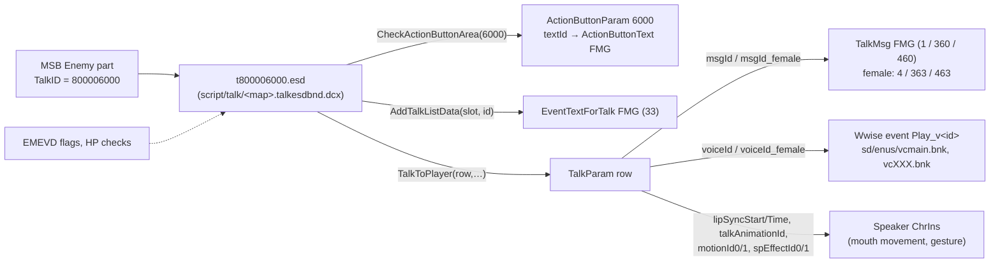

# Elden Ring Dialogue, Subtitles, Voice and Talk Interactions, and How to Present LLM Dialogue

*Research date: 2026-11-06. Scope: ELDEN RING on PC (Steam), patch 1.17.2 (exe `FileVersion` 2.7.2.0), including Shadow of the Erdtree. This report covers how the game delivers NPC speech, and which presentation path an in-process LLM dialogue DLL should use. It builds on [02-modding-ecosystem.md](02-modding-ecosystem.md), which covers the loader, SDK, overlay and EAC.*

**Evidence labels.**
- **FACT:** checked against a primary source: repository source, a shipped paramdef or EMEDF, or a decompiled game script in a public repository.
- **LIKELY:** several weaker signals agree, such as search-result snippets, naming conventions or tool annotations.
- **SPECULATION:** design inference.

**Access limits.** github.com and raw.githubusercontent.com could be fetched. Nexus Mods (including its forums), soulsmodding.com, wiki.gg, itch.io and Reddit could not. Claims from those sites come only from search snippets and are marked LIKELY. I read these repositories from shallow clones on 2026-11-06:
- `vswarte/fromsoftware-rs` @`5702315`
- `thefifthmatt/ESDLang` @`9fa7fa9`
- `vawser/Smithbox` @`5827c4c` (sparse checkout plus raw files)
- `AinTunez/DarkScript3` @`733f024`
- `Banon-Labs/er-mods-rs` @`c107d31`
- `The-Grand-Archives/Elden-Ring-CT-TGA` @`393c439` (v1.19.3)
- `vswarte/rewwise` @`49bccac`
- `ndahn/yonder` @`6f9451d`
- `lorepamplona/ERPT-BR` @`9ef419c`
- `lraty-li/Elden-Ring-Mods` @`a4f7c5d`
- `matyalatte/ER-Dualsub-Tool` @`5de17fd`

**Fact-check pass (2026-11-06).** An adversarial review re-checked the flagged claims against the local clones, fresh raw-GitHub fetches (Smithbox alias and MSB meta files, Smithbox `Info - ESD.txt`, `bnnm/wwiser` `wdefs.py`, `axd1x8a/EwdenWing` `src/lib.rs`), and recomputed hashes and counts. The web-search budget ran out partway through, and Nexus Mods could not be reached, so snippet-only claims stay LIKELY. Corrections are made inline and listed in the [Verification log](#verification-log). The main ones:
1. The Melina script is a 2023 **mod-edited** draft. Its action-button path sits in an **unreachable ("Unused") block**, because Melina is reached through the grace menu (flag 4652). That path is also gated by state checks and event flags, not by `CheckActionButtonArea(6000)` alone.
2. ER **does** change the camera during talk. The standard talk template calls `ChangeCamera(1000000)` when a conversation starts and `ChangeCamera(-1)` when the player moves past 2.5 m or the talk ends. It is not a cinematic camera, but "the gameplay camera stays" was wrong.
3. The 9,174 `Play_v` names come from a dictionary shared by ER, AC6 and Nightreign, so the count is not ER-only.
4. The paramdef's Japanese term for mouth movement is a general word for speech mouth animation. It does not prove a fixed open/close loop.
5. Runtime replacement of all game text already has a precedent: EwdenWing hooks the MsgRepository lookup through an AOB.
6. `ChangeTeamType` (ESD 15) is not used by any game's ESDs according to ESDLang. It is not the hostility mechanism.
7. The NON-AI licences restrict ML training, not using the libraries in a runtime LLM mod (consistent with report 02).

---

## TL;DR

- **Native talk runs per placed character, through talk ESD state machines.**
  - Each map placement carries a `TalkID` (MSB Enemy part), which selects `t<9 digits>.esd` inside `script/talk/<map>.talkesdbnd.dcx`.
  - In the standard template the ESD polls `CheckActionButtonArea(6000)` (the "Talk" prompt). It only gets there after state checks (`GetOneLineHelpStatus`, `IsClientPlayer`, `IsPlayerDead`, `IsCharacterDisabled`) and event-flag gates.
  - It builds menus with `ClearTalkListData` / `AddTalkListData(slot, EventTextForTalk id, -1)` / `ShowShopMessage(1)`.
  - It speaks with `TalkToPlayer(talkParamRow, -1, -1, x)` and waits on `CheckSpecificPersonTalkHasEnded(0)`. The meaning of arg 4 is uncertain; vanilla passes 0 or 1.
  - Most generic enemies LIKELY have no talk ESD, so vanilla gives them no subtitle path. Some soldier variants do have one, for example "Messmer Soldier [Gravesite Plain]" `450056100`. A DLL can still bind its own `TalkScript` to any character handle (fromsoftware-rs, TGA).
- **`TalkParam` is the record for one line.** Its fields:
  - `msgId` (TalkMsg FMG) and `voiceId` (Wwise event `Play_v<id>`), each with female-PC variants;
  - `motionId0/1`, `spEffectId0/1` and `talkAnimationId`;
  - `lipSyncStart` and `lipSyncTime`;
  - `timeout`, and `isForceDisp` (show the subtitle even if subtitles are off).
  
  A line advances when its voice finishes, capped by `GameSystemCommonParam.npcTalkTimeOutThreshold` (FACT, paramdefs).
- **The only lip control in the data is a per-line mouth-movement time window.** The paramdef describes `lipSyncStart` as the start time (-1 = no mouth movement) and `lipSyncTime` as the duration (-1 = no set end) (FACT). Nothing in TalkParam or the bank layout looks like viseme data (LIKELY). The paramdef's Japanese term for mouth movement is a general word for speech mouth animation, including audio-driven systems, so whether ER plays a fixed open/close loop or follows the voice envelope inside that window is **unverified**.
- **Audio is Wwise 2019.2, not FMOD.**
  - The banks use generator version 135, which wwiser independently maps to Wwise 2019.2. They sit in `Game/sd/sd*.bhd/.bdt` as `enus/*.bnk` plus streamed `enus/wem/<2 digits>/<id>.wem`.
  - `vcmain.bnk` is always loaded. Voice banks are `vcXXX` (per NPC). How a `vcXXX` bank gets picked is undocumented; Yonder marks the TalkParam route "TODO".
  - Event names follow `Play_<type><9 digits>`, with `v` = voice (FACT). The rewwise/Yonder name dictionary holds 9,174 `Play_v…` names, but it is shared by ER, AC6 and Nightreign, so the count is not ER-only.
  - Rebuilding banks is very patch-fragile. The PT-BR AI dub had to rebuild 136 banks for 1.17.1.
- **Lines outside menus are mostly talk ESD too:** approach greetings, "you attacked me" lines, death lines, boss mid-fight lines and invader taunts. Bosses and invaders have their own talk scripts, and EMEVD flags or HP conditions feed them (LIKELY). EMEVD can also `PlaySE(entity, Voice, id)` (FACT for the instruction), which LIKELY plays audio with no subtitle, since subtitles come from TalkParam.
- **There is a light talk camera, not a cinematic one.** The standard talk template calls `ChangeCamera(1000000)` (a LockCamParam override) when a conversation starts. It calls `ChangeCamera(-1)` once the player is more than 2.5 m away or the talk ends, and `SetLookAtEntityForTalk` sets look-at targets (FACT for the script text; LIKELY for typical NPCs). The player keeps control, and walking away ends the talk through distance checks.
- **Recommended v1:**
  - (A) our own ImGui subtitles and chat box;
  - (D1) our own 3D-positioned audio engine for optional TTS;
  - (E) a deterministic target picker: open native talk, then lock-on, then forward cone, then nearest;
  - read-only observation of native talk (`CSPopupMenu.current_talk_id`, `CSTalkIns.talk_param_id`), so we never talk over the game and can log vanilla lines into memory. These names were assigned by reverse engineers and their runtime meaning still has to be confirmed in game. Their offsets are also per-build;
  - zero changes to `regulation.bin`, msgbnd, talkesdbnd or sound files.
- **Later (v2+):**
  - (B) native subtitles through `TalkToPlayer` plus a message-lookup hook, which also brings mouth movement and talk animations. EwdenWing already rewrites all game text through an AOB-found MsgRepository lookup hook, but it rewrites existing strings and does not add new IDs;
  - (C) a "Speak freely" entry injected at runtime into vanilla talk menus;
  - (D2) TTS pushed into the game's Wwise through `DLMOW::MOAudioInputObject`. er-mods-rs showed this in October 2026, but only at hard-coded 2.7.2.0 addresses.
- **Anything that reaches native text must be sanitized.** Vanilla ER strings carry `<font color="#…">` and `<?keyicon@N?>` / `<?keyActName…?>` markup (FACT), and EwdenWing deliberately protects `<…>` tags when it rewrites text (FACT). That the talk-subtitle renderer interprets these tags is LIKELY but untested.

---

## 1. The native pipeline at a glance



| Thing | Where it lives | Key / ID | Source |
|---|---|---|---|
| NPC → talk script binding | MSB Enemy part field `TalkID` ("ID of a talk ESD used by the character") | 9-digit, e.g. `800006000` = Merchant Kalé | Smithbox `Assets/MSB/ER/Meta/Part/Enemy.xml`, `Assets/Aliases/ER/TalkScripts.json` (FACT) |
| Talk scripts | `script/talk/mXX_YY_ZZ_WW.talkesdbnd.dcx`, files `t\d{9}.esd`; grace = `t000001000`, Melina = `t000003000` | `t` + talk ID | ESDLang `Script/ESDName.cs`; Chat-with-Melina README (FACT) |
| Line records | `TalkParam` (`TALK_PARAM_ST`; index 18 in fromsoftware-rs `SoloParamRepository`, while the generated `ParamDef::INDEX` is 195) | row ID | `dist/ER/Defs/TalkParam.xml`; `solo_param_repository.rs`; `param/generated.rs` (FACT) |
| Subtitle text | `msg/<lang>/menu*.msgbnd.dcx` → TalkMsg (FMG 1, DLC 360/460), female-PC variants (4/363/463) | `msgId` | Smithbox `Fmg Descriptor Registry.json` (FACT) |
| Menu option text | EventTextForTalk (FMG 33/366/466) | `AddTalkListData` arg 2 | Smithbox registry; Chat-with-Melina (FACT) |
| Prompt text | ActionButtonText (FMG 32) via `ActionButtonParam.textId` | row 6000 = "Talk" | ESDLang annotation `# actionbutton:6000:"Talk"` in a decompiled ER ESD (FACT) |
| Voice | Wwise banks in `sd/` archives, events `Play_v<id>` | `voiceId` | yonder docs and `resources/wwise_ids.txt`; rewwise (FACT) |
| Speaker name | NpcName FMG (18, DLC 328/428) via `NpcParam.nameId` | — | TGA `getNpcName({119,18,328,428})`; NpcParam paramdef (FACT) |

Smithbox marks `menu.msgbnd`, `menu_dlc01`, `item` and `item_dlc01` as "Obsolete" and lists `*_dlc02.msgbnd.dcx` as live. This suggests that since Shadow of the Erdtree the game loads the consolidated `_dlc02` bundles (LIKELY). Data edits to text should therefore target `menu_dlc02.msgbnd.dcx`. Older precedents cited below, Chat with Melina (last commit 2023-03-04) and ER-Dualsub-Tool (2022-07-27), edit `menu.msgbnd`. They were written before SotE and may not apply to current builds as they are.

---

## 2. Talk ESD state machines

### 2.1 Structure of a typical NPC script (FACT for the text of the decompiled `t000003000.py` in Chat-with-Melina; LIKELY as representative)

**Source caveat (fact-check).** The file is `Chat-with-Melina/draft/script-talk/t000003000.py`, a **mod-edited** draft from 2023 (it contains `# ========== custom ===========` blocks). It is not a pristine dump of a current build. Melina is also atypical. Her real entry path (`x46`) waits on event flag 4652, which the grace menu script `t000001000` sets. The generic NPC template (`x7` → `x24` → `x8` → `x11` → `x0`) appears in a block that ESDLang marks `"""Unused"""` (unreachable). The template is still useful as a sample of FromSoftware's standard talk machines, but it is not proof of how any one vanilla NPC behaves on 1.17.2.

ESDLang decompiles ESDs into a subset of Python. Each *machine* is a function, and "in Bloodborne and onwards, machines may call each other as subroutines" (ESDLang README). The script is laid out like this:

1. **Entry `t…_1`.** Checks `IsClientPlayer()`, then runs a main loop and a "while paused" block that hands out SpEffects based on flags.
2. **Waiting for the prompt (`t…_x0`).** `assert not GetOneLineHelpStatus() and not IsClientPlayer() and not IsPlayerDead() and not IsCharacterDisabled()`, then asserts event flags (defaults `flag5..12 = 6000`, `flag4 = 6001`; what these flags mean was not verified), then `elif CheckActionButtonArea(actionbutton1): break` with `actionbutton1=6000`.
3. **Speaking.** `TalkToPlayer(text, -1, -1, 0)` followed by `assert CheckSpecificPersonTalkHasEnded(0) == 1`, and then `ReportConversationEndToHavokBehavior()`, which tells the behaviour graph that the talk animation state is over.
4. **Interrupts.** Branches such as `elif GetDistanceToPlayer() > val3 or GetTalkInterruptReason() == 6:` end the talk when the player walks off. The template defaults are `val1=5, val2=10, val3=12, val4=10, val5=12` (LIKELY metres). They come from the unreachable `x7` call in Melina's script, so other NPCs may pass different values. The meaning of reason 6 is not documented; it shows up in walk-away and abort branches.
5. **Talk camera and look-at (fact-check addition).** When a talk starts, `x8` runs `c1_138(1000000)`, which is `ChangeCamera(1000000)`. While talking it runs `c5_138(GetDistanceToPlayer() > 2.5, -1)` (the conditional form: revert the camera if the player is more than 2.5 m away) and `c5_139(...)` (conditional `SetLookAtEntityForTalk`). On exit it runs `c1_138(-1)`. The 2023 decompile predates ESDLang naming bank 1 ids 138/139, which is why they print as `cN_138`/`cN_139`. The grace script uses `ChangeCamera(1001000/1001001)` the same way. The contents of LockCamParam row 1000000 were not checked.
6. **Clean-up helpers.** `ClearTalkProgressData(); StopEventAnimWithoutForcingConversationEnd(0); ForceCloseGenericDialog(); ForceCloseMenu(); ReportConversationEndToHavokBehavior()`.

Menus follow the pattern in the ESDLang README and the fromsoftware-rs `examples/invoke-esd`:

```py
ClearTalkListData()
AddTalkListData(1, 20000010, -1)   # buy option  (EventTextForTalk)
AddTalkListData(2, 20000011, -1)   # sell option
AddTalkListData(3, 20000009, -1)   # leave option
ShowShopMessage(1)
assert not (CheckSpecificPersonMenuIsOpen(1, 0) == 1 and not CheckSpecificPersonGenericDialogIsOpen(0))
if GetTalkListEntryResult() == 1: ...
elif GetTalkListEntryResult() == 2: ...
else: return 0
```

An if/elif chain waits until one branch is true, and an `else` with no condition always fires (ESDLang README). Vanilla menus usually end in `else: return 0`, which means unknown results exit the menu. Section 7C relies on this.

### 2.2 Talk-relevant commands and functions (FACT, `ESDLang/dist/ESDScriptingDocumentation_Talk.json`, entries tagged `er`)

| Bank 1 command | ID | Notes |
|---|---|---|
| `TalkToPlayer(talkParamRow, unk, unk, eventFlagId)` | 1 | Plays a TalkParam line on this talk's character. ESDLang and Smithbox both call arg 4 an event flag to set (ESDLang: "usually 0"). The vanilla calls seen pass `0` (5×) or `1` (once, on a blank `" "` line), which looks more like a mode switch, so treat arg 4 as **unverified**. Smithbox's `Info - ESD.txt` calls arg 1 an "EventTextforTalk" id, which conflicts with ESDLang. ESDLang annotates it from the TalkMsg namespace, and the decompiled annotations (`# talk:10010500:` followed by the line's TalkMsg text) support ESDLang. |
| `TurnToFacePlayer` | 7 | Named in TGA's `EzState_code.cea`, but ESDLang's `games_used` is empty (no game's ESDs use it) |
| `ForceEndTalk(0)` / `ClearTalkProgressData()` | 8 / 9 | End or skip a line |
| `ShowShopMessage(type)` / `CloseShopMessage` | 10 / 12 | Opens the talk list |
| `ChangeTeamType` | 15 | Listed by TGA as a bare enum name. ESDLang's `games_used` is **empty**, so no vanilla ESD uses it. Hostility in ER is LIKELY driven by flags that ESDs set, which EMEVD `2004[02] Set Character Team Type` then acts on (instruction exists in the ER EMEDF; the per-NPC wiring was not checked). |
| `OpenGenericDialog(type, textId, default, style, unk)` | 17 | Modal box, either centre or "lower screen" (Smithbox notes: types 7/8) |
| `AddTalkListData(slot, textId, unk)` / `ClearTalkListData` | 19 / 20 | Menu rows |
| `SetUpdateDistance(dist)` | 38 | "Sets update distance for talk prompt" (Smithbox) |
| `ReportConversationEndToHavokBehavior` | 71 | |
| `OpenConversationChoicesMenu` | 76 | Dialogue choices (yes/no-style) |
| `ChangeCamera(id)` | 138 | Writes `GameMan.talk_esd_camera_param_id`, a LockCamParam override "when talking to NPC" (fromsoftware-rs `game_man.rs`). The standard talk template calls it with `1000000` at talk start and `-1` at exit or beyond 2.5 m (§2.1) |
| `SetLookAtEntityForTalk(unk, entityId)` | 139 | Called conditionally (bank 5) by the talk template |
| `AddTalkListDataAlt(slot, textId, unk, sortId, addIndicator)` | 149 | |

| Env function | ID | Use |
|---|---|---|
| `GetDistanceToPlayer()` | 1 | Approach and abort radii |
| `CheckSelfDeath()` / `IsAttackedBySomeone()` / `GetSelfHP()` | 3 / 5 / 6 | Death lines, lines reacting to being attacked, HP-phase lines |
| `GetTalkInterruptReason()` | 12 | |
| `GetTalkListEntryResult()` | 23 | fromsoftware-rs calls it `GET_TALK_LIST_MENU_RESULT` |
| `HasPlayerBeenAttacked()` | 33 | |
| `CheckActionButtonArea(row)` | 56 | Shows and tests the prompt |
| `CheckSpecificPersonTalkHasEnded(0)` | 57 | Line finished |
| `CheckSpecificPersonGenericDialogIsOpen` / `CheckSpecificPersonMenuIsOpen(menuType, 0)` | 58 / 59 | `MenuType::TalkList = 1`, `RegularShop = 5` … |

### 2.3 One `TalkToPlayer` can play several subtitle pages (LIKELY)

ESDLang's annotator handles a `TalkToPlayer` id by printing TalkMsg names for `talkId`, `talkId+1`, `talkId+2`, … until one is missing (`Script/Common.cs`, the `Namespace.Talk` loop). That matches the FromSoftware convention of consecutive rows forming one multi-page speech. The game code that walks the rows has not been verified. Design consequence: long LLM replies should be split into pages of one or two lines, the same way.

### 2.4 How the "Talk" prompt appears (FACT and LIKELY)

- The prompt is not a property of the NPC. It appears because the NPC's ESD is polling `CheckActionButtonArea(6000)` (LIKELY, consistent with ESDLang and with fromsoftware-rs raising prompts from a DLL; see below).
- **Corrected:** `CheckActionButtonArea` is not the only gate in `t000003000_x0`. The machine first asserts `not GetOneLineHelpStatus() and not IsClientPlayer() and not IsPlayerDead() and not IsCharacterDisabled()` and event-flag conditions (`flag5/9/10/11/12`, `not flag4`). It re-checks them in the same `if/elif` chain as `CheckActionButtonArea`. In Melina's script this whole path is unreachable (§2.1). A DLL that wants "Talk-like" availability should mirror these preconditions: the player is not dead, the NPC is not disabled, no one-line help is showing, and we are not a client in someone else's world.
- `ActionButtonParam` defines the region and the text. Its fields are `regionType` (cylinder, prism or capsule), `category` (priority when prompts overlap), `dummyPoly1/2`, `radius`, `angle`, `height`, `baseHeightOffset`, `angleCheckType`, `allowAngle`, `textBoxType`, `textId` (into ActionButtonText), `invalidFlag`/`grayoutFlag`, and ride/crouch rules (`ESDLang/dist/ER/Defs/ActionButtonParam.xml`, FACT).
- EMEVD `2004[55] Set Character Talk Range(entity, range)` and ESD `SetUpdateDistance` tune the range (DarkScript3 `er-common.emedf.json`, FACT).
- **FACT:** fromsoftware-rs can raise a prompt from a DLL with `CSActionButtonManImp::present_action_button(action_button_param_id)`. That function calls `CSActionButtonManImp::ExecuteActionButton`, at RVA `0xa64680` on WW 2.7.2.0 (`rva_ww.rs`), and returns true when the player presses it (`examples/present-action-button`).

### 2.5 Runtime objects we can read or call (FACT, fromsoftware-rs)

- **`TalkScript`** (`talk_script.rs`) bundles `CSEzStateTalkEnv`, `CSEzStateTalkEvent` and a boxed `CSNpcTalkIns`. `event()` and `env()` invoke ESD commands and functions by ID through the event and env vtables (`cs_ez_state_talk_event_vmt` `0x2c050c8`, `cs_ez_state_talk_env_vmt` `0x2c05018` on WW 2.7.2.0). The example runs a complete Purchase/Sell/Leave menu from a DLL.
- **`CSTalkIns`** exposes `talk_id`, `talk_interrupt_reason`, **`talk_param_id`** (offset 0x1c by layout), `field_ins_handle` (0x40) and `event_flag_id`. TGA's `ezstate.h` notes that offsets 0x48–0x98 of `CSNpcTalkIns` "seem to be a bunch of wwise related fields". **Caveat:** the field names are reverse-engineered labels, and the two projects disagree on details. TGA labels `+0x0c`/`+0x10` as TalkParam field values ("spEffectId0, returnPos or motionId1"), while fromsoftware-rs leaves those `unk`. Both agree on the handle at `+0x40`. Treat `talk_param_id` as "probably the current line" until it is logged in game.
- **`CSPopupMenu.current_talk_id`** (`menu_man.rs`, offset 0x180; the struct size 0x320 is asserted per build) is LIKELY the talk ID of the active conversation. It has no doc comment, and whether it is also set during menu-less `TalkToPlayer` lines (approach greetings, barks) is unverified.
- `CS::CSWorldTalkManImpl::Update` exists (named in `lua_event_man.rs`). Each `ChrIns` has an unmapped `talk` module (`chr_ins/module.rs`).
- **TGA** calls ESD events from Cheat Engine against a fake `CSNpcTalkIns` built for any `ChrIns` handle. It finds the dispatcher with the AOB `48 8B DA 4C 8B F1 33 FF 89 7D`, minus 0x47 (`table_files/include/tga/ezstate.h`). That is a pattern-based alternative to hard-coded RVAs.

---

## 3. TalkParam and subtitle text

### 3.1 TalkParam fields (FACT, `ESDLang/dist/ER/Defs/TalkParam.xml`; English text from Smithbox `TALK_PARAM_ST.json`; struct in fromsoftware-rs `param/generated.rs`)

| Field | Meaning (our summary of the paramdef) |
|---|---|
| `msgId`, `msgId_female` | Subtitle message for a male or female PC (a reference into the menu text) |
| `voiceId`, `voiceId_female` | Voice for a male or female PC (a reference into the sound data) |
| `spEffectId0/1`, `motionId0/1` | Special effect and motion applied to the speaker |
| `returnPos`, `reactionId`, `eventId` | Conversation return position, reaction talk, event |
| `lipSyncStart` (s16, max 999, unit not stated) | When the speaker's mouth starts to move; **-1 means no mouth movement** |
| `lipSyncTime` (s16, max 999, unit not stated) | How long the speaker's mouth moves; **-1 means it does not stop** |
| `timeout` (f32) | How long the voice may play before the line moves on; -1 falls back to the NPC talk voice timeout in GameSystemCommonParam |
| `talkAnimationId` | Animation the speaker plays while the line is shown |
| `isForceDisp:1` | Shows the subtitle even when the player has turned subtitles off |

`GameSystemCommonParam.npcTalkTimeOutThreshold` is the time after which a line whose voice is still playing moves on to the next message. `npcTalkAnimBeginDiffAngle` and `npcTalkAnimEndDiffAngle` gate the in-talk motion on the facing angle (FACT, same Defs folder). **Open:** how long a line with `voiceId = -1` stays on screen.

### 3.2 Text format and markup

- **FACT:** ER message strings contain Scaleform-style markup. Examples: `<font color="#888484">`, `#78c078` and `#d8d89d` in PlaceName (MapForGoblins `data/PlaceName_engus.json`, er-mods-rs `title_resources_stats_text.rs`), and `<?keyicon@NN?>` / `<?keyActName…?>` button glyphs (SaveForge generated item text: 171 `keyicon` and 18 `keyActName` tags). The menus themselves are Scaleform `.gfx` movies (er-mods-rs `er-gfx` crate docs). **Independent signal:** EwdenWing, which rewrites every string the MsgRepository returns, masks each `<…>` tag before transforming text and puts it back afterwards (`find_tags`/`escape_tags`/`reinsert_tags` in `src/lib.rs`). That implies (but does not prove) that tags have to stay intact for the text to render correctly. Whether TalkMsg subtitles specifically interpret HTML-style tags was not tested (LIKELY).
- **FACT:** TalkMsg lines can contain newlines. ER-Dualsub-Tool (2022, pre-SotE, targets `menu.msgbnd`) builds two-language subtitles by joining TalkMsg, GR_Dialogues and LoadingText entries with `\n`.
- **LIKELY:** vanilla subtitles show no speaker name. The Nexus mod "Better Subtitles" (8480) adds "uniquely colored Speaker Tags", with "?" until the character introduces themselves (search snippet).
- The subtitle text appears to be data-driven, so an LLM string containing `<`, `?>` or a stray tag could corrupt the native display. **Rule:** strip or escape markup before any native text path.

### 3.3 Reading text at runtime (FACT)

- TGA finds the `MsgRepository` global with the AOB `48 8B 3D ?? ?? ?? ?? 44 0F B6 30 48 85 FF 75`. It reads `[[MsgRepository]+8]` as a table of FMG pointers indexed by FMG ID (0–511), then binary-searches the in-memory FMG's ID ranges (`GetThingName_code.cea`). For example, NpcName is checked in `{119, 18, 328, 428}`.
- er-mods-rs fixes the singleton at `MSG_REPOSITORY_GLOBAL_RVA = 0x3d84588`. It calls per-category getters such as `MsgRepositoryImp::GetGoodsName(repo, id) -> wchar_t*`, each "a one-call wrapper around `MsgRepositoryImp::LookupEntry`", which return `?GoodsName?` or `[ERROR]` placeholders on a miss (`er-build-import-runtime/src/catalog.rs`).
- er-mods-rs replaces menu text by detouring `CS::MsgRepository::GetAndFormat(out, getter, text_id, fmg_name, abbrev)` (RVA `0x7646d0`) and calling `MsgRepository::Format` (`0x764bb0`) with its own `wchar_t*` (`er-quit-menu-core/src/save_game_row.rs`).
- **Version-tolerant precedent (fact-check addition, FACT for the code):** EwdenWing (`axd1x8a/EwdenWing`, `src/lib.rs`, branch `master`) finds the lower-level lookup `fn(this, version, category, id) -> *const u16` through the call-site AOB `48 8b f9 44 8d 42 6d e8 $ { ' } 48 85 c0` (the same pattern it uses for Sekiro). It detours it with `retour` and returns a pointer into its own cache, keyed by `(version, category, id)`, so the returned string outlives the call. It skips category 209 (text-embedded image names) on ER. It covers "all in-game text" according to its README, which LIKELY includes TalkMsg subtitles. Its last commit is 2025-12-26, so the pattern is unverified on 1.17.x (report 02).
- **Not verified:** whether talk subtitles use `GetAndFormat`, a TalkMsg getter, or `LookupEntry` directly. The same table layout suggests TalkMsg sits at FMG IDs 1/360/460 (LIKELY; Smithbox registry: 1 "Talk Messages", 4 "Talk Messages (Female)", 360/363 DLC1, 460/463 DLC2).
- TGA's `ThingName:write` also overwrites in-memory FMG strings **in place**, padded with spaces to the original length. That is a hook-free way to change a string, limited by its original length.

---

## 4. Voice audio

### 4.1 Engine and files (FACT)

- **Wwise, not FMOD.**
  - The regulation contains `WwiseValueToStrParam_*` tables (fromsoftware-rs `solo_param_repository.rs`).
  - er-positional-voice writes banks with "generator version 135 (Wwise 2019.2)" (`er-positional-voice-core/src/bank.rs`), and ERPT-BR's `patcher/bnk.py` hard-codes `_SUPPORTED_WWISE_VERSION = 135`. Independent check: wwiser's `wwiser/parser/wdefs.py` maps bank version 135 to "Wwise 2019.2". It also notes that some 135 banks came from a 2019.1 beta, so "2019.2" is the usual reading, not a certainty.
  - BNK sections are `BKHD/DIDX/DATA/HIRC/STID…` (ERPT-BR `patcher/bnk.py`; yonder `docs/wwise/soundbanks.md`).
- **Archives.** `Game/sd/sd.bhd/.bdt` plus `sd_dlc01`/`sd_dlc02`. Inside, paths look like `enus/vcmain.bnk`, `enus/cs_main.bnk`, `enus/cs_m41.bnk` and `enus/wem/<first two digits>/<id>.wem` (ERPT-BR `patcher/engine.py`, `docs/INCIDENTE-0.9.1.md`).
- **Bank roles** (yonder docs):

  | Bank | Role |
  |---|---|
  | `init` | Buses |
  | `cs_main` | Always-loaded character sounds and ambience |
  | `cs_smain` | Music |
  | `cs_cXXXX` | Per-character sounds |
  | `vcXXX` | Per-NPC localized voice lines |
  | `cs_mXX` | Per-map sounds |
  | `cs_smXX` | Cutscenes |

  `init`, `cs_main`, `cs_smain` and `vcmain` "are always loaded". Other banks load per entity. Yonder's table lists `NpcParam` `AdditionalSoundBankId` for character sounds (the ESDLang paramdef fields are `SoundBankId` and `SoundAddBankId`), `DefaultMapInfoParam` for maps and `AssetEnvironmentGeometryParam` for assets. The row "Character (dialog) → TalkParam" is marked **TODO**, so how a `vcXXX` bank is chosen is undocumented.
- **Event names.** `<Play|Stop>_<type><9-digit id>`. The type letters are `a c f o p s m v x b i y z e g d`, where `v` = Voice and `d` = "DynamicDialog". Wwise IDs are the FNV-1 32-bit hash of the lowercase name (rewwise test `Play_c407001000` → `1834890111`; recomputed independently during the fact-check, and `init` → `1355168291` matches wwiser's docs). Yonder's `resources/wwise_ids.txt` lists 9,174 `Play_v` names (9,173 with 9 digits and one with 8), for example `Play_v100010000` and `Play_v800001000`. **Caveat:** that file is "taken from" rewwise's `default_dictionary.txt`, and rewwise covers "Elden Ring, Armored Core 6 and Nightreign soundbanks". The count is therefore a cross-game dictionary size, not a census of ER voice events.
- **LIKELY:** `TalkParam.voiceId` N plays `Play_vN` on the speaker's emitter, and the matching bank is the speaker's `vcXXX`. This follows from the naming, the paramdef's "→ sound" and a Nexus forum post (snippet). The engine's format string has not been verified.
- **Dialogue mix** (FACT, er-positional-voice):
  - Every `vc*.bnk` shares attenuation object `0x13310CAC`, covering 10,146 sounds and curves out to 50 m.
  - NPC dialogue goes to output bus `0x6F005C01`, used by 8,811 sounds.
  - er-positional-voice loads *its own* bank with `AK::SoundEngine::LoadBankMemoryCopy`. How the game loads its own banks was not checked.
  - The Audiokinetic Audio Input source plugin `0x00C80002` is "registered statically in `eldenring.exe`".
- **Listener.** fromsoftware-rs documents `use_chr_based_sound_location` as "whether sound location should be based on the character's position instead of the camera's" (`character_type_properties.rs`). That implies the default listener is the camera (LIKELY).

### 4.2 Precedents for modding voices

- **Replacing lines with data edits works, but every patch breaks it.** ERPT-BR (a PT-BR AI dub, v0.9.7, 2026-09-27) writes 8,968 WEMs and 272 BNK aliases (136 physical banks) directly into the `sd*.bdt` files of 1.17.1 (BuildID `25080141`).
  - An earlier payload copied over old banks. It deleted 234 HIRC objects from `cs_main.bnk` and broke menu clicks.
  - Every update needs a rebuild against the new vanilla banks. The BHD hashes stop matching (README and incident report, FACT).
  - ERPT-BR's last commit (2026-09-27) predates 1.17.2 (2026-10-20). Its installer decides compatibility by the real audio-file profile (BHD SHA-256 and BDT sizes), not by BuildID. Whether 1.17.2 changed the `sd` archives was not checked.
- **Adding new lines needs Wwise Studio to encode WEM** (rewwise README), plus rewwise or Yonder to edit banks and a loader that serves `sd/` overrides. Yonder suggests a custom bank loaded through Torrent's `NpcParam` (rows 8002–8005 on 1.17+) or Shiki's `ERSoundBankLoader` DLL (FACT for the docs; the DLL was not inspected).
- **None of this fits runtime TTS:** the audio does not exist when the banks are built.

---

## 5. Facial animation and body acting

- **Mouth:**
  - The only lip control in the data is the per-line time window `lipSyncStart`/`lipSyncTime`, which the official field names describe with the paramdef's Japanese term for mouth movement (FACT).
  - Neither TalkParam nor the bank layout points to viseme or phoneme data. The SkyrimNet equivalent (`.lip`/`.fuz` files, Audio2Face) has no known ER counterpart (LIKELY).
  - **Corrected (was LIKELY, now SPECULATION):** "a generic open/close loop timed to the line, not to the waveform". The paramdef's Japanese term for mouth movement is a general word for speech mouth animation. Japanese middleware also uses it for audio-driven lip-sync. The paramdef only shows that mouth movement is switched on for a time window. It could be a canned loop, or driven by the voice's amplitude at runtime. Settle this in game, for example by comparing a long voiced line with a silent (`voiceId = -1`) line. **SPECULATION:** it is probably driven inside the talk state, which `ReportConversationEndToHavokBehavior` closes.
- **Body (FACT, fields):** `talkAnimationId`, `motionId0/1` and `spEffectId0/1` play per line. NPCs turn and play their talk motion inside the `npcTalkAnimBegin/EndDiffAngle` facing window.
- **Consequences:**
  - Audio played outside `TalkToPlayer` (our own engine, or Wwise Audio Input) LIKELY moves no mouth, unless a native line with mouth movement enabled is playing at the same time. That is a v2 trick (section 7B).
  - Many important NPCs are masked, helmeted, hooded or non-human: Varré's mask, Alexander's jar, Blaidd, Ranni's doll form, and others. The visual payoff of lip-sync is therefore smaller than in Skyrim (SPECULATION, from game knowledge).

---

## 6. Speech outside menus: ambient, combat, boss and invader lines

- **Proximity and ambient call-outs.** The ESD polls `GetDistanceToPlayer()`, flags and time of day (`IsTimeOfDayInRange`, env 200), then calls `TalkToPlayer` with no button press. Melina's script is full of these gated lines (FACT, `t000003000.py`).
- **Reactions to attack and death.**
  - ER talk ESDs expose `IsAttackedBySomeone`, `HasPlayerBeenAttacked`, `GetSelfHP` and `CheckSelfDeath` (FACT).
  - The ESD README notes that a parent machine starting a new call interrupts the current one. "This is used when NPCs die and it interrupts everything else so they can say a death line" (FACT).
  - **Corrected:** hostility switches do *not* LIKELY go through ESD `ChangeTeamType`, since ESDLang records no game using it. The template's attack handling uses `IsAttackedBySomeone()`, `RemoveMyAggro`/`RemoveMyAggroIf` and SpEffects 9626/9627. The team change itself is LIKELY EMEVD `2004[02] Set Character Team Type`, triggered by flags (not verified per NPC).
- **Bosses and invaders have talk scripts.** Smithbox's alias list (274 talk scripts) includes:
  - bosses: `Rennala, Queen of the Full Moon` (three scripts), `Malenia, Blade of Miquella`, `Maliketh`, `Rykard, Lord of Blasphemy`, `Messmer the Impaler`, `Promised Consort Radahn`, `Patches (Boss)`, `Dryleaf Dane (Boss)`;
  - invasion variants: `Moore (Invasion)`, `Hornsent (Invasion)`, `Fire Knight Queelign (Invasion)`;
  - a few special enemies: `Messmer Soldier [Gravesite Plain]`.
  
  Mid-fight boss lines and invader taunts are therefore ordinary talk lines, not a separate system (LIKELY). They could also be triggered through EMEVD conditions (`4[2] IF Character HP Ratio`) that set flags the ESD waits on (FACT that the instructions exist; the exact wiring per boss was not checked).
- **EMEVD voice without subtitles.** `2010[02] PlaySE(entity, SoundType, id)` with SoundType `7 = Voice` (FACT, DarkScript3 EMEDF enum; "no subtitle" is LIKELY, because subtitles come from TalkParam). Text-only EMEVD outputs are `2007[01] Display Generic Dialog`, `2007[03] Display Status Message`, `2007[04] Display Blinking Message` and `2007[16] Display Network Message`.
- **Generic enemies** (soldiers, wandering nobles, hostile humanoids) LIKELY have no `TalkID` in most placements. Their shouts and grunts are Wwise sounds from TAE or behaviour, with no TalkMsg text (LIKELY). Exceptions exist: Smithbox's alias list names talk scripts for "Messmer Soldier [Gravesite Plain]" (`450056100`) and "[Ancient Ruins of Rauh]" (`450076100`), and for "Rykard-Hating Ghost". The conversational tier should therefore key on "has a talk script **and** is a named NPC", not on `TalkID != 0` alone.
- **Camera (corrected):**
  - There is no cinematic conversation camera, and the player stays in control. Walking out of range aborts the line (the ESD distance checks above).
  - The standard talk template **does** switch the camera. It calls `ChangeCamera(1000000)` at talk start, `ChangeCamera(-1)` if the player is more than 2.5 m away, and `ChangeCamera(-1)` on exit. It also sets look-at targets with `SetLookAtEntityForTalk` (FACT for the script text, §2.1; `GameMan.talk_esd_camera_param_id` in fromsoftware-rs). The task brief's "ER keeps gameplay camera" is therefore only roughly true: a LockCamParam override (row 1000000; contents not checked) applies during close-range talk. Our overlay chat will not trigger it unless we call `ChangeCamera` ourselves through a `TalkScript` (v2).

---

## 7. Options for presenting LLM dialogue

### A. Own overlay: ImGui subtitles and chat box

- **Mechanism.** hudhook's DX12 hooks (v0.9.3) or the kiero/MinHook equivalent draw:
  - a lower-third subtitle with a speaker name;
  - an optional world-space bark label, projected from `ChrIns` position through `CSCamera.pers_cam_1` (`CSCam.matrix`, `fov`, `aspect_ratio`);
  - a chat input box.
  
  Input capture follows er-overlay-input:
  - hook the game's "a menu has the mouse" predicate (2.7.2.0 `0x140766b00`) so the cursor is free and the camera stops;
  - blank DirectInput keyboard and mouse `GetDeviceState`;
  - neutralize `XInputGetState` for pad 0, keeping each key held until it is released (FACT, `er-overlay-input/src/lib.rs`, `er-dinput-suppress-core`).
  
  fromsoftware-rs `debug::InputBlocker` covers DirectInput.
- **Feasibility:** high. **Stability risk:** low to medium.
  - Risks: Present-hook conflicts with other overlays (er-mods-rs warns against "two D3D12 Present compositors"), HDR targets (EROverlay switched to an in-engine `UI_SCENE` hook; see report 02 §6 and §7.1), and pad text entry.
  - Almost no game RVAs are needed: the camera and character singletons resolve through DLRF reflection in fromsoftware-rs.
- **Effort:** low to medium.
- **Precedent (LIKELY, snippets):**
  - EldenEncouragement (Nexus 7999): an OpenAI "maiden" whose overlay shows "messages as subtitles in real-time".
  - The Ranni companion mod (Nexus 8046): "Subtitles show the full AI-generated response", with settings for font size and display time. It plays a pre-recorded clip that matches the emotion of the first sentence, and grunts after that, with no TTS.
  
  Both are external overlays.
- **Downsides:** it does not look native (the game's fonts are proprietary assets and must not be shipped), there is no mouth movement, and it ignores the game's subtitle toggle unless we read it. fromsoftware-rs exposes `GameDataMan.game_settings.show_subtitles` ("Game.Option.Disp.Subtitle"), so the overlay can follow the in-game option directly (per-build layout).

### B. Hijack the native subtitle and talk system

- **Mechanism (SPECULATION, built from FACT pieces):**
  1. Create a `TalkScript` bound to the target NPC's `FieldInsHandle` (fromsoftware-rs).
  2. Call event 1 `TalkToPlayer(reservedRow, -1, -1, 0)` on the game thread.
  3. Detour the TalkMsg lookup (`LookupEntry` or a TalkMsg getter), so that `msgId` in our reserved range returns our sanitized wide string.
  4. Poll env 57 for the end of the line, and use `ForceEndTalk`/`ClearTalkProgressData` to cut a line.
- **The rows problem.**
  - fromsoftware-rs can mutate existing rows (`SoloParamRepository::get_mut`) but has no API to insert rows (FACT).
  - Reserved rows therefore need one of: a `regulation.bin` edit (which breaks drop-in coexistence with Reforged, Convergence and randomizers), a detour on the param lookup, or repurposing existing rows. Our rows would set `voiceId = -1`, mouth movement on, and a `timeout` matched to our TTS length.
- **What we would gain:** native look and placement, the subtitle option, gendered text if wanted, **mouth movement and `talkAnimationId` gestures**, and the NPC's facing logic.
- **What we would risk:**
  - Per-patch RVAs for the lookup hook. er-mods-rs keeps an allowlist of functions checked to be identical across builds; `GetAndFormat` is marked `IDENTICAL-WHOLE`.
  - Clashes with the NPC's own ESD, which may call `ClearTalkProgressData` or start its own line.
  - Unknown handling of long strings and of `voiceId = -1` timing.
  - Markup injection.
  - Whether a free-standing `TalkScript` renders subtitles at all is **unverified**. Menus are known to work (`examples/invoke-esd`); `TalkToPlayer` is not.
- **Feasibility:** medium. **Stability risk:** medium to high. **Effort:** high.
- **Precedent:** er-mods-rs substitutes native *menu* strings through `GetAndFormat` without editing FMGs (FACT). **Corrected:** EwdenWing rewrites *every* string returned by the MsgRepository lookup at runtime, through an AOB-found detour (FACT for the code, §3.3). This LIKELY includes talk subtitles, so runtime substitution of subtitle text has a precedent. What has no known precedent is *new*, dynamic per-line text served for reserved IDs and played through `TalkToPlayer` from a DLL-created `TalkScript`.
- **Alternative native text box:** `OpenGenericDialog(7 or 8, textId, …)` shows a "Lower Screen Box" (Smithbox `Info - ESD.txt`). With the same lookup hook, it is a second native-looking display path that a `TalkScript` can drive without TalkParam rows. It is modal, so it suits menus better than flowing subtitles (SPECULATION).
- **Arxan:** the executable is Arxan-protected. er-mods-rs only allows detours on a hand-checked 535-entry list, after "five of them [weaker rows]… the game died 2 seconds into boot" (`er-game-base/src/detour_allowlist.rs`). Any lookup hook must target a detour-safe address or use the Arxan-aware registration that er-mods-rs uses (`register_shared_hook_following_arxan`).

### C. A "Speak freely" entry in vanilla talk menus

- **C1, ESD edits (data).**
  - Decompile with ESDLang, add `AddTalkListData(N, <new EventTextForTalk id>, -1)` and a branch that signals the DLL, for example through `SetEventFlag(<reserved flag>, 1)` or `GiveSpEffectToPlayer(<reserved>)`, then recompile into the talkesdbnd.
  - Precedent (FACT): **Chat with Melina** (Nexus 1587). It adds rows 70000000–70000117 to EventTextForTalk and edits `t000001000`/`t000003000`. Because no free flags were known, it stored state in "event flags with known meanings". It warns that closing the game mid-chat can corrupt quest progress (README, `DOC/code_explanation_en.md`). The Quest Log mod also edits `m00_00_00_00.talkesdbnd.dcx` and `menu.msgbnd.dcx` (snippet).
  - Cost: conflicts with every overhaul that ships its own ESDs or msgbnds, per-NPC work, and the risk of flag collisions.
- **C2, runtime injection (SPECULATION).**
  - Detour `CSEzStateTalkEvent::invoke`, using the vtable at `0x2c050c8` or TGA's dispatcher AOB. When command 10 `ShowShopMessage` runs for a whitelisted talk ID, first invoke `AddTalkListData(99, <text id>, -1)` on the same event object.
  - Detour env 23 to see when slot 99 is picked. The ESD's trailing `else: return 0` then closes the menu, and the DLL opens free chat with that NPC.
  - The text for slot 99 comes either from a message-lookup hook or from reusing a vanilla EventTextForTalk string.
  - It needs no data edits. Its stability depends on checking each whitelisted ESD offline (with ESDLang) to confirm that unknown results exit cleanly, because a script that loops on an unknown result would lock the menu.
- **C3, our own native menu.** On our hotkey, run a `TalkScript` menu for the target (exactly `examples/invoke-esd`) with entries such as "Speak freely", "Ask about…" and "Leave". This gives controller users a native quick-reply list without touching vanilla scripts. Low risk; ESD event and env vtable RVAs are already maintained by fromsoftware-rs.
- **Feasibility:** C1 high, C2 medium, C3 high. **Stability risk:** C1 low at runtime but high for compatibility; C2 medium; C3 low to medium. **Effort:** C1 medium per NPC, C2 medium to high, C3 low.

### D. TTS audio

- **D1, own audio engine (recommended for v1).**
  - Use WASAPI/XAudio2 through miniaudio (C++), or rodio/kira/cpal (Rust).
  - Mono TTS gets panning and distance attenuation from (NPC head position − camera position) in camera space, using `CSCam.matrix`, and is updated every frame from `ChrIns` physics position by `FieldInsHandle`.
  - Copy the game's dialogue roll-off: about 0–50 m, with the curve points in `er-positional-voice-core/src/bank.rs`.
  - Duck while a native line plays (detected through `CSPopupMenu.current_talk_id` or `CSTalkIns.talk_param_id`).
  - Respect our own volume slider, and optionally read `GameDataMan.game_settings` volumes.
  - It works under Proton through Wine's audio stack (LIKELY).
  - **Feasibility:** high. **Stability risk:** low, because no game hooks are involved. **Effort:** low to medium.
  - Missing: game reverb, occlusion, pause muting (we must mute on the pause menu, loading screens and cutscenes ourselves), the game's voice bus and mouth movement.
- **D2, inject into the game's Wwise (v2 candidate).** er-positional-voice (er-mods-rs, October 2026) proves the path (FACT, `er-positional-voice/src/game.rs`, `-core/src/{bank,sites}.rs`). It is a Seamless Co-op *proximity voice chat*: Steam voice is decoded to 48 kHz PCM and played at each player's character. Feeding TTS PCM into the same object is a small step, but nobody has shown it:
  - build a 479-byte bank that turns `Play_VoiceChat` into the Audio Input plugin at a game object, using the NPC-dialogue attenuation, bus and aux sends;
  - load it with `AK::LoadBankMemoryCopy`;
  - allocate a `DLMOW::MOAudioInputObject` (0x118 bytes) from the game allocator, `Init`, register, then `SetPosition` every frame;
  - `Push` 16-bit mono 48 kHz PCM, then `Play`.
  
  The result is a real 3D voice in the game mix, with reverb and the game's ducking. The costs:
  - 18 call sites at hard-coded **2.7.2.0** offsets, each checked against its expected bytes, and refused on any other build;
  - allocator globals;
  - it was ported from a Cheat Engine table dated 2026-10-17.
  
  Re-porting on every patch is mandatory. Mouth movement is still absent.
- **D3, pre-baked WEMs in banks.** Not applicable to runtime TTS (section 4.2).

### E. Choosing the conversation target (no crosshair)

Facts available: `PlayerIns.locked_on_enemy: FieldInsHandle`, `ChrIns.is_locked_on` and `lock_on_target_position`, `WorldChrMan.chr_inses_by_distance`, `chr_ins_by_handle`, `CSPopupMenu.current_talk_id`, `CSTalkIns.field_ins_handle`, `NpcParam.lockDist` (the lock-on distance, in metres) and `disableLockOnAng` (fromsoftware-rs; NpcParam paramdef).

Proposed deterministic order (SPECULATION):

1. **NPC whose native talk is active.** Capture `CSNpcTalkIns.field_ins_handle` in an ESD-event observer, or map `current_talk_id` to the NPC through our talk-ID table.
2. **Lock-on target.** Whether friendly NPCs can be locked on to in ER is **unverified** (open question). For hostile humanoids this is the natural "talk to that one" gesture.
3. **Best score in a forward cone of the camera:** within 8–12 m (the talk template aborts at 10–12 m), less than about 25° off the camera's forward vector, with a line-of-sight raycast if available. Prefer named NPCs, then NPCs facing the player.
4. **Nearest humanoid within 5 m.**

Show the chosen target with a small overlay marker before sending, as SkyrimNet's audience panel does. For **barks**, the speaker is the generic enemy and the addressee is its combat target or `last_hit_by`. No selection UI is needed.

### Summary

| Option | Feasibility | Stability risk | Effort | Patch fragility | Existing ER precedent |
|---|---|---|---|---|---|
| A ImGui overlay + chat | High | Low–Med | Low–Med | Low (DXGI/DInput) | Nexus 7999, 8046 (external overlays) |
| B Native talk hijack | Medium | Med–High | High | High (lookup + param RVAs; AOB lookup may soften it) | er-mods-rs menu text via `GetAndFormat`; EwdenWing all-text lookup hook |
| C1 ESD edits | High | Low runtime / high compatibility | Med per NPC | Low | Chat with Melina, Quest Log |
| C2 Runtime menu injection | Medium | Medium | Med–High | Medium (one vtable or AOB) | None found |
| C3 Own `TalkScript` menu | High | Low–Med | Low | Low (fromsoftware-rs maintains it) | fromsoftware-rs `invoke-esd` |
| D1 Own audio engine | High | Low | Low–Med | None | (SkyrimNet-style) |
| D2 Wwise Audio Input | Medium | Medium | Medium | High (18 sites, 2.7.2.0 only) | er-positional-voice (Oct 2026) |
| E Target heuristic | High | Low | Low | Low | — |

---

## 8. Recommendation for v1

1. **Presentation = A.**
   - Named NPC replies appear as a lower-third subtitle (speaker name plus one or two lines, paged).
   - Generic barks appear as short world-space labels (two to four seconds, at most one or two lines) and optionally in the subtitle strip.
   - The chat box opens on a hotkey. Pad users get Steam's floating text input, or a C3 quick-reply menu later.
   - Follow the game's subtitle toggle (`GameDataMan.game_settings.show_subtitles`), with our own override.
2. **Never talk over the game.**
   - Watch native talk read-only: `CSPopupMenu.current_talk_id`, and the active `CSTalkIns.talk_param_id` if it can be found, or else a light observer on the ESD event dispatcher. **First milestone:** log these fields in game during menus, menu-less greetings and boss lines, and confirm what they mean before relying on them. As a fallback, also treat "the camera override `GameMan.talk_esd_camera_param_id != -1`" as a talk-in-progress signal (LIKELY, from the template's `ChangeCamera` use; the template clears it once the player is more than 2.5 m away, so it is a partial signal).
   - While a native line or talk menu is up, queue or drop barks and don't open free chat for that NPC.
   - **Bonus:** log the vanilla line (TalkParam → `msgId` → TalkMsg text through the FMG table) into the event and memory stream. Named NPCs then "remember what they told you" for free.
3. **Audio = D1, optional.** Text first, then TTS streamed sentence by sentence through our own 3D mixer. No sound-file edits and no Wwise calls.
4. **Target = E.** Use a hotkey; no menu injection in v1.
5. **No data edits.** Leave `regulation.bin`, `msgbnd`, `talkesdbnd` and `sd` untouched, so the mod drops into Reforged, Convergence, randomizers and Seamless Co-op setups (report 02 §8 and §7.4).
6. **Version gate.** The only RVAs v1 needs are the ones fromsoftware-rs already maintains (task registration, and the ESD vtables only if C3 is used). The struct layouts we read (`CSPopupMenu`, `CSTalkIns`, `GameMan`, `GameDataMan`) are per-build too (report 02 §1). Fail closed on an unknown build.

---

## Implications for the AI framework

- **Two speech tiers map onto two native realities.** Named NPCs have a talk ESD and a `TalkID`; most generic enemies LIKELY have none. Bosses, invaders and a few soldier variants (for example Messmer Soldiers) also have talk scripts, though. The identity table should store `talk_id` next to `npc_param_id` and `event_entity_id`. Use `talk_id != 0` **plus** a curated named-NPC list (NpcName via `NpcParam.nameId`) for the "conversational tier"; `talk_id` alone is not enough.
- **Line model.** Match ER's own unit: a *line* is one to three sentences and is paged at about 2 × 60 characters. A *turn* is several lines. TTS segments map one-to-one to pages, so audio and subtitles advance together, mirroring TalkParam's "advance on voice end, capped by timeout".
- **The scheduler must own the "talk lock".** Native talk (menus or `TalkToPlayer`) has priority over everything we generate. Our P0 (the player's turn) waits for `current_talk_id` to clear, once in-game logging has confirmed what that field means (§2.5). Combat barks (P2) are dropped when the speaker dies, which we detect from ChrIns HP or death, the same way as ESD `CheckSelfDeath`.
- **Perception gets free, high-quality events.** Hooking or observing ESD event 1 gives `(speaker handle, TalkParam row)` → text. Env functions 5 and 33 (attacked) and 3 (death) mark moments the designers already treated as speech-worthy. Mirror them as event types: `npc_attacked_by_player`, `npc_died`, `player_approached`.
- **Sanitize every LLM string.** Strip `<…>`, `<?…?>` and control characters, cap the length, and keep a profanity filter (ER even ships `ngword.msgbnd`). This is required before any v2 native path.
- **Timing.** Approach and abort radii come from the vanilla talk template: engage at 5 m or less and abort at more than 10–12 m (template defaults, taken from an unreachable block of Melina's script; LIKELY metres; other NPCs may pass different values). The talk camera drops beyond 2.5 m. Reuse these values so free chat feels like vanilla talk: walking away ends the conversation.
- **Gate free chat like vanilla does.** Before offering chat, mirror the template's preconditions: player not dead, NPC not disabled (`IsCharacterDisabled`), no one-line help showing, and not a client in someone else's world (`IsClientPlayer`). Also check the NPC is not hostile or being attacked (`IsAttackedBySomeone` branches).
- **Voice design.** Do not clone the original voice actors by default (legal and ethical risk; see Risks). Offer generic TTS voices per archetype, plus filters (reverb, pitch) to suggest masks and helmets. *(2026-11-09: the owner decided otherwise, O62: voices are cloned from the game's own recordings on the player's PC, as SkyrimNet does.)*
- **Later (v2+):**
  - B for native subtitles, mouth movement and gestures on whitelisted named NPCs, with TalkParam rows reserved by an optional "native presentation" regulation add-on;
  - C2 "Speak freely" in vanilla menus, on a whitelist checked offline with ESDLang;
  - D2 Wwise Audio Input for the game's reverb and mix, behind per-build site checks;
  - C3 native quick-reply menus for controllers.

---

## Risks

- **Patch churn.** Every native path beyond A and D1 depends on per-build RVAs. 2026 already had four PC builds (report 02 §1), and er-positional-voice and er-mods-rs refuse any build other than 2.7.2.0. Budget a port for each patch, or prefer AOB/vtable discovery (TGA's dispatcher AOB, the MsgRepository AOB).
- **Overlay and hook contention.**
  - Present hooks: two compositors in one process cause trouble (er-mods-rs warning).
  - MinHook contention: er-mods-rs, ERSC and others may hook the same predicates. Chain through shared hubs where they exist, or stay hook-light. er-mods-rs measured that with several MinHook instances on one entry, "only the last to enable was ever called" (`er-overlay-input/src/lib.rs`).
  - **Arxan anti-tamper.** Detours on unvetted addresses crashed the game 2 s into boot (er-mods-rs `detour_allowlist.rs`). Hook only addresses that are known to be safe, or use Arxan-aware registration.
  - HDR swapchains.
- **Input bleed.** Typing moves the character unless DirectInput and XInput are blanked. Keys held while a menu closes must stay masked until released (er-overlay-input's rule).
- **ESD side effects.** Calling talk events on NPCs whose own ESD is running (B, C2) may desync quest state. Chat with Melina's corruption warning is the precedent. Never set vanilla quest flags.
- **Field-semantics risk.** v1's "never talk over the game" rule depends on reverse-engineered field names (`current_talk_id`, `talk_param_id`) whose runtime behaviour is unverified, and on struct offsets that move between builds (report 02). Validate in game, and fail closed: if the observer cannot be validated, suppress barks near NPCs that have talk scripts.
- **Markup and length injection** into Scaleform text (B, C2), with unknown limits on string length.
- **Audio state.** Our own mixer must mute during pause, loading, cutscenes, death and bonfire rest, or it will talk over cutscenes. These states are not covered by the subtitle observer.
- **Online and EAC.** Any modded client must stay offline (report 02 §2). ERPT-BR reports a successful online session with in-place `sd` edits, but that is one anecdote and it changes nothing for DLL mods.
- **Voice rights and community norms.** Cloning FromSoftware's voice cast is legally risky. Several key tools carry AI-related terms, but **corrected:** they mostly restrict *ML training*, not runtime use. rewwise and fromsoftware-rs ship "MIT NON-AI" / "Apache NON-AI" files that forbid using the code "for the purpose of training or improving machine learning algorithms" or putting it in training datasets. Calling an LLM at runtime is not training, but logging play data to fine-tune models could fall under it. Yonder's `CONTRIBUTING.AI.md` only sets rules for AI-assisted pull requests. me3's policy bans LLM use in *its own* code and community spaces, not in mods it loads (report 02). Get the licenses reviewed, and do not post LLM-written text in those projects' spaces.
- **Unverified mechanics.** These are inferred, not tested in game: TalkToPlayer's consecutive-row paging, the `Play_v<voiceId>` mapping, boss lines being talk ESD, lock-on for friendly NPCs, the meaning of `TalkToPlayer` arg 4, whether mouth movement follows the audio, and the contents of the talk camera row 1000000.

---

## Open questions

1. Which function fetches TalkMsg text for subtitles (`GetAndFormat` with a TalkMsg getter, or `LookupEntry`), and what is its 2.7.2.0 RVA or a version-tolerant AOB?
2. Does `TalkToPlayer` from a free-standing `TalkScript` (fromsoftware-rs) render subtitles, play voice and run mouth movement on the bound NPC, and does it interfere with that NPC's own ESD?
3. How long does a line with `voiceId = -1` stay on screen: `timeout`, `npcTalkTimeOutThreshold`, or immediate advance? Can `ForceEndTalk` cut it cleanly when our TTS ends?
4. Does the engine page consecutive TalkParam rows from one `TalkToPlayer` call, as ESDLang's annotator assumes?
5. Can the player lock on to friendly or neutral NPCs in 1.17.2, and does `PlayerIns.locked_on_enemy` update for them?
6. What do `GetTalkInterruptReason()` values mean, especially 6?
7. Is there a version-tolerant way to enumerate active `CSNpcTalkIns` (through `CSWorldTalkManImpl` or the ChrIns `talk` module) instead of observing the event dispatcher?
8. What is Wwise sound type `d` ("DynamicDialog") used for in ER? Could it be a cheaper hook point for barks?
9. Which `ActionButtonParam` row would make a good "Talk" prompt for `present_action_button` on NPCs that have no talk ESD? Row 6000 is the vanilla Talk prompt, but its region is relative to the ESD owner.
10. Which `GameDataMan` settings map to the game's dialogue volume? fromsoftware-rs labels `voice_volume` as voice-chat volume, but the property is `Game.Option.Sound.VoiceVol` under *Sound*, so it may in fact be the NPC-voice slider (unverified).
11. Which reserved event-flag range (if any) is safe for an ESD to signal a DLL (C1) without colliding with vanilla or popular overhauls?
12. What does `TalkToPlayer`'s fourth argument do? ESDLang and Smithbox call it an event flag, but vanilla passes `0` or `1`.
13. What is in LockCamParam row 1000000 (the talk camera the template applies), and do non-Melina NPC ESDs on 1.17.2 use the same `x7`/`x8`/`x0` template? A pristine decompile of a current `talkesdbnd` (for example Kalé `t800006000`) would settle this.
14. Does ER's mouth movement follow the voice audio inside the `lipSyncStart`/`lipSyncTime` window, or is it a fixed loop?
15. Does EwdenWing's ER lookup AOB still match 2.7.2.0, and does that lookup serve TalkMsg subtitles (categories 1/360/460)?
16. What do event flags 6000 and 6001, the template's default `flag` arguments, mean? SPECULATION: `x0` needs flag 6000 on and flag 6001 off for the prompt to appear, which fits constant "always on" and "always off" placeholders.

---

## Sources

**Repositories (read from source):**
- fromsoftware-rs: https://github.com/vswarte/fromsoftware-rs @`5702315`:
  - `crates/eldenring/src/cs/{talk_script,ez_state_talk,action_button,menu_man,menu_type,game_man,camera,chr_ins,world_chr_man,solo_param_repository,lua_event_man,character_type_properties,game_data_man,targeting}.rs`
  - `crates/eldenring/src/cs/chr_ins/module.rs`
  - `crates/eldenring/src/param/generated.rs` (`TALK_PARAM_ST`)
  - `crates/eldenring/src/rva/rva_ww.rs`
  - `examples/invoke-esd`, `examples/present-action-button`
- ESDLang: https://github.com/thefifthmatt/ESDLang @`9fa7fa9`:
  - `README.md`
  - `dist/ESDScriptingDocumentation_Talk.json`
  - `dist/ER/Defs/{TalkParam,ActionButtonParam,GameSystemCommonParam,NpcParam}.xml`
  - `Script/{ESDName,Common,Decompiler}.cs`
- Smithbox: https://github.com/vawser/Smithbox @`5827c4c`:
  - `Documentation/Game Information/ER/Info - ESD.txt`, `ESD - Transfer to main.txt`
  - `Smithbox.Release/Output/Assets/Aliases/ER/TalkScripts.json`
  - `Assets/FMG/ER/Fmg Descriptor Registry.json`
  - `Assets/MSB/ER/Meta/Part/Enemy.xml`
  - `Assets/PARAM/ER/Param Annotations/English/TALK_PARAM_ST.json`
- DarkScript3: https://github.com/AinTunez/DarkScript3 @`733f024`, `DarkScript3/Resources/er-common.emedf.json`; rendered EMEDF: https://soulsmods.github.io/emedf/er-emedf.html
- er-mods-rs: https://github.com/Banon-Labs/er-mods-rs @`c107d31`:
  - `crates/er-positional-voice/src/{game,lib}.rs`, `crates/er-positional-voice-core/src/{bank,sites,lib}.rs`
  - `crates/er-overlay-input/src/lib.rs`, `crates/er-dinput-suppress-core/src/lib.rs`
  - `crates/er-quit-menu-core/src/save_game_row.rs`
  - `crates/er-invasion-warp/src/place_name.rs`
  - `crates/er-build-import-runtime/src/catalog.rs`
  - `crates/er-title-flow/src/constants_autoload_state.rs`, `crates/er-game-base/src/{rva,detour_allowlist}.rs`
  - `crates/er-gfx/src/lib.rs`, `README.md`
- The Grand Archives CE table: https://github.com/The-Grand-Archives/Elden-Ring-CT-TGA @`393c439` (v1.19.3):
  - `table_files/include/tga/ezstate.h`
  - `CheatTable/.../MiscWIP/Dependencies/Global Functions/{EzState_code,GetThingName_code}.cea`
  - the root `.cea` (MsgRepository AOB)
- rewwise: https://github.com/vswarte/rewwise @`49bccac`, `README.md`, `format/src/bnk.rs`, `LICENSE-MIT-NON-AI`
- Yonder: https://github.com/ndahn/yonder @`6f9451d`:
  - `docs/wwise/{events,soundbanks}.md`
  - `docs/guides/{adding_sounds,custom_banks,locating_sounds}.md`
  - `resources/wwise_ids.txt`, `CONTRIBUTING.AI.md`
- ERPT-BR (PT-BR AI dub): https://github.com/lorepamplona/ERPT-BR @`9ef419c`, `README.md`, `docs/INCIDENTE-0.9.1.md`, `patcher/{engine,bnk}.py`
- Chat with Melina / Gacha Ring: https://github.com/lraty-li/Elden-Ring-Mods @`a4f7c5d`, `Chat-with-Melina/{README.md,DOC/code_explanation_en.md,draft/script-talk/t000003000.py,t000001000.py}`
- ER-Dualsub-Tool: https://github.com/matyalatte/ER-Dualsub-Tool @`5de17fd`, `er_dualsub.py`
- MapForGoblins (PlaceName markup sample): `data/PlaceName_engus.json` (local clone); SaveForge (`<?keyicon@31?>` sample): `backend/db/data/item_text_generated.go` (local clone)
- hudhook: https://github.com/veeenu/hudhook; me3: https://github.com/garyttierney/me3 (see report 02)
- ERSoundBankLoader (referenced by Yonder, not inspected): https://github.com/KamiyamaShiki0704/ERSoundBankLoader

**Search-snippet sources (LIKELY, pages not fetchable from this environment):**
- Nexus Mods forum, "Sound modding tools" (vcXXX → vcmain workflow, TalkParam ↔ voice): https://forums.nexusmods.com/topic/13484154-sound-modding-tools
- UXM page and comments (`sd` folder, unpack issues): https://www.nexusmods.com/eldenring/mods/1651
- EldenEncouragement (OpenAI overlay subtitles): https://www.nexusmods.com/eldenring/mods/7999
- AI companion with subtitles and canned clips: https://www.nexusmods.com/eldenring/mods/8046
- Better Subtitles (speaker tags): https://www.nexusmods.com/eldenring/mods/8480
- Dualsub ENG/JPN: https://www.nexusmods.com/eldenring/mods/967
- Chat with Melina: https://www.nexusmods.com/eldenring/mods/1587
- Elden Ring Dublado por IA: https://yelore.itch.io/elden-ring-dublado and https://www.nexusmods.com/eldenring/mods/4295
- Quest Log mod (talkesdbnd and msgbnd edits): https://www.nexusmods.com/eldenring/mods/3585
- Gacha Ring ESD workflow article: https://nexusmods.com/eldenring/articles/231

**Added during the fact-check (2026-11-06):**
- wwiser (bank-version table): https://github.com/bnnm/wwiser/blob/master/wwiser/parser/wdefs.py
- EwdenWing (AOB MsgRepository lookup hook, tag masking): https://github.com/axd1x8a/EwdenWing/blob/master/src/lib.rs and `README.md`
- Smithbox ESD notes (TalkToPlayer arg naming, OpenGenericDialog box types): https://github.com/vawser/Smithbox/blob/main/Documentation/Game%20Information/ER/Info%20-%20ESD.txt
- Smithbox talk-script aliases and MSB Enemy meta (raw fetch): https://github.com/vawser/Smithbox/blob/main/Smithbox.Release/Output/Assets/Aliases/ER/TalkScripts.json , https://github.com/vawser/Smithbox/blob/main/Smithbox.Release/Output/Assets/MSB/ER/Meta/Part/Enemy.xml
- fromsoftware-rs `game_data_man.rs` (`show_subtitles`, `voice_volume`) and `game_man.rs` (`talk_esd_camera_param_id`) @`5702315`
- er-mods-rs `crates/er-game-base/src/detour_allowlist.rs` (Arxan-safe detour list) @`c107d31`

**Internal:** [02-modding-ecosystem.md](02-modding-ecosystem.md) (patch level, EAC, me3, hudhook, InputBlocker, er-mods-rs `GetAndFormat` RVAs); [../skyrimnet/01-architecture.md](../skyrimnet/01-architecture.md), [../skyrimnet/02-conversation-pipeline.md](../skyrimnet/02-conversation-pipeline.md) (sentence-streamed TTS, priority scheduler, Prisma UI subtitles).

---

## Verification log

Adversarial fact-check, 2026-11-06. Method: re-read the cited files in the local clones (commit hashes as listed at the top), fetched raw files from GitHub, and recomputed counts and hashes. The web-search budget ran out early in this pass and Nexus Mods could not be reached, so snippet-only claims (Nexus 7999, 8046, 8480, 3585) could not be re-checked and stay LIKELY.

| # | Claim | Verdict | Evidence |
|---|---|---|---|
| 1 | `TALK_PARAM_ST` has `msgId`, `voiceId`, `msgId_female`, `voiceId_female`, `motionId0/1`, `spEffectId0/1`, `lipSyncStart`, `lipSyncTime`, `timeout`, `talkAnimationId`, `isForceDisp` | Confirmed (both sources). Note: fromsoftware-rs `ParamDef::INDEX` = 195 vs `SoloParamRepository` index 18 | https://github.com/thefifthmatt/ESDLang/blob/9fa7fa9/dist/ER/Defs/TalkParam.xml ; https://github.com/vswarte/fromsoftware-rs/blob/5702315/crates/eldenring/src/param/generated.rs (`TALK_PARAM_ST`) |
| 2 | `lipSyncStart` = mouth-movement start time, -1 = none; no phoneme/viseme data | Confirmed for the description. **Corrected** on interpretation: the paramdef's Japanese term for mouth movement is the generic term for speech mouth animation and does not prove a fixed loop; "no viseme data in TalkParam" stays LIKELY | ESDLang `TalkParam.xml` (the paramdef's description of `lipSyncStart`: the start of the speaker's mouth movement, -1 for none) |
| 3 | Melina `t000003000` talk prompt is gated solely by `CheckActionButtonArea(6000)` | **Refuted.** `x0` also asserts `GetOneLineHelpStatus`, `IsClientPlayer`, `IsPlayerDead`, `IsCharacterDisabled` and event-flag conditions. The path is in an `"""Unused"""` block (Melina's live entry `x46` waits on flag 4652 set by the grace menu), and the file is a 2023 mod-edited draft | https://github.com/lraty-li/Elden-Ring-Mods/blob/a4f7c5d/Chat-with-Melina/draft/script-talk/t000003000.py (lines 1–57, 1134–1160) |
| 4 | Talk ESD IDs: TalkToPlayer 1, ShowShopMessage 10, OpenGenericDialog 17, AddTalkListData 19, ClearTalkListData 20, ChangeCamera 138, SetLookAtEntityForTalk 139; env GetTalkListEntryResult 23, CheckActionButtonArea 56, CheckSpecificPersonTalkHasEnded 57 | Confirmed (all tagged `er`). Added: TurnToFacePlayer 7 and ChangeTeamType 15 have empty `games_used` | https://github.com/thefifthmatt/ESDLang/blob/9fa7fa9/dist/ESDScriptingDocumentation_Talk.json ; fromsoftware-rs `examples/invoke-esd/src/lib.rs` |
| 4a | `TalkToPlayer` arg 4 is an event flag to set | **Unverified.** ESDLang and Smithbox say so, but vanilla calls pass 0 or 1 | ESDLang JSON; Smithbox `Info - ESD.txt`; Melina script line 558 |
| 4b | `ChangeTeamType` is how friendly NPCs turn hostile | **Refuted** (no ESD uses it per ESDLang; EMEVD `2004[02] Set Character Team Type` exists) | ESDLang JSON (`"games_used": []`); https://github.com/AinTunez/DarkScript3/blob/733f024/DarkScript3/Resources/er-common.emedf.json |
| 5 | Wwise 2019.2 (bank version 135); `enus/vcmain.bnk`; `enus/wem/<2>/<id>.wem` in `sd*.bhd/.bdt` | Confirmed. Independent: wwiser maps 135 → 2019.2 (with a 2019.1-beta caveat); ERPT-BR hard-codes version 135 and builds `enus/wem/{stem[:2]}/{stem}.wem` | https://github.com/bnnm/wwiser/blob/master/wwiser/parser/wdefs.py ; https://github.com/lorepamplona/ERPT-BR/blob/9ef419c/patcher/engine.py ; `patcher/bnk.py` |
| 6 | Voice events `Play_v<9 digits>`; Yonder lists 9,174 names | Count confirmed (9,174, of which 9,173 have 9 digits). **Corrected:** the dictionary is shared across ER, AC6 and Nightreign (from rewwise), so it is not an ER-only count | https://github.com/ndahn/yonder/blob/6f9451d/resources/wwise_ids.txt ; https://github.com/vswarte/rewwise/blob/49bccac/README.md |
| 6a | Wwise ID = FNV-1 32 of the lowercase name | Confirmed (recomputed: `Play_c407001000` → 1834890111; `init` → 1355168291, matching wwiser docs) | rewwise `format/src/bnk.rs`; https://github.com/bnnm/wwiser/blob/master/doc/WWISER.md |
| 7 | Talk scripts are bound per placement through MSB Enemy `TalkID`, not NpcParam | Confirmed (Smithbox meta "The ID of a talk ESD used by the character"; no talk field in the NpcParam paramdef) | https://github.com/vawser/Smithbox/blob/main/Smithbox.Release/Output/Assets/MSB/ER/Meta/Part/Enemy.xml ; ESDLang `NpcParam.xml` |
| 8 | Smithbox aliases include Malenia 203101500, Rykard 214101600, Promised Consort Radahn 410102001, Moore (Invasion) 415016100 | Confirmed (274 entries; also Messmer Soldier 450056100/450076100, which affects the "generic enemies have no ESD" claim) | https://github.com/vawser/Smithbox/blob/main/Smithbox.Release/Output/Assets/Aliases/ER/TalkScripts.json |
| 9 | fromsoftware-rs @5702315 has `PlayerIns.locked_on_enemy`, `CSPopupMenu.current_talk_id`, `CSTalkIns.talk_param_id` | Confirmed (names exist). Caveat added: these are RE labels with unverified runtime meaning and per-build offsets; TGA labels the same struct differently | fromsoftware-rs `cs/chr_ins.rs:913`, `cs/menu_man.rs:129`, `cs/talk_script.rs:177`; TGA `table_files/include/tga/ezstate.h` |
| 10 | er-positional-voice: 16-bit mono 48 kHz via `DLMOW::MOAudioInputObject`, 479-byte bank, attenuation 0x13310CAC, bus 0x6F005C01, 2.7.2.0-only sites | Confirmed (18 sites; refuses other builds). Context added: it is a Seamless Co-op voice-chat mod, not TTS | https://github.com/Banon-Labs/er-mods-rs/blob/c107d31/crates/er-positional-voice-core/src/bank.rs ; `.../sites.rs`; `crates/er-positional-voice/src/{game,steam}.rs` |
| 11 | `SoloParamRepository` has `get_mut` but no row-insert API | Confirmed (`get`, `get_mut`, `get_row_by_index(_mut)`, `rows(_mut)` only; no insert anywhere in the crate) | fromsoftware-rs `crates/eldenring/src/cs/solo_param_repository.rs:320–445` |
| 12 | ERPT-BR v0.9.7 targets 1.17.1 (BuildID 25080141), 136 physical banks, 8,968 WEMs in place in `sd*.bdt` | Confirmed (also 272 BNK aliases, 9,240 files). Note: predates 1.17.2 | https://github.com/lorepamplona/ERPT-BR/blob/9ef419c/README.md |
| 13 | ER strings interpret `<font color>` and `<?keyicon@N?>` markup; LLM text must be sanitized | Markup presence confirmed. Independent support: EwdenWing masks `<…>` tags before rewriting. **Downgraded** for subtitles specifically (FACT → LIKELY) | https://github.com/axd1x8a/EwdenWing/blob/master/src/lib.rs ; local MapForGoblins/SaveForge dumps |
| 14 | "There is no dialogue camera; the gameplay camera stays" | **Corrected.** The talk template calls `ChangeCamera(1000000)` at talk start and `-1` beyond 2.5 m or on exit, plus `SetLookAtEntityForTalk`; the grace script uses `ChangeCamera(1001000/1001001)` | Melina script `t000003000_x8` (lines 165–200); Chat-with-Melina `t000001000.py` lines 786–787, 860; fromsoftware-rs `cs/game_man.rs` |
| 15 | "No public mod pushes runtime text into talk subtitles" | **Corrected.** EwdenWing rewrites all MsgRepository text at runtime through an AOB-found hook (LIKELY including subtitles). Still no precedent for *new* per-line text through `TalkToPlayer` | https://github.com/axd1x8a/EwdenWing (README "uwuify all in-game text"; `src/lib.rs`) |
| 16 | "Generic enemies have no talk ESD, so no text path at all" | **Corrected** to "most LIKELY have none". Some soldier variants have scripts, and a DLL can bind a `TalkScript` to any handle | Smithbox `TalkScripts.json`; fromsoftware-rs `TalkScript::new`; TGA `init_ezstate_talk_event` |
| 17 | Melina's distance defaults 5/10/12/10/12 m | **Downgraded:** they are template defaults from an unreachable block; units LIKELY metres | Melina script lines 24–27, 145 |
| 18 | `ActionButtonParam` fields (regionType cylinder/prism/capsule, category priority, textId, …) | Confirmed (also `depth`, `width`, `spotDummyPoly`, `overrideActionButtonIdForRide`, `execInvalidTime`) | ESDLang `dist/ER/Defs/ActionButtonParam.xml` |
| 19 | `present_action_button` → `ExecuteActionButton` at RVA `0xa64680` (WW 2.7.2.0) | Confirmed (JP uses the same RVA) | fromsoftware-rs `cs/action_button.rs`, `rva/rva_ww.rs:19`, `examples/present-action-button` |
| 20 | ESD vtables `0x2c05018` (env), `0x2c050c8` (event); TGA dispatcher AOB `48 8B DA 4C 8B F1 33 FF 89 7D` − 0x47; MsgRepository AOB | Confirmed | fromsoftware-rs `rva/rva_ww.rs:27–28`; TGA `ezstate.h:128–133`; TGA root `.cea:583` |
| 21 | er-mods-rs `GetAndFormat` `0x7646d0`, `Format` `0x764bb0` marked `IDENTICAL-WHOLE`; `MSG_REPOSITORY_GLOBAL_RVA 0x3d84588`; cursor predicate `0x140766b00` | Confirmed | er-mods-rs `er-game-base/src/{rva,detour_allowlist}.rs`, `er-title-flow/src/constants_autoload_state.rs:679–684`, `er-overlay-input/src/lib.rs:6` |
| 22 | FMG IDs: TalkMsg 1/360/460, female 4/363/463, EventTextForTalk 33/366/466, ActionButtonText 32, NpcName 18/328/428; `_dlc02` bundles live | Confirmed | Smithbox `Assets/FMG/ER/Fmg Descriptor Registry.json` |
| 23 | GameSystemCommonParam `npcTalkTimeOutThreshold`, `npcTalkAnimBegin/EndDiffAngle` | Confirmed | ESDLang `dist/ER/Defs/GameSystemCommonParam.xml` |
| 24 | EMEVD `2004[55] Set Character Talk Range`, `2010[02] Play SE` with SoundType 7 = Voice, `4[2] IF Character HP Ratio`, `2007[01/03/04/16]` | Confirmed | DarkScript3 `er-common.emedf.json` @733f024 |
| 25 | Chat with Melina adds EventTextForTalk 70000000–70000117 and warns about flag corruption | Confirmed; note last commit 2023-03-04 (pre-SotE, edits now-"Obsolete" `menu.msgbnd`) | https://github.com/lraty-li/Elden-Ring-Mods/blob/a4f7c5d/Chat-with-Melina/README.md |
| 26 | ESDLang README: machines call each other "as concurrent sub-machines" | **Corrected** wording to "as subroutines" (README line 27); interrupt-on-new-call statement confirmed | https://github.com/thefifthmatt/ESDLang/blob/9fa7fa9/README.md |
| 27 | Consecutive TalkParam rows page within one `TalkToPlayer` | Unverified (only ESDLang's annotator loop `talkId + i`) | ESDLang `Script/Common.cs:664–677` |
| 28 | Yonder: `init`, `cs_main`, `cs_smain`, `vcmain` always loaded; Torrent `NpcParam` 8002–8005 on 1.17+; ERSoundBankLoader | Confirmed for the docs; added that Yonder marks how dialogue banks load as TODO | https://github.com/ndahn/yonder/blob/6f9451d/docs/guides/custom_banks.md |
| 29 | hudhook v0.9.3 | Confirmed (crates.io max_version 0.9.3, 2026-09-08) | https://crates.io/crates/hudhook |
| 30 | Tool licences are "anti-AI" | **Corrected:** NON-AI licences forbid ML training and dataset use; Yonder's file covers PR contributions; me3's policy covers its own spaces | fromsoftware-rs `LICENSE-MIT-NON-AI`; Yonder `CONTRIBUTING.AI.md`; report 02 Verification log rows 12–13 |
| 31 | Game subtitle toggle must be mirrored by hand | **Corrected:** fromsoftware-rs exposes `GameDataMan.game_settings.show_subtitles` | fromsoftware-rs `cs/game_data_man.rs` (`Game.Option.Disp.Subtitle`) |
| 32 | Nexus precedents (EldenEncouragement 7999, Ranni companion 8046, Better Subtitles 8480, Quest Log 3585) | Unverified (Nexus unreachable from this environment; search budget exhausted) | — |
