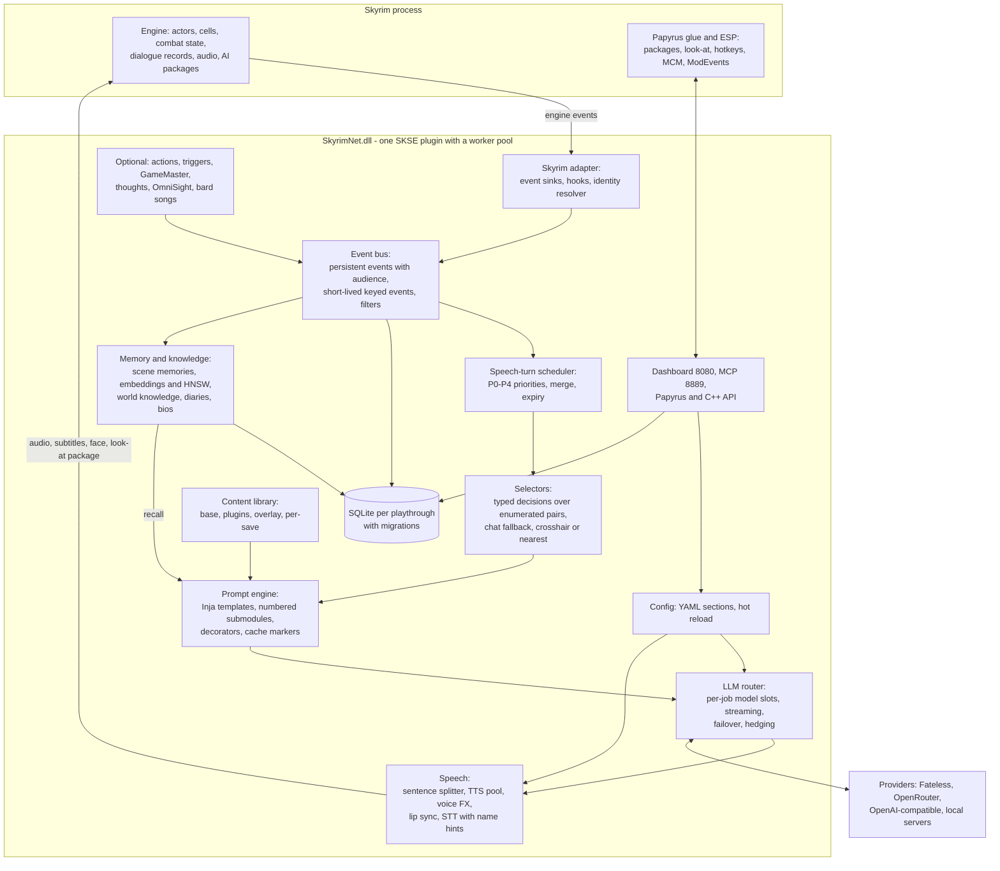
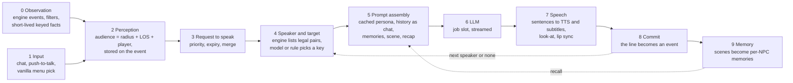

# SkyrimNet: how it works and what to borrow

Research note 00 (synthesis) for EldenNet, an LLM-driven NPC framework for Elden Ring.
Subject: SkyrimNet beta30-rc2 (Fateless.Ai / MinLL), the LLM NPC mod for Skyrim SE/AE/VR.

> **Method and license note.** This note summarises research notes 01–08 in this folder and re-checks a few
> load-bearing facts against the readable materials (length caps in
> `LIB/prompts/submodules/system_head/0020_format_rules.prompt`, slot budgets in
> `GH/model-presets/presets/openrouter-default.yaml`, the Papyrus native count, the license text). Every note it
> draws on used only documentation, human-readable shipped content, the MIT API headers and public web pages.
> No compiled file was inspected. **INFERENCE** marks a reading of the evidence, not a fact about the
> closed-source DLL. SkyrimNet's prompts, templates and bios may not be reused, so nothing here reproduces them.
> We look at what SkyrimNet does with Skyrim and take the ideas that could work in Elden Ring.

**References used below**

| Short form | Meaning |
|---|---|
| `R01`–`R08` | `docs/research/skyrimnet/0n-*.md`: 01 architecture, 02 conversation pipeline, 03 prompts and characters, 04 memory and knowledge, 05 events, perception and triggers, 06 speech, UI and dialogue, 07 actions, decisions and GameMaster, 08 Skyrim engine |
| `ER0n` | `docs/research/eldenring/0n-*.md`, cited only as the R notes cite them. Every Elden Ring claim here is **to verify** by the Elden Ring track |
| `LIB/`, `DEV/`, `GH/`, `SRC/` | SkyrimNet content library, devkit, public repo, Papyrus sources (prefixes as in R01) |
| `#NNN` | `https://github.com/MinLL/SkyrimNet-GamePlugin/issues/NNN` (or pull request) |

---

## TL;DR

- **SkyrimNet is one native DLL built around an event log.** Everything that happens becomes a typed event, and each event records the *audience* that perceived it. Dialogue history, memories, triggers and speaker choice all read this one log (R01 §3, R04 §4, R05 §2).
- **One turn runs in a fixed order:** input and audience, priority scheduler, a speaker key picked from engine-listed pairs, a cache-ordered prompt (stable persona, history as chat, volatile tail with a recap), a model chosen for the job, sentence streaming into TTS and subtitles, commit as an event, and memories formed later from scenes (R02).
- **Fast, stable, extensible.**
  - *Fast:* the game thread never blocks, replies stream per sentence, context is pre-warmed on talk-key *down*, prompts are ordered for caching, and small jobs go to small models with hard output caps (R01 §1.3, R02 §10).
  - *Stable:* every built-in decision has a fallback, the speech queue expires and merges stale requests, the model only picks among options the engine filtered, and subsystems degrade instead of crashing (R01 §6.3, §12).
  - *Extensible:* prompts, bios, filters, triggers, knowledge and config are layered data (R01 §5, §10; R03).
- **SkyrimNet's open bugs are lessons for us:**
  - off-thread reads of live engine memory still crash (#819, #830, #831);
  - name-derived identities fork and orphan memories (#502, #582);
  - combat lines are stale (#784), unaware (#771) or friendly (#768);
  - the rollback trim regressed (#825).
- **Copy these ideas for Elden Ring v1:**
  - a game-neutral core whose game thread only takes snapshots;
  - the audience event log, with short-lived keyed combat events;
  - a small priority scheduler with bark expiry in seconds;
  - per-job model slots behind one OpenAI-compatible client;
  - original, cache-ordered prompts with a recap and "words, not numbers";
  - block personas with a public/private split, and archetype cards for generics;
  - scene memories in SQLite, recalled by FTS, importance and recency;
  - a curated character key with a succession table;
  - a playtime-based rollback check.
- **Defer or drop:**
  - Actions, but freeze their four extension seams now (R07 §11.4).
  - GameMaster, NPC-to-NPC chains, thoughts, diaries, dynamic bios and the recall gate.
  - OmniSight, lip sync, the dashboard, MCP and a public API.
- **Elden Ring lacks most of what Skyrim gives SkyrimNet:** a record database with stable IDs, a script VM, a typed event bus, dialogue records, quest stages and AI packages (R08). EldenNet has to observe by diffing snapshots, ship curated data tables, and bring its own UI and audio.
- **Licensing.** Ideas, architecture and published numbers can inform our design. SkyrimNet's prompts, templates, bios, YAML content and code cannot be reused. Reverse engineering is forbidden, and its name may not be used to promote EldenNet (§7).

---

## 1. One-page overview of SkyrimNet as a system

SkyrimNet is a single SKSE plugin. It runs inside the Skyrim process with its own worker pool, and next to it sit native helper DLLs: whisper.cpp/ggml, ONNX Runtime and FFmpeg. There is no sidecar server (`DEV/docs/FEATURES.md`; R01 §1.1). The Papyrus scripts and the small ESP are glue for the few things only the engine's script VM and records can do: AI packages for "stop and face me", look-at, hotkeys bound as spells, the MCM, message boxes and ModEvents (R05 §10, R08 §6.3). All observation, perception, prompting, memory and speech logic is native (R05 §1).

INFERENCE (R01 §1.2): there is a game-neutral "Fateless engine" core and a Skyrim adapter with content on top. The README mentions a third-party Cyberpunk sister project "built on the Fateless engine". How much code the two share is not documented.

Each component, in one line:

| Component | Role | Detail in |
|---|---|---|
| Event bus | Typed schemas; persistent rows with `actor_UUIDs` (the audience); short-lived TTL facts overwritten by key; ephemeral notify-only types | R01 §3, R04 §4, R05 §2–3 |
| Scheduler | Every reason to talk becomes a "request to speak" with a priority class, a wait limit and merge rules. At most one line plays and one is being prepared per conversation | R01 §4, R02 §7 |
| Selectors | "Who answers and to whom" is a classification over keys the engine generated, never parsed free text | R02 §3, R07 §6 |
| Prompt engine | About 17 top-level templates, 58 numbered submodules, 1,509 bios and about 130 decorators | R03 §1–4 |
| LLM router | About 12 job slots (`default`, `combat`, `meta`, `memory`, `decisions`…) with per-slot budgets, rotation, failover and health cooldowns | R01 §6 |
| Speech | One reply stream split into speech, narration, tags and side channels. Sentences go FIFO to TTS, play through the engine's sound handles, and show in their own subtitle overlay | R06 §1–2 |
| Memory | Scenes of events become first-person JSON memories per perceiver. Recall combines a local embedder, HNSW, importance and recency | R04 §5–7 |
| Persistence | One SQLite DB per playthrough. UUID mapping with aliases and successions. Timeline keep/delete on load | R04 §2, §10–11 |
| Tooling | Web dashboard, MCP server for AI-assisted authoring, telemetry tables, content validator, versioned Papyrus and C++ APIs | R01 §8–10 |

---

## 2. The core loop in plain words

**0. Observation (always running).** Native sinks turn engine events into about 45 typed events: hit, combat, death, spell cast, location change, quest stage, many dialogue variants and more. **INFERENCE:** they are fed by Skyrim's `TES*Event` sources (R05 §2). A per-type policy decides whether an event is stored, whether NPCs may react, and how long the reaction cooldown is. Combat noise is stored as *short-lived keyed* facts, such as "last spell this actor cast", that a newer event with the same key overwrites (R05 §3.2). Regex rules remove vanilla grunt subtitles before they can enter history (R05 §5.5).

**1. Input.** The player can type in the chat overlay (`@Name` to address someone, `^` to whisper, `&` for a group, slash commands), speak with push-to-talk or open mic through local Whisper with an NPC and place name hint list, or pick a line in the vanilla dialogue menu. Key-*down* already starts preparing the memory search query, the decorator caches and action eligibility (R02 §1, §10; R06 §3).

**2. Perception.** When the event is registered, its audience is fixed: everyone within the interaction radius of the originator who passes a line-of-sight check, plus the player. Whisper shrinks the radius. Combatants always count as able to see each other (R02 §2, R05 §4). Being in the audience does not mean having to speak.

**3. Request to speak.** Every trigger, reaction, narration or player line enters the Beta28 scheduler:

| Class | Covers | Wait limit |
|---|---|---|
| P0 | the player | 30 s |
| P1 | directed narration | 15 s |
| P2 | trigger firings | 10 s; repeats of the same trigger merge |
| P3 | reactions to events | 8 s; several waiting reactions get one reply to the newest |
| P4 | NPC-to-NPC continuation | 6 s; ends after a maximum chain depth |

A higher priority can replace a line that is still being written, never one that is already playing. SkyrimNet never reacts to its own lines (R01 §4).

**4. Speaker and target.** Filters remove anyone who may not speak: animals, mannequins, the dead, the last speaker. The engine then builds the remaining legal pairs as keys (`s2_tplayer`). A classifier model picks one and returns probabilities. A chat prompt is the fallback, and after that the crosshair NPC, then the nearest one. The player-target signals, strongest first: a name in the line, the crosshair target, the ongoing exchange, role, distance. After each NPC line, a second selector may pick an interjector, or silence (R02 §3).

**5. Prompt assembly.** The template is ordered for prompt caching:
- **Cached system message:** identity line, stable bio, speech style, guidelines, output format, voice-tag rules, and the action list (in its own cache block).
- **History:** the NPC's own audience-filtered history as chat turns, its own lines as `assistant`. The window starts at a cache-stable anchor.
- **Uncached tail:** dynamic bio (gear, quests, recalled memories, world knowledge), the listener's observable profile, scene context (nearby people with state tags, place, time bucket, weather, recent short-lived events), combat status in words, the task line, and finally a recap of the newest five lines "said since you last spoke", each tagged *to you* or *overheard* (R02 §4).

**6. LLM.** The job picks the model slot: `default`, or `combat` in fights. The call is streamed, with first-token hedging and failover to the next model in the rotation (R01 §6.3).

**7. Speech.** A splitter cuts the stream into sentences:
- It strips side channels (`<internal_thought>`, the `ACTION:` trailer, translations).
- It applies TTS regex rules and carries delivery tags forward from earlier sentences.
- It dispatches sentences FIFO to the TTS pool.

Playback goes through the engine's sound handles, attached to the speaker. When audio starts, the talk package, look-at and facial animation start too. Subtitles appear even if TTS fails (R02 §6, R06 §1).

**8. Commit.** The reply becomes a `dialogue` event with the hearers as its audience. Inline thoughts become private events, and an ACTION line goes to the executor. **INFERENCE:** commit happens around the end of generation, not at playback. That is why lines flushed before playback stay "said" (#548; R02 §7.2).

**9. Memory (background).** Each perceiver's unmemorised events are cut into *scenes*. A memory-slot model writes one first-person JSON memory per scene per perceiver, with emotion, an importance score, tags and a type. The memory is embedded and becomes recallable in step 5. Diaries and dynamic bios are optional higher layers (R04 §5, §8).

**The combat variant uses the same loop.** SkyrimNet has no bark path. In combat the prompt modules change: one sentence of at most 14 words, a COMBAT STATUS block in words, a strength "instinct", and a closing line telling the NPC to stay on the fight. The `combat` slot is used. Hits stay out of the transcript, and the scheduler drops stale requests (R05 §8). EldenNet should split this out into a dedicated bark path (§4, rows 15 and 22).

---

## 3. Design principles that make it fast, stable and extensible

1. **The game thread never waits.** Network, database and TTS work run on workers. Every LLM-facing API is queue-and-callback, and engine-event callbacks run on the pool with an explicit "do not call `RE::`" rule (`DEV/CppAPI/PublicAPI.h`; R01 §1.3). The ExamplePlugin guidance states the snapshot rule outright: capture form IDs, not actor pointers, in anything that runs later (R08 §7.4).
2. **One source of truth.** An event-sourced core with per-event audiences makes "who knows what" a filter rather than a separate model. The same log drives transcripts, memories, triggers, relationship statistics and the chat UI, where editing a line edits the event (R04 §4.5, R06 §3.1).
3. **Filter first, then ask.** Code decides what is *possible*: eligible actions, legal speaker pairs, the memory shortlist. The model only picks a key. This keeps prompts short and invalid choices impossible, and the same predicates serve debugging (R07 §3, §6).
4. **Small jobs on small models, with budgets per job.** `meta` gets 100 output tokens, `decisions` a 10 s timeout and no retries, `combat` its own fast rotation. The budgets are the same across the Budget, Balanced and Premium presets, so swapping models never changes latency bounds (R01 §6.2; Balanced values re-checked for this note).
5. **Hide latency everywhere:**
   - streaming sentences into TTS;
   - pre-warming on key-down, including a throwaway `warmup.prompt` render that fills caches;
   - a byte-stable cached prefix, with no relative-time labels inside it;
   - repeating the newest lines at the end so a smaller model still answers the right line (R02 §4.2–4.3, §10).
6. **Bound the context:**
   - short-lived keyed events instead of blow-by-blow combat logs;
   - state *changes* above a threshold instead of streams of values;
   - numbers turned into words, because "weaker LLMs will parrot" raw values (`0200_combat_status.prompt` comment; R02 §4.1, R05 §3.3).
7. **Backpressure in speech.** Priority, expiry, merge-to-newest, caps per time window and "one playing plus one preparing" keep busy moments from piling up lines that play long after the moment has passed (R01 §4).
8. **Degrade, don't crash:**
   - built-in decisions fall back to chat prompts, then to rules;
   - recall falls back to similarity search;
   - queries return empty before the DB is ready;
   - writes are refused while the timeline check is pending;
   - pool tasks run under an SEH handler (R01 §6.3, §12).
9. **Prose and logic live apart.** Bio files contain only named prose blocks. Engineers own the headers, live state, perspective and order. None of the 1,507 non-empty bios contains template logic (R03 §5.2). The output grammar is rendered only for features that are switched on, so the instructions always match what the parser expects (R03 §8.1).
10. **Everything tunable is data.** It lives in layered content roots (base, then plugins, then the user overlay, then per-save) with "one purpose per file" records and hot reload (R01 §5, §10).
11. **Measure.** Telemetry tables have existed since migration 0001. Recall quality is benchmarked per embedding model and language ("right memory in the top five", Beta27/28). There is a rating and LLM-judge loop (R01 §14.1 item 20, R04 §13.1 item 12).

**Where SkyrimNet still hurts.** Each of these is a design input:

| Lesson | Evidence | EldenNet response |
|---|---|---|
| Off-thread reads of live engine objects are the main remaining crash source | #819, #828, #830, #831 (R01 §12) | Snapshot on the game thread; workers never touch game memory |
| Name-derived identity forks on rename and lifecycle changes | Migration 0021, #502, #582, #565 (R04 §10.2) | A curated stable key and succession table from day one |
| Combat speech without real awareness or hostility facts | #771, #768, #784, #723 (R05 §8.4) | Gate barks on combat *with the player*; an always-on hostility fact; re-check validity at voice time; aggregate damage-only hits |
| Conversation and memory see different events | The verbose renderer keeps hits that the transcript hides (R05 §3.1) | One event-visibility rule for every consumer |
| Lines committed before they were heard | #548 (R02 §7.2, R06 §1.8) | Commit when a line is shown or played |
| Autonomous work not cancelled by player input | #691 (R02 §7.1, R07 §5.3) | A player-input epoch on every queued item |
| Rollback trim regressed | #825 (R04 §11) | An automated test of the trim path |

---

## 4. Transferable pattern catalog

Decisions: **Copy idea**: build our own version of the idea. **Simplify**: keep the idea, cut its scope. **Defer**: v1.5/v2. **Drop**: not planned. All EldenNet prompts, schemas and content are original. "ER" notes are to verify by the Elden Ring track.

### A. Runtime and LLM plumbing

| # | Pattern | What SkyrimNet does | Why it matters | ER v1 decision | Notes |
|---|---|---|---|---|---|
| 1 | In-process native plugin | One SKSE DLL with no sidecar; Papyrus and ESP only for engine verbs; native helper DLLs (R01 §1.1) | Direct state access, one install, low latency | **Copy idea** | One DLL behind a game-neutral core plus a thin ER adapter, so the core can be tested headless (R01 §14.1 items 1–2). Loader: me3 (ER, verify) |
| 2 | Worker threads + game-thread task queue | Workers render, call the LLM, run TTS and the DB; the game thread does quick changes only; but decorators read live engine objects from workers (R01 §1.3) | Smooth frames; where the CTDs come from | **Copy idea, stricter** | Recurring game-thread task (ER01: `CSTaskImp`) only snapshots into plain structs keyed by stable IDs, enqueues events and applies UI and speech commands (R07 §11.4-D) |
| 3 | Per-job model routing | About 12 slots, each with its own models, temperature, `max_tokens`, timeout, rotation and failover (R01 §6.2–6.3) | Barks and conversation need different latency and cost | **Simplify** | Slots `dialogue`, `bark`, `memory`, optional `meta`; unknown slots fall through to `dialogue`. One OpenAI-compatible client, one fallback model, error classes (timeout/429/5xx/empty), provider cooldown. No hedging or weighted rotation |
| 4 | Streaming | SSE stream → word-safe sentence segments → FIFO TTS → ordered playback; cancelled replies stop streaming (R02 §6, R06 §1.2) | The biggest perceived-latency win | **Copy idea** | Text-first v1 streams sentences straight into subtitles. Later TTS: bounded parallelism, strict order (#654, #669), split only on word boundaries (#318) |
| 5 | Output contract + stream parser | One stream with speech, optional `*narration*`, voice tags, `<internal_thought>` after speech, one trailing `ACTION:`; hard length caps; leftovers would be spoken (R02 §5, R06 §1.1) | One call, many channels; parser and prompt must agree | **Copy idea, simplified** | v1 grammar is speech only, plus a reserved trailer channel that is stripped and logged (R07 §11.4-A). Whitelist sanitizer before display or TTS; strip `<think>`. A bark may be empty, which means silence |
| 6 | Typed decisions over engine-enumerated options | Speaker, target, mood and recall gate as `choice`/`score`/yes-no over game-built keys; probabilities used as thresholds; chat fallback (R02 §3.1, R07 §6) | The model cannot choose something illegal; no name parsing | **Simplify** | One `DecisionRequest` interface (R07 §11.4-B). Rules backend by default; optional constrained-output chat backend. No dependency on a proprietary classifier |
| 7 | Typed errors + fallbacks | Decision error codes (`no_decisions_route`, `request_failed`…); every built-in job degrades (R01 §6.3, §12) | A missing bark beats a stalled queue | **Copy idea** | Every async job returns a code and has a deterministic fallback: rule-based pick, recency recall, no bark |
| 8 | Telemetry and evaluation | `traces`/`counters`/`errors` tables from migration 0001; time to first token; dashboard traces; a 1–5 rating and judge loop (R01 §2, R02 §7.2) | Latency and quality need numbers | **Copy idea** (rating: **Defer**) | `traces` per stage (snapshot, render, first token, first display/audio); a `decisions` log with candidate sets (R07 §11.4-F); a dev-only "rate last line" hotkey in v1.5 |

### B. Prompts

| # | Pattern | What SkyrimNet does | Why it matters | ER v1 decision | Notes |
|---|---|---|---|---|---|
| 9 | Prompt templates + decorators | Each LLM job is an Inja `.prompt` with `[ system ]`/`[ user ]`/`[ cache ]` markers; about 130 decorators pull live state; hot reload (R03 §2–4) | Tuning without rebuilds | **Simplify** | Templates are mostly prose with `if` guards. Derived facts are computed natively over the snapshot (`hp_phrase`, `lines_to_you[]`); about 15 fields instead of about 130 (R03 §12.2). Keep the message and cache markers idea |
| 10 | Submodule composition + render modes | Numbered fragment folders concatenated by filename; render modes give the speaker, listener and roster views of one bio (R03 §3) | Mods slot sections in; detail matches the audience | **Copy idea, small** | A few numbered sections per prompt kind; four modes: `self_stable`, `self_dynamic`, `observed`, `brief` |
| 11 | Prompt-cache ordering | Stable system first; history from a power-of-two anchor; volatile tail uncached; no relative time in cached bytes; a shared byte-identical persona block across prompt kinds (R02 §4.1–4.2, R03 §12.1 item 6) | Lower cost and time to first token; harmless elsewhere | **Copy idea** | Split personas into stable and dynamic parts. Start with a fixed N-event window; add anchoring when a caching provider is used |
| 12 | "Said since you last spoke" recap | The newest five lines after the NPC's last line, repeated at the very end, tagged *to you* or *overheard*, with a closing steer (R02 §4.3) | Stops replies to old lines and to other people's asides | **Copy idea** | Cheap. Needed as soon as the cached layout pushes the newest line far back |
| 13 | Words, not numbers | HP/magicka/stamina bands at 25/50/75 %; level gap as an "instinct" phrase; changes over 25 % within 120 s (R05 §3.3, §8.2) | Models parrot numbers | **Copy idea** | HP/FP/stamina bands, a threat phrase, damage-delta phrases computed from snapshot diffs in code, not at render time (R05 §3.3 caveat) |

### C. Characters

| # | Pattern | What SkyrimNet does | Why it matters | ER v1 decision | Notes |
|---|---|---|---|---|---|
| 14 | Character bios | 10 named prose blocks: public summary and appearance ("Stranger Test"), private background, interjection triggers, speech style closing the persona block; spoiler and anti-priming cleanups (R03 §5, PR #384) | Authors write prose; secrets don't leak into other NPCs' prompts | **Copy idea** | Our own YAML schema: `public`, `private`, `voice`, `knowledge`, reveals gated by event flags (R03 §12.1 item 2). Describe cadence rather than effect words such as "cryptic" or "terse". Player-neutral wording (the Dragonborn fix) |
| 15 | Generic bios | About 300 `_generic` bios matched by display name; the bandit bio lists archetypes plus shared constants; no light bark mode; gendered generics clash (R03 §5.3–5.6) | Squads that don't all sound alike | **Copy idea, improved** | Archetype cards keyed by stable IDs (NpcParam, model, team), written gender-neutral. The variant is picked in code from the entity handle. Always-on hostility fact. A dedicated short bark prompt |
| 16 | Generated bios | A missing bio is generated from game data, including the NPC's vanilla dialogue (R03 §6.1) | Covers 1,000+ NPCs | **Defer (offline)** | An offline drafting tool from the NPC's own talk lines, then a human rewrites it. No runtime generation |
| 17 | Dynamic bio updates | Conservative per-block rewrites anchored to the original, stored per save (R03 §6.2) | Characters evolve | **Drop (v1)** | Memories carry continuity; revisit with a review UI |

### D. Perception and turn-taking

| # | Pattern | What SkyrimNet does | Why it matters | ER v1 decision | Notes |
|---|---|---|---|---|---|
| 18 | Event history with audience | One `events` table; audience frozen at registration; per-NPC history is a filtered query rendered as chat turns (R02 §4.2, R04 §4) | Perception-correct knowledge for history, memory and triggers from one mechanism | **Copy idea** | An `event_audience` join table instead of JSON arrays (R04 §13.5). Apply the audience to *every* context block, short-lived included (R05 §4.3 gap) |
| 19 | Short-lived keyed events | In-memory TTL facts overwritten by key; `hit`/`spell`/`combat` kept out of transcripts (R05 §3.2) | Combat context stays small | **Copy idea** | Keys such as `hit:<attacker>:<victim>` and `low_hp:<actor>`, TTL 10–30 s. One visibility rule for every consumer, memory writer included (#723) |
| 20 | Perception radius | Interaction radius (1,600 units ≈ 23 m), whisper radius, two-stage LOS "peek", closed doors block, combatants see each other (R02 §2) | "People upstairs don't answer" | **Simplify** | Radius + same map block + team; a raycast later. Generic barks only when actually in combat *with the player*, never while searching (#771) |
| 21 | Speaker selection | The player-target ranking above; a next-speaker selector with `none` and a strictness setting; NPC↔NPC talk winds down after 2–3 rounds (R02 §3.2) | Answer the right person; no crowd chatter | **Simplify** | Named NPCs: `@name` > lock-on > camera cone > last partner > nearest. Generic NPCs: the rule that fired names the speaker. No interjection chains |
| 22 | Priority speech scheduler | P0–P4 with waits of 30/15/10/8/6 s, merge, caps, one playing plus one preparing, pre-empt only lines being written (R01 §4) | Fights otherwise produce stale lines | **Copy idea** | Classes: player, scripted, combat bark (2–3 s expiry, merge to newest), ambient. Re-validate at voice time (#784). Player-input epoch (#691) |
| 23 | Filters | YAML allow/deny lists by race, faction and gender, separately for *speak* and *remember*; regex `dialogue_rule`/`tts_rule` (R03 §7, R05 §6) | Tune who talks without code | **Copy idea** | Three flags: perceivable, may speak, may remember (#524 lesson). Keyed by model ID, NpcParam ID and team type; one purpose per file |
| 24 | Triggers | Declarative YAML: event type + field conditions → response, with probability, cooldown, priority and interrupt; the base library ships none (R05 §7) | The extension point | **Simplify** | About six built-in rules as data records: `aggro_start`, `took_heavy_damage`, `ally_died`, `low_hp`, `player_died`, `named_greeting` (R05 §14.2). User YAML later |

### E. Memory and knowledge

| # | Pattern | What SkyrimNet does | Why it matters | ER v1 decision | Notes |
|---|---|---|---|---|---|
| 25 | Memory generation | Scenes of unmemorised audience events → one first-person JSON memory per perceiver (2–4 sentences, one of 10 emotions, importance 0–1, 5–10 tags, one of 7 types); per-actor progress; scene retries (R04 §5) | Each witness remembers its own version, written for search | **Copy idea** | Named NPCs only. Structured outputs or a strict JSON parse with bounded retries (#755). A `memory_progress` watermark; never lose source events |
| 26 | Embeddings / vector recall | Local ONNX embedder + HNSW; one search with the player's line verbatim and one with an LLM query or the last 8 lines; separate thresholds; measured per model and language (R04 §6–7) | Semantic recall | **Simplify** | SQLite FTS5 + importance + recency first. Keep the `embeddings` table and producer fingerprint for a later local embedder; brute-force cosine is enough at our scale |
| 27 | Importance and decay | Importance set at write time against a rubric; fading scaled by importance (curve undocumented); about 5 memories injected as "potentially relevant" with relative-time labels (R04 §7) | Being attacked outweighs a pleasantry | **Copy idea** | Score = relevance·w₁ + importance·w₂ + exp(−Δplaytime/τ(importance))·w₃. Top 3–5, plus 1–2 high-importance memories involving the player (R04 §13.5). Tune on a labelled test set |
| 28 | Recall gate | A classifier picks which shortlisted memory the line is about; accept if 1−p(none) ≥ 70 %; support memories; +0.2–0.4 s per line (R04 §7.2) | Catches follow-ups that embeddings miss | **Defer** | v2 candidate via `DecisionRequest`; needs a second model route |
| 29 | Diaries | On-demand long first-person reflections, also stored as memories (R04 §8) | Coarse episodic summaries | **Drop (v1)** | Costly; pays off only after many hours |
| 30 | World knowledge with conditions | Facts with per-NPC template conditions, always-inject vs semantic, a `knowledge_key` for overrides, the ephemeral-vs-persistent quest rule, an LLM drafting assistant with human approval (R04 §9) | Shared lore without duplication | **Simplify** | Static YAML with conditions over event flags, region and persona. Keep `always_inject` and `knowledge_key`. An offline tool to draft entries |

### F. Identity and persistence

| # | Pattern | What SkyrimNet does | Why it matters | ER v1 decision | Notes |
|---|---|---|---|---|---|
| 31 | Identity / UUID mapping | UUID = hash(display name, masked FormID); later added `mod_file + local_form_id`, alias rows unioned at read time, curated successions; a name-independent UUID is still open (#502) (R04 §10, R08 §2.5) | A wrong identity orphans memories | **Copy idea, designed up front** | The primary key is a curated character key. A succession table maps every NpcParam/entity incarnation (ER04 `npc_identity.toml`). Never display names or runtime handles (R08 §12.1 item 9) |
| 32 | Per-save rollback handling + DB hygiene | One DB per playthrough ID; on load, "future" rows → keep/delete prompt; writes refused while pending. Migration lessons: naive semicolon splitter, 32-bit `INTEGER` truncation, embedding-producer fingerprint; WAL fixes slow loads (#565) (R04 §3, §11) | NPCs must not remember undone events | **Copy idea, adapted** | Sidecar DB keyed by Steam ID + slot + character fingerprint. Playtime is the clock: silent trim for a small ε (crash), prompt for a large gap (restored backup). NG+ journey tag. WAL, 64-bit-safe keys, a real migration runner. Test the trim path |
| 33 | Content library layering + config | Base < plugins < external < overlay < per-save; the file path is the identity; manifests, a hub, out-of-band base updates, a validator. Per-subsystem YAML generated on first launch, hot reload, runtime-only toggles (R01 §5, §10) | Users edit without forking; updates don't clobber edits | **Simplify** | Two layers: shipped defaults and a user override folder. 3–4 YAML config files with file-watch reload and a master AI toggle. No hub |

### G. Speech and UI

| # | Pattern | What SkyrimNet does | Why it matters | ER v1 decision | Notes |
|---|---|---|---|---|---|
| 34 | TTS | Many engines, chosen per actor; voices keyed by vanilla voice type; cloning from the game's `.fuz`; YAML voice-effect chains; carry tags; a cache keyed by voice and text; engine audio through `BSSoundHandle` (R06 §1) | Voice is immersion | **Defer (v1.5)** | v1 is text first. Later: one local CPU engine and one OpenAI-compatible HTTP engine, our own audio device with simple 3D attenuation, a voice chain keyed by stable IDs, a pre-rendered bark pool |
| 35 | STT | Local whisper.cpp; push-to-talk with pre-warm; name hints (≤ 500 chars); audio cues; "no transcription" handling; two barge-in moments (R06 §3.2) | Hands-free input; works on gamepad | **Defer (v1.5)** | Name hints for Lands Between proper nouns. Pin the language (#781). Keep "stop capture" separate from "cancel speech" (#548) |
| 36 | Lip sync | NVIDIA Audio2Face-3D driving face morphs (INFERENCE) (R06 §1.7) | Faces | **Drop** | Many ER NPCs are masked or hooded; rig access is unknown |
| 37 | Subtitles / chat overlay | Its own HTML overlay: floating cards over speakers or a bottom box, one line per speaker ranked, hidden in menus; chat with `@Name`, whisper, a "who can hear you" strip, editable events (R06 §2–3) | The minimum usable surface | **Simplify** | ImGui overlay (hudhook; ER, verify): text input aimed at the lock-on target, a bottom box for conversation, floating cards for barks. A JSON message boundary between core and UI |
| 38 | Web dashboard | `localhost:8080` and in game: editors, event monitor, traces, a game-data explorer (R01 §9) | Authoring and debugging | **Defer** | v1: a log, an event dump, and the last prompt and response written to disk |
| 39 | MCP server + agents | Port 8889 tools; authoring assistants whose writes a human approves (R01 §9, R07 §9) | AI-assisted content work | **Drop (v1)** | Later, as developer tooling in EldenNet's own repo (R07 §11.3 notes me3's no-LLM policy for its spaces) |
| 40 | Papyrus / C++ API | 136 Papyrus natives (`SkyrimNetApi.psc`, recounted for this note); C++ API v14 via `LoadLibraryA`/`GetProcAddress` with nullable pointers but a `std::string` ABI that requires MSVC v143; ModEvents (R01 §8, R08 §7.7) | An ecosystem | **Defer** | If added: `extern "C"`, UTF-8 JSON, a version query. Elden Ring has no script VM to bind to |

### H. Autonomy and actions

| # | Pattern | What SkyrimNet does | Why it matters | ER v1 decision | Notes |
|---|---|---|---|---|---|
| 41 | Actions | The LLM picks from an eligibility-filtered list; an embedded `ACTION:` trailer after the speech; categories with a drill-down call; results fed back as events; human review on the hub (R07 §2–5) | Agency; the riskiest content class | **Defer (freeze seams)** | v1 ships the reserved trailer channel, the decision interface, an empty action registry and the eligibility snapshot (R07 §11.4). The LLM never writes progress state (event flags) |
| 42 | GameMaster | A director that acts on a lull plus a cooldown: Start/ContinueConversation, 4–6-beat scene plans; races with player input (#691) (R02 §8, R07 §7) | Ambient NPC↔NPC scenes | **Drop** | Named ER NPCs rarely share a space (R07 §11.3) |
| 43 | Thoughts | Private 1–2-sentence events whose audience is the thinker; 60 s per-NPC cooldown; inline thoughts stripped from TTS (R02 §9, R07 §8) | Private state that colours later lines | **Defer** | Easy to add later: a private event type, and the parser channel already exists |
| 44 | OmniSight | Screenshots described by a vision model, cached by content hash (R01 §2, R08 §8) | "What things look like" | **Drop** | Cost and latency; would need renderer capture |

**The v1 cut in one paragraph.**
- **Named-NPC conversation:** the player types in an overlay aimed at the lock-on target or the nearest named NPC. The game-thread snapshot fixes the audience. The `dialogue` slot gets an original, cache-ordered prompt: persona with its stable part cached, the audience-filtered history, recalled memories and flag-gated knowledge, words-not-numbers state, the recap and the task. Sentences stream into subtitles. A line is committed when it is shown, and scenes become memories in the background.
- **Generic barks:** a snapshot diff fires a data-defined rule. The scheduler admits it with an expiry of a few seconds. The `bark` slot gets an archetype card, the trigger kind and 2–3 state phrases, and returns one line of at most about 10 words, or nothing. Barks get no history and no memory rows. A floating card shows the line.

---

## 5. What Skyrim provides that Elden Ring likely does not

The Elden Ring column summarises R08 §14 and the ER notes it cites. **All of it is to verify.**

| Skyrim feature | How SkyrimNet uses it | Elden Ring situation (per ER notes) | Implication for EldenNet |
|---|---|---|---|
| **Papyrus VM** (scripts on records, natives, latent calls, about 1.2 ms per frame) | Glue only: packages, look-at, hotkeys as spells, MCM, ModEvents; YAML actions call any quest-script function (R07 §2.1, R08 §6) | No runtime VM for mods; EMEVD, ESD and Lua are compiled authored data (ER01) | Everything is native. Actions, if ever, bind to a closed set of native executors, never "any function" (R07 §10) |
| **CK-editable dialogue records** (Quest → Topic → Info, conditions, voice types, 103 topic subtypes) | Captures vanilla lines as events; lists available branches; fires infos (Dialogue Actions); filters grunts (R06 §5, R08 §5) | Talk ESD state machines, TalkParam rows, TalkMsg FMG; generic enemies have no talk ESD (R08 §14) | No firing of vanilla lines in v1. Capturing vanilla talk text is a v2 candidate (a `GetMessage` hook). Borrow the topic-subtype list as our own bark trigger taxonomy (R08 §12.1 item 3) |
| **Quest stages and journal** | Knowledge conditions such as `get_quest_stage("MQ104") >= 13`; quest topics to raise (R04 §9, R08 §10) | No journal; progress is event flags in per-NPC blocks (ER04, via R08 §14) | We must author flag-to-meaning tables per named NPC: significant content work, and the main spoiler-control lever |
| **Plugin forms, FormIDs, EditorIDs** | `Plugin.esp\|0xLocalID` keys; EditorIDs restored by po3 Tweaks; race and faction lists for filters (R08 §2) | Param row IDs, MSB entity IDs, talk codes; no EditorIDs at runtime (R08 §14) | Ship our own human-readable name table and succession table. Key generics by archetype, named NPCs by curated key |
| **SKSE ecosystem** (loader, Address Library, CommonLib-NG, event sinks, task queue, lifecycle messages, co-save) | Version-independent addresses; 53 typed event sources; `AddTask`; `kDataLoaded` vs `kPostLoadGame`; co-save (R08 §7) | me3 loader, fromsoftware-rs RVA tables and AOB patterns, `CSTaskImp`; no public event bus; no co-save; one `.sl2` with continuous autosave (R08 §14) | Observe by **diffing per-frame snapshots**. Detect "system ready" and "character loaded" ourselves. Keep a sidecar store with a fingerprint and a rollback check. Expect struct layouts to move with every patch |
| **Voice-type dialogue playback** (`.fuz` = audio + `.lip`, sound categories, output models, subtitle manager) | TTS keyed by voice type; cloning from vanilla audio; engine sound handles give 3D, reverb, menu pause and volume sliders (R06 §1.6) | Wwise banks; mouth-flap only; rebuilding banks is patch-fragile (R08 §14, ER03) | Text first. Later TTS on our own audio device with simple attenuation and our own volume and pause handling |
| **AI packages** (+ linked refs, `SetLookAt`, `EvaluatePackage`) | "Stop, approach and face the speaker" packages, with ownership and holds; a source of bugs (#141, #156, #644) (R05 §12, R08 §4.1) | No package system for mods; behaviour is Lua goals and think params; talk ESD can face the player (R05 §14) | No body control in v1. Rely on the vanilla talk flow; maybe ESD look-at later |
| **Factions, relationship ranks, crime** | Allegiance, standing and bounty as prompt facts and eligibility keys (R08 §4.4) | Team type for hostility; hostility flags; no crime system (R08 §14) | "Standing" comes from flags plus our own memory and log statistics (R04 §4.5) |
| **Crosshair target** | The strongest "who is addressed" signal after a name (R02 §3.2) | Lock-on, then a camera cone, then nearest (R02 §13.4) | Lock-on is the primary addressing signal |
| **Calendar time** | Game-seconds clocks, relative-time labels, rollback ordering (R04 §11) | Time of day only, no calendar (R04 §13.4) | Playtime becomes the timeline clock; time of day is flavour |
| **Web-view UI host, typing in menus** | Prisma UI chat, dashboard and subtitles (R06 §4) | No equivalent; the world keeps running while you type (R06 §7.4) | An ImGui overlay; gate typing to safe states; a gamepad path (intent wheel or STT) |

**What follows from this:**

1. **Snapshot first.** No event sinks and a less documented engine mean the game thread must copy plain state on a timer (ER01 suggests about 4 Hz for perception), and events are *derived* from diffs (R07 §11.4-D, R08 §12.1 item 4).
2. **Content work replaces engine data.** Personas, archetype cards, the succession table, flag-meaning tables, the name table and filters are hand-curated data (R03 §13 item 8).
3. **Our own presentation stack.** Overlay, subtitles and (later) audio are ours, so v1 avoids the hook-heavy integration that produced SkyrimNet's audio and subtitle crashes (#801, #831).
4. **No actions in v1, by necessity as well as scope.** There is no safe VM. Event flags and ESD can corrupt quest lines (R07 §11.3).
5. **Identity is designed, not discovered.** SkyrimNet reached three identity layers (handle, record, character) through migrations. EldenNet starts with all three (R08 §2.5, §12.1 item 9).
6. **Offline only.** DLL mods need EAC off and no online play (R06 §7.4; ER, verify).

---

## 6. Key numbers worth reusing as defaults

SkyrimNet distances are in Skyrim units, converted at 128 units = 1.828 m (`units_to_meters`). "Community" means the third-party goncalo22 docs, which may be stale. Release-note values were read through a summarising fetch and should be re-checked before they are quoted in design docs (R01 §15 item 10).

| Parameter | SkyrimNet value | Source | Suggested EldenNet v1 start |
|---|---|---|---|
| Conversation hearing radius | 1,600 units ≈ 23 m (was 800 ≈ 11 m; max 8,000); pinned NPCs ×2.0 | Beta20 notes (R02 §2.1) | About 15–20 m for speech (R05 §14.2), plus a "same map block" check |
| Combat-noise / bark awareness radius | no separate radius; combatants always count as mutually visible | R02 §2.1 | About 40 m, combat with the player only (R05 §14.2) |
| Other radii | name search 4,000 units ≈ 57 m; trigger `nearbyRadius` 2,000 ≈ 29 m; talk packages 512/256 ≈ 7.3/3.7 m | `SkyrimNetApi.psc`, `WORKFLOW_TRIGGERS.md`, ESP (R05 §4.2) | Talk-overlay target range about 5–8 m (INFERENCE, to playtest) |
| Scheduler wait limits | P0 30 s, P1 15 s, P2 10 s, P3 8 s, P4 6 s; one playing + one preparing | Beta28 notes (R01 §4) | **Bark 2–3 s** (R02 §13.1 item 8); player 30 s as in SkyrimNet; scripted about 10 s and ambient 6–8 s (INFERENCE, mirroring P2/P3) |
| Dialogue length | 1–3 sentences, 8–40 words typical, 60 max | `0020_format_rules.prompt` (verified) | Named NPC: 1–3 sentences, cap at or below 60 words |
| Combat / bark length | 1 sentence, ≤ 14 words | same (verified) | ≤ 10 words, or empty (R03 §12.2) |
| Thought length | 8–30 words, first sentence ≤ 10 | same (verified) | n/a in v1 |
| Recap | newest 5 lines since the NPC last spoke | `dialogue_response.prompt` (R02 §4.3) | 5 |
| History window | per NPC, configurable; community default 50 (5–200) | R05 §3.1 (community) | Fixed N = 20–30 events for named NPCs (INFERENCE: smaller world, cheaper prompts); none for barks |
| Gap marker in history | > 1,800 game-seconds (30 game-minutes) | `event_history.prompt` (R04 §4.4) | Playtime gap > 10 min (INFERENCE) |
| Cache anchor | power-of-two step ≤ 256, hides ≤ ¼ of the shown events | `event_history.prompt` (R02 §4.2) | Only once a caching provider is used |
| Provider cache lifetime | 5 min or 1 h | Beta27 (R01 §6.4) | Same; a reason to keep the persona prefix byte-stable |
| Slot output budgets | `default` 4,096; `combat` 2,000; `meta` 100; `action_evaluation` 500; `gamemaster` 256 / 30 s; `memory` 4,000 / 60 s; `decisions` 10 s, 0 retries; profile 10,000 / 300 s; diary 12,000 / 120 s | Balanced preset (verified) | `dialogue` about 300 tokens / 20 s; `bark` about 40 tokens / 3 s; `memory` about 600 tokens / 60 s; `meta` 100 / 5 s (INFERENCE: sized to our caps) |
| Memory write | 2–4 sentences (5–6 exceptional); importance bands 0.7–1.0 / 0.4–0.6 / 0.1–0.3; 5–10 tags; 10 emotions; 7 types | `generate_memory.prompt` (R04 §5.2) | Same shape, our own wording and lists |
| Scene segmentation | gap 60 min; scenes 10–480 min with 5–200 events; min importance 0.2; ≤ 1,000 memories per actor | community (R04 §5.1), unverified | Scene closes when the conversation ends, the player leaves the area, or after N minutes of playtime with no new events (R04 §13.1 item 3; N ≈ 5 is an INFERENCE to tune) |
| Recall count | 5 by default (1–10) | community (R04 §7.1) | Top 3–5 + 1–2 high-importance memories about the player |
| Recall thresholds | Min Relevance 0.6 (Beta27); player-line memory floor 30 %; conversation similarity 80 %; related memories 2 at a 75 % cut | Beta27/28 (R04 §7.1) | Tune on our own labelled set; thresholds are model- and language-specific |
| Recall gate | accept if 1 − p(none) ≥ 70 %; costs 0.2–0.4 s | Beta28 (R04 §7.2) | Deferred |
| Recall quality reference | top-5 English 65 / 71 / 76 % (MiniLM / Granite / Bekko); without the LLM query 65 → 51 % | Beta27/28 (R04 §6–7) | A baseline for our FTS-vs-embedding test |
| World knowledge | similarity 0.40, min score 0.575, 5 results, default importance 0.7 | Beta27, `PublicAPI.h` (R04 §9.1) | Same structure; always-inject for "wrong to omit" facts |
| Embeddings | MiniLM 384-dim; HNSW M = 16, ef_construction = 200 (community) | R04 §6 | Later; brute-force cosine first |
| Health bands | 25 / 50 / 75 % (magicka 15/35/60/85) | `0200_combat_status.prompt` (R05 §8.2) | Same bands for HP, FP and stamina |
| State-change phrase | > 25 % of max within 120 s | `8000_recent_state_changes.prompt` (R05 §3.3) | `took_heavy_damage`: > 30 % HP within 3 s (R05 §14.2) |
| Short-lived TTL | "usually around 30 seconds" | community (R05 §3.2) | 10–30 s by kind |
| Per-type reaction cooldowns | combat/death 120–180 s; activation/equip 30–60 s; spell 60–90 s | community (R05 §5.1) | Bark: 20 s per actor, 8 s per squad, global cap (R05 §14.2) |
| Eligibility cache TTL | 10 s | Beta23 (R07 §3.3) | 2–10 s per snapshot generation (R07 §11.4-D) |
| NPC thought cooldown | 60 s per NPC | Beta20 (R07 §8) | n/a |
| GameMaster | cooldown 120 s (fan docs; 139.6 s observed in #691); beats 15–30 s, 4–6 per plan | R02 §8, R07 §7 | n/a |
| NPC↔NPC chains | wind down after 2–3 rounds | speaker selector (R02 §3.2) | n/a in v1 |
| Push-to-talk | 200 s recording timeout (90 s for thought/transform); < 0.3 s press = "think on your own"; open mic ignores < 0.25 s | `SkyrimNetApi.psc`, Beta26 (R02 §1.2) | v1.5: same timeouts; ignore < 0.25 s |
| STT name hints | ≤ 500 chars; re-rendered on cell change or every 30 s, and on each PTT press | `stt_hints.prompt` (R06 §3.2) | Same, from nearby named NPCs and place names |
| Content limits | records 32 KB; voice effects 64 KB; knowledge pack 1 MB; regex ≤ 1,024 bytes; template nesting ≤ 16 | `CONTENT_ROOTS.md`, Beta26 (R01 §5.2, §12) | Similar caps; reject oversize files at load |
| Papyrus LLM reply | capped at 750 characters | `SkyrimNetApi.psc` (R08 §6.3) | n/a |
| Bark latency budget | (SkyrimNet uses 8–10 s reaction windows) | R02 §13.1 item 8 | Under 1–2 s or drop; consider pre-generated pools per (archetype, trigger) (R03 §12.2) |

---

## 7. Licensing: what we may and may not reuse

**Update (2026-11-07):** SkyrimNet's author, Min, has given EldenNet the engine blueprint to work with, and the owner decided that EldenNet's foundation will be based on SkyrimNet, with Min's approval to use, copy and adapt its engine and content (EldenNet `CLAUDE.md`, Licences). The rest of this section is the published licence as we read it before that approval; it still applies to anyone without it.

This is our reading of `GH/LICENSE`, not legal advice.

**The license covers almost everything SkyrimNet ships:** the DLL, Papyrus scripts, the ESP and its Spriggit source, prompts and templates, configuration, interface files and documentation.

**Exceptions to it:**
- `SkyrimNetApi.psc`, which is MIT.
- The C++ API headers (`PublicAPI.h`, `PublicAPIMemoryQuery.h`, `PublicAPIDiaryQuery.h`), each carrying an MIT SPDX notice (checked for this note).
- Third-party components, which keep their own licenses.
- Files with their own notices.
- `FatelessAiEngine.dll`, licensed separately.

**We may:**
- Learn from and use **ideas, architecture and behaviour**: event-sourced audiences, the speech scheduler, cache-ordered layout, the recap, persona block schemas, archetype cards, scene memories, succession tables and the rest of §4. Ideas and facts are not the licensed expression.
- Use **published facts and numbers** as design inputs: length caps, expiry windows, radii, slot budgets, recall measurements. Cite them as SkyrimNet's values and then set and tune our own.
- Use the **same open-source libraries** (inja, SQLite, hnswlib, whisper.cpp, ONNX Runtime, miniaudio, nlohmann/json, yaml-cpp, spdlog…) under their upstream licenses, obtained from upstream, not from SkyrimNet's distribution.
- Read the MIT headers as API design references. They are Skyrim-specific, so EldenNet designs its own C ABI anyway (row 40).

**We may not:**
- **Reuse any SkyrimNet prompt, template, submodule, bio, or other shipped content text in EldenNet.** That includes filters, carry-tag lists, voice-effect recipes and knowledge content. Section 3 of the license allows modified prompts only in content packs used *with SkyrimNet* ("You may not use them with other software"). EldenNet prompts and personas are written from our own specs, not by editing SkyrimNet files. The 1,509 bios are neither a source text nor a training set.
- **Redistribute** any part of the mod (§2).
- **Reverse engineer, decompile or disassemble** the DLL or any compiled part, or derive its source (§4). The research notes also excluded facts that issue reporters said they had pulled from the DLL (#681 in parts, #656 and #470 format strings; R04 §6, R06 method note). Future work must keep doing that.
- **Use the names** "SkyrimNet", "Fateless" or "Fateless.Ai", or their logos, to endorse or promote EldenNet (§6). Naming SkyrimNet as prior art in research notes is descriptive. Product naming, store pages and marketing must not trade on it.

**Practice going forward:**
- Keep quotes in research docs short (well under about 15 lines each, a handful per document).
- Label inference as inference.
- Keep EldenNet's schema sketches visibly original, as R04 §13.5 and R07 §11.4 do.
- The Elden Ring side has its own limits: do not ship FromSoftware text. Use TalkMsg lines only as offline authoring input or read them at runtime from the user's own game files (R03 §13 item 6). Keep any LLM tooling out of me3's project spaces (R07 §11.3).

---

## 8. Consolidated open questions

### 8.1 About SkyrimNet internals (affect only how confidently we cite it)

1. Do decorators read live engine objects from workers, use game-thread snapshots, or both? The crash reports suggest live reads (R01 §15 item 1, R08 §13 item 2).
2. When is the audience computed? Is it re-checked at render time, and are short-lived "Recent Events" filtered per speaker? The template applies no per-NPC filter (R02 §14 item 2, R05 §4.3, §15 item 8).
3. When is a line committed: at the end of generation or at playback? The evidence points to generation (R02 §14 item 3).
4. What selection logic picks the slot? When does `combat` replace `default` (R01 §15 item 2)?
5. Several scheduler and perception defaults are unpublished: Max Chain Depth, Max Recent Speech Count, the whisper radius, and the "audio queue near completion" threshold (R02 §7.1, §14).
6. What are the memory scoring weights and decay curve, and what triggers a scene to close? Only third-party, partly outdated numbers exist (R04 §14).
7. What is the bio key resolution order within layers (R03 §13 item 1)? Do generic NPC instances keep separate memory stores (R03 §13 item 4)?
8. Where is the playthrough ID stored, and how is an "older save" detected? #825 shows that the trim path regressed (R04 §14, R08 §13 item 4).
9. What does `useEngineAudio: false` change? Is the lip-sync pipeline Audio2Face, phonemes, or both (R06 §8 items 1–2, 11)?
10. On what thread does the C++ action `executeCallback` run? How are actions dispatched to Papyrus, and are cooldowns per action or per actor (R07 §12 items 1–2)?
11. Unverified evidence: community-site defaults (segmentation, weights, per-type cooldowns, a 30 s TTL, a history of 50), fan-doc GameMaster values, and release-note wording read through a summarising fetch. Re-check before quoting (R01 §15 item 10, R02 §14 item 9, R04 review notes).

### 8.2 For the Elden Ring research track (blocking design choices)

1. **Identity.** Which key should be canonical for named NPCs: the talk code, the NpcParam row or the MSB entity ID? Which questline NPCs exist as several incarnations, and how many generics have no entity ID (R03 §13 item 5, R04 §14, R08 §13 item 9)?
2. **Awareness.** Is there a cheap, reliable "in combat with the player" signal, as opposed to merely searching? Are `NpcThinkParam` eye and ear distances usable as an audience radius (R05 §15 item 11)?
3. **Game thread.** Is `CSTaskImp` a safe recurring hook, and what does a 4 Hz snapshot of nearby characters cost? Is a raycast available for line of sight (R07 §11.4-D, R05 §14.2)?
4. **Playthrough.** Can playtime, the slot index and the NG+ counter be read? Can we detect a slot being deleted and recreated? Is there any safe per-save sidecar hook (R04 §13.4, §14)?
5. **Presentation.** Does an ImGui overlay take input focus reliably? Is there a gamepad text path? What is the policy for typing while the world runs? Can we read camera projection for floating subtitles, play through our own audio device, and detect "player is in a talk menu" so vanilla and generated voices never overlap (R06 §7.4, §8 item 8)?
6. **v2 hooks.** Is there a hook where talk text is resolved, so vanilla lines can be captured? Can an ESD face-the-player command be used safely? Can a synthetic `TalkScript` drive a live NPC's own talk list (R07 §12 item 8)?

### 8.3 EldenNet design questions (need measurement, not research)

1. **Bark latency.** Can live LLM barks land within about 1–2 s on a small model, or do we need a pre-generated pool per (archetype, trigger) with live calls only for unusual events (R03 §13 item 7)?
2. **Recall.** Is FTS5 plus importance and recency good enough on test playthroughs, measured as "right memory in the top five"? If non-English play is in scope, use a multilingual embedder or Unicode-aware FTS from the start (R04 §14).
3. **Decisions without a classifier.** Which target providers (OpenRouter, llama.cpp, LM Studio) support JSON-schema or grammar-constrained output well enough for a chat-based decision backend (R07 §12 item 9)?
4. **Tone versus hallucination.** Can a FromSoftware-like register be reached by describing cadence instead of using effect words, without riddling one-liners or invented lore? Grounding rules and the PR #384 lesson apply (R03 §12.4).
5. **Spoilers and runtime game text.** How much flag-gated persona and knowledge content is v1 able to author? Should a few canonical talk lines be fed at runtime as voice anchors, or used only offline (R03 §13 items 6, 8)?
6. **Generic persistence.** Should generic enemies keep any per-encounter state, such as "you fled from me", between deaths without grace rests? The v1 spec says no. Revisit after playtests (R04 §13.2).
