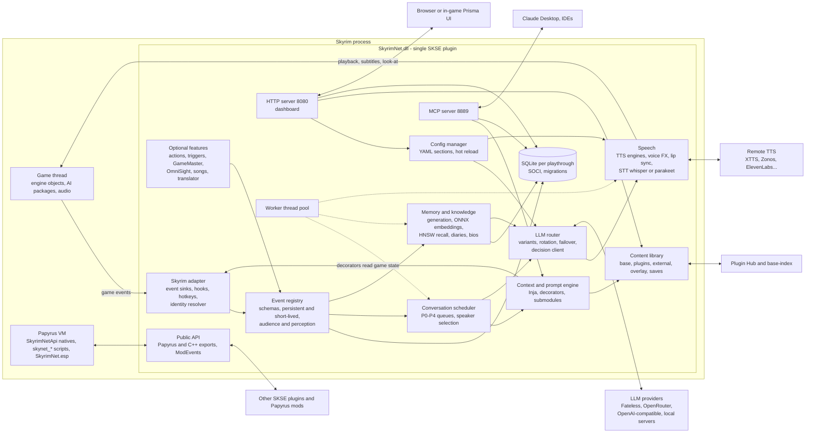
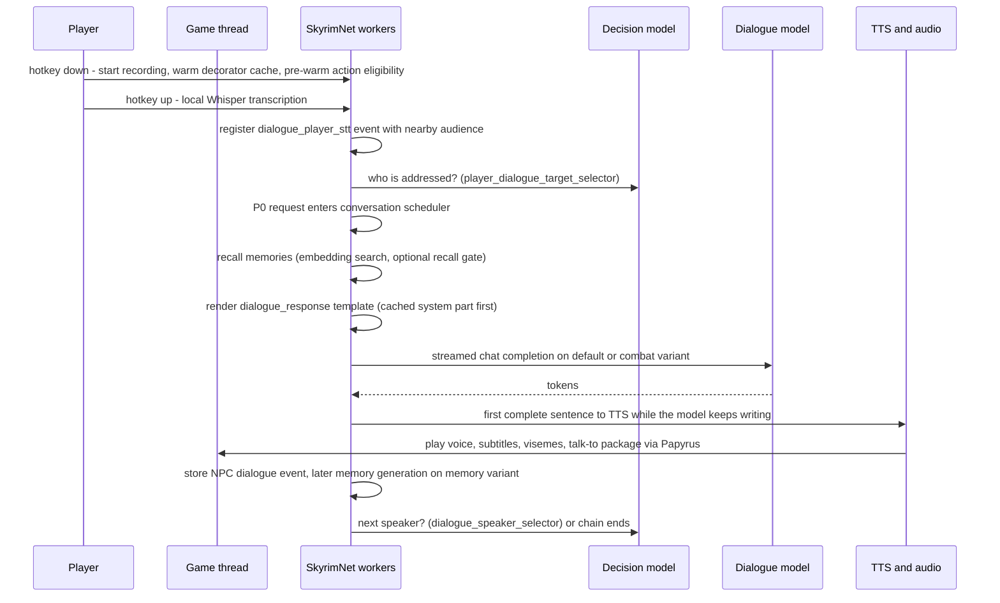

# SkyrimNet runtime architecture: subsystems, threading, configuration, LLM layer, content and APIs

Research note 01 for the EldenNet project, an LLM-driven NPC framework for Elden Ring.
Subject: SkyrimNet beta30-rc2 (Fateless.Ai / MinLL), the LLM NPC mod for Skyrim SE/AE/VR.

> **Method and license note.** Everything here comes from SkyrimNet's documentation, human-readable shipped
> content (YAML, SQL migrations, Papyrus `.psc` sources, the MIT-licensed C++ API headers, the Spriggit ESP
> tree, model presets, license notices, small readable chat UI files) and public web pages. No compiled file
> (DLL, `.pex`, bundled JS) was inspected. Statements marked **INFERENCE** are my reading of that evidence,
> not facts about the closed-source DLL. SkyrimNet's prompts may not be reused. This note paraphrases them
> and quotes only short fragments.

**Path prefixes used below**

| Prefix | Location |
|---|---|
| `DATA/` | `skyrimnet-beta30-rc2/SKSE/Plugins/SkyrimNet/` (release data dir) |
| `LIB/` | `DATA/library/skyrimnet.base/` (shipped content library layer) |
| `SRC/` | `skyrimnet-beta30-rc2/Source/Scripts/` (Papyrus sources) |
| `DEV/` | `skyrimnet-devkit-beta30-rc2/` (devkit: docs, CppAPI) |
| `GH/` | public repo clone `MinLL/SkyrimNet-GamePlugin` |

---

## TL;DR

- **One in-process native DLL.** SkyrimNet is a single SKSE plugin. It runs alongside the game's own threads with its own worker pool, with no sidecar server. Heavy native helpers sit next to it as DLLs: whisper.cpp/ggml, ONNX Runtime, FFmpeg. The Papyrus scripts and ESP are a thin shim for things only the engine's script VM and records can do: AI packages, message boxes, perks, factions and keywords. (`DEV/docs/FEATURES.md` "Why SkyrimNet is built this way"; `DATA/libs/`; `GH/spriggit/SkyrimNet`.)
- **"The game thread never waits."** The docs claim network, database and TTS work never runs on the game thread. The public APIs back this up: they are queue-and-callback, callbacks fire on "SkyrimNet's ThreadPool", and modders are told not to touch `RE::` game objects from them (`DEV/CppAPI/PublicAPI.h`). Public crash reports show where this gets hard: worker threads reading live game data still cause CTDs (GitHub issues #819, #830, #831).
- **The core is event-sourced.** Everything that happens is an *event* with a typed schema. Events are either persistent rows in a per-playthrough SQLite DB or *short-lived*, keyed, TTL-bounded scene facts. Each event has an *audience*: who perceived it. Prompts, memories, triggers and speaker selection all read from this one event stream.
- **The conversation scheduler is a priority queue.** Since Beta28, every "request to speak" enters one of five priority classes (P0 player … P4 NPC-to-NPC continuation). Each class has its own wait limit and merge/expire rules. A conversation has at most one line playing and one being prepared. This matters a lot for combat barks.
- **Different models for different jobs.** About a dozen *variants* (model slots): `default` dialogue, `combat`, `meta`, `memory`, `action_evaluation`, `gamemaster_evaluation`, `decisions`, `vision`, `CharacterProfileGeneration`, `DiaryGeneration`, `UniversalTranslator`, `AgentDefault`. Each slot has its own rotation, temperatures, max_tokens and timeouts, plus failover, first-token hedging and provider health cooldowns (`GH/model-presets/`, Beta25/27 release notes).
- **A typed "decision" channel sits alongside chat completions.** Speaker selection, mood, memory-recall gating and similar questions go to a classifier-style model (`decisions` variant, `typesafe/jev-1.13`, reached through a separate "Decisions"/"System One" provider API style). It picks one key from options the game itself enumerated and returns probabilities, not prose. The recall gate is quoted at about 0.2 to 0.4 s extra per player line (Beta28 notes). Built-in decisions fall back to the older chat-based prompts (`target_selectors/*`); mod-defined decisions get no fallback.
- **Everything tunable is data.** Prompts are Inja templates composed from numbered submodules and fed by C++ "decorators" over live game state. Config is per-subsystem YAML, generated on first launch and hot-reloadable from the dashboard. Content (prompts, bios, triggers, actions, knowledge, filters…) comes as layered plugins: base, then hub/external plugins, then the user overlay, then per-save files.
- **Tooling is built in.** An embedded web dashboard on `localhost:8080` (also drawn in-game through Prisma UI or Magelight UI), an MCP server on port 8889 for external AI agents, telemetry tables, and a headless `content-validate` tool.
- **The extension surface is versioned.** It covers a Papyrus API (`SkyrimNetApi.psc`), a C++ API (v14, resolved with `LoadLibraryA`/`GetProcAddress`, every function nullable, JSON strings across the boundary) and ModEvents.
- **For an Elden Ring v1,** copy the threading discipline, the event model (persistent plus short-lived), the priority speech scheduler, per-job model slots over an OpenAI-compatible client, per-playthrough SQLite with migrations, and data-driven templates and config. Leave out actions, packages, GameMaster, vision, songs, hub, MCP, VastAI and most of the dashboard.

---

## 1. Process model

### 1.1 One DLL inside the game

FACT: `DEV/docs/FEATURES.md` describes SkyrimNet as "a native Windows DLL that loads inside Skyrim itself, a single SKSE plugin", with "no separate program to run, no virtual machine and no server window". The reasons it gives: game state is read straight from memory with no inter-process sync, setup is simpler, and it is fast.

The shipped tree matches this:

- `SKSE/Plugins/SkyrimNet.dll`: the plugin, which SKSE loads.
- `DATA/libs/`: companion native DLLs loaded by the plugin. These are `whisper.dll`, `parakeet.dll`, `ggml*.dll` (CPU, CUDA and Vulkan backends), `onnxruntime_fateless.dll` with `onnxruntime_providers_shared.dll`, and the FFmpeg `avcodec/avformat/avfilter/avutil/swresample` DLLs.
- `SkyrimNet.esp`: very small. The Spriggit tree holds 2 quests (`skynet_MainController`, `skynet_Mcm`), 9 AI packages (talk-to-player, talk-to-NPC, follow and their templates), 3 factions (actor whitelist, actor blacklist, following-player), 2 keywords (dialogue target, follow target), spells and perks for hotkey and telepathy powers, sound categories and an output model for AI voice and bard audio, and a `SilentVoice` voice type (`GH/spriggit/SkyrimNet/*`).
- Papyrus: `SRC/SkyrimNetApi.psc` declares 136 natives implemented in the DLL. `SRC/SkyrimNetInternal.psc` holds functions "executed directly by the main DLL": showing message boxes, setting look-at, applying dialogue packages through the main controller quest. `SRC/skynet_MainController.psc` does version maintenance on load and adds the wheel-menu spell.

INFERENCE: the DLL owns all logic. Papyrus is used only where the engine requires it. Examples are AI packages (`SkyrimNetApi.RegisterPackage(akActor, "TalkToPlayer", …)` followed by `EvaluatePackage()` in `skynet_MainController.SetActorDialogueTarget`) and modal UI (`msgClearHistory.Show()`).

### 1.2 Engine, game plugin and the "Fateless engine"

FACT: the public repo states that "The SkyrimNet DLL itself is built elsewhere" (`GH/CONTRIBUTING.md`). Changelog tooling refers to "the Core repo" (`GH/changelog.d/README.md`). The base-content workflow says it is polled by "SkyrimNet's engine" and cites `Core: ai_docs/CONTENT_COMPATIBILITY.md` (`GH/.github/workflows/publish-base-index.yml`). The license notice mentions a source path `engine/src/face/A2fBasis.generated.inc` (`DATA/THIRD_PARTY_NOTICES.txt`, NVIDIA Audio2Face entry). The Papyrus test harness names a Core endpoint and doc, `/harness?api=engine-sweep` and `ai_docs/ENGINE_SWEEP.md` (`SRC/skynet_Harness.psc`). The README lists "NightCityNet: a sister project for Cyberpunk, built on the Fateless engine", and adds that it is "Independently operated, not by us" (`GH/README.md`, Community).

INFERENCE: there is a game-agnostic **core engine** (LLM routing, prompt engine, memory, speech, DB, web/MCP) and a **Skyrim adapter plus content** layer. The adapter covers CommonLibSSE-NG access, Papyrus bindings, the ESP and Skyrim bios. That a third party builds a Cyberpunk mod "on the Fateless engine" suggests the core is reusable outside Skyrim. How much code the two projects actually share is not documented. It is the most important structural idea for EldenNet: keep a game-neutral core and a thin Elden Ring adapter.

### 1.3 Threads and how blocking is avoided

FACT, from docs and API contracts:

| Thread | What runs there (documented) | Source |
|---|---|---|
| Game (main) thread | Native C++ action *execute* callbacks ("Change the game here, quickly. No I/O, no queries") | ExamplePlugin `docs/best-practices.md` (https://raw.githubusercontent.com/MinLL/SkyrimNet-ExamplePlugin/main/docs/best-practices.md) |
| SkyrimNet worker pool ("ThreadPool") | Event callbacks, custom LLM prompt callbacks, decision callbacks, decorator and eligibility evaluation ("Read only, fast, thread-safe") | `DEV/CppAPI/PublicAPI.h` (`PublicRegisterEventCallback`, `PublicSendCustomPromptToLLM`); best-practices table |
| Papyrus VM | Papyrus natives. Some are documented as blocking the calling Papyrus thread (`PurgeDialogue`: "a blocking call on the Papyrus thread"), with non-blocking hotkey-style alternatives (`TriggerInterruptDialogue`) | `SRC/SkyrimNetApi.psc` |
| Caller's own worker | DB-touching API calls that compute embeddings (`PublicAddDiaryEntry`, `PublicUpdateMemory`: "Blocks while the memory's embedding is computed; avoid the game thread") | `PublicAPI.h` |

Documented techniques for keeping the game smooth:

1. **Asynchronous by contract.** LLM entry points return "task queued" immediately and call back later. These include `SendCustomPromptToLLM`, `SendCustomDecisionToLLM`, `GenerateNPCThought`, `TransformDialogue`, `GenerateDiaryEntry` and `PublicRequestProfileUpdate` (which "returns immediately without blocking the game thread").
2. **Streaming.** "Text-to-speech starts speaking the first sentence while the model is still writing the second" (FEATURES).
3. **Pre-warming during input.** "Eligibility for actions is pre-warmed while your voice is being transcribed" (FEATURES). The thought hotkey "Prepares search query cache for player input" (`SkyrimNetApi.psc`, Thought System). A `warmup.prompt` template is rendered during hotkey preparation only to fill the template engine's decorator callback cache, and its output is discarded (`LIB/prompts/warmup.prompt` header comment).
4. **Per-turn decorator caching.** Beta27 notes mention "a finished turn's cached decorator values" and fixing their leakage between "simultaneous turns" (https://github.com/MinLL/SkyrimNet-GamePlugin/releases/tag/vbeta27). INFERENCE: decorator results are memoised per conversation turn, so one prompt render does not query the same game state many times.
5. **Background start-up work.** Beta24 moved model checks to "background threads instead of the load thread". The trigger worker "survives uncaught streaming exceptions" (release list, https://github.com/MinLL/SkyrimNet-GamePlugin/releases).
6. **No direct game access from callbacks.** "Called on ThreadPool — do NOT call RE:: functions directly" (`PublicRegisterEventCallback` doc). The example plugin adds: "Capture form ids, not `RE::Actor*`, in anything that runs later."

More documented thread facts:

- `PublicRegisterEvent` is "Callable from worker threads, like SkyrimNet's own event registration", and its FormIDs "resolve through live actors, so the originator, target and audience must be loaded" (`PublicAPI.h`). SkyrimNet's own event registration therefore runs on workers and resolves live actors there.
- The example plugin's thread table puts "Eligibility, decorators" on "SkyrimNet workers" with the rule "Read only, fast, thread-safe". Decorator callbacks receive an `RE::Actor*` (`PublicRegisterDecorator`), so a worker is handed a live engine pointer.
- All v3+ data queries "are thread-safe and return empty results gracefully if called before the database is ready" (`PublicAPI.h` header comment).
- User crash reports quote SkyrimNet's log: "The ThreadPool SEH handler logs the fault, but the process still aborts" (#819, reporter text; https://github.com/MinLL/SkyrimNet-GamePlugin/issues/819). INFERENCE: each pool task is wrapped in a Windows structured-exception handler. That catches faults for logging but cannot save the process once engine memory is corrupt.

INFERENCE about the internal pattern: workers render prompts and evaluate decorators, and decorators read game objects. Since the docs call native decorators "thread-safe", SkyrimNet must either (a) read engine objects from workers under guards ("reference-counted entity wrappers, validity checks before every use, strict lock ordering", FEATURES), or (b) snapshot state on the game thread, or both. The facts above and the public CTD reports point to (a), at least in part:

- #819 (closed): "SkyrimNet worker SEH at SkyrimSE.exe+0x1E7DC8", the same offset as #659 and #538. The maintainer traced it to SkyrimNet reading "a faction that another mod has broken".
- #828 (closed as a duplicate of #819): World Knowledge "Add Entry" "reads every faction in the game" and froze the game on such a faction. Maintainer: "SkyrimNet will skip a broken faction instead of crashing", a fix not yet released at the time (https://github.com/MinLL/SkyrimNet-GamePlugin/issues/828).
- #831 (open): an "execute fault on a SkyrimNet worker thread" after a dialogue output-model substitution. The race between the worker and the main thread is the reporter's hypothesis, and no maintainer has confirmed it.

**Lesson:** reading game memory off-thread is the main remaining crash source, even in a mature codebase.

---

## 2. Subsystems and responsibilities

The table lists every subsystem with direct evidence. Internal names in `code` come from human-readable sources (SQL comments, Papyrus comments, header docs). They are evidence of separate components, not a class diagram.

| Subsystem | Responsibility | Evidence |
|---|---|---|
| **Game adapter** | Event sinks for hits, deaths, equips, spell casts, activations; hooks; actor lookup; hotkeys (C++ hotkey manager with a Papyrus fallback) | Event types listed in `PublicRegisterEventCallback` doc; `SetCppHotkeysEnabled`; MinHook in notices; issue #801 title "GFxValueObjectInterfaceInvokeHook" |
| **Identity resolver** | Maps FormID to a stable 64-bit UUID; load-order-independent `mod_file + local_form_id`; rename continuity via aliases; identity links and succession records | `sql/migrations/0005,0020,0021`; comments name `UUIDResolver::AddMapping`, `CoIdentityRegistry`; `CONTENT_ROOTS.md` identity rules |
| **Event registry / schema registry** | Typed event schemas with fields, per-mode format templates (`recent_events`, `raw`, `compact`, `verbose`), ephemeral flag and TTL, `shortLivedEnabled`, `interrupt` | `SkyrimNetApi.psc` "Event Schema Registry Functions" |
| **Short-lived scene events** | Keyed, TTL-bounded facts that overwrite by key (for example "last spell this actor cast") and appear in scene context only | `RegisterShortLivedEvent(eventId, …, ttlMs, …)`; decorators `get_active_short_lived_events` and others (`DATA/docs/decorators.html`) |
| **Perception / audience** | Who perceives an event: nearby actors and the player by default, or an explicit audience; whisper radius; "people upstairs do not respond" | `PublicRegisterEvent` audience semantics; FEATURES "Realistic perception"; `interaction.maxDistance/whisperMaxDistance` (`TriggerToggleWhisperMode` doc) |
| **Conversation scheduler** | Priority classes P0–P4, merging, expiry, chain depth, one line playing plus one being prepared, speaker and target selection | Beta28 notes (https://github.com/MinLL/SkyrimNet-GamePlugin/releases/tag/vbeta28); `LIB/prompts/decisions/*speaker_selector*` |
| **Context / prompt engine** | Inja rendering, decorators (C++, Papyrus, plugin-registered), submodule composition, chat section markers, cache breakpoints, decision templates | `DEV/docs/modding/WORKFLOW_PROMPTS.md`; `warmup.prompt` mentions "ContextEngine"; `ParseString` doc mentions "PromptEngine" |
| **LLM router** | Providers, variants, rotation (sequential or weighted), failover, first-token latency guard, health and cooldown, per-variant directives, reasoning effort, quantization floor | Beta25 and Beta27 notes; `GH/model-presets/*` |
| **Decision client** | Typed questions (`choice`/`score`/`noul`) answered with probabilities over options the game enumerated. Built-in decisions are gated by config flags (for example `dialogue.decisions.useForSpeakerSelection`, `memory_retrieval.decision_gate.enabled`) and fall back to chat-model templates (`target_selectors/*`) or plain similarity search. Mod decisions have no chat fallback (`no_decisions_route`) | `PublicSendCustomDecisionToLLM`; `WORKFLOW_PROMPTS.md` Step 4.4; header comments of `LIB/prompts/decisions/dialogue_speaker_selector.prompt` and `memory_recall_gate.prompt` |
| **Memory** | Per-NPC first-person memories, importance and decay, LLM generation from events, semantic recall (ONNX embeddings plus HNSW), optional "Decision Gate" for recall | FEATURES "Memory"; `LIB/prompts/memory/*`; migrations 0003/0004/0028; `PublicGetWorldKnowledgeForActor` ("no HNSW") |
| **World knowledge / packs / NPC groups** | Shared facts with Inja condition expressions, always-inject or by-relevance; `.sknpack` bundles projected into each save | migrations 0013/0015/0017/0018/0022; `MIGRATING_TO_BETA25.md` "Knowledge packs" |
| **Diary & bios** | Diaries become memories. Static bios (1509 shipped character prompts), generated bios, dynamic bio updates per block | `LIB/prompts/characters/` (1509 files); `PublicRequestProfileUpdate`; `Agents.md` |
| **Database** | SQLite through SOCI, one DB per playthrough, migration runner, timeline keep/clear on load | `sql/`; migration 0021 comment on SOCI; `PublicGetTimelineState` |
| **Speech out** | TTS engine abstraction (Piper, PocketTTS, XTTS, Zonos, Chatterbox, Higgs, OpenAI-compatible, ElevenLabs, Inworld, Fateless, Kokoro), speech queue, voice effects, lip sync and visemes | FEATURES "Speech"; `GetSpeechQueueSize`; `voice_effects/`; Audio2Face in notices; Beta29.1 "engine-timed visemes" |
| **Speech in** | Whisper (CUDA/Vulkan/OpenCL/CPU), Parakeet, cloud Whisper, Fateless STT; STT hint prompt | FEATURES; `DATA/libs/whisper.dll, parakeet.dll`; `LIB/prompts/stt_hints.prompt` |
| **Vanilla dialogue bridge** | Voices player menu picks, prepares voiced replies for silent lines, filters engine grunts, "dialogue actions" | FEATURES "Vanilla dialogue"; `PrepareNPCDialogue/IsNPCDialogueReady`; `LIB/filters/combat_grunts.yaml` |
| **Actions & package manager** | LLM-selected actions (YAML, Papyrus, C++), nested categories, eligibility caching, AI package ownership and holds | `WORKFLOW_ACTIONS.md`; `SkyrimNetApi.psc` Package Management |
| **Triggers** | YAML "when X, do Y" rules over events | `WORKFLOW_TRIGGERS.md` |
| **GameMaster / continuous mode** | Autonomous director that starts NPC-NPC scenes | `LIB/prompts/gamemaster_*.prompt`; `TriggerToggleGameMaster` |
| **Thoughts / telepathy / virtual NPCs** | Private NPC thoughts (audience = self), perk-gated telepathy, bodiless speakers | `GenerateNPCThought`; Telepathy section; Virtual NPC functions |
| **OmniSight** | Screenshots (DirectXTK/Tex) described by a vision model, cached by content hash, lockable descriptions | FEATURES; migrations 0007/0009/0011/0031 |
| **Bard songs** | LLM lyrics plus Suno/Fateless music, cached per save, spatial playback | FEATURES; migrations 0012/0019/0030 |
| **Translator** | Universal Translator speech rules, subtitle and option translation | `LIB/prompts/transformers/*`; `translator/` root |
| **Config manager** | Named YAML sections, `Plugin_<Name>` schemas, JSON-patch writes, hot reload | `SkyrimNetApi.psc` GetConfig*/PatchConfig; `PublicGetPluginConfig` ("ConfigManager") |
| **Content library** | Layered plugins, hub install/update, overlay edits, per-save layer, validation | `CONTENT_ROOTS.md`; `MIGRATING_TO_BETA25.md` |
| **Web server / dashboard** | `localhost:8080` control panel, also rendered in-game | FEATURES "Web dashboard"; `skynet_McmScript.psc` line 249 |
| **MCP server & agents** | Port 8889 tools; in-dashboard agents that use them | FEATURES "MCP server"; `LIB/prompts/agent_*.prompt` |
| **In-game UI** | Chat overlay, subtitles, dashboard as Prisma UI or Magelight views (HTML/JS) with a JSON bridge | `PrismaUI/views/SkyrimNet/{chat,dashboard,subtitles}`; `DATA/chat/app.js` |
| **Telemetry** | `traces` (label, depth, duration_us, parent), `counters`, `errors`; Logs/Traces/Performance pages; `SkyrimNet.log`; streaming `ttft_ms` recorded "on success and failure paths" | migration 0001; FEATURES dashboard list; Beta25 notes |
| **Output evaluation (ratings and LLM judges)** | The player rates outputs from 1 to 5 with tags such as `out_of_character`, `spoke_for_player` or `too_long`. An LLM label assistant pre-fills ratings. A preference extractor turns ratings into at most 8 rules. Pairwise and absolute judges compare candidate replies or task outputs, and a "flag judge" checks whether a new output still has a problem the player flagged | `LIB/prompts/eval/*.prompt` (template headers only; no doc describes the feature) |
| **Engine self-test harness** | A DLL → Papyrus → DLL round trip (UUID resolve, build version, action registry, speech queue) dispatched "like a decorator" by a Core "engine sweep"; test NPCs and a test cell in the ESP; a debug lever that starts an NPC-NPC dialogue | `SRC/skynet_Harness.psc`; Spriggit `Npcs/SkyrimNet_TestNpcAlpha/Beta`, `Cells/`; `SRC/SkyrimNet_agDebugLever01.psc` |
| **VastAI manager** | Rents GPU instances for heavy TTS ("Smart Create", health-first-wins, cleanup) | FEATURES "Cloud GPU (VastAI)" |
| **Public API** | Papyrus natives, C++ exports, ModEvents | §8 |

### 2.1 Component diagram

### 2.2 Data flow of one player line

The order below is reconstructed from the documented features. The individual steps are FACT where cited; their exact sequencing is INFERENCE.

---

## 3. Event model: the spine of the system

FACT (`SRC/SkyrimNetApi.psc`, `DEV/CppAPI/PublicAPI.h`, migrations):

- **Persistent events** are rows in `events`: `event_type`, `event_data` (JSON), `location`, `game_time`, `game_time_str`, `local_time`, `actor_UUIDs`, `originating_actor_UUID`, `target_actor_UUID`. Later columns add `memory_generated_for_actors` (0004), which tracks which perceivers have already turned the event into memories, and pause-aware `playtime` (0008).
- **Short-lived events** live only in memory. They have an `eventId` key, a TTL and an optional source and target. A new event with the same key replaces the old one. The API comment gives the reason: "highly real-time events that don't blow up the context", such as the last spell an actor cast.
- **Ephemeral types** only notify callbacks and are never stored. An empty `DirectNarration` content yields a short-lived event "that appears in scene context but does not persist".
- **Event schemas** declare fields, templates for each render mode, `isEphemeral`, `defaultTTLMs`, `shortLivedEnabled` ("Set to false for high-volume events") and `interrupt`. The same event renders differently in recent-event context, in memories and in diagnostics.
- **Audience.** By default the audience is everyone near the originator plus the player. An explicit audience limits "each character's own history, memories and dialogue context". The GameMaster and speaker selection still see the event (`PublicRegisterEvent`).
- **Reaction semantics by API.** `DirectNarration` forces a reaction and is treated as fact. `RegisterPersistentEvent` records context with reactions off. `RegisterDialogue` adds a spoken line. `GenerateNPCThought` stores a private thought whose audience is the thinker only.

**Why it matters.** One event log with audience filtering powers the NPC's knowledge of the scene, memory formation, triggers and dashboard history alike, so each subsystem can stay simple. For Elden Ring, combat telemetry (hits, stance breaks, phase changes, deaths) maps naturally onto short-lived keyed events. Story beats map onto persistent events.

---

## 4. The conversation scheduler (Beta28 rewrite)

FACT, from the Beta28 release notes (https://github.com/MinLL/SkyrimNet-GamePlugin/releases/tag/vbeta28):

| Class | Sources | Wait limit | Merge / cap rule |
|---|---|---|---|
| P0 player | Player input, Continue Narration | 30 s | Never merged or capped |
| P1 directed | DirectNarration not fired by a trigger; GameMaster cues | 15 s ("cues never expire") | Each call is its own line, in order |
| P2 urgent | Anything a trigger fires; interruptible event types | 10 s | Repeats of the same trigger merge; the other firings are listed in the line's prompt |
| P3 reaction | `RegisterEvent` reactions; vanilla or background lines | 8 s | Different waiting reactions get one reply to the newest |
| P4 continuation | `RegisterDialogue` lines; NPC-to-NPC replies | 6 s | Ends after Max Chain Depth |

Further rules from the same notes:

- A "Max Recent Speech Count" per window caps P2 to P4.
- A higher priority replaces a line that is still being written, but never one already speaking.
- `interrupt: true` events cut speech.
- `PurgeDialogue` clears audio, the line in progress and every waiting request.
- "SkyrimNet does not react to its own lines".
- A conversation has at most one line playing and one being prepared.

The stated motivation was busy moments ("a fight, a trigger firing again and again, a crowd reacting"), where NPCs had kept "playing lines long after the moment has passed". Open issues show what remains hard for combat dialogue: #784 "Stop combat dialogue if no NPCs in range", #771 "Enemies in search mode issue combat dialogue targeted at player", #768 "Enemies are sometimes friendly during combat dialogue" (GitHub issue search). **This is exactly the Elden Ring generic-enemy bark problem**, and SkyrimNet's answer, priority classes with short expiry and merge-to-newest, is the part to copy.

---

## 5. Configuration system

### 5.1 Config records

FACT:

- **No default config ships.** The release has no user `config/` directory. Its only `config/` content is in the base layer (`LIB/config/carry_tags_*.yaml`, audio-tag vocabularies). FEATURES says "First launch generates working defaults for every system", followed by a web setup wizard.
- **Config is split into named sections.** The `PatchConfig` documentation lists 22 sections: `game, OpenRouter, XTTS, Zonos, Piper, STT, ActorFilter, Phonetic, Hotkey, furniture, PlayerDialogue, VirtualEntities, Entity, Memory, ItemCustomization, Actions, DynamicBio, Events, VastAI, WebServer, VoiceSamples, SpellCustomization` (`SkyrimNetApi.psc`). `skynet_ConfigUtilityMenu.psc` addresses the same section as both `"Game"` and `"game"`. INFERENCE: section names are case-insensitive. Other names appear elsewhere: `NpcThoughts.yaml` (the `GenerateNPCThought` doc), `OpenRouter.yaml` with `reasoning_effort` (Beta27), `Dashboard.yaml` with `ui_host`, `ui_console_forward` and `ui_prepaint` (Beta28), and older names `tts_config.yaml`/`text_model_config.yaml` (`GH/.github/ISSUE_TEMPLATE/bug_report.yml`) and `game_config.yaml` (`feature_request.yml`). INFERENCE: one YAML file per section, possibly with legacy names kept for older sections.
- **Values are addressed by dot-path.** Examples are `gamemaster.agentEnabled`, `global.enabled`, `speech.shouldApplyTalkToPlayerPackage`, `narration.enabled` and `interaction.maxDistance`. Reads go through `GetConfigString/Int/Bool/Float(section, path, default)`; writes are JSON merge-patches through `PatchConfig(section, jsonPatch)`.
- **Plugins get their own config.** A plugin ships a schema in `settings/{Name}.yaml`, which renders as a Settings page. Players' values live separately in `config/plugins/{Name}/settings.yaml`. Code reads them via `PublicGetPluginConfig("{Name}")`/`PublicGetPluginConfigValue(name, "a.b", default)`, and the `SkyrimNet_OnPluginConfigSaved` ModEvent signals changes (`MIGRATING_TO_BETA25.md` "Plugin settings").
- **Hot reload.** "Reloading configs from the dashboard also reloads Content Library edits without restarting"; "If a plugin installation is underway, the content reload waits"; "Base content updates apply at startup, never in the middle of a game" (Beta25 notes). Beta27 adds: "Save Changes switches the running game". For example, changing the embedding model downloads it and re-embeds memories in the background. Prompts and voice-effect recipes are "hot-reloadable" (FEATURES).
- **Some toggles are runtime-only.** The actions master switch is "not persisted to config, resets to enabled on game restart", and the telepathy eavesdrop flag "resets to OFF every game load" (`SkyrimNetApi.psc`).

### 5.2 Config-system content roots

Eight content roots carry "the customizations a user otherwise keeps in their own `config/`, shipped as content, one record per file": `voice_effects/`, `items/`, `spells/`, `furniture/`, `identity/`, `filters/`, `translator/`, `dialogue_actions/` (`DEV/docs/modding/CONTENT_ROOTS.md`). The rules:

- The **filename is the identity**. For form-keyed records, the filename is a deterministic "form stem" built from the plugin filename and the plugin-relative id, with an FNV-1a hash for unusual names.
- Size caps: 64 KB per voice-effect recipe, 32 KB per record elsewhere, 1 MB per knowledge pack.
- Cross-mod references use load-order-independent ids: `form: "Plugin.esp|0x01396B"` for records and `npc:Plugin.esp:0xLocalID` for identity links. The hub refuses a runtime FormID spelling such as `npc:0A012345`.
- Identity records come in two kinds: `link` (two NPCs share an identity) and `succession` (one form continues another). An example is the base `identity/vanilla_cicero_dawnstar.yaml`, which maps one Cicero form to his later form.
- `priority` integers order rules.
- List contributions (faction, race and gender white/blacklists) *union*, with one purpose per file so users can switch off exactly one thing.
- Example records: `filters/animals_dont_speak.yaml` blacklists cat, dog and wolf races. `filters/combat_grunts.yaml` is a `dialogue_rule` regex that blanks engine combat grunts so they are not treated as speech.

**Takeaway.** Two kinds of configuration are kept apart: *settings* (scalar knobs per subsystem) and *records* (many small, individually toggleable, layerable files). This keeps the YAML editable and the content shareable.

---

## 6. LLM client layer

### 6.1 Providers

FACT (FEATURES "Language models"; README):

- **Fateless**: a first-party account covering "dialogue, voices, speech recognition and bard songs", Beta29+.
- **OpenRouter**, with Budget, Balanced and Premium presets. FEATURES calls the third one "Performance": its file is `openrouter-performance.yaml`, but `index.yaml` displays it as "Premium".
- **"Any OpenAI-compatible service"**. `recommended-models.yaml` also lists `nvidia`, `nanogpt` and `chutes` provider ids.
- **Local**: LM Studio, Ollama, KoboldCpp, llama.cpp.
- Providers can be mixed ("Fateless for dialogue and a local engine for voices").
- **Provider "API Style".** Since Beta26 a provider has an API Style of "Chat Completions, Decisions, and System One". "Decision models need a Decisions or System One provider rather than a chat-completions provider". A built-in "OpenRouter (Decisions)" provider reuses the OpenRouter key, which is the `provider_id: openrouter_decisions` seen in every preset. To call TypeSafe (Jev's maker) directly, you add a provider using System One (https://github.com/MinLL/SkyrimNet-GamePlugin/releases/tag/vbeta26-rc4). INFERENCE: the client layer has at least two wire protocols, OpenAI-style chat and a classification/decision protocol, chosen per provider rather than per variant.

The HTTP stack is libcurl with nghttp2 and OpenSSL. Issue #697 quotes "cURL: POST request failed: Error in the HTTP2 framing layer".

### 6.2 Variants: different models for different jobs

FACT: `GH/model-presets/presets/openrouter-default.yaml` (Balanced) defines these variants. The job descriptions come from `DEV/docs/Agents.md` and the preset comments.

| Variant | Job | Balanced models (rotation) | max_tokens | timeout s |
|---|---|---|---|---|
| `default` | NPC dialogue (text generation) | gemma-4-31b-it (T 1.0), deepseek-v3.2 (T 0.7) | 4096 | — |
| `combat` | Combat dialogue | gemma-4-26b-a4b, gemma-4-31b, deepseek-v4.1-flash (T 1.0) | 2000 | — |
| `meta` | Mood evaluation, speaking-turn evaluation, memory search-query generation | deepseek-v4.1-flash, v4-flash | **100** | — |
| `action_evaluation` | Choosing actions | gemma-4-31b, deepseek-v3.2 | 500 | — |
| `gamemaster_evaluation` | Scene director | llama-3.3-70b | 256 | 30 |
| `memory` | Memory generation and ranking | qwen3-235b | 4000 | 60 |
| `decisions` | Typed decisions (speaker, mood, recall gate, mod questions) | typesafe/jev-1.13, provider `openrouter_decisions`, `max_retries: 0` | — | **10** |
| `vision` | OmniSight | gemma-4-26b-a4b | 4000 | — |
| `CharacterProfileGeneration` | Bio generation and updates | qwen3-235b | 10000 | 300 |
| `DiaryGeneration` | Diaries | qwen3-235b (T 0.8) | 12000 | 120 |
| `UniversalTranslator` | Speech-pattern and subtitle translation | gemini-2.5-flash | 512 | — |
| `AgentDefault` | Dashboard agents (MCP tool use) | claude-haiku-4.5 | 32000 | 120 |

How the preset files work:

- **Selection.** Budget swaps in the two Gemma-4 models for dialogue, combat and action selection. Premium uses Sonnet 4.6 for dialogue, profiles, diary and memory.
- **Budgets belong to the job, not the tier.** Across all three presets each variant's `max_tokens` and `timeout` are identical (for example meta 100 tokens, combat 2000, decisions 10 s, profile generation 300 s). Only the models and some temperatures change. Compared by slot (`GH/model-presets/presets/*.yaml`):

  | Variant | Budget | Balanced | Premium |
  |---|---|---|---|
  | `default` | gemma-4-31b + gemma-4-26b | gemma-4-31b + deepseek-v3.2 | sonnet-4.6 + gemma-4-31b |
  | `combat` | gemma-4-26b + gemma-4-31b | both Gemmas + deepseek-v4.1-flash | same as Balanced |
  | `meta` | deepseek-v4-flash | v4.1-flash + v4-flash | same as Balanced |
  | `memory`, `DiaryGeneration`, `CharacterProfileGeneration` | qwen3-235b | qwen3-235b | sonnet-4.6 |
  | `gamemaster_evaluation` | llama-3.3-70b | llama-3.3-70b | deepseek-v3.2 |
  | `vision` | gemma-4-26b | gemma-4-26b | qwen3-vl-235b |
  | `decisions`, `AgentDefault` | jev-1.13, haiku-4.5 | same | same |

- **Recommended-model entries** can carry `temperature`, `max_tokens`, `top_p`, `top_k`, `frequency_penalty` and `presence_penalty`. These are applied to the rotation slot when a user picks the model in the dashboard's ModelPicker (`recommended-models.yaml` header).
- **Routing floor.** All three presets set `routing: quantization_floor: fp8`.
- **Mod variants.** "Mod-registered variants inherit `default`", so a mod can name a variant and it falls through to the default rotation (preset header comments). The Papyrus `SendCustomPromptToLLM(promptName, variant, …)` takes a variant name.
- **Preset distribution.** `GH/model-presets/index.yaml` is a manifest the dashboard "fetches once (cached ~10 min)". A new preset is a dropped-in YAML file with "no code change needed". `recommended-models.yaml` maps provider → variant → model entries, each with optional sampling parameters.

INFERENCE: the variant is chosen by the calling job in code, not by the template. `dialogue_response.prompt` names no variant, and the shipped prompts choose a *render mode* (`full`, `thoughts`, `transform`, `book`), not a model.

### 6.3 Router behaviour

FACT, from the Beta25 notes (https://github.com/MinLL/SkyrimNet-GamePlugin/releases/tag/vbeta25-rc13), Beta27 notes, and issues #708/#789:

- **Rotation.** "sequential or weighted-random selection", with per-slot weights and per-character overrides. Beta25-era presets rotate 2–3 models per variant "for more variety in dialogue".
- **Failover.** "Failed requests can retry on the next model or provider in your rotation". A weight of 0 makes a slot failover-only.
- **Hedging.** A first-token latency guard starts an early retry while the original request keeps running: "SkyrimNet uses whichever starts responding first". Beta27: "A reply whose first model stalls ends when its backup finishes".
- **Error classes.** "Timeouts, rate limits, server errors, empty or invalid responses, and connection failures are recognized separately".
- **Health.** A model or provider can be "healthy, cooling down, or being routed around". Failing providers are "temporarily skipped, then allowed back after a cooldown".
- **Scoped directives.** Directives can be "scoped to an individual variant", for example skipping a provider for one job only. Per-model router settings are an open request (#708).
- **Reasoning control.** Reasoning effort per model: off, model default, minimal, low, medium or high. A model that cannot disable reasoning is retried at minimal (Beta27).
- **Decisions fallback.** When Jev was introduced, "The previous chat-based Meta approach remains available for now", and "built-in conversation decisions fall back to it if a decision request fails" (Beta26). Here "it" is the chat-based Meta path, not Jev. The shipped templates match this. `decisions/dialogue_speaker_selector.prompt` names `target_selectors/dialogue_speaker_selector` as "the chat fallback", and the recall gate falls back to "plain similarity search" when its answer is none, too uncertain, or the request fails. The custom decision API has no chat fallback (`no_decisions_route`).
- **Typed async errors.** A failed decision callback carries one of `ai_disabled`, `no_decisions_route`, `template_failed`, `interface_failed`, `request_failed`, `cancelled` or `exception` (`PublicSendCustomDecisionToLLM` doc).

### 6.4 Streaming, prompt caching and structured output

- **Sentence-level streaming to TTS** (FEATURES). Beta27: "Cancelled replies now stop streaming".
- **Prompt caching layout.** Main prompts use chat section markers (`[ system ]`, `[ user ]`, `[ assistant ]`) plus `[ cache ]` breakpoints (`WORKFLOW_PROMPTS.md` Step 4.4). The default prompts are ordered so the stable parts come first: identity and bio, guidelines, response format, voice tags, then actions with their own breakpoint because they change "about one turn in six". The newest lines are repeated at the very end so smaller models answer the latest line (`LIB/prompts/dialogue_response.prompt` header comment, paraphrased; `GH/changelog.d/prompts-cache-layout.md`: lower "cost and time to first word"). Providers without caching ignore the breakpoints. "Each provider's cache lifetime, 5 minutes or 1 hour, is under Advanced on AI › Providers" (Beta27).
- **Typed decisions instead of parsing prose.** Decision templates declare `[ state ]` blocks and `[ question <id> choice|score|noul ]` with one-line `[ criteria ]`. The result JSON has the chosen key, a confidence and the top-k probabilities (`PublicSendCustomDecisionToLLM`). The shipped decisions are `dialogue_speaker_selector`, `scene_speaker_selector`, `player_dialogue_target_selector`, `continue_narration_selector`, `evaluate_mood` and `memory_recall_gate` (`LIB/prompts/decisions/`). The recall gate costs "One extra decision request per player line, about 0.2 to 0.4 s" (Beta28). The engine, not the model, builds the option set. The speaker decision is "one choice over the legal (speaker, target) pairs the game enumerated", and the recall gate chooses among memory keys `m1, m2, …` that similarity search has already shortlisted (template header comments, paraphrased). The model can only pick something that is valid in the game.

---

## 7. Persistence: SQLite per playthrough

FACT, from `DATA/sql/migrations/0001–0031` and `schema_migrations.sql`:

| Table | Purpose |
|---|---|
| `schema_migrations` | Applied migration versions |
| `events` | The event log (§3) |
| `dialogue` | Early speaker/text table (from 0001) |
| `traces`, `counters`, `errors` | Telemetry per session (`label`, `duration_us`, `depth`, `parent_label`) |
| `memories` | Per-actor memories (`actor_uuid`, `content`, `importance_score`, `emotion`, `tags`, `memory_type`, `related_actors`, `related_event_ids`, `game_time`). World knowledge reuses this table with `actor_uuid = 0` plus `condition_expr`, `always_inject`, `is_active` and `display_name` (0013) |
| `memory_embeddings` | Vector BLOB with dimension. Recreated in 0028; `dimension = 0` marks "unembeddable" |
| `embedding_producer` | A single-row fingerprint of the model that produced the stored vectors, so a model change triggers re-embedding (0028) |
| `uuid_mappings` | UUID ↔ runtime FormID, name, bio template, `mod_file` and `local_form_id` (0005, 0020) |
| `identity_aliases` | Rename forks (old and new UUID), unioned at recall time, trimmed on timeline revert (0021) |
| `diary_entries` | Diaries (0006, `updated_at` in 0025) |
| `omnisight_screenshots` | Vision captures, content hash, suggested name, description lock, manual capture |
| `bard_songs` | Songs, composer, imported flag |
| `npc_groups`, `npc_group_members` | User-defined groups (BIGINT fix in 0016) |
| `knowledge_packs` | Installed pack metadata and provenance |

Architecture-relevant details from the SQL comments:

- **UUID scheme.** "A UUID is a hash of display name and masked FormID", so a rename mints a new UUID and needs alias rows (0021).
- **Re-embedding on tokenizer change.** 0014 deletes all embeddings because the tokenizer was replaced "from a hash-based placeholder to a proper WordPiece tokenizer", and `BackfillMissingEmbeddings()` regenerates them at startup. 0024 and 0029 re-embed subsets.
- **A naive migration runner.** It "splits statements on every semicolon outside a quoted string" and "does not understand comments". This is a fragility SkyrimNet documents in its own files.
- **A type-mapping pitfall.** The SOCI layer reads a column declared `INTEGER` "through a 32-bit get", which silently truncated 64-bit UUIDs. Hence the rule to declare BIGINT (0016, 0021).
- **One DB per playthrough.** "within one save's database (each playthrough has its own; ids from different playthroughs are not comparable)" (`PublicQueryDiaryEntries`). `GetSaveUniqueID` is "generated per playthrough and persists across save files within the same playthrough".
- **Timeline reconciliation on load.** After a save loads, SkyrimNet checks for "future history": events, memories and diary entries newer than the save. It asks whether to keep or clear them, with a Papyrus message box shown via `SkyrimNetInternal.ClearTimelineMessage`. Writes are refused while the check is pending, and the `SkyrimNet_TimelineResolved` ModEvent fires when it finishes (`PublicGetTimelineState`).
- **Vector index.** HNSW (hnswlib) sits over the embeddings. Relevance ordering "only sees memories already in the vector index" (`PublicAPIMemoryQuery.h`). INFERENCE: the index is built in memory from the BLOB table at load.

---

## 8. Public APIs

### 8.1 C++ API (`DEV/CppAPI/PublicAPI.h`, MIT)

- **How a plugin obtains it.** Include the header and call `FindFunctions()` once in the SKSE `kDataLoaded` handler. It does `LoadLibraryA("SkyrimNet")`, resolves `PublicGetVersion`, then `GetProcAddress`es only the functions that version supports. Every API function is an `inline` function-pointer variable that stays `nullptr` if absent. Callers gate each feature on its pointer. Data queries also return empty results until a save is loaded (`PublicIsMemorySystemReady()`).
- **Versioning.** A single integer, currently **14**, with a documented history: 2 action registration; 3 data queries, UUID and config; 4 diary queries; 5 decorators, event callbacks and memory creation; 6 busy state; 7 save id and world knowledge CRUD; 8 custom LLM prompt; 9 per-actor world knowledge; 10 filtered memory queries; 11 timeline state, diary writes, memory edits, actor search and audience events; 12 custom decisions; 13 named places; 14 profile updates. A separate probe, `PublicGetPackageApiVersion`, versions the Papyrus package contract independently.
- **ABI.** `std::string` and `std::function` cross the boundary, so callers must "build with the same MSVC toolset as SkyrimNet (Visual Studio 2022, v143)" and preferably the static CRT. Newer functions take `const char*` and JSON strings. The typed `MemoryQuery`/`DiaryQuery` structs are serialized to JSON inline in the header to keep "stable ABI".
- **Surface areas.** Native actions and subcategories with eligibility and execute callbacks and JSON-schema parameters. UUID↔FormID resolution. Queries for memories, events, dialogue, engagement statistics, related actors, player context and event pair counts, all returning JSON. Diaries (read/add/edit/delete). Memories (add/edit/delete). World knowledge CRUD. Decorators with `std::function<std::string(RE::Actor*)>` callbacks. Event callbacks. Actor busy state with a reason. Custom prompt and decision requests. Named places. Actor search. Profile updates.

### 8.2 Papyrus API (`SRC/SkyrimNetApi.psc`, MIT)

136 global natives grouped as: decorators, actions/tags/cooldowns, events (short-lived, persistent, schema registry), dialogue (register, to-listener, purge), a package manager (owners, holds, listing, delayed removal), LLM interaction (prompt and decision with quest-script callbacks; Papyrus responses capped at 750 characters), narration and persistent events, thoughts, JSON helpers, config get/patch, build info, template rendering, diaries and bios, virtual NPCs, hotkey triggers for every input mode, telepathy, OmniSight capture, places and voice effects.

ModEvents include `SkyrimNet_SpeechStarted`, `SkyrimNet_MemoryCreated`, `SkyrimNet_DiaryCreated/Updated/Deleted`, `SkyrimNet_MemoryUpdated/Deleted`, `SkyrimNet_TimelineResolved`, `SkyrimNet_OnPackageAdded/Removed/OnPackagesHeld/Released` and `SkyrimNet_OnPluginConfigSaved` (FEATURES; PublicAPI.h; MIGRATING_TO_BETA25.md).

The ExamplePlugin README notes that Papyrus `RegisterAction`, `RegisterSubCategory` and `RegisterDecorator` are now "deprecated: use YAML actions and categories". A Papyrus decorator is "a VM round trip on every prompt render" (best-practices). The direction is clear: **declarative data over script callbacks**.

---

## 9. Embedded web server, in-game UI and MCP

**Dashboard on `localhost:8080`** (FEATURES; MCM text "UI can be found at http://localhost:8080"). Its pages:

- Home: status, nearby NPCs, live event stream, recent model requests.
- Content editors: characters (bio editor beside live actor data, AI updates with diff preview), memories (search, edit, test semantic recall), world knowledge, packs and groups, triggers (YAML editor with schema validation), voice effects and samples, OmniSight gallery, prompts (hot-reloaded), actions, diary.
- Agents (chat with AI agents that use the MCP tools).
- Content Library (hub install and update).
- Settings: searchable, with hotkey capture.
- A Game Data Explorer: quests, spells, factions, items, NPCs, races, effects, plugins, globals, messages.
- Logs, Traces, Performance and an Event Monitor.

The same dashboard renders in-game as a Prisma UI or Magelight UI view, chosen by `Dashboard.yaml ui_host` (Beta28).

How it is packaged (from file and directory names only; the bundles were not opened): the dashboard ships as a pre-built single-page app, twice. `DATA/assets/web/` (18 files, with `charts-vendor` and `codemirror-vendor` chunks) and `DATA/assets/web-new/` (with per-locale chunks such as `locale-de-json`) are served by the embedded HTTP server, and a copy sits under `PrismaUI/views/SkyrimNet/dashboard/`. INFERENCE: an old and a new dashboard ship side by side during a migration, and the C++ side exposes JSON endpoints. The prompt engine also renders some server-side HTML. `LIB/prompts/web/bundled_base.prompt` is an HTML page template (`{{ page_title }} - {{ server_name }}`), and `LIB/prompts/documentation/main.prompt` is the HTML template behind the decorator reference. INFERENCE: `decorators.html` was produced by rendering that template over the live decorator registry, which is why it shows a generation timestamp.

**In-game overlays.** These are HTML/JS views under `PrismaUI/views/SkyrimNet/` (chat, dashboard, subtitles). The readable chat build shows the bridge: C++ pushes JSON into `window.updateMessages` and `window.updateAudience`, and JS calls `skyrimnet.chatSubmit({text})`, `eventEdit`, `eventDelete`, `requestRefresh` and `chatClose` (`DATA/chat/app.js`, `input.js`, `messages.js`). The audience panel lists nearby NPCs sorted by distance, with whisper state (`audience.js`). INFERENCE: the overlay is a thin view over the same event store. Editing or deleting a chat line edits the stored event.

**MCP server on port 8889** (FEATURES). Its tools cover:

- Game data: `get_plugins`, `get_quests`, `get_quest_scripts`, `get_quest_script_functions`, `get_quest_script_properties`, `get_quest_property_value`, `get_magic_effects`, `get_factions`, `get_globals`, `get_keywords`.
- Live state: `get_monitored_events`, `get_player_info`, `get_nearby_actors`.
- Prompt support: `get_decorators`, `validate_prompt`.
- Validation: `validate_custom_trigger`, `validate_custom_action`.
- Testing: `execute_quest_function`.
- Per FEATURES: memory read/write/search, world knowledge management, action eligibility checks, rendering any prompt with full context, rendering items to images, console commands, and live reloads (`DEV/docs/modding/WORKFLOW_MOD_INTEGRATION.md` "MCP Tools Quick Reference").

The devkit's modding docs are written as **workflows for an AI assistant** that drives these tools. The MCP server is effectively the authoring IDE.

---

## 10. Content library and plugin layering

FACT (`DEV/docs/modding/CONTENT_ROOTS.md`, `MIGRATING_TO_BETA25.md`, `LIB/manifest.json`, `GH/.github/workflows/publish-base-index.yml`):

- **Roots.** `prompts/`, `triggers/`, `actions/`, `knowledge/`, `entities/`, the eight config roots (§5.2) and `settings/`.
- **Layers on disk.**
  - `library/`: hub-installed plugins and plugins the player packaged locally; written only by SkyrimNet.
  - `external/`: plugins shipped inside other mods, read-only to SkyrimNet.
  - `overlay/`: the player's dashboard edits.
  - `saves/`: per-playthrough bios.
- **Priority,** highest first: per-playthrough files, then player edits, then installed and external plugins in user order, then `skyrimnet.base`. "The highest-priority layer that has a file provides it". A file at the same path replaces the lower one.
- **Manifest** (`manifest.json`): `id` as `author.slug` (must equal the folder name), `type: bundle`, semver `version`, `min_skyrimnet_version`, optional `mods` dependencies (warn, never block), tags, `nsfw`, icon. The base manifest also uses `supersedes` (retiring an old hub plugin below a version) and `pins` (forcing one base file to win over overrides).
- **Hub.** Players can browse and install without an account; publishing needs one. Submissions are reviewed automatically, and plugins that contain actions are reviewed by a person "because actions call script functions in other mods". Player edits never block an author's update.
- **Base updates out of band.** `base-index.json` in the public repo lists `{version, commit, min_skyrimnet_version}` entries. The engine fetches the newest base content compatible with the running DLL at a pinned commit, so prompt and bio fixes ship without a DLL release. They "apply at startup, never in the middle of a game".
- **Validation and migration tooling.** `tools/content-validate.exe` "Loads a plugin the way the game loads it and reports what would fail". `tools/content-convert.exe` ports the old layout. `DATA/legacy-fingerprints.json` lists the git blob hashes of every historical shipped file ("commits_scanned": 445), so "Import Old Content" skips files identical to shipped ones.
- **Submodule composition.** Prompt directories such as `submodules/character_bio/` hold numerically ordered fragments (`0010_header`, `0100_summary`, … `9990_speech_style`). A plugin adds a fragment, for example `0301_mymod.prompt`, without editing the main template (`MIGRATING_TO_BETA25.md`; `LIB/prompts/submodules/*`).

---

## 11. Third-party libraries and what they imply

FACT: list from `DATA/THIRD_PARTY_NOTICES.txt` (41 entries). The implications column is INFERENCE unless noted.

| Library | Implied role |
|---|---|
| CommonLibSSE NG | Typed access to Skyrim engine structures (the `RE::` namespace in the API) |
| MinHook | Inline function hooks into game code. A GFx invoke hook is named in issue #801 |
| curl + nghttp2 + OpenSSL + zlib + Brotli | Outbound HTTPS/HTTP2 to LLM, TTS and music APIs; streaming SSE; compression (curl confirmed by #697) |
| cpp-httplib | Embedded HTTP server for the dashboard on 8080 |
| cpp-mcp | MCP server on 8889 |
| nlohmann/json, yaml-cpp | JSON payloads and API strings; YAML config and content records |
| inja | Prompt template engine (confirmed by docs) |
| SQLite + SOCI | Per-playthrough DB through a C++ ORM-lite (SOCI confirmed by migration comments) |
| hnswlib | Approximate nearest-neighbour index for memory recall (HNSW named in PublicAPI.h) |
| ONNX Runtime (+ Abseil, Protobuf, utf8_range) | Local embedding models (all-MiniLM-L6-v2, then Bekko, Granite, custom ONNX models with `tokenizer.json`; Beta27) and the Audio2Face network. The Beta24 notes also list a Silero VAD model, verified at startup with Whisper and MiniLM. Silero VAD is usually distributed as ONNX, so INFERENCE: voice-activity detection runs here. Probably local TTS models too |
| SentencePiece | Tokenizer for some local model (embedding or TTS) |
| ggml + whisper.cpp (whisper.dll, parakeet.dll) | Local STT on CPU, CUDA or Vulkan; Parakeet as an alternative ASR (issue #781) |
| NVIDIA Audio2Face-3D v2.3 | Audio-driven facial animation and lip sync. Basis compiled in, `network.onnx` downloaded from NVIDIA |
| miniaudio | Audio capture (microphone) and playback mixing |
| FFmpeg | Decoding and encoding cloud TTS and music formats, resampling |
| Signalsmith Stretch / Linear | Pitch and formant shifting for voice effects |
| cpp-pinyin (+ Mandarin dictionary), ICU | Chinese romanization and phonetics; Unicode case-folding and search ("Unicode-aware" actor search) |
| DirectXTK / DirectXTex / DirectXMath, stb, base64 | Screenshots and render-to-texture for OmniSight; image encoding for vision API payloads |
| xxHash | Content hashing (OmniSight dedupe "content_hash") |
| rapidcsv | Translation tables (`LIB/prompts/translation/*.csv`) |
| cpuinfo | CPU feature detection (AVX2 requirement in README) |
| spdlog, {fmt} | `SkyrimNet.log` (`Documents/My Games/Skyrim Special Edition/SKSE/SkyrimNet.log`, per the bug template) |

Not listed even though FEATURES says Piper runs in-process: Piper and espeak-ng. `DATA/models/espeak-ng-data` (about 20 MB of phoneme dictionaries) ships anyway. How phonemization is done is an open question.

---

## 12. Stability techniques claimed, and what the evidence says

Claimed in FEATURES:

- "reference-counted entity wrappers"
- "validity checks before every use"
- "strict lock ordering"
- "all heavy work runs on worker threads, so a stuck network call or a slow model can never freeze or stutter the game"
- SHA-pinned model downloads, so "a half-downloaded model never sneaks into your install"

Supporting evidence:

- Every actor-taking API function returns failure for unresolvable FormIDs instead of crashing.
- Queries "return empty results gracefully if called before the database is ready".
- Nested templates stop after 16 levels (Beta26).
- The trigger worker survives exceptions (Beta24).
- "failed memory initialization (e.g. model download blocked by antivirus) no longer crashes every query into SEH errors" (Beta24). Subsystems degrade to empty results instead of faulting.
- Pool tasks run under an SEH handler that logs the fault (#819 log excerpt).
- Writes are refused while the timeline check is pending.
- A per-actor in-flight guard: "Only one profile update per actor may be in flight at a time".
- Locks on shared caches: "per-instance voice caches are locked, fixing a data race under `max_parallel_requests > 1`" (Beta24, Inworld TTS).

Counter-evidence:

- Recurring worker-thread CTDs at the same engine address across releases (#538, #659, #819, #830). For #819 the maintainers traced the cause to a faction broken by another mod being read off-thread.
- A crash or freeze when World Knowledge reads every faction (#828, a duplicate of #819).
- A worker-thread execute fault (#831). The cause is still unconfirmed; the race is the reporter's hypothesis.
- A micro-freeze from a quest-line action (Beta27 fix).

INFERENCE: the guards make crashes rare, but any design where workers dereference live engine objects stays exposed to other mods' corruption and to engine state changing mid-read. The safer design, which SkyrimNet's own modder guidance points to, is to capture IDs and snapshot data on the game thread and keep workers off engine memory.

---

## 13. How it maps onto Skyrim engine features

| SkyrimNet need | Skyrim / SKSE feature used | Evidence |
|---|---|---|
| Load native code in-process | SKSE plugin loader; Address Library for version-independent offsets; CommonLibSSE-NG; an AVX2 CPU and the MSVC redistributable. Other community frameworks it relies on: powerofthree's Papyrus Extender, PapyrusUtil SE, po3 Tweaks, Prisma UI or Magelight UI, and optionally UIExtensions | `GH/README.md` "Requirements"; notices |
| Know who the NPCs are | FormIDs, plugin-relative ids, EditorIDs (needs po3 Tweaks "Load EditorIDs"), display names; NPC Names Distributor ini shipped | README; `CONTENT_ROOTS.md`; `SKSE/Plugins/NPCsNamesDistributor.ini` |
| React to world events | Engine event sinks (hit, death, equip, spell cast, activation, combat), quest stages, Papyrus `OnItemRemoved` and the like, ModEvents from other mods | `PublicRegisterEventCallback` doc; best-practices |
| Make NPCs stop, face and talk | AI packages (`SkyrimNet_TalkToPlayerPackage` and others), linked refs with keywords via po3 Papyrus Extender, `SetLookAt`, `EvaluatePackage` | `skynet_MainController.psc`; Spriggit Packages/Keywords |
| Classify actors | Factions (whitelist/blacklist), races, keywords, voice types, magic effects | Spriggit Factions; `filters/*.yaml` |
| Play generated voice | Sound categories (voice, virtual speakers, bard singing), a 2D dry output model, `SilentVoice` voice type, facial animation (MFG Fix NG on VR; `ResetFacialAnimations`) | Spriggit SoundCategories/VoiceTypes; `SkyrimNetInternal.psc` |
| Player input | Hotkeys (C++ input sink, or Papyrus `RegisterForKey`), spells and powers on the player (wheel menu, voice-input spells), UIExtensions wheel | `skynet_MainController.AddSpells`; `skynet_WheelMenu.psc` |
| UI | Prisma UI / Magelight (embedded web views), MCM (SkyUI) for basic options, vanilla message boxes | `PrismaUI/views`; `skynet_McmScript.psc`; `SkyrimNetInternal.psc` |
| Story state | Quest stages and journal, globals, relationship ranks, crime, civil-war side | WORKFLOW_PROMPTS decorator categories; `decorators.html` |
| Time | In-game calendar (`gameTime`), real time, pause-aware playtime | `events` columns; decorators |
| Save lifecycle | Load and new-game events, a per-playthrough id, a save-time timeline check | `GetSaveUniqueID`; `PublicGetTimelineState` |
| Screenshots | D3D11 render pipeline | DirectXTK/Tex |

Skyrim gives SkyrimNet a **scripting VM, a record system and an AI package system** to borrow. Elden Ring has no equivalent modder-facing VM: its logic lives in EMEVD event scripts, ESD talk state machines and param tables. This is the largest porting gap (see §14).

---

## 14. Transferable patterns for an Elden Ring framework

Scope reminder for EldenNet v1: (a) named NPCs with personality, awareness, persistent memory and free conversation; (b) generic humanoid enemies with short barks about what they are, where they are and combat events; (c) dialogue only, no actions.

### 14.1 Copy as an idea

1. **Game-neutral core plus thin game adapter** (§1.2). Keep the LLM client, scheduler, prompt engine, memory and DB free of Elden Ring types. The adapter only produces *events* and *snapshots* and consumes *speech commands*. *Why:* this lets the core be tested headless, and Elden Ring's reverse-engineered internals will change between patches.
2. **Strict thread discipline, stricter than SkyrimNet's.** The game thread (a hook in the frame or task loop) only does three things: (i) snapshot the minimal state of relevant characters into plain structs keyed by stable ids, (ii) push engine events into a lock-free queue, and (iii) apply UI and speech commands. Workers never dereference game pointers. *Why:* SkyrimNet's remaining CTDs are worker-thread reads of live engine objects (§12). Elden Ring's internals are less documented than Skyrim's CommonLib, so the risk is higher.
3. **Event log with audience, in two tiers** (§3).
   - Persistent events: talked to player, player killed X, boss defeated, grace discovered, quest flag changed.
   - Short-lived keyed events with TTL, for combat: "last hit taken by enemy E", "E's HP band", "player healed", "player is casting", "ally died". A new event overwrites the same key so prompts stay small.
   - Typed schemas with several render modes (context line, memory line, debug).
   *Why:* barks need fresh, bounded context, and conversations need history. One mechanism serves both.
4. **Priority speech scheduler with expiry and merging** (§4). Suggested classes: P0 player utterance, P1 scripted or narrative, P2 combat bark (short wait of about 2–3 s, merge to newest, cap per window, drop if the speaker is dead or out of range), P3 ambient reaction, P4 NPC-to-NPC continuation (likely v2). At most one line playing and one being prepared per conversation or encounter. Higher priority pre-empts lines being *generated*, never lines being *spoken*. *Why:* this is exactly the problem SkyrimNet's open combat-dialogue issues describe (#771, #784, #768).
5. **Per-job model slots ("variants")** with their own model, temperature, max_tokens and timeout (§6.2). v1 needs `dialogue` (quality), `bark` (fast, tiny output, short timeout, local-friendly), `memory` (summarization) and optionally `meta` (speaker or addressee choice, mood) and embeddings. *Why:* SkyrimNet's own presets give `meta` 100 tokens and `combat` its own rotation. Combat barks and conversation have different latency and cost needs.
6. **One OpenAI-compatible client covers most providers.** OpenRouter, Fateless-style gateways, LM Studio, Ollama, KoboldCpp and llama.cpp servers all speak it. Add SSE streaming, per-slot timeout, one fallback model and simple error classification (timeout / 429 / 5xx / empty) with a provider cooldown. *Why:* that gives SkyrimNet's router benefits at a fraction of the complexity.
7. **Stable-prefix prompt layout for caching** (§6.4). Put the static persona and rules first, then history, with the newest line repeated last. *Why:* lower cost and time-to-first-token on providers that cache, harmless on those that do not.
8. **Templates and decorators as data.** Inja (MIT, header-only C++) or a similar engine. Numbered submodule fragments, so personas, world-state blocks and guidelines compose and can be overridden by file path. Named data providers ("decorators") over *snapshots*, not live memory. *Why:* designers can tune NPCs without rebuilding the DLL. Our prompts must be original.
9. **Per-playthrough SQLite with a migrations directory.** Tables for `events`, `memories` (+ `memory_embeddings`), `identity_map`, `telemetry`. Declare 64-bit ids as BIGINT or use a driver that cannot truncate them. Write a real SQL splitter (or use `sqlite3_exec`) to avoid SkyrimNet's semicolon-in-comment trap. Store an embedding-producer fingerprint so a model change re-embeds automatically. *Why:* all of these are lessons written into SkyrimNet's own migration comments.
10. **Stable identity derived from game ids, with an alias table.** For Elden Ring, derive NPC identity from stable ids (character/NPC param or entity ids; to be confirmed by the Elden Ring research track) rather than display names. Keep an alias table for NPCs that change names or appearances across a questline. *Why:* SkyrimNet's name-hashed UUIDs forced a later alias system (migration 0021).
11. **Timeline reconciliation on load.** Elden Ring autosaves continuously to one slot, but players restore backups. Store a monotonic playtime and the game's own progress markers on every row. On load, detect "future" rows and offer keep or clear. *Why:* without it, NPCs remember things that never happened in the restored save.
12. **Bios for unique characters, archetype bios for generics.** SkyrimNet ships hand-written bios for named NPCs and generic ones (for example `bandit_generic.prompt`), and generates bios from game data otherwise. For Elden Ring: hand-written original personas for v1's named NPCs; archetype cards for enemy families (soldier of Godrick, Raya Lucaria sorcerer, bandit and so on) carrying only what they are, their allegiance and their bark style.
13. **Speaker filters as records.** Equivalents of "animals don't speak" and grunt filters: a data-driven allowlist of which character types may speak at all, and which must stay silent (beasts, most bosses in v1).
14. **Defaults generated on first launch, hot reload for templates and config, runtime-only toggles** for things like a master AI switch. *Why:* it makes setup trivial, and players can iterate on prompts without restarting the game.
15. **Telemetry from day one.** A log file plus a `traces` table (label, duration, parent) for each pipeline stage: snapshot, render, first token, first audio. *Why:* latency is the product, and SkyrimNet surfaces "recent model requests" and traces prominently.
16. **If a public API is added later,** copy the *pattern*, not the ABI. Use one `GetVersion()` export, resolve each function by name and leave it nullable, and pass C strings and JSON only. SkyrimNet's `std::string`/`std::function` exports force a compiler match that a C ABI avoids.
17. **Let the engine enumerate the options; let the model only choose** (§6.4). For "who barks now" or "who answers the player", build the legal candidate list in code (alive, in range, humanoid, not muted by filter) and ask the model, or a rule, to pick a key from it. *Why:* an invalid speaker becomes impossible rather than something you parse for and reject. The same pattern works later with a JSON-constrained chat call when there is no classifier model.
18. **Size token budgets and timeouts per job, not per model tier** (§6.2). A bark slot keeps its tiny `max_tokens` and short timeout whether it points at a local 4B model or a cloud model. *Why:* latency and cost bounds stay predictable when users swap models.
19. **Typed failure codes and graceful degradation on every async job.** Use the decision API's style of error code (`disabled`, `no_route`, `template_failed`, `request_failed`, `cancelled`) and make every built-in LLM job fall back to something simpler, such as a rule-based speaker pick, similarity-only recall, or a canned bark line. *Why:* SkyrimNet's built-in decisions already degrade this way (§6.3), and a bark that fails silently is better than a stalled queue.
20. **A rating loop for quality work (v1.5).** SkyrimNet ships templates for rating outputs 1–5 with tags and for LLM pairwise or absolute judges calibrated on the player's own ratings (`LIB/prompts/eval/`). For EldenNet, a dev-only "rate last line" hotkey that logs the rendered prompt, the output, a rating and tags to SQLite is cheap. It turns prompt and model tuning into measurement. Our judge prompts must be original.

### 14.2 Simplify for v1

- **Router.** One primary and one fallback model per slot. Skip weighted rotation, hedged first-token races, health dashboards and quantization floors.
- **Decisions.** No separate classifier model. Use deterministic rules for addressee and bark speaker (nearest, looking at, in combat with), or a small JSON-constrained call on the `meta` slot. SkyrimNet's typed decision format is a good *interface* to mimic later.
- **Memory.**
  - At the end of an exchange, an LLM summarizes it into one to three first-person memories with an importance score.
  - Store them in SQLite.
  - Recall by recency and importance, plus FTS5 keyword match.
  - Add local ONNX embeddings later. Brute-force cosine over a few thousand rows per NPC is enough before any HNSW is needed.
- **Content library.** Two layers, shipped defaults and a user override folder, resolved by relative path. No hub, manifest versioning, pins or supersedes.
- **Config.** A few YAML files (`llm.yaml`, `speech.yaml`, `npcs.yaml`, `perception.yaml`) with dot-path access and file-watch reload.
- **UI.** A minimal in-game overlay for typed input and subtitles, plus an optional local web page showing the log, live events and the last prompt and response. Elden Ring has no Prisma UI. A DX12 overlay such as ImGui is the likely route, but this needs verification by the Elden Ring track.
- **Speech.** Text subtitles first. Local Piper-class CPU TTS is a good stretch goal, as SkyrimNet's default shows it is viable in-process, but it is not needed for a dialogue-only v1.
- **Perception.** Distance plus a same-area check, and a whisper/talk radius. Skip line-of-sight and floor logic initially.

### 14.3 Drop for v1, and why

- **Actions, AI package manager, eligibility pre-warming.** v1 is dialogue-only. Elden Ring offers no Papyrus-like VM or package system, so actions would need deep EMEVD/ESD or behaviour hooking, which is the highest crash risk.
- **GameMaster, continuous NPC-NPC scenes, virtual NPCs, telepathy, thoughts.** These are nice-to-have and multiply LLM traffic and scheduler complexity.
- **OmniSight (vision), bard songs (Suno), VastAI, Universal Translator, Audio2Face, voice effects, diaries, dynamic bio updates, knowledge packs and hub.** All are independent features with heavy dependencies. Dynamic bios and diaries could return in v2 on top of the memory store.
- **MCP server and in-dashboard agents.** Strong for authoring, but not needed to ship. Reconsider once there is a stable event and snapshot API worth exposing.
- **Full STT stack.** Typed input first. whisper.cpp is a proven later addition.

### 14.4 Elden Ring-specific notes for the other research tracks (to verify)

- **Loading.** Mods typically load via a mod loader (ModEngine2 or me3) or a DLL proxy. Online anti-cheat must be off. Hook points are needed for a per-frame tick (game thread), character spawn and despawn, damage and death, and the NPC talk/ESD start, analogous to SkyrimNet's event sinks.
- **Text.** Generated subtitles likely need a custom overlay rather than the FMG/talk pipeline, which keys lines by id.
- **Time and progress markers.** There is no Skyrim-style in-game calendar, so use playtime plus event flags as the time and progress markers on events.

---

## 15. Open questions / uncertainties

1. **How decorators read game state from workers.** Do they use live guarded reads, game-thread snapshots, or a mix? The docs say "thread-safe" and "validity checks", but the CTD reports suggest live reads. This cannot be resolved without internals.
2. **Exact variant selection logic.** When does `combat` replace `default`: the speaker's combat state, the event type, or both? Partly answered for `meta` versus `decisions`. Speaker selection and recall gating use `decisions` when their config flags are on, and fall back to the chat templates (`target_selectors/*`, presumably on `meta`) or to similarity search otherwise. Agents.md assigns two more jobs to `meta`: mood evaluation, which has templates in both `helpers/` and `decisions/` (and `memory/mood_evaluator.prompt`), and memory search-query generation (`helpers/generate_search_query.prompt` only). Whether they follow the same rule is unclear. Agents.md predates Beta26.
3. **Hot-reload mechanism.** Is it file-watch or explicit reload? FEATURES says templates "reload automatically", while the Beta25 notes describe a dashboard reload action. Possibly both.
4. **Config file naming.** The section list in `PatchConfig` mixes current and legacy names (`tts_config.yaml`, `text_model_config.yaml` in the bug template). The authoritative file list could not be confirmed without a generated install.
5. **TTS phonemization.** espeak-ng data ships, but espeak-ng and Piper are absent from the notices. It is unclear what runs Piper and Kokoro in-process. ONNX Runtime is the likely engine.
6. **Decorator count.** FEATURES claims "over a hundred". `DATA/docs/decorators.html` was generated 2025-07-07 and lists 40 functions and 18 variables, so it is stale.
7. **Database file location** per playthrough, and whether events are pruned or compacted over long games. Nothing documents retention.
8. **Size and configuration of the worker pool,** and whether LLM, TTS, embedding and DB work have separate queues. The Beta24 notes mention a dedicated trigger event worker and `max_parallel_requests` for Inworld. Beyond that it is undocumented.
9. **Web sources not reachable** from this session: `fateless.ai` and the community docs mirror (`goncalo22.github.io`) failed DNS resolution. Their architecture statements, such as Fateless inference job routing, are not included. GitHub pages and API search were used instead.
10. **Release note quotes** were extracted through a summarizing fetch tool. Exact wording should be re-checked against https://github.com/MinLL/SkyrimNet-GamePlugin/releases before being quoted in design documents.
11. **The evaluation subsystem** (`LIB/prompts/eval/`) is evidenced only by its templates. Where ratings are stored (no SQL migration creates a ratings table), which dashboard page exposes it, and whether it benchmarks models, prompts or both is undocumented.
12. **How much the "Fateless engine" is shared.** The README says NightCityNet is built on it but "Independently operated". Whether that means a licensed shared core or only shared ideas is unknown.

---

### Sources (web)

- Releases: https://github.com/MinLL/SkyrimNet-GamePlugin/releases, https://github.com/MinLL/SkyrimNet-GamePlugin/releases/tag/vbeta25-rc13, https://github.com/MinLL/SkyrimNet-GamePlugin/releases/tag/vbeta27, https://github.com/MinLL/SkyrimNet-GamePlugin/releases/tag/vbeta28
- Issues: https://github.com/MinLL/SkyrimNet-GamePlugin/issues/828, https://github.com/MinLL/SkyrimNet-GamePlugin/issues/708; titles of #697, #768, #771, #781, #784, #801, #819, #830 and #831 via the GitHub issue search API
- Example plugin: https://github.com/MinLL/SkyrimNet-ExamplePlugin, https://raw.githubusercontent.com/MinLL/SkyrimNet-ExamplePlugin/main/docs/best-practices.md, https://raw.githubusercontent.com/MinLL/SkyrimNet-ExamplePlugin/main/docs/version-compatibility.md
- Added in review: https://github.com/MinLL/SkyrimNet-GamePlugin/releases/tag/vbeta26-rc4, https://github.com/MinLL/SkyrimNet-GamePlugin/releases/tag/vbeta24-rc3, https://github.com/MinLL/SkyrimNet-GamePlugin/issues/819, https://github.com/MinLL/SkyrimNet-GamePlugin/issues/831

---

## Review notes

A completeness, accuracy and license-compliance pass on this note (2026-11-06).

**Spot-checks that passed** (re-read against the materials):

1. FEATURES "Why SkyrimNet is built this way": single in-process SKSE DLL, guarded patterns, worker threads, "The game thread never waits…" (`DEV/docs/FEATURES.md` lines 23–31).
2. `DATA/libs/` contents (whisper, parakeet, five ggml DLLs, ONNX Runtime, five FFmpeg DLLs).
3. `SkyrimNetApi.psc` has 136 `Global Native` declarations (131 single-line plus 5 multi-line).
4. C++ API version 14 and the full version history, `LoadLibraryA("SkyrimNet")`/`GetProcAddress`, the v143 and static-CRT ABI note, and the independent `PublicGetPackageApiVersion` probe (`PublicAPI.h` lines 13–75 and 942–1020).
5. The Balanced preset table in §6.2: every model, temperature, `max_tokens` and timeout matches `openrouter-default.yaml`.
6. SQL migration comments: the naive semicolon splitter (0020/0021/0022/0027/0028/0030), the SOCI 32-bit INTEGER truncation (0016/0021), the WordPiece re-embed (0014), `embedding_producer` (0028), and world knowledge stored as `actor_uuid = 0` (0013).
7. THIRD_PARTY_NOTICES has 41 entries; neither Piper nor espeak-ng is listed.
8. `decorators.html` was generated 2025-07-07 with summary counts of 40 decorators, 18 variables and 13 categories. `legacy-fingerprints.json` has `"commits_scanned": 445`. There are 1509 character prompt files.
9. Spriggit: 2 quests, 9 packages, 3 factions, 2 keywords, 1 `SilentVoice` voice type, 3 sound categories and 1 output model.
10. The Beta28 scheduler table (P0–P4 wait limits and merge rules) matches the release page. MCP tool names match `WORKFLOW_MOD_INTEGRATION.md`. The chat bridge names match `DATA/chat/*.js`. The Beta25 router quotes match the release page. Issue #828's maintainer quote is correct.

**Corrections**

- §6.3 (error): the Beta26 sentence "built-in conversation decisions fall back to it if a decision request fails" had been glossed as falling back *to Jev*. It refers to "The previous chat-based Meta approach", so the fallback goes from Jev to chat. This is now fixed, with supporting evidence from the decision template headers. The TL;DR bullet was updated to match.
- TL;DR: the 0.2–0.4 s figure belongs to the recall gate ("per player line"), not to decision requests in general.
- §1.2: added the README's caveat that NightCityNet is "Independently operated, not by us", and softened the inference that the two projects share a core.
- §1.3 and §12: #819 and #828 share one root cause (a faction broken by another mod, read off-thread), confirmed by the maintainer. #831's worker-thread race is the reporter's hypothesis and is unconfirmed. Issue #828's title says the game *froze*.
- §5.1: the `PatchConfig` section list was incomplete. It now has all 22 names, including `Events, VastAI, WebServer, VoiceSamples, SpellCustomization`. Also noted: section names are used in both cases (`Game`/`game`), and `game_config.yaml` appears in the feature-request template.
- §5.2: size caps are 64 KB for voice-effect recipes, 32 KB for other records and 1 MB for knowledge packs, not a flat 32 KB.
- §6.1: the third OpenRouter preset is "Performance" in FEATURES and "Premium" in `index.yaml`.

**Additions**

- §1.3: `PublicRegisterEvent` is documented as worker-callable "like SkyrimNet's own event registration" and resolves live actors. Decorator callbacks run on workers with `RE::Actor*`. The ThreadPool SEH handler is evidenced by #819 log text.
- §2: two subsystem rows. An output-evaluation subsystem (player ratings, LLM judges, preference extraction; `LIB/prompts/eval/`) and an engine self-test harness (`skynet_Harness.psc`, test NPCs and a test cell, a debug lever). Telemetry now includes `ttft_ms`. The Decision client row now covers config gating and fallbacks.
- §6.1: provider API Style (Chat Completions / Decisions / System One) and the built-in "OpenRouter (Decisions)" provider.
- §6.2: a three-preset comparison table, the observation that token and timeout budgets are per job and identical across tiers, and the sampling fields in recommended-model entries.
- §6.3: the decision error-code taxonomy. §6.4: the per-provider prompt-cache lifetime (5 min or 1 h), and engine-enumerated option sets for decisions.
- §9: dashboard packaging (pre-built SPA bundles in `assets/web`, `assets/web-new` and the PrismaUI view, known from file names only) and Inja-rendered server HTML (`prompts/web/`, `prompts/documentation/`).
- §11: Silero VAD (Beta24). §12: Beta24 graceful degradation on memory-init failure and locked voice caches. §13: the full README requirement list.
- §14.1: patterns 17–20 (engine-enumerated choices, per-job budgets, typed failure codes with fallbacks, a rating loop). §15: questions 11–12, and question 2 updated.

**License check**

- No content in this note derives from inspecting compiled files. DLL and bundle names come from directory listings only, and no `.pex`, minified JS or `.map` file was opened.
- Quotes from SkyrimNet templates are short phrases from header comments (decision and warmup templates). The `eval/` templates are described in paraphrase, and no template body or bio is reproduced.
- Model presets are configuration data, not prompts. They are summarized in tables.

**UNVERIFIED** (not re-checked in this pass; GitHub API access was blocked for this session, and release pages were read through a summarizing fetch tool)

- The titles and content of issues #538, #659, #697, #708, #768, #771, #781, #784, #801 and #830.
- Beta29.1 "engine-timed visemes" and the Beta29 Fateless provider details beyond what FEATURES states.
- The exact wording of every release-note quote. Re-check before quoting in design docs.
- The INFERENCE items about SEH wrapping per pool task, about an old and a new dashboard shipping side by side, and about how `decorators.html` was generated.
