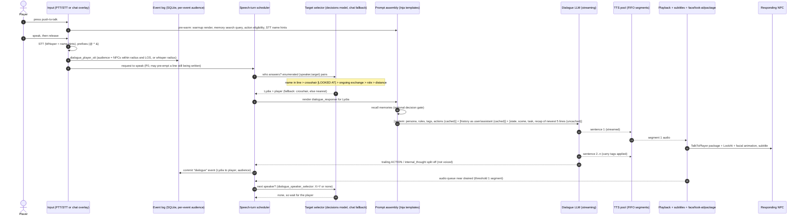
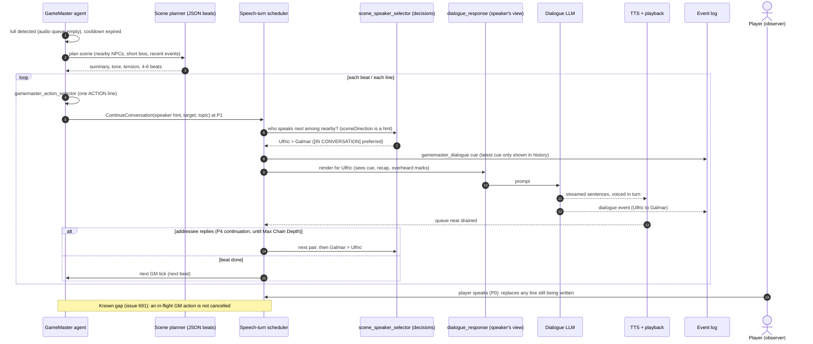

# SkyrimNet Research 02: The Conversation / Turn Pipeline

> Scope: what happens between player input (typed chat, voice through STT, a vanilla dialogue pick) and an NPC's voiced reply. Covers multi-NPC turn-taking, continuous scenes, the GameMaster director and NPC/player thoughts.
> Build studied: SkyrimNet beta30-rc2 (content library `skyrimnet.base` 0.25.3), plus the public devkit, the public GitHub repo, and public release notes and issues.
> Method: documentation, readable shipped content (prompt templates, YAML, SQL migrations, Papyrus `.psc` sources, MIT C++ headers, the small chat JS, view HTML/CSS) and public web pages only. No compiled code was inspected. Anything said about the DLL's internals is marked **INFERENCE**. SkyrimNet's prompts may not be reused. This report quotes only short fragments to explain the design and paraphrases the rest. EldenNet will write its own prompts.

**Path abbreviations**

| Prefix | Root |
|---|---|
| `LIB/` | `skyrimnet-beta30-rc2/SKSE/Plugins/SkyrimNet/library/skyrimnet.base/` |
| `REL/` | `skyrimnet-beta30-rc2/SKSE/Plugins/SkyrimNet/` |
| `PSC/` | `skyrimnet-beta30-rc2/Source/Scripts/` |
| `DEV/` | `skyrimnet-devkit-beta30-rc2/` |
| `GH/` | public clone of `MinLL/SkyrimNet-GamePlugin` |

Release notes cited as "Beta NN" come from https://github.com/MinLL/SkyrimNet-GamePlugin/releases (pages 1 and 2, fetched 2026-11-06).

---

## TL;DR

- **Everything is an event.** Player lines, NPC lines, narration, thoughts, combat and quest changes all go into one SQLite `events` table (`sql/migrations/0001_initial_schema.sql`). Each row records an originator, a target and a JSON array of audience actors (column `actor_UUIDs`, commented "JSON array of form IDs" in the original schema). An NPC's prompt history is the events that NPC perceived. Its own past lines are replayed as `assistant` messages and everything else as `user` messages (`LIB/prompts/components/event_history.prompt`).
- **A turn is two separate problems.** (1) *Who speaks, and to whom?* A cheap typed classification over pre-enumerated `(speaker, target)` pairs answers this, using the "decisions" model (Jev) with a chat-prompt fallback (`LIB/prompts/decisions/*`, `LIB/prompts/target_selectors/*`). (2) *What do they say?* The dialogue model answers with `dialogue_response.prompt`.
- **Perception gates both the audience and the candidates.** Hearing uses an interaction radius (`interaction.maxDistance`, 1600 units since Beta20), a smaller whisper radius (`^` or a hotkey), and line-of-sight "peek" raycasts. Closed doors block sight. NPCs in combat always count as mutually visible (Beta20/23/26 notes).
- **Prompts are laid out for provider prompt caching.** The cached system message holds the stable persona, guidelines, output format, voice-tag rules and action list. Next comes the history, windowed from a cache-friendly anchor. Volatile state goes last, uncached: dynamic bio, memories, scene, combat status, the task, and a recap of the newest five lines "said since you last spoke", with `(to you)` / overheard marking (`LIB/prompts/dialogue_response.prompt`).
- **The output contract is strict and short.** Normally 1–3 sentences (8–40 words, at most 60). In combat, one sentence of at most 14 words. No labels. Optional `*narration*` and engine-specific `[audio tags]`. Optional `<internal_thought>` *after* the speech, stripped from TTS. Optional per-sentence `<translation>`. At most one trailing `ACTION:` line, written after the speech so audio can start first (`LIB/prompts/submodules/system_head/0020_format_rules.prompt`, `.../user_final_instructions/0500,0650,0750,0760`).
- **Speech is streamed per sentence.** TTS starts on sentence 1 while the LLM is still writing sentence 2. Segments are dispatched FIFO to a TTS pool and played in order (FEATURES.md; GH issue #669). Facial animation and the talk package start when playback begins (Beta19.1). Subtitles are the fallback when TTS fails (Beta26).
- **A priority scheduler serializes speech (Beta28 "Conversation System Overhaul").** A conversation has at most one line playing and one being prepared. Requests are ranked P0 (player) to P4 (NPC-to-NPC continuation), and are merged or expired after 30/15/10/8/6 s. A higher priority can replace a line still being *written*, never one being *spoken*. SkyrimNet never reacts to its own lines.
- **Autonomy is layered.** After each NPC line, a next-speaker decision can pick an interjector or silence. *Continuous mode* lets the **GameMaster** (an `ACTION:`-selecting director with an optional 4–6 beat JSON scene plan) keep NPC↔NPC scenes going, with the next speaker chosen as the audio queue drains (Beta13).
- **Latency work.** Sentence streaming, prompt caching, a dedicated small model per job (meta, decisions, combat), action eligibility and memory search pre-warmed while the player is still talking, a `warmup.prompt` render to fill decorator caches, STT name hints, minimal reasoning effort, and backup routing.
- **For Elden Ring v1, copy:** the event log with audiences, the history-as-chat layout, the "since you last spoke" recap, the cache-ordered prompt, the hard length budgets, sentence streaming to TTS, and a small priority scheduler. **Simplify:** speaker selection (rule-based for barks) and perception (distance + same area + one raycast). **Drop:** GameMaster, continuous mode, actions, thoughts, telepathy and virtual NPCs.

---

## 1. Input channels

### 1.1 Typed chat (in-game overlay)

The chat overlay is drawn by PrismaUI (or Magelight UI) and replaces Skyrim's text-entry dialog (`DEV/docs/FEATURES.md` §In-game chat overlay). Per FEATURES.md, typed lines can carry:

| Syntax | Meaning | Source |
|---|---|---|
| plain text | **Say**: addressed to whoever the target selector decides | FEATURES.md; `REL/chat/input.js` (default mode `Say`) |
| `@Name …` | **Direct**: address that NPC. Tab autocompletes from the nearby-actor list | FEATURES.md; `input.js` autocomplete over `audience.js` names |
| `^ …` | **Whisper**: shrink the hearing radius for this line | FEATURES.md §Conversation, §Chat |
| `& …` | **Group**: talk to a user-defined NPC group. Combinable with `^` in either order | FEATURES.md |
| `/think`, `~` | player thought (unvoiced, private) | `input.js` maps `~` and `/think` to *Think* |
| `/narrate`, `!` | narration typed by the player | `input.js` |
| `/silent` | silent fact (a `persistent_generic` event: known, but nobody reacts) | `input.js`; `PSC/SkyrimNetApi.psc: TriggerSilentNarration` |
| `/transform` | rewrite the player's line in the player character's voice before it is spoken | `input.js`; `LIB/prompts/player_dialogue.prompt` |
| `/monologue`, `/compose`, `/playsong`, `/summon`, `/npcthink`, `/telepathy` | monologue, bard songs, summoning, forced NPC thought, telepathic private line | FEATURES.md |

Note: FEATURES.md calls `~` a shorthand for the slash commands next to `/telepathy`, while the fallback `chat/input.js` maps `~` to Think. The PrismaUI bundle may differ. **Uncertain.**

The client sends the raw text (`chatSubmit({text})` in `input.js`). Prefix parsing that matters happens natively (**INFERENCE**, because the JS only sets a badge). The overlay also shows "a live strip showing who can currently hear you" (FEATURES.md). `audience.js` receives `{actors:[{name, distance}], whisperMode, whisperRadius}` and renders the actors sorted by distance, with a Whisper ON/OFF badge. Earlier events can be edited or deleted from the chat to fix a typo or redo a line (FEATURES.md). This works because history is just rows in the event log.

### 1.2 Voice (push-to-talk / open mic → STT)

- `TriggerRecordSpeechPressed` / `…Released(duration)` (`SkyrimNetApi.psc`). Pressing plays a start sound, "prepares search query cache for player input", starts a recording with a 200 s timeout, and resets the GameMaster action cooldown. Releasing stops the recording and processes the audio. Thought and Transform recordings use a 90 s timeout. For those two channels only, a release after less than 0.3 s means "think/speak with empty input", i.e. an autonomous thought or line (`TriggerVoiceThoughtReleased`, `TriggerVoiceDialogueTransformReleased`). The API documents no such short-press rule for normal speech.
- Open mic (`TriggerToggleOpenMic`) uses voice activity detection. Noises under 0.25 s are ignored (Beta26).
- STT runs on local whisper.cpp/Parakeet (`REL/THIRD_PARTY_NOTICES.txt`), Fateless, or OpenAI's cloud Whisper (FEATURES.md §Speech).
- **Name hints.** `LIB/prompts/stt_hints.prompt` is an ordinary template. It renders nearby NPC names, current and nearby place names, the player name and pinned NPCs into a list of at most 500 characters, which is sent as the Whisper prompt or as hosted-STT keywords. It is re-rendered in the background on a cell change (else every 30 s) and at each PTT press. The feature came from GH issue #693 (misheard names such as "Serrano" for Serana), shipped in beta27-rc3. Beta29 made hints **off by default** for local Whisper (they have their own toggle there) because "local Whisper could turn a whole message into a stray word". External Whisper and Fateless keep them on.
- **Barge-in.** With `dialogue.interruptDialogueOnVoiceStart` on, pressing PTT purges queued NPC speech. GH issue #548 documents a bug where *releasing* PTT flushed queues even with the setting off. The lesson: keep "stop capturing audio" separate from "cancel NPC speech".
- Voice lines become `dialogue_player_stt` events. Typed lines become `dialogue_player_text` (`DEV/docs/modding/WORKFLOW_TRIGGERS.md` event table).

### 1.3 Other hotkey channels

`SkyrimNetApi.psc` exposes each channel as a trigger. `PSC/skynet_Library.psc: HandleHotkeyPress` maps keys onto these.

- **Thought** (text/voice): a private player thought, rendered by `player_thoughts.prompt`.
- **Transform** (text/voice): the player says it in-character via `player_dialogue.prompt`, then NPCs react (`TransformDialogue`).
- **Direct input**: custom event text, i.e. a `direct_narration` that NPCs must react to as fact.
- **Silent narration**: `persistent_generic`, a fact with no reaction.
- **Continue Narration** (F8 by default per Beta26): registers an ephemeral `continue_narration` event. "Someone carry the scene on."
- **Interrupt**: `TriggerInterruptDialogue(abDeferToCurrentFinished)` clears the TTS queue, streaming buffers and per-actor dialogue queues. It can let the current line finish first. Its blocking twin `PurgeDialogue` also "invalidates pending TTS generation tasks".
- **No keyboard needed.** The ESP ships lesser powers (`skynet_VoiceInput{Normal,Direct,Thought,Transform}Spell`, `skynet_WheelMenuSpell` in `GH/spriggit/SkyrimNet/Spells/`). Their magic-effect scripts (`PSC/skynet_VoiceInputNormal.psc` etc.) toggle recording: the first cast calls `TriggerRecordSpeechPressed`, the second calls `…Released(10.0)`. A wheel menu (`PSC/skynet_WheelMenu.psc`) covers the other hotkeys. These exist for VR and controller players.

### 1.4 Vanilla dialogue

- A line the player picks in the vanilla menu is spoken in the player's TTS voice. NPC lines that never had voice acting get a generated voiced reply (FEATURES.md §Vanilla dialogue). The API exposes `TriggerPlayerTTS(text)` / `IsPlayerTTSFinished()` and `PrepareNPCDialogue(text)` / `IsNPCDialogueReady()`. The ESP ships a `SilentVoice` voice type (`GH/spriggit/SkyrimNet/VoiceTypes/`), presumably so silent vanilla INFOs can be filled with generated audio (**INFERENCE**).
- `LIB/prompts/transformers/native_dialogue_transformer.prompt` can rewrite a vanilla line into the NPC's own voice: same length and same intent, output only the line.
- **Dialogue choice.** A hotkey asks the model to pick the menu option that matches what the player wants. `player_thoughts.prompt` gets `dialogue_options` and must answer with one JSON line `{"choice_index", "reasoning"}`. The reasoning becomes a player thought, and the option is only highlighted, never confirmed automatically (FEATURES.md; Beta21).
- Vanilla NPC lines are registered as `dialogue_npc` and ambient chatter as `dialogue_background`. Regex `dialogue_rule` filters delete vanilla combat grunts and placeholder lines before they reach history (`LIB/filters/combat_grunts.yaml`, `heavy_breathing.yaml`, `invisible_continues.yaml`).

### 1.5 Programmatic channels (other mods, triggers)

`DirectNarration(content, originator?, target?)` creates a fact that *must* be responded to. With no originator, the system picks the speaker. With empty content, it is an ephemeral nudge. `RegisterPersistentEvent` creates a fact with no reaction. `RegisterDialogue[ToListener]` injects a line. `GenerateNPCThought(actor, hint)` creates a private thought. All are in `SkyrimNetApi.psc`. YAML triggers map game events to the same response types with `audience`, `probability`, `cooldownSeconds`, `priority` and `interrupt` (`DEV/docs/modding/WORKFLOW_TRIGGERS.md`).

---

## 2. Perception: who can hear

### 2.1 Facts

- Candidates and hearers come from `get_nearby_npc_list(uuid)`: "all NPCs within the maximum interaction distance" (`REL/docs/decorators.html`).
- The range is `interaction.maxDistance`. Whisper mode toggles it between `interaction.whisperMaxDistance` and `interaction.normalMaxDistance` (`SkyrimNetApi.psc: TriggerToggleWhisperMode`). Beta20 raised the normal default from 800 to 1600 units (Skyrim units, about 1.4 cm each) and the allowed maximum from 2000 to 8000. It also added `pinnedTargetRangeMultiplier` = 2.0, so pinned NPCs can be heard from twice as far.
- **Line of sight** (Beta20): NPCs "can now 'bend' their sight checks around open obstacles and corners", with closed doors and rooms still blocking. The "peek" system samples 17 fixed directions and tries two-stage sight paths, and "NPCs in combat always remain mutually visible". Beta23 added sealed-room fixes (structural geometry blocks at the ray origin). Beta26 tightened inn-room checks. FEATURES.md sums it up: "People upstairs do not respond to conversations downstairs."
- **The audience is stored per event.** The `events` table has `actor_UUIDs TEXT -- JSON array` next to `originating_actor_UUID` / `target_actor_UUID` (`0001_initial_schema.sql`). The C++ API spells out the semantics (`DEV/CppAPI/PublicAPI.h: PublicRegisterEvent`). By default the audience is "everyone near the originator, plus the player". With an explicit list it is exactly those actors plus originator and target. Only *each character's own* history, memories and dialogue context are limited to the audience. "The GameMaster agent, speaker/target selection and combined history views still see the event."
- More audience details from `PublicAPI.h: PublicRegisterEvent`:
  - Unloaded audience actors are skipped. If none is loaded, nothing is stored ("it never falls back to nearby").
  - A private `direct_narration` still makes its originator speak, and "its spoken reply is ordinary dialogue that bystanders hear". Privacy covers the stimulus, not the reaction.
  - Events are persistent "unless the event type is configured as ephemeral". Ephemeral types "only notif[y] event callbacks".
- Trigger audiences: `player`, `originator`, `target`, `originator_or_target`, `everyone`, `nearby_npcs`, `enabled_virtual_npcs` (WORKFLOW_TRIGGERS.md §3.2).
- **Who may speak at all is data.** `LIB/filters/*.yaml` with `kind: actor` take race blacklists and faction white/blacklists:
  - `animals_dont_speak.yaml` (cat, dog and wolf races) and `mannequins_dont_speak.yaml` keep those races silent.
  - `paarthurnax_speaks.yaml` whitelists a faction.
  - `skyrimnet_filter_factions.yaml` maps the ESP's `SkyrimNet_ActorWhitelistFaction` / `…BlacklistFaction`.
  - Matching `kind: memory` filters stop those actors from forming memories.
  - **INFERENCE:** these filters prune the candidate list before any selector runs.
- **State tags in candidate lists.** `components/context/scene_context.prompt` prefixes nearby actors with `[DEAD]`, `[UNCONSCIOUS]`, "summoned creature serving/hostile to" or "reanimated undead". `decisions/player_dialogue_target_selector.prompt` says an unconscious looked-at NPC "cannot reply".
- **Special channels.** Telepathy reaches only the addressed NPC. When the player is elsewhere, the reply prompt states that the player is not physically present (`.../user_final_instructions/0160_telepathy_reception.prompt`). Virtual NPCs are bodiless and either `public` or `private` (`RegisterVirtualNPC`). Selectors must follow the rule "Regular NPCs cannot hear Virtual NPCs" (`target_selectors/*.prompt`). Group mode (`&`) keeps non-members from being selected or interjecting, and this "propagates through the entire dialogue and interjection chain" (Beta19).
- Player thoughts are excluded from the speaker selector's history, "which no candidate heard" (`decisions/dialogue_speaker_selector.prompt` header).

### 2.2 INFERENCE

Hearing is probably decided **once, when the event is registered**: the audience is snapshotted into `actor_UUIDs`. It is then enforced by filtering each NPC's history on that list. The C++ API backs this up: "FormIDs resolve through live actors, so the originator, target and audience must be loaded" at registration time. `event_history.prompt` falls back to `get_recent_events(count, [npc.UUID])` when the C++ side has not supplied `events`. This is cheap and deterministic, and it also makes memory formation audience-aware. The cost: an NPC who walks into the room later never "hears" what was said before it arrived. That is realistic.

---

## 3. Responder and speaker selection

### 3.1 Two implementations of each selector

Each selection exists twice:

1. **Decision templates** (`LIB/prompts/decisions/*.prompt`). These are not chat prompts. They use `[ state <field> ]` blocks and one `[ question <id> choice ]` with a `[ criteria ]` list, one `key: description` per line. The game turns this into a request to the `decisions` model variant, which "returns a typed answer with probabilities instead of text" (`DEV/docs/modding/WORKFLOW_PROMPTS.md` §4.4). The keys are legal `(speaker, target)` pairs the game has already enumerated, such as `s2_tplayer` or `s2_t5`, with the no-self-target, no-last-speaker and virtual-NPC rules already applied. The model cannot invent a name. The shipped preset routes `decisions` to `typesafe/jev-1.13` with a 10 s timeout and `max_retries: 0` (`GH/model-presets/presets/openrouter-default.yaml`). Beta26 calls Jev "a significantly faster, cheaper, and more reliable way to handle these tasks".
   - **Question types** (WORKFLOW_PROMPTS.md §4.4): `choice` picks one key, `score` picks one of 2–10 ordered levels, and `noul` is yes/no. Each criterion must be one line. Multi-line context goes in `[ state ]` blocks.
   - **Result shape** (`PublicAPI.h: PublicSendCustomDecisionToLLM`): JSON with per-question `choice` / `score` / `noul`, plus optional `confidence` and a `probabilities` map. Error codes include `no_decisions_route`.
   - **Probabilities are used as thresholds.** The memory recall gate accepts a memory only when "1 − p(none)" clears a configured cut-off. Otherwise it falls back to plain similarity search (`decisions/memory_recall_gate.prompt` header). This gives a cheap rule for when to trust a classifier and when to use the deterministic path.
   - Each built-in decision has its own switch: `dialogue.decisions.useForPlayerTarget`, `…useForSpeakerSelection`, `…useForMood` (template headers).
   - Mods can ship their own decision templates and call them with `SendCustomDecisionToLLM`. These have **no** chat fallback (WORKFLOW_PROMPTS.md).
2. **Chat fallbacks** (`LIB/prompts/target_selectors/*.prompt`). An ordinary chat prompt whose output is a single string. The chat fallback is used when the decision setting is off or a request fails (Beta26: built-in decisions "fall back to" the chat method):

   ```text
   - `Lydia>player` = Lydia speaks to the player
   - `Ulfric Stormcloak>Galmar Stone-Fist` = Ulfric speaks to Galmar
   ```
   (fragment, `target_selectors/player_dialogue_target_selector.prompt`)

   The speaker selector's chat version lists explicit INCORRECT examples (no race tags, no asterisks, full names, `player` in lowercase). This is evidence of how often free-text parsing went wrong.

### 3.2 The four selectors

| Selector | When | Options | Main signals (strongest first) | Fallback |
|---|---|---|---|---|
| `player_dialogue_target_selector` | each player line without `@Name` (**INFERENCE**: `@` skips it) | pairs only, **no "none"**: someone always answers | 1. a name or clear reference in the line "decides it". 2. otherwise the player's crosshair target (`[LOOKED AT]`) answers, "even if you were just talking to someone else" (Beta29.1), unless it cannot reply. 3. with no one looked at: continuation of the ongoing exchange. 4. role fit. 5. distance. Plus companion priority for remarks to the party, and NPC→NPC pairs only when the player asks someone to talk to, ask or tell another NPC | crosshair NPC, else nearest |
| `dialogue_speaker_selector` | after a line has been spoken (interjections, replies between NPCs) | pairs **plus `none`** (silence always offered in the decision version) | someone addressed and unanswered first; then direct involvement or duty (a guard who saw a crime); then the bio's `interject_summary` ("Interjection guidance"), gated by **strictness** `chatty` / `balanced` (default) / `strict` (Beta27). The last speaker cannot be chosen. NPC↔NPC exchanges wind down after 2–3 rounds. Silence if the player was asked a direct question | the chat version shows the silence option only `if random < silenceChancePercent`, a prompt-level dice roll |
| `scene_speaker_selector` | continuous mode, after the GameMaster has decided *that* someone speaks | pairs, no none | keep the turn among `[IN CONVERSATION]` participants; the addressee usually replies. Outsiders join only if named, addressed or directly involved, or if their interjection guidance matches. The GameMaster's `sceneDirection` (speaker, target, topic, newConversation) is "a hint, not a rule". Unlike `dialogue_speaker_selector`, the last speaker *may* go again, but "only when no one else has a reason to speak". `[IN CONVERSATION]` means the actor said or was told one of the newest lines | the GameMaster's own pick |
| `continue_narration_selector` | player pressed Continue Narration | pairs, no none (only the looked-at NPC's pairs if there is one) | looked-at NPC speaks; else the unanswered addressee; else another participant; outsiders only on an interjection match; NPCs address each other, not the player | crosshair → last line's addressee → participant → nearest who didn't just speak |

Candidate lines in all selectors combine a short inline bio, an `Interjection:` line from the bio's `interject_summary` block, gender/race/distance, and tags: `[COMPANION]` (follower faction), `[ENGAGED]` (has the SkyrimNet follow package), `[IN SCENE]` (an adult-framework faction: strongly deprioritized). They also get `recent_dialogue` from `components/event_history_compact.prompt`, a bullet list rather than chat messages, and a `last_exchange` sentence ("X was speaking to Y").

### 3.3 Timing of the next-speaker decision

FEATURES.md: "The next speaker is chosen as the current line finishes." Beta13 deferred the evaluation until non-silent audio drops to a threshold ("Audio Queue Near Completion Threshold", default 1 segment remaining), so a reply is tied to the current scene and not to stale queued lines. This comes from the fan docs at goncalo22.github.io via search snippets. That host was not reachable from this session, so the page itself was not read.

### 3.4 Arbitration between pipelines

Several async flows can react to one stimulus: the player's own auto-interjections (`PlayerDialogue.yaml eventConfigs`), NPC reactions (`Events.yaml allowNPCReaction`), and dialogue. GH issue #544 (open) documents double responses 1.3–2 s apart, because both requests rendered history that lacked the other's answer. Beta28 introduced the speech-turn scheduler (§7). The issue is still open, so how much the scheduler fixes the race is **uncertain**.

---

## 4. Prompt assembly for one dialogue turn

### 4.1 Message layout

`dialogue_response.prompt` is about 90 lines. Its header comment says it is "ordered for prompt caching". Templates use Inja with section markers: `[ system ]`, `[ user ]`, `[ assistant ]`, and `[ cache ]` breakpoints that "are ignored by a provider without prompt caching". Markers are allowed only in top-level prompts (WORKFLOW_PROMPTS.md §4.4). The assembled request looks like this (described, not reproduced):

| # | Message | Content | Cached? |
|---|---|---|---|
| 1 | `system` | ① identity line ("You are <name>, a <gender> <race> in Skyrim.") + `render_character_profile("stable")` + `("speech_style")` ② roleplay guidelines (`submodules/guidelines/*`, `stable_split`) ③ response format (`0500`) + voice-tag rules (`0650`) ④ embedded-action list (`0750`). It has its own breakpoint because actions change "about one turn in six" | 4 breakpoints |
| 2…n | alternating `user` / `assistant` | `components/event_history` with `cache_history: true`: this NPC's lines → `assistant`; everything else → `user` | breakpoint on the last history event |
| n+1 | `user` | `system_head` (dynamic): setting, length rules, **dynamic profile** (equipment, relationships, party/quests, memories), the **dialogue target's** observable bio, **scene context** (nearby people with state, location, time-of-day bucket, weather, short-lived events, state summary), OmniSight descriptions. Then `user_final_instructions` (dynamic): telepathy reception, quest topics to raise, spoken language / translation, direct-narration "must respond", merged events, continue-narration note, recent state changes. Then the **tail**: combat status → task ("Respond as X… You are speaking to Y.") → **recap** → combat or knocked-down urgency line → actions available now, else "Respond in character now." | uncached |

Mechanics worth copying:

- **`stable_split`** is passed down through `render_subcomponent` into the bio submodules. Each one decides whether it belongs to the "stable" render (summary, background, personality, aspirations, skills, occupation, long-term progression) or the volatile "full" remainder (physical activity, equipment, relationship *state*, quests, `7100_memories`). Together the two equal the old full bio (`LIB/prompts/submodules/cache_split/npc_profile_dynamic.prompt` comment). A plugin that overrides a moved section without the check renders it twice (`GH/changelog.d/prompts-cache-layout.md`).
- **Numbered submodule folders** (`0010_…`, `0500_…`, `8000_…`) are concatenated in filename order. Mods drop in a file at the right number to insert a section (`DEV/docs/modding/prompts-and-decorators.md`).
- **Render modes** (`full`, `stable`, `thoughts`, `transform`, `book`, `dialogue_target`, `short_inline`, `interject_inline`, `speech_style`, …) let one bio source serve the speaker (first-person, internal state), the listener (observable only), and the selectors (one-liners).
  - Mechanically, each bio is one file of named Inja ``s (summary, background, personality, interject_summary, speech_style…; e.g. `characters/bandit_generic.prompt`).
  - Layout components then pick blocks: `components/character_bio_short_inline.prompt` is just the `summary` block, and `character_bio_interject_inline` just `interject_summary`. The numbered `submodules/character_bio/*` files gate themselves on `render_mode` / `stable_split`.
- **Scene context also uses template inheritance.** `components/context/scene_context.prompt` defines the blocks:
  - `nearbyNpcs`: name, short bio, gender/race, distance in metres, and state tags.
  - `situationSummary`: location, time, and a time-of-day bucket ("late at night - most people would be sleeping"…).
  - `weather`: notes when you are "indoors and sheltered", and describes rain, snow or wind.
  - `recentEvents`: TTL'd short-lived events via `component_recent_events.prompt`, skipping GameMaster cues.
  - `npcStateSummary`: following, unconscious, mounted, and furniture use such as "lying down in a bed" or "sitting at a table".

  Layouts such as `scene_context_full.prompt` and `scene_context_target_selection.prompt` choose which blocks appear and in what order. **INFERENCE:** `get_scene_context(uuid, target, mode)` selects the layout by mode. This decorator is not documented in `docs/decorators.html`.
- **The closing line depends on actions.** When actions are offered, the prompt ends on the list of available action names. The usual "Respond in character now." is then omitted, because "a closing line about speech alone makes models drop the action" (`dialogue_response.prompt` comment).
- **Sanitize numbers into words.** Combat status turns HP, magicka and stamina ratios into phrases ("Badly wounded, bleeding and struggling"). The level comparison becomes an "instincts tell you…" sentence, because "weaker LLMs will parrot" raw numbers (`0200_combat_status.prompt` comment). `8000_recent_state_changes.prompt` uses `track_entity_state(uuid, key, value, 120)` to report only *changes* above 25 % within a window ("Injured", "Just equipped X").

### 4.2 History windowing (`components/event_history.prompt`)

- Events come in pre-filtered for this NPC (the C++ `events` variable, else `get_recent_events(get_event_history_count(npc), [npc])`). The count is configurable.
- **Filter at fetch time, not render time.** Beta24 fixed a case where events with no source actor "consumed fetch-window slots, then the prompt template dropped them": "A 15-event fetch could render 6 during a knockdown-heavy fight." The current template still drops `spell`/`hit`/`combat` at render time. Whether those types still use up fetch slots is **UNVERIFIED**.
- `spell`, `hit` and `combat` events are **excluded** from the chat history. That noise reaches the model only through scene context ("short-lived events" with a TTL, `RegisterShortLivedEvent`). Short-lived events are **keyed**: `RegisterShortLivedEvent(eventId, …, ttlMs, …)` overwrites by `eventId`. The API comment's example uses a per-actor `spell_cast_<actor>` key, "therefore, only the last spell they cast shows up in the context" (`SkyrimNetApi.psc`).
- **Cache anchor.** A sliding window would change the first message every turn and break the cache. Instead, the window starts at the first event whose id reaches a multiple of a power-of-two *step*. The step is about a quarter of the id span, capped at 256, and lowered until the anchor hides at most a quarter of the shown events. The prefix therefore stays identical for several turns. The last shown event carries the history's `[ cache ]` breakpoint.
- **Time and place markers**, in prose: "*Some time passes…* It is now …" between events more than 30 game-minutes apart. "[Location changed to …]" when a line comes from another building, or the speaker moved since their own last line. Before the tail: "*A few hours have passed, and the location has changed to …*".
- **No relative time inside the cached prefix.** The template computes "[Yesterday]", "[A few hours ago]" and similar labels relative to *now*. It prints them only on `direct_narration` entries, and only when `cache_history` is off, because such a label would change the history bytes on every call. **INFERENCE:** avoiding cache breakage is the reason. The template shows the behaviour; no comment states the motive. Under caching it uses only absolute gap markers, which never change once written ("…It is now <game time>"), and puts the single "time has passed" line after the history.
- **No breakpoint on a sliding window.** `transformers/universal_translator.prompt` rewrites a line into an NPC's speech pattern and/or spoken language. It shares the byte-identical stable-profile block with `dialogue_response`, so the two reuse one cache entry. Its history has no breakpoint, because "the transformer passes only the last five events, a window that slides on every call" (header comment).
- `dialogue_background` lines get a `[Background]` prefix. NPC thoughts heard telepathically are marked "(thought, telepathically observed)". Lines are prefixed `Speaker (to Target):`. Only the *latest* `gamemaster_dialogue` (director cue) is shown.
- Missing listener names in rendered history made NPCs answer lines meant for others (GH issue #600). The current template renders `(to X)` explicitly.

### 4.3 The "said since you last spoke" recap

This is the most important prompt-engineering idea in the pipeline. Under the cache layout, the newest line sits thousands of tokens before the end, and "a smaller model can answer an older one instead" (`dialogue_response.prompt` comment). So the template:

1. finds this NPC's last own line (`dialogue` or `dialogue_npc`);
2. collects everything after it from others: player lines of every kind, NPC lines, `direct_narration`, `persistent_generic`;
3. prints the **newest five** under "Said and done since you last spoke:". Spoken lines are tagged `(to you)` or `(to <name>)`, and narration is tagged "(what happened)";
4. closes with one of three steers: the last entry is narration, so react to it first; some lines were said to you, so answer the last `(to you)` one; or none were for you, so you overheard them and need not reply.

The changelog fragment states the intent: "Lines between other people are marked as overheard, so companions stop answering each other's asides" (`GH/changelog.d/prompts-cache-layout.md`). `player_dialogue.prompt` and `player_thoughts.prompt` carry the same block ("Just Now") for the player's own generated lines.

### 4.4 Memory in the turn

`7100_memories` calls `get_relevant_memories(actorUUID)` and lists each hit with a relative-time tag, emotion and importance. Retrieval is semantic (vector) and can use an LLM-written search query (`LIB/prompts/helpers/generate_search_query.prompt`, a "meta" model call). Beta28: turning that off "searches the last 8 lines instead" and saves one call per reply. An optional **decision gate** (`decisions/memory_recall_gate.prompt`) picks which recalled memory the player's line is about. It costs "about 0.2 to 0.4 s" and "starts early" (Beta28). The memory system itself is covered in a separate report.

---

## 5. The response output contract

| Rule | Where |
|---|---|
| Length: 1–3 sentences, 8–40 words typical, 60 max, never multiple paragraphs. **Combat: 1 sentence, max 14 words.** Thoughts: 8–30 words, first sentence ≤ 10 words | `system_head/0020_format_rules.prompt` |
| No headers or labels, just the response. "Each response must advance the conversation" | `0500_response_format.prompt` |
| Narration (if enabled) only in `*asterisks*`, about 1 in 4 replies, only the speaker's own body language, no repeats; text outside asterisks is speech. Disabled → "spoken words only" | `0500`, `0700` |
| Voice tags per TTS engine: Higgs `[emotion-…]` / `[style-…]` catalog; Chatterbox fixed emotion + sound tags; Fateless/Inworld `[say …]` directions + sound tags (at most one direction per reply, never "slow"); generic `[sighs]`; "Use sparingly" | `0650_audio_tags.prompt`; `GH/changelog.d/fateless-slow-directions.md` |
| **Carry tags.** Because TTS gets one sentence at a time, a delivery tag (e.g. `whispering`) "carr[ies] through the rest of that reply unless a later sentence supplies its own tags". One-off sounds (laugh, cough, sigh) are not carried (Beta26). Which tags carry is data: `LIB/config/carry_tags_*.yaml` (`kind: carry_audio_tags`, categories Anger, Fear, Volume, Pace, Steering `"say *"`/`reset`, …) | config + Beta26 |
| `<internal_thought>…</internal_thought>` (if enabled; off by default since Beta20.2) **only after** the spoken line. Stripped from TTS and saved as a private thought event "instead of delaying speech" (Beta20) | `0500` |
| Never emit `<thinking>` or any scratchpad tag ("if any survive into the output they get spoken aloud by TTS"). `<think>` blocks are filtered from speech and subtitles (Beta26) | `0500`; Beta26 |
| `<translation>` after **each** sentence when a subtitle language is set (speak in L1, subtitle in L2) | `0760_spoken_language.prompt` |
| At most **one** `ACTION: Name [PARAMS: {json}]` line, **after** the dialogue, "this allows speech to start while action is parsed". Only the first is executed. Categories need `{"intent": …}`. The tail repeats the available action names because "with nothing about actions near the end models stopped writing the ACTION line" | `0750_embedded_actions.prompt`; `dialogue_response.prompt` comment; `changelog.d/embedded-actions-reminder.md` |

Short fragment showing the action format (`0750`):

```text
- `ACTION: ActionName` — action with no parameters
- `ACTION: ActionName PARAMS: {"param": "value"}` — action with parameters
```

Post-processing is data-driven too. `kind: tts_rule` regex filters run before speech, e.g. dropping romanization in parentheses (`LIB/filters/romanization_in_parentheses.yaml`). The bug list shows the contract's weak spots: an ACTION line wrapped in asterisks is silently dropped (GH issue #706), and a bracket-only "[ Silence: not my turn ]" leaked as a player line (GH issue #544).

---

## 6. Streaming, TTS and playback

**FACT (docs, notes, public issues):**

1. The LLM reply is streamed. "Text-to-speech begins reading the first sentence while the model is still writing the second one" (FEATURES.md §Conversation, §Why).
2. Per GH issue #669 (closed, "Fixed for beta26"), which quotes public logs:
   - `StreamIngest` marks each piece of text "queued" and splits it into segments.
   - `TtsEnginePool::Generate` dispatches segments to the engine, FIFO by design. The bug was out-of-order dispatch: "Queued: A B C D E F. Dispatched: A D F B E C". It stalled playback by 10–20 s.
   - `EngineSoundPlayer` plays strictly in sequence.
   - Engines have a `max_parallel_requests` (e.g. `Chatterbox.yaml`; the reporter ran 1).

   FIFO dispatch matters more than parallelism: "any early segment that is generated late blocks every segment after it".

   Two levels of streaming should not be confused. Sentence-level streaming (text → TTS per sentence) is always on. *Audio* streaming inside an engine is a separate engine option. Beta29 made Pocket TTS streaming "off by default": new installs "play a Pocket TTS line once it is fully made".
3. Per GH issue #548, the speech manager holds queued `SpeechTask` and `AudioTask` objects, streaming text buffers and subtitles, facial-animation tasks, and per-speaker timing maps. A flush clears all of those but lets the already-playing sound finish.
4. Body language: `skynet_MainController.SetActorDialogueTarget` (`PSC/`) makes the speaker `SetLookAt` the listener. It links the listener through a linked-ref keyword (`PO3_SKSEFunctions.SetLinkedRef(…, libs.keywordDialogueTarget)`), registers a `TalkToPlayer` or `TalkToNPC` AI package, and calls `EvaluatePackage()`. `SkyrimNetInternal.SetLookAt` is a look-only variant "for actors that already have a follower package we don't want to override". The ESP's `SkyrimNet_TalkToPlayerPackage` sets interrupt flags for random conversations, idle chatter, reactions to player actions, friendly-fire comments, aggro-radius behaviour and world interactions. Whether CK semantics make these flags allow or suppress those behaviours is **UNVERIFIED** here. The intent is evidently to hold the NPC in the conversation. Since Beta19.1 the package is applied "when audio playback begins rather than when the speech is queued". Packages are removed with reason `dialogue` when "SkyrimNet ended a conversation" (`SkyrimNetApi.psc` ModEvent list).
5. Audio: the ESP defines sound categories for Voice, VirtualSpeakers and BardSinging, plus a `SkyrimNet_SOMDialogue2DDry` output model (`GH/spriggit/SkyrimNet/Sound*`). **INFERENCE:** embodied NPCs are positional and bodiless speakers play 2D. Voice effects (pitch, formant, reverb…) are applied per NPC (FEATURES.md; the Signalsmith Stretch library is listed in THIRD_PARTY_NOTICES).
6. Face: THIRD_PARTY_NOTICES lists **NVIDIA Audio2Face-3D v2.3** (network downloaded at runtime), so facial animation is generated from the TTS audio (**INFERENCE** about how it is driven). A mood decision (`decisions/evaluate_mood.prompt`, `helpers/evaluate_mood.prompt`) sets mood "for voice modulation and facial expressions" (`DEV/docs/Agents.md`). Mouths stop moving while thoughts are voiced (Beta20).
7. Subtitles: a click-through HUD view (`PrismaUI/views/SkyrimNet/subtitles/index.html`) with a bottom box *and* floating cards placed over speakers, side-by-side translation, and ruby readings. Subtitles appear even "when the voice engine is disabled or fails" (Beta26).

**INFERENCE (ordering):** each finished sentence becomes a segment; TTS starts on it immediately; the `ACTION:` line, `<internal_thought>`, `<translation>` blocks and tags are split off the stream before TTS (§5 says so for thoughts and translations); playback begins when segment 1's audio is ready, which also starts the package and face animation.

---

## 7. Speech-turn scheduler, interruption and commit

### 7.1 The scheduler (Beta28 release notes, "Speech Turns, Priorities, Merging, and Expiry")

Before Beta28, each DirectNarration, trigger or reacted-to event started its own LLM request on arrival: "five in two seconds made five lines in parallel that played back to back for half a minute." Since Beta28, every call is a **request to speak**:

| Priority | What | Max wait | Merging |
|---|---|---|---|
| P0 player | player input, Continue Narration | 30 s | never merged or capped |
| P1 directed | DirectNarration not from a trigger, GameMaster cues | 15 s | each is its own line; cues never expire |
| P2 urgent | trigger firings, interruptible event types | 10 s | repeats of one trigger merge; others listed in the prompt |
| P3 reaction | events NPCs react to, vanilla/background lines | 8 s | several waiting → **one reply to the newest** |
| P4 continuation | `RegisterDialogue` lines, NPC↔NPC replies | 6 s | ends after *Max Chain Depth* |

Rules: one line playing plus one being prepared per conversation. "Max Recent Speech Count" per window caps P2–P4. A higher priority replaces a line still being written, but never one already speaking. `interrupt: true` triggers and interruptible events still cut speech. `PurgeDialogue` clears audio, the line being written and every waiting request. **SkyrimNet does not react to its own lines.** Templates see `speech_turn.{mode, merged_count, conversation_depth, also_events}` (Beta28 notes; the shipped templates read only `mode`, `merged_count` and `also_events`). The release notes give no defaults for Max Chain Depth, Max Recent Speech Count or its window. `0805_merged_events.prompt` turns them into "Along with what you are answering, these also just happened: …" and, in `together` mode, asks for one line reacting to them as a whole.

Known gap: GH issue #691 (open). A GameMaster `ContinueConversation` already in flight when the player starts speaking is not cancelled, so an NPC banter line plays before the answer. The race window is 0.35–3.6 s after a lull.

### 7.2 Committing the turn

- The NPC's reply becomes a `dialogue` event (speaker = originator, listener = target, audience = hearers). `PublicRegisterEventCallback` and the YAML `dialogue` trigger type see it (`speaker`, `dialogue`, `listener`). Lifecycle ModEvents such as `SkyrimNet_SpeechStarted` are published (FEATURES.md §Modder API).
- **Commit timing (INFERENCE):** at or near the end of generation, *not* at playback. GH issue #548 notes that after a queue flush "the dialogue events stay in history, so later NPCs can react to lines the player never heard". The mood decision comment says "the event for it may not be registered yet" when it runs on the just-generated line.
- Inline thoughts become `npc_thoughts` events with the thinker as the only audience. The ACTION line goes to the action executor.
- Memories are not written per line. They are generated later from recent events and scored for importance (`DEV/docs/Agents.md` §Memory Generation; `memory/generate_memory.prompt`; covered elsewhere).
- **Built-in latency telemetry.** The very first migration creates `traces` (`label`, `depth`, `parent_label`, `duration_us`, `session_id`), `counters` and `errors` tables next to `events` (`sql/migrations/0001_initial_schema.sql`). That is a nested-span profiler kept in the same SQLite database as the event log (**INFERENCE** from the column names). Each event row stores both `game_time` and real `local_time`. The same migration also has a small legacy `dialogue` table (`speaker`, `text`, `timestamp`). Whether it is still written is unknown.

---

## 8. Autonomous conversation: GameMaster and continuous mode

**FACTS**

- The GameMaster is an optional director that "starts scenes and conversations between NPCs on its own" (FEATURES.md). Toggling it is a hotkey. Continuous mode needs the GameMaster on (`SkyrimNetApi.psc: TriggerToggleContinuousMode`). Any player input resets its action cooldown (`TriggerTextInput` etc.).
- **Action selector** (`LIB/prompts/gamemaster_action_selector.prompt`, variant `gamemaster_evaluation`, Llama 3.3 70B with `max_tokens: 256` in the Balanced preset). It reads compact recent events, every nearby NPC with short bio + "Interjects when:", and the eligible GM actions. It answers with exactly one `ACTION:` line: `StartConversation` (strongly prefer NPC→NPC), `ContinueConversation` (with a 2–6-word *topic*, "NOT dialogue"), narration, or `None` (not allowed in continuous mode). It is told to prefer dialogue over narration and NPCs over the player.
- **Scene planner** (`gamemaster_scene_planner.prompt`) returns JSON: `scene_summary`, `tone`, `central_tension`, 4–6 `beats` (type dialogue/narration/action/environmental, description, primary characters, purpose), `potential_escalations`, `natural_endings`. Constraints: the player is "UNCONTROLLABLE", so the scene must work without them; each beat is roughly 15–30 s; it should still work if only 2–3 beats run. In continuous mode the action selector receives `scene_plan.current_beat` / `upcoming_beats` and the user message "Execute current beat: …".
- Since Beta26 the GameMaster "decides that someone should speak and suggests a speaker"; `scene_speaker_selector` makes the final pick. Bystanders join only when named, spoken to or directly concerned, or when their bio's interjection triggers match (Beta26/27).
- Trigger and timing per the public log trace in GH issue #691: `GameMaster::ShouldTriggerGameMasterAction` fires on a lull "when the audio queue is empty", checks the cooldown (139.6 s elapsed in the trace), calls the LLM about 250 ms later, and executes the action at about 800 ms. Fan docs (search snippet only, host unreachable) list a 120 s cooldown between autonomous actions, 6 s between narration lines in continuous mode, and an 800-unit scan radius. These may be stale.
- The GameMaster's cue is stored as a `gamemaster_dialogue` event. The speaker's history shows only the latest one (§4.2). It travels at P1 and never expires (§7.1).

**INFERENCE:** in continuous mode the loop is lull or near-drained queue → GameMaster tick → beat → speaker decision → dialogue line. It ends when the plan runs out, the chain depth or cooldown stops it, or the player takes over at P0.

---

## 9. Thoughts (NPC and player)

- `npc_thoughts.prompt` uses the same identity line, `system_head` / `user_final_instructions` in `thoughts` mode, and the NPC's history. Unlike `player_thoughts`, it is **not** laid out for caching. It has no `[ cache ]` breakpoints, the whole `system_head` (including the volatile profile and scene) sits in the system message, and the history is rendered without `cache_history`. It requires 1–2 sentences of first-person silent thought in the character's own register, "not in a narrator's voice". An optional required topic comes from `promptForThoughts`, and an optional `triggeringEvent` gets a "gut reaction". The thought is stored as a private event that colours later dialogue (`GenerateNPCThought` doc). It respects per-NPC and global cooldowns in `NpcThoughts.yaml` (60 s per NPC, Beta20) and is skipped for dead, unconscious or sleeping NPCs.
- `player_thoughts.prompt` has the same cache layout as dialogue, so the player's thoughts, the player's lines and NPC replies "share one cached prefix" (header comment). It has modes for a required topic, a book just read (with text and vision description), combat, a triggering event, the "Just Now" recap, and dialogue-choice JSON.
- Telepathy (perks) adds the player to the audience of nearby NPC thoughts. A telepathic NPC's prompt explains how to treat overheard thoughts (`system_head/0150_telepathy_awareness.prompt`).
- **INFERENCE:** thoughts are an inexpensive way to give the dialogue model persistent *private* state without spending output tokens on every spoken turn.

---

## 10. Latency optimizations (documented)

| Technique | Evidence |
|---|---|
| Sentence-level streaming LLM → TTS | FEATURES.md |
| Game thread never waits on network, DB or TTS; heavy work on worker threads; "game state is read straight from memory, with no syncing between processes" (in-process DLL, no sidecar server) | FEATURES.md §Why |
| Action eligibility cached and **pre-warmed while the player speaks** | FEATURES.md §NPC actions |
| Memory search query prepared at hotkey **press** ("Prepares search query cache for player input") | `SkyrimNetApi.psc` trigger docs |
| `warmup.prompt`: rendered "during hotkey preparation" to fill the Inja decorator callback cache (sub-components, event history, scene context, profiles of up to 8 nearby NPCs); output discarded | `LIB/prompts/warmup.prompt` |
| STT name hints rendered in the background, so PTT is cheap | `stt_hints.prompt` |
| Prompt caching layout (cached system, anchored history, uncached tail); cache lifetime 5 min or 1 h | `dialogue_response.prompt`; Beta27, Beta29.1 |
| A model per job: `default` dialogue, `combat` (smaller, faster models, `max_tokens: 2000`), `meta` (`max_tokens: 100`), `decisions` (Jev, 10 s, no retries), `gamemaster_evaluation`, `memory`, `vision`… | `GH/model-presets/presets/openrouter-default.yaml`; `DEV/docs/Agents.md` |
| Typed decisions instead of chat-text parsing for who-speaks | Beta26 |
| Two-stage action pick: "When the NPC doesn't want to act, no second LLM call happens at all" | Beta19 |
| Inline thoughts parsed out "instead of delaying speech" | Beta20 |
| Reasoning effort default "minimal" for thinking models; retry once at minimal if refused | Beta27 |
| Latency-sorted provider routing; a backup model takes over a stalled reply ("a reply whose first model stalls ends when its backup finishes"); cancelled replies stop streaming | Beta19, Beta25, Beta27 |
| Nested-span latency telemetry (`traces` table) | `sql/migrations/0001_initial_schema.sql` |
| Outbound HTTP latency cut by about 60–210 ms per call | Beta27 |
| A lone reply "starts as fast as before" despite the scheduler | Beta28 |

---

## 11. Sequence diagrams

### 11.1 One player → NPC turn (Say mode, voice input)



### 11.2 NPC ↔ NPC continuous scene (GameMaster on, continuous mode on)



---

## 12. How it maps onto Skyrim engine features

| Pipeline need | Skyrim / SKSE feature used | Evidence |
|---|---|---|
| Stable actor identity across saves | FormID → SkyrimNet UUID mapping table; virtual NPC UUIDs derived from the registration name | migrations `0005_uuid_mappings`, `0020_…modfile`; `GetVirtualNPCUUID` doc |
| "Who is the player addressing?" | crosshair pick target (`crosshairTarget`, distance), follower faction, packages | target selector templates; `SkyrimNetInternal.psc: Follower_IsEligible` |
| Hearing / sight | actor distance in Skyrim units, cell/location, raycast LOS with "peek" directions; combat ⇒ mutually visible | Beta20/23/26 notes |
| Place awareness in history | location strings, `location_building()`, user-defined places (`MarkPlace(name, radius)`) | `event_history.prompt`; `SkyrimNetApi.psc` places API |
| Time markers | game time in seconds (`gameTimeNumeric`), season | `event_history.prompt`, `7100_memories` |
| Making the NPC stop and face you | AI packages `TalkToPlayer`/`TalkToNPC` (ESP), `SetLookAt`, linked-ref keyword; package on playback start | `skynet_MainController.psc`; spriggit Packages; Beta19.1 |
| Speech audio | engine sound with SoundCategory/SoundOutputModel; miniaudio; positional falloff (bard songs "get quieter as you walk away") | spriggit Sound*; THIRD_PARTY_NOTICES; FEATURES.md |
| Lip/face | Audio2Face-3D driving facial morphs; MFG Fix NG on VR | THIRD_PARTY_NOTICES; GH README requirements |
| Vanilla dialogue | dialogue menu, silent voice type, generated audio for unvoiced INFOs, quest dialogue codes (`TriggerDialogueLine`) | FEATURES.md; `components/dialogue_action.prompt` |
| Event sources | SKSE event sinks (hit, combat, death, spell, equip, quest stage, location change, crime, menus…) | WORKFLOW_TRIGGERS.md event table |
| Mod integration | Papyrus natives + ModEvents, C++ DLL API, YAML triggers/actions; `PublicSetActorBusy(formId, reason)` lets another mod mark an actor busy so eligibility rules can defer | `SkyrimNetApi.psc`, `PublicAPI.h` (v6+) |
| Input without a keyboard | lesser-power spells whose magic effects toggle recording; a wheel menu | spriggit `Spells/`; `skynet_VoiceInput*.psc`, `skynet_WheelMenu.psc` |
| Who can speak | race and faction lists (`kind: actor` filters) | `LIB/filters/*.yaml` |
| UI | PrismaUI/Magelight HTML overlays (chat, dashboard, subtitles) | `PrismaUI/views/SkyrimNet/*` |

---

## 13. Transferable patterns for an Elden Ring framework

The Elden Ring (ER) specifics below are **INFERENCE** to be checked against the ER engine research. ER has no Papyrus, no dialogue menu like Skyrim's, no crosshair, often helmeted NPCs, enemies that respawn at grace rest, and a talk system driven by ESD state machines and FMG text.

### 13.1 Copy as ideas (high value, low cost)

1. **One event log with per-event audience snapshots.** Record every stimulus once: player line, NPC line, combat event, area entered, boss killed. Store `originator`, `target` and `audience[]` decided *at registration* from distance, same map area and LOS. Each NPC's history is then a filtered query, and memories and history automatically respect "who could know". This works for named NPCs (persistent rows) and generic enemies (short-lived, discarded on respawn).
2. **History as chat turns from the speaker's point of view.** The NPC's own lines are `assistant`; everyone else's are `user`, prefixed `Name (to X):`. Keep combat spam (hits, spell casts) *out* of history and in a TTL'd "recent events" block in the scene context instead.
3. **The "since you last spoke" recap at the very end of the prompt**, with `(to you)` / overheard marks and a closing instruction that depends on whether anything was addressed to this NPC. This is cheap and fixes the main multi-NPC failure (answering someone else's line).
4. **Cache-ordered prompt.** Stable persona, rules and output format first. Then history from a stable anchor. Then volatile state, task and recap last. Split each bio into *stable* and *dynamic* parts. This pays off on any provider with prefix caching and costs nothing otherwise.
5. **Hard output budgets and a sanitizer.** Named NPC conversation: 1–3 sentences, ≤ 60 words. Combat or bark: one sentence, ≤ 10–14 words. Ban labels and reasoning tags; strip `<think>`; regex filters (dialogue and TTS rules) as data files.
6. **Numbers to words.** Bucket HP and FP ratios, relative strength and "recent change" deltas into phrases. Never put raw stats or levels in a prompt. This is exactly what generic ER enemies need to know about the fight.
7. **Sentence streaming → FIFO TTS → sequential playback**, with subtitles as a guaranteed fallback when TTS fails or is off. Dispatch order matters more than parallelism (issue #669).
8. **A small priority scheduler.** Per-area "one line playing + one preparing", priorities (player > directed > urgent combat > reaction), per-priority expiry, merging of repeated stimuli, and a rule never to react to your own lines. For ER barks, use short expiries (a bark about a hit is worthless after about 2–3 s; SkyrimNet uses 8–10 s for reactions). Also cancel in-flight autonomous work when the player starts speaking; SkyrimNet's issue #691 is the cautionary tale.
9. **Pre-warm while the player talks.** Render static context, start the memory query and resolve the target at PTT *press*, not release.
10. **STT name hints** from nearby NPC names and place names (Lands Between names are hard for Whisper: "Godrick", "Liurnia", "Ranni").
11. **A model per job.** A quality model for named-NPC dialogue, a small fast model for barks and combat, and a classifier or cheap model for selection decisions. Keep provider and model choice in config.
12. **Who may speak is data.** A filter file maps race or category to "never speaks" or "never remembers", as SkyrimNet's `animals_dont_speak.yaml` does. In ER, keyed by NPC param or character ID, this keeps beasts, golems and non-humanoid enemies out of the bark pool without code changes.
13. **Keyed short-lived combat events.** Store combat stimuli as TTL'd entries keyed per actor and kind (e.g. `last_hit:<actor>`, `last_spell:<actor>`). A new entry overwrites the old, so the prompt always shows only the latest of each, and they never enter the persistent history.
14. **Keep the cached prefix byte-stable.** Write no relative-time labels ("yesterday", "a few hours ago") into cached history; use absolute gap markers and one "time has passed" line after the history. Put no breakpoint on a window that slides every call. Filter unwanted event types in the *query*, so the history window is not quietly emptied (SkyrimNet's Beta24 knockdown case).
15. **Use classifier probabilities as a gate.** If a selection model is used, act on its pick only when `1 − p(none)` or the top probability clears a threshold. Otherwise fall back to the deterministic rule.
16. **Trace table from day one.** A nested-span timing table (label, parent, µs) in the same database makes the latency budget measurable per turn. For barks the budget is the whole design.

### 13.2 Simplify for v1

- **Perception.** Hearing radius + same map tile/area + a single raycast, plus a whisper multiplier. Skip the 17-direction peek system. Treat combatants as mutually aware, as SkyrimNet does.
- **Target selection for named NPCs.** Deterministic first: explicit `@name` → lock-on target or camera-facing cone (ER's analogue of `[LOOKED AT]`) → last conversation partner if the line continues it → nearest named NPC in range. Use an LLM or classifier only when several named NPCs are in range and the rules tie. If one is added, copy the *enumerated pairs* idea: the model picks a key and never writes a name.
- **Generic enemies (barks).** No selector LLM. Use a rule: the nearest perceiving enemy of the group who has not barked within N seconds speaks, with a per-group and global cooldown. The prompt is a generic archetype bio (SkyrimNet's `*_generic.prompt` bios keyed by type, e.g. `bandit_generic`; in ER keyed by NPC param or name) + area + time-of-day + the triggering combat event + bucketed combat status. Expire quickly. Optionally pre-generate small bark pools per archetype and situation, so combat never waits on the network. Copy the idea of state tags in the "nearby" list from SkyrimNet's scene context (`[DEAD]`, `[UNCONSCIOUS]`, "summoned creature serving/hostile to…"). ER needs the same kind of tag for spirit ashes, cooperator and invader phantoms, and the player's Torrent. **INFERENCE** on the ER side.
- **History window.** A fixed N most-recent events. Add anchor windowing only when a caching provider is used.
- **Audio tags.** Support one TTS engine's tag set at most, plus a simple "carry the last delivery tag to later sentences" rule. The full carry-tag taxonomy is optional.
- **Templates.** Keep a small numbered-section system (a folder of ordered snippets per prompt section) so users can extend prompts, but with a much smaller variable surface than SkyrimNet's hundred-plus decorators.

### 13.3 Drop for a minimal v1 (and why)

| Feature | Why drop now |
|---|---|
| GameMaster, scene planner, continuous mode | Extra LLM loops, races with player input (#691), cost; v1 is reactive dialogue only |
| NPC→NPC interjection chains | Needs the next-speaker decision, chain depth and overheard handling; add in v2 once the event log and recap exist |
| Embedded `ACTION:` lines, quest dialogue codes | v1 is dialogue only, with no NPC actions |
| `<internal_thought>`, NPC/player thoughts, telepathy, virtual NPCs, identity links | Nice depth, but each adds parsing and audience special cases |
| Transform mode, dialogue-choice picking, voicing vanilla lines | ER's talk menus are ESD-driven; integration is a separate project |
| Per-sentence `<translation>` | Single-language v1 |
| Audio2Face-style facial animation | Many ER NPCs are helmeted; huge integration cost; subtitles + positional audio suffice |
| Decision-model dependency | Requires a specific provider; rules cover v1 |

### 13.4 ER-specific cautions (INFERENCE)

- **Respawn semantics.** Generic enemies reset at grace rest, so their "memory" must be per-encounter. Named NPCs persist, and their state follows quest event flags. Time markers should use in-game time-of-day plus playtime, since there is no calendar.
- **No crosshair.** Lock-on is the strongest addressing signal. Without lock-on, use a camera-forward cone weighted by distance.
- **Combat never pauses.** Bark latency must stay under 1–2 s, or the line must be dropped (expiry), which favours pre-generated pools and a tiny model.
- **Offline only** (EAC), and no in-game text input. An overlay (a DX12 hook UI) is needed for typed chat and the "who can hear you" strip.

---

## 14. Open questions / uncertainties

1. **Current hearing defaults.** 1600 units is the Beta20 value. The whisper radius default and how `^` interacts with the toggle were not found in shipped readable files, because the generated config is not shipped.
2. **When the audience is computed** (at registration, as assumed) and whether it is re-checked at render time. Only the schema and API docs were seen. **INFERENCE.**
3. **When a dialogue event is committed** (end of generation vs. playback). Evidence (#548, the mood template comment) points to generation, which means interrupted lines stay "said".
4. **Whether `@Name` bypasses the target selector entirely** or only biases it. Likely a bypass, not confirmed.
5. **How far Beta28's scheduler resolved** the player-auto-line vs NPC-reaction race (#544 still open) and the in-flight GameMaster collision (#691 open).
6. **Segmenting rules.** Sentence vs. clause segments, minimum segment length, and how ellipses and tags are handled per engine. Only release-note fragments are available (Beta23: XTTS collapses ellipses).
7. **Decision-model internals.** How probabilities and confidence are produced, and the latency per decision. Documented so far: the result shape (`choice`/`score`/`noul`, optional `confidence` and `probabilities`; `PublicAPI.h`), the recall gate's `1 − p(none)` cut-off, the 10 s timeout with no retries, and Beta28's 0.2–0.4 s figure for the recall gate. What the selectors do with low-confidence answers (a threshold, or the top key regardless) is not documented.
11. **Fetch-slot accounting.** Whether `spell`/`hit`/`combat` events still use up `get_event_history_count` slots before the template drops them (the Beta24 class of bug) is not visible from templates.
12. **Package interrupt flags.** Whether the `TalkToPlayer` package's interrupt flags allow or suppress random conversation and idle chatter under CK semantics has not been checked against the CK wiki.
8. **The `~` prefix** is "Think" in `chat/input.js` but listed with `/telepathy` in FEATURES.md.
9. **GameMaster timing defaults** (120 s action cooldown, 6 s narration gap, 800-unit radius) come from fan docs that were seen only as search snippets. The host goncalo22.github.io is not reachable from this session's network; it must be allowed for verification.
10. **For ER:** feasibility of positional audio playback and subtitle overlay from an injected DLL, of reading lock-on target, map area and LOS raycasts, and of finding a reliable "player is in a talk menu" signal. All of this is for the ER engine report to confirm.

---

### Sources (web)

- Releases (Beta19–Beta29.2 notes): https://github.com/MinLL/SkyrimNet-GamePlugin/releases, https://github.com/MinLL/SkyrimNet-GamePlugin/releases?page=2, https://github.com/MinLL/SkyrimNet-GamePlugin/releases/tag/vbeta28
- Issues: #544 https://github.com/MinLL/SkyrimNet-GamePlugin/issues/544 · #548 …/issues/548 · #600 …/issues/600 · #669 …/issues/669 · #691 …/issues/691 · #693 …/issues/693 · #706 and #747 (issue list) https://github.com/MinLL/SkyrimNet-GamePlugin/issues
- Fan docs (search snippets only; not fetched): https://goncalo22.github.io/SkyrimNet-GamePlugin/Features/gamemaster, …/Features/player-dialogue, …/blog/2026/01/11/beta13-release
- Release tags re-checked during review: https://github.com/MinLL/SkyrimNet-GamePlugin/releases/tag/vbeta20, …/vbeta24-rc3, …/vbeta27, …/vbeta28, …/vbeta29, …/vbeta29.1 (Beta26 text read via the releases index page, since its tag is `vbeta26-rc4`)

---

## Review notes

A completeness, accuracy and license review was done on 2026-11-06 against the local materials and the public GitHub pages listed above.

**Spot-checked and confirmed (no change needed):**
- `dialogue_response.prompt`: four system cache blocks, history with `cache_history`, and the tail order (combat status, task, recap of the newest five, knocked-down/combat line, actions).
- The `event_history.prompt` anchor algorithm (power-of-two step ≤ 256, at most a quarter of shown events hidden), the exclusion of `spell`/`hit`/`combat`, and the latest-GM-cue-only rule.
- Length budgets in `0020_format_rules.prompt` (1–3 sentences, 8–40 typical, 60 max; combat 1 sentence ≤ 14 words; thoughts 8–30).
- The decision templates' contracts: enumerated `decision_pairs`, `none` only in `dialogue_speaker_selector`, strictness modes. Also the chat fallback's `random < silenceChancePercent` and its INCORRECT examples.
- Model preset values: `decisions` → `typesafe/jev-1.13`, 10 s, `max_retries: 0`; `gamemaster_evaluation` → Llama 3.3 70B, `max_tokens: 256`; `meta` → `max_tokens: 100`; `combat` → `max_tokens: 2000` (Balanced = `openrouter-default.yaml`).
- `SkyrimNetApi.psc` trigger docs (200 s / 90 s timeouts, "prepares search query cache", GM cooldown reset, whisper toggle keys) and `PublicAPI.h` audience semantics.
- GameMaster selector and scene-planner contracts (4–6 beats, 15–30 s, "UNCONTROLLABLE" player, `None` banned in continuous mode).
- Beta20 (800→1600, 2000→8000, pinned ×2.0, 17-direction peek, combat mutual visibility, 60 s thought cooldown) and Beta28 (P0–P4 waits and merge rules, 0.2–0.4 s recall gate, "last 8 lines"), checked against the release pages.
- Issues #544 (open), #548 (closed), #600 (open), #669, #691 (open), #693 and #706 (open): contents match how the report uses them.

**Corrected:**
- §3.2 and diagram 11.1: in `player_dialogue_target_selector` a name or clear reference in the line *outranks* the crosshair target. The previous ordering put the crosshair first. NPC→NPC pairs are chosen only when the player asks someone to talk to or ask another NPC.
- §1.2: the < 0.3 s "empty input" rule and the 90 s timeout are documented for the Thought and Transform channels, not for normal speech.
- §1.2: STT name hints originate in #693 (shipped beta27-rc3). Beta29 made them *off by default* (not removed) for local Whisper.
- §7.1: the Beta28 "five in two seconds" sentence is now quoted exactly. Added that no defaults are published for Max Chain Depth and Max Recent Speech Count.
- §10: the backup-model behaviour is reworded to match Beta27 ("ends when its backup finishes"). The notes do not describe a race.
- TL;DR: `actor_UUIDs` is commented "JSON array of form IDs" in the schema.
- §6: the claim that the `TalkToPlayer` package "ignores random conversation, idle chatter" was stated as fact. It is now described as the interrupt flags the package sets, with CK semantics UNVERIFIED.
- §6: #669 is closed ("Fixed for beta26").

**Added:**
- Speaker eligibility filters (`kind: actor` / `kind: memory` YAML) and the scene-context state tags (§2.1).
- C++ API audience details: unloaded actors skipped, the reply to a private stimulus is heard publicly, ephemeral event types (§2.1).
- Decision question types (`choice`/`score`/`noul`), the result JSON shape, probability cut-offs, per-decision config switches, and custom decisions without a chat fallback (§3.1). Also the scene selector's last-speaker rule (§3.2).
- Inja block-based bio and scene-context composition, and the action-dependent closing line (§4.1).
- Fetch-vs-render filtering (Beta24), keyed short-lived events, relative-time labels kept out of cached history, and the universal translator's no-breakpoint-on-sliding-window rule (§4.2).
- Sentence streaming vs engine audio streaming (Pocket TTS, Beta29) (§6).
- `traces`/`counters`/`errors` telemetry tables and the legacy `dialogue` table (§7.2).
- `npc_thoughts.prompt` is not cache-ordered (§9).
- In-process state reads and telemetry (§10); lesser-power and wheel-menu input (§1.3, §12).
- Transferable patterns 12–16 and the ER bark state-tag note (§13). Open questions 11–12, with question 7 updated (§14).

**License check:** no content derived from compiled binaries was found. The log identifiers (`StreamIngest`, `TtsEnginePool`, `GameMaster::ShouldTriggerGameMasterAction`, `SpeechManager`…) all come from public GitHub issues that quote user logs. No quoted SkyrimNet template text exceeds a few lines. The two code-fence fragments are two lines each, and everything else is short phrases or paraphrase. Nothing was trimmed.

**UNVERIFIED:**
- Beta13's "Audio Queue Near Completion Threshold" (default 1 segment) and the fan-doc GameMaster defaults (120 s cooldown, 6 s narration gap, 800-unit radius). The source host goncalo22.github.io does not resolve from this session, and a web search found nothing. Treat these as unconfirmed. The 139.6 s cooldown in #691 is a single observed value, not a default.
- Whether `@Name` bypasses the target selector (still an inference).
- Whether `spell`/`hit`/`combat` events consume history fetch slots.
- The CK semantics of the `TalkToPlayer` package's interrupt flags.
- How `get_scene_context` picks its layout. The decorator is absent from `docs/decorators.html`.
