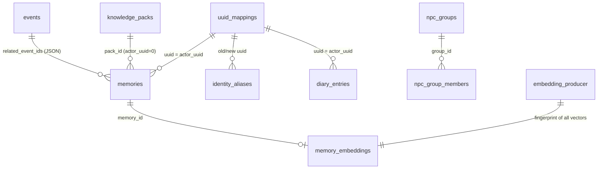
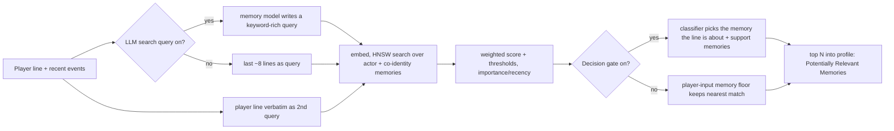

# SkyrimNet persistence and memory: event log, NPC memories, recall, diaries, world knowledge, identity and save timelines

Research note 04 for the EldenNet project, an LLM-driven NPC framework for Elden Ring.
Subject: SkyrimNet beta30-rc2 (Fateless.Ai / MinLL). Scope: everything SkyrimNet stores between
sessions, how it turns game events into NPC memories, how it recalls them for dialogue, and how it
keeps actor identity and save timelines consistent.

> **Method and license note.** Sources: the SQL migrations, shipped prompt templates (read for analysis
> only), YAML content, Papyrus `.psc` sources, the MIT-licensed C++ API headers, the Spriggit ESP tree,
> devkit docs, GitHub issues and release notes, and one community documentation site. No compiled file
> was inspected. **INFERENCE** marks my reading of that evidence, not a fact about the closed-source DLL.
> SkyrimNet's prompts may not be reused, so this note paraphrases them and quotes only short fragments.
> EldenNet writes its own prompts.

**Path prefixes** (same as notes 01 and 02)

| Prefix | Location |
|---|---|
| `DATA/` | `skyrimnet-beta30-rc2/SKSE/Plugins/SkyrimNet/` (release data dir) |
| `MIG/` | `DATA/sql/migrations/` |
| `LIB/` | `DATA/library/skyrimnet.base/` (shipped content library) |
| `SRC/` | `skyrimnet-beta30-rc2/Source/Scripts/` (Papyrus sources) |
| `DEV/` | `skyrimnet-devkit-beta30-rc2/` (devkit: docs, CppAPI) |
| `GH/` | public repo clone `MinLL/SkyrimNet-GamePlugin` |
| `COMMUNITY/` | community docs at `goncalo22.github.io/SkyrimNet-GamePlugin` (third party, may be out of date; fetched from the site's `gh-pages` branch) |

---

## TL;DR

- **One SQLite database per playthrough** (`data/SkyrimNet-<save id>.db`). It holds the event log, memories, world knowledge, diaries, identity mappings, NPC groups and knowledge-pack projections. A playthrough ID that "persists across save files within the same playthrough" picks the file (`SRC/SkyrimNetApi.psc: GetSaveUniqueID`). Per-playthrough *files* (dynamic bios) sit in a `saves/` content layer.
- **The event log is the source of truth.** Each event row has a type, a JSON payload, location, three clocks (game seconds, real time, pause-aware playtime), an originator, a target and an **audience** list of who perceived it. Long-term memories are derived from these events. The recent event window, rendered as chat turns, acts as short-term memory.
- **Memories are LLM summaries of event "scenes".** Events are segmented by time gaps (community docs: 60 min gap, 10–480 min, 5–200 events). One request per scene per perceiving NPC returns JSON: a dense first-person memory of a few sentences (the prompt targets 2–4, allows 5–6 for exceptional events), an emotion from a fixed list, importance 0–1, 5–10 tags and a type (EXPERIENCE, RELATIONSHIP, KNOWLEDGE, LOCATION, SKILL, TRAUMA, JOY). Per-actor progress is tracked on the event row (`memory_generated_for_actors`).
- **Recall is hybrid and has been tuned hard.** It runs a local ONNX embedding model (all-MiniLM-L6-v2 at first; selectable since Beta27) and an in-memory HNSW index. It searches with an LLM-written query *and* with the player's verbatim line. Results are weighted by similarity, importance, recency and other signals, with thresholds. An optional classifier "recall gate" (Beta28) picks the memory the player's line is about. Memories go into the prompt as a short numbered list with relative-time labels.
- **World knowledge reuses the memories table** (`actor_uuid = 0`). Each entry adds a per-NPC **condition expression** written in the template language, plus **always-inject** vs **semantic** retrieval and a `knowledge_key` for deduplication. Packs ship as `.sknpack` content and are projected into each save's DB. NPC groups are save-scoped sets that conditions can test.
- **Identity was the hardest problem.** UUIDs began as "a hash of display name and masked FormID". Renames and lifecycle stages split actors, which orphaned their memories. The fixes are layered: load-order-independent `mod_file + local_form_id`, rename alias rows that are unioned at recall time without rewriting, and curated identity links and successions in content. The maintainer still lists a name-independent UUID as pending (#502).
- **Rollback is handled by timeline reconciliation.** After a load, if the DB holds "future" rows newer than the save, the player picks Keep or Delete. Delete removes future events, memories, diary entries and alias rows, using `game_time` as the clock.
- **Diaries and dynamic bios are consolidation layers.** A diary is a long first-person reflection that is also stored as a memory. A dynamic bio is a conservative, per-block rewrite of the character profile from events, memories and the latest diary.
- **For an Elden Ring v1,** copy: a per-character DB with an audience-tagged event log, scene-based memory generation into strict JSON, recency + importance + relevance recall, stable persona keys with an alias table, an embedding-producer fingerprint, and playtime-based rollback detection. Simplify or drop: recall gate, diaries, dynamic bios, packs, groups and identity links (possession). Elden Ring has no calendar and no co-save, so playtime must serve as the timeline clock, and the playthrough must be identified some other way (§13).

---

## 1. Where state lives

| Store | What | Scope | Evidence |
|---|---|---|---|
| SQLite DB `SkyrimNet-<save id>.db` in `SKSE/Plugins/SkyrimNet/data` | Events, memories, knowledge, diaries, UUID maps, aliases, groups, packs, telemetry, OmniSight, songs | Per playthrough | Filename and path: GH issue #565. "each playthrough has its own; ids from different playthroughs are not comparable" (`DEV/CppAPI/PublicAPI.h: PublicQueryDiaryEntries`) |
| Playthrough ID | e.g. `1775335979900-500596` | Carried by every save of a playthrough | `SRC/SkyrimNetApi.psc: GetSaveUniqueID`; C++ `PublicGetSaveUniqueID` (v7) |
| SKSE co-save | UUID mapping table restored from it on load and written back to the DB | Per save file | Issue #565 (reporter's analysis of the load path; not confirmed by maintainers) |
| `saves/` content layer | Per-playthrough character bios, including dynamic bios `prompts/characters/dynamic/<name>.dynamic.prompt` | Per playthrough, highest layer priority | `DEV/docs/modding/MIGRATING_TO_BETA25.md` (folder table); `PublicRequestProfileUpdate` doc (v14) |
| `library/`, `external/`, `overlay/` | Prompts, bios, knowledge packs, identity links, filters | All playthroughs | `MIGRATING_TO_BETA25.md`, `CONTENT_ROOTS.md` |
| In-process memory | Short-lived events (TTL), HNSW vector index | Session | `SkyrimNetApi.psc: RegisterShortLivedEvent`; `PublicAPIMemoryQuery.h` ("only sees memories already in the vector index") |

INFERENCE: the playthrough ID is minted at new game and stored in the co-save. Every save of that
character, including older ones, therefore opens the same DB, which is why rollback needs reconciliation (§11).
A brand-new character gets a fresh DB, so playthroughs are fully isolated.

---

## 2. The final SQLite schema (reconstructed from `MIG/0001`–`0031`)

Plus `DATA/sql/schema_migrations.sql`: `schema_migrations(version INTEGER PRIMARY KEY)`.

### 2.1 Memory, knowledge and event tables

**`events`**: the event log.

| Column | Type / default | Added | Meaning |
|---|---|---|---|
| `id` | INTEGER PK AUTOINCREMENT | 0001 | Monotonic, also used as a cache anchor in prompts (§4.4) |
| `event_type` | TEXT NOT NULL | 0001 | e.g. `dialogue_player_stt`, `death`, `direct_narration` |
| `event_data` | TEXT NOT NULL | 0001 | JSON payload per event schema (a dialogue line is `{"dialogue": "..."}`, `PublicGetRecentEvents`) |
| `location` | TEXT | 0001 | Location string; since Beta29 may include a named place ("the kitchen") |
| `game_time` | REAL | 0001 | In-game seconds (prompt thresholds such as 604800 equal one week; `MemoryQuery.gameTimeAfter` is "game-seconds") |
| `game_time_str` | TEXT | 0001 | Formatted in-game date |
| `local_time` | REAL `julianday('now')` | 0001 | Real-world time |
| `actor_UUIDs` | TEXT (JSON array) | 0001 | Actors associated with the event. INFERENCE: the perceiving audience. The SQL comment says "form IDs", but the column name and API say UUIDs |
| `originating_actor_UUID` | BIGINT 0 | 0001 | Speaker, aggressor, victim (per type) |
| `target_actor_UUID` | BIGINT 0 | 0001 | Listener, victim, killer (per type) |
| `memory_generated_for_actors` | TEXT `'[]'` | 0004 | JSON array of actors whose memories already cover this event |
| `playtime` | INTEGER | 0008 | Pause-aware active play time at creation; NULL on legacy rows |

Indexes: `event_type`, `local_time`, originator, target, `memory_generated_for_actors`, `playtime`.

**`memories`**: per-actor memories *and* world knowledge.

| Column | Added | Meaning |
|---|---|---|
| `id`, `actor_uuid` BIGINT NOT NULL, `content` TEXT NOT NULL | 0003 | `actor_uuid = 0` marks a world-knowledge entry (0013) |
| `location`, `game_time`, `creation_time` | 0003 | Where and when (game seconds); real creation time |
| `related_event_ids`, `related_actors` (JSON arrays) | 0003 | Provenance: source events, involved actors |
| `emotion`, `importance_score` (0.5), `tags` (JSON), `memory_type` ('EXPERIENCE') | 0003 | LLM-assigned metadata |
| `embedding_checksum` | 0003 | Cache invalidation for the vector |
| `condition_expr`, `always_inject`, `is_active` (1), `display_name` | 0013 | World knowledge controls |
| `pack_id` → `knowledge_packs(id)` ON DELETE SET NULL | 0017 | Pack membership |
| `knowledge_key` | 0018 | Override/dedupe key |
| `source_key`, `source_hash` | 0022 | Identity and content hash inside a managed pack file |
| `updated_at` | 0026 | Epoch seconds of last user/API edit |

Indexes: `actor_uuid`, `importance_score DESC`, `creation_time DESC`, `memory_type`, `game_time`,
`location`, `emotion`, `(actor_uuid, is_active, always_inject)`, `pack_id`.

**`memory_embeddings`** (rebuilt in 0028): `memory_id INTEGER NOT NULL UNIQUE`, `embedding BLOB`,
`dimension INTEGER`. Partial index on `memory_id WHERE dimension = 0` marks memories that cannot be
embedded. No foreign key since 0028. The comment explains that `memory_id` is UNIQUE rather than the
primary key "so that counting memories without a vector reads its index only".

**`embedding_producer`**: a single row (`id CHECK (id = 1)`) holding `fingerprint` and `dimension`
of whatever produced the stored vectors (0028).

**`diary_entries`**: `id`, `actor_uuid`, `content`, `entry_date` (in-game), `creation_time`,
`location`, `emotion`, `related_event_ids`, `related_memory_ids`, `importance_score`, `tags`,
`updated_at` (0025). Indexes: actor, `entry_date DESC`, `importance DESC`. The `creation_time` index was
dropped in 0027 because entries are ordered by id.

**`knowledge_packs`**: `id`, `name`, `description`, `version`, `is_enabled`, `created_at`, `updated_at`,
`source_path`, `source_file_hash`. A unique partial index on `source_path` allows one managed pack per
logical path. `author` was dropped in 0023: authorship now comes from the plugin manifest.

**`npc_groups`** (`id`, `group_name UNIQUE`, `description`) and **`npc_group_members`**
(`group_id`, `actor_uuid BIGINT`, PK both, FK cascade; index on actor).

### 2.2 Identity tables

**`uuid_mappings`**: `id`, `uuid BIGINT UNIQUE`, `form_id` (runtime FormID), `actor_name`,
`bio_template_name`, `created_at`, `updated_at`, `mod_file`, `local_form_id` (0020). Indexes: uuid,
form_id, bio template, name, `(mod_file, local_form_id)`.

**`identity_aliases`** (0021): `id`, `old_uuid BIGINT`, `new_uuid BIGINT`, `mod_file`, `local_form_id`,
`old_name`, `new_name`, `game_time` (0 = unknown, never trimmed), `created_at`. Indexes on old and new.

### 2.3 Other tables (out of scope, listed for completeness)

`dialogue` (`speaker`, `text`, `timestamp`; from 0001, INFERENCE: early or legacy), telemetry `traces`,
`counters`, `errors`, `omnisight_screenshots` (vision captures; 0007/0009/0010/0011/0031) and
`bard_songs` (0012/0019/0030; it has a `save_id` column even though the DB is per playthrough, and
0019 declares `composer_uuid INTEGER`, the very declared type that 0021's comment says SOCI reads back
through a 32-bit get. INFERENCE: the BIGINT lesson was applied to identity tables but not everywhere).



---

## 3. How the design evolved

| Phase | Migrations | What changed, and the lesson |
|---|---|---|
| **Foundations** | 0001 | Event log with three actor columns and two clocks. Telemetry tables. A pre-vector `memories` table existed outside these files; 0002 drops its indexes on actor, type, emotion, game_time and importance. |
| **Vector memory** | 0002–0004 | The old memory system was removed and replaced by `memories` plus a separate `memory_embeddings` BLOB table (0003). Per-actor generation tracking on events (0004). INFERENCE: the legacy prompts `LIB/prompts/memory/memory_builder`, `memory_ranker`, `evaluate_memory_relevance` and `components/memory_access` belong to the old design. They use `summary`/`details`/`short|mid|long` fields that no current column holds. The current bio submodule reads `memory.memory.content`. |
| **Identity and diaries** | 0005, 0006 | UUID ↔ FormID map (0005); diaries (0006). |
| **Clocks** | 0008 | Pause-aware `playtime` on events. The comment says segmentation "can fall back to local_time when missing". INFERENCE: in-game time jumps (sleep, wait, fast travel at a 20x timescale), so episodes are grouped by real active play time. |
| **World knowledge** | 0013, 0015–0018 | Knowledge entries go into `memories` with `actor_uuid = 0`, a template condition and always-inject (0013). NPC groups (0015). A BIGINT fix (0016): the DB layer (SOCI) maps `INTEGER` to 32-bit and silently truncated 64-bit UUIDs. Packs (0017). Dedupe key (0018). |
| **Embedding quality** | 0014, 0024, 0029 | 0014 deleted every vector: the tokenizer had been "a hash-based placeholder", so all vectors were garbage until a WordPiece tokenizer replaced it. 0024 re-embedded only non-ASCII text after adding BERT normalization (accent stripping, CJK). 0029 re-embedded knowledge from title + content, because entries often never name their subject. |
| **Load-order and rename identity** | 0020, 0021 | `mod_file + local_form_id` (0020). Rename-fork alias rows unioned at recall time, with `game_time` so a timeline revert can undo them (0021). |
| **Content-managed knowledge** | 0022, 0023 | Packs become projections of content files, owned by a sync job (0022). |
| **Edit tracking and model swaps** | 0025, 0026, 0028 | `updated_at` (0025/0026). An embedding-producer fingerprint drops vectors whenever the producing model changes (0028). Beta27 then added user-selectable models with background re-embedding. |

Two engineering lessons are written into the migration comments themselves: the runner splits on every
semicolon and does not understand comments, so an apostrophe in a comment "swallows the rest of the
file" (0020–0022, 0027, 0028, 0030); and tests with small toy UUIDs hide 32-bit truncation (0021).

**The pre-vector design, as the legacy prompts show it.** The four legacy files under
`LIB/prompts/memory/` describe an all-LLM pipeline that the current schema no longer supports
(INFERENCE: they are leftovers of the table 0002 dropped):

1. `evaluate_memory_relevance.prompt` asked an LLM which raw events were worth remembering for an NPC,
   returning a relevance reason and a 0–10 importance per event.
2. `memory_builder.prompt` turned the chosen events into a memory with a `summary`, `details` and a
   `short|mid|long` horizon.
3. `memory_ranker.prompt` gave the LLM a numbered list of memories plus the current scene and asked it to
   return the indices of the most relevant ones, weighing location, mood, importance, recency, memory
   horizon and who is present.
4. `components/memory_access.prompt` rendered summary, details and an importance out of 10.

The current design replaces steps 1–3 with a single generator call per scene and replaces LLM ranking
with embedding search plus weighted scoring. INFERENCE: an LLM ranker costs a model call per reply and
scales poorly with memory count, and that is the likely reason for the change. For EldenNet this is an
argument against LLM-ranked recall even in v1.

---

## 4. The event log: what an "event" is

### 4.1 Three tiers of events

FACT (`SRC/SkyrimNetApi.psc`, `DEV/CppAPI/PublicAPI.h`, `WORKFLOW_TRIGGERS.md`):

1. **Persistent events** are rows in `events`, written through `RegisterEvent`, `RegisterDialogue*`,
   `DirectNarration`, `RegisterPersistentEvent` and engine hooks.
2. **Short-lived events** live only in memory, have a TTL and a caller-chosen `eventId`. A new event with
   the same ID replaces the old one (the Papyrus doc's example: "spell_cast_actor_id" keeps only the last
   spell). Prompts query them with `get_active_short_lived_events` and `get_short_lived_events_by_entity`
   (`DATA/docs/decorators.html`).
3. **Ephemeral event types** are declared with `isEphemeral` in `RegisterEventSchema`. They notify
   callbacks only and are not stored. Beta24 fixed a bug where Papyrus-declared ephemeral types "were
   written to the database anyway, accumulating forever" (GH release notes).

Event schemas declare typed fields and four render modes (`SkyrimNetApi.psc: RegisterEventSchema`).
The Papyrus doc labels them `recent_events` (scene context), `raw` ("event history"), `compact`
("used for memories") and `verbose` ("diagnostics"). The shipped templates use them differently from
those labels:

- `verbose` is used by the main dialogue history (`components/event_history`) and by the memory,
  diary and dynamic-bio generators (`components/event_history_verbose`, included by
  `memory/generate_memory`, `diary_entry`, `dynamic_bio_update`)
- `compact` is used by `components/event_history_compact`, which feeds the search-query helper, mood,
  speaker and target selectors, and the GameMaster
- `recent_events` is used for the triggering event in `player_dialogue` and for
  `components/context/component_recent_events`

One event therefore renders at several levels of detail for different consumers. The labels in the
Papyrus doc are not a reliable guide to which consumer uses which mode.

`RegisterEventSchema` also takes `shortLivedEnabled` (default true): a persistent event type also
produces a short-lived scene-context copy unless this is set to false "for high-volume events that
shouldn't clutter scene context". It also takes `interrupt`, which lets player-initiated event types
cut into ongoing speech.

### 4.2 Types, originator and target

The trigger reference lists about 40 engine event types (`DEV/docs/modding/WORKFLOW_TRIGGERS.md`,
"Event Type Reference"):

- combat: `hit`, `combat`, `death`, `enter_bleedout`
- magic: `spell_cast`, `active_effect`
- world: `activation`, `location_change`, `cell_attach_detach`, `container_changed`, `lock_changed`, `crime`
- quests: `quest_stage`, `quest_start_stop`, `quest_objective_state`
- social: `trade_start/complete`, `book_read`, `sleep_start/stop`
- UI: `notification`, `messagebox`
- dialogue variants: `dialogue`, `dialogue_npc`, `dialogue_player_stt`, `dialogue_player_text`, `dialogue_background`, telepathy
- SkyrimNet's own outputs: `direct_narration`, `persistent_generic`, `player_thoughts`, `npc_thoughts`, `diary_entry_created`
- mod hooks: `mod_event`, `custom`

Originator and target are assigned **per type**. For `hit` the originator is the aggressor; for `death`
it is the victim and the target is the killer; for `dialogue` it is the speaker; for `active_effect` it
is the affected actor and the caster is the target (`WORKFLOW_TRIGGERS.md`). Elden Ring needs the same
per-type table, written once and used everywhere.

### 4.3 Who perceived it: the audience

FACT (`PublicRegisterEvent` doc, API v11): with no explicit audience, an event is perceived by
"everyone near the originator, plus the player". An explicit list gives "exactly the listed actors plus
originator and target". The audience limits "each character's own history, memories and dialogue
context", while the GameMaster and speaker selection still see the event. FEATURES.md adds that "An NPC
only reacts to what they could plausibly see or hear", and whisper mode shrinks the radius. NPC thoughts
are events "whose audience is the thinking NPC only" (`GenerateNPCThought`). Audience members must
be loaded actors: "Unloaded ones are skipped; if none is loaded, nothing is registered (it never
falls back to nearby)" (`PublicRegisterEvent`). Leaks across the audience boundary are a real class of
bug. Beta24 fixed private virtual-NPC lines that were being "laundered into" nearby NPCs' memory
(GH release notes). Memory filters
(`LIB/filters/animals_no_memories.yaml`, `mannequins_no_memories.yaml`, `kind: memory` with race,
faction and gender black/whitelists) stop some actors from forming memories.

**This is the key privacy primitive.** An NPC's prompt history, memory generation and recall all filter
on "was I in the audience". Prompts fetch history with `get_recent_events(count, [npc.UUID])`
(`LIB/prompts/components/event_history*.prompt`). INFERENCE: this filter matches against `actor_UUIDs`.

### 4.4 The recent window is short-term memory

`components/event_history.prompt` renders the last N events the NPC perceived as **chat turns**. The
NPC's own lines become `assistant` messages and everything else becomes `user` messages. `spell`, `hit` and
`combat` events are left out of the long history. N is per-actor, from `get_event_history_count(npc.UUID)`.
The template:

- computes relative-time labels ("[Earlier today]", "[Yesterday]", "[Over a week ago]") from
  `gameTimeNumeric - event.gameTime` in game seconds
- inserts gap markers when more than 1800 game seconds separate events
- inserts "location changed" markers when the building changes
- pins the start of the window to an **anchor event id** (the next multiple of a power-of-two step), so the
  prompt prefix stays byte-stable between replies and provider prompt caching keeps working

`dialogue_response.prompt` places this history after a cached system message. The changing parts of the
profile (memories and knowledge) follow it in the final user message, so recall never invalidates the
cache (`submodules/cache_split/npc_profile_dynamic.prompt` explains the split).

### 4.5 The log doubles as a relationship signal

The C++ API derives social statistics directly from the event log and memories, with no separate
relationship table (`DEV/CppAPI/PublicAPI.h`, v3 data queries):

- `PublicGetActorEngagement`: per actor, memory count, total memory importance, recent importance and
  event counts in a short and a medium game-seconds window (examples: 86400 = one game day, 604800 =
  seven), last event time and NPC-to-NPC event count
- `PublicGetRelatedActors`: actors who share events with an anchor actor, with recency windows
- `PublicGetPlayerContext`: recent interaction names and per-NPC interaction counts with the player
- `PublicGetEventPairCounts`: shared-event counts for NPC pairs in a candidate pool
- `PublicGetRecentDialogue`: player–NPC exchanges, oldest first, with `speaker` as a role ("player" or
  "npc"). INFERENCE: read from the dialogue events in the log, not from the legacy `dialogue` table

Events can also carry a `gameTimeEnd` (null in the API example; the event-history template uses it as
the end of an event's span when set). No migration adds such a column. INFERENCE: it is computed or
stored inside the payload for events that span time.

Transferable idea: "how well does this NPC know the Tarnished" can be a query over the audience-tagged
log (shared events, memory importance involving the player). A v1 does not need a hand-maintained
affinity table for that.

---

## 5. Memory formation

### 5.1 When: event segments ("scenes")

- FACT (`MIG/0008`): segmentation of events into memory units exists and prefers `playtime`.
- FACT (Beta29.1 release notes): the unit is called a **scene**. "A scene whose memory failed is retried
  even after a later scene succeeds"; after 12 failed tries it waits for the next session.
- COMMUNITY (`COMMUNITY/Memory System/sqlite-storage`, `memory-recall`) gives segmentation defaults:
  max gap 60 minutes, segment duration 10–480 minutes, 5–200 events per segment, a minimum importance
  of 0.2 to store, at most 1000 memories per actor with low-importance memories pruned first, and async
  generation on 10 threads with batch size 100. These read like a dump of config defaults, but the site
  is third-party and may be stale.
- FACT (`DEV/docs/Agents.md`): "Memories are generated from recent dialogue and events", on a dedicated
  memory model slot.
- `events.memory_generated_for_actors` (0004) records, per event, which perceivers already have a
  memory covering it. INFERENCE: the generator picks, for each actor, unmemorized events in that actor's
  audience, cuts them into scenes and marks the events done once the memory is stored. Issue #755
  reports that after failed parses "Source events remain in the session database" (no source-event
  loss was demonstrated), while the memory itself was not stored.

### 5.2 How: the generation prompt (paraphrased)

`LIB/prompts/memory/generate_memory.prompt` is the active generator. INFERENCE: its output fields match
the current `memories` columns one for one. Its inputs:

- the setting submodule (lore framing)
- the memory owner's full character profile, marked as "THIS IS YOU"
- the involved actors, each with race, gender and a one-line profile, and flags for self and player
- the scene's events rendered in verbose form

Its instructions ask for a **first-person** recollection with no "last week"-style relative time,
written "dense, not flowery". The memory should run 2–4 sentences (5–6 for exceptional events) and
always use specific names and full location names, since these are "searchable terms". The output is a
single JSON object:

- `content`
- `location`
- `emotion`, one of ten values from joyful to traumatized
- `importance_score`, 0–1, with rubric bands (0.7–1.0 for danger, betrayal or transformative events;
  0.4–0.6 for meaningful conversations or transactions; 0.1–0.3 for routine or background events)
- 5–10 lowercase `tags`: names, places, activities, items, emotional themes
- `type`, one of the seven memory types

Before/after example pairs show verbose prose being compressed into one concrete line.

Design points worth copying as ideas:

- **Write for retrieval.** The prompt optimises memories for later search: concrete nouns, names, tags.
  This matters more than literary quality.
- **The perspective is per owner.** The same scene yields a separate memory for each perceiver, each in
  that NPC's voice, with the owner's profile in context. A merchant and a guard remember the same robbery
  differently.
- **Importance is decided at write time** by the LLM against an explicit rubric. It drives recall
  weighting, decay and pruning.
- **The JSON must be strict.** Issue #755 (Oct 2026) shows a model adding commentary around the JSON, the
  parser rejecting it, and the memory being lost. The reporter asks for provider structured-output
  parameters, narrow cleanup of a final JSON block, bounded retries and requeueing. Beta29.1 added scene
  retries.
- **Garbage in, garbage out.** Issue #723 (open) shows `hit` events from a non-hostile spell reaching a
  reaction prompt as "struck", which produced a guilty player thought. The reporter also found a similar
  memory and diary entry but could not confirm that they came from the same path. The reporter argues
  that such misphrased events reinforce a false narrative over time. Per-type event phrasing feeds memory
  quality directly.

### 5.3 Other ways a memory gets written

- **API:** `PublicAddMemory(formId, content, importance, type, emotion, location, tagsJSON,
  relatedActorsJSON)` (v5), then edit and delete (v11). Edits and deletes fire `SkyrimNet_MemoryUpdated`
  and `SkyrimNet_MemoryDeleted` (`PublicAPI.h`). FEATURES.md lists `SkyrimNet_MemoryCreated` among the
  lifecycle ModEvents. World knowledge, plugin-installed rows and diary-backed memories cannot be edited
  through `PublicUpdateMemory`. The Papyrus API can write events, diaries, dynamic bios and world
  knowledge, but it has no function that reads memories. Reads go through the C++ API or the template
  decorators.
- **Diary entries** become memories tagged `diary_entry` (§8).
- **The dashboard** can edit memories. Editing re-embeds the text, so recall follows the new wording
  (Beta26).
- Beta24 notes that `game_time` "is stamped on every creation path". Issue #391 earlier complained that
  memories and diaries were "dateless", and the maintainer replied that "something functionally
  equivalent" landed in Beta21.

### 5.4 Mood

The legacy `memory/mood_evaluator.prompt` derived a primary mood, intensity and attitude toward the
player from recent events. Mood is now a typed decision (`decisions/evaluate_mood.prompt`, used when
`dialogue.decisions.useForMood` is on, with `helpers/evaluate_mood` as fallback) and is exposed to
templates as `get_actor_mood()`. Mood is not stored in the DB schema. INFERENCE: it is session state.

---

## 6. Embeddings and the vector index

| Fact | Source |
|---|---|
| Libraries: SQLite, SOCI, ONNX Runtime, SentencePiece, hnswlib | `DATA/THIRD_PARTY_NOTICES.txt` |
| Original model all-MiniLM-L6-v2: 384 dimensions, 30,522-token vocabulary, run through ONNX Runtime on CPU, with a WordPiece tokenizer | SkyrimNet's own log lines quoted in GH issue #681 (maintainer reply: evaluating "a different embedding model for better multi-lingual support"); the WordPiece tokenizer is also confirmed by `MIG/0014`. (Parts of #681 were derived from the reporter's look inside the DLL; this note does not use those parts.) |
| Beta27: selectable model under Memory → Embedding Model. New installs default to "Bekko Embedding v1" (234 MB download); "Granite Embedding 107M Multilingual" (442 MB) is built in; custom ONNX model + `tokenizer.json` go in `models/embedding/custom/<name>/`. Memories "re-embed in the background, with progress". A failed load reverts the setting | GH releases (Beta27) |
| Beta27's own recall measurement (right memory in the top five), for all-MiniLM-L6-v2 / Granite / Bekko: English 65% / 71% / 76%, Russian 46% / 88% / 93% | GH releases (Beta27) |
| Re-embedding is not free. Beta26's non-English fixes reprocessed affected memories "once on first load", and the notes warn that the first load "may take a while": alpha testers reported "15+ minutes for 6 month long playthroughs". Beta26 also fixed VR saves (with the "VR playroom" enabled) loading memories into "a temporary database that disappears on the next launch" | GH releases (Beta26) |
| A model change is detected by the `embedding_producer` fingerprint; vectors are deleted and backfilled. `dimension = 0` rows mark unembeddable memories so they are not retried forever | `MIG/0028`; 0014/0024 mention `BackfillMissingEmbeddings()` at startup |
| Knowledge is embedded as "display name, a newline, then its content without template markup" | `MIG/0029` |
| Semantic ordering "only sees memories already in the vector index"; SQL orders see every row. An empty knowledge query is "cheap, no HNSW" | `PublicAPIMemoryQuery.h`, `PublicGetWorldKnowledgeForActor` |
| COMMUNITY: HNSW `M = 16`, `ef_construction = 200`, cosine similarity | `COMMUNITY/Memory System/sqlite-storage` |

INFERENCE: vectors are persisted as BLOBs in SQLite, and the HNSW graph is rebuilt in memory when a save
loads (hnswlib is an in-memory index). The background backfill covers rows that have no vector yet,
which is why freshly written memories may briefly be invisible to semantic search. `PublicAddMemory`
and the diary write functions are documented as blocking "while the memory's embedding" is computed,
so API-created memories are embedded synchronously. INFERENCE: SentencePiece in
`THIRD_PARTY_NOTICES.txt` probably serves tokenizers of the non-BERT models (Granite-class
multilingual models usually use a SentencePiece/BPE vocabulary). Neither doc says so.

**Caveat on the community pages.** `COMMUNITY/Memory System/sqlite-storage` shows a `memories` table with
`actor_uuid TEXT`, an inline `embedding BLOB` and a `details` column. That does not match `MIG/0003`
or any later migration. The page describes an older or idealised design, so its numeric defaults
(below and in §7) should be read as historical.

---

## 7. Recall: from a player line to injected memories

### 7.1 Pipeline



Evidence:

- **Query generation.** `DEV/docs/Agents.md` ("Memory Search") and `LIB/prompts/helpers/generate_search_query.prompt`
  produce one query from location, emotion, nearby actors, conversation partners and compact recent
  events, favouring concrete nouns and avoiding vague words.
- **The verbatim line is also a query.** COMMUNITY (memory-recall page) says the player's last input
  "is also used, verbatim, as a query".
- **Beta28 recall notes:**
  - recall of the memory under discussion roughly doubled (English 33% → 65%, Russian 20% → 60% on the
    team's test saves)
  - a "Player Input Memory Floor" (default 30%; 0 keeps the nearest memory always)
  - related-memory settings that pull closely matching memories along
  - a conversation search with its own Similarity (default 80%) and Min Relevance (default 0, off).
    The general Similarity Threshold and Min Relevance Score now "apply only to the search with your
    line". Two searches therefore run with separate thresholds: one on the player's line, one on the
    conversation (the LLM query or the last 8 lines)
  - "Related Player Input Memories" (default 2) and "Related Memory Cut" (default 75%) pull the closest
    neighbours of the matched memory along, "so an NPC asked how a matter started also sees how it went"
  - turning off the LLM search query "saves one meta-model call per reply and searches the last 8 lines
    instead, at a little less recall (English 51% against 65%, Russian 53% against 60%)"
  - per-language tuning advice (a lower memory floor for Russian and Japanese, a different conversation
    similarity per embedding model). Thresholds are model- and language-specific
- **Beta27:** Min Relevance Score default raised to 0.6 ("NPCs are handed fewer memories unrelated to the
  conversation").
- **Scoring.** FEATURES.md: "A memory of being attacked outweighs a passing pleasantry. Memories fade
  over time at a rate based on how important they were." COMMUNITY lists a weighted score (semantic
  similarity 0.35, temporal proximity 0.20, actor involvement 0.20, emotional match 0.10, keyword
  relevance 0.10, location 0.05) and thresholds (similarity 0.52, relevance 0.57, keyword 0.18; likely
  pre-Beta27). Five memories are retrieved by default, configurable from 1 to 10. INFERENCE: decay is
  importance-scaled, with high-importance memories fading slowly. The exact curve is not documented.

### 7.2 The recall gate (Beta28, experimental, off by default)

`LIB/prompts/decisions/memory_recall_gate.prompt` is a **decision template**, not a chat prompt. It goes
to the classifier-style `decisions` model, which returns probabilities over option keys. Its inputs are
the NPC, the player's line verbatim, the earlier conversation, and the candidate memories that came
closest to the line, keyed `m1, m2, …` and flattened to one line each.

- The main question is *which memory, if any, is the line about*, with an explicit `none` option. The
  template says to pick none for greetings, requests and remarks about the present scene.
- Optional `support_m<n>` yes/no questions ask whether a memory concerns *the same matter*, including
  how it later turned out.

The header comment documents the acceptance rule. A memory is accepted when 1 − p(none) clears a cut-off
(the "Min Probability" setting, 70% by default per Beta28 notes), and the likeliest memory is taken. Each
support memory at or above `support_min_probability` is added, up to `support_max_picks`. Without an
answer, recall "falls back to its plain similarity search". The cost is about 0.2–0.4 s per player line
(Beta28). While on, the gate replaces the player-input floor.

Idea worth noting: **recall answers a question, not just a similarity.** The gate catches follow-ups
("what about that?") that embeddings miss, and the support question brings back the *outcome* of an
episode (the debt was paid), not only its start.

### 7.3 Injection format

`LIB/prompts/submodules/character_bio/7100_memories.prompt` renders the result inside the character
profile (modes `full`, `thoughts`, `transform`) as a heading "…'s Potentially Relevant Memories", then a
numbered list. Each item carries:

- a relative-time label from game-seconds deltas ("[Last week]", "[Several months ago]")
- `[in <season>]` when the memory's season differs from the current one
- the content in bold, then emotion, importance and tags
- `[experienced as <old name>]` for memories that belong to a linked or renamed co-identity
  (`memory.isOwn`, `memory.originName`)

The word *potentially* tells the model that the memories are optional context, not script.
`submodules/system_head/0020_format_rules.prompt` limits the model to "your character profile, listed
memories, scene description, and recent events".

### 7.4 Query API (useful as a spec)

`PublicAPIMemoryQuery.h` (v10) offers:

- include/exclude lists (OR semantics; exclude wins) for tags, memory types, emotions and locations
- an importance range and a game-time range
- an `isActive` flag
- `contextQuery` for semantic search
- seven orderings (`GameTimeDesc` … `Relevance`)

The SQL filters apply "before truncation". `PublicAPIDiaryQuery.h` mirrors this for diaries and adds
`minId` for incremental reads. It guarantees within one DB that ids only grow, are never reused (not even
after a timeline clear) and are kept on edit.

---

## 8. Diaries and dynamic bios: consolidation layers

**Diary entries** (`LIB/prompts/diary_entry.prompt`, table `diary_entries`):

- Triggered on demand only:
  - a hotkey with a scope menu: Player, Nearby, Pinned or Crosshair (`SRC/SkyrimNetInternal.psc: GetDiaryScopeMessage`, `TriggerGenerateDiaryBio`)
  - a trigger response type `diary_entry`
  - Papyrus `GenerateDiaryEntry`
  - the C++ `PublicAddDiaryEntry` (including player-written entries)
- Inputs: the previous entry for continuity, recent memories with dates and importance, and the recent
  verbose event history. A target length is scaled by importance.
- Output: JSON with `importance_score`, `emotion` and a Markdown `content`, written as a private,
  in-voice reflection.
- Each entry "becomes a searchable memory" (FEATURES). Editing the entry rebuilds that memory. Deleting
  the memory keeps the entry (`PublicUpdateMemory`/`PublicDeleteMemory` docs). The `diary_entry_created`
  event and `SkyrimNet_DiaryCreated` ModEvent fire.
- Design role (INFERENCE): a diary is a higher-level **episodic summary** over many small memories, and
  it gives retrieval a coarse, high-importance document that spans a day.

**Dynamic bio updates** (`LIB/prompts/dynamic_bio_update.prompt`, `PublicRequestProfileUpdate` v14):

- Inputs: the static bio, the current dynamic bio, recent events, the most significant memories, the
  latest diary, factions and linked identities.
- The output rewrites only the "updatable blocks": summary, background, personality, appearance,
  aspirations, relationships, occupation, skills, speech style and interject summary. The prompt pushes
  hard for conservatism ("95% of updates should be MINIMAL or require NO CHANGE"), sets word budgets per
  block with pruning rules, and applies a **"Stranger Test"**: public-facing blocks (summary, appearance)
  may hold only what a stranger could observe or know by reputation.
- It returns `updated_content` plus `changes_summary` and is stored as a per-playthrough file, not a DB
  row. One update per actor may be in flight at a time.

INFERENCE on the overall memory hierarchy:

| Tier | Span | Form |
|---|---|---|
| Short-term | minutes to hours | recent event window |
| Episodic | scenes | memories |
| Reflective | days | diaries, also stored as memories |
| Semantic self-model | weeks | dynamic bio blocks |
| Shared facts | any | world knowledge |

---

## 9. World knowledge, knowledge packs, NPC groups

### 9.1 Entries

A world-knowledge entry is a `memories` row with `actor_uuid = 0` (`MIG/0013`). Fields
(`LIB/prompts/agent_knowledge_builder.prompt`, `PublicAddWorldKnowledge`):

- `content`: an in-world fact. Per the agent prompt it is rendered through the template engine at
  runtime, so it can use the player's name or quest checks. Issue #602 ("Ability to resolve template
  variables in knowledge pack entries", open, no maintainer reply) reports that in pack entries only
  `{{ playername }}` resolves, while per-NPC variables such as `npc.name` and `actorName` do not.
  Template rendering of content therefore exists, but its context is narrower than a dialogue prompt's.
- `condition_expr`: a template-language boolean evaluated **per NPC**, with `actorUUID` and `actorName`
  available. Examples: `is_in_faction(actorUUID, "…")`, `is_in_npc_group(actorUUID, "…")`,
  `get_quest_stage("MS13", false) >= 10`, `is_quest_active(…)`, `decnpc(actorUUID).race == "Nord"`,
  `contains(get_location(actorUUID), "Whiterun")`. Empty means every NPC.
- `always_inject`: true makes the entry deterministic. It is included every time the condition passes,
  for facts "wrong to omit", such as a shopkeeper knowing their own shop was robbed. False (the default)
  makes it semantic, surfacing only when the conversation is relevant. The agent prompt warns that
  over-injecting makes NPCs "sound like they're reciting a fact sheet".
- `importance` (0–1, default 0.7) for ranking, `type`, `tags` written "as natural language" for the
  embedder, and `display_name`.
- `knowledge_key`: when several entries with the same key pass their conditions for one NPC, only the
  highest-importance one is shown. A specific personal entry can replace general gossip this way, e.g.
  the robbed merchant's version beats the village rumour.

A subtle and transferable rule: quest-gated knowledge must decide between **ephemeral** (true only
while the quest runs; `get_quest_stage(id, true)` returns −1 afterwards) and **persistent** (the outcome is
remembered forever; `get_quest_stage(id, false) >= N`). The agent prompt makes the second argument
mandatory for that reason.

Retrieval (`submodules/character_bio/0130_world_knowledge.prompt`, `PublicGetWorldKnowledgeForActor`):

- always-inject entries whose condition passes, plus semantic matches (Beta27: knowledge similarity
  threshold 0.40, min score 0.575; "NPCs find a world knowledge entry when asked about it by name")
- the API defaults to 5 results
- rendered in the profile under "Things You Know"

**Authoring is LLM-assisted.** `agent_knowledge_builder.prompt` is not a runtime prompt. It extends
`components/agent_tools_base` and drives a dashboard assistant that proposes batches of entries to a
review board through a `propose_knowledge_entries` tool (create, update, remove). Before writing
conditions it looks up real identifiers with game-data tools: `get_decorators`, `get_quest_stages`
(stages with objectives and journal text), `get_npcs`, `get_quests`, `get_factions` and others. It
is told to report failed lookups "rather than guessing at identifiers". The human approves the
proposals. Its worked example is a typical quest pattern: three entries share one `knowledge_key` and
rise in importance through ephemeral "stolen" and "mid-quest" stages to a persistent "recovered"
outcome.

Transferable idea: an offline authoring assistant that reads Elden Ring's event-flag and NPC tables
and *proposes* knowledge entries for human review could write the v1 lore files much faster than
hand-authoring, and a runtime LLM call is never needed for it.

### 9.2 Packs

Packs are `.sknpack` files in a plugin's `knowledge/` root (1 MB limit, `CONTENT_ROOTS.md`). Since
Beta25 (`MIGRATING_TO_BETA25.md`, "Knowledge packs"), installed packs are **projected into each save's DB
on load and whenever content changes**, and the sync owns those rows:

- updating the pack updates entries in place, matched by a stable per-entry key (`source_key`, `source_hash`)
- uninstalling removes the entries; disabling deactivates them
- players can toggle entries per playthrough, edit an entry "for the current playthrough only" (a personal
  copy), or edit "for all playthroughs" (an overlay copy of the pack)
- save-specific entries the player or game creates are never shipped
- group *names* ship with a pack; group *membership* stays per playthrough

### 9.3 NPC groups

NPC groups are named, save-scoped actor sets (`npc_groups`, `npc_group_members`). Players assign them in
the web UI or the chat right-click menu. They are used by `is_in_npc_group()` conditions, triggers and
chat group mode. The built-in "Pinned" group also feeds speech-to-text hints
(`LIB/prompts/stt_hints.prompt: get_npc_group_members("Pinned")`). Groups make up for factions the game
does not define, e.g. "Companions Inner Circle".

---

## 10. Identity: keeping "who" stable

### 10.1 Layers, in the order they were added

1. **UUID.** A 64-bit identifier, originally "a hash of display name and masked FormID" (`MIG/0021`).
   INFERENCE: the masked FormID strips the load-order index. Virtual NPC UUIDs derive from the
   registration name and are "stable across sessions" (`GetVirtualNPCUUID`, Beta24 notes). APIs convert
   with `PublicFormIDToUUID` and `PublicUUIDToFormID`. Prompts and decorators work with UUIDs only. In
   Papyrus every UUID is a `String` (`GetEntityUUID`, `RegisterEventByUUID`, `GenerateDiaryEntryByUUID`).
   INFERENCE: Papyrus `Int` is 32-bit, so a 64-bit ID has to cross the boundary as text, the same
   truncation hazard that 0016 and 0021 fixed in the DB layer. (`THIRD_PARTY_NOTICES.txt` lists xxHash;
   which hash function produces the UUID is not documented.)
2. **`uuid_mappings`** (0005): UUID → runtime FormID, name and bio template.
3. **Load-order independence** (0020): `mod_file + local_form_id`. Content files reference NPCs as
   `npc:<Plugin.esp>:<0xLocalID>` and never by runtime FormID, which "depends on load order; the hub
   refuses it" (`CONTENT_ROOTS.md`).
4. **Rename continuity** (0021): when one stable `(mod_file, local_form_id)` is seen under a second UUID,
   a row `old_uuid → new_uuid` is written. "CoIdentityRegistry unions the chain at recall time --
   nothing is rewritten". Old names are kept so old memories can be labelled with the name the actor had
   then.
5. **Curated links and successions** (`identity/` content root, Beta24):
   - `kind: link` joins two identities (NPC or virtual) as one being, with a per-link direction for
     sharing memories and conversation.
   - `kind: succession` declares that one record continues another.
   - Base content ships successions for actors whose record the game swaps mid-quest: Ulfric, Cicero,
     Erik, Astrid, Kodlak and others (`LIB/identity/vanilla_*.yaml`; Beta29 notes: they "keep their memories
     when a quest or scene swaps their record").
   - Links feed the "[experienced as …]" labels and the possession and shared-soul framing in
     `7050_identity_links.prompt` (fields `dominance` = host_led / entity_led / contested and
     `sees_their_memories`).
6. **Merged reads.** Diary and memory queries merge "the actor's co-identities (renames, identity links,
   drifted UUIDs)" (`PublicQueryDiaryEntries`). The same-name fix in Beta26 stopped NPCs who share a
   name from sharing diaries and memories.

### 10.2 What still goes wrong (public issues)

- **#582 / #502.** The UUID is name-derived, and actors are materialised at several lifecycle stages
  (main menu, save load, cell load) under different names (unresolved, generic base name, renamed). One
  FormID ends up with two or three UUIDs, and older memories become unretrievable. One reporter's save
  had 11 alias rows against 120 split FormIDs, because aliases are only recorded for renames observed
  within a session. The player alone had two UUIDs. The maintainer closed #582 as a duplicate (Oct 13,
  2026): "both come from the UUID being derived from the actor name", with the name-independent UUID fix
  tracked in #502 (still open, no target release).
- **#565** (open, no maintainer reply). `uuid_mappings` grows without bound: 2,180 of 2,558 rows were
  "referenced by nothing", which the reporter identifies as "corpses from cleared dungeons", and 748
  pointed at forms that no longer matched the load order. In the reporter's analysis the load path
  restores the table from the co-save and writes it back, so pruning the DB alone does not help. Under
  the default `delete` journal mode a 5400 RPM HDD load never finished. WAL took it to 86 s on the same
  drive and 2 s on NVMe. The reporter calls `PRAGMA journal_mode=WAL` a mitigation and asks for the load
  path to stop rewriting unchanged rows.
- **#612.** Runtime-spawned actors (`0xFF…` refs, such as children grown into adults by another mod) have
  no plugin and local ID, so no succession can name them, and their memories are orphaned.

**Lesson:** identity must come from a stable record key chosen up front, never from a display name.
Aliases should be additive and resolved at read time. Some identity continuity is semantic (the same
person in two records) and must be curated as data.

---

## 11. Save association, rollback and per-save isolation

- **Isolation.** Each playthrough has its own DB. Every save of the same playthrough shares it, because
  they share the playthrough ID.
- **Readiness gate.** `PublicIsMemorySystemReady()` is false "until a save is loaded or a new game
  starts". Writes must wait.
- **Timeline check.** After a load, SkyrimNet looks for history from the loaded save's "future". If any
  exists, it shows the message box `skynet_DeleteHistoryMessage` ("Timeline Mismatch: … detected an older
  save being loaded. Do you want to delete all messages that did not happen in this timeline, yet?",
  buttons Keep History / Delete History; `GH/spriggit/SkyrimNet/Messages/…000009…json`, shown via
  `SkyrimNetInternal.ClearTimelineMessage`).
  - `PublicGetTimelineState()`: 0 none, 1 pending, 2 kept, "3 = cleared (all future events, memories
    and diary entries deleted)".
  - Diary and memory writes are refused while the state is 1. `SkyrimNet_TimelineResolved` fires when
    the check finishes.
  - `MIG/0021`: the revert also "drops alias rows newer than a reloaded save", comparing in `game_time`
    units. Rows with `game_time = 0` are never trimmed.
- **Clock choice.** INFERENCE: the revert keys on `game_time`, because Skyrim's in-game calendar only
  moves forward within a playthrough. `playtime` (0008) is used for segmentation.
- **Known bug.** #825 (opened Nov 3, 2026, open, no maintainer reply yet): after Delete History
  "Nothing happens. Memories, and dialogue and event history persist." The reporter says it began with
  Beta28 and that earlier versions reset dialogue history to the save's point. The reproduction ran
  through a game close or crash and a reload. That is the exact path a rollback check exists for, and
  it argues for an automated test of the trim path.
- **Keep History** retains the "future" rows. The NPC then remembers things that, in this timeline, never
  happened. SkyrimNet makes this a player choice rather than deciding.

---

## 12. How it maps onto Skyrim engine features

| SkyrimNet concept | Skyrim/SKSE feature it leans on |
|---|---|
| UUID from name + masked FormID; `mod_file + local_form_id` | Plugin-relative FormIDs (`Plugin.esp|0xLocalID`); load-order index in the top byte (ESL: 12-bit IDs) |
| Successions (Ulfric, Cicero, Erik) | Quests that swap one actor record for another (disable old ref, enable new) |
| Playthrough ID and UUID mappings in the co-save | SKSE co-save serialization alongside each `.ess` |
| Timeline revert on `game_time` | A monotonic in-game calendar (timescale 20; sleep and wait advance it) |
| `playtime` for scene segmentation | Wall-clock active play, independent of waiting and sleeping |
| Knowledge conditions `get_quest_stage`, `is_in_faction` | Quest stages and factions as authoritative, queryable world state |
| Audience = actors near the originator | Loaded 3D actors, distance and line of sight; cells and buildings for "location changed" |
| `hit`, `death`, `combat`, `crime` events | SKSE/CommonLib event sinks (TESHitEvent, TESDeathEvent, …) |
| Memory filters by race (animals, mannequins) | Race forms and editor IDs |

---

## 13. Transferable patterns for an Elden Ring framework

### 13.1 Copy as an idea

1. **Event-sourced memory with an audience list.** Store every observable happening once, with
   originator, target and the set of actors who perceived it. Derive NPC history and memories from
   "events I was in the audience of". This gives perception-correct knowledge for free and is the
   foundation for both important NPCs and generic barks.
2. **Two clocks, both stored on every event: playtime and game time.** In Elden Ring, playtime should
   be the *primary* clock (see 13.4). Store the in-game time of day as a string for flavour.
3. **Scene-based generation into strict JSON.** Group a named NPC's unmemorized audience events into a
   scene: a conversation ended, the player left the area, or N minutes of playtime with no new events.
   Make one memory-model call per scene per named perceiver, with an importance rubric, a fixed emotion
   list, tags and a type. Keep a per-actor watermark, retry boundedly, never lose source events, and use
   structured-output parameters where the provider supports them (issue #755).
4. **Write memories for retrieval.** Concrete names, places and items, 2–4 sentences, first person,
   with each perceiver's own perspective.
5. **Recall = relevance × importance × recency.** Recency decay should be scaled by importance. Use the
   player's verbatim line as one query. Inject at most about 5 memories after the cached prompt prefix,
   marked as "potentially relevant", with relative-time labels.
6. **Stable persona keys plus an alias table, resolved at read time.** Never key on a display name or a
   runtime handle (§10.2 is the cautionary tale).
7. **An embedding-producer fingerprint, and "unembeddable" markers.** These make model swaps and
   tokenizer fixes safe: store vectors as BLOBs, fingerprint the producer, and backfill in the background.
8. **World knowledge as conditioned facts** with always-inject vs relevance, a dedupe key, and the
   ephemeral-vs-persistent rule for progress-gated facts.
9. **Timeline reconciliation on load,** with a keep/trim choice and writes refused until it resolves.
10. **Data hygiene from day one:** WAL mode, BIGINT for 64-bit IDs, a real SQL migration runner, no
    unbounded identity table, and no full-table rewrites on load.
11. **Relationship signals derived from the log** (§4.5): shared-event counts and the summed importance
    of memories involving the player, over recency windows, instead of a separate affinity store that
    can drift from the history.
12. **Measure recall on real saves.** SkyrimNet's tuning only became trustworthy once it measured
    "right memory in the top five" and "memory reaches the reply" per language and per model
    (Beta27/28). EldenNet should keep a small labelled set of (player line, expected memory) pairs from
    test playthroughs from the start.

### 13.2 Simplify for v1

- **Keyword or FTS first, embeddings second.** SQLite's FTS5 (BM25) over `content` and `tags`, combined
  with importance and recency, gives usable recall without shipping a model. The design should still
  include an `embeddings` table and producer fingerprint, so a small local ONNX embedder
  (MiniLM-class, about 22M parameters on CPU) can be added later without a schema break. With a few
  hundred memories per NPC, brute-force cosine over BLOBs is fast enough; HNSW can wait.
- **No LLM search-query step** at first. Query with the player line plus the last few lines, as
  SkyrimNet's "LLM Search Query off" mode does. SkyrimNet measured the cost of this: English recall fell
  from 65% to 51% (Beta28). That is acceptable for v1, and an LLM query can be an opt-in later.
- **World knowledge as static files:** per-NPC and per-region YAML entries with conditions over event
  flags, the player's location or region, and the NPC's persona key. The DB is not needed for authored
  lore. Keep `always_inject` and `knowledge_key`. Draft the files with an offline, tool-assisted LLM
  helper that proposes entries for human review, after `agent_knowledge_builder` (§9.1).
- **Generic enemies and ambient humanoids get no memory rows.** They see short-lived, TTL'd scene
  events (combat started, ally died, player used a grace or item) and an archetype bio, like SkyrimNet's
  `bandit_generic.prompt` pattern, for their barks. Elden Ring respawns them at every grace rest, so
  per-individual memory would contradict the game anyway.
- **One memory per scene per named perceiver.** No mood store and no diary.

### 13.3 Drop for a minimal v1, and why

| Feature | Why drop now |
|---|---|
| Recall gate (decision model) | Needs a second model route; +0.2–0.4 s per line; still experimental in SkyrimNet |
| Diaries, dynamic bios | Expensive LLM calls and file layers; they only help after many hours of play |
| Knowledge packs with provenance and hub sync | Distribution machinery; v1 ships its own lore files |
| NPC groups UI | Elden Ring NPC sets are small and authored; conditions can list persona keys |
| Identity links, possession framing | Niche; successions (§13.4) cover what Elden Ring needs |
| Memory edit API, ModEvents, MCP | Developer tooling; add when there are integrators |
| OmniSight and bard tables | Out of scope |

### 13.4 Elden Ring-specific adaptations (to verify in the Elden Ring research track)

- **Identity.** Elden Ring has no FormIDs. Named NPCs are character instances placed per map (MSB) with
  entity IDs, parameterised by NpcParam, and named via text (FMG) entries. A questline NPC typically
  appears as *different placed entities in different maps* as the quest advances, toggled by event
  flags. That is SkyrimNet's **succession** problem by default. Recommendation: a curated
  `persona.yaml` mapping a stable persona key (e.g. `npc:<persona_slug>`) to the known entity IDs and/or
  NpcParam IDs of every incarnation, with a fallback key derived from the NpcParam ID for uncurated named
  NPCs, and never from the display name. INFERENCE: entity IDs are stable across game versions and
  unaffected by load order, which makes them better keys than Skyrim's runtime FormIDs. This needs
  checking against patch history and against mods that rewrite MSBs.
- **Playthrough identification.** Skyrim stores SkyrimNet's playthrough ID in the SKSE co-save. Elden
  Ring has a single `ER0000.sl2` with up to 10 character slots, continuous autosave, and no co-save.
  Options: a sidecar file keyed by slot index plus a character fingerprint (name, creation-time stats,
  appearance hash), or (risky) hooking save serialization. A deleted-and-recreated character in the same
  slot must be detected as a *new* playthrough.
- **Rollback clock.** Elden Ring's time of day cycles and has no calendar, so game time cannot order a
  timeline. **Playtime** (shown per slot, monotonic per character) should be the timeline clock. On load:
  if `max(events.playtime) > current playtime + ε`, the player restored a backup → offer keep/trim.
  Rollback is rarer than in Skyrim (only backup copies or crashes), but it does happen through save
  backups. A crash is the routine case: the DB may hold a few seconds or minutes of events newer than the
  last autosave. INFERENCE: a small ε of tolerance with silent trimming suits that case. Only a large
  gap, which means a restored backup, needs the keep/trim prompt.
- **Deaths and respawns.** Player death does not reload a save. The world continues, so memories must
  survive deaths, and "the Tarnished died here" is a valid event. Enemy respawn on grace rest is a world
  reset that should clear short-lived combat state but not named-NPC memories.
- **New Game+ (journeys).** NPC questlines reset while the character carries over. Tag every event and
  memory with the journey number. A v1 policy might filter recall to the current journey, or let
  previous-journey memories surface only for persona flags that opt in.
- **Knowledge conditions.** Elden Ring's equivalent of quest stages is **event flags** (questline
  progress, NPC alive or dead, boss defeated, hostile or pacified). A condition helper such as
  `flag(<id>)` plus `region()` and `persona()` covers most needs. The ephemeral-vs-persistent split maps
  onto "flag set while the quest step is active" vs "outcome flag".

### 13.5 The minimal subset for "NPCs remember the player", with good stability

1. `personas` (persona key → display name, entity/param IDs) + `persona_aliases` (old key → new key, playtime).
2. `events` (id, type, payload JSON, playtime, time-of-day, journey, location, originator, target,
   audience JSON or a join table).
3. `memory_progress` (persona, last memorized event id) instead of a JSON array on every event.
4. `memories` (persona, content, importance, emotion, type, tags, playtime, journey, first/last event id,
   updated_at) + FTS5 index; optional `embeddings` + `embedding_producer`.
5. Scene segmentation and one JSON memory per scene per named perceiver, with a bounded retry queue.
6. Recall: FTS/semantic match on the player line plus recent lines, score = relevance × w₁ + importance ×
   w₂ + exp(−Δplaytime/τ(importance)) × w₃, top 3–5, plus 1–2 highest-importance memories that involve
   the player, so "do you remember me?" always has an answer.
7. Prompt: cached static profile → recent audience-filtered window → (uncached) "potentially relevant
   memories" + "things you know" + the task.
8. Load: open the per-character DB (WAL), run migrations, check rollback by playtime, refuse writes
   until resolved.

An original schema sketch for EldenNet (not derived from SkyrimNet text):

```sql
CREATE TABLE personas (key TEXT PRIMARY KEY, display_name TEXT, kind TEXT CHECK (kind IN ('named','generic')));
CREATE TABLE persona_aliases (old_key TEXT, new_key TEXT, playtime_s INTEGER, PRIMARY KEY (old_key, new_key));
CREATE TABLE events (id INTEGER PRIMARY KEY, type TEXT NOT NULL, payload TEXT NOT NULL,
  playtime_s INTEGER NOT NULL, journey INTEGER NOT NULL, tod TEXT, location TEXT,
  origin TEXT, target TEXT);
CREATE TABLE event_audience (event_id INTEGER, persona TEXT, PRIMARY KEY (persona, event_id));
CREATE TABLE memory_progress (persona TEXT PRIMARY KEY, last_event_id INTEGER NOT NULL);
CREATE TABLE memories (id INTEGER PRIMARY KEY, persona TEXT NOT NULL, content TEXT NOT NULL,
  importance REAL NOT NULL, emotion TEXT, mtype TEXT, tags TEXT, playtime_s INTEGER, journey INTEGER,
  first_event_id INTEGER, last_event_id INTEGER, updated_at INTEGER);
CREATE VIRTUAL TABLE memories_fts USING fts5(content, tags, content='memories', content_rowid='id');
```

An `event_audience` join table replaces SkyrimNet's JSON `actor_UUIDs` and per-event
`memory_generated_for_actors` arrays. Both are indexed TEXT columns that SQL can neither join nor index
by element. This is a design choice, not a SkyrimNet fact.

---

## 14. Open questions / uncertainties

- **Exact scoring and decay formula.** Official sources only say importance-scaled fading. The weights and
  thresholds above come from a third-party page and predate the Beta27 recalibration ("similarity is
  now scaled differently"). Not recoverable without the closed code. EldenNet should tune its own on
  test saves, as SkyrimNet did (Beta27 measured top-5 recall per embedding model; Beta28 measured how
  often the memory under discussion reached the reply).
- **Segmentation trigger.** Does a scene close on a time gap only, or also on location change or
  conversation end? Does generation run continuously or on save/sleep? Only the community defaults are
  known.
- **Is the audience exactly `actor_UUIDs`?** Strongly suggested, not stated. How are later-arriving NPCs
  handled? (They probably are not added.)
- **Where is the playthrough ID stored, and how is "older save" detected?** By game time, by the max
  event id in the co-save, or otherwise? #825 shows the trim path regressed in Beta28.
- **Whether legacy prompts** (`memory_builder`, `memory_ranker`, `evaluate_memory_relevance`,
  `mood_evaluator`, `components/memory_access`) are still loaded anywhere. The schema says no.
- **What template context does knowledge content get?** The agent prompt says content is rendered at
  runtime. Issue #602 says only `playername` resolves in pack entries, not per-NPC variables.
- **What is `gameTimeEnd`?** The API and the event-history template know an event end time, but no
  migration stores one. Is it in the payload, or computed when consecutive events are merged?
- **What fills the `long_term_memories` block?** `submodules/character_bio/7000_memories_and_progression`
  defines an empty "Long Term Memories and Plot Progression" block. No shipped bio fills it.
  Per-playthrough or dynamic bios may (UNVERIFIED).
- **Elden Ring unknowns for the other tracks:**
  - Can entity IDs and NpcParam IDs be read reliably from a DLL at runtime?
  - Which questline NPCs exist as multiple placed entities?
  - Can playtime, slot index and the journey counter be read from game memory?
  - Can we detect slot deletion and recreation?
  - Is there any safe hook for per-save sidecar data?
- **Multilingual recall.** SkyrimNet needed three tokenizer and model migrations for non-English text.
  If EldenNet supports non-English play, it should pick a multilingual embedder from the start or stay
  on FTS with Unicode tokenization.

### Sources (web)

- GitHub issues: #391 <https://github.com/MinLL/SkyrimNet-GamePlugin/issues/391>, #502 <https://github.com/MinLL/SkyrimNet-GamePlugin/issues/502>, #565 <https://github.com/MinLL/SkyrimNet-GamePlugin/issues/565>, #582 <https://github.com/MinLL/SkyrimNet-GamePlugin/issues/582>, #602 <https://github.com/MinLL/SkyrimNet-GamePlugin/issues/602>, #612 <https://github.com/MinLL/SkyrimNet-GamePlugin/issues/612>, #675 <https://github.com/MinLL/SkyrimNet-GamePlugin/issues/675>, #681 <https://github.com/MinLL/SkyrimNet-GamePlugin/issues/681>, #723 <https://github.com/MinLL/SkyrimNet-GamePlugin/issues/723>, #755 <https://github.com/MinLL/SkyrimNet-GamePlugin/issues/755>, #825 <https://github.com/MinLL/SkyrimNet-GamePlugin/issues/825>
- Release notes (Beta24–Beta29.1): <https://github.com/MinLL/SkyrimNet-GamePlugin/releases>; Beta28 recall details: <https://github.com/MinLL/SkyrimNet-GamePlugin/releases/tag/vbeta28>; Beta26 re-embedding and VR notes: <https://github.com/MinLL/SkyrimNet-GamePlugin/releases/tag/vbeta26-rc4>
- Community docs (third party): <https://goncalo22.github.io/SkyrimNet-GamePlugin/Memory%20System/memory-recall>, <https://goncalo22.github.io/SkyrimNet-GamePlugin/Memory%20System/sqlite-storage>, <https://goncalo22.github.io/SkyrimNet-GamePlugin/Memory%20System/diaries> (read from the site's `gh-pages` branch on raw.githubusercontent.com)

---

## Review notes

A completeness, accuracy and license review of this note, made against the beta30-rc2 materials and
the public GitHub pages listed above.

**Spot-checked and confirmed** (claim → source re-read):

- Every migration `MIG/0001`–`0031`: the column lists, defaults, indexes and comments in §2–§3 (0003 FK
  cascade and its removal in 0028, the 0028 partial index and single-row `embedding_producer`, 0016/0021
  BIGINT rationale, 0024 non-ASCII predicate, 0029 title + content re-embed).
- `generate_memory.prompt`: inputs (setting, "THIS IS YOU" profile, involved actors, verbose events),
  the JSON fields, the ten emotions, the seven types, the importance bands, the 5–10 tags.
- `decisions/memory_recall_gate.prompt`: `m1…`, `none`, `support_m<n>` yes/no questions, the
  1 − p(none) acceptance rule, fallback to similarity search.
- `components/event_history.prompt`: relative-time and gap labels in game seconds, the 1800 s gap,
  building-change markers, the power-of-two anchor id (only under `cache_history`), spell/hit/combat
  excluded, own lines as `assistant`.
- `submodules/character_bio/7100_memories.prompt` and `0130_world_knowledge.prompt`: headings, labels,
  `[experienced as …]`, season label.
- `PublicAPI.h`: audience rules for `PublicRegisterEvent`, `PublicGetTimelineState` values,
  `PublicIsMemorySystemReady`, diary-id guarantees, `PublicGetWorldKnowledgeForActor` (5 results, no
  HNSW for an empty query), `PublicRequestProfileUpdate`. `PublicAPIMemoryQuery.h`: seven orderings,
  OR/exclude-wins semantics.
- Spriggit `skynet_DeleteHistoryMessage` text and buttons; `SkyrimNetInternal.psc:
  ClearTimelineMessage` and `GetDiaryScopeMessage`; `SkyrimNetApi.psc: GetSaveUniqueID` wording.
- GitHub issues #391, #502, #565, #582, #602, #612, #681, #723, #755 and #825, plus the Beta24–Beta29.1
  release notes (Beta27/28 numbers re-read on the release pages). The community recall and
  sqlite-storage pages were re-read from the `gh-pages` branch (weights, thresholds, segmentation
  defaults).

**Corrected:**

- §4.1: render modes. The Papyrus labels ("compact … used for memories") do not match the shipped
  templates. The memory generator and the dialogue history both use `verbose`, and `compact` feeds the
  search-query, mood and selector prompts. The section now says so.
- §3: the migrations that carry the semicolon/apostrophe warning are 0020–0022, 0027, 0028 and 0030.
  0029 has none.
- §5.1: the #755 quote. The issue says "Source events remain in the session database", not "intact".
- §5.2: #723 was overstated. The reporter could not confirm that the false memory and diary entry came
  from the same event path.
- §5.3: `SkyrimNet_MemoryCreated` is listed in FEATURES.md, but the header does not say that
  `PublicAddMemory` fires it. Only update and delete events are documented in `PublicAPI.h`.
- §9.1 and §14: #602 is more specific. Only `{{ playername }}` resolves in pack entries, so templates do
  render, with a narrow context.
- §10.2: #565 and #582 details (load-order-stale rows, co-save restore, WAL timings, aliases only within
  a session, player with two UUIDs, #582 closed as a duplicate of the still-open #502).
- §14: Beta27, not Beta28, measured top-5 recall per model.

**License compliance:**

- §6: the #681 row no longer repeats the reporter's claims that URLs and SHA-256 hashes are "compiled
  in". Those came from the reporter's inspection of the DLL. The row keeps only facts from SkyrimNet's
  own log lines and `MIG/0014`.
- No quoted template text exceeds a few lines. Additions paraphrase and quote only short phrases.

**Added:**

- §3: the legacy all-LLM pipeline (relevance filter → builder → LLM ranker) and why it matters for v1.
- §4.1: `shortLivedEnabled` and `interrupt` on event schemas.
- §4.3: audience members must be loaded actors, and the Beta24 leak fix for private virtual NPCs.
- §4.5 (new): relationship and engagement analytics derived from the log, and `gameTimeEnd`.
- §6: Beta27 per-model recall numbers and download sizes, the Beta26 re-embedding load cost and the VR
  temporary-DB bug, synchronous embedding on API writes, a SentencePiece inference, and a caveat that the
  community schema does not match the migrations.
- §7.1: Beta28's two-search structure with separate thresholds, related-memory settings, and the
  measured recall cost of switching off the LLM query (English 65% → 51%).
- §9.1: `agent_knowledge_builder` is a tool-using authoring assistant, not a runtime prompt.
  Transferable as an offline lore-drafting helper.
- §10.1: UUIDs cross into Papyrus as strings.
- §2.3: `bard_songs.composer_uuid` is declared INTEGER despite the 0021 lesson.
- §13: patterns 11 (relationship signals from the log) and 12 (a recall test set), the measured cost of
  dropping the LLM query, crash-tolerant rollback for Elden Ring.

**UNVERIFIED (could not be confirmed from the materials or public pages):**

- That SkyrimNet stores the playthrough ID in the SKSE co-save and decides "older save" by `game_time`.
  Only the alias-trim comment in `MIG/0021` and #565's reporter analysis point that way. (UNVERIFIED)
- The segmentation defaults (60 min gap, 10–480 min, 5–200 events), the 0.2 minimum importance, the
  1000-memory cap, 10 threads × 100 batch and the scoring weights. They come only from the third-party
  community site, whose schema page is visibly out of date. (UNVERIFIED for beta30)
- Whether `actor_UUIDs` holds exactly the perceiving audience. (UNVERIFIED; strongly suggested by
  `PublicRegisterEvent` and `get_recent_events(count, [npc.UUID])`)
- Whether the four legacy memory prompts and `mood_evaluator` are still loaded by any code path.
  (UNVERIFIED; no shipped template or config references them)
- What fills the `long_term_memories` bio block. (UNVERIFIED)
- The Elden Ring statements in §13.4 (entity IDs, NpcParam, slot layout, readable playtime and journey
  counter) were not checked in this review. They belong to the Elden Ring research track.
