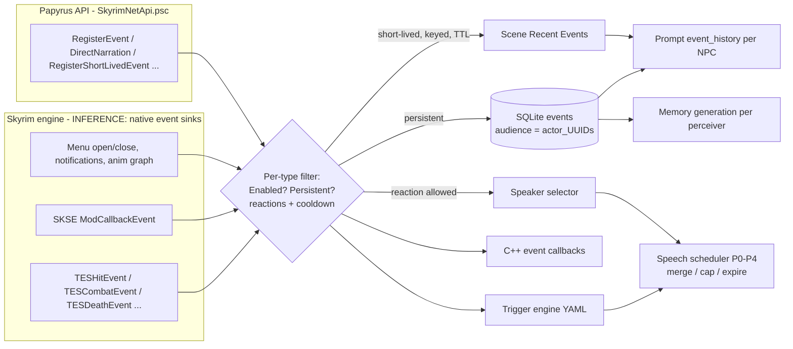

# How SkyrimNet observes the game: events, perception, triggers, combat speech, and the Papyrus/ESP layer

> Research note for the EldenNet project (an LLM NPC framework for Elden Ring). It describes what SkyrimNet does with Skyrim and which of its ideas could carry over. It does **not** reverse engineer SkyrimNet. Sources are its documentation, readable shipped content (prompt templates, YAML, SQL migrations, Papyrus `.psc` sources, the MIT-licensed API headers, the Spriggit dump of the ESP), public GitHub issues and release notes, and public library headers (CommonLibSSE-NG). Statements about what happens inside the DLL are labelled **INFERENCE**. Quotes are short and are used only where the wording matters.

**Path roots used below**

| Root | Path |
|---|---|
| `DATA/` | `skyrimnet-beta30-rc2/SKSE/Plugins/SkyrimNet/` (release data) |
| `LIB/` | `DATA/library/skyrimnet.base/` (content library) |
| `SRC/` | `skyrimnet-beta30-rc2/Source/Scripts/` (Papyrus sources) |
| `DEV/` | `skyrimnet-devkit-beta30-rc2/` (devkit docs and C++ API headers) |
| `ESP/` | `SkyrimNet-GamePlugin/spriggit/SkyrimNet/` (ESP serialized by Spriggit) |
| `ER01` | `EldenNet/docs/research/eldenring/01-engine-internals.md` (sister report, for the Elden Ring side) |

---

## TL;DR

- **Game observation happens entirely in the DLL.** The Papyrus scripts register no game-event handlers (no `OnHit`, `OnCombatStateChanged` or similar), and the ESP has no Story Manager nodes. Everything comes from native code. **INFERENCE:** it uses Skyrim's engine event sinks (`TESHitEvent`, `TESCombatEvent`, `TESDeathEvent`, …). The documented field names line up almost one-to-one with those structs.
- **There are about 45 event types.** They cover combat (`hit`, `combat`, `death`, `enter_bleedout`, `spell_cast`, `active_effect`), interaction (`activation`, `equip`, `container_changed`, `lock_changed`, `book_read`, `trade_*`, `sleep_*`), world and quest state (`location_change`, `cell_attach_detach`, `quest_*`, `scene_*`), UI (`notification`, `messagebox`), integration (`mod_event`, `animation_event`, `custom`), around ten dialogue variants, and SkyrimNet's own outputs (`DEV/docs/modding/WORKFLOW_TRIGGERS.md`, "Event Type Reference").
- **Two stores keep noise down.** Persistent events go into a SQLite `events` table, where each row carries an **audience list** (`actor_UUIDs`). Short-lived events are in-memory and keyed: a TTL expires them and a new event with the same key overwrites the old one. The dialogue transcript and the compact (selector) history drop `hit`, `spell` and `combat` rows, so in conversation those show up mainly as "Recent Events" in the scene context. **But** the verbose renderer used for memory generation, diaries and bio updates keeps them, which is one path by which spurious "hits" become false memories (issue #723).
- **Throttling has several layers.** Each event type has enable, persist and react toggles plus a reaction cooldown. There is a global reaction cooldown. A Beta28 speech scheduler with priority classes P0–P4 merges duplicates, caps speech per window, and drops lines that waited too long. Regex rules strip vanilla junk text such as combat grunts.
- **Perception is "near the originator, plus line of sight", decided when the event is recorded.** By default the audience is everyone near the originator plus the player. Whisper mode shrinks the radius. LOS checks were hardened in 2026 so they no longer leak through walls and closed doors. Being perceived does not oblige anyone to speak: a separate speaker-selection step decides that, and bystanders need a reason beyond proximity. The audience filter covers persistent history. The short-lived "Recent Events" block, as templated, is scene-wide and centred on the player.
- **Triggers are declarative YAML** (event type plus field conditions → response). Responses can be a player thought, narration, an NPC thought, a diary or bio update, a virtual-NPC toggle or a voice effect. Each trigger has probability, cooldown, priority and interrupt settings. It is the cleanest idea here to copy.
- **There is no separate bark system for combat.** Combat speech is ordinary dialogue with combat-conditioned prompt modules: a one-sentence, 14-word cap, a "COMBAT STATUS" block that turns HP, magicka and stamina into words, a level-ratio "strength assessment", and a closing instruction to stay on the fight. The open bugs are the warning for us: stale lines after the fight, enemies in *search* mode talking as if in combat, and harmless spell "hits" read as assaults. In the dialogue prompt, ordinary enemies are never tagged as hostile. The only hostility cue is the in-combat "Fighting: X" line.
- **Stopping and facing is done with Skyrim's own tools.** SkyrimNet calls `SetLookAt` for head tracking, links the dialogue target through a keyword-linked ref, and applies an ESP AI package (travel to within about 256 units, then sandbox or wait) through a priority-based package registry. Followers, seated NPCs and NPCs in scenes get only the look-at.
- **For Elden Ring v1, copy** the event bus with audience lists, short-lived keyed events, the per-type and per-actor cooldowns, the expiry-based speech queue, words-not-numbers combat state, and actor filters. **Simplify** triggers to a handful of hard-coded rules. **Drop** packages, actions, telepathy, vision and the large Papyrus API surface.

---

## 1. The observation pipeline at a glance



FACT, not inferred: the Papyrus layer subscribes only to key presses, a load-game alias event, magic-effect starts (spells used as hotkeys), VRIK gestures, MinAI ModEvents and UI ModEvents (`grep "Event On" SRC/*.psc`). The ESP contains two quests, nine packages, seven spells, seven magic effects, two perks, three factions, two keywords, one global, one voice type, sound categories and test NPCs (§11). None of these records observe combat, death or dialogue. So the event stream must be produced natively. That fits FEATURES.md: "Game state is read straight from memory, with no syncing between processes" (`DEV/docs/FEATURES.md`).

---

## 2. Event type catalogue and the engine events behind them

The reference table in `DEV/docs/modding/WORKFLOW_TRIGGERS.md` is the authoritative list of type names and `extraData` fields. The "likely engine source" column is **INFERENCE**. It matches SkyrimNet's field names against public CommonLibSSE-NG structs. Every `TES*Event` named below is a real `BSTEventSource` in CommonLibSSE-NG `include/RE/S/ScriptEventSourceHolder.h`, which I checked on GitHub. The field matches are often exact. `TESHitEvent` has `target`, `cause`, `source` (weapon or spell FormID), `projectile` and `flags` (power, sneak, bash, blocked). `TESCombatEvent` has `actor`, `targetActor` and `newState` ∈ {None, Combat, **Searching**}. `TESDeathEvent` has `actorDying`, `actorKiller` and a `dead` bool. `BSAnimationGraphEvent` has `tag` and `payload`. The SKSE mod callback carries `eventName`, `strArg`, `numArg` and `sender`.

### 2.1 Combat and bodily state

| SkyrimNet type | Documented fields | Originator → target | Likely engine source (INFERENCE) | Notes |
|---|---|---|---|---|
| `hit` | `aggressor`, `target`, `weapon_id`, `flags` | aggressor → victim | `TESHitEvent` | `source` may be a **spell**, so buffs and benign spells produce "hits" (issue #723, §5.4) |
| `combat` | `actor`, `target`, `new_state` (Combat/NonCombat) | actor → target | `TESCombatEvent` | the engine also has a *Searching* state; see issue #771 |
| `death` | `victim`, `killer`, `death_type`, `is_dead`, `is_summoned` | victim → killer | `TESDeathEvent` (fires as "dying", then again as "dead") | `is_dead` mirrors the struct's `dead` flag |
| `enter_bleedout` | `actor` | — | `TESEnterBleedoutEvent` | "knocked down" state is also used in prompts |
| `spell_cast` | `actor`, `spell`, `spell_id`, `spell_editor_id` | caster | `TESSpellCastEvent` | the API comment shows it kept as a keyed short-lived "last spell cast" per actor |
| `active_effect` | `action` (applied/removed), `effect`, `effect_editor_id`, `caster`, `target`, UUIDs | **affected actor → caster** (reversed on purpose) | `TESActiveEffectApplyRemoveEvent` / `TESMagicEffectApplyEvent` | doc: a self-cast effect names the caster either way |

### 2.2 Interaction, world and quest

| Type | Fields | Likely source (INFERENCE) |
|---|---|---|
| `activation` | `actor`, `target_name`, `activator_editor_id` | `TESActivateEvent` |
| `equip` | `actor`, `item`, `action`, `equipped` | `TESEquipEvent` |
| `container_changed` | `item`, `item_count`, `from_container`, `to_container` | `TESContainerChangedEvent` |
| `lock_changed` | `actor`, `object_name`, `action`, `lock_level` | `TESLockChangedEvent` |
| `sleep_start` / `sleep_stop` | `actor` | `TESSleepStartEvent` / `TESSleepStopEvent` |
| `book_read` | `book_name`, `book_title`, `book_text`, `is_note`, `book_vision_description` | FACT: emitted "on Book Menu close" or by the crosshair hotkey. INFERENCE: `MenuOpenCloseEvent` |
| `trade_start` / `trade_complete` | `merchant`, gold and item deltas | INFERENCE: BarterMenu open/close plus inventory diff |
| `location_change` | `actor`, `from_location`, `to_location` | `TESActorLocationChangeEvent` |
| `cell_attach_detach` | `actor`, `from_cell`, `to_cell`, `action` | `TESCellAttachDetachEvent` |
| `quest_stage` / `quest_start_stop` / `quest_objective_state` | quest ids, stage, started, objective states | `TESQuestStageEvent`, `TESQuestStartStopEvent`. Objective state: unknown hook |
| `scene` / `scene_action` / `scene_phase` | scene name, participants, phase | `TESSceneEvent` / `TESSceneActionEvent` / `TESScenePhaseEvent` |
| `crime` | `criminal`, `crime_type`, `victim`, `bounty` | unknown (INFERENCE: crime/bounty bookkeeping hook) |
| `dragon_soul` | `absorber`, `dragon_name` | `DragonSoulsGained::Event` |
| `notification` / `messagebox` | message text, buttons, source plugin | INFERENCE: HUD/message-box hooks. FACT: SkyrimNet's own notifications are excluded so triggers never fire on its output |
| `animation_event` | `tag`, actor ids, `payload`, `graph_vars` | `BSAnimationGraphEvent`. Very noisy: the MCP tool hides it unless `include_animations` is set |
| `mod_event` | `event_name`, `str_arg`, `num_arg`, `sender_name`, `sender_form_id` | SKSE `ModCallbackEvent` (any mod's `SendModEvent`) |
| `package_apply` / `package_remove` | `actor`, `package_type` | FACT: SkyrimNet's *own* package manager |

### 2.3 Dialogue and SkyrimNet's own outputs

- **Dialogue family:** `dialogue`, `dialogue_npc`, `dialogue_player`, `dialogue_player_stt`, `dialogue_player_text`, `dialogue_background`, `dialogue_player_monologue`, `dialogue_player_telepathy`, `dialogue_npc_telepathy`. Fields: `speaker`, `dialogue`, `listener`. **INFERENCE:** vanilla voiced lines come from `TESTopicInfoEvent` and/or subtitle capture. The `combat_grunts` text filter (§5.5) only makes sense if vanilla combat topics are being captured as text. Supporting FACTs: the GameMaster prompt glosses `dialogue_background` as "Ambient/idle chatter" (`gamemaster_action_selector.prompt`), the transcript prefixes such rows with "[Background]" (`event_history.prompt`), and a `transformers/subtitle_translation.prompt` translates "a vanilla line's subtitle". So vanilla speech, including ambient chatter, enters the event stream as text.
- **Outputs fed back as events:** `direct_narration`, `persistent_generic`, `player_thoughts`, `npc_thoughts`, `diary_entry_created`, plus types visible in templates such as `gamemaster_dialogue`, `continue_narration` and the bridge type `minai_context` (`SRC/skynet_MinAIBridge.psc`). Release notes add that "SkyrimNet does not react to its own lines" (Beta28, https://github.com/MinLL/SkyrimNet-GamePlugin/releases/tag/vbeta28).
- **Custom types:** mods can register a schema (`RegisterEventSchema`, §9) with fields, four format templates (`recent_events`, `raw`, `compact`, `verbose`), `isEphemeral`, `defaultTTLMs`, `shortLivedEnabled` and `interrupt`.

### 2.4 What an event looks like

FACT (`DEV/CppAPI/PublicAPI.h`, `PublicGetRecentEvents`; `DATA/sql/migrations/0001_initial_schema.sql`, `0004`, `0008`). A stored event has: `id`, `type`, `data` (JSON payload), `location` (string), `actors` (JSON array of UUIDs, the perceivers), `originatingActor`, `targetActor`, `gameTime` / `gameTimeStr`, `localTime`, `playtime` (pause-aware) and an optional `gameTimeEnd`. A later column, `memory_generated_for_actors`, records which perceivers have already turned the event into memories. The design point for us: **perception is stored with the event**, so per-NPC history and per-NPC memory formation are just filters.

---

## 3. Two stores: persistent history and short-lived scene events

### 3.1 Persistent events

`RegisterEvent`, `RegisterPersistentEvent` and `DirectNarration` (non-empty) write rows. `event_history.prompt` fetches `get_recent_events(count, [npc.UUID])` for the NPC being prompted. It renders the NPC's own lines as `assistant` turns and everything else as `user` turns. It adds relative-time tags ("[A while ago]", "[Yesterday]"), gap markers ("Some time passes…") and location-change markers (`LIB/prompts/components/event_history.prompt`). The count is per NPC (`get_event_history_count`). A community doc lists the dialogue default as 50, range 5–200, and a preload of 500–8000 events at game start (https://github.com/goncalo22/SkyrimNet-GamePlugin, `docs/Features/events-and-reactions.md`; unofficial, may be dated).

**FACT, important for combat (corrected in review):** two of the three history renderers skip `hit`, `spell` and `combat` events: `components/event_history.prompt` (the per-NPC transcript used by `dialogue_response`, `player_dialogue`, `npc_thoughts` and the transformers) and `components/event_history_compact.prompt` (used by the speaker/target selectors, GameMaster, action selector and mood evaluation). In those views the fight does not exist as a blow-by-blow. It survives only as dialogue said during it and as derived state.

The third renderer, `components/event_history_verbose.prompt`, has **no** such filter (it only special-cases `gamemaster_dialogue`, `direct_narration` and telepathy-observed thoughts). It is the one rendered by `memory/generate_memory.prompt`, `diary_entry.prompt`, `dynamic_bio_update.prompt` and `helpers/generate_profile.prompt`, and its filter list includes the response target as well as the NPC. So combat rows that are hidden from conversation **are** visible when memories, diaries and bios are written. **INFERENCE:** this is a plausible route for #723's complaint that harmless spell "hits" turn into remembered assaults: the conversational prompt never sees the hit row, but the memory writer does, without the context that would make it look harmless.

### 3.2 Short-lived events

`RegisterShortLivedEvent(eventId, type, description, data, ttlMs, source, target)` creates an in-memory event that "appears in scene context and expires after TTL". The API's own example is the key idea: use the key `spell_cast_<actor>`, so "only the last spell they cast shows up in the context" (`SRC/SkyrimNetApi.psc`). The MinAI bridge uses the same trick for de-duplication. It builds `minai_ctx_<mod>_<key>` so "only one context per key exists at a time" (`SRC/skynet_MinAIBridge.psc`). The scene context lists active short-lived events under "## Recent Events", each rendered with the schema's `recent_events` template (`LIB/prompts/components/context/component_recent_events.prompt`, `scene_context_full.prompt`). A hit, as users see it rendered: "**Cassian** hit **Val Serano** with Kinship (happened moments ago)" (issue #723). The community doc says non-persistent events live "usually around 30 seconds" and recommends this mode for `hit` and `container_changed` "to avoid spamming the event context". Decorators can query the set: `get_short_lived_events_count`, `get_active_short_lived_events`, `…_by_type`, `…_by_entity` (`DATA/docs/decorators.html`).

### 3.3 Ephemeral types and synthesized state events

- An **ephemeral** type is never stored. It only notifies callbacks (`PublicRegisterEvent` doc). `DirectNarration("")` produces a short-lived event that triggers a response "without cluttering event history".
- **State-diff "events" computed inside templates.** `LIB/prompts/submodules/user_final_instructions/8000_recent_state_changes.prompt` calls `track_entity_state(npc, "status:health", value, 120)` for health, magicka, stamina and "wearing a cuirass". A change of more than 25% of max inside a 120-second window becomes a phrase such as "Badly hurt (lost over half health)". This avoids an event per damage tick: the model sees a *summary of change*, not a stream. Two details from the template matter if we copy it. First, "max" is the **base** actor value (`get_base_actor_value`), not the buffed maximum. Second, the comparison is against the value stored the *previous time this template ran for that NPC* (`hasPrevious`, `isRecent`, `changed` on the returned object). **INFERENCE:** sampling happens only when a prompt renders, so an NPC that has not been prompted for a while gets no delta, and the "window" is really "since my last prompt, if that was under 120 s ago". The same `track_entity_state` / `get_entity_state` / `is_state_recent` family appears in `test_decorators/` as a general-purpose per-entity key/value store with timestamps.

---

## 4. Perception: who "has" an event

### 4.1 The default audience

FACT (`DEV/CppAPI/PublicAPI.h`, `PublicRegisterEvent`): with no explicit audience, an event goes to "everyone near the originator, plus the player". With an explicit list, it goes to "exactly the listed actors plus originator and target", with no fallback to nearby actors. Audience limits "each character's own history, memories and dialogue context". The GameMaster, speaker/target selection and combined history views still see the event. So there are **two views**: a per-NPC subjective view, which feeds memory and dialogue, and an omniscient director view, which feeds selection.

### 4.2 Distance

- `interaction.maxDistance` switches between `interaction.normalMaxDistance` and `interaction.whisperMaxDistance` when whisper mode toggles (`SkyrimNetApi.psc: TriggerToggleWhisperMode`). Whisper can also be a chat prefix (`^`) (`DEV/docs/FEATURES.md`). The chat overlay shows the resulting audience live, sorted by distance in metres, with a whisper badge (`DATA/chat/audience.js`).
- `get_nearby_npc_list(source)` returns NPCs "within the maximum interaction distance of the specified source entity" (`decorators.html`). The scene context lists them with distance in metres and flags for dead, unconscious, summoned and reanimated (`scene_context.prompt`).
- Other radii: `FindActorByName` searches 4000 units around the player. A trigger's `all_nearby_actors` scope defaults to `nearbyRadius: 2000`. The unit conversion used is 128 units = 1.828 m (`decorators.html: units_to_meters`).

### 4.3 Line of sight and rooms

- There is a decorator `has_line_of_sight(a, b)` (`LIB/prompts/submodules/test_decorators/0100_actor_decorators.prompt`). **INFERENCE:** it wraps the engine's LOS test.
- Issue history shows LOS is part of audience selection and that it was hard to get right. Users reported NPCs outside a closed inn room hearing the player (#426, fixed in beta23.1). It was reported again (#491). The fix in beta26-rc3 was "line of sight no longer leaks through walls and closed doors inside one interior cell", and beta27-rc2 removed a "menu/overlay LoS skip" that let NPCs hear the player regardless (https://github.com/MinLL/SkyrimNet-GamePlugin/issues/491). The beta26-rc4 notes repeat it: "Improved visibility checks in inn rooms".
- FEATURES.md states the intended rule: "An NPC only reacts to what they could plausibly see or hear. People upstairs do not respond to conversations downstairs."
- **Not modelled (FACT, from open requests):** separate sense axes (mute, deaf, blind, invisible; #445). Distance-tiered "you hear muffled sounds" guidance was requested (#295) but closed as "mostly solved by the fix to line of sight". Stealth or detection state is not a gate either; see #771 in §8.4.

**INFERENCE, the overall rule:** an actor joins an event's audience when it is within the interaction radius of the originator *and* passes an LOS test, with the player always included for default-audience events. The audience is frozen into `actor_UUIDs` when the event is recorded.

**Other perception primitives visible in templates (added in review).** The template layer has more than one notion of "who is around", and they are not interchangeable:

| Decorator | What it returns (FACT, from usage or docs) | Where it is used |
|---|---|---|
| `get_nearby_npc_list(src)` | NPCs within the max interaction distance of `src`, with distance | scene context, selectors, state summary |
| `get_visible_npc_list(player)` | an "authoritative list" of NPCs that are **on camera** | OmniSight `describe_scene.prompt` only |
| `has_line_of_sight(a, b)`, `distance_between(a, b)` | pairwise LOS and distance | test submodule only (no shipped prompt uses them) |
| `get_actor_position_relative_to_actor/_camera` | metres plus a cardinal direction | OmniSight |
| `is_sneaking`, `has_weapon_drawn`, `is_in_combat`, `is_knocked_down` | per-actor state flags | bio "Physical Activity", OmniSight, combat modules |

**FACT, a scope gap worth knowing:** the "## Recent Events" block (`component_recent_events.prompt`) loops over `scene.short_lived_events` and filters only on "has a valid source actor" and "is not `gamemaster_dialogue`". It applies no per-NPC audience filter, and it computes its nearby list from the **player**, not from the speaking NPC. **INFERENCE:** short-lived events are a scene-wide (player-centred) context, while per-perceiver audience applies to persistent events. A distant NPC who gets prompted may therefore see a "moments ago" hit it could not have witnessed. The README pitch ("they react to what they could plausibly see and hear") is enforced for persistent history, not obviously for this block. Whether the DLL pre-filters `scene.short_lived_events` per speaker is UNVERIFIED.

Issue #491 adds a related detail: the reporter saw NPCs react from outside a closed room *while the chat overlay's audience strip did not list them*. So at that time (beta23) the UI audience and the event audience were computed by different paths.

### 4.4 Perceiving vs. speaking

The speaker selector is a separate LLM step (chat or "decision" variant), with explicit anti-crowd rules:

- Proximity alone is never a reason for a bystander to speak. The criteria run from addressed or involved, through unresolved question, duty, companion, personal stakes and witnessed event, to the bio's "Interjection" guidance (`LIB/prompts/target_selectors/dialogue_speaker_selector.prompt`).
- A strictness knob (`dialogue.speakerSelector.strictness`: chatty, balanced or strict) and tags ([COMPANION], [ENGAGED], [IN SCENE]) tune how readily people react. Silence is always a legal answer in the decision variant (`LIB/prompts/decisions/dialogue_speaker_selector.prompt`). In the chat variant, a `silenceChancePercent` setting decides at random whether "0 (silence)" is even offered as an output, and the prompt says silence is preferred when uncertain (`target_selectors/dialogue_speaker_selector.prompt`). This is a cheap **stochastic damper** on crowd chatter, separate from cooldowns.
- For the player's own lines, the NPC in the crosshair leads. If the model gives no usable answer, the crosshair NPC answers, else the nearest (`decisions/player_dialogue_target_selector.prompt`; also Beta29.1 notes).
- A runtime toggle, `TriggerToggleWorldEventReactions`, turns off reactions to "dialogue (Including AI dialogue), combat, death, quest stages, etc." without turning off recording (`SkyrimNetApi.psc`).

---

## 5. Noise control: throttling, dedup and coalescing

SkyrimNet works in layers. Each layer catches a different kind of spam.

### 5.1 Per-event-type policy

The `Events` config section holds a master switch, `global.enabled` (`SRC/skynet_ConfigUtilityMenu.psc`). Per the community doc, each event type has **Enabled**, **Persistent**, **Allow NPC Reaction** and an **NPC Reaction Cooldown**, plus a **global** reaction cooldown. The suggested values are 120–180 s for `combat` and `death`, 30–60 s for `activation` and `equip`, 60–90 s for `spell_cast`, and reactions off for dialogue and scene types. The C++ API confirms that types can be "disabled or filtered" (`PublicRegisterEvent` return doc). The schema flag `shortLivedEnabled` exists specifically for "high-volume events that shouldn't clutter scene context" (`RegisterEventSchema`).

### 5.2 The speech scheduler (Beta28)

From the Beta28 notes (details in report 01, §4):

- **P0** player input: 30 s.
- **P1** directed narration: 15 s.
- **P2** trigger output: 10 s. Repeats of the same trigger **merge**.
- **P3** reactions to `RegisterEvent`: 8 s. Several waiting reactions get **one reply to the newest**.
- **P4** continuations: 6 s, bounded by Max Chain Depth.

A "Max Recent Speech Count" caps P2–P4 per window. A higher priority may replace a line still being written but never one already playing. The prompt side of merging is `speech_turn.merged_count` and `also_events`, rendered by `0805_merged_events.prompt`. It tells the model either to react to everything "together" in one line or to answer the main thing and acknowledge the rest. The stated motivation was "a fight, a trigger firing again and again, a crowd reacting".

### 5.3 Trigger-level gates

Each trigger has `probability`, `cooldownSeconds` and `priority` (§7). `GenerateNPCThought` respects "per-NPC and global cooldowns from NpcThoughts.yaml". It skips dead, unconscious or sleeping NPCs (`SkyrimNetApi.psc`).

### 5.4 Known failure modes (issues as of Nov 2026)

- **#723** (open): spell-effect "hits" between companions were rendered as "X struck Y (None)". The model wrote guilty thoughts about attacks that never happened, and these fed into memories. The root cause is that `TESHitEvent.source` covers spells, so non-damaging contact looks like a blow. Related: #501 asks for item and spell blacklists on hit events. #299 asks for an "Ignore" trigger response.
- **#784** (open): combat lines still played about 25 s after the last enemy fell. The request is to cancel in-flight combat lines when no hostile is in range, *checked again just before speaking*.
- **#771** (open): enemies in **search** mode, never having seen the player, spoke as if in combat and used the player's name.
- **#768** (open): enemies sometimes talk as if friendly during combat dialogue.

### 5.5 Text-level filters

`kind: dialogue_rule` files are regex replacements applied to captured dialogue text. `kind: tts_rule` applies to TTS input. Both are ordered by `priority` (`DEV/docs/modding/CONTENT_ROOTS.md`). `LIB/filters/combat_grunts.yaml` blanks a line made up only of a vanilla grunt ("Rrargh!", "Oof!", "Gah!", about 20 variants). `heavy_breathing.yaml` and `invisible_continues.yaml` remove other non-speech subtitle strings. **INFERENCE:** without these, vanilla combat barks would enter history as dialogue and the model would imitate them.

---

## 6. Actor eligibility filters

FACT (`DEV/docs/modding/CONTENT_ROOTS.md`, `LIB/filters/*.yaml`):

- **`kind: actor`** (who may speak or fire) and **`kind: memory`** (who forms memories) contribute to user lists: `FactionWhitelist`, `FactionBlacklist`, `RaceWhitelist`, `RaceBlacklist`, `GenderWhitelist` and `GenderBlacklist`. Contributions are unioned, and "a whitelist contribution widens what may speak". Shipped files:
  - Animals (`ACLRaceCat`, `DogRace`, `WolfRace`) neither speak nor remember.
  - Mannequins (`ManakinRace`) neither speak nor remember.
  - Paarthurnax is whitelisted by faction "even when only speech-capable races may", which implies a **speech-capable-race filter** is on by default.
  - `SkyrimNet_ActorWhitelistFaction` and `SkyrimNet_ActorBlacklistFaction` force allow or block.
- Faction membership can be toggled in game. The wheel menu's "White/Blacklist Mgmt" appears only when an actor is under the crosshair. It offers separate "Actor" and "Memory" whitelist and blacklist entries (`SRC/skynet_WheelMenu.psc`).
- Issue #524 shows the speech-capable filter also hides wildlife from the *nearby list*, so a bear is not "seen". The request is to make animals detectable without letting them speak. This is a useful distinction: **perceivable vs. speaking vs. remembering** are three different flags.
- Runtime exclusions also exist. The C++ "busy" flag (`PublicSetActorBusy(formId, reason)`) is documented as feeding `is_busy()` / `busy_reason()` "for eligibility rules", i.e. action eligibility (`DEV/CppAPI/PublicAPI.h`). FEATURES.md describes it more broadly as "so SkyrimNet defers to your mod". Whether it also suppresses *speech* is UNVERIFIED. Package holds (§12) are the other runtime exclusion. Release notes for beta26-rc4 mention closing "gaps that could allow excluded actors, including animals, to respond".
- `RealNamesChange.psc` and `RealNamesReset.psc` ship in `SRC/`. They are a patch for the separate Real Names Extended mod, which gives generic bandits, guards and others personal names. **INFERENCE:** shipped because unique names make generic NPCs addressable and remembered. It is not attached to anything in SkyrimNet.esp.

---

## 7. The trigger system

### 7.1 Schema

FACT (`DEV/docs/modding/WORKFLOW_TRIGGERS.md`; Beta24 and Beta25 notes):

```yaml
# minimal shape, paraphrased (not copied) from the doc's template
name: my_trigger                 # must equal the filename (MIGRATING_TO_BETA25.md)
eventCriteria:                   # or a list of rule objects, OR-ed
  eventType: death               # any type from §2, or "*"
  schemaConditions:
    - { fieldPath: killer, operator: equals, value: "{{ player_name }}" }
response:
  type: direct_narration         # see 7.2
  content: "{{ originator }} ..."  # Inja template
  targetScope: triggering_actor  # for diary/bio/npc_thought/voice effects
audience: nearby_npcs            # default is "player"
probability: 0.5
cooldownSeconds: 60
priority: 1                      # plus optional interrupt / enabled flags
```

Conditions inside one rule combine with `logicalOperator` (default AND), and each condition can set `caseSensitive: false`.

- **Operators:** `equals`, `not_equals`, `contains`, `not_contains`, `starts_with`, `ends_with`, `regex`, `greater_than`, `less_than`, `greater_equal`, `less_equal`, `length_*` and `has_field` / `not_has_field`. Comparisons are case-sensitive by default. Unknown operators never match.
- **Template variables:** `originator`, `target` and their UUIDs, `actor` and `target_actor` objects, `player`, `event_json.<field>`, `event_type`, `event_location`, `location`, `gameTime` and `timestamp`. An unknown variable is a render error, and the template is then posted verbatim.

### 7.2 Responses and audiences

| Response `type` | Effect |
|---|---|
| `player_thought` / `player_dialogue` | the player thinks, or speaks aloud |
| `direct_narration` | a factual event that nearby NPCs respond to |
| `persistent_generic` | a silent fact (no reaction) |
| `npc_thought` | an unvoiced private thought for the target NPC(s) |
| `diary_entry` / `dynamic_bio_update` | long-term reflection |
| `enable_virtual_npc` / `disable_virtual_npc` | narrator or spirit on or off |
| `activate_voice_effect` / `deactivate_voice_effect` | e.g. a werewolf voice |

Audience (who perceives the response): `player`, `originator`, `target`, `originator_or_target`, `everyone`, `nearby_npcs`, `enabled_virtual_npcs`. Target scope (who the diary, bio, thought or effect applies to): `triggering_actor`, `player`, `all_pinned_actors`, `all_nearby_actors` (with `nearbyRadius`), `all_enabled_virtual_npcs`.

### 7.3 Runtime behaviour and tooling

- Trigger output is scheduler class **P2**, and repeats of the same trigger merge (§5.2). `interrupt: true` purges queued dialogue first.
- An MCP server tool, `get_monitored_events`, shows the live event shape. `validate_custom_trigger` rejects unknown event types. The dashboard has a YAML editor with schema validation and an "Event Monitor" for building triggers from real traffic (FEATURES.md; community doc).
- Gaps users raised: no "Ignore" response for dropping noisy events (#299), and no way to name the *speaker* of a narration response or chain follow-ups (#151).
- SkyrimNet ships **no triggers** in its base library. Triggers are an extension point, not where core behaviour lives. Core reactions to combat or death come from the per-event-type reaction policy plus speaker selection.

---

## 8. Combat speech: what SkyrimNet actually does

This is the most relevant part for EldenNet's "generic enemy" tier.

### 8.1 No separate bark path

FACT: there is no bark template, bark filter or bark-specific event type in the content library. A bandit in combat goes through the same `dialogue_response` pipeline as a conversation, using its generic bio (`bandit_generic.prompt` describes several archetypes; see report 03). Combat changes *which prompt modules render* and *how long the answer may be*. There are about 300 `*_generic.prompt` bios. The bandit one is a useful model for the ER "generic enemy" card. It asks the model to pick one archetype per scene and keep it, it gives an "interjects when" list, and it states a combat disposition: rank-and-file bandits put self-preservation ahead of bravado. Paired with the health bands below, that lets a losing bandit talk about yielding or running without any morale system.

### 8.2 Combat-conditioned prompt modules

The FACTs below are paraphrased from files under `LIB/prompts/`.

- **Length** (`submodules/system_head/0020_format_rules.prompt`): in combat, spoken output is one sentence of at most 14 words, "urgent and brief". Combat thoughts run 8–30 words with a short first sentence. Outside combat a reply is 1–3 sentences, with a 60-word ceiling.
- **Guideline line** (`submodules/guidelines/0500_roleplay_guidelines.prompt`): a one-line reminder that the NPC is in combat.
- **COMBAT STATUS block** (`submodules/user_final_instructions/0200_combat_status.prompt`). It is rendered only while `is_in_combat(npc)` is true. It lists:
  - who the NPC is fighting (`get_combat_targets`), or just "in active combat";
  - a **health band** with cut-offs at 25%, 50% and 75% (near death / badly wounded / taking damage / holding up);
  - a **magicka band**, only for casters or the player;
  - a **stamina band**, or unconscious.
  It divides safely when max values are zero.
- **COMBAT STRENGTH ASSESSMENT** (same file). It compares the NPC's level with the response target's, using both ratio and difference, and picks one of seven phrasings from "well beneath you" to "far beyond you". The template comment explains the design: level is "one signal among many", and literal numbers are never shown because "weaker LLMs will parrot them in dialogue". It renders whenever there is a response target, in or out of combat.
- **Placement for caching** (`dialogue_response.prompt`): the combat status goes at the *end* of the prompt (`combat_at_end`), so the cached system prefix stays stable while the volatile fight state comes last.
- **Final instruction** (`dialogue_response.prompt`, tail): if the NPC is knocked down (bleedout), it speaks short and pained about its state or begs for help. Otherwise, if *either the NPC or the player* is in combat, it keeps to the fight and "arguments can wait". The comment notes that bleedout drops an actor out of combat, so it is checked first. A companion not yet flagged as in combat still treats the player's fight as one.
- **Recent state change** (`8000_recent_state_changes.prompt`, §3.3) adds "Badly hurt", "Winded", "Armor removed, exposed" and similar phrases from 120-second diffs.
- **Scene list flags:** nearby actors show [DEAD], [UNCONSCIOUS], or summoned or reanimated hostile vs. serving (`scene_context.prompt`). OmniSight's scene description adds [COMBAT], [Armed], [Running] and [Sneaking].
- **State that renders outside combat too** (added in review). The character-bio header (`submodules/character_bio/0010_header.prompt`) shows a health line for any profiled actor, from "near death (IMPORTANT)" down to minor injury, whether or not they are fighting. The "Physical Activity" module (`0050_physical_activity.prompt`) describes knocked-down actors as badly wounded and kneeling, and sneaking actors as trying to move unseen. So a wounded NPC still sounds wounded after the fight, without any combat event.
- **Hostility is only explicit for summons and thralls (FACT, added in review).** The only `is_hostile_to_actor` checks in the dialogue-side prompts are on summoned or reanimated actors (bio header, scene list, speech style). An ordinary hostile human such as a bandit gets no "[Hostile to player]" tag in the dialogue prompt. During combat, the one hostility cue is the COMBAT STATUS "Fighting: X" line. By contrast, the action selector drilldown tags *every* hostile NPC as "[Hostile to …]" (`native_action_selector_drilldown.prompt`). **INFERENCE:** this asymmetry fits #768 (enemies sometimes sound friendly in combat dialogue) and #771 (a searching enemy has no combat target, so there is no "Fighting:" line, yet it can still be prompted).

### 8.3 Who speaks in a fight

There is no code that says "enemies bark on spot". INFERENCE from the parts above: `combat` and `hit` events are recorded with reactions allowed but cooldown-limited. Speaker selection then picks someone with a reason: the attacked, the involved, a companion. The scheduler drops what is stale. The decision selector explicitly lists "attacked, robbed, handed something" as reasons to speak (`decisions/dialogue_speaker_selector.prompt`), and the chat selector says companions "react to combat, close calls" (`target_selectors/dialogue_speaker_selector.prompt`). Both selectors read the *compact* history, which hides `hit`/`combat` rows (§3.1). **INFERENCE:** the selector therefore judges "who was attacked" from the triggering event and the scene's Recent Events, not from the transcript. Hostile NPCs can be selected like anyone else, which is why #768 and #771 exist.

### 8.4 Lessons from the open combat issues

1. **Re-check validity at voice time, not only at request time.** The fight can end while the LLM and TTS are working (#784). Beta28's expiry windows (6–15 s) reduce this but do not remove it.
2. **Gate on real awareness.** The engine's combat state includes *Searching* (CommonLib `ACTOR_COMBAT_STATE::kSearching`). An enemy that has not detected the player must not know their name (#771). **INFERENCE:** SkyrimNet's `is_in_combat` or combat event mapping treats searching like combat.
3. **Do not turn ambiguous contact into canon.** Filter "hits" with no damage or with friendly sources. Describe them neutrally instead of as "struck" (#723).
4. **Keep hostility explicit in the prompt** (#768). The "Fighting: X" line exists for this purpose. It needs to be reliable, and as shown in §8.2 it is the *only* hostility cue for ordinary enemies in SkyrimNet's dialogue prompt. EldenNet's generic-enemy card should carry an always-on "you are hostile to the player" fact taken from team or faction data, not from the combat state.
5. **Keep the memory writer consistent with the conversational view.** If combat rows are hidden from dialogue but shown to memory generation (§3.1), the two disagree about what happened. Decide once which events may become memories.

---

## 9. The Papyrus API (`SRC/SkyrimNetApi.psc`, MIT)

There are 132 functions, every one `Global Native`, and most return 0/1 status codes (counted by grepping `Global Native` across single-line and multi-line declarations). Categorized:

| Category | Functions |
|---|---|
| **Decorators** | `RegisterDecorator` (Papyrus function callable from templates as `name(uuid)`) |
| **Actions** | `RegisterAction`, `RegisterSubCategory`, `RegisterTag`, `IsActionRegistered`, `UnregisterAction`, `ExecuteAction`, `ExecuteActionByUUID`, `SetActionCooldown`, `GetRemainingCooldown` |
| **Events** | `RegisterShortLivedEvent(+ByUUID)`, `RegisterEvent(+ByUUID)`, `RegisterPersistentEvent(+ByUUID)`, `DirectNarration(+ByUUID)` |
| **Dialogue** | `RegisterDialogue(+ByUUID)`, `RegisterDialogueToListener(+ByUUID)`, `PurgeDialogue(deferToCurrent)`, `TransformDialogue`, `GenerateNPCThought` |
| **Packages** | `RegisterPackage`, `RegisterPackageEx` (owner, display name, honour conditions), `UnregisterPackage(+Ex)`, `ListPackage`, `GetPackageOwner`, `HoldPackages`, `ReleaseHeldPackages`, `IsHoldingPackages`, `ScheduleDelayedPackageRemoval`, `ClearAllPackages`, `ClearAllPackagesGlobally`, `CancelPendingPackageTasks`, `HasPackage`, `ReinforcePackages` |
| **LLM** | `SendCustomPromptToLLM` (callback with up to 750 chars), `SendCustomDecisionToLLM` (typed choice/score/yes-no answer with probabilities) |
| **Event schemas** | `RegisterEventSchema`, `ValidateEventData`, `FormatEvent`, `GetSchemaInfo`, `GetAllEventTypes`, `IsEventTypeRegistered`, `GetAllSchemasInfo` |
| **Bio / diary / knowledge** | `UpdateActorDynamicBio`, `GenerateDiaryEntry(+ByUUID)`, `AddWorldKnowledge` |
| **Virtual NPCs** | `RegisterVirtualNPC`, `UpdateVirtualNPC`, `EnableVirtualNPC`, `DisableVirtualNPC`, `GetVirtualNPCUUID`, `GetVirtualNPCList` |
| **Entities and utilities** | `GetJsonString/Int/Bool/Float/Actor`, `FindActorByName` (4000 units), `GetEntityUUID`, `GetEntityDisplayNameByUUID`, `IsVirtualEntity`, `GetActorByUUID`, `JoinStrings`, `RenderTemplate`, `ParseString` |
| **Config and build** | `GetConfigString/Int/Bool/Float`, `PatchConfig(section, jsonPatch)` (sections include `ActorFilter` and `Events`), `GetBuildVersion`, `GetBuildType`, `GetSaveUniqueID` |
| **Runtime state and UI** | `IsRecordingInput`, `IsRunningVR`, `GetSpeechQueueSize`, `GetTimeSinceLastAudioEnded`, `IsContinuousModeEnabled`, `OpenSkyrimNetUI` (opens the web dashboard in a browser) |
| **Hotkey equivalents** | `TriggerRecordSpeechPressed/Released`, `TriggerToggleOpenMic`, `TriggerTextInput`, `TriggerToggleGlobalAI`, `TriggerToggleGameMaster`, `TriggerToggleContinuousMode`, `TriggerToggleWorldEventReactions`, `TriggerToggleActions`, `TriggerToggleWhisperMode`, `TriggerToggleDashboard`, `SetDashboardToggleKey`, `TriggerTextThought`, `TriggerVoiceThoughtPressed/Released`, `TriggerTextDialogueTransform`, `TriggerVoiceDialogueTransformPressed/Released`, `TriggerDirectInput`, `TriggerVoiceDirectInputPressed/Released`, `TriggerContinueNarration`, `TriggerPlayerThought`, `TriggerPlayerDialogue`, `TriggerPlayerTTS`, `IsPlayerTTSFinished`, `PrepareNPCDialogue`, `IsNPCDialogueReady`, `TriggerCaptureCrosshairPressed/Released`, `TriggerGenerateDiaryBio`, `TriggerInterruptDialogue`, `TriggerSilentNarration`, `SetCppHotkeysEnabled`, `IsCppHotkeysEnabled` |
| **Telepathy** | `ToggleTelepathyEavesdropping`, `IsTelepathyEavesdroppingEnabled`, `SetTelepathyEavesdroppingEnabled` (runtime only, resets on load) |
| **Named places** | `MarkPlace`, `GetPlaceId`, `RenamePlace`, `SetPlaceRadius`, `RemovePlace`, `GetPlaceName` (sub-locations such as "Breezehome, Kitchen") |
| **Voice effects** | `SetVoiceEffect`, `ClearVoiceEffect`, `GetVoiceEffect` (+ByUUID) |

**Semantics worth copying.** The event API names the *reaction contract* directly:

- `DirectNarration`: must be answered, as established fact. The system picks a speaker if none is given.
- `RegisterPersistentEvent`: known, but "will NOT respond to with dialogue".
- `RegisterEvent`: normal per-type policy.
- `RegisterShortLivedEvent`: context only, expires.
- `GenerateNPCThought`: private to the thinker.

**Actions are keyed to event types too (added in review).** `RegisterAction` and `RegisterSubCategory` take a `triggeringEventTypesCsv` parameter, and so does the C++ `PublicRegisterCPPAction`. **INFERENCE:** action eligibility can be restricted to the event types that prompted the turn, e.g. a "surrender" action only after `hit` or `combat`. The shipped Papyrus actions (AccompanyTarget, StopAccompanying, WaitHere) pass an empty string, meaning no restriction. This is out of scope for dialogue-only v1, but it shows the event bus also drives action gating.

**Event-derived analytics in the C++ API (added in review).** `PublicGetActorEngagement`, `PublicGetRelatedActors`, `PublicGetEventPairCounts` and `PublicGetPlayerContext` (`DEV/CppAPI/PublicAPI.h`) compute, from the events table, per-actor event and memory counts over short and medium game-time windows, the actors who most often share events with a given actor, and NPC-pair co-occurrence counts. Because each event stores its audience, "who has been around whom" falls out as a query. A later EldenNet version could use the same idea to pick which named NPCs are salient enough to be worth a prompt.

**ModEvents sent by SkyrimNet** (SKSE `(eventName, strArg, numArg, sender)`):

- Package lifecycle: `SkyrimNet_OnPackageAdded`, `SkyrimNet_OnPackageRemoved` (reason codes 0–9: api, webui, clearAll, death, delayed, **dialogue**, missing, load, webuiAll, replaced), `SkyrimNet_OnPackagesHeld`, `SkyrimNet_OnPackagesReleased` (`SkyrimNetApi.psc`).
- Content lifecycle: `SkyrimNet_SpeechStarted`, `SkyrimNet_MemoryCreated/Updated/Deleted`, `SkyrimNet_DiaryCreated/Updated/Deleted`, `SkyrimNet_TimelineResolved`, `SkyrimNet_OnPluginConfigSaved` (FEATURES.md; `PublicAPI.h`; MIGRATING_TO_BETA25.md).

The C++ API adds thread-pool event callbacks (`PublicRegisterEventCallback(type, fn)`, "do NOT call RE:: functions directly").

**ModEvents received:** `MinAI_RegisterEvent`, `MinAI_SetContext`, `MinAI_RequestResponse`, `MinAI_RequestResponseDialogue`. These are bridged so mods written for MinAI also feed SkyrimNet. VRIK gesture events `skynet_vrik_*` are received in VR. Any other mod's events reach SkyrimNet natively as `mod_event`.

---

## 10. Papyrus-side scripts: what they actually do

| Script (in `SRC/`) | Attached to | Role |
|---|---|---|
| `skynet_MainController` | quest `skynet_MainController` (start-game enabled, run once) | `Maintenance()` on init and every load: version gate, `libs.Maintenance`, gives the player the wheel power. Owns **`SetActorDialogueTarget` / `ClearActorDialogueTarget`** (§12) and follow linked refs |
| `skynet_PlayerAlias` | PlayerAlias on that quest | `OnPlayerLoadGame` → `Maintenance()` |
| `skynet_Library` | same quest | registers three Papyrus actions (AccompanyTarget, StopAccompanying, WaitHere) and the `follower` tag. Implements in-game hotkeys with press/hold timing (`OnKeyDown` / `OnKeyUp` → `Trigger*`), VRIK gestures, and a spell-cast helper |
| `SkyrimNetInternal` | global, "executed directly by the main DLL" | DLL-called helpers: `SetActorDialogueTarget`, **`SetLookAt`** ("for actors that already have a follower package we don't want to override"), action eligibility and execute shims, `ResetFacialAnimations`, message-box prompts (timeline mismatch, diary scope) |
| `skynet_MinAIBridge` | same quest | MinAI ModEvent → SkyrimNet API translation (§9) |
| `skynet_McmScript` | quest `skynet_Mcm` | MCM pages: Overview, Status, Hotkeys, Powers (telepathy perks and spells), Developer (buttons that call API functions) |
| `skynet_ConfigUtilityMenu` | global | UIExtensions list menu that flips config flags such as `Events.global.enabled`, `Game.gamemaster.agentEnabled`, `Game.speech.shouldApplyTalkToPlayerPackage` and `Game.narration.enabled` through `PatchConfig` |
| `skynet_WheelMenu` | magic effect of the "Quick Wheel" power | 8-slot UIExtensions wheel: text input, think, auto-roleplay, whisper toggle, utilities (GameMaster, NPC reactions, actions, continue narration, continuous mode, interrupt, white/blacklist for the crosshair target), dashboard |
| `skynet_VoiceInput{Normal,Thought,Transform,Direct}` | magic effects of four lesser powers | toggle voice recording in a given mode (spells used as bindable hotkeys) |
| `skynet_TelepathyEavesdrop` / `skynet_TelepathyListenIn` | magic effects | eavesdrop toggle; 60-second "Listen In" spell that turns eavesdropping on and off |
| `skynet_Harness`, `skynet_ExampleScript`, `SkyrimNet_agDebugLever01` | test only | round-trip probe; example decorator; a lever in the test cell that starts NPC-to-NPC talk |
| `uitextentrymenu` | UI | text-entry menu (legacy; text input moved to PrismaUI) |
| `RealNamesChange` / `RealNamesReset` | not in SkyrimNet.esp | patch for Real Names Extended (§6) |

FACT: Papyrus here is **glue**. It handles input binding, a few actions, package and look-at calls the DLL delegates, and menus. None of the observation, perception or LLM logic lives in Papyrus. The trend is toward moving even more native. `skynet_Library.Maintenance()` unregisters a `PlayDBVOTopic` ModEvent, and its comment says old saves "still carry this registration" from before "the dialogue voice moved into the DLL". So voicing vanilla dialogue lines used to go through a Papyrus ModEvent and is now native.

---

## 11. The ESP (`ESP/`)

| Record(s) | Purpose |
|---|---|
| Quest `skynet_MainController` (0x802) | hosts Library, MainController and MinAIBridge scripts. Properties wire in the dialogue packages, keywords, messages and the vanilla follower faction (Skyrim.esm 0x084D1B, used to exclude real followers from the follow actions). PlayerAlias for load events |
| Quest `skynet_Mcm` (0xD63) | MCM, with telepathy perk and spell properties |
| Keyword `SkyrimNet_DialogueTargetKeyword` (0x002) | keyword for the **linked ref** that points an NPC at its conversation partner |
| Keyword `SkyrimNet_FollowTargetKeyword` (0x006) | linked-ref keyword for follow targets |
| Package `SkyrimNet_PlayerDialoguePackage` (0x003) + template (0x001) | **talk to player**: travel to within 512 units of the player, then travel to within 256 (success completes). If the *player* is sitting, sandbox near the player instead. Package conditions: NPC **not sitting**, **not in a scene**, current AI procedure **not Follow (1), Escort (2) or Accompany (7)**. The numbering is CommonLib's `PACKAGE_PROCEDURE_TYPE`; INFERENCE that the condition uses it |
| Package `SkyrimNet_NPCDialoguePackage` (0x004) + template (0x005) | **talk to NPC**: target is the linked ref by DialogueTargetKeyword. If the NPC is sitting, `Wait` (999 s). Otherwise travel to within 256 of the target, then sandbox with zero wander. Unlike the player package, it has **no** package-level conditions (follow, scene and sitting are not excluded), and it sets the "preferred speed" flag with the default speed. INFERENCE: this may explain #644's travelling NPCs who "slow down and slowly walk towards their target" |
| Interrupt flags on the two dialogue packages | FACT: both list only `AggroRadiusBehavior`. The legacy follow/talk packages list many more (random conversations, idle chatter, reaction to player actions, …). INFERENCE, assuming CK semantics where these flags *allow* a behaviour to interrupt the package: while in a SkyrimNet talk package, vanilla hellos, idle chatter and similar barks are suppressed, and only aggro-radius behaviour can still break in. Semantics UNVERIFIED (CK wiki not reachable from this session) |
| Package `SkyrimNet_PlayerFollowPackage` (0x008) + template (0x007) | AccompanyTarget action: Follow the player (128–256) while AV `WaitingForPlayer` = 0. Hold position while it is 1 (WaitHere). Speaker selection tags NPCs in this package as **[ENGAGED]** |
| Packages `SkyrimNet_FollowPlayerPackage` (0xE8E), `SkyrimNet_TalkToPlayerPackage` (0xE9D) + template (0xE8D) | older follower-style packages: the template stacks Follow branches by faction rank and distance, plus a Flee branch. `FollowPlayerPackage` only runs while the actor is in `SkyrimNet_FollowingPlayerFaction`. INFERENCE: legacy (issue #117 shows a mix-up between these names) |
| Factions `SkyrimNet_ActorWhitelistFaction`, `SkyrimNet_ActorBlacklistFaction` | force allow or block in actor filters (§6) |
| Faction `SkyrimNet_FollowingPlayerFaction` ("Skynet Temporary Followers") | temporary follower state for the older follow package |
| Perks `SkyrimNet_TelepathyPerk`, `SkyrimNet_TelepathyCanonicalPerk` (hidden) | telepathy display, and the in-fiction version that adds the player to NPC-thought audiences (`SkyrimNetApi.psc` telepathy section) |
| Spells: Quick Wheel, four voice-input powers, Eavesdrop (debug), Listen In (60 s, cost 140) + matching script-archetype magic effects | **spells as hotkeys**. Lesser powers can be bound to the favourites menu and gamepad |
| Global `prayAnimationGlobal` (short, value 0) | FACT: no other record in the Spriggit dump and no shipped `.psc` references it. INFERENCE: vestigial, or read natively; possibly a flag for a prayer idle |
| Voice type `SilentVoice` | FACT: an empty record that no NPC or other record in the dump references (the two test NPCs use vanilla Skyrim.esm voice types). INFERENCE: a voice type with no vanilla lines, kept for assigning to TTS-only NPCs, or vestigial |
| Sound categories (Voice, Bards, Virtual Speakers) + output model `SOMDialogue2DDry` | the in-game volume sliders and 2D output for TTS and virtual speakers |
| Messages `skynet_DeleteHistoryMessage`, `skynet_DiaryScopeMessage` | "Timeline mismatch" keep/delete prompt after loading an older save; diary scope picker |
| Test cell + NPCs Alrik Test-Alpha and Bera Test-Beta | developer test fixtures |

---

## 12. How an NPC stops, turns and looks at the player

FACT (`SRC/skynet_MainController.psc: SetActorDialogueTarget`):

1. `akActor.SetLookAt(target)` starts **head tracking** on the partner.
2. `PO3_SKSEFunctions.SetLinkedRef(actor, target, SkyrimNet_DialogueTargetKeyword)` points package data at the partner (used by `NPCDialoguePackage`).
3. `SkyrimNetApi.RegisterPackage(actor, "TalkToPlayer" | "TalkToNPC", priority 1, …, persistent=false)` adds the package through SkyrimNet's registry. The highest priority among SkyrimNet rows and mirrored PapyrusUtil `ActorUtil` overrides wins.
4. `akActor.EvaluatePackage()` makes it take effect immediately.

Clearing reverses each step: unlink, unregister both names, `ClearLookAt()`, re-evaluate. When SkyrimNet ends a conversation itself, it sends `SkyrimNet_OnPackageRemoved` with reason 5, "dialogue". The DLL can call the same functions through `SkyrimNetInternal`.

**INFERENCE, the friendly-name mapping.** The Library properties are `packageDialoguePlayer` → 0x003, `packageDialogueNPC` → 0x004 and `packageFollowPlayer` → 0x008. That suggests `TalkToPlayer` = `SkyrimNet_PlayerDialoguePackage`, `TalkToNPC` = `SkyrimNet_NPCDialoguePackage` and `FollowPlayer` = `SkyrimNet_PlayerFollowPackage`.

**Exceptions and toggles:**

- **Followers and moving NPCs:** the `TalkToPlayer` package conditions exclude NPCs that are following, escorting or accompanying, seated, or in a scene. The `TalkToNPC` package has no such conditions; a seated NPC there just Waits. `SkyrimNetInternal.SetLookAt` exists "for actors that already have a follower package". The maintainer's fix for #308 says followers "only turn their heads" and dialogue "defers to follower frameworks".
- `Game.speech.shouldApplyTalkToPlayerPackage` turns the package off globally (`skynet_ConfigUtilityMenu.psc`). Mods can `HoldPackages(actor, owner)` to suspend SkyrimNet's packages during their own scenes.
- **Problems seen:**
  - Packages stuck after alt-tab (#141).
  - A bandit kept a "talk" package after the player left, then found and attacked them (#156).
  - Followers slow to a walk toward the speaker and get left behind (#644, open).

  These are why the package now has short travel radii, conditions and lifecycle events.

**INFERENCE, body turning.** There is no explicit "turn to face" call in the readable scripts. Facing comes from the travel/sandbox procedures ending next to the partner, plus head tracking. Whether the DLL also rotates actors natively cannot be checked from the readable sources.

---

## 13. How it maps onto Skyrim engine features

| SkyrimNet concept | Skyrim / SKSE feature it relies on |
|---|---|
| Event stream | engine `BSTEventSource<TES*Event>` sinks, SKSE ModCallback, menu open/close, animation graph events (INFERENCE, field names match) |
| Actor identity | FormIDs mapped to SkyrimNet UUIDs (`uuid_mappings` migrations); `GetEntityUUID` |
| Perception | interaction radius around the originator; engine LOS (`has_line_of_sight`); interior cell and doors (bugfixes) |
| Location strings | `BGSLocation` and cell names, plus SkyrimNet "named places" (radius in the same cell or worldspace) |
| Combat state | `Actor` combat state and combat targets; actor values Health, Magicka, Stamina; bleedout; level |
| Hostility | `is_hostile_to_actor` (INFERENCE: engine faction/combat hostility) |
| Stop/face/approach | AI packages (Travel, Sandbox, Wait, Follow) with conditions; `SetLookAt`; keyword linked refs (PO3); `EvaluatePackage`; PapyrusUtil ActorUtil overrides |
| Input bindings | lesser powers (favourites/gamepad), `RegisterForKey`, UIExtensions wheel, PrismaUI overlay |
| Filters | RACE and FACT forms by EditorID (needs po3 Tweaks' "Load EditorIDs", README requirements) |
| Integration bus | SKSE ModEvents (`SendModEvent` / `RegisterForModEvent`) |

---

## 14. Transferable patterns for an Elden Ring framework

Elden Ring has no Papyrus, no ESP-style package records and no `TES*Event` sinks. Per ER01, the native footholds are:

- **Characters:** `WorldChrMan.chr_inses_by_distance` (sorted by distance to the player). Each `ChrIns` has `hp/max_hp`, `last_hit_by`, a dead bit, `team_type`, `is_locked_on` and position.
- **Perception params:** `NpcThinkParam` (`eye_dist`, `ear_dist`, `searchEye_angY`, forget timers).
- **World state:** event flags (poll a curated list or hook flag-set), and a Havok raycast for LOS.
- **Talk scripts:** ESD commands such as `TurnCharacterToFaceEntity` and `SetLookAtEntityForTalk`.
- **Text:** a `GetMessage` hook for subtitles.

All of these are to be verified by the ER track. The ideas below are framed against those footholds.

### 14.1 Copy as an idea

1. **One event bus, audience stored with the event.** Record `{id, type, payload, location, originator, target, audience[], game_time, playtime}`. Per-NPC history and memory become filters, and "who knew what" can be debugged afterwards. For ER: compute the audience from a snapshot of `chr_inses_by_distance` when the event is recorded.
2. **Persistent vs. short-lived keyed events.** Combat telemetry (hits, posture breaks, low HP, spell casts) should be *short-lived and keyed*, e.g. `hit:<attacker>:<victim>`, overwritten and expiring in about 10–30 s. Story beats (a named NPC met, a boss died, a grace rested at, a flag-driven quest step) are persistent. Never put blow-by-blow combat into long-term history. SkyrimNet hides `hit`, `spell` and `combat` from its dialogue and selector views but still shows them to its memory writer (§3.1). EldenNet should apply **one** rule to every consumer, so that conversation and memory never disagree about what happened.
3. **Reaction contract by API.** Separate "must respond" (narration), "know but don't react", "react per policy" and "private thought". Even v1 needs the first three internally.
4. **Per-type policy table:** enabled, persistent, reactions allowed, per-type cooldown, global cooldown, plus a **per-actor** cooldown for barks.
5. **Expiry-based speech queue.** Every request carries a priority and a deadline. Merge repeats to the newest. Cap speech per window. Never preempt audio that is already playing. **Re-validate at voice time** that the speaker is alive and still in range, and that the trigger condition still holds (lesson #784).
6. **Words, not numbers, for state.** Use HP, FP and stamina bands, a relative-strength phrase from level (ER: from `NpcParam` and soul level, or a "threat" proxy), and "badly hurt in the last few seconds" from deltas. Put this volatile block at the end of the prompt so the cached prefix stays stable.
7. **Three separate flags: perceivable, may speak, may remember.** These are filter lists keyed by stable IDs (ER: `NpcParam` id or character model id, `team_type`). They allow "animals and spirits are perceived but silent", and "this boss speaks but does not remember".
8. **Text filters on anything captured from the game.** If EldenNet ever records vanilla subtitles, strip non-speech strings the way `combat_grunts.yaml` does.
9. **Always-on hostility fact for generic enemies.** Hostility should not depend on the combat state, which is what SkyrimNet relies on for ordinary enemies (§8.2, #768). Write "hostile to the player" into the generic card from team or faction data, and give a separate "has detected the player / is fighting the player" flag from AI state.
10. **Audience applies to every context block.** Filter short-lived "recent events" by the speaker's own perception as well, not only the persistent history. A scene-wide list lets distant NPCs mention things they never saw (§4.3).
11. **Avoid double voices.** SkyrimNet's talk packages appear to switch off vanilla hellos and idle chatter (§11, INFERENCE). EldenNet should likewise stop vanilla talk or bark audio for an NPC while an LLM line is pending or playing for that NPC.

### 14.2 Simplify for v1

- **Triggers → a few hard-coded reaction rules,** declared as data so a YAML layer can come later. Example rules:
  - `aggro_start` (generic enemy enters combat *and has the player as its target*: bark, per-actor cooldown 20 s, squad cooldown 8 s)
  - `took_heavy_damage` (more than 30% HP within 3 s)
  - `ally_died` (same squad, within hearing)
  - `low_hp` (crossing below 25%)
  - `player_died` (enemy gloats, one per death)
  - `named_npc_greeting` (player approaches within talk range)

  Each rule has probability, cooldown and priority, as SkyrimNet triggers do.
- **Perception → radius + same block + team, LOS later.** Use the NPC's `ear_dist`, or a fixed ~15–20 m for speech and ~40 m for combat noise. Require the same map block or legacy area, which is a cheap stand-in for SkyrimNet's interior-cell problems. Add a raycast LOS once ER01's `cs_phys_world_cast_ray` is proven. Gate generic barks on **actual combat with the player as target**, not "searching" (lesson #771). Re-check `team_type` at runtime, not from the param (lesson #768).
- **Hits → damage events, aggregated.** Record only hits that changed HP, merged per attacker–victim pair over a 2–3 s window ("struck Y three times, heavy damage"). Drop buffs and friendly contact (lesson #723).
- **Speaker selection → rules first, LLM later.** For named NPCs the player addresses: the one locked on or in front, else the nearest within talk range (SkyrimNet's own fallback). For generics: the rule that fired names the speaker. Skip the LLM speaker selector in v1.
- **Generic tier prompt → one-line contract.** About 10 words or a short line (SkyrimNet's combat cap is 14 words), from an archetype card, the trigger kind and 2–3 state phrases. No event history, no memories (per the EldenNet spec).

### 14.3 Drop for v1, and why

- **AI packages, linked refs and package registry.** Dialogue-only v1 should not move NPCs. Stopping or turning is an *action*, and SkyrimNet's package issues (#141, #156, #308, #644) show the cost. For named NPCs, ER's own talk flow already makes them face the player. If needed later, use the ESD `TurnCharacterToFaceEntity` / `SetLookAtEntityForTalk` path (ER01 §10) rather than a package system.
- **Most of the Papyrus API surface** (hotkey equivalents, schemas, virtual NPCs, voice effects, decision requests). Keep an internal event-registration function and maybe a tiny config API.
- **Telepathy, NPC thoughts, GameMaster, continuous scene mode, OmniSight, diaries and dynamic bios.** Each adds event types and noise. None is needed for "talk to named NPCs and get barks from generics".
- **User-authored YAML triggers and MCP tooling.** Valuable later. For v1, ship a JSON/YAML **dump of live events** (like `get_monitored_events`) to tune the hard-coded rules.
- **Animation, container, lock, trade, book and messagebox events.** They are high-volume or Skyrim-specific. In ER the equivalent world hooks (item pickups, menus) can wait.

### 14.4 A minimal Elden Ring event set (proposal, written for EldenNet)

| Type | Store | Source idea (ER, to verify) | Audience |
|---|---|---|---|
| `player_said` / `npc_said` | persistent | EldenNet input / output | radius + same block |
| `combat_start` / `combat_end` (per enemy, target = player) | short-lived keyed | AI target / aggro state from snapshot diff | enemy's squad + nearby |
| `damaged` (aggregated) | short-lived keyed | HP delta + `last_hit_by` | attacker, victim, nearby |
| `killed` | persistent for named NPCs, short-lived for generics | dead bit transition + `last_hit_by` | nearby |
| `low_hp` threshold crossing | short-lived keyed | HP ratio | self (drives bark) |
| `player_died` | short-lived | player HP 0 / death flag | nearby enemies |
| `location_changed` | persistent (deduped per place) | PlaceName id / BlockId change | player + companions later |
| `flag_set` (curated list: boss kills, NPC quest steps) | persistent | event-flag polling | world knowledge (all named NPCs, conditioned) |

---

## 15. Open questions / uncertainties

1. **The exact perception algorithm** (radius value, whether LOS is a raycast or the engine's detection LOS, how floors and doors are handled outdoors versus in interiors) is not documented. Only its effects and fixes are visible (issues #426 and #491, beta26 notes). The default values of `interaction.normalMaxDistance` and `whisperMaxDistance` were not found in readable sources.
2. **Per-event-type defaults** (which types are persistent or reactive out of the box, and their cooldowns) come from an *unofficial* community page that may predate Beta25–30. The official dashboard bundles are off-limits by license, so the shipped defaults are unverified.
3. **Whether `combat` events or `is_in_combat` include the engine's Searching state.** Issue #771 suggests yes. The mapping is INFERENCE.
4. **How generic enemies are chosen to speak in combat.** Is it purely the speaker selector plus reactions, or is there a native shortcut? No readable source says. FACT: no bark-specific template exists.
5. **Body turning during conversation:** the readable scripts show only head tracking plus travel/sandbox packages. Native rotation is unknown.
6. **Which ESP packages are live.** The `TalkToPlayer` friendly-name mapping is INFERENCE from Library properties. `SkyrimNet_TalkToPlayerPackage` (0xE9D) may be legacy.
7. **`death` fires twice in the engine** (dying, then dead). How SkyrimNet dedups this (`is_dead` field) is not documented.
8. **Whether short-lived "Recent Events" are filtered per speaker** before the template sees `scene.short_lived_events`. The template itself does no audience filtering (§4.3).
9. **Interrupt-flag semantics on the talk packages** (only `AggroRadiusBehavior` set). The reading that vanilla hellos and chatter are suppressed during LLM talk depends on CK semantics this session could not check.
10. **Whether the C++ busy flag also gates speech**, or only action eligibility as its header says.
11. **For Elden Ring:**
    - Whether a cheap, reliable "is in combat with the player" signal exists (AI targeting system vs. team type vs. lock-on).
    - Whether `NpcThinkParam` eye and ear distances are a good audience radius.
    - Whether ESD face-the-player commands can be invoked safely outside vanilla talk.

    All belong to the ER engine track (ER01 open questions).

---

### Sources (web)

- SkyrimNet issues: #426 and #491 (LoS through walls), #295 (hearing/seeing guidance), #445 (sense-axis factions), #524 (animals detectable), #723 (hit events → false memories), #784 (stale combat dialogue), #771 (search-mode enemies), #768 (friendly enemies), #151 (events, triggers, narration observations), #156, #308, #644 (dialogue packages), at https://github.com/MinLL/SkyrimNet-GamePlugin/issues/NNN
- Releases and notes (Beta23.1–Beta29.2), in particular https://github.com/MinLL/SkyrimNet-GamePlugin/releases/tag/vbeta28 and https://github.com/MinLL/SkyrimNet-GamePlugin/releases
- Community documentation (unofficial): https://github.com/goncalo22/SkyrimNet-GamePlugin, `docs/Features/events-and-reactions.md` (raw.githubusercontent.com). The rendered site goncalo22.github.io was not reachable from this session.
- CommonLibSSE-NG headers: `include/RE/S/ScriptEventSourceHolder.h`, `include/RE/T/TESCombatEvent.h`, `TESHitEvent.h`, `TESDeathEvent.h`, `TESPackage.h` (https://github.com/CharmedBaryon/CommonLibSSE-NG)

---

## Review notes

A completeness, accuracy and license-compliance review was run against the beta30-rc2 materials, the devkit, the Spriggit dump and public GitHub pages. Sections that checked out were left unchanged.

**Claims spot-checked and confirmed**

1. Papyrus registers no game-event handlers. `grep "Event On"` over `SRC/*.psc` finds only key, effect-start, load-game, MCM, UI, VRIK and MinAI handlers.
2. The event type table and its `extraData` field names match `DEV/docs/modding/WORKFLOW_TRIGGERS.md` (about 46 named types plus `*`).
3. Trigger response types, audiences (default `player`), `targetScope` values, `nearbyRadius` (default 2000) and the operator list match the same doc.
4. The `RegisterShortLivedEvent` keyed-overwrite example (`spell_cast_<actor>`) and the MinAI `minai_ctx_<mod>_<key>` de-duplication match `SkyrimNetApi.psc` and `skynet_MinAIBridge.psc`.
5. `PublicRegisterEvent` audience semantics (nearby plus player by default; an explicit list never falls back; selection and GameMaster still see the event) match `DEV/CppAPI/PublicAPI.h`.
6. The combat length caps (spoken: 1 sentence, at most 14 words; thoughts: 8–30 words; out of combat: 60 words) match `system_head/0020_format_rules.prompt`.
7. The COMBAT STATUS health cut-offs (25/50/75%), the seven-step level comparison, `combat_at_end` placement and the bleedout-first final instruction match `0200_combat_status.prompt` and `dialogue_response.prompt`. Magicka uses different cut-offs (15/35/60/85%).
8. All shipped filter files match their description; `combat_grunts.yaml` has 21 alternatives.
9. The ESP package radii (512/256), conditions (not sitting, not in scene, procedure not 1/2/7), Wait 999, quest flags (StartGameEnabled, RunOnce), Library properties (0x003/0x004/0x008, follower faction 0x084D1B) and Listen In (60 s, cost 140) match the Spriggit JSON.
10. The `SetActorDialogueTarget` and `ClearActorDialogueTarget` steps match `skynet_MainController.psc`, and the `SkyrimNetInternal.SetLookAt` comment matches.
11. The package-removal reason codes 0–9 match `SkyrimNetApi.psc`.
12. The Beta28 scheduler (P0 30 s, P1 15 s, P2 10 s with merging, P3 8 s with newest-wins, P4 6 s with Max Chain Depth, Max Recent Speech Count, no pre-emption of speaking lines, "does not react to its own lines") matches https://github.com/MinLL/SkyrimNet-GamePlugin/releases/tag/vbeta28.
13. The contents of issues #771, #723, #784 and #491, including the beta26-rc3 and beta27-rc2 LOS fix wording, match their GitHub pages.
14. The events table columns, `memory_generated_for_actors` (0004) and `playtime` (0008) match `sql/migrations`. `gameTimeEnd` appears in the `PublicGetRecentEvents` example.
15. `FindActorByName` (4000 units), the whisper `interaction.*MaxDistance` keys, `units_to_meters` (128 units = 1.828 m) and the `chat/audience.js` distance sort and whisper badge match their sources.

**Corrections**

- §3.1 and the TL;DR said all three history renderers drop `hit`, `spell` and `combat`. In fact only `event_history` and `event_history_compact` do. `event_history_verbose`, used for memories, diaries, bios and profiles, keeps them. Both passages were rewritten, and the consequence was added to §8.4 and §14.1.
- §8.3 cited the "attacked, robbed, handed something" wording to `target_selectors/`. It is in `decisions/dialogue_speaker_selector.prompt`.
- §9 table: added the missing `OpenSkyrimNetUI` and the total count (132 native functions).
- §6: the C++ busy flag is documented for action-eligibility rules. Whether it also blocks speech is now marked UNVERIFIED.
- §11: `SilentVoice` and `prayAnimationGlobal` are referenced by nothing else in the ESP or the scripts. They are now marked as possibly vestigial.
- §7.1: the trigger YAML sketch was trimmed to 15 lines (license hygiene: paraphrased, not copied), with the default audience noted.

**Additions**

- The perception decorator inventory (`get_visible_npc_list`, `has_line_of_sight`, `distance_between`, relative-position decorators) and the finding that the "Recent Events" block is scene-wide and player-centred, with no per-NPC audience filter (§4.3).
- The chat selector's `silenceChancePercent` stochastic damper (§4.4).
- `track_entity_state` semantics: compared against the previous render and normalised by the base actor value (§3.3).
- Hostility is explicit only for summoned and reanimated actors in dialogue prompts; health and physical-state lines render outside combat; the bandit generic bio's archetype and self-preservation disposition (§8.1, §8.2).
- `triggeringEventTypesCsv` on actions, and the event-derived engagement and pair-count analytics in the C++ API (§9).
- Supporting evidence that vanilla and ambient lines are captured as text (`dialogue_background`, subtitle translation), plus the `PlayDBVOTopic` migration note showing vanilla voicing moved from Papyrus into the DLL (§2.3, §10).
- The `TalkToNPC` package has no conditions and uses the preferred-speed flag, and both talk packages keep only the `AggroRadiusBehavior` interrupt flag (§11, §12).
- New transferable patterns 9–11 and open questions 8–10.

**License check.** The report contains no content derived from compiled files (DLL, `.pex`, bundled JS). Every quote from templates or docs is a short phrase. The bandit bio is paraphrased, not quoted.

**UNVERIFIED (cited by the original author; not re-checked in this review)**

- Issues #426, #445, #295, #524, #501, #299, #151, #156, #141, #308, #117 and #768. Of the four issue pages fetched, all matched, so the rest are probably accurate.
- The beta26-rc4 wording ("Improved visibility checks in inn rooms"; closing gaps that let excluded actors respond) and the Beta29.1 crosshair-fallback note. The crosshair-first behaviour itself is confirmed by `decisions/player_dialogue_target_selector.prompt`.
- CommonLibSSE-NG struct field names and the `ACTOR_COMBAT_STATE::kSearching` and `PACKAGE_PROCEDURE_TYPE` numbering (§2, §8.4, §11). These were not re-fetched.
- The per-event-type default cooldowns and the 30-second short-lived lifetime, which come from the unofficial goncalo22 community doc.
- CK semantics of package interrupt flags (§11). ck.uesp.net was not reachable from this session.
- All Elden Ring footholds in §14 (`chr_inses_by_distance`, `NpcThinkParam`, ESD commands). These belong to the ER engine track (ER01).
