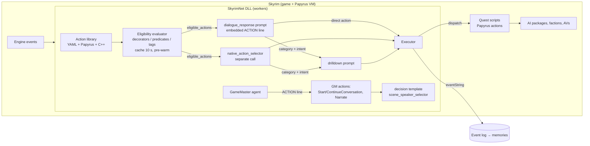
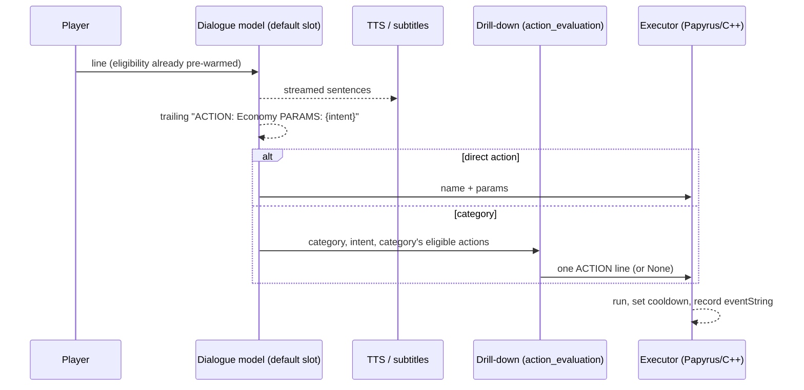
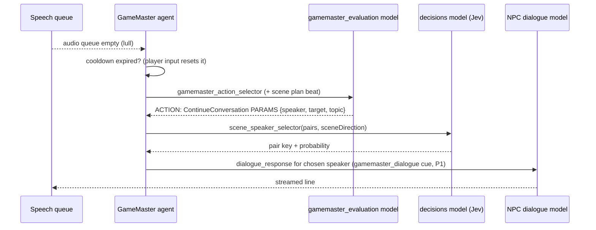

# SkyrimNet's decision and action layer: actions, eligibility, selection, GameMaster, thoughts and agents, and the extension seam EldenNet v1 should leave

Research note 07 for the EldenNet project, an LLM-driven NPC framework for Elden Ring.
Subject: SkyrimNet beta30-rc2 (Fateless.Ai / MinLL), content library `skyrimnet.base` 0.25.3.

> **Method and license note.** All of this comes from SkyrimNet's documentation, human-readable shipped content
> (prompt templates, YAML, Papyrus `.psc` sources, the MIT-licensed C++ API header, the Spriggit ESP tree, model
> presets, license notices) and public GitHub pages (release notes, issues, PRs). No compiled file was inspected.
> **INFERENCE** marks my reading of that evidence, not a fact about the closed-source DLL. SkyrimNet's prompts
> may not be reused. Here they are paraphrased, with only short fragments quoted to explain a design. Every
> template, schema and interface in §11 is original EldenNet design.

**Path prefixes** (the same as notes 01–06)

| Prefix | Location |
|---|---|
| `DATA/` | `skyrimnet-beta30-rc2/SKSE/Plugins/SkyrimNet/` |
| `LIB/` | `DATA/library/skyrimnet.base/` |
| `SRC/` | `skyrimnet-beta30-rc2/Source/Scripts/` |
| `DEV/` | `skyrimnet-devkit-beta30-rc2/` |
| `GH/` | public repo clone `MinLL/SkyrimNet-GamePlugin` |
| `ER-0n` | EldenNet's Elden Ring research notes, `docs/research/eldenring/0n-*.md` |

"Beta NN" means the release notes at https://github.com/MinLL/SkyrimNet-GamePlugin/releases (pages 1–2, fetched 2026-11-06).

---

## TL;DR

- **An action is a named, described, parameterised callback that the LLM may pick, but only from the list of actions that already passed eligibility for this NPC.** Actions come from three sources: YAML files that bind directly to a function on any Papyrus quest script, Papyrus `RegisterAction`, and native C++ `PublicRegisterCPPAction`. All three feed one action library with categories, tags, priorities, cooldowns and an enable flag (`DEV/docs/modding/WORKFLOW_ACTIONS.md`; `SRC/SkyrimNetApi.psc`; `DEV/CppAPI/PublicAPI.h`). The shipped content itself is minimal: no YAML actions, and three Papyrus follow/wait actions. Large action libraries come from third parties.
- **Eligibility is computed in code before the prompt is written.** YAML rules call the same decorator functions that prompt templates use. Papyrus and C++ use predicate callbacks. Tags are reusable predicates. The results are cached (10 s TTL, Beta23) and pre-warmed while the player is still speaking (`DEV/docs/FEATURES.md`). The model never sees an action it cannot take.
- **Two selection modes.** In the default *embedded* mode (since Beta19), the dialogue prompt lists eligible actions and the NPC may end its spoken reply with one `ACTION: Name PARAMS: {json}` line. In the older *separate-call* mode, a second prompt (`native_action_selector`) reads the finished exchange and picks one action or `None`. Embedded mode is more accurate and saves a call, but SkyrimNet admits it can bias what NPCs say (Beta19). A runtime master switch disables both (`SkyrimNetApi.psc: TriggerToggleActions`).
- **Categories make it a two-step choice.** The first step names a category with only `{"intent": "..."}`. A cheaper drill-down prompt (`native_action_selector_drilldown`, model slot `action_evaluation`) then picks the concrete action inside it. "When the NPC doesn't want to act, no second LLM call happens at all" (Beta19).
- **A lot of the engineering is in the wording and placement of the prompt, not in code.** Rules include: one ACTION line, after the speech, so audio can start first. "Narrating it does not make it happen." The action names are repeated at the uncached tail of the prompt, because otherwise models stopped emitting the line (`LIB/prompts/dialogue_response.prompt`, PRs #797/#822).
- **Executed actions feed back as events.** An `eventString` template with `isShortLived` writes what happened into the event log, so it enters memories (`WORKFLOW_ACTIONS.md`). Cooldowns are per action name (`SetActionCooldown`). `ExecuteAction` lets scripts force an action and bypass both cooldown and eligibility.
- **Decisions run on two machines.** Actions and the GameMaster use *chat selector prompts* that must answer with exactly one parsable line. Speaker, target, mood and memory gating use *typed decision templates* (`[ state ]` / `[ question id choice|score|noul ]` / `[ criteria ]`). A classifier model ("Jev", slot `decisions`) answers these with option keys and probabilities, and the chat prompts act as fallback (`DEV/docs/modding/WORKFLOW_PROMPTS.md`; Beta26).
- **The GameMaster is a director agent built on the same action format.** It runs on a conversation lull (empty audio queue) once its cooldown has expired. Each tick it picks `StartConversation`, `ContinueConversation`, narration or `None`, optionally following a 4–6-beat JSON scene plan. Since Beta26, a decision template has the final say on which speaker and target to use (`LIB/prompts/gamemaster_*.prompt`, `LIB/prompts/decisions/scene_speaker_selector.prompt`, GH #691).
- **NPC thoughts and "Agents" sit next to this layer.** Thoughts are private 1–2-sentence events that colour later dialogue and action prompts (`npc_thoughts.prompt`, `GenerateNPCThought`). Agents are dashboard assistants that call tools on the built-in MCP server (cpp-mcp). They are authoring tools, not NPC brains (`agent_*.prompt`, `components/agent_tools_base.prompt`).
- **For EldenNet v1 (dialogue only)**, build no actions, but freeze four seams now: (1) a reserved reply channel that the streaming parser already strips and logs, (2) one decision abstraction, already used in v1 for speaker and bark gating, (3) a data-driven action registry with zero entries and a native executor table, and (4) an eligibility snapshot evaluated off-thread. §11 gives the precise contracts.

---

## 1. Where the action layer sits



INFERENCE: the diagram is assembled from the prompts' input variables (`eligible_actions`, `category_name`, `category_intent`, `dialogue_response`, `scene_plan`, `sceneDirection`) and the API docs. The DLL's internal module boundaries are not public.

---

## 2. Action definitions: three registration paths, one model

### 2.1 YAML actions (`actions/*.yaml` content root)

YAML actions are content files, one action per file, and the filename must equal `name` (`DEV/docs/modding/CONTENT_ROOTS.md`). Before Beta25 they lived in `config/actions/` (`MIGRATING_TO_BETA25.md`). FACT: the shipped base library (`LIB/`, and `GH/plugins/skyrimnet/base`) has **no `actions/` folder at all**, so every YAML action a player has comes from a third-party plugin or their own edits. The documented skeleton (abridged excerpt from the devkit doc, `WORKFLOW_ACTIONS.md` §4.3):

```yaml
name: "ActionName"
description: "Description for LLM decision-making"
questEditorId: "QuestEditorID"
scriptName: "ScriptName"
executionFunctionName: "FunctionName"
parameterMapping:
  - type: "speaker"
  - type: "dynamic"
    name: "param_name"
    description: "Description for LLM"
eligibilityRules: [ ... ]
eventString: "{{ actor.name }} performed the action for {{ player.name }}"
isShortLived: false   # plus: tags, enabled, defaultPriority
```

| Field | Meaning (FACT unless marked) |
|---|---|
| `name` | The identifier the LLM sees and writes back. Per-action `enabled`/`cooldown` user settings are **keyed by this name**, so renaming an action resets them (`MIGRATING_TO_BETA25.md`). |
| `description` | An Inja template that tells the model *when* to choose the action, written from a roleplay perspective. The doc says not to restate eligibility ("they're already checked!"). Its good example begins "Use ONLY if {{ player.name }} asks to trade and you agree." |
| `questEditorId` / `scriptName` / `executionFunctionName` | A binding to a function on a script attached to a quest. **The YAML can call an existing mod's function without any glue script.** The doc's discovery phase uses MCP tools (`get_quest_scripts`, `get_quest_script_functions`) to find signatures. |
| `parameterMapping` | Positional arguments for that function. `speaker` (the acting NPC), `dynamic` (filled by the LLM, with its own description) or `static` (a fixed value, e.g. a form-ID hex string). Papyrus `Actor` targets are `dynamic`. |
| `eligibilityRules` | See §3. |
| `eventString` / `isShortLived` | A template for the event recorded after execution. It can use `{{ actor.name }}`, `{{ player.name }}`, `{{ action_name }}` and dynamic params by name. `isShortLived` makes it a short-lived scene event instead of a persistent one. |
| `tags`, `enabled`, `defaultPriority` | Tag-based eligibility (§3.2), the user toggle, and ordering (INFERENCE: ordering within the eligible list). |
| `availableForVirtualNpc` | An opt-in flag that lets bodiless "virtual NPCs" use the action (Beta19.1/Beta20). |

Categories as YAML files are implied but not documented. The migration doc's renaming example turns `cat_economy.yaml` with `name: Economy` into `economy.yaml`, and Beta20 says "Plugin-defined action categories now work correctly". INFERENCE: category records can be YAML, but their schema is not in the devkit.

### 2.2 Papyrus registration (`SRC/SkyrimNetApi.psc`, MIT)

`RegisterAction(actionName, description, eligibilityScriptName, eligibilityFunctionName, executionScriptName, executionFunctionName, triggeringEventTypesCsv, categoryStr, defaultPriority, parameterSchemaJson, customCategory="", tags="")`. Its companions are `RegisterSubCategory(...)` (a category that has its own eligibility function and an optional custom parent), `RegisterTag(tagName, script, fn)`, `IsActionRegistered`, `UnregisterAction`, `ExecuteAction[ByUUID](name, actor, argsJson)`, `SetActionCooldown(name, seconds)` and `GetRemainingCooldown(name)`.

- `categoryStr` is `PAPYRUS` for a top-level action, or `PAPYRUS_CUSTOM` plus `customCategory` for one placed inside a sub-category.
- `parameterSchemaJson` is a flat name→type map, e.g. `{"target": "string", "duration": "number"}`.
- The callbacks are **global** functions. In SkyrimNet's own scripts both have the shape `(Actor akActor, string contextJson, string paramsJson)`: `bool` for eligibility, no return value for execution (`SRC/SkyrimNetInternal.psc: StartFollow_IsEligible / StartFollow_Execute`). What `contextJson` contains is undocumented.
- The JSON helpers `GetJsonString/Int/Bool/Float/Actor` read the parameters (top-level keys only, per the `GetVirtualNPCList` note in the same file). `GetJsonActor` and `FindActorByName` (nearby, within 4000 units) suggest that actor parameters travel as **display names** and are resolved on the Papyrus side. INFERENCE, consistent with the selector prompt's rule to "use the actor's display name exactly as shown in Nearby Actors". Beta20 also mentions "dynamic UUID parameter mapping" for virtual-NPC actions, so at least some actor parameters can be mapped to entity UUIDs (mechanism undocumented).

SkyrimNet's own Papyrus actions are small. `AccompanyTarget`, `StopAccompanying` and `WaitHere` (`SRC/skynet_Library.psc: RegisterBasicActions`) are registered on every game load in `Maintenance()`, all with priority `1`, no triggering events and an empty parameter schema. Their eligibility functions read engine state (membership in a vanilla follower faction, `Skyrim.esm` 0x084D1B; whether SkyrimNet's `FollowPlayer` package is registered, the `WaitingForPlayer` actor value). `AccompanyTarget` and `StopAccompanying` register or unregister the `FollowPlayer` package through SkyrimNet's package manager; `WaitHere` only sets `WaitingForPlayer` to 1 (the package's own conditions do the rest, INFERENCE). All three then call `EvaluatePackage()` and show a `Debug.Notification`. One tag, `follower`, is registered with its own predicate (`RegisterTags`). Beta25 removed the built-in trade, rent-room and follower-command actions in favour of vanilla dialogue (`GH/changelog/beta25/cut-shipped-actions.md`). The shipped core action set is now deliberately small, and the large libraries come from third parties: SeverActions describes 70+ actions in installer-selected categories (https://github.com/Severause/SeverActions).

### 2.3 Native C++ registration (`DEV/CppAPI/PublicAPI.h`, MIT)

`PublicRegisterCPPAction(name, description, eligibleCallback(Actor*)→bool, executeCallback(Actor*, json_params)→bool, triggeringEventTypesCSV, categoryStr "CPP"|"CPP_NESTED_ACTION", priority, parameterSchemaJSON, customCategory, customParentCategory, tagsCSV)` and `PublicRegisterCPPSubCategory(...)`. Facts worth noting:

- The **eligibility callback "Must be thread-safe"**. It runs off the game thread.
- `parameterSchemaJSON` is described as a *JSON Schema* that "the LLM uses … to generate params".
- `priority`: "higher = checked first", with 50 as a reasonable default.
- `triggeringEventTypesCSV`: "event types that trigger eligibility checks (e.g., "combat_hit,dialogue")". INFERENCE: these invalidate or refresh the eligibility cache for that action when such an event happens.
- Actions can be registered at `kDataLoaded`, before any save is loaded. API version 2 introduced action registration and v6 the busy state (§5.5).

### 2.4 The unified model (INFERENCE)

Taken together, every action or category is a record of the form {name, description template, category path, priority, tags, parameter schema, eligibility predicate (decorator rules | Papyrus fn | C++ fn), executor (Papyrus quest-script method | global Papyrus fn | C++ callback), cooldown, enabled, vNPC flag, event template}. The dashboard's merged "Actions" page lists them with per-actor eligibility, a toggle and a cooldown (Beta21; FEATURES "Web dashboard"). The MCP server exposes "check which actions any actor can take" and `validate_custom_action` (FEATURES; `WORKFLOW_ACTIONS.md` §5).

---

## 3. Eligibility

### 3.1 YAML rule semantics (FACT, `WORKFLOW_ACTIONS.md` §4.4–4.5)

- An action is eligible if **all required rules** pass: `Rule1 AND Rule2 AND …`.
- Each rule combines its `conditions` with one `logicalOperator` (AND or OR). To express "A AND (B OR C)", write two rules.
- A condition is `{decoratorName, arguments, comparisonOperator, expectedValue}`. The operators are `== != > < >= <= contains not_contains is_null is_not_null is_empty is_not_empty`.
- `arguments` take the tokens `currentActor` (the NPC being evaluated) and `player`, plus literal editor IDs.
- **"`required: false` rules are IGNORED entirely."** This is a trap in the schema: an optional rule is not a soft preference.
- `decoratorName` is looked up in **the same decorator registry the prompt templates use**. So mods that register decorators (`RegisterDecorator`, `PublicRegisterDecorator`) extend both prompts and action eligibility in one step, and the C++ header shows a decorator used in an eligibility rule. Typical decorators: `is_in_faction`, `get_faction_rank`, `get_actor_value`, `is_follower`, `is_in_combat`, `is_hostile_to_actor`, `distance_between`, `actor_has_keyword`, `has_magic_effect`, `get_relationship_rank`, `get_global_value`.

### 3.2 Predicates, tags and busy state

Papyrus and C++ actions use code predicates. A **tag** is a named predicate (`RegisterTag`) that any action can require. `AlwaysEligible` exists "for actions that only need tag-based eligibility checks" (`SRC/SkyrimNetInternal.psc`). The C++ busy state (`PublicSetActorBusy(formId, reason)`, v6) makes `is_busy()` / `busy_reason()` available to eligibility rules. A multi-step action can therefore mark its NPC busy and stop other actions from interfering until it clears the flag.

### 3.3 Caching, pre-warming and filtering

- "Action eligibility is cached and pre-warmed while you speak, so by the time your sentence is transcribed, the model already knows which actions each nearby NPC can take" (FEATURES "NPC actions"; the "Speed" bullet repeats it: "pre-warmed while your voice is being transcribed"). The Papyrus docs for the input hotkeys (`TriggerRecordSpeechPressed`, `TriggerTextInput`, `TriggerTextThought`) only say they "prepare search query cache for player input". INFERENCE: the eligibility pre-warm hangs off the same input-start hook, but the API docs do not say so.
- Priority scales differ by path: YAML examples use `defaultPriority: 5`, the core Papyrus actions use `1`, and the C++ header suggests `50` ("higher = checked first"). INFERENCE: one shared integer ordering, with no documented normalisation.
- The cache has a **10-second expiration**. A Beta23 bug had cache hits renewing the timer, which kept stale results alive.
- Actions on cooldown or unavailable to virtual NPCs are filtered out. A category whose children are all filtered is hidden from the prompt (Beta19.1).
- INFERENCE: two-level filtering is what keeps the prompts short. Only names and descriptions of eligible actions are rendered, and the per-category lists appear only in the drill-down.

---

## 4. Selection: embedded, separate call, drill-down

### 4.1 Embedded actions (default since Beta19, `embedActionsInDialogue: true`)

The dialogue reply prompt (`LIB/prompts/dialogue_response.prompt`) renders `submodules/user_final_instructions/0750_embedded_actions` inside the **cached system message**, in its own cache breakpoint because "they change more often than the rest (about one turn in six)". The block lists each eligible action with its parameter schema and description. It also explains the format (three-line fragment):

```
- `ACTION: ActionName` — action with no parameters
- `ACTION: ActionName PARAMS: {"param": "value"}` — action with parameters
- `ACTION: CategoryName PARAMS: {"intent": "what you intend to do"}` — REQUIRED for categories
```

Its rules, paraphrased: at most one ACTION line per reply, and only the first is executed. Write the speech first so that TTS can start while the action is parsed. Act only on what you said, agreed to or are doing, though implicit agreement counts. The NPC may also act unprompted if that fits its character.

**The known trade-off.** Beta19, which made this mode the default ("considerably improves action execution accuracy over the old one"), also names its cost: users "may be concerned with this overly biasing LLM behavior based on the actions that are present". Listing actions in the dialogue prompt can steer *what the NPC says* toward what it can do. The separate-call mode stays available (`embedActionsInDialogue: false`) for players who prefer unbiased dialogue at the price of a second call per reply (Beta19 release notes).

Three details came from production failures:

1. **Tail reminder.** With the action list cached far up the prompt, "models stopped writing the ACTION line". The prompt now ends with "Actions you can take now: …", naming each action, and the instruction that narrating an act does not perform it, only the ACTION line does. The usual closing line "Respond in character now." is omitted when actions are offered, because a closing line about speech alone made models drop the action (template comment; PR #822; issues #820/#821 "Embedded actions not firing effectively in 29.1"). The comment draws the analogy itself: tool-calling harnesses repeat a cached tool list near the end in the same way.
2. **One deal, one action.** A reply carrying both an `Economy` action and the vanilla rent-room line would charge the player twice. Only the first line ran, so the wrong one sometimes won. Now one line per reply is the rule, and a vanilla exchange "settles its own gold" (PR #797; Beta29).
3. **Narration vs. action.** When actions are offered, the response-format module tells the NPC that actions are how it physically interacts with the world and that narration is flavour only (`0500_response_format.prompt`). Beta29.2's fix: an NPC who agrees to something "is more likely to act upon it instead of only describing it" (`GH/changelog.d/embedded-actions-reminder.md`).

Robustness fixes listed in the release notes: an ACTION line inside a Markdown code block now runs (Beta29.1, with structured outputs). Action JSON with a trailing comma is no longer lost, and an action followed by an inline thought keeps its target and arguments (Beta29). An ACTION line wrapped in asterisks is silently dropped (GH issue #706, cited in note 02). A `structured_json_actions` flag switches the selectors to `{"ACTION": …, "PARAMS": …}` JSON output (`native_action_selector.prompt`).

### 4.2 Separate-call selection (`LIB/prompts/native_action_selector.prompt`)

The older mode, still available but "no longer recommended" (Beta19). It is a short, dedicated prompt on the `action_evaluation` slot. The system part holds the NPC's full profile. The user part holds the location, a compact dialogue history, the "most recent exchange" (the player's last line plus the NPC's just-generated `dialogue_response`), nearby actors annotated with hostility, death, summoned or reanimated status and distance in metres, and the eligible actions plus `None`. The guidance is tilted toward acting. The model is told to focus on the player's *request*, not just the NPC's words: a purely verbal "Sure, I'll wait here" still means the wait action. When unsure between an action and None, it should prefer the action, while avoiding dramatic or aggressive actions unless the situation clearly signals them. The output is a single line with no reasoning.

### 4.3 Two-step category → specific action

The separate-call prompt tells the model that entries without a `PARAMS` schema are categories and entries with one are direct actions. Selecting a category requires `PARAMS: {"intent": "…"}` with `intent` as the *only* key (the prompt explains that extra keys make the action fail). **Caveat (INFERENCE):** the templates print `PARAMS:` only when `length(action.parameterSchema) > 0`, and the core Papyrus actions register with an empty schema (`""`), so a parameterless direct action such as `WaitHere` may render exactly like a category. Whether the DLL serialises it as `{}` (non-empty string) is not visible. The embedded block avoids the ambiguity by documenting a bare `ACTION: ActionName` for parameterless actions and naming categories in prose. Categories are marked by *absence* of data, a fragile signal. The drill-down prompt (`native_action_selector_drilldown.prompt`) receives `category_name`, `category_description`, `category_intent` and the eligible actions *of that category*. It uses a lighter `render_character_profile("action", …)` (Beta20 added "a lightweight NPC profile for action-relevant details"). It runs on `action_evaluation`, whose Balanced preset is Gemma-4-31B / DeepSeek-v3.2 with `max_tokens: 500` (`GH/model-presets/presets/openrouter-default.yaml`). That is the same model rotation as the Balanced `default` (dialogue) slot, with a lower output cap. So in this preset "cheaper" means a shorter prompt and output, not a smaller model; FEATURES says "a cheaper prompt for the second step", and its model overview calls the action/speaker models "fast and cheap" in general. Beta19 describes the effect: the dialogue model chooses a category and intent, and the evaluator drills down, so the expensive dialogue prompt carries only top-level entries. The drill-down's nearby-actor list is simpler than the separate selector's (hostility only, no dead/summoned/virtual filtering; `native_action_selector_drilldown.prompt`).



### 4.4 Dialogue actions: firing the game's own lines (`TriggerDialogueLine`)

Since Beta25 a special action lets the LLM fire a vanilla dialogue line (topic info and its script fragment), "the action that enables the LLM to move quests forward". It runs only "when the game itself would allow the player to do so" (Beta25). The body of the action description is a template (`LIB/prompts/components/dialogue_action.prompt`). It lists the quest beats and services the NPC can fire *right now*, each with a bracketed 8-hex code passed as `form_id`. It tells the model to fire only once the outcome is settled ("Until that yes, keep talking"), to follow the path the player picks when a branch splits, and to fire at most one code per turn. Under the cache layout the quest beats are repeated at the end of the prompt as well (`at_end`). Quest topics also appear as "Quests You Could Raise" (`0740_quest_dialogue.prompt`). Gating, FACT from the templates: both blocks render only when `feature_enabled("quest_actions")` and `is_action_enabled("TriggerDialogueLine")` hold *and* the NPC is answering the player (`responseTarget` is the player). The line lists come from one decorator, `available_dialogue(npc.UUID, mode)`, with modes such as `"fires"`, `"quest"` and `"quest ids"`. It returns `text`/`services` plus `hasQuest`/`hasServices`/`hasContent` flags, so the game, not the template, decides which vanilla lines are currently legal. The template has a non-embedded branch too, but Beta25 says "Embedded Actions is recommended for this feature". Beta25.1 added a toggle that disables the whole dialogue-action system. The embedded block adds a pairing rule: `TriggerDialogueLine` "runs a complete exchange on its own, gold and all", so it must never be combined with an `Economy` action for the same deal (`0750_embedded_actions.prompt`). Safety comes from data: `dialogue_actions/*.yaml` `kind: lists` files blacklist lines, e.g. one "whose script sets a quest stage", and a follower-framework controller (`LIB/dialogue_actions/*.yaml`). Users can toggle categories (`quest`, `follower`, `merchant`, `trainer`, `carriage`, `innkeeper`, …) and attach per-line instructions (`CONTENT_ROOTS.md`).

**This is the most transferable action idea for Elden Ring** (§11.4-H). Choosing among the game's *own* talk options inherits the game's conditions and side effects, so the LLM never writes quest state directly.

---

## 5. Execution, feedback, cooldowns and control

### 5.1 Dispatch and threads

FACT: eligibility evaluation runs on workers ("Must be thread-safe"). FEATURES says the game thread never waits on network, DB or TTS work. YAML actions call a method on a quest script and Papyrus actions call global functions, so execution is a Papyrus VM call. The SkyrimNet execute functions then do engine work: `RegisterPackage`, `SetAV`, `EvaluatePackage`, `Debug.Notification`.

INFERENCE: the DLL queues a VM dispatch from a worker and the call runs on the Papyrus VM's own schedule. The thread on which the C++ `executeCallback` runs is **not documented**. Nothing in the header says it is safe to call `RE::` there. Event callbacks, by contrast, are explicitly "on ThreadPool — do NOT call RE:: functions directly".

### 5.2 Feedback into the event log

The YAML `eventString` (with pronoun helpers via `decnpc(actor.UUID)`) becomes an event, short-lived or persistent according to `isShortLived` (`WORKFLOW_ACTIONS.md` "Event String Templates"). Persistent events reach history and therefore memory generation. This closes the loop: the NPC later remembers that it began following the player, and so do bystanders, according to audience rules (note 05).

### 5.3 Cooldowns and overrides

- `SetActionCooldown(actionName, seconds)` and `GetRemainingCooldown(actionName)` take **only the action name**. INFERENCE: the cooldown is global per action, not per actor, at least through this API. The dashboard also exposes a per-action cooldown setting, keyed by name.
- An action that is cooling down disappears from the eligible list (Beta19.1).
- `ExecuteAction[ByUUID](name, actor, argsJson)` "runs the action irrespective of cooldowns or eligibility". It is a scripting entry point, so quest mods can drive the same behaviours deterministically.
- The GameMaster keeps a separate **action cooldown** that every player input resets (`TriggerTextInput`, `TriggerRecordSpeechPressed`, … in `SkyrimNetApi.psc`). A trace shows it expiring after 139.6 s (GH #691).

### 5.4 Master switches and review

`TriggerToggleActions()` "disables BOTH embedded-in-dialogue actions and the separate-call action evaluation flow". Beta20 notes it is process-lifetime only and resets on restart. A global AI master switch also stops the GameMaster (`TriggerToggleGlobalAI`). On the content hub, "Plugins that contain actions are reviewed by a person, because actions call script functions in other mods", and publishing one asks "which mod each action calls into and for an in-game test attestation" (`MIGRATING_TO_BETA25.md`). The project treats actions as the **riskiest content class**.

The authoring guidance says the same thing. `WORKFLOW_ACTIONS.md` §2.3 lists which functions make good actions: clear action-oriented names, `Actor` parameters, visible game effects, simple parameter lists. It tells authors to **avoid** internal state functions, **quest stage modifications (`SetStage`, `CompleteObjective`)**, parameters that cannot be constructed, and functions with no gameplay effect. Its MCP test step, `execute_quest_function`, is flagged "modifies game state!". The quest-stage rule matches the shipped `dialogue_actions` blacklist entry for a line "whose script sets a quest stage" (§4.4). Across all three, SkyrimNet lets the LLM *trigger* game-owned logic, and it does not let the LLM *write* quest progress directly.

### 5.5 Arbitration: busy state and package ownership

Multi-step behaviours need exclusive control of an actor. SkyrimNet provides the busy flag (§3.2) and an owned AI-package registry: `RegisterPackageEx(... owner ...)`, `HoldPackages(actor, owner)` / `ReleaseHeldPackages`, `ListPackage(... removable ...)`, and ModEvents `SkyrimNet_OnPackageAdded/Removed/Held/Released` (`SkyrimNetApi.psc`, Package Management). Holds are reference-counted per owner, so "two mods holding the same actor never end each other's". INFERENCE: this exists because LLM-chosen actions and quest scripts compete for the same NPC, and last-writer-wins breaks quests.

---

## 6. The shared decision machinery

SkyrimNet makes many small "pick one of N" decisions. It has two ways of asking them.

**(a) Chat selector prompts.** These are ordinary chat completions whose output contract is a single parsable line. Action selection (`ACTION: X PARAMS: {...}`), GameMaster selection (the same format, `gamemaster_evaluation` slot, `max_tokens: 256`) and the fallback speaker selector (`Name>target` or `0` for silence, `LIB/prompts/target_selectors/dialogue_speaker_selector.prompt`) all work this way. These prompts spend many lines on format policing: exact names, no asterisks, no commentary, never an empty target. That is a symptom of free-text parsing.

**(b) Typed decision templates** (`LIB/prompts/decisions/*.prompt`). These are not chat at all. The template declares named state blocks and typed questions. Short excerpt of the documented format (`WORKFLOW_PROMPTS.md` §4.4):

```
[ state <field> ]
Named text the model judges ...
[ end state ]
[ question <id> choice ]
What to decide, in plain language. Name the state fields in backticks.
[ criteria ]
key: description of this option (one option per line ...)
[ end criteria ]
[ end question ]
```

The question types are `choice`, `score` (2–10 ordered levels) and `noul` (yes/no). The game builds the option keys and passes them in, for example `decision_pairs` with keys like `s2_tplayer`: "Keys are short and numbered per request". It gets back an option key, a confidence and the probabilities of the top options. The model behind them is a dedicated classifier (`decisions` slot: `typesafe/jev-1.13`, 10 s timeout, `max_retries: 0`). Mods can ask their own questions with `SendCustomDecisionToLLM` / `PublicSendCustomDecisionToLLM` (API v12). There is "no chat fallback" for mods (error `no_decisions_route`), while the built-in decisions fall back to the chat selectors (Beta26).

| Decision | Template | Options | Fallback |
|---|---|---|---|
| Next speaker after a line | `decisions/dialogue_speaker_selector` | (speaker, target) pairs + `none` | `target_selectors/dialogue_speaker_selector` (chat) |
| Who the player addressed | `decisions/player_dialogue_target_selector` | nearby targets | chat target selector |
| Continue-narration speaker | `decisions/continue_narration_selector` | pairs, no `none` | crosshair, then last target, … |
| Continuous-mode speaker | `decisions/scene_speaker_selector` | pairs, GameMaster hint | the GameMaster's own pick |
| Mood | `decisions/evaluate_mood` | mood list | `helpers/evaluate_mood` (chat) |
| Memory recall gate | `decisions/memory_recall_gate` | `m1..mn` + `none`, plus per-memory `noul` support questions | plain similarity search |
| NPC action / category / drill-down | chat only (`native_action_selector*`, embedded) | eligible actions + `None` | – |
| GameMaster action | chat only (`gamemaster_action_selector`) | GM actions (+ `None` outside continuous mode) | – |

**Code pre-filters the options here too (FACT, template header comments).** The game enumerates only *legal* (speaker, target) pairs. In `decisions/dialogue_speaker_selector` the last speaker, self-targets and virtual-NPC violations are "already applied to the pairs", and silence (`none`) is always offered. In `decisions/scene_speaker_selector` there is no `none`. Each typed decision is behind a config switch: `dialogue.decisions.useForSpeakerSelection` for the speaker selectors and `memory_retrieval.decision_gate.enabled` for the memory gate. A tunable `dialogue.speakerSelector.strictness` (`chatty` / `balanced` / `strict`) changes how readily bystanders interject. This is the same "filter first, then ask" principle as action eligibility (§3), applied to speaker choice.

**Observations (INFERENCE).** The typed path is safer because the game owns the option set and the model only returns a key. It also gives a probability, which callers use as a threshold: the memory gate accepts a memory only when 1−p(none) clears a cut-off. Actions have stayed on the chat path, likely because they need free-form parameters (`intent`, amounts, names) and because the embedded mode piggybacks on the dialogue generation, which costs no extra call. The eval tooling labels both kinds uniformly as "choices" (§9.2).

---

## 7. The GameMaster director loop

**What starts it** (FACT unless marked):

1. The **GameMaster agent must be enabled**: a hotkey, the MCM, `TriggerToggleGameMaster()` or the config path `gamemaster.agentEnabled` (note 01).
2. **A lull.** `GameMaster::ShouldTriggerGameMasterAction` logs "Conversation lull detected (audio queue empty), considering intervention" (GH #691 log).
3. **The cooldown has expired** ("Action cooldown expired after 139.6s, allowing new request", same trace). Player input resets the cooldown ("Action cooldown reset due to player input"), but **an action already in flight is not cancelled**. The issue measured collisions when push-to-talk came 0.35–3.6 s after the lull. The selector LLM call started about 250 ms after the lull, and execution followed about 800 ms after it.
4. **Continuous mode** (`TriggerToggleContinuousMode`, requires the GameMaster) changes the contract. `None` is no longer offered and the selector "must select an action". NPCs "keep talking autonomously after player interaction ends" (`IsContinuousModeEnabled` doc).

**What it decides.** `gamemaster_action_selector.prompt` gives the director a role: observe like a storyteller, prefer NPC→NPC, dialogue over narration, "one compelling interaction beats three forced ones". It provides the compact recent events, each nearby NPC's short bio plus an *Interjects when* summary, and the eligible GM actions, gated by `is_action_enabled("StartConversation")`, `("ContinueConversation")`, and (per the test decorators) `Narrate`. `ContinueConversation` takes a 2–6-word *topic* that is explicitly "NOT dialogue". The director writes stage directions; the characters write the lines. Its cues are stored as `gamemaster_dialogue` events, travel at scheduler priority P1 and never expire (note 02). The GM's action list is rendered from the same `eligible_actions` variable and line format as the NPC selectors. INFERENCE: GM actions are entries in the same action library, filtered by the same eligibility and enable machinery. The prompt also hard-codes virtual-NPC hearing rules: regular NPCs cannot hear virtual NPCs, so a virtual NPC may be a speaker but a target only for another virtual NPC.

**Which model.** The presets give the GM its own slot, `gamemaster_evaluation` (Balanced: Llama-3.3-70B, temperature 0.8, `max_tokens: 256`, 30 s timeout). `DEV/docs/Agents.md`, however, lists "Game Master" under its *Default Model* heading. INFERENCE: that doc predates the split, or the planner and selector use different slots. Which slot the scene planner uses is not documented.

**Scene plans.** `gamemaster_scene_planner.prompt` asks for a JSON plan: `scene_summary`, `tone`, `central_tension`, 4–6 `beats` {order, type dialogue|narration|action|environmental, description, primary_characters, purpose}, `potential_escalations` and `natural_endings`. Its central constraint is that the player is "UNCONTROLLABLE". Scenes must work entirely among NPCs, and each beat should survive interruption ("work even if only 2-3 beats execute"). The pacing is explicit: each beat should take "roughly 15-30 seconds of real time", dialogue beats should dominate, and narration gets "0-1 beats max". A full plan therefore covers about 1–3 minutes of ambient scene. In continuous mode the selector receives `scene_plan.current_beat` and the upcoming beats, with the user turn "Execute current beat: …". INFERENCE: when a plan is created and how beats advance (one per GM tick, or when the selector judges a beat done) is not visible in content.

**Final say on speakers.** Since Beta26 the GameMaster "decides that someone should speak and suggests a speaker". `decisions/scene_speaker_selector` then picks the pair, treats the suggestion as "a hint, not a rule", and lets outsiders join only when named, addressed, directly involved or matched by their interjection guidance.



The **IntelEngine** mod advertises its own "AI Dungeon Master that creates quests, ambushes and faction wars" on top of SkyrimNet (`GH/README.md`). The core GameMaster is conversational only. World-changing direction is left to mods.

---

## 8. NPC thoughts

- **Generation.** `npc_thoughts.prompt` uses the NPC identity, the thoughts render mode of the shared submodules, and the NPC's event history. It asks for 1–2 sentences of silent thought in the character's own register, with an optional required topic (`promptForThoughts`) and an optional `triggeringEvent` for a "gut reaction". In combat the thought should be "raw and urgent". Possessed or linked identities get a correction at the tail.
- **Sources.** Triggers with `response.type: npc_thought` (`WORKFLOW_TRIGGERS.md`), Papyrus `GenerateNPCThought(actor, hint)`, the `/npcthink` chat command, and optional inline `<internal_thought>` tags after the spoken line. The inline tags have been off by default since Beta20.2 ("to reduce strain on non-flagship models") and are controlled by the config key `allowInlineInDialogue`. In templates the flag shows up as `allow_inline_internal_thoughts` (`0500_response_format.prompt`, which also requires the tag *after* the dialogue, never before or mid-line).
- **Inline thoughts are an existing non-speech channel.** Beta20: "Inline internal thoughts are stripped from TTS and saved as separate thought events", and they are parsed "instead of delaying speech". This is the same stream-splitting that the `ACTION:` trailer needs: one reply carries speech for TTS plus tagged side-channel content that is routed elsewhere. It is direct precedent for the reserved channel in §11.4-A. The response format also bans `<thinking>` scratchpad tags because any that survive "get spoken aloud by TTS".
- **Semantics.** The result is stored as an `npc_thoughts` event whose audience is only the thinker. It is never voiced, but it "will surface in that NPC's prompts (dialogue, actions, etc.)" and colour their behaviour (`GenerateNPCThought` doc). Per-NPC and global cooldowns come from `NpcThoughts.yaml` (`perNPCCooldownSeconds: 60`, Beta20). Dead, unconscious and sleeping NPCs are skipped.
- **Telepathy** is a perception layer on top. Perks decide whether the *player* sees thoughts, and whether the player character is added to the thought's audience in-fiction (`SkyrimNetApi.psc` Telepathy; `skynet_McmScript.psc` info texts).

INFERENCE: thoughts are a cheap way to give the action layer a "reason" channel. A trigger can plant a motive ("you saw the player steal"), and the next dialogue or action prompt sees it, without the motive being spoken.

---

## 9. "Agents" (MCP-backed) and the evaluation loop

### 9.1 Dashboard agents

`DEV/docs/Agents.md` uses "agents" loosely for model *roles*: text generation, Game Master, memory, profile generation, Action_Evaluation, mood, speaking turn and memory search. The **Agents feature** proper is a dashboard chat with AI assistants that "can query game state through the built-in MCP server" (FEATURES). The MCP server runs on port 8889 and is built with `cpp-mcp` (`DATA/THIRD_PARTY_NOTICES.txt`). It offers game-data queries, memory and world-knowledge CRUD, action eligibility checks, template rendering, console commands, YAML validation and live reloads.

- `components/agent_tools_base.prompt` defines a home-grown tool protocol. JSON objects one per line inside `<function_calls>` tags, then **stop**. Results come back next turn and are **ephemeral**: they are removed after the reply, so the assistant must copy what it needs into its answer.
- `agent_chat` is a general game-data Q&A agent. `agent_knowledge_builder` drafts world-knowledge entries with condition expressions and submits them through a `propose_knowledge_entries` tool (create/update/remove) into a review panel. `agent_prompt_helper` edits templates through `propose_prompt_edit`, shown as a diff.
- The model slot is `AgentDefault` (Claude Haiku 4.5, 120 s timeout, 32 000 max tokens, Balanced preset).
- `WORKFLOW_ACTIONS.md` and `WORKFLOW_MOD_INTEGRATION.md` are written *for* AI assistants driving that MCP server. They cover discovering quests and script functions, checking decorators, writing YAML, `validate_custom_action`, and testing with `execute_quest_function`, with the note that "MCP tools are the source of truth" over source code.

Agents never act as NPCs. They are **authoring and debugging tools with a human approving every write**.

**The integration model behind it (`WORKFLOW_MOD_INTEGRATION.md`).** The doc splits any mod's surface into three content types and gives a decision matrix. **Triggers** detect what happens: ModEvents, spell and effect application, global thresholds. **Prompts** make NPCs aware of state: effects, factions, globals, via `character_bio` submodules in numbered ranges (0300–0499 for mod integrations). **Actions** give agency, but only where the mod "has callable functions". Factions and globals feed both eligibility and prompts. Each type has its own MCP validator (`validate_custom_trigger`, `validate_custom_action`, `validate_prompt`), and the worked example (a follower mod) produces 3 triggers, 4 actions and 1 prompt submodule. INFERENCE for EldenNet: v1 already has two of the three content types (perception/events and prompt awareness). Actions are a third, separately validated content type that can be added later without touching the other two.

### 9.2 Eval and labeling (`LIB/prompts/eval/*`)

Players can rate outputs, including **choices**: who speaks next, an action, a mood, a dialogue option. `label_assist.prompt` pre-labels an output: a 1–5 rating, tags, a `better` option key and a confidence. It rates a choice "on the choice alone" and notes that naming the right action with the wrong details is a distinct failure. The tag list includes `wrong_tool` and `wrong_arguments`. `bench_*_judge` prompts compare a new reply against flagged ones or against each other. `judge_preferences` distils a player's ratings into at most 8 rules. GH #777 asks for a better "choose the action that should have been taken" picker, sorted by "JEV score". INFERENCE: logged decisions together with their *candidate sets* are the dataset for regression-testing prompts and models.

---

## 10. How it maps onto Skyrim engine features

| SkyrimNet concept | Skyrim / SKSE mechanism it rests on | Evidence |
|---|---|---|
| YAML action → function | Papyrus VM: methods on scripts attached to **Quest** forms, found by editor ID (INFERENCE: this is one reason the README requires po3 Tweaks' "Load EditorIDs") | `WORKFLOW_ACTIONS.md`; `GH/README.md` |
| Papyrus actions, tags | **Global** Papyrus functions as callbacks | `SkyrimNetInternal.psc` |
| Follow / wait | **AI packages** (`SkyrimNet_FollowPlayerPackage` with conditions on `SkyrimNet_FollowingPlayerFaction`), `EvaluatePackage()`, the `WaitingForPlayer` **actor value**, **factions** as state flags | `GH/spriggit/SkyrimNet/Packages`, `/Factions`; `skynet_Library.psc` |
| Eligibility decorators | Engine queries: faction rank, AVs, keywords, magic effects, relationship rank, **globals**, hostility, combat state | `WORKFLOW_ACTIONS.md` §3.2 |
| `TriggerDialogueLine` | **Topic infos** and their **TIF script fragments**, gated by the game's own **dialogue conditions** | Beta25; `dialogue_actions/*.yaml` (`TIF__000C3698`) |
| Package arbitration | Package **priority** stacks, PapyrusUtil **ActorUtil** overrides (mirrored by SkyrimNet) | `SkyrimNetApi.psc` Package Management |
| Feedback / ModEvents | SKSE **ModEvents** (`SkyrimNet_OnPackage*`, lifecycle events) | `SkyrimNetApi.psc` Events |
| GameMaster scenes | No engine Scene forms. Directed dialogue lines plus the speech queue | prompts; GH #691 |
| Cast-spell helper | `Spell.Cast` with a form resolved from a hex string (`GetForm`/`GetFormEx`) | `skynet_Library.psc: CastSpell_Execute` |

Skyrim gives SkyrimNet a **general-purpose script VM with stable, editor-ID-addressable entry points into every mod**. That is why "any Papyrus quest-script function can be an action" works, and why it needs human review. Elden Ring has nothing equivalent. EMEVD and ESD are compiled per map and per NPC. Mods mutate state only through specific engine paths: the ESD command vocabulary, event flags, SpEffects, EMEVD instructions such as `2004[02] Set Character Team Type` (`ER-01` §6, §9–10). A future EldenNet action layer must therefore bind to a **closed set of native executors**, not to arbitrary functions.

---

## 11. Transferable patterns for an Elden Ring framework

### 11.1 Copy as an idea

1. **Filter first, then ask.** Compute eligibility in code and show the model only possible options. *Why:* prompts stay short, the model cannot pick impossible acts, and the same predicates serve the UI and debugging.
2. **Descriptions say *when*, from the character's point of view; conditions live in data.** Never restate eligibility in prose.
3. **One action per reply, after the speech, with the speech streamed first.** *Why:* latency, and one deal maps to one effect (the double-charge bug).
4. **The game's own options as actions** (`TriggerDialogueLine`). The model selects a vanilla branch, and the game's conditions and scripts do the work. In Elden Ring that is choosing a talk-menu entry the NPC's ESD already offers (§11.4-H).
5. **Feedback as events.** Every executed or failed action becomes an event with an audience, so memory stays consistent with what really happened.
6. **Short, per-request option keys for decisions** (`s2_tplayer`, `m3`) instead of matching display names. Elden Ring has many duplicate names ("Godrick Soldier", "Wandering Noble"), so names alone are ambiguous.
7. **Master switches, per-action enable and cooldown, a forced-execute API, and an exclusive actor lock (busy/hold)**, all designed in before any action ships.
8. **Log every decision with its candidates** (task, options, chosen key, confidence, backend, latency, prompt hash). Labeling and regression benches need this data, and it costs nothing to collect.
9. **The LLM triggers game-owned logic; it never writes progress state.** SkyrimNet's authoring guide bans quest-stage setters as actions, and its dialogue-action blacklist blocks a stage-setting line (§5.4, §4.4). EldenNet should have the same rule for event flags.
10. **One stream, several channels.** Speech goes to TTS, and tagged side content (inline thoughts, the `ACTION:` trailer) is stripped and routed as events (§8). EldenNet's v1 parser should be built for this from day one.

### 11.1b Copy with care: known costs

- **Embedded actions bias dialogue.** SkyrimNet's own Beta19 notes warn that listing actions in the dialogue prompt can steer what NPCs say. When EldenNet adds actions, it should measure this (same scenes with and without `actions_block`) before making embedded mode the default.
- **The two selector styles lean opposite ways.** The separate-call selector is told "when in doubt … ALWAYS prefer the action"; the embedded block says to act only on what the NPC said or agreed to. A v2 design should choose one policy on purpose, and lean toward restraint for anything above the `cosmetic` safety class.
- **Mark kinds explicitly.** SkyrimNet tells categories from actions by whether a `PARAMS` schema is present (§4.3). EldenNet records should carry an explicit `kind: action | category` and render it.

### 11.2 Simplify

- **One selection mode.** Use embedded selection for important NPCs. Add a separate-call selector only for paths without a dialogue generation (director ticks). Generic enemies get **no LLM actions ever**: their bodies belong to the game's battle AI, and barks only talk.
- **A flat action list until there are about 15 actions.** Categories and drill-down add a second call and a second failure mode (`intent`-only parameters).
- **A small predicate DSL over a snapshot** instead of Inja decorator calls into live game memory.
- **Cooldowns per (action, actor) plus an optional global one**, keyed by a stable `id`, not by the LLM-visible name. SkyrimNet keys settings by name, so renaming an action resets user settings.
- **Typed parameters** (enum, int range, actor handle, string with max length), validated before execution. Actor parameters are per-request handles (`a1`, `a2`), never free names.

### 11.3 Drop for v1, and why

- **All executed actions.** Elden Ring has no safe script VM, the ESD/EMEVD/flag paths can corrupt quest lines and saves, and ER-01's v1 rule is "never call ESD commands that mutate state … except dialogue presentation".
- **GameMaster and continuous mode.** Named Elden Ring NPCs rarely share a space. Roundtable Hold is the main exception, so NPC↔NPC scenes have little to work with. The lull race in GH #691 also shows how easily a director talks over the player.
- **Scene planner, NPC thoughts, telepathy.** These multiply LLM calls for little visible gain in a sparse world. Thoughts are the cheapest to add later, since they are only a private event type.
- **Runtime agents and MCP.** An authoring MCP can come later as a developer tool (validating persona files, querying params and FMGs). Note that me3 forbids LLM use in its project spaces (`ER-01` Risks), so keep this tooling in EldenNet's own repo.

### 11.4 The extension seam: what v1 must freeze so actions can be added without a redesign

The four seams from the task, made concrete, plus the supporting reservations.

#### A. Reserved output channel (reply envelope and stream parser)

The v1 reply contract already defines a **non-speech trailer**. The streaming parser routes sentences to subtitles and TTS as they arrive. A line that begins with `ACT:` (or the legacy `ACTION:`), tolerant of surrounding `*`, backticks or a code fence, is **never** sent to TTS or subtitles. It is captured instead.

```text
NpcReply {
  speech:   [Sentence]          // streamed as produced
  gesture:  Option<String>      // *...* text; display-only or dropped in v1
  intent:   Option<RawIntent>   // trailer line; v1: logged, never executed
  meta:     { model, latency_ms, truncated, parse_warnings[] }
}
RawIntent { name: String, params_json: String, raw_line: String }
```

- In v1 the prompt advertises no actions, and the *honesty rule* is part of v1 guidelines. EldenNet's own wording should say, in effect, "you can only speak; do not claim to hand over, move, fight or open anything". This is the inverse of SkyrimNet's Beta29.2 problem: an NPC promising an act that never happens breaks immersion and poisons memory.
- The same parser should handle any other tagged side channel EldenNet adds later (e.g. an inline private-thought tag, as SkyrimNet strips `<internal_thought>` from TTS, §8), so "speech vs. side channel" is a single mechanism.
- If the model emits a trailer anyway, the line is dropped. A counter `unexpected_intent` is incremented and an `npc_intent` event (audience = the speaker only) records it as *unexecuted*. In v2 the same parser hands `RawIntent` to the executor pipeline (E). No change to streaming or TTS is needed.
- The prompt template reserves **two empty partials**: `actions_block` inside the cached system section and `actions_tail` at the very end. Adding actions later then fills these slots without reordering the prompt and breaking prompt-cache layout (SkyrimNet's lesson in `dialogue_response.prompt`).

#### B. One decision abstraction (used in v1, extended in v2)

```text
DecisionRequest {
  task:        "speaker" | "bark_gate" | "addressee" | "action" | "director" | <mod id>
  subject:     ActorKey?                 // whose decision
  state:       [(name, text)]            // named blocks, like SkyrimNet's [ state ]
  question:    text
  options:     [{ key: "o1", label, description, payload_ref }]   // built by code
  allow_none:  bool
  params:      Option<ParamSchema>       // only for task=action/director
  slot:        model slot name; timeout_ms; min_confidence
  fallback:    Rule (deterministic function of the snapshot)
}
DecisionResult { key, params?, confidence?, probs?, backend: Rules|Chat|Classifier,
                 latency_ms, raw, fell_back: bool }
```

- **Backends.** `Rules` is the v1 default for generic-NPC barks and the fallback for everything. `Chat` uses a one-line constrained output (`PICK o3` or a JSON-schema / GBNF grammar where the provider supports it). `Classifier` uses logprobs when available. The design must **not** depend on a proprietary classifier like Jev; a probability is optional, so callers threshold only when one exists.
- **In v1** it is used for speaker selection among co-present important NPCs, for the addressee when the player speaks without lock-on, and optionally for bark gating. The abstraction is therefore tested and logged from day one.
- **In v2** action selection is just `task: "action"` with `options` = the eligible actions. Embedded selection reuses the same option keys inside `actions_block`.

#### C. Action registry (ships empty in v1)

Data-driven definitions bind only to **native executors registered in code**. Example of an original EldenNet schema (illustrative, not shipped in v1):

```yaml
id: er.talk.open_wares            # stable key for settings, cooldowns, logs
kind: action                      # action | category, explicit (never inferred from params)
llm_name: ShowWares               # what the model sees; renaming keeps settings
description: "Offer {{player}} a look at your goods, once they ask to trade and you are willing."
tiers: [important]                # generic NPCs are never offered actions
params: []                        # typed: enum | int{min,max} | actor_handle | text{max}
eligibility:
  all:
    - npc.talk_menu_has: shop
    - not: npc.hostile_to_player
    - not: player.in_combat
cooldown: { per_actor_s: 20 }
executor: { kind: talk_menu_entry, entry: shop }   # must exist in the native table
safety: menu                      # cosmetic | menu | world_state | save_state
event: { text: "{{npc}} showed {{player}} their wares.", persist: true }
```

- The loader, validator (unknown executor kinds or facts are rejected), hot reload and `list_eligible(actor)` all run in v1 against an empty registry, plus one dev-only `Noop` action used in tests.
- **Safety classes** gate executors globally. In v2, `cosmetic` (face the player, gesture SpEffect) and `menu` (open an existing shop or talk branch) can be enabled. `world_state` (team type, item lots) and `save_state` (event flags) stay hard-disabled until there is a save-integrity story. Offline-only and multiplayer-off checks (`ER-01` v1 item 1) apply to every class.

#### D. Eligibility snapshot

- The 4 Hz perception task (`ER-01` "Game-thread discipline") already copies a POD snapshot. It must **also** carry the fields future predicates need, so actions never require a new game read path: per actor `key`, `tier`, `team_type`, `chr_type`, hp%, dead, in-combat / `last_hit_by`, distance and bearing to the player, lock-on, `talk_id` (has an ESD), currently-talking, `busy_owner` (reserved, always none in v1); player state (in combat, menu open, riding Torrent, HP%); curated event flags; place and BlockId; time of day.
- Predicates are **pure functions over an immutable `Arc<Snapshot>`** with a generation number, evaluated on workers (SkyrimNet's "thread-safe eligibility", without touching live memory). Results are cached per (actor, generation) with a short TTL, about 2–10 s (SkyrimNet uses 10 s). The cache is invalidated on event types (combat start or end, death, flag change, talk open) and pre-warmed when the player opens the chat box or locks on.
- The same fact names (`npc.hostile_to_player`, …) feed prompt rendering in v1, so there is one vocabulary, as with SkyrimNet's shared decorators.

#### E. Execution pipeline (v2) and its v1 stubs

`RawIntent` → match `llm_name` (case-insensitive, exact) → validate params against the schema and resolve actor handles → **re-check** eligibility, cooldown, master switch and safety class on the *newest* snapshot → enqueue a `GameCommand{executor, args, deadline, epoch}` on the **same main-thread apply queue** v1 uses for subtitles and talk → the executor runs inside a `CSTaskImp` task (`ER-01` §3.2) → `ExecResult` → event `npc_action` (ok) or `npc_action_failed` (reason, visible to the actor's next prompt) → cooldown update.

- Each command carries the **player-input epoch**. If the player has spoken or acted since the command was decided, director commands are dropped. This avoids SkyrimNet's #691 race by design.
- v1 ships the queue, the epoch counter and the event types; only the `Noop` executor exists.
- `force_execute(id, actor, params)` (the `ExecuteAction` analogue) is reserved for scripted and debug use and honours safety classes.

#### F. Other reservations

- **Event types:** `npc_intent`, `npc_action`, `npc_action_failed`, `director_cue`, `npc_thought` (schemas defined, unused in v1).
- **Scheduler classes:** `Directed` (P1) and `Autonomous` (P4) exist in the enum (note 02 §7).
- **Config:** `actions.enabled` (compile-time false in v1), `actions.<id>.{enabled,cooldown}`, `director.enabled=false`; model slots `action_eval`, `director` and `decisions` fall back to `default`.
- **Telemetry:** a `decisions` table (id, task, subject, options_json, chosen, confidence, backend, latency, prompt_hash, created_at, label) and an `actions` table (intent, resolved id, result, reason).
- **Actor lock:** `acquire(actor, owner, reason)` / `release` with owner counting (the HoldPackages idea), used in v1 only to mark "in conversation".

#### G. Conformance tests v1 should already pass

- A reply containing a trailer line never produces audio or subtitle text for that line (fuzz with `*ACTION:*`, fenced and JSON variants).
- With `actions.enabled=false`, no `GameCommand` other than presentation commands is ever enqueued.
- `list_eligible` over recorded snapshots is deterministic and never touches game memory (a test harness without the game).
- Every decision call writes exactly one `decisions` row.

#### H. Candidate Elden Ring executors for v2 (to verify in game)

| Executor kind | Mechanism (from ER notes) | Safety class | SkyrimNet analogue |
|---|---|---|---|
| `talk_menu_entry` | Run an entry the NPC's ESD already lists (`AddTalkListData` branches) through a synthetic `TalkScript` (fromsoftware-rs `invoke-esd`, `ER-01` §10, `ER-03` §2.5). It inherits the game's conditions. **Caveat:** `ER-01`'s verification log (#21) notes that the `invoke-esd` example binds the `TalkScript` to the *player's* handle and uses only menu/shop commands, so driving a live NPC's own talk list is unproven | menu | `TriggerDialogueLine` |
| `open_shop` | `OpenRegularShop` (ESD command) | menu | (cut) OpenTrade |
| `face_player` / `gesture` | `TurnCharacterToFaceEntity`, `RequestAnimation`, `spEffectId` (`ER-01` "Later", apply-speffect example) | cosmetic | narration-like acts |
| `set_flag` | `SetEventFlag` on a reserved, unused range | save_state | quest stage set (blacklisted by SkyrimNet) |
| `give_item` | `AwardItemLot` | save_state | GiveGold-type actions |
| `turn_hostile` | EMEVD `2004[02]` team type | world_state | attack/surrender actions |

---

## 12. Open questions / uncertainties

1. **Execution thread.** Does SkyrimNet run C++ `executeCallback` on the game thread or a worker? How does it dispatch Papyrus calls (queued VM dispatch is INFERENCE)? The header is silent on whether `RE::` calls are safe there.
2. **Cooldown scope.** `SetActionCooldown(name, s)` suggests a cooldown global per action. Whether the dashboard setting is per actor is undocumented.
3. **`contextJson`** passed to Papyrus eligibility and execute callbacks has no documented schema.
4. **Actor parameter resolution.** How are display names resolved when names repeat or the name is unknown? Only `FindActorByName` (nearest within 4000 units) is documented.
5. **`triggeringEventTypes`.** Do they only refresh the eligibility cache, or also restrict when an action is offered?
6. **Category records.** The schema of YAML category files (`cat_*.yaml`) and how YAML actions join a category are not in the devkit.
7. **GameMaster internals.** When is a scene plan created, how do beats advance, what are the `Narrate` action's parameters, and where are GM actions registered? None of these are visible in shipped content.
8. **Elden Ring side.** Can a synthetic `TalkScript` select an existing talk-menu entry of a live NPC without desynchronising that NPC's ESD state machine? `ER-03` leaves the related `TalkToPlayer` question open, and it decides whether executor H1 is feasible.
9. **Constrained decoding.** Which providers EldenNet will target (OpenRouter, local llama.cpp/LM Studio) support JSON-schema or grammar outputs well enough to make the `Chat` decision backend reliable without format-policing prose? This must be measured.
10. **Evidence limits.** GitHub issue and release pages were read through a summarising fetch, and Nexus and fan docs were unreachable from this session. Quotes from releases and issues are short and should be spot-checked before they are relied on.
11. **Parameterless actions vs categories.** If a direct action has an empty schema, does it render without `PARAMS:` and so look like a category to the separate-call selector (§4.3)? Or does the DLL always serialise a `{}`?
12. **Where the core action set lives.** The base library ships no YAML actions, and only three Papyrus actions are registered in `.psc` sources. Yet prompts and docs mention `Economy`/`Inventory` categories, and FEATURES mentions "give gold, attack, surrender, sing, craft". Which of these are native C++ registrations in the DLL, and which come from third-party plugins such as SeverActions? This is not documented.
13. **GameMaster model slot.** `Agents.md` puts the Game Master under the default model, but the presets define `gamemaster_evaluation`. Which slot does each GM prompt (selector, planner) use?

---

### Sources (web)

- Releases (Beta19–Beta29.2 notes): https://github.com/MinLL/SkyrimNet-GamePlugin/releases, https://github.com/MinLL/SkyrimNet-GamePlugin/releases?page=2
- Issues and PRs: #691 https://github.com/MinLL/SkyrimNet-GamePlugin/issues/691 · #777 https://github.com/MinLL/SkyrimNet-GamePlugin/issues/777 · #797 https://github.com/MinLL/SkyrimNet-GamePlugin/pull/797 · #820/#821/#822 and the issue list https://github.com/MinLL/SkyrimNet-GamePlugin/issues?q=action
- SeverActions (third-party action framework built on SkyrimNet): https://github.com/Severause/SeverActions
- Issue #706 (asterisk-wrapped ACTION line dropped): https://github.com/MinLL/SkyrimNet-GamePlugin/issues/706 · PR #822: https://github.com/MinLL/SkyrimNet-GamePlugin/pull/822

---

## Review notes

A completeness, accuracy and license-compliance review was done on 2026-11-06 against the local materials and public GitHub pages.

**Spot-checks that passed (claim confirmed in the cited source):**

1. YAML action schema, rule semantics (`AND` across rules, one `logicalOperator` per rule, "`required: false` rules are IGNORED"), the operator list, the `currentActor`/`player` tokens and the decorator table: `DEV/docs/modding/WORKFLOW_ACTIONS.md` §3.2, §4.3–4.5.
2. `RegisterAction` / `RegisterSubCategory` / `RegisterTag` / `ExecuteAction` ("irrespective of cooldowns or eligibility") / `SetActionCooldown` / `GetRemainingCooldown` signatures, and `TriggerToggleActions` ("BOTH" flows, runtime only): `SRC/SkyrimNetApi.psc`.
3. C++ `PublicRegisterCPPAction`: eligibility "Must be thread-safe", JSON Schema params, "higher = checked first. 50", `CPP` / `CPP_NESTED_ACTION`, version history (2 = actions, 6 = busy, 12 = decisions), the decorator-in-eligibility-rule example, and ThreadPool callbacks "do NOT call RE::": `DEV/CppAPI/PublicAPI.h`.
4. The cached action block, the tail "Actions you can take now", "Narrating it does not make it happen", and dropping "Respond in character now." when actions are offered: `LIB/prompts/dialogue_response.prompt`. PR #822 (merged; fixes #820/#821) confirmed via web.
5. The one-ACTION-line rule, the category `intent` rule and the `TriggerDialogueLine`-alone rule: `LIB/prompts/submodules/user_final_instructions/0750_embedded_actions.prompt`.
6. Model slots (`action_evaluation` Gemma-4-31B/DeepSeek-v3.2 with 500 max tokens; `gamemaster_evaluation` 256; `decisions` = `typesafe/jev-1.13`, 10 s, `max_retries: 0`; `AgentDefault` = Claude Haiku 4.5, 120 s, 32 000): `GH/model-presets/presets/openrouter-default.yaml` (named "Balanced" in `index.yaml`).
7. GH #691 log lines: lull at 19:41:42.458, LLM call at .710 (about 250 ms), `ContinueConversation` executed at 43.259 (about 800 ms), cooldown 139.6 s, player presses 0.35–3.6 s after the lull, and the in-flight action not being cancelled. Confirmed via web.
8. Release-note claims: Beta19 (embedded default, category plus intent, "no second LLM call", separate mode "no longer recommended"), Beta19.1 (vNPC opt-in, categories hidden), Beta20 (`availableForVirtualNpc`, lightweight drill-down profile, process-lifetime master switch, `perNPCCooldownSeconds: 60`, `allowInlineInDialogue`), Beta20.2 (inline thoughts off), Beta23 (10 s cache, timer bug), Beta25 (`TriggerDialogueLine`), Beta26 (Jev, the GameMaster suggests a speaker), Beta29 (one action, double charge, trailing comma), Beta29.1 (code block). Confirmed via web.
9. Core Papyrus actions, the follower tag and `AlwaysEligible`: `SRC/skynet_Library.psc`, `SRC/SkyrimNetInternal.psc`. The GameMaster and scene-planner contents: `LIB/prompts/gamemaster_*.prompt`. The `npc_thoughts.prompt` contents. The eval tags `wrong_tool` / `wrong_arguments` and "at most 8 rules": `LIB/prompts/eval/*`. The `<function_calls>` protocol with ephemeral results: `components/agent_tools_base.prompt`. cpp-mcp: `THIRD_PARTY_NOTICES.txt`. Issues #706 and #777 confirmed via web.

**Corrections made:**

- §3.3: the report had said the input hotkeys' prepare step is the eligibility pre-warm. The `.psc` docs only say they "prepare search query cache". The pre-warm is now attributed to FEATURES, and the link to the hotkeys is marked INFERENCE.
- §2.2: `WaitHere` does not register a package. It only sets `WaitingForPlayer` and re-evaluates. Added that the core actions use priority 1 and an empty schema.
- §4.3: "entries without PARAMS are categories" is now attributed to the prompt's instruction rather than stated as fact. Added the parameterless-action ambiguity (INFERENCE) and the note that the drill-down slot uses the same models as dialogue in the Balanced preset, so it is cheaper by prompt and output size, not by model.
- §2.1: the YAML skeleton excerpt was trimmed from 16 to 13 lines (license quote budget).

**Additions (with evidence):**

- The base library ships no YAML actions (`LIB/` and `GH/plugins/skyrimnet/base` have no `actions/` folder). Added to §2.1 and the TL;DR.
- The embedded-mode bias trade-off from Beta19 (§4.1, TL;DR, §11.1b).
- Dialogue-action gating: `feature_enabled("quest_actions")`, `is_action_enabled`, only when replying to the player, the `available_dialogue()` decorator and its modes, Beta25.1's disable toggle (§4.4).
- The authoring "avoid" list (quest-stage setters, internal state) and the `execute_quest_function` caution, from `WORKFLOW_ACTIONS.md` §2.3 and §5.2 (§5.4). New pattern 9.
- Decision-side pre-filtering of legal pairs and the config switches (`dialogue.decisions.useForSpeakerSelection`, `memory_retrieval.decision_gate.enabled`, `dialogue.speakerSelector.strictness`) from the template headers (§6).
- GameMaster: the action list comes from the same `eligible_actions` variable, the virtual-NPC hearing rules, the scene-plan pacing (15–30 s per beat, 0–1 narration beats), and the `Agents.md` versus preset model-slot discrepancy (§7).
- Thoughts: the template flag `allow_inline_internal_thoughts`, the rule that thoughts come after speech, and Beta20 "stripped from TTS". Linked to the reserved channel (§8, §11.4-A, new pattern 10).
- The `WORKFLOW_MOD_INTEGRATION.md` triggers/prompts/actions matrix (§9.1).
- An explicit `kind` field in the EldenNet schema (§11.4-C), and the caveat that `invoke-esd` binds to the player's handle, from ER-01's verification log #21 (§11.4-H).
- Open questions 11–13.

**License check:** no claim in this note comes from inspecting a compiled file. The report cites only docs, prompt and YAML text, `.psc` sources, the MIT header, Spriggit JSON, presets, license notices and public GitHub pages. Quoted SkyrimNet text is limited to short fragments: the two devkit-doc excerpts are 13 lines (YAML skeleton) and 10 lines (decision-template format), and quotes from shipped prompt templates are at most 3 lines. The EldenNet schemas in §11 are original.

**UNVERIFIED (kept, but could not be confirmed from the materials):**

- "A category whose children are all filtered is hidden from the prompt" (Beta19.1). The fetched notes confirm that categories "are now automatically hidden from the action selection prompt", but the condition was truncated in the fetch.
- That `triggeringEventTypes` refreshes the eligibility cache (already marked INFERENCE). Also unconfirmed: whether cooldowns are global per action rather than per actor.
- The thread on which C++ `executeCallback` runs, and how Papyrus dispatch is queued (open question 1).
- The `NpcThoughts.yaml` *global* cooldown value. The `.psc` mentions per-NPC and global cooldowns, but Beta20 lists only `perNPCCooldownSeconds: 60`.
- The exact title of #820 (the fetch gave "Embedded actions not firing effectively in 29.1 rc2").
